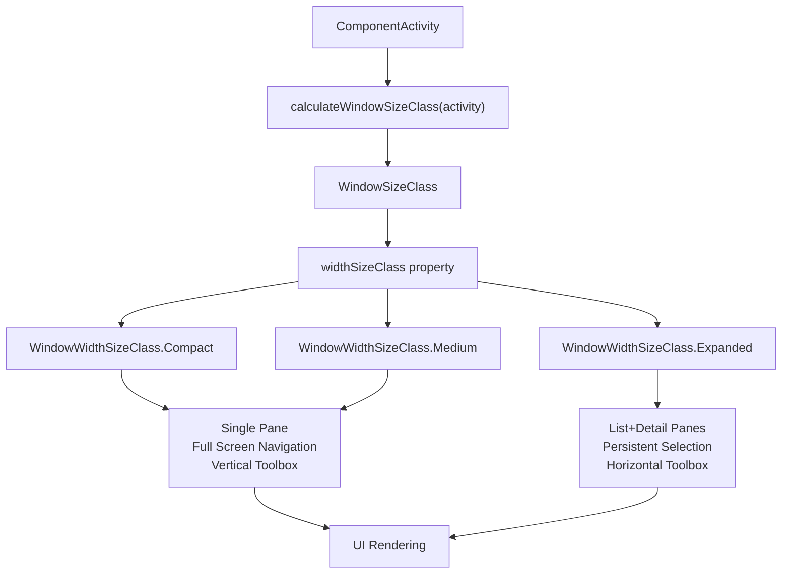
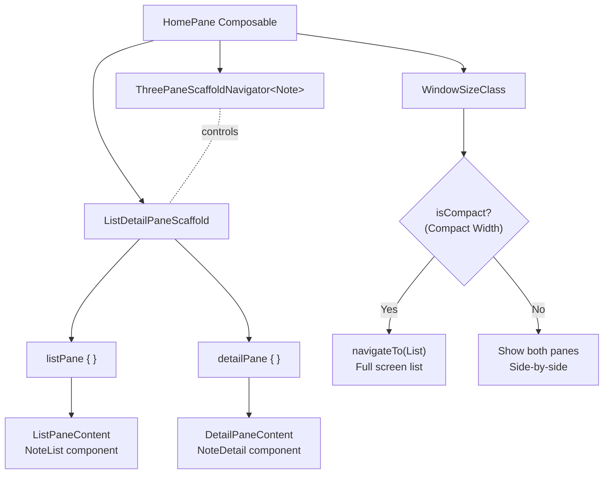
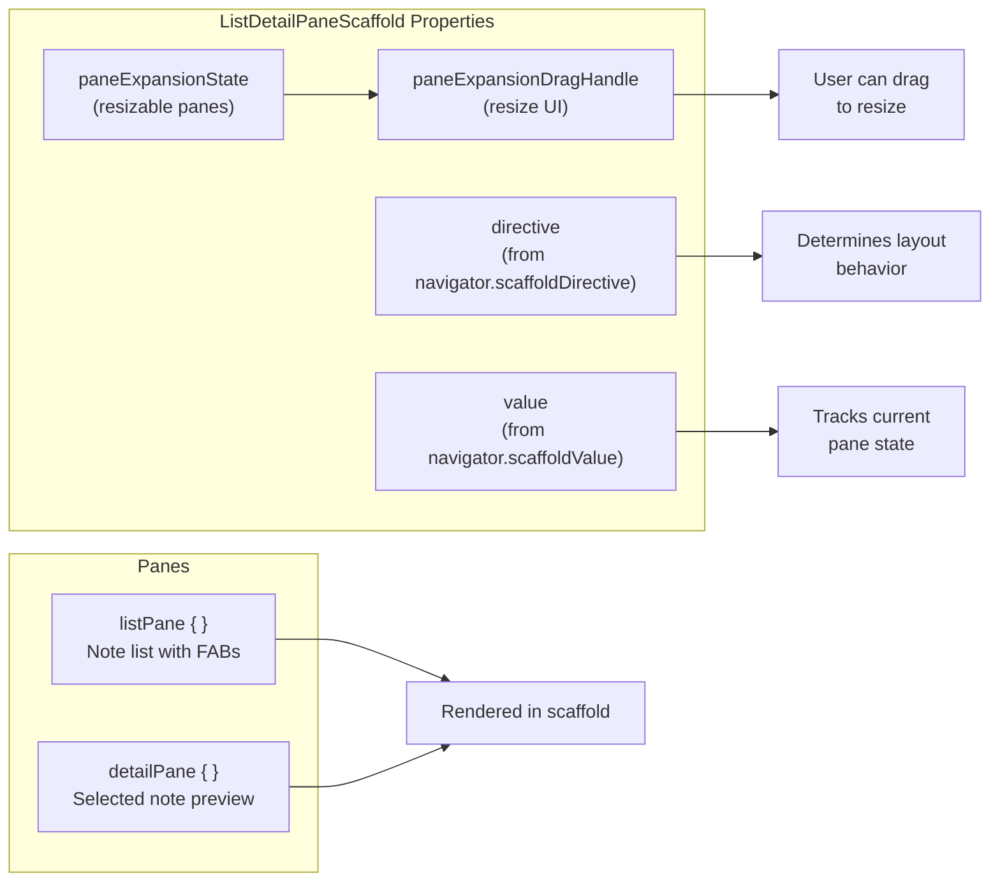
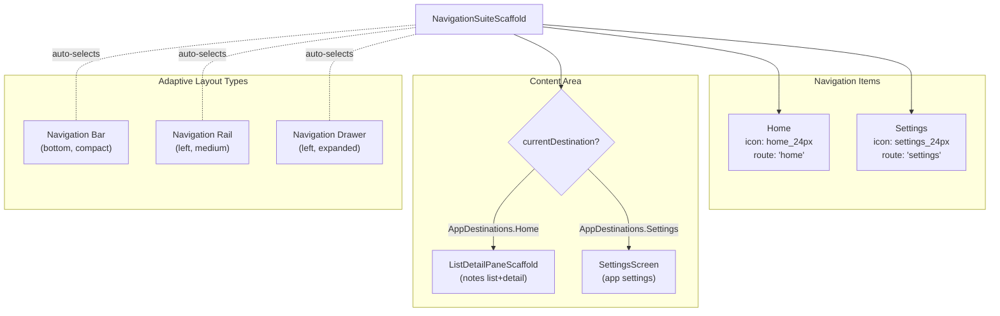
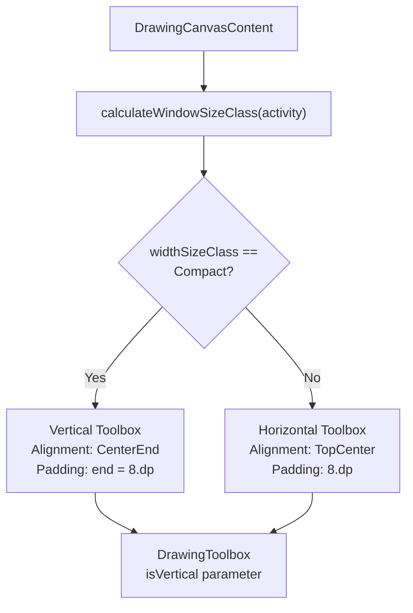
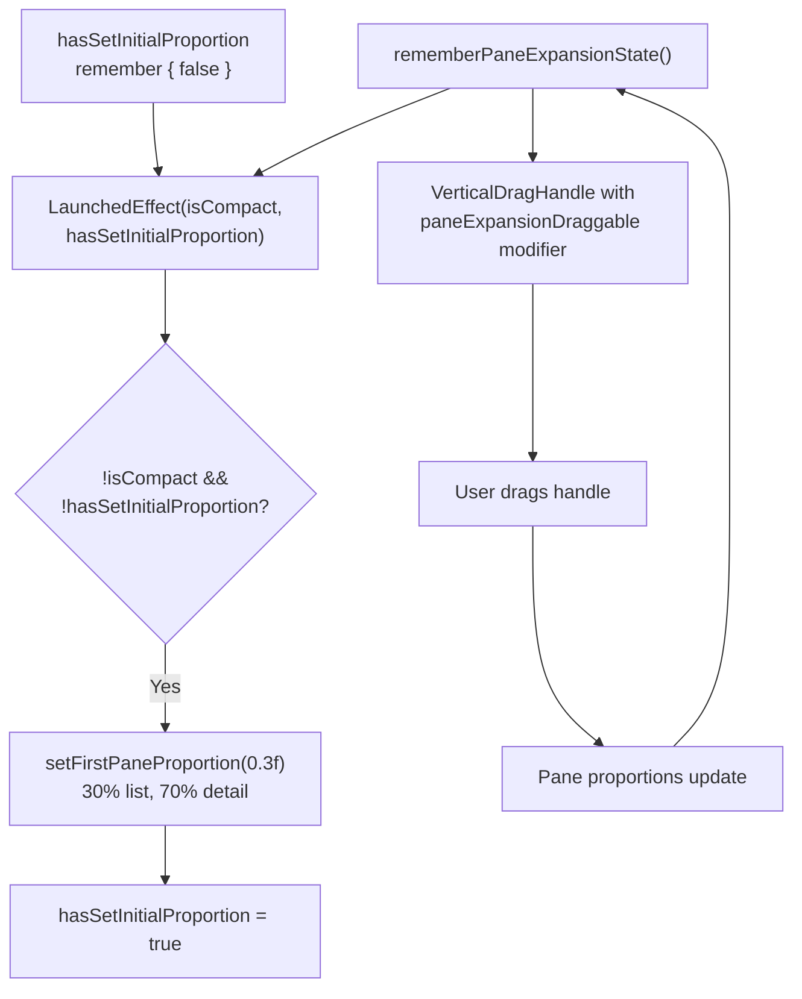
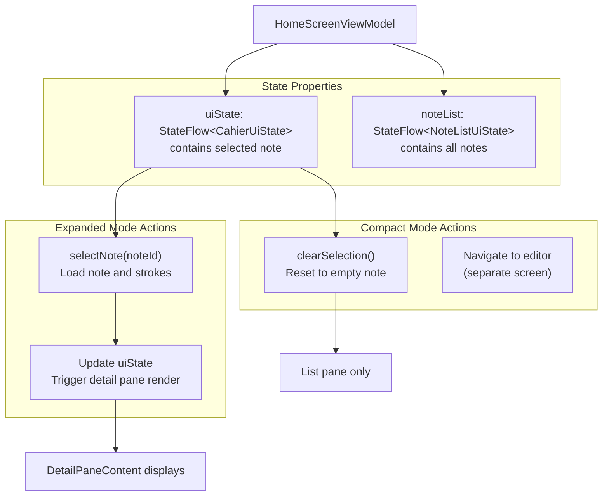
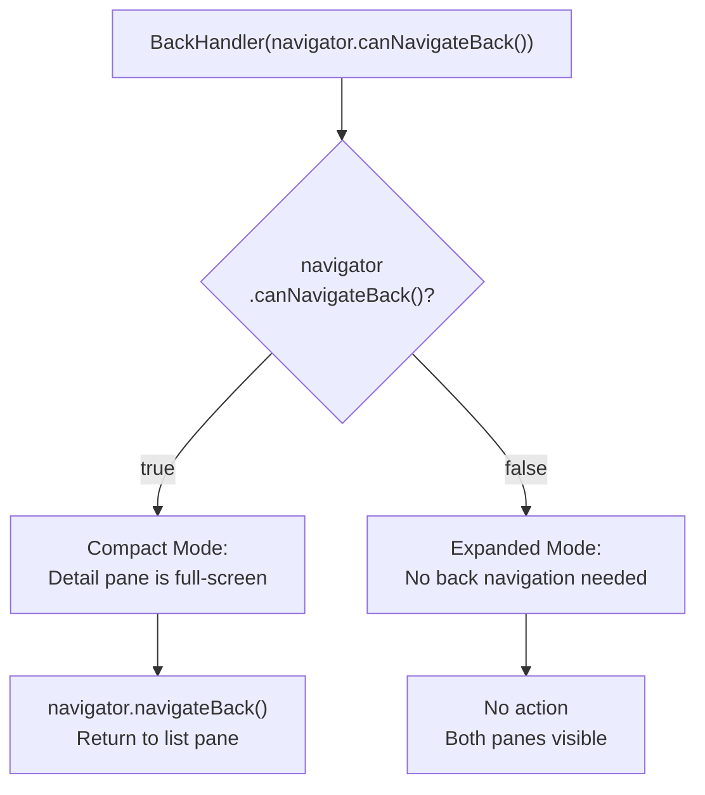
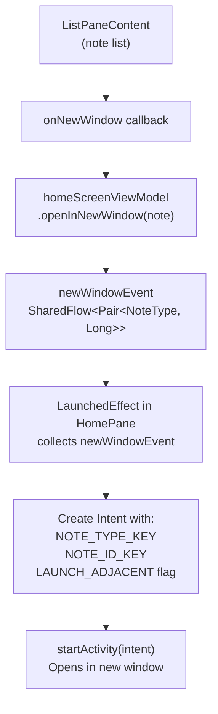

<!-- source: DeepWiki mcp.deepwiki.com · repo android/cahier · page 5.1 Adaptive Layouts · fetched 2026-10-23 -->

# Adaptive Layouts

<details>
<summary>Relevant source files</summary>

The following files were used as context for generating this wiki page:

- [app/build.gradle.kts](app/build.gradle.kts)
- [app/src/main/java/com/example/cahier/ui/CahierHomeScreen.kt](app/src/main/java/com/example/cahier/ui/CahierHomeScreen.kt)
- [app/src/main/java/com/example/cahier/ui/DrawingCanvas.kt](app/src/main/java/com/example/cahier/ui/DrawingCanvas.kt)
- [app/src/main/java/com/example/cahier/ui/utils/DragAndDropUtils.kt](app/src/main/java/com/example/cahier/ui/utils/DragAndDropUtils.kt)
- [gradle/libs.versions.toml](gradle/libs.versions.toml)

</details>


## Purpose and Scope

This document explains how the Cahier application adapts its user interface to different screen sizes and form factors, including phones (compact width), tablets (medium/expanded width), and foldable devices. The adaptive layout system ensures optimal user experience by presenting appropriate UI patterns for each device configuration, such as single-pane navigation on phones and dual-pane list-detail layouts on tablets.

For information about the overall navigation system and routing, see [Navigation System](#2.3). For UI component implementations, see [Shared UI Components](#5.3). For theme and styling, see [Theme System](#5.2).

---

## Window Size Classification

The application uses Material 3's `WindowSizeClass` to categorize screen sizes and determine appropriate layouts. The classification occurs at the composable level using the `calculateWindowSizeClass()` function.

### Size Class Detection

The window size class is calculated from the current activity and provides `widthSizeClass` values:

| Width Size Class | Typical Devices | Layout Strategy |
|------------------|-----------------|-----------------|
| `WindowWidthSizeClass.Compact` | Phones in portrait, small phones | Single-pane navigation, full-screen views |
| `WindowWidthSizeClass.Medium` | Phones in landscape, small tablets | Can use dual-pane or single-pane |
| `WindowWidthSizeClass.Expanded` | Tablets, foldables unfolded | Dual-pane list-detail, persistent navigation |

**Window Size Class Detection Flow**



Sources: [app/src/main/java/com/example/cahier/ui/CahierHomeScreen.kt:116-121](), [app/src/main/java/com/example/cahier/ui/DrawingCanvas.kt:197-199]()

---

## List-Detail Pane Scaffold

The home screen uses `ListDetailPaneScaffold` from Material 3 Adaptive to implement a responsive list-detail pattern that automatically adapts between compact and expanded layouts.

### ListDetailPaneScaffold Architecture



Sources: [app/src/main/java/com/example/cahier/ui/CahierHomeScreen.kt:111-149](), [app/src/main/java/com/example/cahier/ui/CahierHomeScreen.kt:231-304]()

### Scaffold Components

The `ListDetailPaneScaffold` in `HomePane()` contains three key elements:

1. **Navigator**: `rememberListDetailPaneScaffoldNavigator<Note>()` manages pane navigation state and transitions
2. **Pane Expansion State**: `rememberPaneExpansionState()` controls resizable pane proportions
3. **Drag Handle**: `VerticalDragHandle` allows users to resize panes on expanded layouts



Sources: [app/src/main/java/com/example/cahier/ui/CahierHomeScreen.kt:231-247]()

---

## Compact vs Expanded Behavior

The application implements different interaction patterns based on screen size:

### Behavior Comparison

| Feature | Compact Mode | Expanded Mode |
|---------|--------------|---------------|
| **Navigation** | Stack-based, full-screen transitions | List+detail side-by-side |
| **Note Selection** | Navigates to editor screen | Shows preview in detail pane, edit in place or new window |
| **Selection State** | No persistent selection | Maintains selected note |
| **Back Navigation** | Returns to list | Clears selection only |
| **Initial State** | Shows list only | Auto-selects first note |
| **Pane Proportions** | N/A | List at 30%, detail at 70% |

**Interaction Flow Differences**

```mermaid
graph TB
    subgraph "Compact Mode Flow"
        CList["List Screen<br/>(full screen)"]
        CClick["User taps note"]
        CNav["Navigate to editor<br/>(new screen)"]
        CBack["Back button"]
        CReturn["Returns to list"]
        
        CList --> CClick
        CClick --> CNav
        CNav --> CBack
        CBack --> CReturn
    end
    
    subgraph "Expanded Mode Flow"
        EList["List Pane<br/>(30% width)"]
        EDetail["Detail Pane<br/>(70% width)"]
        EClick["User taps note"]
        ESelect["Update selection<br/>Show preview"]
        EEdit["Click 'Edit'"]
        EEditor["Open editor"]
        
        EList --> EClick
        EClick --> ESelect
        ESelect --> EDetail
        EDetail --> EEdit
        EEdit --> EEditor
    end
```



Sources: [app/src/main/java/com/example/cahier/ui/CahierHomeScreen.kt:138-156](), [app/src/main/java/com/example/cahier/ui/CahierHomeScreen.kt:254-264]()

### Implementation Details

**Compact Mode Behavior** [app/src/main/java/com/example/cahier/ui/CahierHomeScreen.kt:138-143]():
- `LaunchedEffect(isCompact)` clears selection when entering compact mode
- Note clicks trigger immediate navigation: `navigateToCanvas(noteId)` or `navigateToDrawingCanvas(noteId)`
- Navigator forced to `ListDetailPaneScaffoldRole.List` pane

**Expanded Mode Behavior** [app/src/main/java/com/example/cahier/ui/CahierHomeScreen.kt:145-156]():
- Auto-selects first note if list is non-empty and no selection exists
- Note clicks update selection: `homeScreenViewModel.selectNote(it.id)`
- Pane expansion proportion set to 30%: `paneExpansionState.setFirstPaneProportion(0.3f)`
- Detail pane shows `NoteDetail` with preview and edit button

---

## Navigation Suite Scaffold

The application uses `NavigationSuiteScaffold` to provide adaptive navigation UI that automatically switches between navigation bar (phones), rail (medium tablets), and drawer (large tablets) based on window size.

### Navigation Suite Structure



Sources: [app/src/main/java/com/example/cahier/ui/CahierHomeScreen.kt:79-94](), [app/src/main/java/com/example/cahier/ui/CahierHomeScreen.kt:197-316]()

### NavigationSuiteScaffold Configuration

The scaffold is configured in `CahierNavigationSuite()` with:

1. **Navigation Items**: Defined using `AppDestinations` enum [app/src/main/java/com/example/cahier/ui/CahierHomeScreen.kt:79-94]()
2. **Selection State**: `currentDestination` tracks active destination
3. **Content Switching**: Content lambda switches based on `currentDestination`
4. **Automatic Adaptation**: Scaffold internally selects navigation type based on `WindowSizeClass`

**Navigation Item Definition**:
```
NavigationSuiteItem(
    icon = { Icon(...) },
    label = { Text(stringResource(destination.label)) },
    selected = isSelected,
    onClick = { onDestinationChanged(destination) }
)
```

Sources: [app/src/main/java/com/example/cahier/ui/CahierHomeScreen.kt:199-225]()

---

## Component-Specific Adaptations

Individual components within the application also adapt their layout based on screen size.

### Drawing Toolbox Adaptation

The `DrawingToolbox` component changes orientation and position based on window size:

**Toolbox Layout Adaptation**



Sources: [app/src/main/java/com/example/cahier/ui/DrawingCanvas.kt:197-222]()

**Implementation in DrawingCanvasContent** [app/src/main/java/com/example/cahier/ui/DrawingCanvas.kt:197-235]():

```
val windowSizeClass = calculateWindowSizeClass(activity)
val isCompact = windowSizeClass.widthSizeClass == WindowWidthSizeClass.Compact

val toolboxModifier = if (isCompact) {
    Modifier
        .align(Alignment.CenterEnd)
        .padding(end = 8.dp)
} else {
    Modifier
        .align(Alignment.TopCenter)
        .padding(8.dp)
}

DrawingToolbox(
    isVertical = isCompact,
    modifier = toolboxModifier,
    ...
)
```

**Compact (Phone)**: Toolbox displayed vertically on the right edge, allowing thumb access
**Expanded (Tablet)**: Toolbox displayed horizontally at the top, maximizing drawing surface

---

## Pane Expansion and Resizing

On expanded layouts, users can adjust the relative sizes of the list and detail panes using a drag handle.

### Pane Expansion State Management



Sources: [app/src/main/java/com/example/cahier/ui/CahierHomeScreen.kt:117-156](), [app/src/main/java/com/example/cahier/ui/CahierHomeScreen.kt:235-246]()

### Drag Handle Implementation

The drag handle is configured in the `ListDetailPaneScaffold` [app/src/main/java/com/example/cahier/ui/CahierHomeScreen.kt:235-246]():

```
paneExpansionDragHandle = { state ->
    val interactionSource = remember { MutableInteractionSource() }
    VerticalDragHandle(
        modifier = Modifier.paneExpansionDraggable(
            state,
            LocalMinimumInteractiveComponentSize.current,
            interactionSource,
            state.defaultDragHandleSemantics()
        ),
    )
}
```

The `paneExpansionDraggable` modifier enables the drag gesture and updates the `PaneExpansionState` in real-time.

---

## Selection State Management

The `HomeScreenViewModel` manages note selection differently based on layout mode:

### Selection State Flow



Sources: [app/src/main/java/com/example/cahier/ui/CahierHomeScreen.kt:112-113](), [app/src/main/java/com/example/cahier/ui/CahierHomeScreen.kt:138-149]()

**Key Selection Behaviors**:

1. **Compact Mode Entry** [app/src/main/java/com/example/cahier/ui/CahierHomeScreen.kt:138-143]():
   - Clears selection immediately
   - No detail pane visible
   
2. **Expanded Mode with Empty Selection** [app/src/main/java/com/example/cahier/ui/CahierHomeScreen.kt:145-149]():
   - Auto-selects first note if available
   - Ensures detail pane always shows content
   
3. **Note Click in Expanded** [app/src/main/java/com/example/cahier/ui/CahierHomeScreen.kt:262]():
   - Calls `homeScreenViewModel.selectNote(it.id)`
   - Updates `uiState` with new note and strokes
   - Detail pane re-renders with new selection

4. **Destination Change** [app/src/main/java/com/example/cahier/ui/CahierHomeScreen.kt:216-221]():
   - Clears selection when navigating to Settings from detail view
   - Prevents stale selection when returning to Home

---

## Back Navigation Handling

Back navigation behavior differs significantly between compact and expanded modes:

### Back Navigation Logic



Sources: [app/src/main/java/com/example/cahier/ui/CahierHomeScreen.kt:158-162]()

**Implementation** [app/src/main/java/com/example/cahier/ui/CahierHomeScreen.kt:158-162]():
```
BackHandler(navigator.canNavigateBack()) {
    coroutineScope.launch {
        navigator.navigateBack()
    }
}
```

- **Compact**: `canNavigateBack()` returns `true` when detail pane is showing; back button navigates to list
- **Expanded**: `canNavigateBack()` returns `false`; both panes always visible, no back navigation needed

---

## Dependencies

The adaptive layout system relies on several Material 3 Adaptive libraries:

### Required Dependencies

From [app/build.gradle.kts:82-84]():
```
// Adaptive layouts dependencies
implementation(libs.material3.adaptive.navigation.suite.android)
implementation(libs.androidx.adaptive.navigation.android)
```

From [gradle/libs.versions.toml:21-22, 29]():
```
adaptiveNavigationAndroid = "1.1.0"
material3AdaptiveNavigationSuiteAndroidVersion = "1.4.0"
```

Additional window size class support [app/build.gradle.kts:88]():
```
implementation(libs.androidx.compose.material3.window.size.class1)
```

### Key Library Components Used

| Library | Component | Purpose |
|---------|-----------|---------|
| `material3-adaptive-navigation-suite` | `NavigationSuiteScaffold` | Adaptive navigation bar/rail/drawer |
| `adaptive-navigation-android` | `ListDetailPaneScaffold` | Two-pane list-detail layout |
| `adaptive-navigation-android` | `ThreePaneScaffoldNavigator` | Pane navigation state management |
| `adaptive-navigation-android` | `PaneExpansionState` | Resizable pane proportions |
| `material3-window-size-class` | `WindowSizeClass` | Screen size classification |
| `material3-window-size-class` | `calculateWindowSizeClass()` | Runtime size detection |

Sources: [app/build.gradle.kts:82-88](), [gradle/libs.versions.toml:21-22, 29, 38]()

---

## Multi-Window Support Integration

The adaptive layout system integrates with multi-window support for opening notes in separate windows. This is particularly useful on tablets and foldable devices.

### New Window Flow



Sources: [app/src/main/java/com/example/cahier/ui/CahierHomeScreen.kt:125-136](), [app/src/main/java/com/example/cahier/ui/CahierHomeScreen.kt:282-284]()

**Implementation** [app/src/main/java/com/example/cahier/ui/CahierHomeScreen.kt:125-136]():
```
LaunchedEffect(Unit) {
    homeScreenViewModel.newWindowEvent.collect { (noteType, noteId) ->
        val intent = Intent(context, MainActivity::class.java).apply {
            putExtra(AppArgs.NOTE_TYPE_KEY, noteType)
            putExtra(AppArgs.NOTE_ID_KEY, noteId)
            flags = Intent.FLAG_ACTIVITY_NEW_TASK or
                    Intent.FLAG_ACTIVITY_MULTIPLE_TASK or
                    Intent.FLAG_ACTIVITY_LAUNCH_ADJACENT
        }
        context.startActivity(intent)
    }
}
```

The `LAUNCH_ADJACENT` flag requests the system to open the activity in a separate window, particularly useful on tablets and foldables.

---

## Summary

The Cahier adaptive layout system provides seamless user experience across device form factors through:

1. **Window Size Classification**: Runtime detection using `WindowSizeClass` and `calculateWindowSizeClass()`
2. **List-Detail Pattern**: `ListDetailPaneScaffold` with automatic compact/expanded behavior
3. **Adaptive Navigation**: `NavigationSuiteScaffold` switches between bar/rail/drawer automatically
4. **Component Adaptation**: Drawing toolbox and other components adjust position/orientation
5. **Selection Management**: Different selection patterns for compact (navigation-based) vs expanded (persistent)
6. **Resizable Panes**: User-adjustable pane proportions on expanded layouts
7. **Multi-Window Support**: Integration with Android's multi-window APIs for tablets

This architecture ensures optimal layouts for phones (single-pane, full-screen), tablets (dual-pane, side-by-side), and foldables (adaptive to fold state), all using the same codebase without device-specific branching.

Sources: [app/src/main/java/com/example/cahier/ui/CahierHomeScreen.kt](), [app/src/main/java/com/example/cahier/ui/DrawingCanvas.kt](), [app/build.gradle.kts:82-88](), [gradle/libs.versions.toml:21-22, 29, 38]()

---

