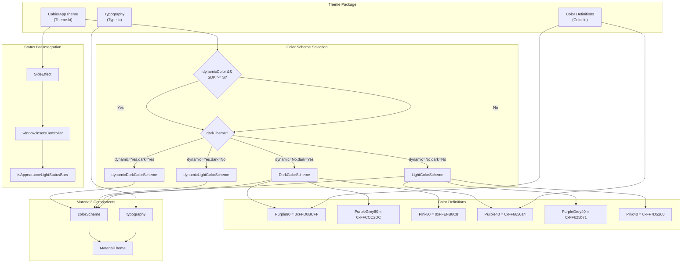
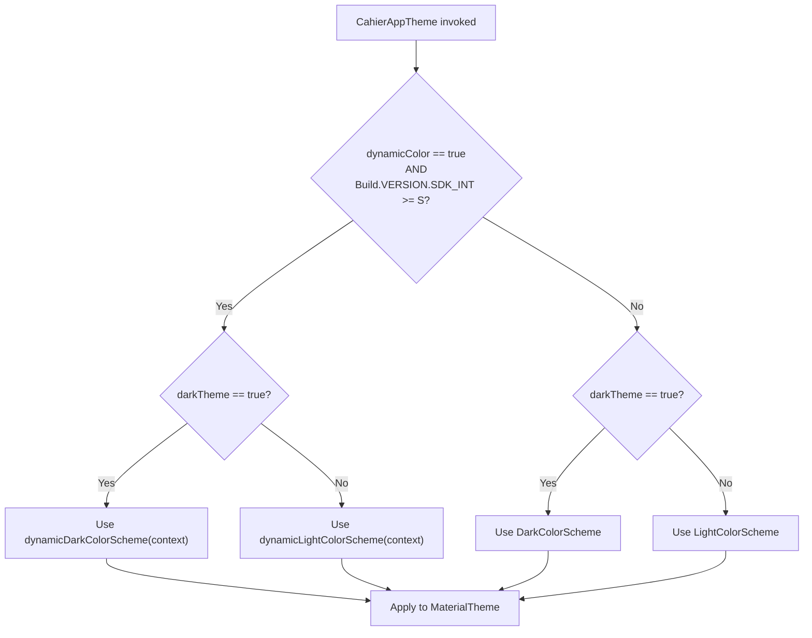
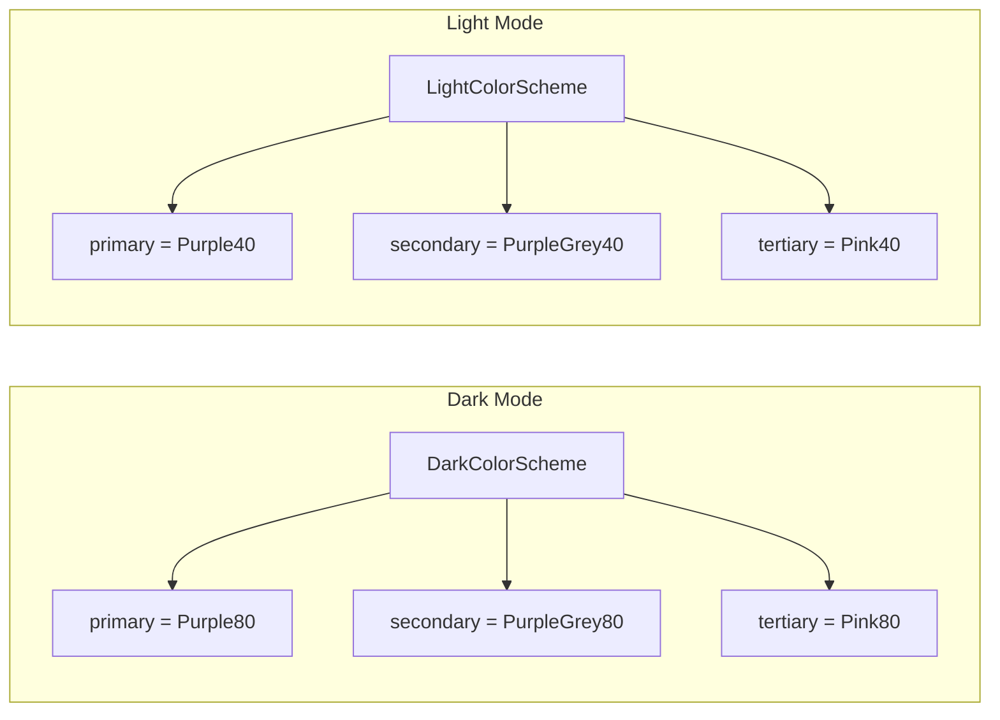
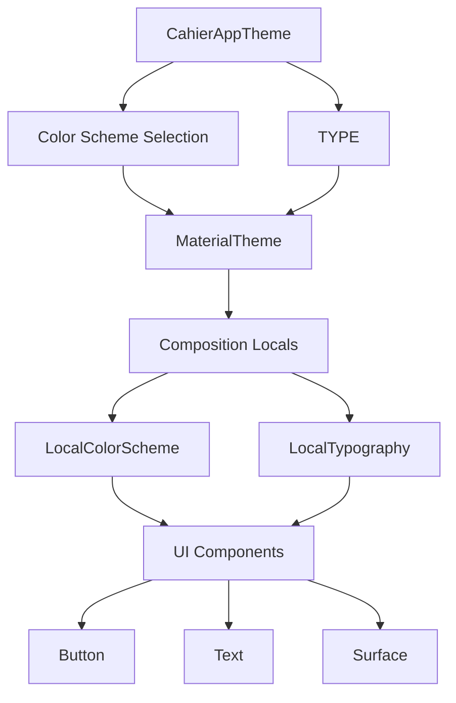
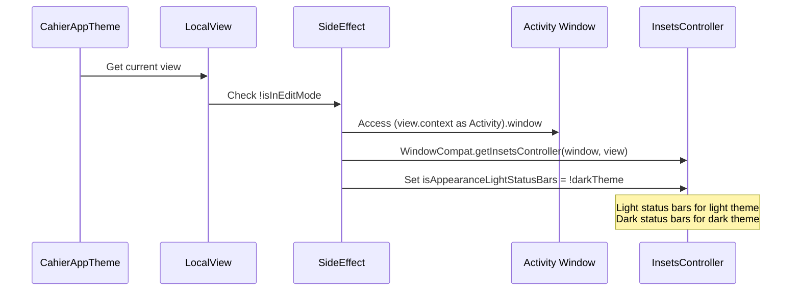
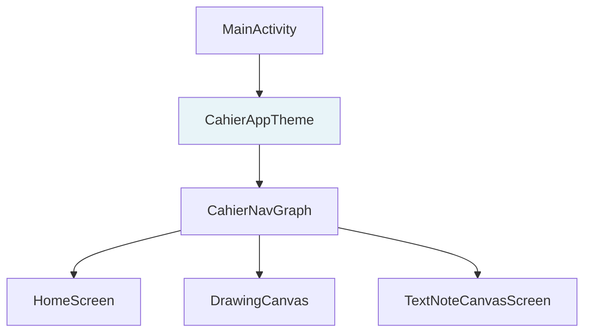

<!-- source: DeepWiki mcp.deepwiki.com · repo android/cahier · page 5.2 Theme System · fetched 2026-10-23 -->

# Theme System

Relevant source files

The following files were used as context for generating this wiki page:

- [app/src/main/java/com/example/cahier/ui/theme/Color.kt](app/src/main/java/com/example/cahier/ui/theme/Color.kt)
- [app/src/main/java/com/example/cahier/ui/theme/Theme.kt](app/src/main/java/com/example/cahier/ui/theme/Theme.kt)
- [app/src/main/java/com/example/cahier/ui/theme/Type.kt](app/src/main/java/com/example/cahier/ui/theme/Type.kt)

## Purpose and Scope

This document describes the Material Design 3 theme implementation in Cahier, including color scheme management, typography configuration, and dynamic color support for Android 12+. The theme system provides consistent styling across all UI components in the application and handles both light and dark modes.

For information about reusable UI components that use this theme, see [Shared UI Components](#5.3). For adaptive layout behavior based on screen size, see [Adaptive Layouts](#5.1).

---

## Theme Architecture

The theme system is located in the `com.example.cahier.ui.theme` package and consists of three main files that define color schemes, typography, and the composable theme function.

**Theme Architecture Diagram**

Sources: [app/src/main/java/com/example/cahier/ui/theme/Theme.kt:1-75](), [app/src/main/java/com/example/cahier/ui/theme/Color.kt:1-29](), [app/src/main/java/com/example/cahier/ui/theme/Type.kt:1-36]()

---

## CahierAppTheme Composable

The `CahierAppTheme` composable function is the primary entry point for theming the application. It wraps the entire application content and provides Material Design 3 styling.

**Function Signature**

| Parameter | Type | Default | Description |
|-----------|------|---------|-------------|
| `darkTheme` | Boolean | `isSystemInDarkTheme()` | Whether to use dark theme |
| `dynamicColor` | Boolean | `true` | Whether to use dynamic colors on Android 12+ |
| `content` | @Composable () -> Unit | Required | The application content to theme |

The theme function is defined in [app/src/main/java/com/example/cahier/ui/theme/Theme.kt:48-75]().

Sources: [app/src/main/java/com/example/cahier/ui/theme/Theme.kt:48-75]()

---

## Color Scheme System

The color scheme system implements a three-tier fallback strategy to provide appropriate colors across different Android versions and user preferences.

**Color Scheme Decision Flow**

Sources: [app/src/main/java/com/example/cahier/ui/theme/Theme.kt:53-61]()

### Dynamic Color Schemes

Dynamic colors are Material Design 3's system for deriving app color schemes from the user's wallpaper or selected accent color. This feature is available on Android 12 (API level 31) and above.

The implementation uses `dynamicDarkColorScheme(context)` and `dynamicLightColorScheme(context)` from Material 3 library, which extract colors from the system based on the user's wallpaper. The implementation is in [app/src/main/java/com/example/cahier/ui/theme/Theme.kt:54-56]().

Sources: [app/src/main/java/com/example/cahier/ui/theme/Theme.kt:54-56]()

### Static Color Schemes

When dynamic colors are unavailable or disabled, the application falls back to predefined color schemes defined in [app/src/main/java/com/example/cahier/ui/theme/Color.kt:1-29]().

**Static Color Definitions**

| Color Name | Hex Value | Purpose | Scheme |
|------------|-----------|---------|--------|
| `Purple80` | `0xFFD0BCFF` | Primary color | Dark |
| `PurpleGrey80` | `0xFFCCC2DC` | Secondary color | Dark |
| `Pink80` | `0xFFEFB8C8` | Tertiary color | Dark |
| `Purple40` | `0xFF6650a4` | Primary color | Light |
| `PurpleGrey40` | `0xFF625b71` | Secondary color | Light |
| `Pink40` | `0xFF7D5260` | Tertiary color | Light |

The dark color scheme is defined in [app/src/main/java/com/example/cahier/ui/theme/Theme.kt:35-39]() and the light color scheme in [app/src/main/java/com/example/cahier/ui/theme/Theme.kt:41-45]().

**Color Scheme Construction**

Sources: [app/src/main/java/com/example/cahier/ui/theme/Theme.kt:35-45](), [app/src/main/java/com/example/cahier/ui/theme/Color.kt:23-29]()

---

## Typography System

The typography system defines text styles used throughout the application. The implementation uses Material Design 3's `Typography` class with customized text styles.

**Typography Configuration**

The `Typography` object is defined in [app/src/main/java/com/example/cahier/ui/theme/Type.kt:28-36]() and currently specifies a single style:

| Style | Font Family | Weight | Size | Line Height | Letter Spacing |
|-------|-------------|--------|------|-------------|----------------|
| `bodyLarge` | `FontFamily.Default` | Normal | 16sp | 24sp | 0.5sp |

Additional Material Design 3 typography styles (`displayLarge`, `headlineMedium`, `titleSmall`, etc.) inherit default values from the Material 3 `Typography` class.

The typography is applied to the Material theme in [app/src/main/java/com/example/cahier/ui/theme/Theme.kt:72]().

Sources: [app/src/main/java/com/example/cahier/ui/theme/Type.kt:28-36](), [app/src/main/java/com/example/cahier/ui/theme/Theme.kt:72]()

---

## MaterialTheme Integration

The selected color scheme and typography are passed to `MaterialTheme`, which makes them available to all composables in the content hierarchy through composition locals.

The `MaterialTheme` invocation occurs in [app/src/main/java/com/example/cahier/ui/theme/Theme.kt:70-74]().

Sources: [app/src/main/java/com/example/cahier/ui/theme/Theme.kt:70-74]()

---

## Status Bar Appearance Management

The theme system automatically adjusts the status bar appearance to match the current theme. This ensures status bar icons (battery, time, signal) remain visible against the status bar background.

**Status Bar Management Flow**

The implementation uses a `SideEffect` to execute this configuration only when not in Android Studio's preview mode (`!view.isInEditMode`). The status bar appearance is set in [app/src/main/java/com/example/cahier/ui/theme/Theme.kt:62-67]().

**Implementation Details**

| Component | Purpose |
|-----------|---------|
| `LocalView.current` | Access the current view in the composition |
| `view.isInEditMode` | Skip status bar changes in Android Studio previews |
| `SideEffect` | Execute side-effect code during composition |
| `WindowCompat.getInsetsController()` | Get platform-agnostic insets controller |
| `isAppearanceLightStatusBars` | Boolean flag controlling status bar icon color |

When `isAppearanceLightStatusBars` is `true` (light theme), status bar icons are rendered in dark colors. When `false` (dark theme), icons are rendered in light colors.

Sources: [app/src/main/java/com/example/cahier/ui/theme/Theme.kt:62-67]()

---

## Theme Application in the App

The `CahierAppTheme` is applied at the application's root level, wrapping all UI content. This ensures consistent theming throughout the entire application hierarchy.

**Theme Hierarchy**

All screens and UI components access theme values through `MaterialTheme` composition locals:
- `MaterialTheme.colorScheme` provides access to the color scheme
- `MaterialTheme.typography` provides access to text styles
- `MaterialTheme.shapes` provides access to shape definitions

Sources: [app/src/main/java/com/example/cahier/ui/theme/Theme.kt:48-75]()

---

## Summary

The Cahier theme system implements Material Design 3 with the following characteristics:

1. **Dynamic Color Support**: Automatically uses system-derived colors on Android 12+ when enabled
2. **Static Fallback**: Provides purple-based color schemes for older Android versions or when dynamic colors are disabled
3. **Dark Mode Support**: Full support for both light and dark themes with automatic system theme detection
4. **Status Bar Integration**: Automatically adjusts status bar icon colors to maintain visibility
5. **Material 3 Foundation**: Built on Material Design 3 specifications with minimal customization

The implementation prioritizes user preferences (system wallpaper colors, dark mode settings) while providing sensible fallbacks for all Android versions.

---

