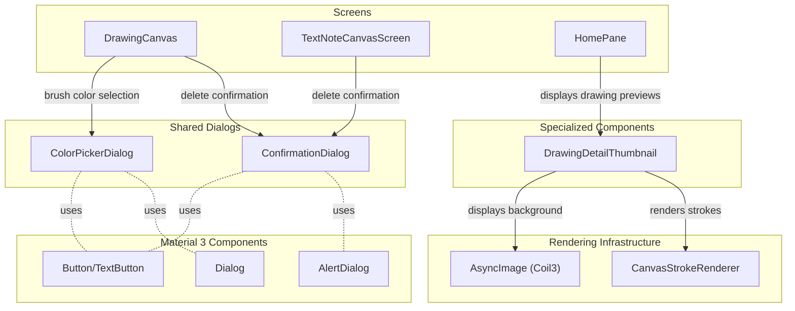
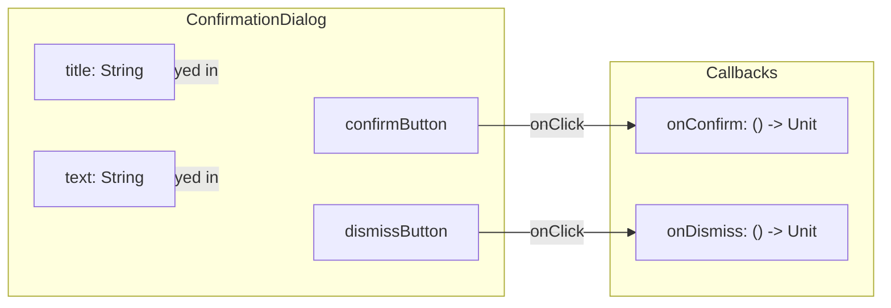
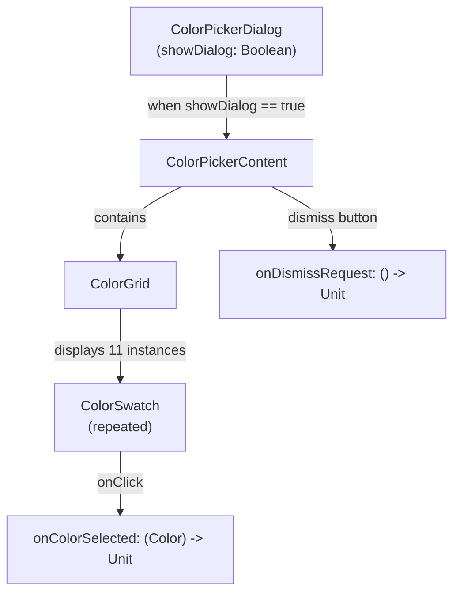
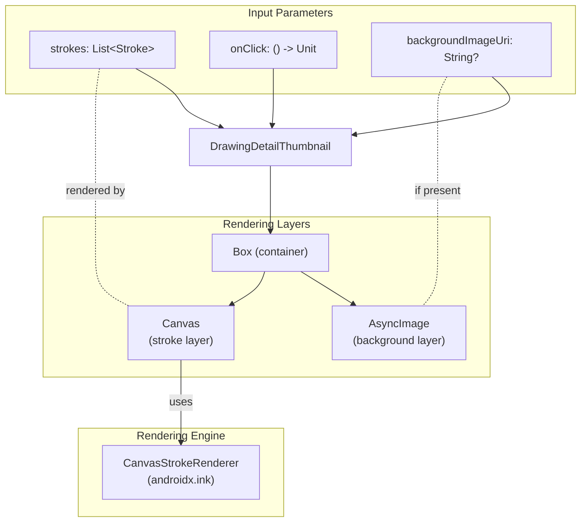
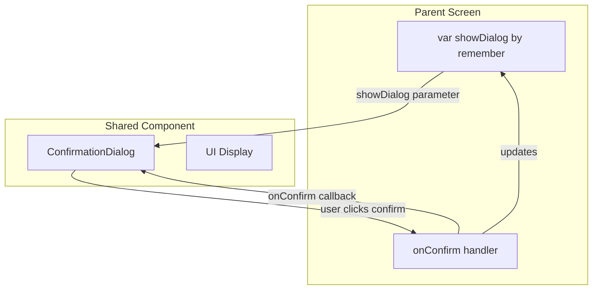

<!-- source: DeepWiki mcp.deepwiki.com · repo android/cahier · page 5.3 Shared UI Components · fetched 2026-10-23 -->

# Shared UI Components

<details>
<summary>Relevant source files</summary>

The following files were used as context for generating this wiki page:

- [app/src/androidTest/java/com/example/cahier/utils/FileHelperTest.kt](app/src/androidTest/java/com/example/cahier/utils/FileHelperTest.kt)
- [app/src/main/java/com/example/cahier/navigation/CahierNavGraph.kt](app/src/main/java/com/example/cahier/navigation/CahierNavGraph.kt)
- [app/src/main/java/com/example/cahier/ui/ColorPickerDialog.kt](app/src/main/java/com/example/cahier/ui/ColorPickerDialog.kt)
- [app/src/main/java/com/example/cahier/ui/ConfirmationDialog.kt](app/src/main/java/com/example/cahier/ui/ConfirmationDialog.kt)
- [app/src/main/java/com/example/cahier/ui/DrawingDetailThumbnail.kt](app/src/main/java/com/example/cahier/ui/DrawingDetailThumbnail.kt)
- [app/src/main/java/com/example/cahier/ui/viewmodels/HomeScreenViewModel.kt](app/src/main/java/com/example/cahier/ui/viewmodels/HomeScreenViewModel.kt)
- [app/src/main/java/com/example/cahier/utils/FileHelper.kt](app/src/main/java/com/example/cahier/utils/FileHelper.kt)
- [app/src/test/java/com/example/cahier/ui/viewmodels/HomeScreenViewModelTest.kt](app/src/test/java/com/example/cahier/ui/viewmodels/HomeScreenViewModelTest.kt)

</details>


## Purpose and Scope

This document covers reusable UI components that are shared across multiple screens in the Cahier application. These components include dialogs for user confirmation and color selection, as well as specialized display components for rendering drawing thumbnails. These are atomic, self-contained Composables that can be integrated into various screens.

For screen-level UI components and layouts, see [Drawing Canvas UI](#3.1.1), [Text Notes System](#3.2), and [Home Screen & Note Management](#3.3). For responsive layout patterns, see [Adaptive Layouts](#5.1). For theming and styling, see [Theme System](#5.2).

## Component Architecture Overview

The shared UI components follow a consistent pattern: they are stateless Composables that receive callbacks for user interactions and display data passed as parameters. They integrate with Jetpack Compose's Material Design 3 system and maintain consistency with the application's theme.

### Component Relationship Diagram



Sources: [app/src/main/java/com/example/cahier/ui/ConfirmationDialog.kt:1-47](), [app/src/main/java/com/example/cahier/ui/ColorPickerDialog.kt:1-150](), [app/src/main/java/com/example/cahier/ui/DrawingDetailThumbnail.kt:1-92]()

## Dialog Components

### ConfirmationDialog

`ConfirmationDialog` is a generic dialog component used throughout the application for confirming destructive actions, such as deleting notes. It wraps Material 3's `AlertDialog` with a standardized interface.

#### Component Structure

| Element | Type | Purpose |
|---------|------|---------|
| `onConfirm` | Callback | Invoked when user confirms the action |
| `onDismiss` | Callback | Invoked when user cancels or dismisses |
| `title` | String | Dialog title text |
| `text` | String | Dialog body/description text |

The component is implemented at [app/src/main/java/com/example/cahier/ui/ConfirmationDialog.kt:12-36]() as a Composable function that constructs a Material 3 `AlertDialog` with confirm and dismiss buttons. The button labels are localized using string resources `R.string.confirm` and `R.string.dismiss`.



#### Usage Pattern

The dialog is typically shown conditionally based on state:

```kotlin
// State management in calling component
var showDeleteDialog by remember { mutableStateOf(false) }

if (showDeleteDialog) {
    ConfirmationDialog(
        onConfirm = {
            // Perform deletion
            showDeleteDialog = false
        },
        onDismiss = { showDeleteDialog = false },
        title = "Delete Note",
        text = "Are you sure you want to delete this note?"
    )
}
```

Sources: [app/src/main/java/com/example/cahier/ui/ConfirmationDialog.kt:1-47]()

### ColorPickerDialog

`ColorPickerDialog` provides color selection functionality for the drawing toolbox. It displays a grid of predefined colors and handles user selection through a callback pattern.

#### Component Architecture

The component is structured in three layers:

1. **ColorPickerDialog** [app/src/main/java/com/example/cahier/ui/ColorPickerDialog.kt:49-70](): Wrapper that conditionally displays the dialog based on `showDialog` parameter
2. **ColorPickerContent** [app/src/main/java/com/example/cahier/ui/ColorPickerDialog.kt:72-98](): Card container with title, color grid, and dismiss button
3. **ColorGrid** [app/src/main/java/com/example/cahier/ui/ColorPickerDialog.kt:101-125](): LazyVerticalGrid displaying color swatches
4. **ColorSwatch** [app/src/main/java/com/example/cahier/ui/ColorPickerDialog.kt:127-141](): Individual clickable color circle



#### Color Palette

The predefined colors are defined at [app/src/main/java/com/example/cahier/ui/ColorPickerDialog.kt:106-110]():

| Color | Purpose |
|-------|---------|
| Black, Gray, White, DarkGray, LightGray | Neutral tones |
| Red, Green, Blue | Primary colors |
| Yellow, Cyan, Magenta | Secondary colors |

The color grid uses `GridCells.Adaptive(minSize = 40.dp)` to automatically adjust column count based on available width, ensuring responsive layout on different screen sizes.

#### Integration with Drawing System

The color picker integrates with `DrawingCanvasViewModel` through the `changeBrushColor` function. When a user selects a color, the callback updates the current brush configuration:

```kotlin
// Typical usage in DrawingCanvas
var showColorPicker by remember { mutableStateOf(false) }

ColorPickerDialog(
    showDialog = showColorPicker,
    onDismissRequest = { showColorPicker = false },
    onColorSelected = { color ->
        viewModel.changeBrushColor(color.toArgb())
        showColorPicker = false
    }
)
```

Sources: [app/src/main/java/com/example/cahier/ui/ColorPickerDialog.kt:1-150]()

## Specialized Display Components

### DrawingDetailThumbnail

`DrawingDetailThumbnail` is a specialized component that renders a preview of drawing notes in the home screen's note list. It combines background image display with stroke rendering to create an accurate thumbnail representation.

#### Component Structure



#### Rendering Implementation

The component is implemented at [app/src/main/java/com/example/cahier/ui/DrawingDetailThumbnail.kt:38-78](). Key implementation details:

1. **Background Layer**: If `backgroundImageUri` is provided, displays the image using Coil3's `AsyncImage` with `ContentScale.Crop` to fill the container [app/src/main/java/com/example/cahier/ui/DrawingDetailThumbnail.kt:56-63]().

2. **Stroke Rendering**: Uses `CanvasStrokeRenderer` from androidx.ink library to draw each stroke [app/src/main/java/com/example/cahier/ui/DrawingDetailThumbnail.kt:64-76](). The renderer is created once using `remember` to avoid recreation on recomposition.

3. **Coordinate Transformation**: Applies an identity `Matrix()` for `strokeToScreenTransform`, meaning strokes are rendered at their original coordinates without scaling [app/src/main/java/com/example/cahier/ui/DrawingDetailThumbnail.kt:73]().

4. **Click Handling**: The entire component is wrapped in a clickable modifier with `Role.Button` for accessibility [app/src/main/java/com/example/cahier/ui/DrawingDetailThumbnail.kt:51-54]().

#### Technical Dependencies

| Dependency | Purpose | Source |
|------------|---------|--------|
| `CanvasStrokeRenderer` | Renders ink strokes to Android Canvas | androidx.ink library |
| `AsyncImage` | Loads and displays images from URIs | Coil3 image loading library |
| `nativeCanvas` | Access to underlying Android Canvas API | Compose UI |

The component demonstrates efficient rendering by:
- Creating the `CanvasStrokeRenderer` once and reusing it across recompositions
- Using Coil's built-in caching for background images
- Avoiding unnecessary transformations when strokes are already in screen coordinates

#### Usage in Home Screen

The thumbnail is used in the home screen's note list to provide visual previews of drawing notes. It integrates with `HomeScreenViewModel` to receive stroke data:

```kotlin
// Typical usage in note list
DrawingDetailThumbnail(
    strokes = note.strokes,  // Loaded by HomeScreenViewModel
    onClick = { navigateToDrawingCanvas(note.id) },
    backgroundImageUri = note.imageUriList.firstOrNull()
)
```

The `HomeScreenViewModel` loads stroke data when a drawing note is selected [app/src/main/java/com/example/cahier/ui/viewmodels/HomeScreenViewModel.kt:74-78](), ensuring that the thumbnail has the necessary data for rendering.

Sources: [app/src/main/java/com/example/cahier/ui/DrawingDetailThumbnail.kt:1-92](), [app/src/main/java/com/example/cahier/ui/viewmodels/HomeScreenViewModel.kt:67-89]()

## Component Integration Patterns

### State Management Pattern

All shared components follow the "stateless component" pattern where:

1. **State is lifted**: Parent components manage visibility and state
2. **Callbacks are provided**: Components invoke callbacks for user actions
3. **Data flows down**: Components receive display data as parameters



This pattern ensures:
- Components remain reusable and testable
- State management stays in ViewModel or parent composable
- Clear separation of concerns between display and logic

### Dependency Injection

While the dialog components are stateless and don't require dependencies, `DrawingDetailThumbnail` indirectly depends on services through its rendering infrastructure:

- **CanvasStrokeRenderer**: Created locally, no injection needed
- **AsyncImage (Coil)**: Uses the `ImageLoader` provided at application level through Hilt [app/src/main/java/com/example/cahier/di/AppModule.kt]()

The stroke data itself comes from `NotesRepository` via `HomeScreenViewModel`, following the standard dependency injection pattern documented in [Dependency Injection with Hilt](#2.2).

Sources: [app/src/main/java/com/example/cahier/ui/ConfirmationDialog.kt:1-47](), [app/src/main/java/com/example/cahier/ui/ColorPickerDialog.kt:1-150](), [app/src/main/java/com/example/cahier/ui/DrawingDetailThumbnail.kt:1-92]()

## Preview Support

All shared components include `@Preview` annotated functions for development and design iteration:

| Component | Preview Function | Location |
|-----------|-----------------|----------|
| ConfirmationDialog | `ConfirmationDialogPreview` | [app/src/main/java/com/example/cahier/ui/ConfirmationDialog.kt:38-47]() |
| ColorPickerDialog | `ColorPickerContentPreview` | [app/src/main/java/com/example/cahier/ui/ColorPickerDialog.kt:143-150]() |
| DrawingDetailThumbnail | `DrawingDetailThumbnailPreview` | [app/src/main/java/com/example/cahier/ui/DrawingDetailThumbnail.kt:80-92]() |

These previews enable rapid UI iteration in Android Studio's Compose preview pane without running the full application.

Sources: [app/src/main/java/com/example/cahier/ui/ConfirmationDialog.kt:38-47](), [app/src/main/java/com/example/cahier/ui/ColorPickerDialog.kt:143-150](), [app/src/main/java/com/example/cahier/ui/DrawingDetailThumbnail.kt:80-92]()

---

