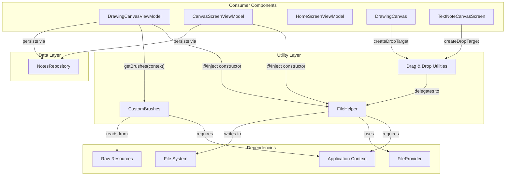
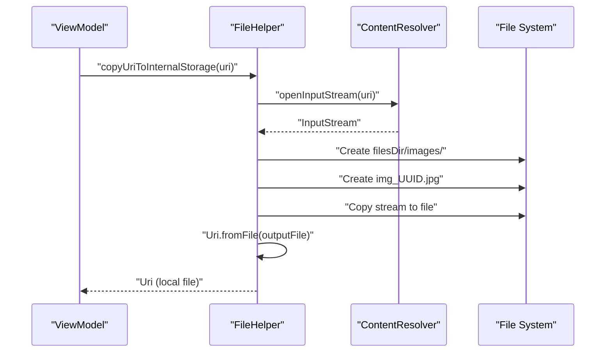
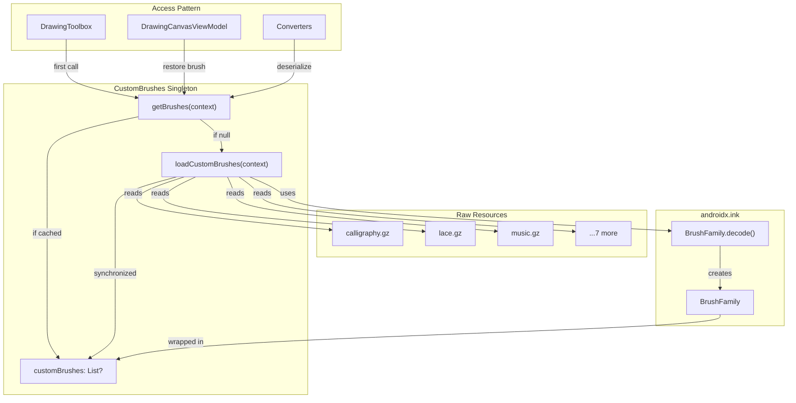
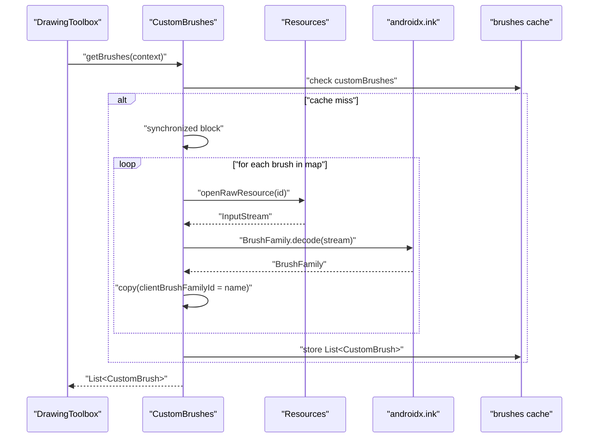

<!-- source: DeepWiki mcp.deepwiki.com · repo android/cahier · page 6 Utilities · fetched 2026-10-23 -->

# Utilities

<details>
<summary>Relevant source files</summary>

The following files were used as context for generating this wiki page:

- [app/src/main/java/com/example/cahier/ui/ConfirmationDialog.kt](app/src/main/java/com/example/cahier/ui/ConfirmationDialog.kt)
- [app/src/main/java/com/example/cahier/ui/CustomBrushes.kt](app/src/main/java/com/example/cahier/ui/CustomBrushes.kt)
- [app/src/main/java/com/example/cahier/utils/FileHelper.kt](app/src/main/java/com/example/cahier/utils/FileHelper.kt)

</details>


## Purpose and Scope

This document covers the utility classes and helper systems in the Cahier application. These utilities provide cross-cutting functionality used by multiple components across the application architecture, including file management, custom brush loading, and drag-and-drop support.

For information about how these utilities are integrated into the dependency injection system, see [Dependency Injection with Hilt](#2.2). For details on how file management integrates with the drawing and text note systems, see [Drawing Notes System](#3.1) and [Text Notes System](#3.2).

---

## Overview

The utilities layer consists of three primary systems:

| Utility System | Primary Class | Purpose |
|----------------|---------------|---------|
| File Management | `FileHelper` | URI copying, bitmap caching, FileProvider integration |
| Custom Brushes | `CustomBrushes` | Loading and caching custom brush resources |
| Drag and Drop | Various utilities | Import/export image handling with permission management |

These utilities are provided as injectable dependencies through Hilt modules and are consumed by ViewModels and UI components throughout the application.

**Sources:** [app/src/main/java/com/example/cahier/utils/FileHelper.kt:1-109](), [app/src/main/java/com/example/cahier/ui/CustomBrushes.kt:1-72]()

---

## System Architecture

### Utility Integration Architecture



**Sources:** [app/src/main/java/com/example/cahier/utils/FileHelper.kt:38-109](), [app/src/main/java/com/example/cahier/ui/CustomBrushes.kt:32-71]()

---

## File Management System

### FileHelper Class

The `FileHelper` class provides file operation utilities with a focus on URI management and secure file sharing. It is injected into ViewModels via Hilt and operates on the `Dispatchers.IO` context for all file operations.

**Class Location:** [app/src/main/java/com/example/cahier/utils/FileHelper.kt:38]()

#### Constructor

```
FileHelper(private val context: Context)
```

The class requires an `Application` context, which is provided by the Hilt dependency injection system.

**Sources:** [app/src/main/java/com/example/cahier/utils/FileHelper.kt:38]()

---

### Core File Operations

#### URI Copying to Internal Storage

The `copyUriToInternalStorage` function handles the critical task of copying content from temporary external URIs (such as those from drag-and-drop or image pickers) to permanent internal storage.

**Function Signature:** [app/src/main/java/com/example/cahier/utils/FileHelper.kt:47-71]()

```
suspend fun copyUriToInternalStorage(uri: Uri): Uri?
```

**Operation Flow:**



**Implementation Details:**

| Aspect | Detail |
|--------|--------|
| Execution Context | `Dispatchers.IO` via `withContext` |
| Target Directory | `context.filesDir/images` |
| File Naming | `img_${UUID.randomUUID()}.jpg` |
| Return Value | File URI on success, `null` on failure |
| Error Handling | Catches `SecurityException` and `IOException` |

The function creates the `images` directory if it doesn't exist [app/src/main/java/com/example/cahier/utils/FileHelper.kt:51-54]() and uses Kotlin's `use` extension for automatic stream closure [app/src/main/java/com/example/cahier/utils/FileHelper.kt:57-60]().

**Sources:** [app/src/main/java/com/example/cahier/utils/FileHelper.kt:47-71]()

---

#### Bitmap Caching

The `saveBitmapToCache` function creates temporary cache files for sharing operations, particularly for exporting drawing canvas content.

**Function Signature:** [app/src/main/java/com/example/cahier/utils/FileHelper.kt:78-89]()

```
suspend fun saveBitmapToCache(bitmap: Bitmap): Uri
```

**Operation Details:**

| Parameter | Purpose |
|-----------|---------|
| `bitmap: Bitmap` | The bitmap to cache |
| Returns | Shareable content URI via FileProvider |
| Target Location | `context.cacheDir/images` |
| File Format | PNG with 100% quality |
| File Naming | `shared_image_${UUID.randomUUID()}.png` |

The function uses `FileProvider.getUriForFile` to create a secure content URI with the authority `${context.packageName}.provider` [app/src/main/java/com/example/cahier/utils/FileHelper.kt:87]().

**Sources:** [app/src/main/java/com/example/cahier/utils/FileHelper.kt:78-89]()

---

#### Shareable URI Creation

The `createShareableUri` function creates temporary, shareable copies of permanent files from internal storage, enabling secure sharing without exposing file:// URIs.

**Function Signature:** [app/src/main/java/com/example/cahier/utils/FileHelper.kt:96-108]()

```
suspend fun createShareableUri(originalFile: File): Uri
```

**Process:**

1. Creates a `shares` subdirectory in cache [app/src/main/java/com/example/cahier/utils/FileHelper.kt:98-99]()
2. Copies the original file to the cache location [app/src/main/java/com/example/cahier/utils/FileHelper.kt:101-103]()
3. Returns a FileProvider content URI [app/src/main/java/com/example/cahier/utils/FileHelper.kt:105-106]()

This approach ensures that:
- Original files remain private in `filesDir`
- Temporary copies in cache are automatically cleaned by Android
- Shared URIs have proper read permissions for receiving apps

**Sources:** [app/src/main/java/com/example/cahier/utils/FileHelper.kt:96-108]()

---

### File Management Integration

The following diagram shows how file operations integrate with the application's data flow:

```mermaid
graph TB
    subgraph "Input Sources"
        IP["Image Picker"]
        DD["Drag & Drop"]
        BITMAP["Canvas Bitmap Export"]
    end
    
    subgraph "FileHelper Operations"
        COPY["copyUriToInternalStorage()"]
        CACHE["saveBitmapToCache()"]
        SHARE["createShareableUri()"]
    end
    
    subgraph "Storage Locations"
        INTERNAL["filesDir/images/<br/>Permanent Storage"]
        CACHEDIR["cacheDir/images/<br/>Temporary Cache"]
        SHAREDIR["cacheDir/shares/<br/>Share Cache"]
    end
    
    subgraph "Consumers"
        REPO["NotesRepository"]
        SHARE_INTENT["Share Intent"]
        DND_SOURCE["Drag Source"]
    end
    
    IP -->|"content:// URI"| COPY
    DD -->|"content:// URI"| COPY
    COPY -->|"file:// URI"| INTERNAL
    INTERNAL -->|"persisted"| REPO
    
    BITMAP -->|"Bitmap"| CACHE
    CACHE -->|"content:// URI"| CACHEDIR
    
    INTERNAL -->|"File"| SHARE
    SHARE -->|"content:// URI"| SHAREDIR
    
    CACHEDIR -->|"shareable"| SHARE_INTENT
    SHAREDIR -->|"shareable"| DND_SOURCE
```



**Sources:** [app/src/main/java/com/example/cahier/utils/FileHelper.kt:47-108]()

---

## Custom Brushes System

### CustomBrushes Object

The `CustomBrushes` singleton manages the loading and caching of custom brush families from compressed raw resources. It uses lazy initialization with double-checked locking to ensure thread-safe singleton behavior.

**Object Location:** [app/src/main/java/com/example/cahier/ui/CustomBrushes.kt:32-72]()

---

### Brush Loading Architecture



**Sources:** [app/src/main/java/com/example/cahier/ui/CustomBrushes.kt:36-71]()

---

### Public API

#### getBrushes Function

**Function Signature:** [app/src/main/java/com/example/cahier/ui/CustomBrushes.kt:36-40]()

```
fun getBrushes(context: Context): List<CustomBrush>
```

This function implements thread-safe lazy initialization:

1. Returns cached list if already loaded [app/src/main/java/com/example/cahier/ui/CustomBrushes.kt:37]()
2. Enters synchronized block if not loaded [app/src/main/java/com/example/cahier/ui/CustomBrushes.kt:37]()
3. Double-checks the cache within the synchronized block [app/src/main/java/com/example/cahier/ui/CustomBrushes.kt:38]()
4. Calls `loadCustomBrushes` and caches the result [app/src/main/java/com/example/cahier/ui/CustomBrushes.kt:38]()

**Sources:** [app/src/main/java/com/example/cahier/ui/CustomBrushes.kt:36-40]()

---

### Brush Resource Configuration

The custom brushes are defined in a map structure [app/src/main/java/com/example/cahier/ui/CustomBrushes.kt:45-56]():

| Brush Name | Raw Resource | Icon Resource |
|------------|--------------|---------------|
| Calligraphy | `R.raw.calligraphy` | `R.drawable.draw_24px` |
| Flag Banner | `R.raw.flag_banner` | `R.drawable.flag_24px` |
| Graffiti | `R.raw.graffiti` | `R.drawable.format_paint_24px` |
| Groovy | `R.raw.groovy` | `R.drawable.bubble_chart_24px` |
| Holiday lights | `R.raw.holiday_lights` | `R.drawable.lightbulb_24px` |
| Lace | `R.raw.lace` | `R.drawable.styler_24px` |
| Music | `R.raw.music` | `R.drawable.music_note_24px` |
| Shadow | `R.raw.shadow` | `R.drawable.blur_on_24px` |
| Twisted yarn | `R.raw.twisted_yarn` | `R.drawable.line_weight_24px` |
| Wet paint | `R.raw.wet_paint` | `R.drawable.water_drop_24px` |

**Sources:** [app/src/main/java/com/example/cahier/ui/CustomBrushes.kt:45-56]()

---

### Loading Implementation

The `loadCustomBrushes` function performs the following steps for each brush:

1. Opens the raw resource as an input stream [app/src/main/java/com/example/cahier/ui/CustomBrushes.kt:61]()
2. Decodes the compressed brush family using `BrushFamily.decode` [app/src/main/java/com/example/cahier/ui/CustomBrushes.kt:61-63]()
3. Copies the brush family with `clientBrushFamilyId` set to the brush name [app/src/main/java/com/example/cahier/ui/CustomBrushes.kt:64]()
4. Wraps it in a `CustomBrush` data class with name and icon [app/src/main/java/com/example/cahier/ui/CustomBrushes.kt:64]()
5. Returns `null` for any brush that fails to load [app/src/main/java/com/example/cahier/ui/CustomBrushes.kt:65-68]()

The function uses `mapNotNull` to filter out any failed loads [app/src/main/java/com/example/cahier/ui/CustomBrushes.kt:58]() and logs errors for debugging [app/src/main/java/com/example/cahier/ui/CustomBrushes.kt:66]().

**Critical Detail:** The `clientBrushFamilyId` is set to the brush name [app/src/main/java/com/example/cahier/ui/CustomBrushes.kt:64](). This identifier is used during serialization and deserialization to restore custom brushes from the database. See [Stroke Serialization](#4.3) for more details.

**Sources:** [app/src/main/java/com/example/cahier/ui/CustomBrushes.kt:43-71]()

---

### Custom Brush Data Flow



**Sources:** [app/src/main/java/com/example/cahier/ui/CustomBrushes.kt:36-71]()

---

## Drag and Drop System

The drag-and-drop system provides utilities for importing images into notes and exporting note content to other applications. While the primary implementation is distributed across UI components, common patterns and utilities are reused.

For detailed information on drag-and-drop integration with the drawing and text note systems, see [Image Management](#3.4).

---

### Drop Target Creation

The application uses Compose's `Modifier.dragAndDropTarget` API with utility functions for creating drop targets. The typical pattern involves:

1. **MIME Type Filtering:** Accepting only image types
2. **Permission Request:** Requesting read permission on dropped URIs
3. **URI Copying:** Using `FileHelper.copyUriToInternalStorage` to persist the content
4. **State Update:** Adding the resulting URI to the note's image list

**Key Operations:**

| Operation | Purpose | Implementation Location |
|-----------|---------|------------------------|
| MIME filtering | Accept only images | UI components with `DragAndDropTarget` |
| Permission request | Request `FLAG_GRANT_READ_URI_PERMISSION` | Drop target callbacks |
| URI copying | Persist temporary URIs | `FileHelper.copyUriToInternalStorage` |
| State update | Add to note images | ViewModel update functions |

---

### Drag Source Creation

For exporting content, the application uses `Modifier.dragAndDropSource` with:

1. **Bitmap Export:** Converting canvas content to bitmap (drawing notes)
2. **Cache Creation:** Using `FileHelper.saveBitmapToCache` for temporary storage
3. **URI Sharing:** Creating shareable content URIs via FileProvider
4. **ClipData Creation:** Building Android `ClipData` with appropriate MIME types

---

### Permission Management

Drag-and-drop operations require careful permission management:

**Input (Drop):**
- Request `FLAG_GRANT_READ_URI_PERMISSION` on dropped URIs
- Copy content immediately to internal storage
- Release original URI permissions after copy

**Output (Drag):**
- Create content URIs via FileProvider
- Grant `FLAG_GRANT_READ_URI_PERMISSION` in ClipData
- Use cache directory for temporary export files

**Sources:** [app/src/main/java/com/example/cahier/utils/FileHelper.kt:47-108]()

---

## Reusable UI Components

### ConfirmationDialog

The `ConfirmationDialog` is a simple reusable component for confirmation actions throughout the application.

**Component Location:** [app/src/main/java/com/example/cahier/ui/ConfirmationDialog.kt:12-36]()

**Function Signature:**

```
@Composable
fun ConfirmationDialog(
    onConfirm: () -> Unit,
    onDismiss: () -> Unit,
    title: String,
    text: String,
    modifier: Modifier = Modifier
)
```

**Implementation:**
- Uses Material 3 `AlertDialog` [app/src/main/java/com/example/cahier/ui/ConfirmationDialog.kt:20]()
- Two action buttons: Confirm and Dismiss [app/src/main/java/com/example/cahier/ui/ConfirmationDialog.kt:24-34]()
- String resources for button text [app/src/main/java/com/example/cahier/ui/ConfirmationDialog.kt:26,31]()

**Usage Pattern:**
The dialog is typically controlled by a `Boolean` state variable that triggers its display when true. The `onConfirm` callback executes the action, while `onDismiss` hides the dialog.

**Sources:** [app/src/main/java/com/example/cahier/ui/ConfirmationDialog.kt:12-36]()

---

## Utility Dependencies Summary

The following table summarizes how utilities depend on Android and third-party libraries:

| Utility | Key Dependencies | Purpose |
|---------|------------------|---------|
| `FileHelper` | `Context`, `FileProvider`, `Dispatchers.IO` | File operations and URI management |
| `CustomBrushes` | `Context`, `androidx.ink.brush.BrushFamily`, `androidx.ink.storage.decode` | Custom brush loading and caching |
| Drag & Drop | `Modifier.dragAndDropTarget`, `ClipData`, `DragAndDropEvent` | Image import/export functionality |
| `ConfirmationDialog` | `AlertDialog`, Material 3 | User confirmation UI pattern |

**Sources:** [app/src/main/java/com/example/cahier/utils/FileHelper.kt:1-109](), [app/src/main/java/com/example/cahier/ui/CustomBrushes.kt:1-72](), [app/src/main/java/com/example/cahier/ui/ConfirmationDialog.kt:1-36]()

---

