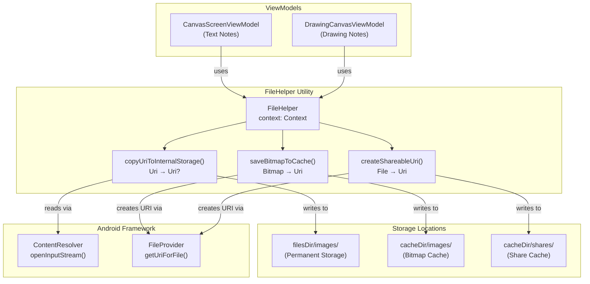
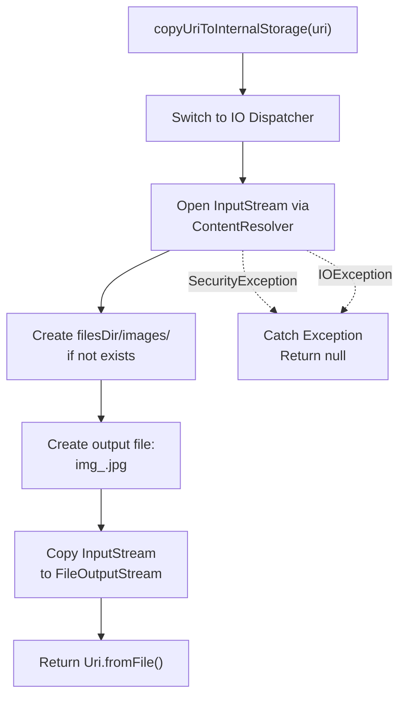
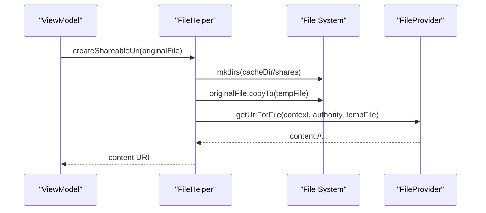
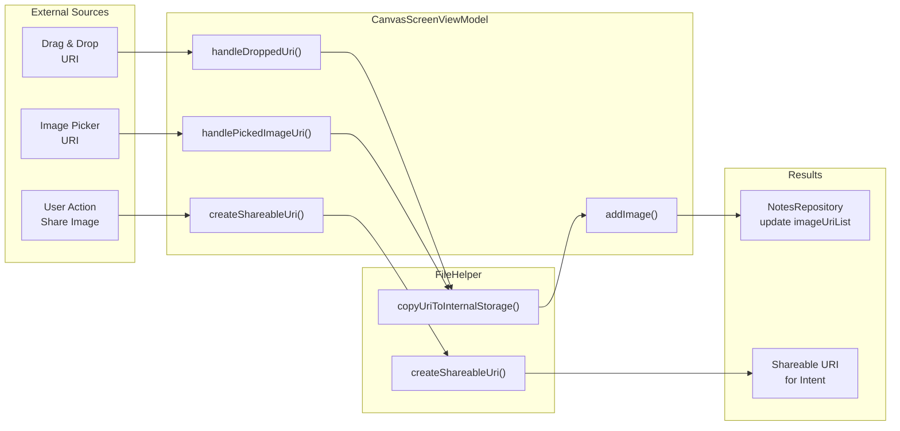

<!-- source: DeepWiki mcp.deepwiki.com · repo android/cahier · page 6.1 File Management · fetched 2026-10-23 -->

# File Management

<details>
<summary>Relevant source files</summary>

The following files were used as context for generating this wiki page:

- [app/src/main/java/com/example/cahier/ui/ConfirmationDialog.kt](app/src/main/java/com/example/cahier/ui/ConfirmationDialog.kt)
- [app/src/main/java/com/example/cahier/ui/viewmodels/CanvasScreenViewModel.kt](app/src/main/java/com/example/cahier/ui/viewmodels/CanvasScreenViewModel.kt)
- [app/src/main/java/com/example/cahier/utils/FileHelper.kt](app/src/main/java/com/example/cahier/utils/FileHelper.kt)

</details>


## Purpose and Scope

This document details the `FileHelper` utility class, which centralizes file operations for the Cahier application. The `FileHelper` class handles three primary responsibilities: copying external URIs to internal storage, caching bitmaps for sharing, and creating shareable content URIs via FileProvider.

For information about how images are used in notes, see [Image Management](#3.4). For drag-and-drop system details, see [Drag and Drop System](#6.3).

**Sources:** [app/src/main/java/com/example/cahier/utils/FileHelper.kt:1-109]()

## Architecture Overview

The `FileHelper` class serves as a centralized utility for all file operations in the application. It is injected into ViewModels via Hilt and provides async functions that execute on the IO dispatcher.

### File Management System Architecture



**Sources:** [app/src/main/java/com/example/cahier/utils/FileHelper.kt:38-109](), [app/src/main/java/com/example/cahier/ui/viewmodels/CanvasScreenViewModel.kt:44-47]()

## Storage Locations

The `FileHelper` class uses three distinct storage locations, each serving a specific purpose:

| Location | Path | Purpose | Lifecycle | Example Filename |
|----------|------|---------|-----------|------------------|
| **Permanent Images** | `filesDir/images/` | Store note attachments permanently | Until deleted by app | `img_<UUID>.jpg` |
| **Bitmap Cache** | `cacheDir/images/` | Temporary bitmap exports for sharing | Cleared by system | `shared_image_<UUID>.png` |
| **Share Cache** | `cacheDir/shares/` | Temporary copies of permanent files | Cleared by system | Original filename |

**Storage Characteristics:**
- `filesDir` is private to the app and persists until explicitly deleted
- `cacheDir` can be cleared by the Android system when storage is low
- All paths are created via `mkdirs()` if they don't exist

**Sources:** [app/src/main/java/com/example/cahier/utils/FileHelper.kt:51-54](), [app/src/main/java/com/example/cahier/utils/FileHelper.kt:80-81](), [app/src/main/java/com/example/cahier/utils/FileHelper.kt:98-99]()

## File Operations

### URI Copying to Internal Storage

The `copyUriToInternalStorage()` function is the most critical file operation in the application. It copies content from external URIs to permanent internal storage, which is essential for handling temporary permissions from sources like drag-and-drop and the image picker.

**Function Signature:**
```kotlin
suspend fun copyUriToInternalStorage(uri: Uri): Uri?
```

**Implementation Details:**



**Key Implementation Points:**

1. **Thread Safety:** All file I/O is executed on `Dispatchers.IO` via `withContext()` [app/src/main/java/com/example/cahier/utils/FileHelper.kt:49]()

2. **Directory Creation:** The `images` directory is created with `mkdirs()` if it doesn't exist [app/src/main/java/com/example/cahier/utils/FileHelper.kt:52-54]()

3. **Unique Filenames:** Files are named `img_<UUID>.jpg` to prevent collisions [app/src/main/java/com/example/cahier/utils/FileHelper.kt:55]()

4. **Stream Management:** Both input and output streams are properly closed using Kotlin's `use` extension [app/src/main/java/com/example/cahier/utils/FileHelper.kt:57-60]()

5. **Error Handling:** Catches `SecurityException` (permission denied) and `IOException` (file errors), returning `null` on failure [app/src/main/java/com/example/cahier/utils/FileHelper.kt:64-70]()

**Sources:** [app/src/main/java/com/example/cahier/utils/FileHelper.kt:47-71]()

### Bitmap Caching

The `saveBitmapToCache()` function saves bitmaps to temporary cache storage and returns a shareable content URI. This is used for exporting drawing notes as images.

**Function Signature:**
```kotlin
suspend fun saveBitmapToCache(bitmap: Bitmap): Uri
```

**Implementation:**

1. **Cache Directory:** Creates `cacheDir/images/` if needed [app/src/main/java/com/example/cahier/utils/FileHelper.kt:80-81]()

2. **File Naming:** Uses `shared_image_<UUID>.png` for unique temporary filenames [app/src/main/java/com/example/cahier/utils/FileHelper.kt:82]()

3. **Bitmap Compression:** Compresses bitmap to PNG format at 100% quality [app/src/main/java/com/example/cahier/utils/FileHelper.kt:85]()

4. **FileProvider URI:** Returns a content URI via `FileProvider.getUriForFile()` using the authority `{packageName}.provider` [app/src/main/java/com/example/cahier/utils/FileHelper.kt:87]()

**Sources:** [app/src/main/java/com/example/cahier/utils/FileHelper.kt:78-89]()

### Shareable URI Creation

The `createShareableUri()` function creates temporary, shareable copies of permanent files from internal storage. This enables secure sharing of note attachments without exposing the permanent internal storage paths.

**Function Signature:**
```kotlin
suspend fun createShareableUri(originalFile: File): Uri
```

**Purpose:** Permanent files in `filesDir` cannot be directly shared because they are in private storage. This function:
1. Copies the permanent file to `cacheDir/shares/`
2. Returns a FileProvider content URI for the temporary copy

**Implementation Flow:**



**Key Points:**

1. **Temporary Copy:** The original file is copied to `cacheDir/shares/` with `overwrite = true` [app/src/main/java/com/example/cahier/utils/FileHelper.kt:103]()

2. **Same Filename:** Preserves the original filename in the cache [app/src/main/java/com/example/cahier/utils/FileHelper.kt:101]()

3. **Authority:** Uses `{packageName}.provider` as the FileProvider authority [app/src/main/java/com/example/cahier/utils/FileHelper.kt:105-106]()

**Sources:** [app/src/main/java/com/example/cahier/utils/FileHelper.kt:96-108]()

## FileProvider Integration

The `FileHelper` class relies on Android's `FileProvider` to create secure, shareable content URIs. FileProvider exposes files from private storage directories via content URIs with temporary permissions.

### FileProvider Authority

Both `saveBitmapToCache()` and `createShareableUri()` use the same authority pattern:
```kotlin
val authority = "${context.packageName}.provider"
```

This resolves to a package-specific authority (e.g., `com.example.cahier.provider`).

### FileProvider Configuration Requirements

To function properly, the application's `AndroidManifest.xml` must:
1. Declare a FileProvider component with the matching authority
2. Specify XML paths that define exposed cache directories
3. Grant temporary read permissions via `grantUriPermissions`

For manifest configuration details, see [Android Manifest & Permissions](#7.1).

**Sources:** [app/src/main/java/com/example/cahier/utils/FileHelper.kt:87](), [app/src/main/java/com/example/cahier/utils/FileHelper.kt:105-106]()

## ViewModel Integration

ViewModels use `FileHelper` to handle file operations without directly interacting with the file system or Android framework APIs. This maintains clean separation between UI logic and file I/O.

### Usage in CanvasScreenViewModel

The `CanvasScreenViewModel` (for text notes) demonstrates typical `FileHelper` usage patterns:



**Dependency Injection:**

`FileHelper` is injected into the ViewModel constructor via Hilt:
```kotlin
@HiltViewModel
class CanvasScreenViewModel @Inject constructor(
    savedStateHandle: SavedStateHandle,
    private val noteRepository: NotesRepository,
    val fileHelper: FileHelper  // Injected
) : ViewModel()
```

[app/src/main/java/com/example/cahier/ui/viewmodels/CanvasScreenViewModel.kt:44-48]()

### Key Usage Patterns

#### Pattern 1: Drag-and-Drop Handling

```kotlin
fun handleDroppedUri(uri: Uri, permissions: DragAndDropPermissions?) {
    viewModelScope.launch {
        try {
            val localUri = fileHelper.copyUriToInternalStorage(uri)
            addImage(localUri)
        } finally {
            permissions?.release()
        }
    }
}
```

**Workflow:**
1. Receives temporary URI from drag-and-drop system
2. Copies to permanent internal storage via `copyUriToInternalStorage()`
3. Adds resulting local URI to note's image list
4. Releases temporary permissions in `finally` block

[app/src/main/java/com/example/cahier/ui/viewmodels/CanvasScreenViewModel.kt:130-139]()

#### Pattern 2: Image Picker Handling

```kotlin
fun handlePickedImageUri(uri: Uri) {
    viewModelScope.launch {
        val localUri = fileHelper.copyUriToInternalStorage(uri)
        addImage(localUri)
    }
}
```

**Workflow:**
1. Receives URI from Android image picker
2. Copies to internal storage
3. Adds to note's image list

[app/src/main/java/com/example/cahier/ui/viewmodels/CanvasScreenViewModel.kt:141-146]()

#### Pattern 3: Share URI Creation

```kotlin
suspend fun createShareableUri(imageUriString: String): Uri? {
    val imageFile = imageUriString.toUri().path?.let { File(it) } ?: return null
    return fileHelper.createShareableUri(imageFile)
}
```

**Workflow:**
1. Converts stored URI string to File object
2. Creates temporary shareable copy via FileProvider
3. Returns content URI for sharing via Intent

[app/src/main/java/com/example/cahier/ui/viewmodels/CanvasScreenViewModel.kt:148-151]()

**Sources:** [app/src/main/java/com/example/cahier/ui/viewmodels/CanvasScreenViewModel.kt:47](), [app/src/main/java/com/example/cahier/ui/viewmodels/CanvasScreenViewModel.kt:130-151]()

## Error Handling and Permissions

### Permission Scenarios

The `copyUriToInternalStorage()` function handles two critical permission scenarios:

| Scenario | Exception | Cause | Result |
|----------|-----------|-------|--------|
| **Permission Denied** | `SecurityException` | URI source revoked permissions before copy completed | Returns `null`, logs error |
| **File I/O Error** | `IOException` | Disk full, file system error, corrupted data | Returns `null`, logs error |

### Null Handling Pattern

All callers of `copyUriToInternalStorage()` must handle `null` return values:

```kotlin
val localUri = fileHelper.copyUriToInternalStorage(uri)
addImage(localUri)  // addImage() checks for null
```

The `addImage()` function explicitly guards against null:
```kotlin
fun addImage(localUri: Uri?) {
    if (localUri == null) {
        Log.w(TAG, "addImage called with null URI, ignoring.")
        return
    }
    // ... proceed with adding image
}
```

[app/src/main/java/com/example/cahier/ui/viewmodels/CanvasScreenViewModel.kt:96-100]()

### Logging

All errors are logged with context:
- `SecurityException`: `"SecurityException for URI: $uri"` [app/src/main/java/com/example/cahier/utils/FileHelper.kt:65]()
- `IOException`: `"IOException for URI: $uri"` [app/src/main/java/com/example/cahier/utils/FileHelper.kt:68]()

**Sources:** [app/src/main/java/com/example/cahier/utils/FileHelper.kt:64-70](), [app/src/main/java/com/example/cahier/ui/viewmodels/CanvasScreenViewModel.kt:96-100]()

## Coroutine Integration

All `FileHelper` functions are suspend functions that execute file I/O on the IO dispatcher:

```kotlin
suspend fun copyUriToInternalStorage(uri: Uri): Uri? {
    return withContext(Dispatchers.IO) {
        // File I/O operations
    }
}
```

**Benefits:**
1. **Non-blocking:** UI thread remains responsive during file operations
2. **Automatic Cancellation:** Operations are cancelled if the calling coroutine scope is cancelled
3. **Sequential Safety:** Guarantees sequential execution within the IO dispatcher

ViewModels launch these operations in `viewModelScope`:
```kotlin
viewModelScope.launch {
    val localUri = fileHelper.copyUriToInternalStorage(uri)
    // ...
}
```

**Lifecycle Behavior:** Operations are automatically cancelled when the ViewModel is cleared, preventing memory leaks and unnecessary work.

**Sources:** [app/src/main/java/com/example/cahier/utils/FileHelper.kt:49](), [app/src/main/java/com/example/cahier/utils/FileHelper.kt:79](), [app/src/main/java/com/example/cahier/utils/FileHelper.kt:97](), [app/src/main/java/com/example/cahier/ui/viewmodels/CanvasScreenViewModel.kt:131]()

---

