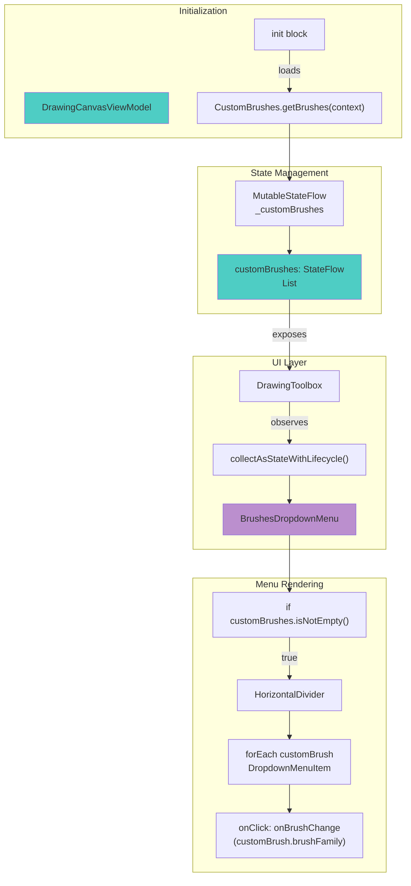

<!-- source: DeepWiki mcp.deepwiki.com · repo android/cahier · page 6.2 Custom Brushes · fetched 2026-10-23 -->

# Custom Brushes

<details>
<summary>Relevant source files</summary>

The following files were used as context for generating this wiki page:

- [app/src/androidTest/java/com/example/cahier/data/OfflineNotesRepositoryTest.kt](app/src/androidTest/java/com/example/cahier/data/OfflineNotesRepositoryTest.kt)
- [app/src/main/java/com/example/cahier/ui/Converters.kt](app/src/main/java/com/example/cahier/ui/Converters.kt)
- [app/src/main/java/com/example/cahier/ui/CustomBrushes.kt](app/src/main/java/com/example/cahier/ui/CustomBrushes.kt)
- [app/src/main/java/com/example/cahier/ui/DrawingToolbox.kt](app/src/main/java/com/example/cahier/ui/DrawingToolbox.kt)
- [app/src/main/res/raw/lace.gz](app/src/main/res/raw/lace.gz)
- [app/src/main/res/raw/music.gz](app/src/main/res/raw/music.gz)
- [app/src/main/res/raw/shadow.gz](app/src/main/res/raw/shadow.gz)

</details>


This document describes the custom brush system, which loads specialized brush definitions from compressed raw resources and integrates them with the drawing subsystem. For information about the drawing toolbox UI and brush selection controls, see [Drawing Toolbox & Brush System](#3.1.3). For details about how brushes are serialized for persistence, see [Stroke Serialization](#4.3).

## Purpose and Scope

The custom brush system provides advanced brush types beyond the standard stock brushes (`marker`, `pressurePen`, `highlighter`, `dashedLine`) offered by the androidx.ink library. Custom brushes are loaded from compressed `.gz` files stored in raw resources, decoded using the androidx.ink storage API, and made available throughout the drawing system. The system handles:

- Loading and caching custom brush definitions from compressed resources
- Assigning unique identifiers to custom brushes for serialization
- Integrating custom brushes into the brush selection UI
- Supporting deserialization of strokes drawn with custom brushes

## System Architecture

**Custom Brush Loading and Integration Flow**

```mermaid
graph TB
    subgraph "Raw Resources"
        R1["R.raw.calligraphy"]
        R2["R.raw.lace"]
        R3["R.raw.music"]
        R4["R.raw.shadow"]
        R5["R.raw.{others}"]
    end
    
    subgraph "CustomBrushes Singleton"
        CB["CustomBrushes object"]
        GB["getBrushes(context)"]
        LB["loadCustomBrushes(context)"]
        CACHE["customBrushes: List<CustomBrush>?"]
    end
    
    subgraph "Data Model"
        CBM["CustomBrush<br/>name: String<br/>icon: Int<br/>brushFamily: BrushFamily"]
        BF["BrushFamily<br/>clientBrushFamilyId: String"]
    end
    
    subgraph "UI Components"
        DVM["DrawingCanvasViewModel<br/>customBrushes: StateFlow"]
        DT["DrawingToolbox"]
        BDD["BrushesDropdownMenu"]
    end
    
    subgraph "Serialization"
        CONV["Converters"]
        SER["serializeBrush()"]
        DESER["deserializeBrush()"]
    end
    
    R1 --> LB
    R2 --> LB
    R3 --> LB
    R4 --> LB
    R5 --> LB
    
    GB --> CACHE
    CACHE -->|null| LB
    CACHE -->|cached| CBM
    LB -->|BrushFamily.decode()| BF
    BF --> CBM
    
    CB -->|provides| DVM
    DVM -->|observes| DT
    DT --> BDD
    
    CBM -->|used by| SER
    CBM -->|matched by clientBrushFamilyId| DESER
    
    style CB fill:#95e1d3
    style DVM fill:#4ecdc4
    style CONV fill:#95e1d3
```

Sources: [app/src/main/java/com/example/cahier/ui/CustomBrushes.kt:32-72](), [app/src/main/java/com/example/cahier/ui/DrawingToolbox.kt:115-178]()

## CustomBrushes Singleton

The `CustomBrushes` object is a singleton manager that handles loading and caching custom brush definitions.

**Core Implementation**

| Component | Type | Purpose |
|-----------|------|---------|
| `CustomBrushes` | `object` | Singleton providing global access to custom brushes |
| `customBrushes` | `List<CustomBrush>?` | Cached brush list, null until first load |
| `getBrushes(context)` | `fun` | Public API that returns cached or loads brushes |
| `loadCustomBrushes(context)` | `private fun` | Decodes brush definitions from raw resources |

The singleton uses double-checked locking to ensure thread-safe lazy initialization:

```
customBrushes ?: synchronized(this) {
    customBrushes ?: loadCustomBrushes(context).also { customBrushes = it }
}
```

Sources: [app/src/main/java/com/example/cahier/ui/CustomBrushes.kt:32-40]()

## Brush Loading Process

**Resource-to-BrushFamily Transformation**

```mermaid
graph LR
    subgraph "Input"
        RES["Raw Resource<br/>(e.g., R.raw.lace)"]
        GZ["Compressed .gz file"]
    end
    
    subgraph "Decoding"
        IS["InputStream"]
        DEC["BrushFamily.decode(inputStream)"]
        BF["BrushFamily"]
    end
    
    subgraph "Identification"
        COPY["brushFamily.copy<br/>(clientBrushFamilyId = name)"]
        ID["clientBrushFamilyId<br/>set to brush name"]
    end
    
    subgraph "Output"
        CB["CustomBrush<br/>(name, icon, brushFamily)"]
    end
    
    RES --> GZ
    GZ -->|openRawResource()| IS
    IS --> DEC
    DEC --> BF
    BF --> COPY
    COPY --> ID
    ID --> CB
    
    style DEC fill:#bb8fce
    style ID fill:#95e1d3
```

The loading process performs these steps for each brush:

1. **Resource Access**: Opens the raw resource file using `context.resources.openRawResource(resourceId)` [app/src/main/java/com/example/cahier/ui/CustomBrushes.kt:61]()
2. **Decoding**: Uses `BrushFamily.decode(inputStream)` from androidx.ink.storage API to decode the compressed brush definition [app/src/main/java/com/example/cahier/ui/CustomBrushes.kt:62]()
3. **Identification**: Copies the `BrushFamily` and sets `clientBrushFamilyId` to the brush name for later identification during deserialization [app/src/main/java/com/example/cahier/ui/CustomBrushes.kt:64]()
4. **Error Handling**: Wraps each brush load in try-catch, logging errors and returning null for failed brushes [app/src/main/java/com/example/cahier/ui/CustomBrushes.kt:65-68]()

Sources: [app/src/main/java/com/example/cahier/ui/CustomBrushes.kt:43-71]()

## Available Custom Brushes

The system includes ten predefined custom brushes, each with an associated icon and resource file:

| Brush Name | Resource | Icon | Description |
|------------|----------|------|-------------|
| Calligraphy | `R.raw.calligraphy` | `R.drawable.draw_24px` | Calligraphic stroke style |
| Flag Banner | `R.raw.flag_banner` | `R.drawable.flag_24px` | Banner-like stroke pattern |
| Graffiti | `R.raw.graffiti` | `R.drawable.format_paint_24px` | Graffiti-style texture |
| Groovy | `R.raw.groovy` | `R.drawable.bubble_chart_24px` | Decorative bubble pattern |
| Holiday lights | `R.raw.holiday_lights` | `R.drawable.lightbulb_24px` | String-light effect |
| Lace | `R.raw.lace` | `R.drawable.styler_24px` | Lace pattern texture |
| Music | `R.raw.music` | `R.drawable.music_note_24px` | Musical notation effect |
| Shadow | `R.raw.shadow` | `R.drawable.blur_on_24px` | Shadow/blur effect |
| Twisted yarn | `R.raw.twisted_yarn` | `R.drawable.line_weight_24px` | Yarn-like texture |
| Wet paint | `R.raw.wet_paint` | `R.drawable.water_drop_24px` | Wet paint simulation |

This mapping is defined in `brushFiles` map at [app/src/main/java/com/example/cahier/ui/CustomBrushes.kt:45-56]().

Sources: [app/src/main/java/com/example/cahier/ui/CustomBrushes.kt:45-56]()

## Resource File Format

Custom brushes are stored as compressed `.gz` files in the `app/src/main/res/raw/` directory. Examples include:

- `lace.gz` [app/src/main/res/raw/lace.gz:1-2]()
- `music.gz` [app/src/main/res/raw/music.gz:1-39]()
- `shadow.gz` [app/src/main/res/raw/shadow.gz:1-2]()

These files contain binary-encoded brush family definitions that conform to the androidx.ink storage format. The compression reduces resource size while the androidx.ink library handles decompression and decoding automatically when reading from the input stream.

Sources: [app/src/main/res/raw/lace.gz](), [app/src/main/res/raw/music.gz](), [app/src/main/res/raw/shadow.gz]()

## Integration with Drawing System

**ViewModel and UI Integration Flow**



The integration process:

1. **Loading**: `DrawingCanvasViewModel` calls `CustomBrushes.getBrushes(context)` during initialization
2. **State Exposure**: Custom brushes are exposed via `StateFlow<List<CustomBrush>>` property [app/src/main/java/com/example/cahier/ui/DrawingToolbox.kt:115]()
3. **UI Observation**: `DrawingToolbox` collects the state using `collectAsStateWithLifecycle()` [app/src/main/java/com/example/cahier/ui/DrawingToolbox.kt:115]()
4. **Conditional Rendering**: Menu only displays custom brush section if list is not empty [app/src/main/java/com/example/cahier/ui/DrawingToolbox.kt:480]()
5. **Menu Items**: Each custom brush renders as a `DropdownMenuItem` with its name and icon [app/src/main/java/com/example/cahier/ui/DrawingToolbox.kt:488-499]()
6. **Selection**: Clicking a custom brush calls `onBrushChange(customBrush.brushFamily)`, updating the current brush [app/src/main/java/com/example/cahier/ui/DrawingToolbox.kt:497]()

Sources: [app/src/main/java/com/example/cahier/ui/DrawingToolbox.kt:115-178](), [app/src/main/java/com/example/cahier/ui/DrawingToolbox.kt:427-501]()

## Serialization and Persistence

Custom brushes require special handling during serialization because they are not part of the standard stock brush set.

**Custom Brush Serialization Strategy**

```mermaid
graph TB
    subgraph "Serialization"
        STROKE["Stroke<br/>brush + inputs"]
        SER_BRUSH["serializeBrush(brush)"]
        CHECK_STOCK["stockBrushToEnumValues[brush.family]"]
        FALLBACK["?: SerializedStockBrush.MarkerLatest"]
        CLIENT_ID["clientBrushFamilyId<br/>from brush.family"]
        SER_OBJ["SerializedBrush<br/>size, color, epsilon<br/>stockBrush, clientBrushFamilyId"]
    end
    
    subgraph "Deserialization"
        SER_STROKE["SerializedStroke JSON"]
        DESER_BRUSH["deserializeBrush<br/>(serializedBrush, customBrushes)"]
        ENUM_LOOKUP["enumToStockBrush[stockBrush]"]
        CUSTOM_MATCH["customBrushes.find<br/>clientBrushFamilyId match"]
        FAMILY["brushFamily = custom ?? stock ?? marker"]
        RECONSTRUCT["Brush.createWithColorLong<br/>(family, color, size, epsilon)"]
    end
    
    STROKE --> SER_BRUSH
    SER_BRUSH --> CHECK_STOCK
    CHECK_STOCK --> FALLBACK
    SER_BRUSH --> CLIENT_ID
    FALLBACK --> SER_OBJ
    CLIENT_ID --> SER_OBJ
    
    SER_STROKE --> DESER_BRUSH
    DESER_BRUSH --> ENUM_LOOKUP
    DESER_BRUSH --> CUSTOM_MATCH
    ENUM_LOOKUP --> FAMILY
    CUSTOM_MATCH --> FAMILY
    FAMILY --> RECONSTRUCT
    
    style SER_OBJ fill:#95e1d3
    style CUSTOM_MATCH fill:#95e1d3
```



### Serialization Process

When serializing a brush:

1. **Stock Brush Check**: Attempts to map `brush.family` to `SerializedStockBrush` enum [app/src/main/java/com/example/cahier/ui/Converters.kt:66]()
2. **Fallback**: If not a stock brush, defaults to `SerializedStockBrush.MarkerLatest` [app/src/main/java/com/example/cahier/ui/Converters.kt:66]()
3. **ID Capture**: Stores `brush.family.clientBrushFamilyId` in `SerializedBrush` [app/src/main/java/com/example/cahier/ui/Converters.kt:67]()
4. **JSON Encoding**: Entire `SerializedBrush` is encoded to JSON for database storage [app/src/main/java/com/example/cahier/ui/Converters.kt:82]()

Sources: [app/src/main/java/com/example/cahier/ui/Converters.kt:61-83]()

### Deserialization Process

When deserializing a brush:

1. **Custom Brush Matching**: Searches `customBrushes` list for entry where `clientBrushFamilyId` matches serialized value [app/src/main/java/com/example/cahier/ui/Converters.kt:101-103]()
2. **Stock Brush Lookup**: If no custom match, tries `enumToStockBrush` map [app/src/main/java/com/example/cahier/ui/Converters.kt:100]()
3. **Final Fallback**: If both fail, defaults to `StockBrushes.marker()` [app/src/main/java/com/example/cahier/ui/Converters.kt:105]()
4. **Brush Reconstruction**: Creates `Brush` instance with matched family and serialized properties [app/src/main/java/com/example/cahier/ui/Converters.kt:107-112]()

**Critical Requirement**: `customBrushes` list must be passed to deserialization methods (`deserializeStroke`, `deserializeBrush`) for custom brushes to be correctly restored. Methods accept `List<CustomBrush>` parameter [app/src/main/java/com/example/cahier/ui/Converters.kt:87]().

Sources: [app/src/main/java/com/example/cahier/ui/Converters.kt:85-118]()

## Error Handling

The custom brush system implements graceful degradation:

| Error Scenario | Handling | Location |
|----------------|----------|----------|
| Brush decode failure | Logs error, returns `null`, excludes from list | [app/src/main/java/com/example/cahier/ui/CustomBrushes.kt:65-68]() |
| Missing resource file | Caught by try-catch, brush not loaded | [app/src/main/java/com/example/cahier/ui/CustomBrushes.kt:60-69]() |
| Custom brush not found during deserialization | Falls back to stock brush, then to marker | [app/src/main/java/com/example/cahier/ui/Converters.kt:100-105]() |
| Empty custom brush list | UI conditionally hides custom brush section | [app/src/main/java/com/example/cahier/ui/DrawingToolbox.kt:480]() |

This ensures the application remains functional even if custom brush resources are corrupted or missing.

Sources: [app/src/main/java/com/example/cahier/ui/CustomBrushes.kt:60-69](), [app/src/main/java/com/example/cahier/ui/Converters.kt:96-113](), [app/src/main/java/com/example/cahier/ui/DrawingToolbox.kt:480-500]()

## Testing Considerations

Custom brushes are tested indirectly through repository tests that verify serialization:

- `getNoteStrokes_deserializes_strokes_correctly` test creates strokes and verifies deserialization [app/src/androidTest/java/com/example/cahier/data/OfflineNotesRepositoryTest.kt:53-65]()
- `updateNoteStrokes_calls_DAO_with_serialized_strokes` verifies serialization flow [app/src/androidTest/java/com/example/cahier/data/OfflineNotesRepositoryTest.kt:68-78]()

While these tests use stock brushes, the same serialization path handles custom brushes through the `clientBrushFamilyId` mechanism.

Sources: [app/src/androidTest/java/com/example/cahier/data/OfflineNotesRepositoryTest.kt:53-78]()

---

