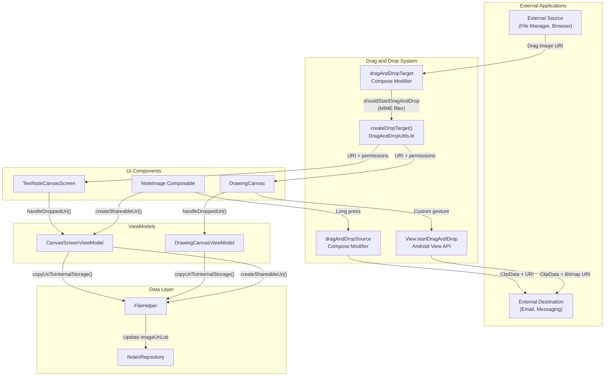
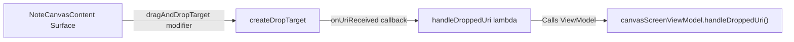
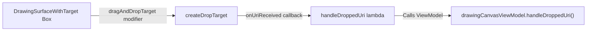
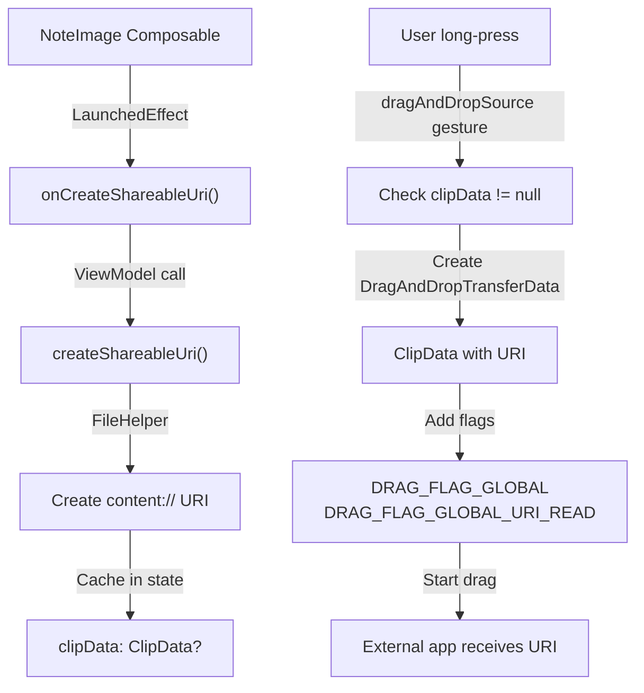
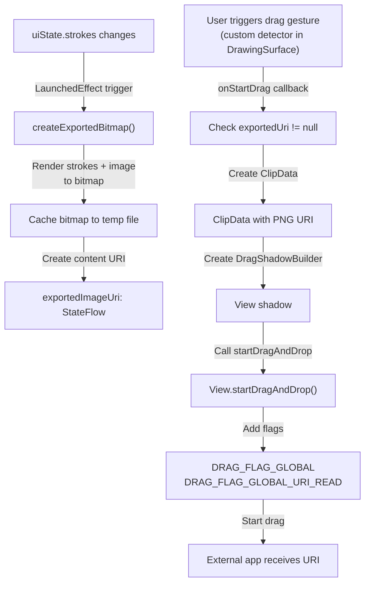
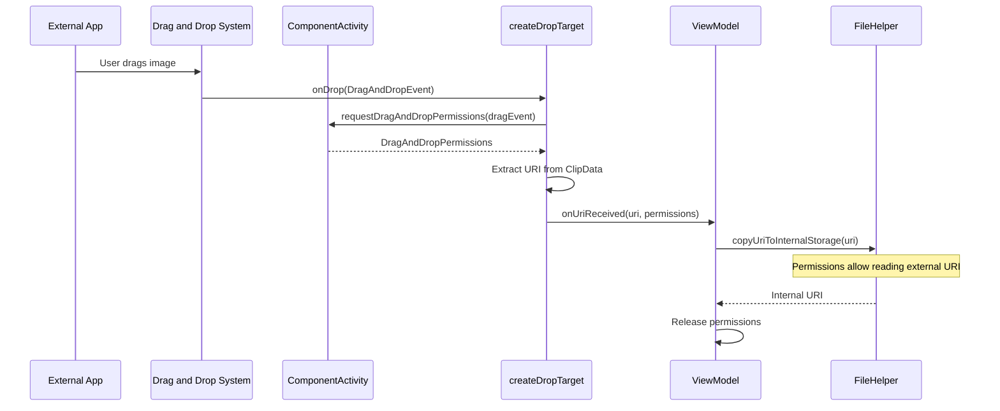
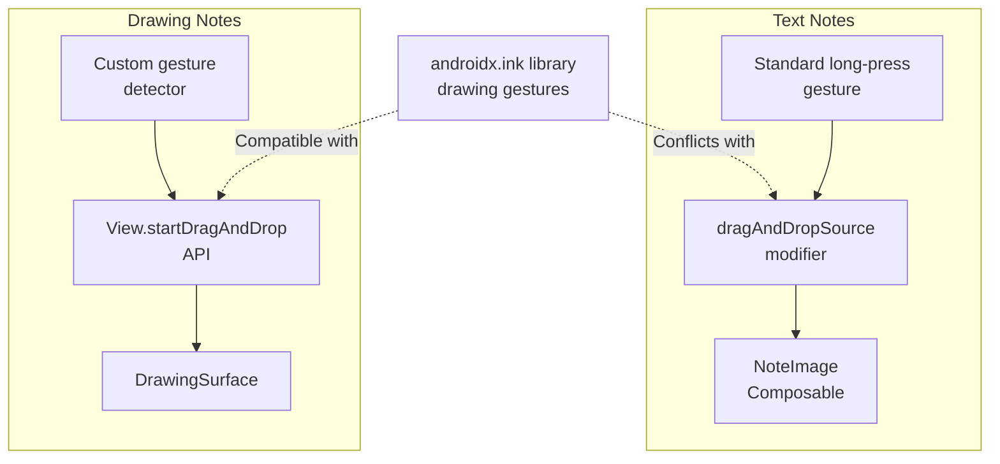
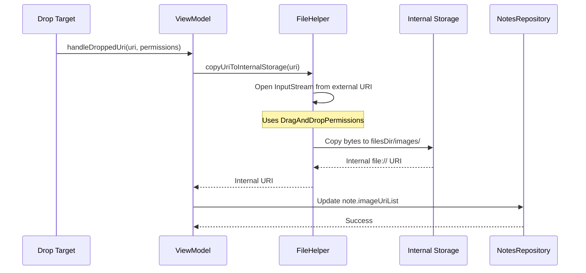
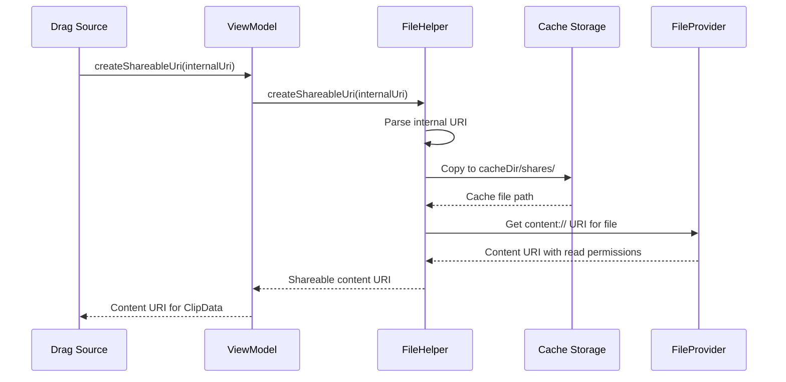

<!-- source: DeepWiki mcp.deepwiki.com · repo android/cahier · page 6.3 Drag and Drop System · fetched 2026-10-23 -->

# Drag and Drop System

<details>
<summary>Relevant source files</summary>

The following files were used as context for generating this wiki page:

- [app/src/main/java/com/example/cahier/ui/DrawingCanvas.kt](app/src/main/java/com/example/cahier/ui/DrawingCanvas.kt)
- [app/src/main/java/com/example/cahier/ui/TextNoteCanvasScreen.kt](app/src/main/java/com/example/cahier/ui/TextNoteCanvasScreen.kt)
- [app/src/main/java/com/example/cahier/ui/utils/DragAndDropUtils.kt](app/src/main/java/com/example/cahier/ui/utils/DragAndDropUtils.kt)

</details>


## Purpose and Scope

This document describes the drag and drop functionality that enables users to import images into notes and export images from notes to other applications. The system handles two distinct flows: accepting images dropped onto the application (drop targets) and initiating drags to export images to other applications (drag sources). 

For information about how dropped images are persisted to internal storage, see [File Management](#6.1). For details on image display and management within notes, see [Image Management](#3.4).

**Sources:** [app/src/main/java/com/example/cahier/ui/utils/DragAndDropUtils.kt:1-46](), [app/src/main/java/com/example/cahier/ui/DrawingCanvas.kt:1-413](), [app/src/main/java/com/example/cahier/ui/TextNoteCanvasScreen.kt:1-482]()

## System Overview

The drag and drop system consists of two primary flows:

1. **Image Import (Drop Target)**: Users can drag images from external applications (file managers, browsers, galleries) into Cahier notes. The system filters for image MIME types, requests temporary URI permissions, and copies the image to internal storage.

2. **Image Export (Drag Source)**: Users can drag images from Cahier notes to external applications. The system converts internal URIs to shareable content URIs that external apps can access.

Both text notes and drawing notes support both flows, with slight implementation differences due to the drawing canvas's integration with the androidx.ink library.

### High-Level Architecture



**Sources:** [app/src/main/java/com/example/cahier/ui/utils/DragAndDropUtils.kt:30-45](), [app/src/main/java/com/example/cahier/ui/DrawingCanvas.kt:283-319](), [app/src/main/java/com/example/cahier/ui/TextNoteCanvasScreen.kt:188-200]()

## Import System (Drop Targets)

### Drop Target Utility

The `createDropTarget` utility function in [app/src/main/java/com/example/cahier/ui/utils/DragAndDropUtils.kt:30-45]() provides a reusable implementation for handling dropped images:

```kotlin
fun createDropTarget(
    activity: ComponentActivity?,
    onUriReceived: (Uri, DragAndDropPermissions?) -> Unit
): DragAndDropTarget
```

| Parameter | Type | Purpose |
|-----------|------|---------|
| `activity` | `ComponentActivity?` | Required for requesting drag and drop permissions |
| `onUriReceived` | Lambda | Callback invoked with the URI and permissions when a drop occurs |
| Returns | `DragAndDropTarget` | Implementation of Compose's `DragAndDropTarget` interface |

The implementation:
1. Converts Compose's `DragAndDropEvent` to Android's native `DragEvent`
2. Requests temporary permissions via `Activity.requestDragAndDropPermissions()`
3. Extracts the URI from the first item in the `ClipData`
4. Invokes the callback with URI and permissions

**Sources:** [app/src/main/java/com/example/cahier/ui/utils/DragAndDropUtils.kt:30-45]()

### MIME Type Filtering

Both text notes and drawing notes filter dropped content to accept only images using the `dragAndDropTarget` modifier's `shouldStartDragAndDrop` predicate:

| Note Type | Implementation | Line Reference |
|-----------|---------------|----------------|
| Text Notes | [app/src/main/java/com/example/cahier/ui/TextNoteCanvasScreen.kt:195-200]() | Filters for `image/*` MIME types |
| Drawing Notes | [app/src/main/java/com/example/cahier/ui/DrawingCanvas.kt:314-319]() | Filters for `image/*` MIME types |

The filter checks if any MIME type in the drag event starts with `"image/"`:

```kotlin
shouldStartDragAndDrop = { event ->
    event.mimeTypes().any { it.startsWith("image/") }
}
```

**Sources:** [app/src/main/java/com/example/cahier/ui/DrawingCanvas.kt:314-319](), [app/src/main/java/com/example/cahier/ui/TextNoteCanvasScreen.kt:195-200]()

### Drop Target Integration

#### Text Notes Drop Target

The text note canvas applies the drop target to its root `Surface` at [app/src/main/java/com/example/cahier/ui/TextNoteCanvasScreen.kt:188-200]():



The drop target is created once and remembered:
- Activity is obtained via `LocalActivity.current`
- Lambda captures ViewModel's `handleDroppedUri` method
- Permissions are passed through to ViewModel for proper URI access

**Sources:** [app/src/main/java/com/example/cahier/ui/TextNoteCanvasScreen.kt:188-200]()

#### Drawing Notes Drop Target

The drawing canvas applies the drop target to the `DrawingSurfaceWithTarget` Box at [app/src/main/java/com/example/cahier/ui/DrawingCanvas.kt:283-319]():



The implementation is nearly identical to text notes, with the target applied at [app/src/main/java/com/example/cahier/ui/DrawingCanvas.kt:310-319]().

**Sources:** [app/src/main/java/com/example/cahier/ui/DrawingCanvas.kt:283-319]()

## Export System (Drag Sources)

### Text Notes Export (Compose Modifier)

Text notes use Compose's `dragAndDropSource` modifier for exporting images. The `NoteImage` composable at [app/src/main/java/com/example/cahier/ui/TextNoteCanvasScreen.kt:413-457]() implements drag-out functionality:

#### Export Flow



#### ClipData Structure

The ClipData is constructed at [app/src/main/java/com/example/cahier/ui/TextNoteCanvasScreen.kt:425-429]() with:

| Component | Value | Purpose |
|-----------|-------|---------|
| Label | `"Image"` | Human-readable description |
| MIME type | `["image/*"]` | Specifies image content |
| Item | Shareable URI string | Content URI from FileProvider |

The drag flags at [app/src/main/java/com/example/cahier/ui/TextNoteCanvasScreen.kt:442]() enable:
- `DRAG_FLAG_GLOBAL`: Allow drag to other applications
- `DRAG_FLAG_GLOBAL_URI_READ`: Grant temporary read permission

**Sources:** [app/src/main/java/com/example/cahier/ui/TextNoteCanvasScreen.kt:413-457]()

### Drawing Notes Export (Custom Implementation)

Drawing notes cannot use Compose's `dragAndDropSource` modifier due to gesture conflicts with the androidx.ink library. Instead, they use Android View system's `startDragAndDrop` API at [app/src/main/java/com/example/cahier/ui/DrawingCanvas.kt:331-357]().

#### Custom Drag Implementation Rationale

From [app/src/main/java/com/example/cahier/ui/DrawingCanvas.kt:343-350]():

```
While Jetpack Compose offers the `dragAndDropSource` modifier, a custom 
implementation using the Android View system's `startDragAndDrop` is 
necessary here. This is because the Ink API's drawing gestures conflict 
with the long-press-to-drag gesture when using the standard Compose 
modifier, preventing drag detection. This approach allows for a custom 
gesture detector to coexist with the Ink API and manually initiate the 
drag for seamless interoperability.
```

#### Export Preparation Flow



The bitmap export is prepared proactively at [app/src/main/java/com/example/cahier/ui/DrawingCanvas.kt:296-308](), updating whenever strokes or the background image change. The actual drag is initiated at [app/src/main/java/com/example/cahier/ui/DrawingCanvas.kt:331-357]() when the user performs a drag gesture detected by `DrawingSurface`.

**Sources:** [app/src/main/java/com/example/cahier/ui/DrawingCanvas.kt:296-357]()

## Permission Management

### Temporary URI Access

When users drag images from external applications, Android provides URIs that Cahier doesn't normally have permission to access. The `DragAndDropPermissions` object grants temporary read access.

#### Permission Request Flow



The permission request occurs at [app/src/main/java/com/example/cahier/ui/utils/DragAndDropUtils.kt:37]():

```kotlin
val permission = activity?.requestDragAndDropPermissions(dragEvent)
```

These permissions:
- Grant temporary read access to the dropped URI
- Are automatically released when the app loses focus or the permissions object is no longer held
- Enable `FileHelper` to read the external URI and copy it to internal storage

**Sources:** [app/src/main/java/com/example/cahier/ui/utils/DragAndDropUtils.kt:30-45]()

### Permission Lifecycle

| Stage | Permission State | Notes |
|-------|------------------|-------|
| Drop occurs | Permissions requested | Via `Activity.requestDragAndDropPermissions()` |
| ViewModel processing | Permissions held | Passed to ViewModel's `handleDroppedUri()` |
| FileHelper access | Permissions active | Used to read external URI |
| Copy complete | Permissions released | Automatically or explicitly released |

**Sources:** [app/src/main/java/com/example/cahier/ui/utils/DragAndDropUtils.kt:37]()

## ViewModel Integration

### Text Notes ViewModel

`CanvasScreenViewModel` handles both import and export for text notes:

#### Import Handler

At [app/src/main/java/com/example/cahier/ui/TextNoteCanvasScreen.kt:138-143]():

```kotlin
onDroppedUri = { uri, permissions ->
    canvasScreenViewModel.handleDroppedUri(uri, permissions)
}
```

The ViewModel:
1. Receives the URI and permissions from the drop target
2. Calls `FileHelper.copyUriToInternalStorage()` to persist the image
3. Updates the note's `imageUriList` in the database via `NotesRepository`

#### Export Handler

At [app/src/main/java/com/example/cahier/ui/TextNoteCanvasScreen.kt:144-146]():

```kotlin
onCreateShareableUri = { uriString ->
    canvasScreenViewModel.createShareableUri(uriString)
}
```

The ViewModel:
1. Receives an internal URI string
2. Calls `FileHelper.createShareableUri()` to convert to a content:// URI
3. Returns the shareable URI for ClipData construction

**Sources:** [app/src/main/java/com/example/cahier/ui/TextNoteCanvasScreen.kt:138-146]()

### Drawing Notes ViewModel

`DrawingCanvasViewModel` provides similar handlers:

#### Import Handler

At [app/src/main/java/com/example/cahier/ui/DrawingCanvas.kt:283-286]():

```kotlin
val dropTarget = remember {
    createDropTarget(activity) { uri, permissions ->
        drawingCanvasViewModel.handleDroppedUri(uri, permissions)
    }
}
```

#### Export Handler

The drawing ViewModel proactively exports the canvas as a bitmap:

At [app/src/main/java/com/example/cahier/ui/DrawingCanvas.kt:296-308]():

```kotlin
LaunchedEffect(
    uiState.strokes,
    uiState.note.imageUriList,
    canvasSize
) {
    if (canvasSize != IntSize.Zero) {
        drawingCanvasViewModel.createExportedBitmap(
            canvasSize.width,
            canvasSize.height
        )
    }
}
```

The `createExportedBitmap()` method:
1. Renders strokes and background image to a Bitmap
2. Caches the Bitmap to a temporary file
3. Creates a shareable content URI
4. Updates `exportedImageUri` StateFlow

**Sources:** [app/src/main/java/com/example/cahier/ui/DrawingCanvas.kt:283-308]()

## Implementation Differences

### Text Notes vs Drawing Notes

| Aspect | Text Notes | Drawing Notes | Reason |
|--------|-----------|---------------|--------|
| **Drop Target** | Applied to root Surface | Applied to DrawingSurface Box | Both use same `createDropTarget` utility |
| **Drag Source** | `dragAndDropSource` Compose modifier | Custom `View.startDragAndDrop()` | Ink API gesture conflicts prevent Compose modifier |
| **Export Trigger** | User long-press on image | Custom gesture in DrawingSurface | Drawing canvas needs custom gesture detector |
| **Export Content** | Existing image URI | Generated bitmap of canvas | Drawing notes render strokes to bitmap |
| **Export Preparation** | On-demand via LaunchedEffect | Proactive on stroke/image changes | Bitmap generation is async, done ahead of time |

**Sources:** [app/src/main/java/com/example/cahier/ui/TextNoteCanvasScreen.kt:413-457](), [app/src/main/java/com/example/cahier/ui/DrawingCanvas.kt:283-365]()

### Architecture Comparison



**Sources:** [app/src/main/java/com/example/cahier/ui/TextNoteCanvasScreen.kt:438-445](), [app/src/main/java/com/example/cahier/ui/DrawingCanvas.kt:343-356]()

## ClipData and MIME Type Handling

### ClipData Structure

Both import and export use Android's ClipData API for data transfer:

#### Import ClipData (Received)

When an image is dropped, the system receives ClipData with:
- **Description**: Label and MIME types from source app
- **Items**: One or more ClipData.Item objects, each potentially containing a URI
- **Extraction**: [app/src/main/java/com/example/cahier/ui/utils/DragAndDropUtils.kt:38]() extracts first item's URI

#### Export ClipData (Created)

When exporting images, Cahier creates ClipData:

**Text Notes** at [app/src/main/java/com/example/cahier/ui/TextNoteCanvasScreen.kt:425-430]():
```kotlin
ClipData(
    ClipDescription("Image", arrayOf("image/*")),
    ClipData.Item(shareableUri.toString())
)
```

**Drawing Notes** at [app/src/main/java/com/example/cahier/ui/DrawingCanvas.kt:333-341]():
```kotlin
ClipData(
    ClipDescription("Image", arrayOf("image/png")),
    ClipData.Item(uri)
)
```

| Component | Text Notes | Drawing Notes | Purpose |
|-----------|-----------|---------------|---------|
| Label | "Image" | "Image" | Human-readable description |
| MIME type | `image/*` | `image/png` | Specific vs generic image type |
| URI type | Content URI from existing image | Content URI from bitmap export | Different source content |

**Sources:** [app/src/main/java/com/example/cahier/ui/TextNoteCanvasScreen.kt:425-430](), [app/src/main/java/com/example/cahier/ui/DrawingCanvas.kt:333-341]()

## Integration with FileHelper

The drag and drop system relies heavily on `FileHelper` for URI management:

### Import Flow with FileHelper



### Export Flow with FileHelper



For detailed information about `FileHelper` methods and internal/cache storage management, see [File Management](#6.1).

**Sources:** [app/src/main/java/com/example/cahier/ui/DrawingCanvas.kt:283-286](), [app/src/main/java/com/example/cahier/ui/TextNoteCanvasScreen.kt:138-146]()

## Summary

The drag and drop system provides bidirectional image transfer capabilities:

**Import (Drop Target)**:
- Unified implementation via `createDropTarget` utility
- MIME type filtering for images only
- Automatic permission request and URI extraction
- Integration with `FileHelper` for persistent storage

**Export (Drag Source)**:
- Text notes use Compose's `dragAndDropSource` modifier
- Drawing notes use custom View API due to Ink library gesture conflicts
- Both convert internal URIs to shareable content URIs via FileProvider
- Drawing notes proactively render canvas to bitmap for export

**Key Design Decisions**:
- Separate utility function for drop target creation promotes code reuse
- Permission management handled at system boundary (drop target utility)
- ViewModel layer abstracts UI from FileHelper implementation details
- Drawing canvas uses custom drag implementation to avoid gesture conflicts

**Sources:** [app/src/main/java/com/example/cahier/ui/utils/DragAndDropUtils.kt:1-46](), [app/src/main/java/com/example/cahier/ui/DrawingCanvas.kt:1-413](), [app/src/main/java/com/example/cahier/ui/TextNoteCanvasScreen.kt:1-482]()

---

