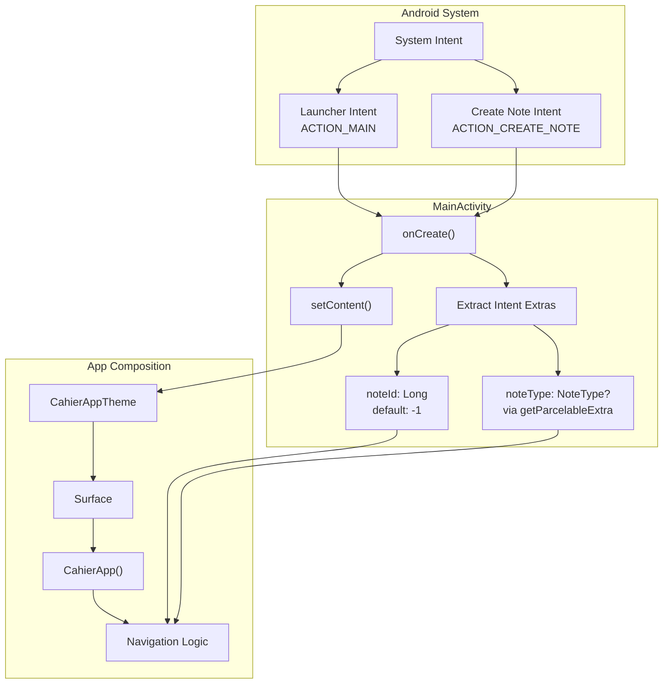
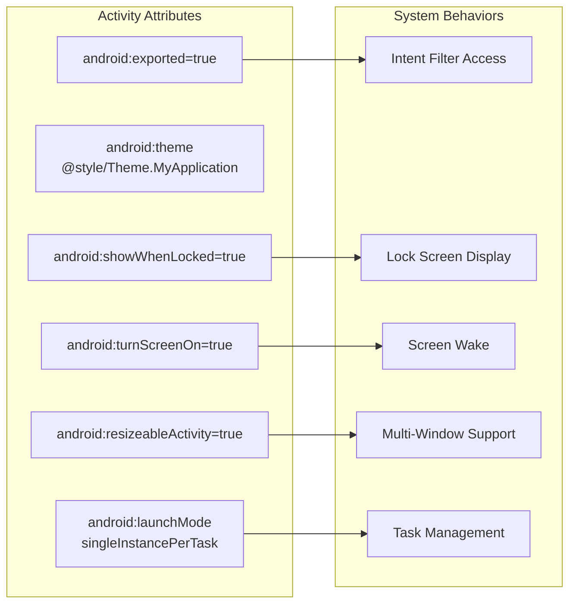
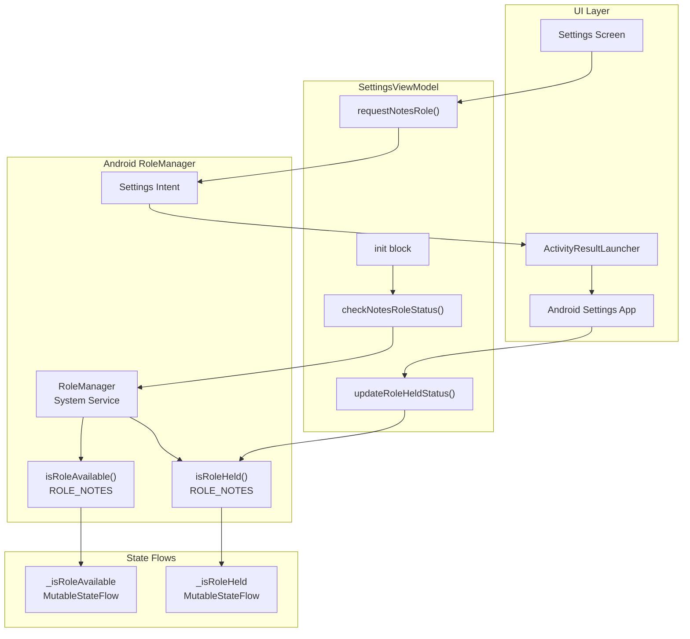
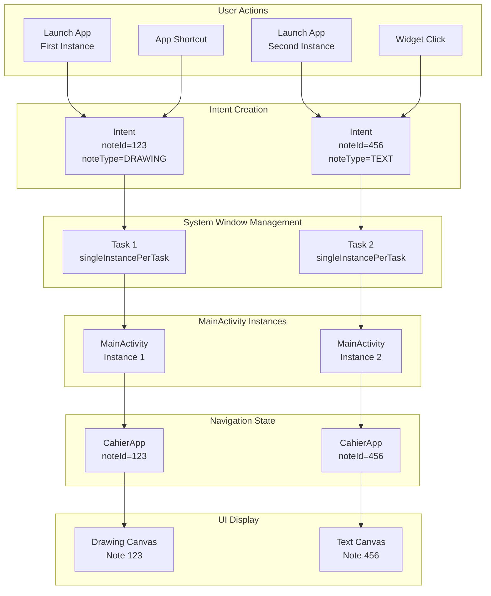

<!-- source: DeepWiki mcp.deepwiki.com · repo android/cahier · page 7 System Integration · fetched 2026-10-23 -->

# System Integration

<details>
<summary>Relevant source files</summary>

The following files were used as context for generating this wiki page:

- [app/src/main/AndroidManifest.xml](app/src/main/AndroidManifest.xml)
- [app/src/main/java/com/example/cahier/MainActivity.kt](app/src/main/java/com/example/cahier/MainActivity.kt)
- [app/src/main/java/com/example/cahier/ui/viewmodels/SettingsViewModel.kt](app/src/main/java/com/example/cahier/ui/viewmodels/SettingsViewModel.kt)

</details>


## Purpose and Scope

This document covers how the Cahier application integrates with the Android operating system at the platform level. It focuses on external system interactions including Intent handling, manifest configuration, permissions, FileProvider setup, the ROLE_NOTES API for default app registration, and multi-window support.

For internal application architecture, see [Architecture](#2). For file system operations and URI management, see [File Management](#6.1). For navigation within the application, see [Navigation System](#2.3).

---

## Overview

Cahier integrates with Android through several system-level mechanisms:

| Integration Type | Purpose | Key Components |
|-----------------|---------|----------------|
| **Intent Handling** | Receive note creation requests and direct launches with note ID | `MainActivity`, `AppArgs` |
| **Manifest Configuration** | Define app capabilities, permissions, and system properties | `AndroidManifest.xml` |
| **FileProvider** | Enable secure file sharing with other apps | `androidx.core.content.FileProvider` |
| **ROLE_NOTES** | Register as default notes app (Android 14+) | `SettingsViewModel`, `RoleManager` |
| **Multi-Window** | Support multiple note instances in separate windows | Intent extras, activity properties |

The primary entry point for all system interactions is `MainActivity`, which is annotated with `@AndroidEntryPoint` for Hilt dependency injection.

Sources: [app/src/main/java/com/example/cahier/MainActivity.kt:35-62](), [app/src/main/AndroidManifest.xml:31-53]()

---

## Intent Processing and Entry Point

### MainActivity Intent Handling

`MainActivity` processes incoming Intent data to determine the initial navigation state. The activity extracts two optional parameters:

1. **noteId** (`Long`): The ID of a specific note to open
2. **noteType** (`NoteType`): The type of note (TEXT or DRAWING)



**Intent Parameter Extraction**

The activity uses API-level conditional logic to extract the `NoteType` parcelable:

- **Android 13+ (API 33+)**: Uses `getParcelableExtra(key, Class)` type-safe method [app/src/main/java/com/example/cahier/MainActivity.kt:42-44]()
- **Android 12 and below**: Uses deprecated `getParcelableExtra(key)` with type cast [app/src/main/java/com/example/cahier/MainActivity.kt:48-49]()

The `noteId` defaults to `-1` if not provided [app/src/main/java/com/example/cahier/MainActivity.kt:41](). Both parameters are passed to `CahierApp()` composable [app/src/main/java/com/example/cahier/MainActivity.kt:58](), which uses them to determine initial navigation destination.

Sources: [app/src/main/java/com/example/cahier/MainActivity.kt:37-62]()

---

## Android Manifest Configuration

### Application Metadata

The application is defined in `AndroidManifest.xml` with the following key attributes:

| Attribute | Value | Purpose |
|-----------|-------|---------|
| `android:name` | `.CahierApplication` | Hilt application class |
| `android:allowBackup` | `true` | Enable automatic backup |
| `android:dataExtractionRules` | `@xml/data_extraction_rules` | Android 12+ backup configuration |
| `android:fullBackupContent` | `@xml/backup_rules` | Pre-Android 12 backup configuration |
| `android:supportsRtl` | `true` | Right-to-left layout support |

Sources: [app/src/main/AndroidManifest.xml:20-30]()

### Activity Configuration

The `MainActivity` activity configuration enables several important system integrations:



**Key Activity Properties:**

- `android:exported="true"`: Allows external apps to launch the activity via Intent filters [app/src/main/AndroidManifest.xml:33]()
- `android:showWhenLocked="true"`: Enables note creation from lock screen [app/src/main/AndroidManifest.xml:36]()
- `android:turnScreenOn="true"`: Wakes device screen when launched [app/src/main/AndroidManifest.xml:37]()
- `android:resizeableActivity="true"`: Enables multi-window and split-screen modes [app/src/main/AndroidManifest.xml:38]()
- `android:launchMode="singleInstancePerTask"`: Creates separate task instances for multi-window scenarios [app/src/main/AndroidManifest.xml:39]()

Sources: [app/src/main/AndroidManifest.xml:31-39]()

### Intent Filters

The activity declares two intent filters:

**1. ACTION_CREATE_NOTE Intent Filter**

```xml
<intent-filter>
    <action android:name="android.intent.action.CREATE_NOTE" />
    <category android:name="android.intent.category.DEFAULT" />
</intent-filter>
```

This allows Cahier to receive note creation requests from:
- Quick Settings tile
- Voice assistants ("Create a note")
- Other apps requesting note creation
- System-wide note creation shortcuts

Sources: [app/src/main/AndroidManifest.xml:45-48]()

**2. MAIN/LAUNCHER Intent Filter**

```xml
<intent-filter>
    <action android:name="android.intent.action.MAIN" />
    <category android:name="android.intent.category.LAUNCHER" />
</intent-filter>
```

This makes Cahier appear in the app launcher and allows it to be set as a default app.

Sources: [app/src/main/AndroidManifest.xml:49-52]()

### Multi-Window Property

The activity declares multi-instance system UI support via a property element:

```xml
<property
    android:name="android.window.PROPERTY_SUPPORTS_MULTI_INSTANCE_SYSTEM_UI"
    android:value="true"/>
```

This enables the system to create multiple independent instances of the app in separate windows, allowing users to edit different notes simultaneously.

Sources: [app/src/main/AndroidManifest.xml:41-43]()

---

## FileProvider Configuration

### Provider Declaration

The manifest declares a `FileProvider` for secure file sharing:

```xml
<provider
    android:name="androidx.core.content.FileProvider"
    android:authorities="${applicationId}.provider"
    android:exported="false"
    android:grantUriPermissions="true">
    <meta-data
        android:name="android.support.FILE_PROVIDER_PATHS"
        android:resource="@xml/filepaths" />
</provider>
```

**Configuration Details:**

| Attribute | Value | Purpose |
|-----------|-------|---------|
| `android:authorities` | `${applicationId}.provider` | Unique authority identifier (e.g., `com.example.cahier.provider`) |
| `android:exported` | `false` | Prevents direct external access |
| `android:grantUriPermissions` | `true` | Allows temporary URI permissions for shared files |
| Meta-data resource | `@xml/filepaths` | Defines which directories can be shared |

Sources: [app/src/main/AndroidManifest.xml:54-62]()

### FileProvider Usage

The `FileProvider` is used throughout the application for:

1. **Image Sharing**: Converting internal file URIs to content URIs for drag-and-drop export (see [Drag and Drop System](#6.3))
2. **Cache File Sharing**: Providing temporary access to cached bitmap files (see [File Management](#6.1))
3. **Cross-App Communication**: Enabling other apps to access shared images with appropriate permissions

The authority string is referenced in `FileHelper` utility class for URI creation operations.

Sources: [app/src/main/AndroidManifest.xml:54-62]()

---

## ROLE_NOTES Integration

### Overview

Starting with Android 14 (API 34, UPSIDE_DOWN_CAKE), Android introduced the `ROLE_NOTES` API, which allows users to designate a default notes application. Cahier integrates with this system through `SettingsViewModel`.



Sources: [app/src/main/java/com/example/cahier/ui/viewmodels/SettingsViewModel.kt:39-127]()

### SettingsViewModel Implementation

The `SettingsViewModel` manages ROLE_NOTES integration with three main operations:

**1. Role Status Checking**

The `checkNotesRoleStatus()` method queries the current state [app/src/main/java/com/example/cahier/ui/viewmodels/SettingsViewModel.kt:60-87]():

- Obtains `RoleManager` system service via `Context.getSystemService(RoleManager::class.java)` [app/src/main/java/com/example/cahier/ui/viewmodels/SettingsViewModel.kt:51-53]()
- Checks if `RoleManager.ROLE_NOTES` is available on the device [app/src/main/java/com/example/cahier/ui/viewmodels/SettingsViewModel.kt:64-66]()
- Checks if Cahier currently holds the role [app/src/main/java/com/example/cahier/ui/viewmodels/SettingsViewModel.kt:67]()
- Updates two `StateFlow` values: `isRoleAvailable` and `isRoleHeld` [app/src/main/java/com/example/cahier/ui/viewmodels/SettingsViewModel.kt:45-49]()

**2. Role Request**

The `requestNotesRole()` method initiates the system settings flow [app/src/main/java/com/example/cahier/ui/viewmodels/SettingsViewModel.kt:89-105]():

- Verifies the role is available and not currently held [app/src/main/java/com/example/cahier/ui/viewmodels/SettingsViewModel.kt:91-92]()
- Creates an Intent with action `Settings.ACTION_MANAGE_DEFAULT_APPS_SETTINGS` [app/src/main/java/com/example/cahier/ui/viewmodels/SettingsViewModel.kt:94]()
- Launches the intent via `ActivityResultLauncher` [app/src/main/java/com/example/cahier/ui/viewmodels/SettingsViewModel.kt:100]()
- This opens the Android system settings where users can select their default notes app

**3. Role Status Update**

The `updateRoleHeldStatus()` method refreshes the held state [app/src/main/java/com/example/cahier/ui/viewmodels/SettingsViewModel.kt:107-122]():

- Re-checks if Cahier currently holds `ROLE_NOTES` [app/src/main/java/com/example/cahier/ui/viewmodels/SettingsViewModel.kt:111]()
- Updates the `isRoleHeld` StateFlow [app/src/main/java/com/example/cahier/ui/viewmodels/SettingsViewModel.kt:112]()
- Called after returning from the settings activity to reflect any changes

### API Level Requirements

The entire `SettingsViewModel` class is annotated with `@RequiresApi(Build.VERSION_CODES.UPSIDE_DOWN_CAKE)` [app/src/main/java/com/example/cahier/ui/viewmodels/SettingsViewModel.kt:39](), restricting its use to Android 14 (API 34) and above. The UI layer must conditionally display settings options based on API level.

### Role Manager Lazy Initialization

The `RoleManager` instance is lazily initialized [app/src/main/java/com/example/cahier/ui/viewmodels/SettingsViewModel.kt:51-53]():

```kotlin
private val roleManager: RoleManager? by lazy {
    context.getSystemService(RoleManager::class.java)
}
```

The nullable type and null-safety checks throughout the class handle cases where the service is unavailable.

Sources: [app/src/main/java/com/example/cahier/ui/viewmodels/SettingsViewModel.kt:39-127]()

---

## Multi-Window Support

### Architecture

Cahier supports opening multiple notes simultaneously in separate windows. This is achieved through a combination of manifest configuration and Intent-based communication.



### Launch Mode Configuration

The activity's `android:launchMode="singleInstancePerTask"` [app/src/main/AndroidManifest.xml:39]() is critical for multi-window support:

- Each Intent with different extras creates a new task instance
- Multiple tasks can run simultaneously, each displaying different notes
- The system manages task stacking and switching independently

### Multi-Instance System UI Support

The manifest property `android.window.PROPERTY_SUPPORTS_MULTI_INSTANCE_SYSTEM_UI` with value `true` [app/src/main/AndroidManifest.xml:41-43]() enables:

- Split-screen mode with two Cahier instances
- Freeform window mode on devices that support it
- Picture-in-picture transitions (when applicable)
- Independent task switcher entries

### Intent-Based Window Creation

External components (widgets, shortcuts, other apps) can open specific notes in new windows by:

1. Creating an Intent targeting `MainActivity`
2. Adding `AppArgs.NOTE_ID_KEY` extra with the note ID [app/src/main/java/com/example/cahier/MainActivity.kt:41]()
3. Adding `AppArgs.NOTE_TYPE_KEY` extra with the `NoteType` enum [app/src/main/java/com/example/cahier/MainActivity.kt:42-50]()
4. Setting appropriate Intent flags for new task creation

The MainActivity processes these extras and navigates directly to the specified note, bypassing the home screen.

### Resizeable Activity

The `android:resizeableActivity="true"` attribute [app/src/main/AndroidManifest.xml:38]() ensures the activity can be resized in:

- Split-screen mode
- Freeform window mode
- Multi-window scenarios on large screens (tablets, foldables)

The application's adaptive layout system (see [Adaptive Layouts](#5.1)) automatically adjusts the UI based on window size changes.

Sources: [app/src/main/AndroidManifest.xml:31-43](), [app/src/main/java/com/example/cahier/MainActivity.kt:37-62]()

---

## System Integration Summary

| Integration | Entry Point | Configuration | Purpose |
|-------------|-------------|---------------|---------|
| **Intent Handling** | `MainActivity.onCreate()` | Intent filters in manifest | Process note creation requests and direct launches |
| **FileProvider** | `androidx.core.content.FileProvider` | Provider declaration + filepaths.xml | Enable secure file sharing with temporary permissions |
| **ROLE_NOTES** | `SettingsViewModel` | None (programmatic API) | Register as default notes app (Android 14+) |
| **Multi-Window** | Activity properties + launch mode | `singleInstancePerTask`, multi-instance support | Allow multiple note instances in separate windows |
| **Lock Screen** | Activity attributes | `showWhenLocked`, `turnScreenOn` | Enable note creation from lock screen |

All system integrations follow Android best practices and are compatible with modern Android versions while maintaining backward compatibility where appropriate.

Sources: [app/src/main/java/com/example/cahier/MainActivity.kt](), [app/src/main/AndroidManifest.xml](), [app/src/main/java/com/example/cahier/ui/viewmodels/SettingsViewModel.kt]()

---

