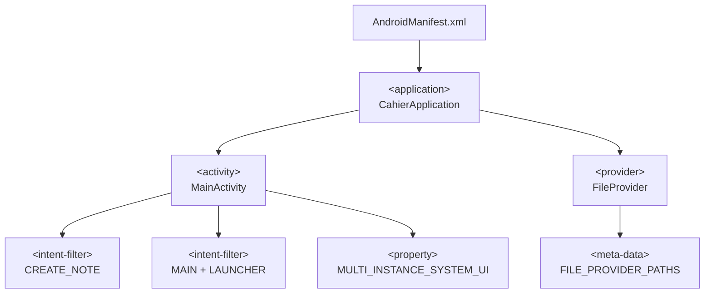
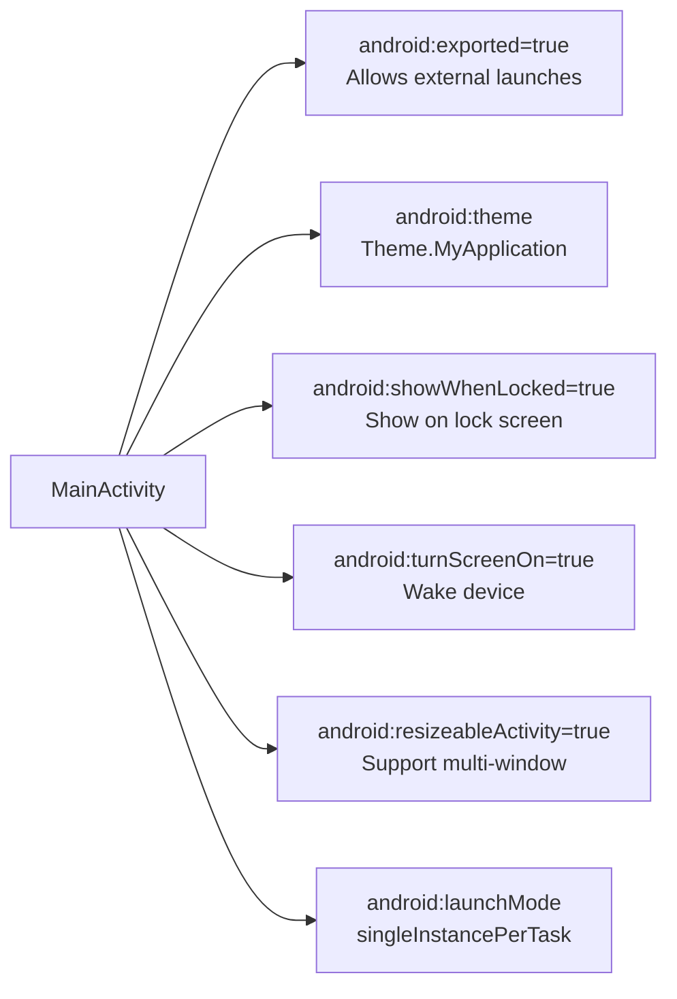
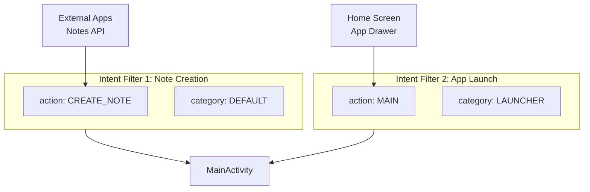
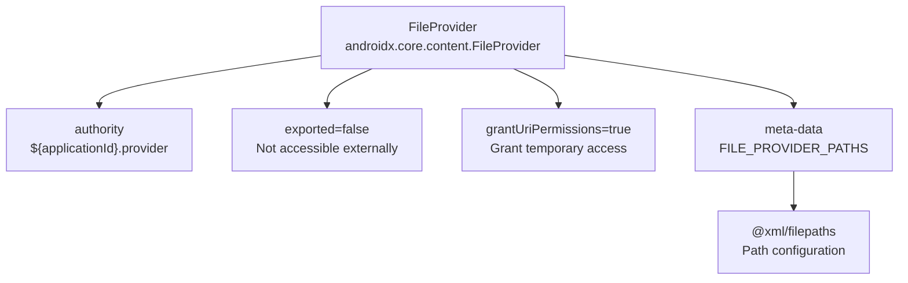
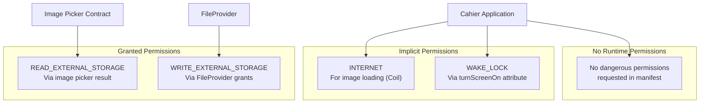
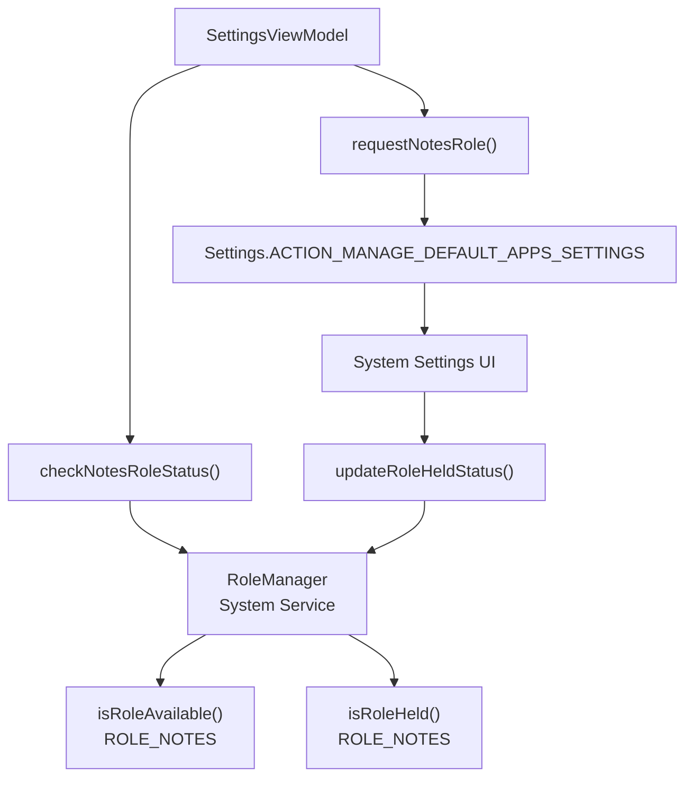

<!-- source: DeepWiki mcp.deepwiki.com · repo android/cahier · page 7.1 Android Manifest & Permissions · fetched 2026-10-23 -->

# Android Manifest & Permissions

<details>
<summary>Relevant source files</summary>

The following files were used as context for generating this wiki page:

- [app/src/main/AndroidManifest.xml](app/src/main/AndroidManifest.xml)
- [app/src/main/java/com/example/cahier/ui/viewmodels/SettingsViewModel.kt](app/src/main/java/com/example/cahier/ui/viewmodels/SettingsViewModel.kt)

</details>


## Purpose and Scope

This document details the Android manifest configuration and system-level integrations for the Cahier application. It covers:
- Application and activity declarations
- Intent filters for launcher and note creation
- FileProvider configuration for secure file sharing
- Activity properties for multi-window support
- ROLE_NOTES integration for becoming the default notes app

For information about how ROLE_NOTES is managed through the settings UI, see [ROLE_NOTES Integration](#7.2). For multi-window implementation details, see [Multi-Window Support](#7.3).

---

## Manifest Structure Overview

The application manifest defines a single-activity architecture with FileProvider support for secure file access. The manifest configures system-level behaviors including backup rules, launch modes, and multi-instance window support.

### Manifest Component Hierarchy



**Sources:** [app/src/main/AndroidManifest.xml:1-65]()

---

## Application Configuration

The `<application>` element defines global application properties including the custom `Application` subclass, backup behavior, and theming.

### Application Properties

| Property | Value | Purpose |
|----------|-------|---------|
| `android:name` | `.CahierApplication` | Custom Application class for Hilt initialization |
| `android:allowBackup` | `true` | Enables automatic backup/restore |
| `android:dataExtractionRules` | `@xml/data_extraction_rules` | API 31+ backup rules |
| `android:fullBackupContent` | `@xml/backup_rules` | Pre-API 31 backup rules |
| `android:icon` | `@mipmap/ic_launcher` | App icon resource |
| `android:roundIcon` | `@mipmap/ic_launcher_round` | Round icon for adaptive launchers |
| `android:supportsRtl` | `true` | Right-to-left layout support |
| `android:theme` | `@style/Theme.MyApplication` | Material Design 3 theme |

The `CahierApplication` class is annotated with `@HiltAndroidApp`, which initializes the Hilt dependency injection framework at application startup. This enables constructor injection in ViewModels and other components throughout the app.

**Sources:** [app/src/main/AndroidManifest.xml:20-30]()

---

## MainActivity Configuration

`MainActivity` is declared as an exported activity with multiple intent filters to support both standard app launching and the Android CREATE_NOTE action.

### Activity Properties



### Key Property Explanations

| Property | Value | Purpose |
|----------|-------|---------|
| `android:exported` | `true` | Required when intent filters are present; allows external apps to launch the activity |
| `android:showWhenLocked` | `true` | Displays activity above the lock screen for quick note taking |
| `android:turnScreenOn` | `true` | Wakes the device when launching (e.g., from quick settings) |
| `android:resizeableActivity` | `true` | Enables split-screen and freeform window modes |
| `android:launchMode` | `singleInstancePerTask` | Each instance runs in its own task, supporting multi-window note editing |

The `singleInstancePerTask` launch mode is critical for multi-window support. It ensures that each window showing the app can have its own navigation state while preventing duplicate instances within the same task.

**Sources:** [app/src/main/AndroidManifest.xml:31-39]()

---

## Intent Filters

The activity declares two intent filters that enable different entry points into the application.

### Intent Filter Configuration



### CREATE_NOTE Intent Filter

The `android.intent.action.CREATE_NOTE` action allows the app to respond to system-wide note creation requests. When another app or system UI component (such as quick settings or the stylus menu) requests note creation, Android can route the intent to Cahier.

```xml
<intent-filter>
    <action android:name="android.intent.action.CREATE_NOTE" />
    <category android:name="android.intent.category.DEFAULT" />
</intent-filter>
```

This intent filter is essential for integration with Android's notes ecosystem, particularly when combined with the ROLE_NOTES designation (see [ROLE_NOTES Integration](#7.2)).

### MAIN/LAUNCHER Intent Filter

The standard launcher intent filter makes the app appear in the device's app drawer and allows it to be launched normally by users.

```xml
<intent-filter>
    <action android:name="android.intent.action.MAIN" />
    <category android:name="android.intent.category.LAUNCHER" />
</intent-filter>
```

**Sources:** [app/src/main/AndroidManifest.xml:45-52]()

---

## Multi-Instance Window Support

The application declares support for multiple simultaneous instances through the `PROPERTY_SUPPORTS_MULTI_INSTANCE_SYSTEM_UI` property.

### Multi-Instance Property

```xml
<property
    android:name="android.window.PROPERTY_SUPPORTS_MULTI_INSTANCE_SYSTEM_UI"
    android:value="true"/>
```

This property, combined with `android:launchMode="singleInstancePerTask"` and `android:resizeableActivity="true"`, enables:

1. **Multiple windows** - Users can open different notes in separate windows simultaneously
2. **System UI integration** - The system can create new instances when appropriate (e.g., split-screen)
3. **Independent task management** - Each window maintains its own back stack and navigation state

The multi-instance capability is leveraged by the application through the `newWindowEvent` channel, which allows programmatic creation of new windows. For implementation details, see [Multi-Window Support](#7.3).

**Sources:** [app/src/main/AndroidManifest.xml:41-43]()

---

## FileProvider Configuration

The manifest declares a `FileProvider` to enable secure file sharing for images and cached content. This is necessary for sharing files with other apps and for handling drag-and-drop operations.

### FileProvider Declaration



### FileProvider Properties

| Property | Value | Purpose |
|----------|-------|---------|
| `android:name` | `androidx.core.content.FileProvider` | Standard FileProvider implementation |
| `android:authorities` | `${applicationId}.provider` | Unique authority using application ID |
| `android:exported` | `false` | Prevents external apps from directly accessing the provider |
| `android:grantUriPermissions` | `true` | Allows temporary URI access grants to other apps |

### File Path Configuration

The provider references `@xml/filepaths`, which defines the accessible file paths. Based on the FileHelper implementation (see [File Management](#6.1)), the configured paths likely include:

- **Internal storage** - `filesDir/images` for permanent image attachments
- **Cache storage** - `cacheDir/images` for image picker temporary files
- **Share cache** - `cacheDir/shares` for exported content (drag-and-drop, sharing)

The FileProvider converts internal file paths to `content://` URIs that can be safely shared with other applications. The FileHelper class uses `FileProvider.getUriForFile()` to create these shareable URIs.

**Sources:** [app/src/main/AndroidManifest.xml:54-62]()

---

## Permission Model

The Cahier application follows a minimal permission approach, requiring no runtime permissions for its core functionality.

### Permission Requirements



### Permission Strategy

The application avoids requesting explicit storage permissions by leveraging:

1. **Storage Access Framework** - The image picker (`ActivityResultContracts.PickMultipleVisualMedia`) provides read access to selected images without requiring permission declarations
2. **FileProvider** - Enables secure file sharing without requiring `WRITE_EXTERNAL_STORAGE` permission
3. **Scoped Storage** - All file operations use app-specific directories (`filesDir`, `cacheDir`) which don't require permissions
4. **Content URIs** - Received URIs from drag-and-drop or intents include implicit access grants

This zero-permission approach improves user trust and simplifies the installation experience while maintaining full functionality.

**Sources:** [app/src/main/AndroidManifest.xml:1-65]()

---

## ROLE_NOTES Integration

While not directly in the manifest, the application integrates with Android's `ROLE_NOTES` system role to become the default notes app. This integration is managed by `SettingsViewModel`.

### RoleManager Integration Flow



### Role Checking Logic

The `SettingsViewModel` checks role availability and status on initialization:

```kotlin
// Requires Android API 34 (UPSIDE_DOWN_CAKE)
@RequiresApi(Build.VERSION_CODES.UPSIDE_DOWN_CAKE)
fun checkNotesRoleStatus() {
    val roleManager = context.getSystemService(RoleManager::class.java)
    _isRoleAvailable.value = roleManager.isRoleAvailable(RoleManager.ROLE_NOTES)
    _isRoleHeld.value = roleManager.isRoleHeld(RoleManager.ROLE_NOTES)
}
```

The role status is exposed via StateFlows that the settings UI can observe:
- `isRoleAvailable: StateFlow<Boolean>` - Whether the device supports ROLE_NOTES
- `isRoleHeld: StateFlow<Boolean>` - Whether Cahier is currently the default notes app

### Role Request Process

When the user wants to make Cahier the default notes app:

1. **Check eligibility** - `isRoleAvailable()` must return true and `isRoleHeld()` must return false
2. **Launch system settings** - Opens the default apps settings screen
3. **User selection** - User manually selects Cahier from available notes apps
4. **Update status** - After returning, `updateRoleHeldStatus()` refreshes the held state

### Benefits of ROLE_NOTES

When Cahier holds `ROLE_NOTES`, the system:
- Routes `CREATE_NOTE` intents preferentially to Cahier
- May display Cahier in system quick settings for note creation
- Integrates Cahier with stylus gestures (device-dependent)
- Provides enhanced visibility in Android's notes ecosystem

The role system requires API 34+ (Android 14) and is unavailable on earlier versions. The ViewModel gracefully handles unavailability by setting both StateFlows to `false`.

**Sources:** [app/src/main/java/com/example/cahier/ui/viewmodels/SettingsViewModel.kt:39-127]()

---

## Manifest-Related Code Entities

### Key Classes and Configuration

| Entity | Type | Location | Purpose |
|--------|------|----------|---------|
| `CahierApplication` | Class | Application class | Hilt initialization entry point |
| `MainActivity` | Class | Activity | Single activity hosting all screens |
| `FileProvider` | Provider | androidx.core.content | Secure file sharing mechanism |
| `SettingsViewModel` | ViewModel | ui/viewmodels/ | ROLE_NOTES management |
| `RoleManager.ROLE_NOTES` | Constant | Android API 34+ | System role for default notes app |
| `CREATE_NOTE` | Action | android.intent.action | Note creation intent action |
| `${applicationId}.provider` | Authority | Build config | FileProvider authority string |

### Configuration Files Referenced

| File | Purpose |
|------|---------|
| `@xml/data_extraction_rules` | API 31+ backup/restore rules |
| `@xml/backup_rules` | Pre-API 31 backup/restore rules |
| `@xml/filepaths` | FileProvider path configuration |
| `@style/Theme.MyApplication` | Material Design 3 theme |
| `@string/app_name` | Application label |
| `@mipmap/ic_launcher` | App icon resources |

**Sources:** [app/src/main/AndroidManifest.xml:1-65](), [app/src/main/java/com/example/cahier/ui/viewmodels/SettingsViewModel.kt:1-127]()

---

