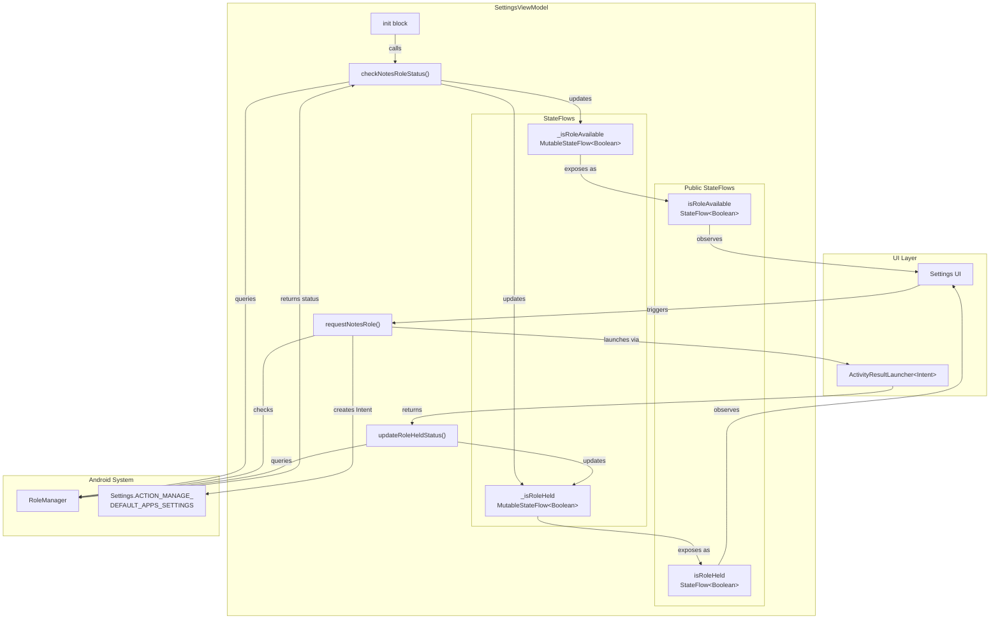
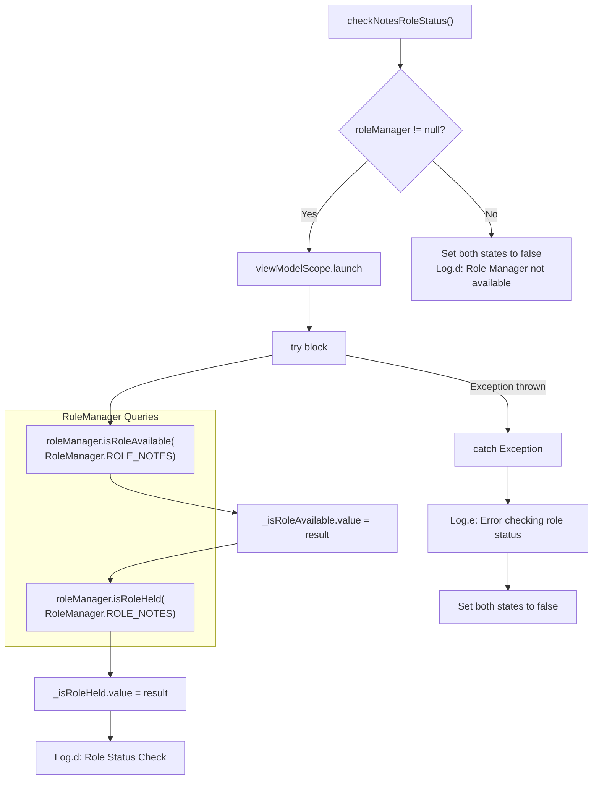
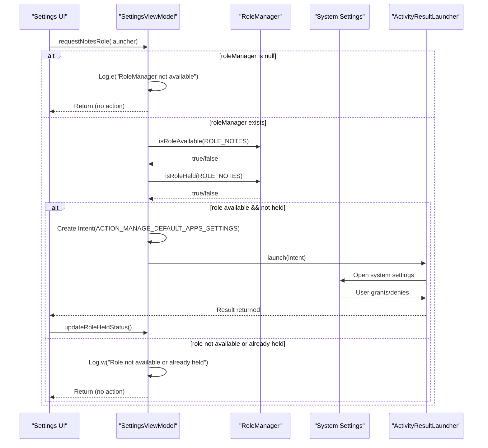
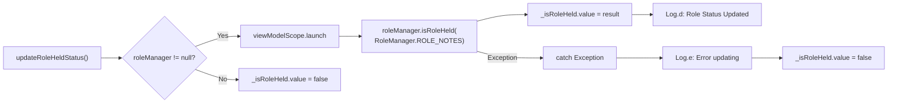
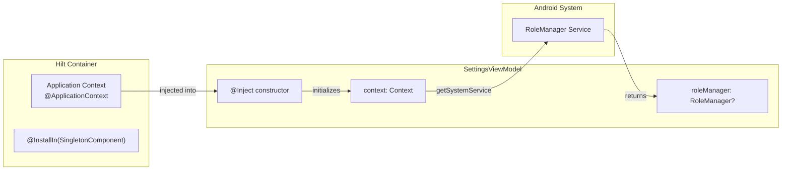
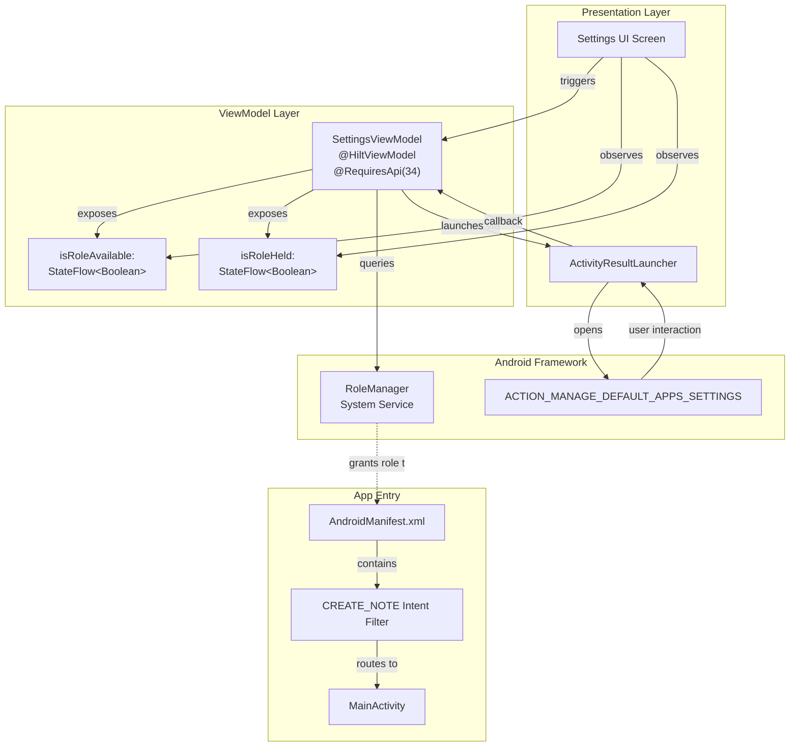

<!-- source: DeepWiki mcp.deepwiki.com · repo android/cahier · page 7.2 ROLE_NOTES Integration · fetched 2026-10-23 -->

# ROLE_NOTES Integration

<details>
<summary>Relevant source files</summary>

The following files were used as context for generating this wiki page:

- [app/src/main/AndroidManifest.xml](app/src/main/AndroidManifest.xml)
- [app/src/main/java/com/example/cahier/ui/viewmodels/SettingsViewModel.kt](app/src/main/java/com/example/cahier/ui/viewmodels/SettingsViewModel.kt)

</details>


## Purpose and Scope

This document describes how Cahier integrates with Android's `ROLE_NOTES` system to become the default notes application on Android 14+ devices. It covers the `SettingsViewModel` implementation, role status management, and the manifest configuration required to receive system note-taking intents.

For general Android manifest configuration including permissions and FileProvider setup, see [Android Manifest & Permissions](#7.1). For multi-window support and intent handling, see [Multi-Window Support](#7.3).

---

## Overview

Android 14 (API level 34, Build.VERSION_CODES.UPSIDE_DOWN_CAKE) introduced the `RoleManager.ROLE_NOTES` role, which allows applications to register as the system's default notes app. When an app holds this role, the system can launch it through the `android.intent.action.CREATE_NOTE` intent action, enabling integration with system note-taking triggers such as stylus shortcuts or quick settings tiles.

Cahier implements this integration through:
- A `SettingsViewModel` that manages role status and requests
- An intent filter in `AndroidManifest.xml` that declares support for `CREATE_NOTE` actions
- API level checks to ensure compatibility

**Sources:** [app/src/main/java/com/example/cahier/ui/viewmodels/SettingsViewModel.kt:1-127](), [app/src/main/AndroidManifest.xml:45-48]()

---

## SettingsViewModel Architecture

### Component Overview

The `SettingsViewModel` serves as the central coordinator for ROLE_NOTES integration, managing role availability checks, status tracking, and user-initiated role requests.

#### State Management Diagram



**Sources:** [app/src/main/java/com/example/cahier/ui/viewmodels/SettingsViewModel.kt:39-87]()

### Key Components

| Component | Type | Purpose |
|-----------|------|---------|
| `roleManager` | `RoleManager?` | Lazy-initialized Android system service for role management |
| `_isRoleAvailable` | `MutableStateFlow<Boolean>` | Internal state tracking whether ROLE_NOTES is available on the device |
| `isRoleAvailable` | `StateFlow<Boolean>` | Public read-only state for UI observation |
| `_isRoleHeld` | `MutableStateFlow<Boolean>` | Internal state tracking whether the app currently holds ROLE_NOTES |
| `isRoleHeld` | `StateFlow<Boolean>` | Public read-only state for UI observation |

The `roleManager` is obtained lazily via `context.getSystemService(RoleManager::class.java)` [app/src/main/java/com/example/cahier/ui/viewmodels/SettingsViewModel.kt:51-53](), ensuring efficient resource usage.

**Sources:** [app/src/main/java/com/example/cahier/ui/viewmodels/SettingsViewModel.kt:45-53]()

---

## Role Status Checking

### checkNotesRoleStatus()

This method queries the Android system to determine ROLE_NOTES availability and whether the app currently holds the role. It executes in a coroutine launched from `viewModelScope` to avoid blocking the main thread.

#### Execution Flow



**Sources:** [app/src/main/java/com/example/cahier/ui/viewmodels/SettingsViewModel.kt:59-87]()

### API Level Constraints

The entire `SettingsViewModel` class is annotated with `@RequiresApi(Build.VERSION_CODES.UPSIDE_DOWN_CAKE)` [app/src/main/java/com/example/cahier/ui/viewmodels/SettingsViewModel.kt:39](), indicating it requires Android 14 (API 34) or higher. The method implementation handles three scenarios:

| Scenario | Condition | Behavior |
|----------|-----------|----------|
| **Normal Operation** | RoleManager available, no exceptions | Queries both `isRoleAvailable()` and `isRoleHeld()`, updates StateFlows, logs success |
| **Exception Handling** | RoleManager available, exception occurs | Sets both StateFlows to `false`, logs error with stack trace |
| **Unavailable RoleManager** | RoleManager is `null` | Sets both StateFlows to `false`, logs unavailability message |

**Sources:** [app/src/main/java/com/example/cahier/ui/viewmodels/SettingsViewModel.kt:59-87]()

---

## Requesting the Notes Role

### requestNotesRole()

This method initiates the system flow for the user to designate Cahier as the default notes app. Rather than directly granting the role (which requires user consent), it launches the system's default apps settings screen.

#### Method Signature and Flow



**Sources:** [app/src/main/java/com/example/cahier/ui/viewmodels/SettingsViewModel.kt:89-105]()

### Intent Details

The method constructs an `Intent` with action `Settings.ACTION_MANAGE_DEFAULT_APPS_SETTINGS` [app/src/main/java/com/example/cahier/ui/viewmodels/SettingsViewModel.kt:94](). This launches the system settings screen where users can manage default app assignments for various roles, including ROLE_NOTES.

The implementation includes debug logging that inspects intent extras [app/src/main/java/com/example/cahier/ui/viewmodels/SettingsViewModel.kt:95-99](), which can be useful for understanding what data the system passes to the settings screen.

**Sources:** [app/src/main/java/com/example/cahier/ui/viewmodels/SettingsViewModel.kt:89-105]()

---

## Updating Role Status

### updateRoleHeldStatus()

This method refreshes the `isRoleHeld` state after the user returns from system settings. It should be called in response to the `ActivityResultLauncher` callback to ensure the UI reflects the current role assignment.

#### Implementation Pattern



**Sources:** [app/src/main/java/com/example/cahier/ui/viewmodels/SettingsViewModel.kt:107-122]()

### Usage Pattern

The typical usage pattern involves:

1. User clicks a button to request the notes role
2. `requestNotesRole(launcher)` is called with an `ActivityResultLauncher<Intent>`
3. System settings screen opens
4. User grants or denies the role
5. Launcher callback is triggered
6. `updateRoleHeldStatus()` is called to refresh the state
7. UI observes `isRoleHeld` StateFlow and updates accordingly

**Sources:** [app/src/main/java/com/example/cahier/ui/viewmodels/SettingsViewModel.kt:89-122]()

---

## Manifest Configuration

### CREATE_NOTE Intent Filter

The `AndroidManifest.xml` declares an intent filter that allows the system to launch Cahier when a note creation action is requested:

```xml
<intent-filter>
    <action android:name="android.intent.action.CREATE_NOTE" />
    <category android:name="android.intent.category.DEFAULT" />
</intent-filter>
```

This configuration is located at [app/src/main/AndroidManifest.xml:45-48]().

#### Integration with ROLE_NOTES

| Component | Role |
|-----------|------|
| **ROLE_NOTES** | System role that designates an app as the default notes application |
| **CREATE_NOTE intent filter** | Declares that the app can handle note creation intents |
| **MainActivity** | Target activity for CREATE_NOTE actions |

When the device user triggers a note-taking action (e.g., via stylus button, quick settings), the Android system:

1. Checks which app holds `RoleManager.ROLE_NOTES`
2. Constructs an `Intent` with action `android.intent.action.CREATE_NOTE`
3. Resolves the intent to the app's `MainActivity` via the declared intent filter
4. Launches the activity

**Sources:** [app/src/main/AndroidManifest.xml:45-48]()

### Activity Configuration

The `MainActivity` is configured with several attributes that support note-taking workflows:

| Attribute | Value | Purpose |
|-----------|-------|---------|
| `android:exported` | `true` | Allows external apps (system) to launch the activity |
| `android:launchMode` | `singleInstancePerTask` | Ensures each task has only one instance, supporting multi-window scenarios |
| `android:showWhenLocked` | `true` | Allows launching from lock screen for quick note capture |
| `android:turnScreenOn` | `true` | Wakes the device screen when launched |
| `android:resizeableActivity` | `true` | Supports multi-window and freeform modes |

These configurations work in conjunction with ROLE_NOTES to enable seamless note creation from various system contexts.

**Sources:** [app/src/main/AndroidManifest.xml:31-43]()

---

## Dependency Injection

### Hilt Integration

The `SettingsViewModel` is annotated with `@HiltViewModel` [app/src/main/java/com/example/cahier/ui/viewmodels/SettingsViewModel.kt:40](), enabling automatic dependency injection. The `Context` is injected using `@ApplicationContext` qualifier [app/src/main/java/com/example/cahier/ui/viewmodels/SettingsViewModel.kt:42](), ensuring the ViewModel receives the application context rather than an activity context.



**Sources:** [app/src/main/java/com/example/cahier/ui/viewmodels/SettingsViewModel.kt:39-43]()

---

## Error Handling

The implementation includes comprehensive error handling and logging:

### Logging Strategy

| Log Level | Scenario | Tag | Purpose |
|-----------|----------|-----|---------|
| `Log.d` | Successful role status check | `SettingsViewModel` | Debug information about current role state |
| `Log.d` | RoleManager unavailable | `SettingsViewModel` | Indicates API level or service issues |
| `Log.d` | Role status updated | `SettingsViewModel` | Confirms state refresh after settings change |
| `Log.e` | Exception during status check | `SettingsViewModel` | Critical error with stack trace |
| `Log.e` | Exception during status update | `SettingsViewModel` | Critical error with stack trace |
| `Log.e` | RoleManager unavailable for request | `SettingsViewModel` | Cannot fulfill user request |
| `Log.w` | Role already held or unavailable | `SettingsViewModel` | Invalid state for role request |
| `Log.w` | Intent extras inspection | `SettingsViewModel` | Debug information about system intent |

All log statements use the constant `TAG = "SettingsViewModel"` [app/src/main/java/com/example/cahier/ui/viewmodels/SettingsViewModel.kt:125]() for consistent filtering.

**Sources:** [app/src/main/java/com/example/cahier/ui/viewmodels/SettingsViewModel.kt:60-125]()

### Exception Handling

Both `checkNotesRoleStatus()` and `updateRoleHeldStatus()` wrap RoleManager calls in try-catch blocks [app/src/main/java/com/example/cahier/ui/viewmodels/SettingsViewModel.kt:63-78](), [app/src/main/java/com/example/cahier/ui/viewmodels/SettingsViewModel.kt:110-117](). When exceptions occur, the methods:

1. Log the error with stack trace using `Log.e()`
2. Set relevant StateFlows to `false` to indicate failure
3. Prevent crashes and allow the app to continue functioning

**Sources:** [app/src/main/java/com/example/cahier/ui/viewmodels/SettingsViewModel.kt:63-78](), [app/src/main/java/com/example/cahier/ui/viewmodels/SettingsViewModel.kt:110-117]()

---

## Implementation Summary

### Key Files

| File | Purpose |
|------|---------|
| `SettingsViewModel.kt` | Manages ROLE_NOTES state and requests |
| `AndroidManifest.xml` | Declares CREATE_NOTE intent filter and activity configuration |

### Architecture Pattern



**Sources:** [app/src/main/java/com/example/cahier/ui/viewmodels/SettingsViewModel.kt:1-127](), [app/src/main/AndroidManifest.xml:31-52]()

### State Flow Summary

1. **Initialization**: `checkNotesRoleStatus()` is called in the ViewModel's `init` block
2. **UI Observation**: Settings UI observes `isRoleAvailable` and `isRoleHeld` to show appropriate UI
3. **User Action**: User taps button to request notes role
4. **System Settings**: `requestNotesRole()` launches system settings via `ActivityResultLauncher`
5. **User Decision**: User grants or denies the role in system settings
6. **State Update**: `updateRoleHeldStatus()` refreshes the held state
7. **UI Update**: StateFlow emission triggers UI recomposition
8. **Intent Handling**: When the app holds the role, system CREATE_NOTE intents launch `MainActivity`

**Sources:** [app/src/main/java/com/example/cahier/ui/viewmodels/SettingsViewModel.kt:55-122](), [app/src/main/AndroidManifest.xml:45-48]()

---

