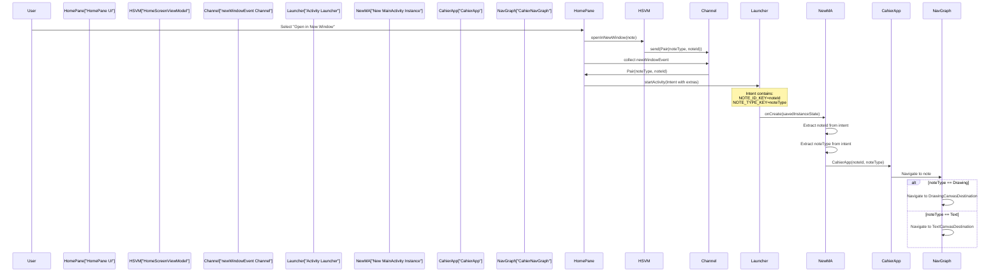
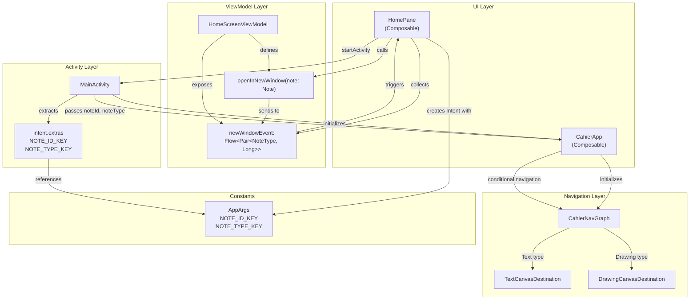

<!-- source: DeepWiki mcp.deepwiki.com · repo android/cahier · page 7.3 Multi-Window Support · fetched 2026-10-23 -->

# Multi-Window Support

<details>
<summary>Relevant source files</summary>

The following files were used as context for generating this wiki page:

- [app/src/androidTest/java/com/example/cahier/utils/FileHelperTest.kt](app/src/androidTest/java/com/example/cahier/utils/FileHelperTest.kt)
- [app/src/main/java/com/example/cahier/MainActivity.kt](app/src/main/java/com/example/cahier/MainActivity.kt)
- [app/src/main/java/com/example/cahier/navigation/CahierNavGraph.kt](app/src/main/java/com/example/cahier/navigation/CahierNavGraph.kt)
- [app/src/main/java/com/example/cahier/ui/ColorPickerDialog.kt](app/src/main/java/com/example/cahier/ui/ColorPickerDialog.kt)
- [app/src/main/java/com/example/cahier/ui/viewmodels/HomeScreenViewModel.kt](app/src/main/java/com/example/cahier/ui/viewmodels/HomeScreenViewModel.kt)
- [app/src/test/java/com/example/cahier/ui/viewmodels/HomeScreenViewModelTest.kt](app/src/test/java/com/example/cahier/ui/viewmodels/HomeScreenViewModelTest.kt)

</details>


## Purpose and Scope

This document explains how Cahier supports opening notes in separate windows on multi-window capable Android devices. The system allows users to view and edit multiple notes simultaneously in different windows, leveraging Android's multi-window and multi-display capabilities.

The multi-window feature uses Android Intent extras to pass note information between activity instances and a Channel-based event system to trigger new window creation. For information about the general navigation structure within a single window, see [Navigation System](#2.3).

## System Overview

The multi-window support system consists of three main components:

| Component | Purpose | Key Classes |
|-----------|---------|-------------|
| Event Channel | Communicates window creation requests from UI to launcher | `HomeScreenViewModel._newWindowEvent` |
| Intent Extras | Passes note information between activity instances | `AppArgs.NOTE_ID_KEY`, `AppArgs.NOTE_TYPE_KEY` |
| Entry Point Handler | Processes intent data and initializes app state | `MainActivity.onCreate()`, `CahierApp` |

When a user requests to open a note in a new window, the system emits an event through a Channel, which is collected by the UI layer. The UI layer then constructs a new Intent with note metadata and launches a new activity instance. The new `MainActivity` instance extracts the note information from the intent and passes it to the navigation system, which directly navigates to the appropriate note editor.

## Intent Extras Structure

The `MainActivity` extracts two pieces of information from incoming intents to support multi-window functionality:

**Note Identifier**: The `NOTE_ID_KEY` extra contains the database ID of the note to open.

**Note Type**: The `NOTE_TYPE_KEY` extra contains a `NoteType` enum value (either `Text` or `Drawing`) to determine which editor screen to display.

[app/src/main/java/com/example/cahier/MainActivity.kt:41-50]()

```kotlin
val noteId = intent.getLongExtra(AppArgs.NOTE_ID_KEY, -1)
val noteType = if (Build.VERSION.SDK_INT >= Build.VERSION_CODES.TIRAMISU) {
    intent.getParcelableExtra(AppArgs.NOTE_TYPE_KEY, NoteType::class.java)
} else {
    @Suppress("DEPRECATION")
    intent.getParcelableExtra(AppArgs.NOTE_TYPE_KEY) as NoteType?
}
```

The implementation handles API level differences for parcelable extraction, using the newer type-safe method on Android 13+ (API 33) and falling back to the deprecated method for older versions.

Both values are passed to `CahierApp`:

[app/src/main/java/com/example/cahier/MainActivity.kt:58]()

```kotlin
CahierApp(noteId = noteId, noteType = noteType)
```

**Sources:** [app/src/main/java/com/example/cahier/MainActivity.kt:37-62]()

## Channel-Based Event System

The `HomeScreenViewModel` exposes a Channel-based event system for triggering new window creation requests:

### Channel Declaration

[app/src/main/java/com/example/cahier/ui/viewmodels/HomeScreenViewModel.kt:51-52]()

```kotlin
private val _newWindowEvent = Channel<Pair<NoteType, Long>>()
val newWindowEvent = _newWindowEvent.receiveAsFlow()
```

The private `_newWindowEvent` Channel accepts pairs of `NoteType` and note ID (Long). The public `newWindowEvent` Flow allows UI components to collect events without directly accessing the Channel's send operation.

### Event Emission

The `openInNewWindow()` function emits events to the channel:

[app/src/main/java/com/example/cahier/ui/viewmodels/HomeScreenViewModel.kt:158-162]()

```kotlin
fun openInNewWindow(note: Note) {
    viewModelScope.launch {
        _newWindowEvent.send(Pair(note.type, note.id))
    }
}
```

This function is called when the user selects the "Open in New Window" action from the note context menu in the home screen. The function extracts the note's type and ID and sends them through the channel within the ViewModel's coroutine scope.

**Sources:** [app/src/main/java/com/example/cahier/ui/viewmodels/HomeScreenViewModel.kt:51-52](), [app/src/main/java/com/example/cahier/ui/viewmodels/HomeScreenViewModel.kt:158-162]()

## Multi-Window Flow Diagram

**Multi-Window Launch Sequence**



**Sources:** [app/src/main/java/com/example/cahier/ui/viewmodels/HomeScreenViewModel.kt:158-162](), [app/src/main/java/com/example/cahier/MainActivity.kt:41-58]()

## Component Integration

**Architecture Components and Data Flow**



**Sources:** [app/src/main/java/com/example/cahier/ui/viewmodels/HomeScreenViewModel.kt:44-162](), [app/src/main/java/com/example/cahier/MainActivity.kt:36-62]()

## Implementation Details

### HomeScreenViewModel Integration

The `HomeScreenViewModel` serves as the source of multi-window events. It does not directly launch activities, maintaining separation of concerns between ViewModels (which manage business logic and state) and UI components (which handle Android framework interactions like activity launching).

The Channel pattern ensures that events are only consumed once. When `HomePane` collects from `newWindowEvent`, each emitted event is delivered to exactly one collector, preventing duplicate window launches.

**Sources:** [app/src/main/java/com/example/cahier/ui/viewmodels/HomeScreenViewModel.kt:44-162]()

### Activity Lifecycle Considerations

Each new window creates a separate `MainActivity` instance with its own lifecycle. The instances maintain independent:
- `NavHostController` instances for navigation
- ViewModel instances (scoped to each activity)
- Compose UI trees

This isolation ensures that changes in one window (such as editing a note) do not directly affect the UI of other windows. However, all instances share the same underlying `NotesRepository` and Room database, so data changes are synchronized through the repository's Flow-based APIs.

**Sources:** [app/src/main/java/com/example/cahier/MainActivity.kt:36-62]()

### Navigation Integration

When `CahierApp` receives non-null `noteId` and `noteType` parameters, it bypasses the normal home screen and navigates directly to the appropriate editor:

```kotlin
// Pseudocode representation of CahierApp logic
if (noteId != -1 && noteType != null) {
    // Navigate directly to note editor
    when (noteType) {
        NoteType.Drawing -> navigate to DrawingCanvasDestination
        NoteType.Text -> navigate to TextCanvasDestination
    }
} else {
    // Normal flow: show home screen
    navigate to HomeDestination
}
```

This conditional navigation ensures that new windows open directly to the requested note rather than showing the home screen first.

**Sources:** [app/src/main/java/com/example/cahier/MainActivity.kt:58](), [app/src/main/java/com/example/cahier/navigation/CahierNavGraph.kt:37-80]()

## Testing Considerations

The multi-window system can be tested at several levels:

### ViewModel Testing

The `openInNewWindow()` function can be tested by collecting from the `newWindowEvent` Flow:

[app/src/test/java/com/example/cahier/ui/viewmodels/HomeScreenViewModelTest.kt:1-136]()

The test suite demonstrates testing other ViewModel functions but does not currently include explicit tests for `openInNewWindow()`. A complete test would verify that calling the function results in the correct event being emitted through the channel.

### Integration Testing

Full multi-window behavior requires instrumented tests with actual activity launches. These tests would verify:
1. Intent extras are correctly set when launching a new activity
2. New activity instances correctly extract and process intent data
3. Navigation occurs to the correct destination based on note type

**Sources:** [app/src/test/java/com/example/cahier/ui/viewmodels/HomeScreenViewModelTest.kt:44-136]()

## Limitations and Future Considerations

### Current Limitations

- The system assumes that the `AppArgs` constant object exists and defines the `NOTE_ID_KEY` and `NOTE_TYPE_KEY` constants, though these are not visible in the provided code files
- No explicit handling for invalid note IDs (e.g., note deleted after intent created but before activity launched)
- No state restoration for the multi-window scenario where configuration changes occur

### Potential Enhancements

- Support for opening multiple notes in split-screen within a single activity instance
- Synchronization indicators when a note is being edited in multiple windows
- Conflict resolution UI if the same note is modified in different windows simultaneously

**Sources:** [app/src/main/java/com/example/cahier/MainActivity.kt:41-50](), [app/src/main/java/com/example/cahier/ui/viewmodels/HomeScreenViewModel.kt:158-162]()

---

