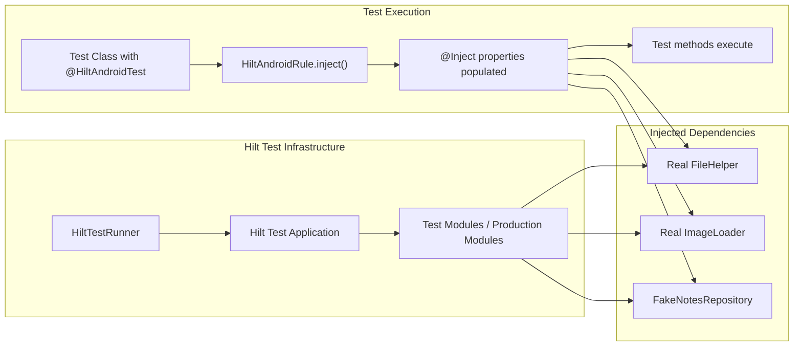

<!-- source: DeepWiki mcp.deepwiki.com · repo android/cahier · page 8 Testing · fetched 2026-10-23 -->

# Testing

<details>
<summary>Relevant source files</summary>

The following files were used as context for generating this wiki page:

- [app/build.gradle.kts](app/build.gradle.kts)
- [app/src/androidTest/java/com/example/cahier/ui/viewmodels/DrawingCanvasViewModelTest.kt](app/src/androidTest/java/com/example/cahier/ui/viewmodels/DrawingCanvasViewModelTest.kt)
- [app/src/androidTest/java/com/example/cahier/utils/FileHelperTest.kt](app/src/androidTest/java/com/example/cahier/utils/FileHelperTest.kt)
- [app/src/main/java/com/example/cahier/navigation/CahierNavGraph.kt](app/src/main/java/com/example/cahier/navigation/CahierNavGraph.kt)
- [app/src/main/java/com/example/cahier/ui/ColorPickerDialog.kt](app/src/main/java/com/example/cahier/ui/ColorPickerDialog.kt)
- [app/src/main/java/com/example/cahier/ui/viewmodels/HomeScreenViewModel.kt](app/src/main/java/com/example/cahier/ui/viewmodels/HomeScreenViewModel.kt)
- [app/src/test/java/com/example/cahier/ui/viewmodels/HomeScreenViewModelTest.kt](app/src/test/java/com/example/cahier/ui/viewmodels/HomeScreenViewModelTest.kt)
- [gradle/libs.versions.toml](gradle/libs.versions.toml)

</details>


This document describes the testing infrastructure, strategies, and key test implementations in the Cahier application. It covers both unit tests (local JVM tests) and instrumented tests (Android device/emulator tests), along with the testing utilities and patterns used throughout the codebase.

For information about the build configuration that enables testing, see [Build Configuration](#9). For details about dependency injection used in tests, see [Dependency Injection with Hilt](#2.2).

---

## Test Architecture Overview

The Cahier application implements a comprehensive testing strategy with two distinct test types: unit tests that run on the local JVM and instrumented tests that run on Android devices or emulators. The testing infrastructure leverages Hilt for dependency injection, coroutine testing utilities for asynchronous code, and the Turbine library for testing Kotlin Flows.

### Test Directory Structure

The test code is organized into two primary directories:

| Directory | Location | Execution Environment | Purpose |
|-----------|----------|----------------------|---------|
| Unit Tests | `app/src/test/java/` | Local JVM | Fast tests for ViewModels and business logic |
| Instrumented Tests | `app/src/androidTest/java/` | Android Device/Emulator | Tests requiring Android framework components |

Sources: [app/build.gradle.kts:92-115](), [app/src/test/java/com/example/cahier/ui/viewmodels/HomeScreenViewModelTest.kt:1-136](), [app/src/androidTest/java/com/example/cahier/ui/viewmodels/DrawingCanvasViewModelTest.kt:1-215]()

### Test Architecture Diagram

```mermaid
graph TB
    subgraph "Unit Tests (test/)"
        HSVMTest["HomeScreenViewModelTest"]
        FAKE["FakeNotesRepository"]
        TURBINE_UNIT["Turbine Flow Testing"]
    end
    
    subgraph "Instrumented Tests (androidTest/)"
        DCVMTest["DrawingCanvasViewModelTest"]
        FHTest["FileHelperTest"]
        HTR["HiltTestRunner"]
    end
    
    subgraph "Testing Infrastructure"
        HILT_RULE["HiltAndroidRule"]
        INSTANT["InstantTaskExecutorRule"]
        TEST_DISP["UnconfinedTestDispatcher"]
        TURBINE["Turbine Library"]
    end
    
    subgraph "Production Code Under Test"
        HSVM["HomeScreenViewModel"]
        DCVM["DrawingCanvasViewModel"]
        FH["FileHelper"]
        REPO["NotesRepository Interface"]
    end
    
    subgraph "Test Dependencies"
        JUNIT["JUnit"]
        MOCKITO["Mockito"]
        COROUTINES_TEST["kotlinx-coroutines-test"]
        HILT_TEST["hilt-android-testing"]
    end
    
    HSVMTest --> FAKE
    HSVMTest --> TURBINE_UNIT
    HSVMTest --> HSVM
    
    DCVMTest --> HILT_RULE
    DCVMTest --> HTR
    DCVMTest --> DCVM
    
    FHTest --> HILT_RULE
    FHTest --> HTR
    FHTest --> FH
    
    HILT_RULE --> HILT_TEST
    INSTANT --> JUNIT
    TEST_DISP --> COROUTINES_TEST
    TURBINE --> COROUTINES_TEST
    
    FAKE -.implements.- REPO
    DCVM --> REPO
    HSVM --> REPO
    
    HSVMTest --> INSTANT
    HSVMTest --> TEST_DISP
    DCVMTest --> INSTANT
    DCVMTest --> TEST_DISP
    FHTest --> HILT_TEST
```



Sources: [app/src/test/java/com/example/cahier/ui/viewmodels/HomeScreenViewModelTest.kt:44-66](), [app/src/androidTest/java/com/example/cahier/ui/viewmodels/DrawingCanvasViewModelTest.kt:57-100]()

---

## Unit Testing

Unit tests execute on the local development machine's JVM, providing fast feedback without requiring an Android device or emulator. These tests focus on ViewModels and business logic that don't require Android framework components.

### Unit Test Setup

Unit tests use standard JUnit 4 with additional rules and utilities for testing Android Architecture Components and Kotlin coroutines:

```
@ExperimentalCoroutinesApi
class HomeScreenViewModelTest {
    @get:Rule
    val instantTaskExecutorRule = InstantTaskExecutorRule()
    
    private val testDispatcher = UnconfinedTestDispatcher()
    private lateinit var viewModel: HomeScreenViewModel
    private lateinit var notesRepository: FakeNotesRepository
}
```

**Key Components:**

- **InstantTaskExecutorRule**: Forces LiveData and StateFlow operations to execute synchronously on the same thread during tests [app/src/test/java/com/example/cahier/ui/viewmodels/HomeScreenViewModelTest.kt:48]()
- **UnconfinedTestDispatcher**: A test coroutine dispatcher that executes coroutines immediately without delay [app/src/test/java/com/example/cahier/ui/viewmodels/HomeScreenViewModelTest.kt:50]()
- **FakeNotesRepository**: A test double that implements the `NotesRepository` interface for isolated testing [app/src/test/java/com/example/cahier/ui/viewmodels/HomeScreenViewModelTest.kt:52]()

### Setting Up Test Coroutine Context

The test setup establishes a test coroutine dispatcher as the Main dispatcher to ensure deterministic coroutine execution:

```kotlin
@Before
fun setup() {
    Dispatchers.setMain(testDispatcher)
    notesRepository = FakeNotesRepository()
    viewModel = HomeScreenViewModel(noteRepository = notesRepository)
}

@After
fun tearDown() {
    Dispatchers.resetMain()
}
```

This pattern ensures that all coroutines launched with `Dispatchers.Main` in the ViewModel execute immediately and synchronously during tests.

Sources: [app/src/test/java/com/example/cahier/ui/viewmodels/HomeScreenViewModelTest.kt:54-66]()

### Testing StateFlows with Turbine

The Turbine library provides a clean API for testing Kotlin Flows, including StateFlows used extensively in ViewModels:

```kotlin
@Test
fun selectNote_updates_uiState_with_the_correct_note() = runTest {
    val noteId = runBlocking {
        notesRepository.addNote(Note(title = "Selected Note", type = NoteType.Drawing))
    }
    
    viewModel.selectNote(noteId)
    
    viewModel.uiState.test {
        val state = awaitItem()
        assertEquals(noteId, state.note.id)
        assertEquals("Selected Note", state.note.title)
        assertNotNull(state.strokes)
        cancelAndIgnoreRemainingEvents()
    }
}
```

The `test` extension function creates a test scope where:
- `awaitItem()` suspends until the next emission
- `cancelAndIgnoreRemainingEvents()` cleans up the test scope

Sources: [app/src/test/java/com/example/cahier/ui/viewmodels/HomeScreenViewModelTest.kt:68-88](), [gradle/libs.versions.toml:37]()

### FakeNotesRepository Pattern

Unit tests use `FakeNotesRepository` instead of the real `OfflineNotesRepository` to avoid dependencies on Room database and Android Context. The fake implementation provides:

- In-memory storage for notes and strokes
- Synchronous operations for deterministic testing
- Complete implementation of the `NotesRepository` interface
- Ability to pre-populate test data

This follows the repository pattern's promise of abstraction, allowing tests to focus on ViewModel behavior without database concerns.

Sources: [app/src/test/java/com/example/cahier/ui/viewmodels/HomeScreenViewModelTest.kt:57-60]()

### Example Unit Tests

The `HomeScreenViewModel` tests demonstrate common testing patterns:

| Test | Purpose | Verification |
|------|---------|--------------|
| `selectNote_updates_uiState_with_the_correct_note` | Verifies note selection updates UI state | StateFlow emission contains correct note |
| `addDrawingNote_adds_a_drawing_note_to_repository` | Tests note creation | Repository contains new drawing note |
| `deleteNote_removes_note_from_repository` | Tests note deletion | Repository is empty after deletion |
| `toggleFavorite_toggles_favorite_status_in_repository` | Tests favorite toggling | Note's favorite status changes |
| `clearSelection_clears_selection_in_uiState` | Tests selection clearing | UI state resets to default |

Sources: [app/src/test/java/com/example/cahier/ui/viewmodels/HomeScreenViewModelTest.kt:68-136]()

---

## Instrumented Testing

Instrumented tests run on Android devices or emulators and can access Android framework components like `Context`, `ContentResolver`, and view hierarchies. These tests are essential for components that require Android platform APIs.

### Instrumented Test Setup with Hilt

Instrumented tests use Hilt for dependency injection, enabling the injection of real dependencies and test doubles:

```kotlin
@ExperimentalCoroutinesApi
@HiltAndroidTest
class DrawingCanvasViewModelTest {
    @get:Rule
    var hiltRule = HiltAndroidRule(this)
    
    @get:Rule
    val instantTaskExecutorRule = InstantTaskExecutorRule()
    
    private val testDispatcher = UnconfinedTestDispatcher()
    
    @Inject
    lateinit var fileHelper: FileHelper
    
    @Inject
    lateinit var imageLoader: ImageLoader
}
```

**Key Components:**

- **@HiltAndroidTest**: Marks the test class for Hilt code generation [app/src/androidTest/java/com/example/cahier/ui/viewmodels/DrawingCanvasViewModelTest.kt:58]()
- **HiltAndroidRule**: Sets up Hilt for the test and triggers dependency injection [app/src/androidTest/java/com/example/cahier/ui/viewmodels/DrawingCanvasViewModelTest.kt:62]()
- **@Inject**: Marks properties for dependency injection by Hilt [app/src/androidTest/java/com/example/cahier/ui/viewmodels/DrawingCanvasViewModelTest.kt:69-73]()

### HiltTestRunner Configuration

The custom `HiltTestRunner` is configured in the build file to enable Hilt in instrumented tests:

```
testInstrumentationRunner = "com.example.cahier.HiltTestRunner"
```

This runner extends the default `AndroidJUnitRunner` and sets up Hilt's test application.

Sources: [app/build.gradle.kts:36]()

### Hilt Test Flow Diagram



Sources: [app/src/androidTest/java/com/example/cahier/ui/viewmodels/DrawingCanvasViewModelTest.kt:79-95]()

### Testing ViewModels with Android Dependencies

The `DrawingCanvasViewModel` requires Android `Context`, `FileHelper`, and `ImageLoader`, making it suitable for instrumented testing:

```kotlin
@Before
fun setup() {
    hiltRule.inject()
    Dispatchers.setMain(testDispatcher)
    notesRepository = FakeNotesRepository()
    noteId = runBlocking {
        notesRepository.addNote(com.example.cahier.data.Note(title = "Drawing Test"))
    }
    
    val savedStateHandle = SavedStateHandle(
        mapOf(DrawingCanvasDestination.NOTE_ID_ARG to noteId)
    )
    val context = ApplicationProvider.getApplicationContext<Context>()
    viewModel = DrawingCanvasViewModel(
        context, savedStateHandle, notesRepository, fileHelper, imageLoader
    )
}
```

This setup:
1. Calls `hiltRule.inject()` to populate `@Inject` properties
2. Sets up test dispatcher for coroutines
3. Creates a `FakeNotesRepository` for controlled testing
4. Creates test data (a note) in the repository
5. Constructs `SavedStateHandle` with navigation arguments
6. Obtains Android `Context` via `ApplicationProvider`
7. Manually constructs the ViewModel with mixed real and fake dependencies

Sources: [app/src/androidTest/java/com/example/cahier/ui/viewmodels/DrawingCanvasViewModelTest.kt:79-95]()

### Example Instrumented Tests

The `DrawingCanvasViewModelTest` covers drawing-specific functionality:

| Test | Purpose | What It Tests |
|------|---------|---------------|
| `initial_state_is_correct` | Verifies ViewModel initialization | Title, eraser mode, undo/redo states |
| `setEraserMode_updates_isEraserMode_state` | Tests eraser mode toggling | `isEraserMode` StateFlow updates |
| `changeBrush_updates_selectedBrush_state` | Tests brush changes | Brush family and size updates |
| `changeBrushColor_updates_selectedBrush_state` | Tests color changes | Brush color property updates |
| `changeBrushSize_updates_selectedBrush_state` | Tests size changes | Brush size property updates |
| `highlighter_brush_has_reduced_alpha` | Tests brush alpha behavior | Highlighter has < 1.0 alpha |
| `undo_restores_previous_strokes` | Tests undo/redo system | Stroke list changes correctly |
| `clearStrokes_clears_and_saves_empty_strokes` | Tests clearing canvas | Strokes removed from state and repository |
| `changeBrush_disables_eraserMode` | Tests mode transitions | Eraser mode disabled on brush change |

Sources: [app/src/androidTest/java/com/example/cahier/ui/viewmodels/DrawingCanvasViewModelTest.kt:102-215]()

### Testing FileHelper with ContentResolver

The `FileHelperTest` demonstrates testing utility classes that require Android framework components:

```kotlin
@ExperimentalCoroutinesApi
@HiltAndroidTest
@RunWith(AndroidJUnit4::class)
class FileHelperTest {
    @get:Rule
    val hiltRule = HiltAndroidRule(this)
    
    @Inject
    lateinit var fileHelper: FileHelper
    
    private lateinit var context: Context
    private lateinit var contentResolver: ContentResolver
}
```

The tests verify:
- `copyUriToInternalStorage_creates_a_new_file`: Tests URI copying functionality
- `saveBitmapToCache_creates_a_new_file`: Tests bitmap caching
- `createShareableUri_creates_a_new_file`: Tests FileProvider URI creation

These operations require real Android file system and `ContentResolver`, making them unsuitable for unit tests.

Sources: [app/src/androidTest/java/com/example/cahier/utils/FileHelperTest.kt:44-108]()

---

## Test Dependencies

The testing infrastructure relies on several key dependencies configured in the build files:

### Testing Libraries

| Library | Version | Purpose | Test Type |
|---------|---------|---------|-----------|
| junit | 4.13.2 | Core testing framework | Unit |
| mockito-core | 5.20.0 | Mocking framework | Unit |
| mockito-kotlin | 6.0.0 | Kotlin-friendly Mockito API | Unit & Instrumented |
| androidx-arch-core-testing | 2.2.0 | InstantTaskExecutorRule | Unit & Instrumented |
| kotlinx-coroutines-test | 1.10.2 | Coroutine testing utilities | Unit & Instrumented |
| turbine | 1.2.1 | Flow testing library | Unit & Instrumented |
| androidx-junit | 1.3.0 | AndroidX test framework | Instrumented |
| androidx-espresso-core | 3.7.0 | UI testing framework | Instrumented |
| hilt-android-testing | 2.57.1 | Hilt test utilities | Instrumented |
| mockito-android | 5.20.0 | Mockito for Android tests | Instrumented |

Sources: [gradle/libs.versions.toml:32-39](), [gradle/libs.versions.toml:88-96]()

### Dependency Configuration in Gradle

```kotlin
// Testing - For local unit tests
testImplementation(libs.junit)
testImplementation(libs.mockito.core)
testImplementation(libs.mockito.kotlin)
testImplementation(libs.androidx.arch.core.testing)
testImplementation(libs.kotlinx.coroutines.test)
testImplementation(libs.turbine)

// Android Testing - For instrumented tests
androidTestImplementation(libs.androidx.junit)
androidTestImplementation(libs.androidx.espresso.core)
androidTestImplementation(platform(libs.androidx.compose.bom))
androidTestImplementation(libs.androidx.ui.test.junit4)
androidTestImplementation(libs.mockito.kotlin)
androidTestImplementation(libs.mockito.android)
androidTestImplementation(libs.androidx.arch.core.testing)
androidTestImplementation(libs.kotlinx.coroutines.test)
androidTestImplementation(libs.turbine)

// Hilt Testing
androidTestImplementation(libs.hilt.android.testing)
kspAndroidTest(libs.hilt.android.compiler)
```

Note that some dependencies (mockito-kotlin, coroutines-test, turbine, arch-core-testing) are included in both unit and instrumented test configurations, enabling consistent testing patterns across both test types.

Sources: [app/build.gradle.kts:92-115]()

---

## Common Testing Patterns

### Testing ViewModel State Changes

ViewModels expose state via StateFlow properties. Tests verify state changes using Turbine:

```kotlin
@Test
fun setEraserMode_updates_isEraserMode_state() = runTest {
    viewModel.setEraserMode(true)
    assertTrue(viewModel.isEraserMode.value)
    
    viewModel.setEraserMode(false)
    assertFalse(viewModel.isEraserMode.value)
}
```

This pattern directly accesses the `.value` property of StateFlow for synchronous assertions.

Sources: [app/src/androidTest/java/com/example/cahier/ui/viewmodels/DrawingCanvasViewModelTest.kt:111-117]()

### Testing Async State Updates

When state updates happen asynchronously, Turbine's `test` function provides a more robust approach:

```kotlin
viewModel.uiState.test {
    val state = awaitItem()
    assertEquals(noteId, state.note.id)
    cancelAndIgnoreRemainingEvents()
}
```

Sources: [app/src/test/java/com/example/cahier/ui/viewmodels/HomeScreenViewModelTest.kt:81-87]()

### Testing Repository Interactions

Tests verify that ViewModels correctly interact with repositories:

```kotlin
@Test
fun clearStrokes_clears_and_saves_empty_strokes() = runTest {
    val brush = Brush(StockBrushes.marker(), 10f, 1f)
    val stroke = Stroke(brush, ImmutableStrokeInputBatch.EMPTY)
    viewModel.onStrokesFinished(listOf(stroke))
    
    assertEquals(1, viewModel.uiState.value.strokes.size)
    assertEquals(1, notesRepository.getNoteStrokes(noteId).size)
    
    viewModel.clearStrokes()
    
    assertEquals(0, viewModel.uiState.value.strokes.size)
    val repoStrokes = notesRepository.getNoteStrokes(noteId)
    assertTrue(repoStrokes.isEmpty())
}
```

This test verifies both the ViewModel's internal state and the repository's persisted state.

Sources: [app/src/androidTest/java/com/example/cahier/ui/viewmodels/DrawingCanvasViewModelTest.kt:182-198]()

### Testing Brush Properties

The drawing system tests verify complex brush behavior, including alpha channel handling:

```kotlin
@Test
fun highlighter_brush_has_reduced_alpha() = runTest {
    viewModel.changeBrushAndSize(StockBrushes.highlighter(), 20f)
    val highlighterBrush = viewModel.getCurrentBrush()
    assertTrue(highlighterBrush.composeColor.alpha < 1.0f)
    
    viewModel.changeBrushAndSize(StockBrushes.marker(), 10f)
    val markerBrush = viewModel.getCurrentBrush()
    assertEquals(1.0f, markerBrush.composeColor.alpha, 0.01f)
}
```

Sources: [app/src/androidTest/java/com/example/cahier/ui/viewmodels/DrawingCanvasViewModelTest.kt:147-156]()

### Testing Undo/Redo Functionality

The history system is tested by performing operations and verifying state transitions:

```kotlin
@Test
fun undo_restores_previous_strokes() = runTest {
    val brush = Brush(StockBrushes.marker(), 10f, 1f)
    val stroke1 = Stroke(brush, ImmutableStrokeInputBatch.EMPTY)
    
    viewModel.onStrokesFinished(listOf(stroke1))
    
    assertTrue(viewModel.canUndo.value)
    assertFalse(viewModel.canRedo.value)
    assertEquals(1, viewModel.uiState.value.strokes.size)
    
    viewModel.undo()
    
    assertFalse(viewModel.canUndo.value)
    assertTrue(viewModel.canRedo.value)
    assertEquals(0, viewModel.uiState.value.strokes.size)
    
    viewModel.redo()
    
    assertTrue(viewModel.canUndo.value)
    assertFalse(viewModel.canRedo.value)
    assertEquals(1, viewModel.uiState.value.strokes.size)
}
```

This test verifies the complete undo/redo cycle including state flags and stroke list changes.

Sources: [app/src/androidTest/java/com/example/cahier/ui/viewmodels/DrawingCanvasViewModelTest.kt:158-179]()

---

## Running Tests

### Running Unit Tests

Unit tests can be executed from Android Studio or the command line:

```bash
# Run all unit tests
./gradlew test

# Run tests for a specific variant
./gradlew testDebugUnitTest

# Run tests for a specific class
./gradlew test --tests HomeScreenViewModelTest
```

### Running Instrumented Tests

Instrumented tests require a connected device or running emulator:

```bash
# Run all instrumented tests
./gradlew connectedAndroidTest

# Run instrumented tests for a specific variant
./gradlew connectedDebugAndroidTest

# Run tests for a specific class
./gradlew connectedAndroidTest --tests DrawingCanvasViewModelTest
```

### Running Tests from Android Studio

- Right-click on a test class or method and select "Run"
- Use the Run configuration dropdown to select specific test suites
- View test results in the Run tool window

Sources: [app/build.gradle.kts:36]()

---

## Test Coverage Summary

### Current Test Coverage

| Component | Test Type | Test Class | Coverage |
|-----------|-----------|------------|----------|
| HomeScreenViewModel | Unit | HomeScreenViewModelTest | Note selection, creation, deletion, favorites |
| DrawingCanvasViewModel | Instrumented | DrawingCanvasViewModelTest | Brush management, eraser mode, undo/redo, stroke handling |
| FileHelper | Instrumented | FileHelperTest | URI copying, bitmap caching, shareable URI creation |

### Testing Best Practices in Cahier

1. **Use unit tests for business logic**: ViewModels are tested with unit tests when possible, using fake repositories
2. **Use instrumented tests for Android dependencies**: Tests requiring Context, ContentResolver, or other Android framework components run as instrumented tests
3. **Maintain consistent patterns**: Both test types use the same coroutine testing utilities and assertion styles
4. **Test state flows thoroughly**: Use Turbine for async flow testing and direct `.value` access for synchronous assertions
5. **Verify repository interactions**: Ensure ViewModels correctly persist data through repositories
6. **Test complex behavior**: Drawing functionality includes tests for alpha handling, mode switching, and history management

Sources: [app/src/test/java/com/example/cahier/ui/viewmodels/HomeScreenViewModelTest.kt:1-136](), [app/src/androidTest/java/com/example/cahier/ui/viewmodels/DrawingCanvasViewModelTest.kt:1-215](), [app/src/androidTest/java/com/example/cahier/utils/FileHelperTest.kt:1-108]()

---

