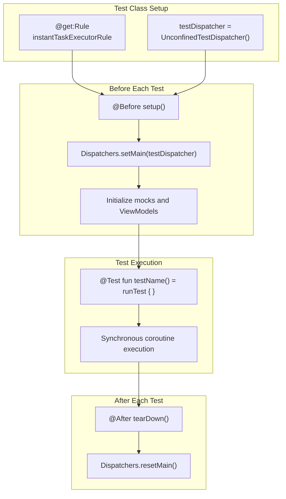
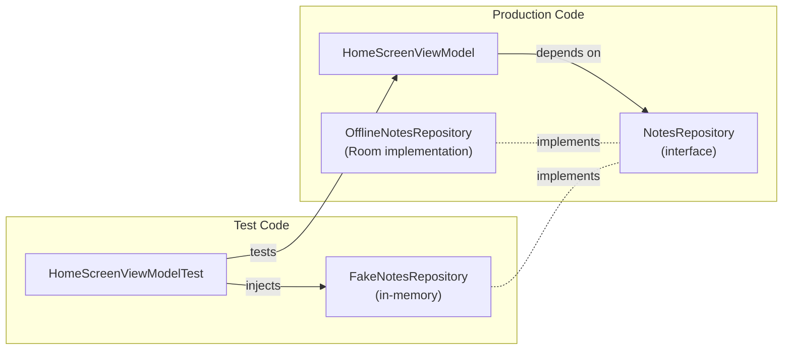
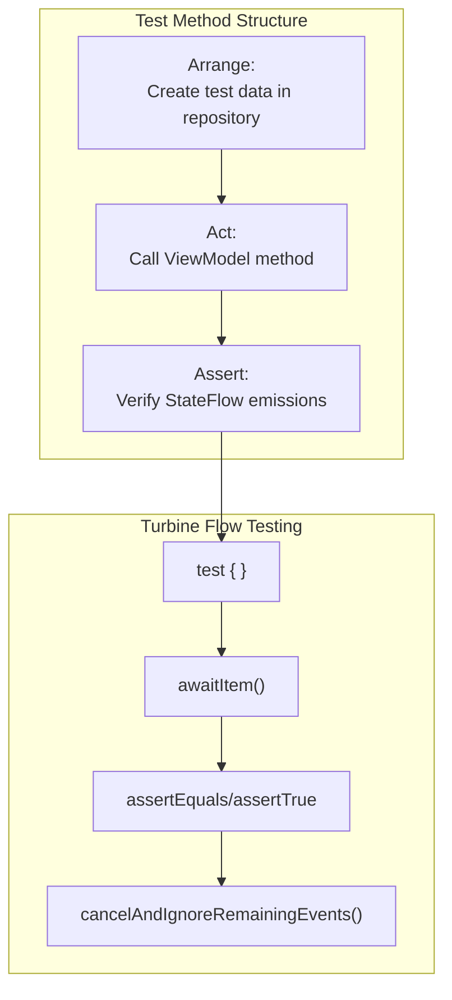
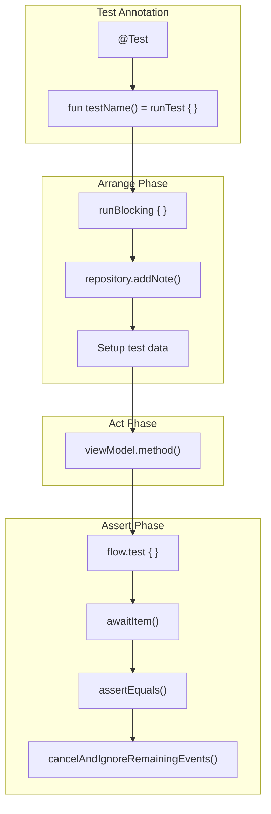

<!-- source: DeepWiki mcp.deepwiki.com · repo android/cahier · page 8.1 Unit Testing · fetched 2026-10-23 -->

# Unit Testing

<details>
<summary>Relevant source files</summary>

The following files were used as context for generating this wiki page:

- [app/src/androidTest/java/com/example/cahier/ui/viewmodels/DrawingCanvasViewModelTest.kt](app/src/androidTest/java/com/example/cahier/ui/viewmodels/DrawingCanvasViewModelTest.kt)
- [app/src/androidTest/java/com/example/cahier/utils/FileHelperTest.kt](app/src/androidTest/java/com/example/cahier/utils/FileHelperTest.kt)
- [app/src/main/java/com/example/cahier/navigation/CahierNavGraph.kt](app/src/main/java/com/example/cahier/navigation/CahierNavGraph.kt)
- [app/src/main/java/com/example/cahier/ui/ColorPickerDialog.kt](app/src/main/java/com/example/cahier/ui/ColorPickerDialog.kt)
- [app/src/main/java/com/example/cahier/ui/viewmodels/HomeScreenViewModel.kt](app/src/main/java/com/example/cahier/ui/viewmodels/HomeScreenViewModel.kt)
- [app/src/test/java/com/example/cahier/ui/viewmodels/HomeScreenViewModelTest.kt](app/src/test/java/com/example/cahier/ui/viewmodels/HomeScreenViewModelTest.kt)

</details>


## Purpose and Scope

This page documents the unit testing infrastructure and practices for the Cahier application, focusing on pure JUnit tests that run on the local JVM without Android device dependencies. Unit tests in this codebase primarily target ViewModel business logic and repository behavior using mock implementations.

For testing with Android framework dependencies (Context, Room databases, etc.), see [Instrumented Testing](#8.2). For information about the repository abstraction that enables testability, see [Repository Pattern & NotesRepository](#4.1).

---

## Test Source Location and Structure

Unit tests reside in the `app/src/test/` directory, separate from instrumented tests in `app/src/androidTest/`. The test package structure mirrors the main source code:

| Test Directory | Purpose |
|----------------|---------|
| `test/java/com/example/cahier/ui/viewmodels/` | ViewModel business logic tests |
| `test/java/com/example/cahier/data/` | Repository and data layer tests |

Unit tests execute on the local JVM and do not require an Android device or emulator, making them faster than instrumented tests.

**Sources:** Project directory structure

---

## Key Testing Dependencies

The unit testing infrastructure relies on these libraries:

| Dependency | Purpose |
|------------|---------|
| **JUnit 4** | Test framework (`@Test`, assertions) |
| **kotlinx-coroutines-test** | Coroutine testing utilities (`runTest`, `UnconfinedTestDispatcher`) |
| **Turbine** | Flow testing library with expressive APIs |
| **InstantTaskExecutorRule** | Forces LiveData/Flow operations to execute synchronously |

**Sources:** [app/build.gradle.kts:dependencies]()

---

## Test Infrastructure Setup

### Dispatcher Management and Rules

Unit tests require careful management of coroutine dispatchers and execution rules to ensure deterministic behavior:



**Standard Test Class Pattern**

[app/src/test/java/com/example/cahier/ui/viewmodels/HomeScreenViewModelTest.kt:44-66]() demonstrates the canonical setup:

```kotlin
@ExperimentalCoroutinesApi
class HomeScreenViewModelTest {
    @get:Rule
    val instantTaskExecutorRule = InstantTaskExecutorRule()
    
    private val testDispatcher = UnconfinedTestDispatcher()
    private lateinit var viewModel: HomeScreenViewModel
    private lateinit var notesRepository: FakeNotesRepository
    
    @Before
    fun setup() {
        Dispatchers.setMain(testDispatcher)
        notesRepository = FakeNotesRepository()
        viewModel = HomeScreenViewModel(noteRepository = notesRepository)
    }
    
    @After
    fun tearDown() {
        Dispatchers.resetMain()
    }
}
```

**Key Components:**

- **`InstantTaskExecutorRule`**: Forces Architecture Components' background operations to execute synchronously on the calling thread
- **`UnconfinedTestDispatcher`**: Executes coroutines immediately on the current thread without scheduling
- **`Dispatchers.setMain()`**: Replaces the Main dispatcher with the test dispatcher for ViewModel scope operations
- **`Dispatchers.resetMain()`**: Restores the original Main dispatcher after each test

**Sources:** [app/src/test/java/com/example/cahier/ui/viewmodels/HomeScreenViewModelTest.kt:44-66]()

---

## Mock Repository Implementation

### FakeNotesRepository

The `FakeNotesRepository` provides an in-memory implementation of the `NotesRepository` interface, eliminating database dependencies in unit tests:



**Mock Repository Characteristics:**

| Feature | Implementation |
|---------|---------------|
| **Storage** | `MutableList<Note>` in memory |
| **ID Generation** | Sequential counter (no database) |
| **Strokes** | In-memory map keyed by note ID |
| **Flows** | `MutableStateFlow` for reactive streams |
| **Scope** | Recreated for each test (isolated state) |

The fake repository allows tests to verify business logic without persistence overhead. ViewModels receive the `FakeNotesRepository` instead of `OfflineNotesRepository`, making tests fast and deterministic.

**Sources:** [app/src/test/java/com/example/cahier/ui/viewmodels/HomeScreenViewModelTest.kt:54-60]()

---

## ViewModel Testing Patterns

### Testing State Management

ViewModels expose state via `StateFlow` properties. Tests verify that ViewModel operations correctly update this state:



**Example: Testing Note Selection**

[app/src/test/java/com/example/cahier/ui/viewmodels/HomeScreenViewModelTest.kt:68-88]() demonstrates state verification:

```kotlin
@Test
fun selectNote_updates_uiState_with_the_correct_note() = runTest {
    // Arrange: Add note to repository
    val noteId = runBlocking {
        notesRepository.addNote(Note(title = "Selected Note", type = NoteType.Drawing))
    }
    
    // Act: Select the note
    viewModel.selectNote(noteId)
    
    // Assert: Verify state update
    viewModel.uiState.test {
        val state = awaitItem()
        assertEquals(noteId, state.note.id)
        assertEquals("Selected Note", state.note.title)
        assertNotNull(state.strokes)
        cancelAndIgnoreRemainingEvents()
    }
}
```

**Sources:** [app/src/test/java/com/example/cahier/ui/viewmodels/HomeScreenViewModelTest.kt:68-88]()

### Testing Repository Interactions

Tests verify that ViewModels correctly call repository methods and update state based on results:

**Example: Testing Note Addition**

[app/src/test/java/com/example/cahier/ui/viewmodels/HomeScreenViewModelTest.kt:90-99]():

```kotlin
@Test
fun addDrawingNote_adds_a_drawing_note_to_repository() = runTest {
    var createdNoteId: Long? = null
    viewModel.addDrawingNote { id -> createdNoteId = id }
    
    val notes = notesRepository.getNotes()
    assertEquals(1, notes.size)
    assertEquals(NoteType.Drawing, notes.first().type)
    assertEquals(createdNoteId, notes.first().id)
}
```

This pattern verifies both callback invocation and repository state changes.

**Example: Testing Note Deletion**

[app/src/test/java/com/example/cahier/ui/viewmodels/HomeScreenViewModelTest.kt:101-109]():

```kotlin
@Test
fun deleteNote_removes_note_from_repository() = runTest {
    val noteId = runBlocking { notesRepository.addNote(Note(title = "To Delete")) }
    val noteToDelete = notesRepository.getNotes().first { it.id == noteId }
    
    viewModel.deleteNote(noteToDelete)
    
    assertTrue(notesRepository.getNotes().isEmpty())
}
```

**Sources:** [app/src/test/java/com/example/cahier/ui/viewmodels/HomeScreenViewModelTest.kt:90-109]()

---

## Flow Testing with Turbine

### Turbine Library Usage

Turbine provides a fluent API for testing Kotlin `Flow` emissions. The library simplifies async assertions on reactive streams:

```mermaid
graph TB
    subgraph "Flow Under Test"
        FLOW["StateFlow<T>"]
        EMIT1["Initial State"]
        EMIT2["Updated State"]
        EMIT3["Final State"]
    end
    
    subgraph "Turbine Test Block"
        TEST["flow.test { }"]
        AWAIT1["awaitItem()"]
        ASSERT1["assertEquals(expected1, item1)"]
        AWAIT2["awaitItem()"]
        ASSERT2["assertEquals(expected2, item2)"]
        CANCEL["cancelAndIgnoreRemainingEvents()"]
    end
    
    FLOW --> EMIT1
    EMIT1 --> EMIT2
    EMIT2 --> EMIT3
    
    TEST --> AWAIT1
    AWAIT1 --> ASSERT1
    ASSERT1 --> AWAIT2
    AWAIT2 --> ASSERT2
    ASSERT2 --> CANCEL
```



**Turbine API Methods:**

| Method | Purpose |
|--------|---------|
| `flow.test { }` | Creates a test scope for Flow assertions |
| `awaitItem()` | Suspends until next emission, returns the value |
| `awaitComplete()` | Suspends until Flow completes |
| `awaitError()` | Suspends until Flow throws an error |
| `cancelAndIgnoreRemainingEvents()` | Terminates the test scope |

### Testing Multiple State Changes

[app/src/test/java/com/example/cahier/ui/viewmodels/HomeScreenViewModelTest.kt:111-122]() shows testing state transitions:

```kotlin
@Test
fun toggleFavorite_toggles_favorite_status_in_repository() = runTest {
    val noteId = runBlocking { 
        notesRepository.addNote(Note(title = "My Note", isFavorite = false)) 
    }
    
    viewModel.toggleFavorite(noteId)
    
    notesRepository.getNoteStream(noteId).test {
        assertTrue(awaitItem().isFavorite)
        cancelAndIgnoreRemainingEvents()
    }
}
```

This test:
1. Creates a note with `isFavorite = false`
2. Calls `toggleFavorite()`
3. Collects from the repository's Flow
4. Asserts the emitted note has `isFavorite = true`

**Sources:** [app/src/test/java/com/example/cahier/ui/viewmodels/HomeScreenViewModelTest.kt:111-122]()

### Testing State Clearing

[app/src/test/java/com/example/cahier/ui/viewmodels/HomeScreenViewModelTest.kt:124-135]() demonstrates resetting state:

```kotlin
@Test
fun clearSelection_clears_selection_in_uiState() = runTest {
    val noteId = runBlocking { notesRepository.addNote(Note(title = "A Note")) }
    viewModel.selectNote(noteId)
    
    viewModel.clearSelection()
    
    viewModel.uiState.test {
        assertEquals(Note(), awaitItem().note)
        cancelAndIgnoreRemainingEvents()
    }
}
```

**Sources:** [app/src/test/java/com/example/cahier/ui/viewmodels/HomeScreenViewModelTest.kt:124-135]()

---

## Testing Asynchronous Operations

### Using runTest and runBlocking

The codebase uses two different coroutine test builders:

| Builder | Purpose | Usage |
|---------|---------|-------|
| `runTest { }` | Wraps the entire test function, providing test scope | Outer test function wrapper |
| `runBlocking { }` | Blocks current thread for setup operations | Initializing test data before assertions |

**Pattern Example:**

```kotlin
@Test
fun testName() = runTest {  // Test scope for assertions
    // Arrange: Use runBlocking for synchronous setup
    val id = runBlocking {
        repository.addNote(Note(...))
    }
    
    // Act: Call ViewModel method
    viewModel.someMethod(id)
    
    // Assert: Test async behavior
    viewModel.state.test {
        assertEquals(expected, awaitItem())
        cancelAndIgnoreRemainingEvents()
    }
}
```

This pattern ensures:
- Setup operations complete before assertions begin
- Test scope properly handles coroutine timing
- Flows emit values before test completion

**Sources:** [app/src/test/java/com/example/cahier/ui/viewmodels/HomeScreenViewModelTest.kt:68-135]()

---

## Common Testing Patterns Summary

### Complete Test Method Structure



### Key Assertions Used

| Assertion | Purpose |
|-----------|---------|
| `assertEquals(expected, actual)` | Verify exact value match |
| `assertTrue(condition)` | Verify boolean condition |
| `assertFalse(condition)` | Verify negative boolean condition |
| `assertNotNull(value)` | Verify value is not null |
| `assertNotEquals(expected, actual)` | Verify values differ |

### Testing Callbacks

When ViewModels expose callbacks, tests capture the callback parameter:

```kotlin
var capturedId: Long? = null
viewModel.addNote { id -> capturedId = id }
assertEquals(expectedId, capturedId)
```

This pattern appears in [app/src/test/java/com/example/cahier/ui/viewmodels/HomeScreenViewModelTest.kt:90-99]().

**Sources:** [app/src/test/java/com/example/cahier/ui/viewmodels/HomeScreenViewModelTest.kt:44-135]()

---

## Unit Test vs Instrumented Test Distinction

The following table clarifies when to use unit tests versus instrumented tests:

| Aspect | Unit Tests (`test/`) | Instrumented Tests (`androidTest/`) |
|--------|---------------------|-----------------------------------|
| **Execution** | Local JVM | Android device/emulator |
| **Speed** | Fast (~milliseconds) | Slower (~seconds) |
| **Dependencies** | Mock/fake implementations | Real Android framework |
| **Use Cases** | ViewModel logic, business logic | Context, Room, FileHelper, UI |
| **Setup Complexity** | Simple (no Hilt needed) | Complex (Hilt, test rules) |
| **Example** | `HomeScreenViewModelTest` | `DrawingCanvasViewModelTest` |

**When to Write Unit Tests:**
- Testing ViewModel state transitions
- Testing business logic with mock repositories
- Testing Flow transformations
- Testing utility functions with no Android dependencies

**When to Write Instrumented Tests:**
- Testing with `Context` (file operations, resources)
- Testing Room database queries
- Testing ViewModels with real dependencies
- Testing Compose UI components

For instrumented test documentation, see [Instrumented Testing](#8.2).

**Sources:** Project test directory structure, [app/src/test/java/com/example/cahier/ui/viewmodels/HomeScreenViewModelTest.kt](), comparison with [app/src/androidTest/java/com/example/cahier/ui/viewmodels/DrawingCanvasViewModelTest.kt]()

---

