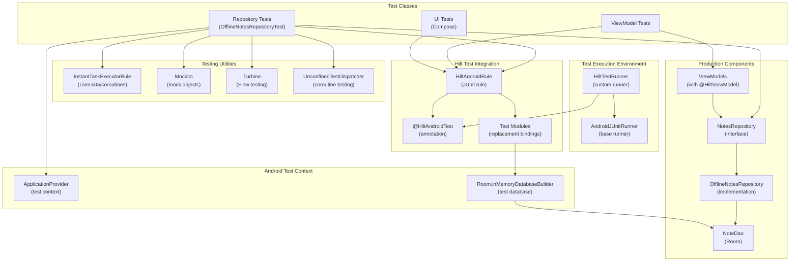
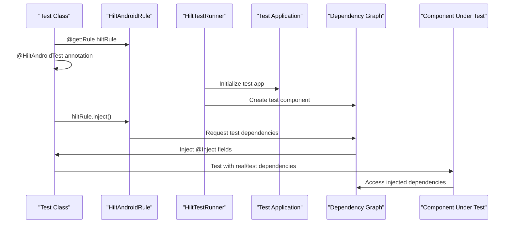
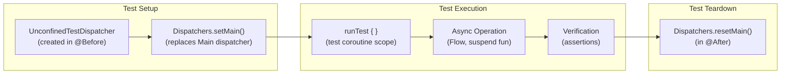
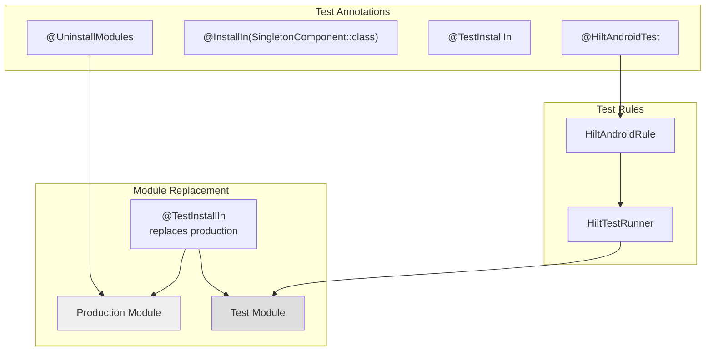
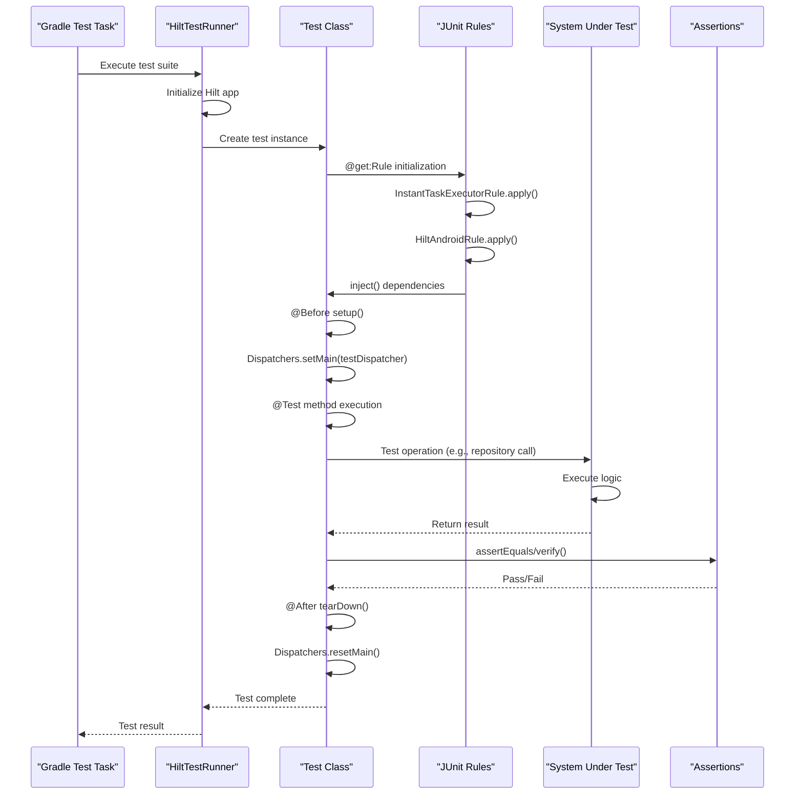

<!-- source: DeepWiki mcp.deepwiki.com · repo android/cahier · page 8.2 Instrumented Testing · fetched 2026-10-23 -->

# Instrumented Testing

<details>
<summary>Relevant source files</summary>

The following files were used as context for generating this wiki page:

- [app/build.gradle.kts](app/build.gradle.kts)
- [app/src/androidTest/java/com/example/cahier/data/OfflineNotesRepositoryTest.kt](app/src/androidTest/java/com/example/cahier/data/OfflineNotesRepositoryTest.kt)
- [app/src/main/java/com/example/cahier/ui/Converters.kt](app/src/main/java/com/example/cahier/ui/Converters.kt)
- [app/src/main/java/com/example/cahier/ui/DrawingToolbox.kt](app/src/main/java/com/example/cahier/ui/DrawingToolbox.kt)
- [gradle/libs.versions.toml](gradle/libs.versions.toml)

</details>


## Purpose and Scope

This page documents the instrumented testing infrastructure for the Cahier application. Instrumented tests run on Android devices or emulators and can test Android-specific components including UI, database operations, and system integrations. These tests differ from unit tests (see [Unit Testing](#8.1)) in that they execute in an Android runtime environment and can interact with actual Android framework components.

Instrumented tests in Cahier are located in [app/src/androidTest/]() and focus on:
- Repository layer with real Room database access
- Compose UI components with user interaction simulation
- Hilt dependency injection in test contexts
- Android-specific functionality like FileProvider and ContentResolver

Sources: [app/build.gradle.kts:36](), [gradle/libs.versions.toml:61-96]()

---

## Test Configuration

### Test Runner Setup

The application uses a custom `HiltTestRunner` to enable Hilt dependency injection in instrumented tests. This is configured in the `build.gradle.kts` file:

```
testInstrumentationRunner = "com.example.cahier.HiltTestRunner"
```

The `HiltTestRunner` extends AndroidJUnitRunner and integrates with Hilt's testing infrastructure, allowing tests to replace production dependencies with test doubles and access injected components.

Sources: [app/build.gradle.kts:36]()

### Build Configuration

The instrumented test dependencies are declared in the `dependencies` block:

| Dependency | Purpose | Version Catalog Reference |
|------------|---------|--------------------------|
| `androidx.junit` | JUnit extensions for Android | `libs.androidx.junit` |
| `androidx.espresso.core` | UI testing framework | `libs.androidx.espresso.core` |
| `androidx.compose.bom` | Compose testing libraries | `platform(libs.androidx.compose.bom)` |
| `androidx.ui.test.junit4` | Compose UI testing | `libs.androidx.ui.test.junit4` |
| `hilt-android-testing` | Hilt test support | `libs.hilt.android.testing` |
| `mockito-android` | Mocking framework | `libs.mockito.android` |
| `kotlinx-coroutines-test` | Coroutine testing utilities | `libs.kotlinx.coroutines.test` |
| `turbine` | Flow testing library | `libs.turbine` |

The KSP compiler is configured for test annotation processing:

```
kspAndroidTest(libs.hilt.android.compiler)
```

Sources: [app/build.gradle.kts:100-115](), [gradle/libs.versions.toml:88-96]()

---

## Test Infrastructure Architecture

### Component Diagram



Sources: [app/build.gradle.kts:36](), [app/src/androidTest/java/com/example/cahier/data/OfflineNotesRepositoryTest.kt:1-100]()

### Hilt Integration Flow



Sources: [app/build.gradle.kts:36, 114-115]()

---

## Testing Strategies

### Repository Layer Testing

Repository tests verify data persistence and transformation logic using a combination of mocked DAOs and real Android context. The example `OfflineNotesRepositoryTest` demonstrates this pattern:

**Test Setup Pattern:**

```
@ExperimentalCoroutinesApi
class OfflineNotesRepositoryTest {
    
    @get:Rule
    val instantTaskExecutorRule = InstantTaskExecutorRule()
    
    private val testDispatcher = UnconfinedTestDispatcher()
    private lateinit var repository: OfflineNotesRepository
    private val noteDao: NoteDao = mock()
    
    @Before
    fun setup() {
        Dispatchers.setMain(testDispatcher)
        val context = ApplicationProvider.getApplicationContext<Context>()
        repository = OfflineNotesRepository(noteDao, context)
    }
    
    @After
    fun tearDown() {
        Dispatchers.resetMain()
    }
}
```

**Key Testing Patterns:**

1. **InstantTaskExecutorRule** - Executes LiveData and coroutines synchronously for testing
2. **UnconfinedTestDispatcher** - Runs coroutines immediately without scheduling delays
3. **Mockito mock()** - Creates mock DAO instances for controlled behavior
4. **ApplicationProvider.getApplicationContext()** - Provides real Android context

Sources: [app/src/androidTest/java/com/example/cahier/data/OfflineNotesRepositoryTest.kt:30-50]()

### Serialization Testing

The repository tests verify stroke serialization/deserialization, a critical function for drawing persistence:

**Test Case Structure:**

| Test Method | Purpose | Verifies |
|-------------|---------|----------|
| `getNoteStrokes_deserializes_strokes_correctly()` | Stroke deserialization | `Converters` can reconstruct `Stroke` objects from JSON |
| `updateNoteStrokes_calls_DAO_with_serialized_strokes()` | Stroke serialization | Repository correctly serializes strokes before DAO call |
| `toggleFavorite_updates_the_note_correctly()` | State mutation | Repository updates note properties via DAO |
| `getAllNotesStream_returns_flow_from_DAO()` | Flow handling | Repository exposes DAO Flow correctly |

**Deserialization Test Example:**

The test creates a `Stroke` with a `Brush` and `ImmutableStrokeInputBatch`, serializes it using `Converters`, stores it as JSON, then verifies the repository can deserialize it:

```
val brush = Brush(StockBrushes.marker(), 1f, 1f)
val stroke = Stroke(brush, ImmutableStrokeInputBatch.EMPTY)
val serializedStroke = Converters().serializeStroke(stroke)
val strokesJson = Gson().toJson(listOf(serializedStroke))
val note = Note(id = 1, strokesData = strokesJson)

whenever(noteDao.getNoteById(1L)).thenReturn(note)
val resultStrokes = repository.getNoteStrokes(1L)

assertEquals(1, resultStrokes.size)
```

Sources: [app/src/androidTest/java/com/example/cahier/data/OfflineNotesRepositoryTest.kt:52-78]()

### Coroutine Testing Pattern

All async operations use the `runTest` coroutine builder with proper dispatcher management:



Sources: [app/src/androidTest/java/com/example/cahier/data/OfflineNotesRepositoryTest.kt:36-50]()

---

## Test Dependencies and Utilities

### Core Testing Libraries

**JUnit and AndroidX Test:**
- `androidx-junit` - Android extensions for JUnit4, provides `AndroidJUnit4` runner
- `InstantTaskExecutorRule` - Synchronous execution for Architecture Components
- `ApplicationProvider` - Provides test application context

**Compose UI Testing:**
- `androidx-ui-test-junit4` - Compose testing framework
- `androidx-ui-test-manifest` - Debug manifest for test activities
- `androidx-ui-tooling` - Compose preview and inspection tools

**Mocking and Assertions:**
- `mockito-android` - Android-compatible Mockito for creating mocks
- `mockito-kotlin` - Kotlin-friendly DSL for Mockito (e.g., `mock()`, `whenever()`, `verify()`)

**Async Testing:**
- `kotlinx-coroutines-test` - `UnconfinedTestDispatcher`, `runTest`, `TestCoroutineScheduler`
- `turbine` - Flow testing library for collecting and asserting on Flow emissions

Sources: [gradle/libs.versions.toml:88-96](), [app/build.gradle.kts:100-111]()

### Hilt Testing Components



**Hilt Test Configuration:**

| Component | Purpose | Usage |
|-----------|---------|-------|
| `HiltTestRunner` | Custom test runner | Configured in `build.gradle.kts` as `testInstrumentationRunner` |
| `@HiltAndroidTest` | Marks test class for Hilt | Applied to test classes requiring DI |
| `HiltAndroidRule` | Initializes Hilt graph | JUnit `@Rule` that calls `hiltRule.inject()` |
| `@TestInstallIn` | Replaces modules | Allows test modules to override production bindings |
| `kspAndroidTest()` | Annotation processor | Processes Hilt annotations in androidTest source set |

Sources: [app/build.gradle.kts:114-115]()

---

## Test Execution Flow

### Complete Test Lifecycle



Sources: [app/src/androidTest/java/com/example/cahier/data/OfflineNotesRepositoryTest.kt:30-100]()

---

## Running Instrumented Tests

### Gradle Commands

Instrumented tests are executed using Android Gradle Plugin tasks:

```
./gradlew connectedAndroidTest       # Run all instrumented tests
./gradlew connectedDebugAndroidTest  # Run on debug variant
./gradlew :app:connectedAndroidTest  # Run app module tests
```

### Test Filtering

Run specific test classes or methods:

```
./gradlew connectedAndroidTest --tests "com.example.cahier.data.OfflineNotesRepositoryTest"
./gradlew connectedAndroidTest --tests "*.OfflineNotesRepositoryTest.getNoteStrokes_deserializes_strokes_correctly"
```

Sources: [app/build.gradle.kts:25-40]()

---

## Best Practices

### Test Isolation

1. **Use `@Before` and `@After`** - Reset state between tests
2. **Mock external dependencies** - Use `mock()` for DAO, avoid real network calls
3. **Reset dispatchers** - Call `Dispatchers.resetMain()` in `@After`
4. **Independent test data** - Each test creates its own test fixtures

### Coroutine Testing

1. **Use `UnconfinedTestDispatcher`** - Executes coroutines immediately
2. **Wrap tests in `runTest`** - Provides test coroutine scope
3. **Apply `InstantTaskExecutorRule`** - Synchronizes LiveData/Flow execution
4. **Set Main dispatcher** - Replace Main with test dispatcher before tests

### Assertion Strategies

1. **Verify DAO interactions** - Use `verify(dao).method()` to confirm calls
2. **Assert on results** - Use JUnit assertions for return values
3. **Test Flow emissions** - Use Turbine for Flow testing (in unit tests) or `first()` for simple cases
4. **Check error cases** - Test exception handling and null safety

Sources: [app/src/androidTest/java/com/example/cahier/data/OfflineNotesRepositoryTest.kt:30-100]()

---

## Key Test Files

| File Path | Purpose | Tests |
|-----------|---------|-------|
| `app/src/androidTest/java/com/example/cahier/HiltTestRunner.kt` | Custom test runner | Hilt initialization for tests |
| `app/src/androidTest/java/com/example/cahier/data/OfflineNotesRepositoryTest.kt` | Repository tests | Serialization, DAO interactions, Flow handling |

Sources: [app/build.gradle.kts:36](), [app/src/androidTest/java/com/example/cahier/data/OfflineNotesRepositoryTest.kt:1-100]()

---

