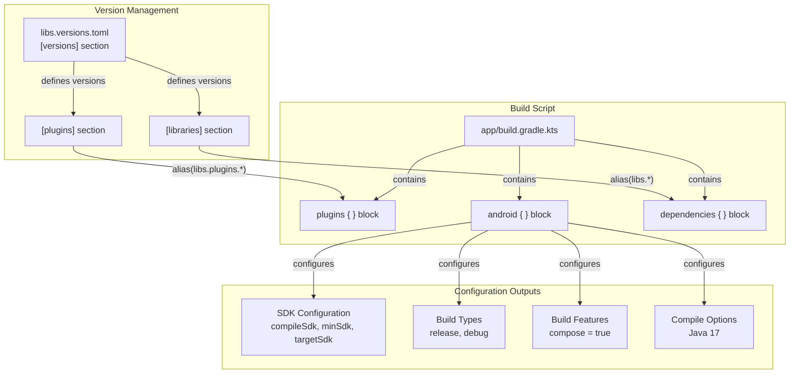
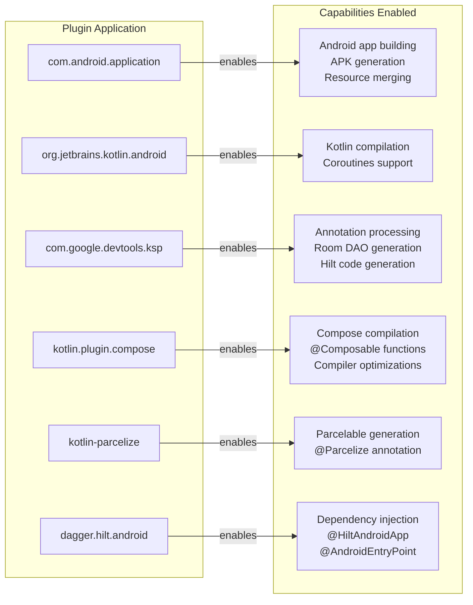

<!-- source: DeepWiki mcp.deepwiki.com · repo android/cahier · page 9 Build Configuration · fetched 2026-10-23 -->

# Build Configuration

<details>
<summary>Relevant source files</summary>

The following files were used as context for generating this wiki page:

- [app/build.gradle.kts](app/build.gradle.kts)
- [gradle/libs.versions.toml](gradle/libs.versions.toml)

</details>


This document describes the Gradle build configuration for the Cahier application, including the project structure, SDK settings, version management through a centralized catalog, and build feature configuration. For detailed information about individual dependencies, see [Dependencies](#9.1). For information about build plugins and their configuration, see [Build Plugins](#9.2).

## Build System Overview

Cahier uses **Gradle with Kotlin DSL** for build configuration and employs a **version catalog** system for centralized dependency management. The build configuration is split across two primary files:

- **Version Catalog**: [gradle/libs.versions.toml]() - Centralized version and dependency definitions
- **App Build Script**: [app/build.gradle.kts]() - Module-level build configuration

This architecture separates version management from build logic, enabling easier dependency updates and consistent versioning across the project.

**Sources**: [gradle/libs.versions.toml:1-102](), [app/build.gradle.kts:1-156]()

## Build Configuration Architecture



**Sources**: [gradle/libs.versions.toml:1-102](), [app/build.gradle.kts:16-63]()

## Version Catalog Structure

The [gradle/libs.versions.toml]() file uses the TOML format with three main sections:

### Version Declarations

The `[versions]` section declares all version numbers as variables [gradle/libs.versions.toml:1-39](). Key version variables include:

| Variable | Value | Purpose |
|----------|-------|---------|
| `agp` | 8.13.0 | Android Gradle Plugin version |
| `kotlin` | 2.2.20 | Kotlin language and compiler version |
| `composeBom` | 2025.09.01 | Compose Bill of Materials version |
| `ink` | 1.0.0-beta01 | androidx.ink library version |
| `hiltAndroid` | 2.57.1 | Hilt dependency injection version |
| `roomKtx` | 2.8.1 | Room database version |
| `ksp` | 2.2.20-2.0.3 | Kotlin Symbol Processing version |

### Library Declarations

The `[libraries]` section [gradle/libs.versions.toml:40-96]() defines dependency coordinates using the format:

```
library-name = { group = "...", name = "...", version.ref = "..." }
```

Libraries are organized into functional groups (see [Dependencies](#9.1) for complete details).

### Plugin Declarations

The `[plugins]` section [gradle/libs.versions.toml:98-102]() declares Gradle plugins:

```
pluginId = { id = "plugin.identifier", version.ref = "versionVariable" }
```

**Sources**: [gradle/libs.versions.toml:1-102]()

## Android SDK Configuration

The `android` block in [app/build.gradle.kts:25-63]() configures Android-specific build settings:

| Setting | Value | Description |
|---------|-------|-------------|
| `namespace` | `com.example.cahier` | Application package namespace |
| `compileSdk` | 36 | SDK version used for compilation |
| `minSdk` | 26 | Minimum Android version (Android 8.0) |
| `targetSdk` | 36 | Target Android version |
| `applicationId` | `com.example.cahier` | Unique application identifier |
| `versionCode` | 1 | Internal version number |
| `versionName` | "1.0" | User-visible version string |

The minimum SDK of 26 enables features like:
- FileProvider for secure file sharing
- RoleManager for ROLE_NOTES integration
- Modern Jetpack Compose components

**Sources**: [app/build.gradle.kts:25-40]()

## Build Types Configuration

The application defines build type configurations in [app/build.gradle.kts:42-50]():

### Release Build Type

```
release {
    isMinifyEnabled = false
    proguardFiles(...)
}
```

Currently configured without minification or obfuscation. ProGuard rules are defined but not applied due to `isMinifyEnabled = false`.

### Debug Build Type

The debug build type uses default Gradle settings (not explicitly configured). It automatically includes:
- Debug symbols
- Non-optimized bytecode
- Debug-specific resources (referenced in [app/build.gradle.kts:105-106]())

**Sources**: [app/build.gradle.kts:42-50]()

## Compilation Settings

### Java Compatibility

The `compileOptions` block [app/build.gradle.kts:51-54]() and `java.toolchain` block [app/build.gradle.kts:152-156]() configure Java 17 compatibility:

- **Source Compatibility**: `JavaVersion.VERSION_17`
- **Target Compatibility**: `JavaVersion.VERSION_17`
- **Language Version**: `JavaLanguageVersion.of(17)`

Java 17 is required for modern Kotlin features and Compose compiler optimizations.

### Kotlin Configuration

Kotlin version 2.2.20 is specified in [gradle/libs.versions.toml:10](). The Kotlin Compose compiler plugin is applied via [app/build.gradle.kts:20]():

```
id("org.jetbrains.kotlin.plugin.compose") version "2.2.20"
```

**Sources**: [app/build.gradle.kts:51-54](), [app/build.gradle.kts:152-156](), [gradle/libs.versions.toml:10]()

## Build Features

The `buildFeatures` block [app/build.gradle.kts:55-57]() enables specific Android build features:

```
buildFeatures {
    compose = true
}
```

This enables:
- Jetpack Compose compilation
- Compose Preview support
- `@Composable` annotation processing

The `vectorDrawables` configuration in [app/build.gradle.kts:37-39]() enables vector drawable support from the support library.

**Sources**: [app/build.gradle.kts:55-57](), [app/build.gradle.kts:37-39]()

## Testing Configuration

### Test Runner Setup

The instrumented test runner is configured in [app/build.gradle.kts:36]():

```
testInstrumentationRunner = "com.example.cahier.HiltTestRunner"
```

This custom runner extends AndroidJUnitRunner to support Hilt dependency injection in instrumented tests (see [Testing](#8) for more details).

### Test Dependencies Organization

Test dependencies are organized by scope in [app/build.gradle.kts:92-115]():

| Scope | Configuration | Purpose |
|-------|--------------|---------|
| Unit Tests | `testImplementation` | JVM-based tests without Android framework |
| Instrumented Tests | `androidTestImplementation` | Tests requiring Android emulator/device |
| Debug Builds | `debugImplementation` | Debug-only utilities (UI tooling, test manifest) |
| KSP Test Processing | `kspAndroidTest` | Annotation processing for instrumented tests |

**Sources**: [app/build.gradle.kts:36](), [app/build.gradle.kts:92-115]()

## Dependency Categories Overview

The application's dependencies are organized into functional categories. The following diagram shows the major dependency groups and their relationships:

```mermaid
graph TB
    subgraph "Core Android"
        CORE["androidx.core:core-ktx"]
        LIFECYCLE["androidx.lifecycle:*"]
        ACTIVITY["androidx.activity:activity-compose"]
    end
    
    subgraph "Compose UI"
        BOM["androidx.compose:compose-bom"]
        UI["androidx.compose.ui:*"]
        MATERIAL3["androidx.compose.material3:*"]
        FOUNDATION["androidx.compose.foundation:foundation"]
    end
    
    subgraph "Ink Drawing System"
        INK_AUTHORING["androidx.ink:ink-authoring"]
        INK_BRUSH["androidx.ink:ink-brush"]
        INK_GEOMETRY["androidx.ink:ink-geometry"]
        INK_RENDERING["androidx.ink:ink-rendering"]
        INK_STROKES["androidx.ink:ink-strokes"]
        INK_STORAGE["androidx.ink:ink-storage"]
        MOTION["androidx.input:input-motionprediction"]
    end
    
    subgraph "Data Persistence"
        ROOM_RUNTIME["androidx.room:room-runtime"]
        ROOM_KTX["androidx.room:room-ktx"]
        ROOM_COMPILER["androidx.room:room-compiler<br/>(KSP)"]
        GSON["com.google.code.gson:gson"]
    end
    
    subgraph "Dependency Injection"
        HILT["com.google.dagger:hilt-android"]
        HILT_COMPILER["hilt-android-compiler<br/>(KSP)"]
        HILT_NAV["androidx.hilt:hilt-navigation-compose"]
    end
    
    subgraph "Navigation & Adaptive"
        NAV_COMPOSE["androidx.navigation:navigation-compose"]
        ADAPTIVE_NAV["androidx.compose.material3.adaptive:*"]
        WINDOW["androidx.window:window-core"]
    end
    
    subgraph "Image Loading"
        COIL["io.coil-kt.coil3:coil-compose"]
        COIL_NETWORK["coil-network-okhttp"]
    end
    
    subgraph "Testing"
        JUNIT["junit:junit"]
        MOCKITO["org.mockito:*"]
        TURBINE["app.cash.turbine:turbine"]
        HILT_TEST["hilt-android-testing"]
    end
    
    BOM -.->|"version management"| UI
    BOM -.->|"version management"| MATERIAL3
    
    INK_AUTHORING -->|"uses"| INK_BRUSH
    INK_AUTHORING -->|"uses"| INK_GEOMETRY
    INK_AUTHORING -->|"uses"| INK_STROKES
    INK_RENDERING -->|"renders"| INK_STROKES
    
    ROOM_RUNTIME -->|"requires"| ROOM_COMPILER
    ROOM_KTX -->|"extends"| ROOM_RUNTIME
    
    HILT -->|"requires"| HILT_COMPILER
    HILT_NAV -->|"integrates with"| NAV_COMPOSE
    
    COIL -->|"uses"| COIL_NETWORK
```



For detailed information about each dependency and its purpose, see [Dependencies](#9.1).

**Sources**: [app/build.gradle.kts:65-151](), [gradle/libs.versions.toml:40-96]()

## Plugin Configuration Overview

The `plugins` block in [app/build.gradle.kts:16-23]() applies multiple Gradle plugins:



The plugin versions are managed through the version catalog [gradle/libs.versions.toml:98-102]() using `alias(libs.plugins.*)` syntax, except for `kotlin.plugin.compose` and `kotlin-parcelize` which are hardcoded.

For detailed information about each plugin's configuration and purpose, see [Build Plugins](#9.2).

**Sources**: [app/build.gradle.kts:16-23](), [gradle/libs.versions.toml:98-102]()

## Resource Packaging Configuration

The `packaging` block [app/build.gradle.kts:58-62]() configures resource exclusions:

```
packaging {
    resources {
        excludes += "/META-INF/{AL2.0,LGPL2.1}"
    }
}
```

This excludes Apache 2.0 and LGPL 2.1 license files from the APK to avoid duplicate resource conflicts when multiple dependencies include these standard licenses.

**Sources**: [app/build.gradle.kts:58-62]()

## Dependency Resolution Strategy

Dependencies in [app/build.gradle.kts:65-151]() use three resolution mechanisms:

### 1. Version Catalog References

Most dependencies use the `libs.*` syntax:
```
implementation(libs.androidx.core.ktx)
```

This resolves to the library definition in [gradle/libs.versions.toml]().

### 2. BOM (Bill of Materials)

Compose dependencies use platform BOM for version alignment [app/build.gradle.kts:70]():
```
implementation(platform(libs.androidx.compose.bom))
```

After importing the BOM, Compose dependencies omit version specifications [app/build.gradle.kts:71-74]():
```
implementation(libs.androidx.ui)  // version from BOM
```

### 3. KSP Processing

Annotation processors use `ksp()` or `kspAndroidTest()` configurations [app/build.gradle.kts:89](), [app/build.gradle.kts:115]():
```
ksp(libs.androidx.room.compiler)
kspAndroidTest(libs.hilt.android.compiler)
```

**Sources**: [app/build.gradle.kts:65-151](), [app/build.gradle.kts:70](), [app/build.gradle.kts:89](), [app/build.gradle.kts:115]()

## Version Catalog Migration Benefits

The version catalog system provides several advantages:

| Benefit | Description |
|---------|-------------|
| **Single Source of Truth** | All versions defined in one file [gradle/libs.versions.toml:1-39]() |
| **Type-Safe Accessors** | IDE autocompletion for `libs.*` references |
| **Dependency Sharing** | Consistent versions across modules (future-proof for multi-module setup) |
| **Version Alignment** | Related libraries (e.g., all ink libraries) share version `1.0.0-beta01` |
| **Easier Updates** | Change version once, affects all usages |
| **Build Script Clarity** | Build files focus on structure, not version details |

**Sources**: [gradle/libs.versions.toml:1-102](), [app/build.gradle.kts:65-151]()

---

