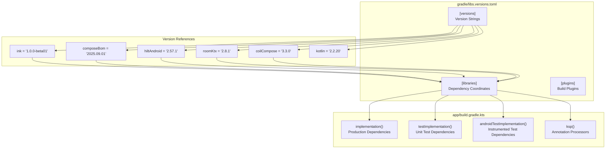
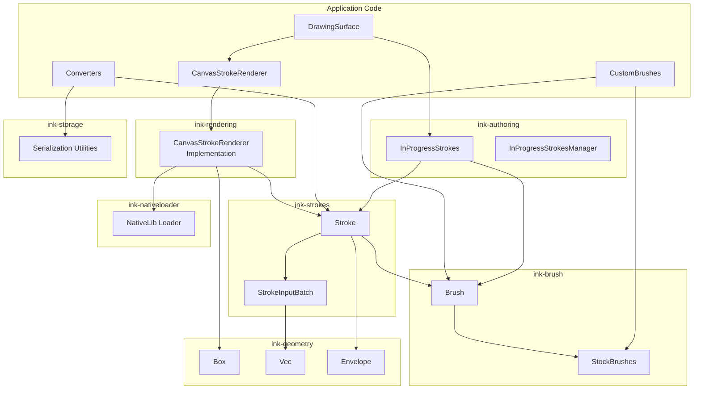
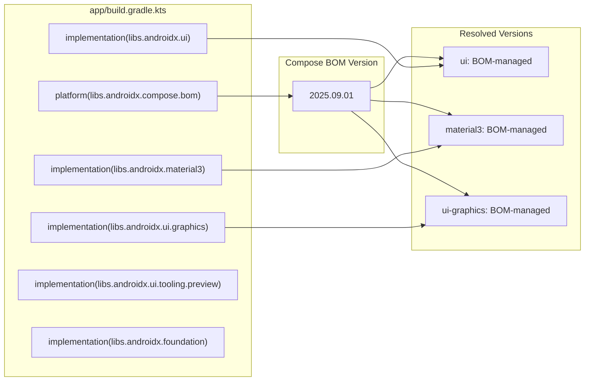
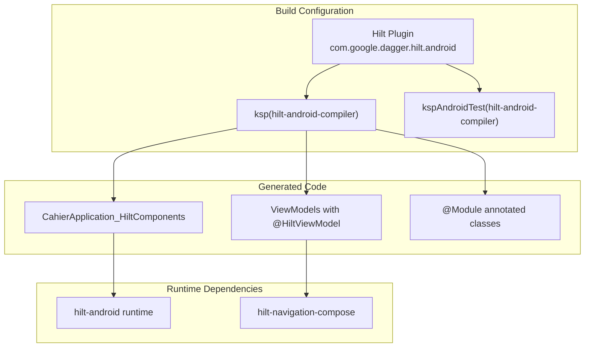
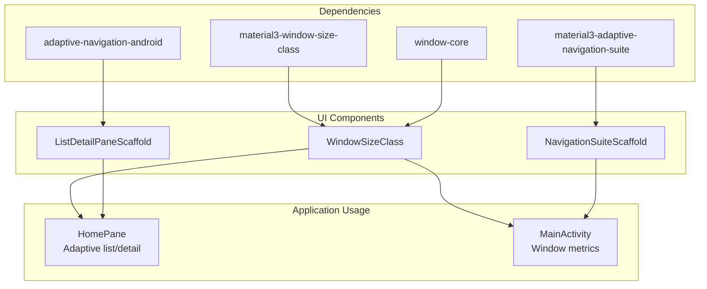
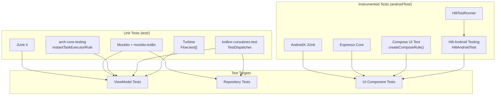
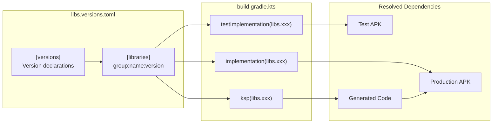

<!-- source: DeepWiki mcp.deepwiki.com · repo android/cahier · page 9.1 Dependencies · fetched 2026-10-23 -->

# Dependencies

<details>
<summary>Relevant source files</summary>

The following files were used as context for generating this wiki page:

- [app/build.gradle.kts](app/build.gradle.kts)
- [gradle/libs.versions.toml](gradle/libs.versions.toml)

</details>


## Purpose and Scope

This document details all external dependencies used in the Cahier application, their versions, purposes, and how they are configured in the build system. This includes the androidx.ink libraries for drawing functionality, Jetpack Compose for UI, Room for persistence, Hilt for dependency injection, and testing frameworks.

For information about how these dependencies are used in the build configuration and plugin system, see [Build Plugins](#9.2). For information about dependency injection setup with Hilt, see [Dependency Injection with Hilt](#2.2).

---

## Version Management System

The application uses Gradle Version Catalogs to centralize dependency version management in [gradle/libs.versions.toml:1-102](). This provides type-safe dependency declarations and ensures version consistency across the project.

### Version Catalog Structure



**Sources:** [gradle/libs.versions.toml:1-102](), [app/build.gradle.kts:65-151]()

---

## Androidx.ink Libraries

The androidx.ink library suite is the most critical dependency set in Cahier, providing the core drawing and stroke rendering capabilities. The application uses version `1.0.0-beta01` across all ink modules.

### Ink Library Components

| Library Module | Artifact Name | Purpose | Lines |
|---|---|---|---|
| **ink-authoring** | `androidx.ink:ink-authoring` | Provides `InProgressStrokes` for stroke capture during drawing | [gradle/libs.versions.toml:44]() |
| **ink-authoring-android** | `androidx.ink:ink-authoring-android` | Android-specific authoring utilities | [gradle/libs.versions.toml:82]() |
| **ink-authoring-compose** | `androidx.ink:ink-authoring-compose` | Compose integration for ink authoring | [gradle/libs.versions.toml:84]() |
| **ink-brush** | `androidx.ink:ink-brush` | Brush definitions and configurations | [gradle/libs.versions.toml:45]() |
| **ink-brush-compose** | `androidx.ink:ink-brush-compose` | Compose-compatible brush utilities | [gradle/libs.versions.toml:85]() |
| **ink-geometry** | `androidx.ink:ink-geometry` | Geometric primitives for stroke data | [gradle/libs.versions.toml:46]() |
| **ink-geometry-compose** | `androidx.ink:ink-geometry-compose` | Compose integration for geometry types | [gradle/libs.versions.toml:86]() |
| **ink-nativeloader** | `androidx.ink:ink-nativeloader` | Native library loading for performance | [gradle/libs.versions.toml:47]() |
| **ink-rendering** | `androidx.ink:ink-rendering` | Core rendering engine for strokes | [gradle/libs.versions.toml:48]() |
| **ink-strokes** | `androidx.ink:ink-strokes` | Stroke data structures and manipulation | [gradle/libs.versions.toml:49]() |
| **ink-storage** | `androidx.ink:ink-storage` | Serialization/deserialization utilities | [gradle/libs.versions.toml:50]() |

### Ink Dependency Graph



**Sources:** [app/build.gradle.kts:118-128](), [gradle/libs.versions.toml:9](), [gradle/libs.versions.toml:44-50](), [gradle/libs.versions.toml:82](), [gradle/libs.versions.toml:84-86]()

---

## Jetpack Compose Dependencies

The application is built entirely with Jetpack Compose using Material Design 3. Compose dependencies are managed through a Bill of Materials (BOM) to ensure version compatibility.

### Compose BOM and Core Libraries

| Component | Version/BOM | Purpose | Lines |
|---|---|---|---|
| **compose-bom** | `2025.09.01` | Bill of Materials for version alignment | [gradle/libs.versions.toml:18]() |
| **ui** | BOM-managed | Core Compose UI toolkit | [gradle/libs.versions.toml:66]() |
| **ui-graphics** | BOM-managed | Graphics primitives and utilities | [gradle/libs.versions.toml:67]() |
| **ui-tooling** | BOM-managed | Debug tooling and layout inspector | [gradle/libs.versions.toml:68]() |
| **ui-tooling-preview** | BOM-managed | Preview annotations and support | [gradle/libs.versions.toml:69]() |
| **material3** | BOM-managed | Material Design 3 components | [gradle/libs.versions.toml:72]() |
| **foundation** | `1.9.2` | Foundation APIs including gesture handling | [gradle/libs.versions.toml:5]() |

### Compose Integration in Build



**Sources:** [app/build.gradle.kts:70-80](), [gradle/libs.versions.toml:18](), [gradle/libs.versions.toml:65-74]()

---

## Room Database Dependencies

Room provides the persistence layer for notes and stroke data. The application uses version `2.8.1` across all Room modules and requires Kotlin Symbol Processing (KSP) for code generation.

### Room Dependencies

| Component | Version | Purpose | Processing | Lines |
|---|---|---|---|---|
| **room-runtime** | `2.8.1` | Runtime database access APIs | implementation | [gradle/libs.versions.toml:52]() |
| **room-ktx** | `2.8.1` | Kotlin extensions and coroutine support | implementation | [gradle/libs.versions.toml:51]() |
| **room-compiler** | `2.8.1` | Annotation processor for DAO/Entity generation | ksp | [gradle/libs.versions.toml:79]() |

### Room Build Integration

The Room compiler is applied via KSP (Kotlin Symbol Processing) rather than KAPT for improved build performance:

```
ksp(libs.androidx.room.compiler)
```

For details on how Room is configured in the data layer, see [Repository Pattern & NotesRepository](#4.1) and [Room Database Schema](#4.2).

**Sources:** [app/build.gradle.kts:87-90](), [gradle/libs.versions.toml:24-25](), [gradle/libs.versions.toml:28](), [gradle/libs.versions.toml:51-52](), [gradle/libs.versions.toml:79]()

---

## Hilt Dependency Injection

Hilt provides compile-time dependency injection built on Dagger. Version `2.57.1` is used consistently across all Hilt dependencies.

### Hilt Dependencies

| Component | Version | Purpose | Processing | Lines |
|---|---|---|---|---|
| **hilt-android** | `2.57.1` | Core Hilt runtime | implementation | [gradle/libs.versions.toml:58]() |
| **hilt-android-compiler** | `2.57.1` | Annotation processor for DI graph generation | ksp | [gradle/libs.versions.toml:59]() |
| **hilt-navigation-compose** | `1.3.0` | Hilt ViewModel integration for Compose Navigation | implementation | [gradle/libs.versions.toml:43]() |
| **hilt-android-testing** | `2.57.1` | Testing utilities for Hilt-injected components | androidTestImplementation | [gradle/libs.versions.toml:93]() |

### Hilt Plugin Configuration

The Hilt Gradle plugin is applied in [app/build.gradle.kts:22]():

```kotlin
id("com.google.dagger.hilt.android")
```

Hilt requires both the plugin and KSP processor:



**Sources:** [app/build.gradle.kts:22](), [app/build.gradle.kts:113-115](), [app/build.gradle.kts:144-146](), [gradle/libs.versions.toml:7-8](), [gradle/libs.versions.toml:43](), [gradle/libs.versions.toml:58-59](), [gradle/libs.versions.toml:93]()

---

## Coil Image Loading

Coil 3 provides asynchronous image loading with Compose integration. Version `3.3.0` is used.

### Coil Dependencies

| Component | Version | Purpose | Lines |
|---|---|---|---|
| **coil-compose** | `3.3.0` | Compose integration with AsyncImage composable | [gradle/libs.versions.toml:55]() |
| **coil-network-okhttp** | `3.3.0` | OkHttp-based network image loading | [gradle/libs.versions.toml:56]() |

The `ImageLoader` is provided as a singleton via Hilt in the `AppModule` and used throughout the application for loading note images and thumbnails.

**Sources:** [app/build.gradle.kts:148-150](), [gradle/libs.versions.toml:4](), [gradle/libs.versions.toml:55-56]()

---

## Navigation and Lifecycle

Navigation and lifecycle management are provided by AndroidX libraries with Kotlin extensions.

### Navigation Dependencies

| Component | Version | Purpose | Lines |
|---|---|---|---|
| **navigation-runtime-ktx** | `2.9.5` | Core navigation runtime with Kotlin extensions | [gradle/libs.versions.toml:76]() |
| **navigation-compose** | `2.9.5` | Compose-specific navigation integration | [gradle/libs.versions.toml:77]() |

### Lifecycle Dependencies

| Component | Version | Purpose | Lines |
|---|---|---|---|
| **lifecycle-runtime-ktx** | `2.9.4` | Lifecycle-aware components with coroutine support | [gradle/libs.versions.toml:63]() |
| **lifecycle-viewmodel-compose** | `2.9.4` | ViewModel integration for Compose | [gradle/libs.versions.toml:73]() |
| **lifecycle-runtime-compose** | `2.9.4` | Lifecycle state as Compose State | [gradle/libs.versions.toml:74]() |

These libraries enable the navigation system documented in [Navigation System](#2.3) and support the ViewModel architecture described in [MVVM Pattern & State Management](#2.1).

**Sources:** [app/build.gradle.kts:68](), [app/build.gradle.kts:75-78](), [gradle/libs.versions.toml:16](), [gradle/libs.versions.toml:19-20](), [gradle/libs.versions.toml:22-23](), [gradle/libs.versions.toml:63](), [gradle/libs.versions.toml:73-74](), [gradle/libs.versions.toml:76-77]()

---

## Adaptive Layout Dependencies

The application supports both compact (phone) and expanded (tablet) layouts using Material 3 Adaptive components.

### Adaptive Layout Libraries

| Component | Version | Purpose | Lines |
|---|---|---|---|
| **adaptive-navigation-android** | `1.1.0` | List-detail pane scaffolds and adaptive navigation | [gradle/libs.versions.toml:75]() |
| **material3-adaptive-navigation-suite-android** | `1.4.0` | Navigation rail, drawer, and bottom bar adaptation | [gradle/libs.versions.toml:81]() |
| **material3-window-size-class** | `1.4.0` | Window size class utilities for layout decisions | [gradle/libs.versions.toml:96]() |
| **window-core** | `1.5.0` | Core window metrics APIs | [gradle/libs.versions.toml:78]() |

### Adaptive Layout Usage



For implementation details, see [Adaptive Layouts](#5.1).

**Sources:** [app/build.gradle.kts:79](), [app/build.gradle.kts:83-88](), [gradle/libs.versions.toml:21](), [gradle/libs.versions.toml:26](), [gradle/libs.versions.toml:29](), [gradle/libs.versions.toml:38](), [gradle/libs.versions.toml:75](), [gradle/libs.versions.toml:78](), [gradle/libs.versions.toml:81](), [gradle/libs.versions.toml:96]()

---

## Testing Dependencies

The application includes comprehensive testing infrastructure for both unit tests and instrumented tests.

### Unit Testing Dependencies

| Component | Version | Purpose | Lines |
|---|---|---|---|
| **junit** | `4.13.2` | JUnit 4 testing framework | [gradle/libs.versions.toml:60]() |
| **mockito-core** | `5.20.0` | Mocking framework for Java objects | [gradle/libs.versions.toml:89]() |
| **mockito-kotlin** | `6.0.0` | Kotlin-friendly Mockito extensions | [gradle/libs.versions.toml:90]() |
| **arch-core-testing** | `2.2.0` | Testing utilities for Architecture Components | [gradle/libs.versions.toml:91]() |
| **kotlinx-coroutines-test** | `1.10.2` | Testing utilities for coroutines and Flow | [gradle/libs.versions.toml:92]() |
| **turbine** | `1.2.1` | Flow testing library for assertions | [gradle/libs.versions.toml:94]() |

### Instrumented Testing Dependencies

| Component | Version | Purpose | Lines |
|---|---|---|---|
| **androidx-junit** | `1.3.0` | AndroidX JUnit extensions | [gradle/libs.versions.toml:61]() |
| **espresso-core** | `3.7.0` | UI testing framework | [gradle/libs.versions.toml:62]() |
| **ui-test-junit4** | BOM-managed | Compose UI testing integration | [gradle/libs.versions.toml:71]() |
| **ui-test-manifest** | BOM-managed | Test manifest for Compose testing | [gradle/libs.versions.toml:70]() |
| **mockito-android** | `5.20.0` | Android-specific Mockito support | [gradle/libs.versions.toml:95]() |
| **hilt-android-testing** | `2.57.1` | Hilt testing utilities | [gradle/libs.versions.toml:93]() |

### Test Infrastructure Configuration



The custom `HiltTestRunner` is configured in [app/build.gradle.kts:36]() as the instrumentation test runner. For testing implementation details, see [Unit Testing](#8.1) and [Instrumented Testing](#8.2).

**Sources:** [app/build.gradle.kts:36](), [app/build.gradle.kts:93-111](), [app/build.gradle.kts:113-115](), [gradle/libs.versions.toml:12-14](), [gradle/libs.versions.toml:33-37](), [gradle/libs.versions.toml:60-62](), [gradle/libs.versions.toml:70-71](), [gradle/libs.versions.toml:89-95]()

---

## Utility Dependencies

Additional utility libraries support serialization, input prediction, and compatibility.

### Serialization and Data

| Component | Version | Purpose | Lines |
|---|---|---|---|
| **gson** | `2.13.2` | JSON serialization for stroke data | [gradle/libs.versions.toml:57]() |
| **kotlinx-serialization-json** | `1.9.0` | Kotlin-first JSON serialization (alternative to Gson) | [gradle/libs.versions.toml:80]() |

### Input and Compatibility

| Component | Version | Purpose | Lines |
|---|---|---|---|
| **input-motionprediction** | `1.0.0-beta06` | Motion prediction for smoother stylus input | [gradle/libs.versions.toml:83]() |
| **appcompat** | `1.7.1` | Backward compatibility and AppCompat resources | [gradle/libs.versions.toml:53]() |
| **appcompat-resources** | `1.7.1` | Resource loading compatibility | [gradle/libs.versions.toml:54]() |
| **core-ktx** | `1.17.0` | Kotlin extensions for Android core APIs | [gradle/libs.versions.toml:41]() |

### Utility Dependency Integration

The motion prediction library enhances the drawing experience by predicting stylus movement, used in `DrawingSurface`. Gson is used by the `Converters` class for stroke serialization (see [Stroke Serialization](#4.3)).

**Sources:** [app/build.gradle.kts:67](), [app/build.gradle.kts:131](), [app/build.gradle.kts:135](), [app/build.gradle.kts:138](), [app/build.gradle.kts:140-141](), [gradle/libs.versions.toml:3](), [gradle/libs.versions.toml:6](), [gradle/libs.versions.toml:11](), [gradle/libs.versions.toml:15](), [gradle/libs.versions.toml:30](), [gradle/libs.versions.toml:41](), [gradle/libs.versions.toml:53-54](), [gradle/libs.versions.toml:57](), [gradle/libs.versions.toml:80](), [gradle/libs.versions.toml:83]()

---

## Build Configuration Summary

### Minimum SDK and Compatibility

The application targets a wide range of Android devices:

| Setting | Value | Location |
|---|---|---|
| **minSdk** | 26 (Android 8.0 Oreo) | [app/build.gradle.kts:31]() |
| **targetSdk** | 36 | [app/build.gradle.kts:32]() |
| **compileSdk** | 36 | [app/build.gradle.kts:27]() |
| **Java Version** | 17 | [app/build.gradle.kts:52-53]() |
| **Kotlin Version** | 2.2.20 | [gradle/libs.versions.toml:10]() |

### Dependency Application Pattern



### Critical Dependency Relationships

The following table summarizes the most important dependencies and their primary usage in the codebase:

| Dependency | Primary Usage Classes/Files | Documented In |
|---|---|---|
| **androidx.ink** | `DrawingSurface`, `CanvasStrokeRenderer`, `Converters` | [Drawing Notes System](#3.1) |
| **Room** | `NotesRepository`, `NoteDao`, `CahierDatabase` | [Data Layer](#4) |
| **Hilt** | `CahierApplication`, all ViewModels, `AppModule` | [Dependency Injection](#2.2) |
| **Compose** | All UI screens and components | Throughout UI documentation |
| **Coil** | `AppModule` (ImageLoader singleton), `DrawingDetailThumbnail` | [Image Management](#3.4) |
| **Navigation** | `CahierNavGraph`, `MainActivity` | [Navigation System](#2.3) |

**Sources:** [app/build.gradle.kts:25-63](), [app/build.gradle.kts:65-151](), [gradle/libs.versions.toml:1-102]()

---

