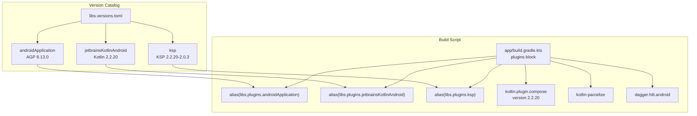
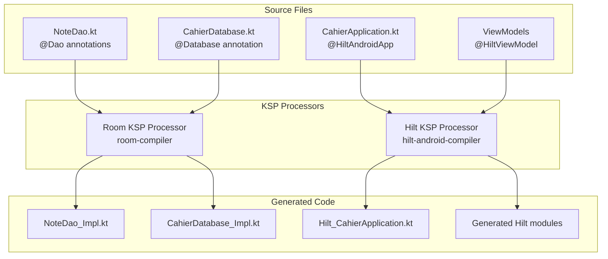
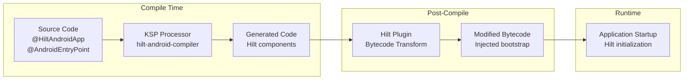
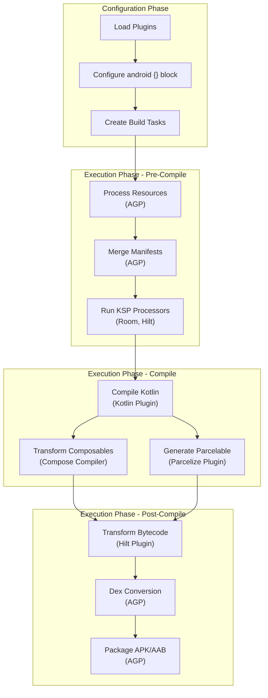

<!-- source: DeepWiki mcp.deepwiki.com · repo android/cahier · page 9.2 Build Plugins · fetched 2026-10-23 -->

# Build Plugins

<details>
<summary>Relevant source files</summary>

The following files were used as context for generating this wiki page:

- [app/build.gradle.kts](app/build.gradle.kts)
- [gradle/libs.versions.toml](gradle/libs.versions.toml)

</details>


## Purpose and Scope

This document describes the Gradle build plugins used in the Cahier application, their configuration, and their roles in the build process. The application uses six primary plugins that handle Android compilation, Kotlin processing, code generation, and dependency injection.

For information about the dependencies managed by these plugins, see [Dependencies](#9.1). For information about dependency injection configuration, see [Dependency Injection with Hilt](#2.2).

---

## Plugin Catalog Overview

The application uses Gradle's version catalog feature to centralize plugin version management. Plugins are defined in the version catalog and referenced using type-safe accessors in the build script.

### Version Catalog Structure

The version catalog defines plugins with their Maven coordinates and versions:

| Plugin ID | Catalog Reference | Version | Purpose |
|-----------|------------------|---------|---------|
| `com.android.application` | `androidApplication` | 8.13.0 | Android application module configuration |
| `com.android.library` | `androidLibrary` | 8.13.0 | Android library module configuration (not used in app) |
| `org.jetbrains.kotlin.android` | `jetbrainsKotlinAndroid` | 2.2.20 | Kotlin compilation for Android |
| `com.google.devtools.ksp` | `ksp` | 2.2.20-2.0.3 | Kotlin Symbol Processing |

**Sources:** [gradle/libs.versions.toml:98-102]()

---

## Applied Plugins

The application module applies six plugins, using a combination of catalog references and direct plugin IDs:



**Diagram: Plugin Definition and Application Flow**

The plugins block in the build script:

**Sources:** [app/build.gradle.kts:16-23]()

---

## Plugin Descriptions

### Android Application Plugin

**Plugin ID:** `com.android.application`  
**Version:** 8.13.0 (AGP - Android Gradle Plugin)

The Android Application Plugin configures the module as an Android application that can be installed on devices. It provides the `android` configuration block and manages:

- Compilation of Android resources
- Manifest merging
- APK/AAB packaging
- Build variant configuration (debug/release)
- Android-specific compilation settings

**Configuration in `android` block:**

| Property | Value | Purpose |
|----------|-------|---------|
| `namespace` | `"com.example.cahier"` | Application package namespace |
| `compileSdk` | 36 | Android SDK version for compilation |
| `minSdk` | 26 (Android 8.0) | Minimum supported Android version |
| `targetSdk` | 36 | Target Android version |
| `applicationId` | `"com.example.cahier"` | Unique application identifier |

**Build Features Enabled:**

The plugin enables Jetpack Compose through the `buildFeatures` block:

```
buildFeatures {
    compose = true
}
```

This feature flag instructs AGP to integrate with the Compose Compiler plugin for composable function processing.

**Sources:** [app/build.gradle.kts:16-17](), [app/build.gradle.kts:25-63]()

---

### Kotlin Android Plugin

**Plugin ID:** `org.jetbrains.kotlin.android`  
**Version:** 2.2.20

The Kotlin Android Plugin enables Kotlin language support in Android projects. It provides:

- Kotlin source compilation to JVM bytecode
- Integration with Android-specific Kotlin features
- Kotlin standard library dependency management
- Interoperability with Java code

**Java Compatibility Configuration:**

The plugin is configured to target Java 17 bytecode:

```
compileOptions {
    sourceCompatibility = JavaVersion.VERSION_17
    targetCompatibility = JavaVersion.VERSION_17
}
```

Additionally, the Java toolchain is explicitly configured:

```
java {
    toolchain {
        languageVersion = JavaLanguageVersion.of(17)
    }
}
```

This ensures consistent Java/Kotlin compilation across different development environments.

**Sources:** [app/build.gradle.kts:18](), [app/build.gradle.kts:51-54](), [app/build.gradle.kts:152-156]()

---

### KSP Plugin

**Plugin ID:** `com.google.devtools.ksp`  
**Version:** 2.2.20-2.0.3

KSP (Kotlin Symbol Processing) is an annotation processing framework that generates code at compile time. It replaces KAPT (Kotlin Annotation Processing Tool) with better performance and Kotlin-native APIs.

**Primary Use Cases in Cahier:**

1. **Room Database Code Generation**
   - Processes `@Dao`, `@Database`, `@Entity` annotations
   - Generates implementation classes for `NoteDao`
   - Applied via: `ksp(libs.androidx.room.compiler)`

2. **Hilt Dependency Injection**
   - Processes `@HiltAndroidApp`, `@AndroidEntryPoint`, `@HiltViewModel` annotations
   - Generates dependency injection components and modules
   - Applied via: `ksp(libs.hilt.android.compiler)`

3. **Test Annotation Processing**
   - Processes Hilt test annotations in instrumented tests
   - Applied via: `kspAndroidTest(libs.hilt.android.compiler)`



**Diagram: KSP Code Generation Pipeline**

**Version Coordination:**

The KSP plugin version (2.2.20-2.0.3) must be compatible with the Kotlin version (2.2.20). The first part of the KSP version matches the Kotlin compiler version.

**Sources:** [app/build.gradle.kts:19](), [app/build.gradle.kts:89](), [app/build.gradle.kts:145](), [app/build.gradle.kts:115]()

---

### Compose Compiler Plugin

**Plugin ID:** `org.jetbrains.kotlin.plugin.compose`  
**Version:** 2.2.20

The Compose Compiler Plugin transforms Kotlin code containing composable functions into optimized runtime code. This plugin is distinct from the Compose UI libraries and handles:

- `@Composable` function transformation
- State tracking and recomposition optimization
- Compose runtime integration
- Compiler validation of Compose rules

**Application Syntax:**

Unlike other plugins, the Compose Compiler plugin is applied with an explicit version:

```kotlin
id("org.jetbrains.kotlin.plugin.compose") version "2.2.20"
```

This direct versioning ensures the Compose Compiler version matches the Kotlin version, which is critical for compatibility.

**Integration with AGP:**

The Compose Compiler plugin works in conjunction with the Android Application Plugin's `compose = true` build feature flag. The AGP flag enables Android-specific Compose integrations, while the compiler plugin handles the actual code transformation.

**Compiler Features:**

The plugin enables:
- Strong skipping mode (optimization introduced in Compose 1.5+)
- Compose metrics generation (when configured)
- State object creation tracking
- Composable function parameter optimization

**Sources:** [app/build.gradle.kts:20](), [app/build.gradle.kts:55-57]()

---

### Parcelize Plugin

**Plugin ID:** `kotlin-parcelize`  
**Version:** Inherited from Kotlin plugin version

The Parcelize plugin is a Kotlin compiler plugin that generates `Parcelable` implementation code for data classes annotated with `@Parcelize`. This is an Android-specific serialization mechanism used for passing objects between Android components.

**Usage in Cahier:**

The plugin enables serialization for the navigation argument type:

- `NoteType` enum used in navigation arguments
- Automatic implementation of `Parcelable` interface methods
- Type-safe serialization for Intent extras

**Generated Methods:**

For each `@Parcelize` data class or object, the plugin generates:
- `writeToParcel(Parcel, Int)` - Serializes object to Parcel
- `describeContents()` - Returns content description flags
- `CREATOR` companion object - Creates instances from Parcel

**Sources:** [app/build.gradle.kts:21]()

---

### Hilt Android Plugin

**Plugin ID:** `com.google.dagger.hilt.android`  
**Version:** 2.57.1 (inherited from dependency version)

The Hilt Android Plugin is an Android-specific wrapper around the Dagger dependency injection framework. It provides:

- Bytecode transformation for Hilt components
- AGP task integration for multi-module projects
- Aggregation of Hilt modules across modules

**Plugin Responsibilities:**

Unlike the Hilt annotation processor (which runs via KSP), this plugin handles:

1. **Component Aggregation:** Collects `@Module` and `@EntryPoint` annotations across all modules
2. **Bytecode Transformation:** Modifies compiled bytecode to inject Hilt bootstrapping code
3. **Build Optimization:** Enables faster incremental builds for Hilt projects

**Coordination with KSP:**

The plugin works alongside KSP-based annotation processing:



**Diagram: Hilt Compilation and Runtime Flow**

**Sources:** [app/build.gradle.kts:22]()

---

## Plugin Configuration Matrix

The following table shows how various configuration settings are influenced by the applied plugins:

| Configuration | Primary Plugin | Related Plugins | Location in Build Script |
|--------------|---------------|-----------------|--------------------------|
| `namespace` | Android Application | - | [app/build.gradle.kts:26]() |
| `compileSdk` | Android Application | - | [app/build.gradle.kts:27]() |
| `minSdk` | Android Application | - | [app/build.gradle.kts:31]() |
| `compose = true` | Android Application | Compose Compiler | [app/build.gradle.kts:55-57]() |
| `sourceCompatibility` | Kotlin Android | - | [app/build.gradle.kts:52]() |
| `testInstrumentationRunner` | Android Application | Hilt (custom runner) | [app/build.gradle.kts:36]() |
| `vectorDrawables.useSupportLibrary` | Android Application | - | [app/build.gradle.kts:37-39]() |

**Sources:** [app/build.gradle.kts:25-63]()

---

## Build Phases and Plugin Execution

The plugins execute in specific phases of the Gradle build lifecycle:



**Diagram: Build Phase Execution Order**

**Key Execution Points:**

1. **KSP runs before Kotlin compilation** - Generated code must be available when compiling source files
2. **Compose Compiler is part of Kotlin compilation** - Runs as a Kotlin compiler plugin
3. **Hilt bytecode transformation happens after compilation** - Modifies already-compiled class files
4. **AGP orchestrates all Android-specific tasks** - Handles resource processing, manifest merging, and packaging

**Sources:** [app/build.gradle.kts:16-23]()

---

## Version Management Strategy

The project uses a centralized version management approach through the version catalog:

### Version Catalog Benefits

1. **Single Source of Truth:** All plugin versions defined in `gradle/libs.versions.toml`
2. **Type-Safe Accessors:** `libs.plugins.androidApplication` provides compile-time validation
3. **Consistent Versioning:** Related plugins (AGP, Kotlin, KSP) use coordinated versions
4. **Easy Updates:** Single location to update versions across entire project

### Version Compatibility Requirements

| Plugin Pair | Compatibility Requirement | Current Versions |
|------------|---------------------------|------------------|
| Kotlin + KSP | KSP version must match Kotlin compiler | Kotlin 2.2.20 / KSP 2.2.20-2.0.3 |
| Kotlin + Compose Compiler | Compose Compiler version must match Kotlin | Both 2.2.20 |
| AGP + Kotlin | AGP supports Kotlin versions within range | AGP 8.13.0 / Kotlin 2.2.20 |

**Sources:** [gradle/libs.versions.toml:1-102]()

---

## Testing Configuration

The plugins affect test configuration in specific ways:

### Custom Test Runner

The Android Application Plugin's `testInstrumentationRunner` is set to a custom Hilt test runner:

```kotlin
testInstrumentationRunner = "com.example.cahier.HiltTestRunner"
```

This enables Hilt dependency injection in instrumented tests. The test runner is generated by the Hilt plugin.

### Test-Specific KSP Processing

The KSP plugin processes test annotations separately:

```kotlin
kspAndroidTest(libs.hilt.android.compiler)
```

This ensures Hilt components are generated for the `androidTest` source set independently from the main app components.

**Sources:** [app/build.gradle.kts:36](), [app/build.gradle.kts:115]()

---

## Proguard and Minification

The Android Application Plugin manages code obfuscation and minification:

```kotlin
buildTypes {
    release {
        isMinifyEnabled = false
        proguardFiles(
            getDefaultProguardFile("proguard-android-optimize.txt"),
            "proguard-rules.pro"
        )
    }
}
```

**Current Configuration:**
- **Minification:** Disabled (`isMinifyEnabled = false`)
- **Proguard Rules:** Configured but not applied due to disabled minification
- **Build Type:** Only applied to release builds

When minification is enabled in the future, the Hilt and Room libraries will require specific Proguard rules to preserve annotation metadata.

**Sources:** [app/build.gradle.kts:42-50]()

---

## Resource Packaging

The Android Application Plugin's packaging configuration excludes duplicate license files:

```kotlin
packaging {
    resources {
        excludes += "/META-INF/{AL2.0,LGPL2.1}"
    }
}
```

This prevents build failures when multiple dependencies include Apache 2.0 or LGPL 2.1 license files in their JAR metadata.

**Sources:** [app/build.gradle.kts:58-62]()

---

## Summary

The Cahier build configuration uses six plugins that work together to compile, process, and package the Android application:

| Plugin | Primary Responsibility | Key Output |
|--------|----------------------|------------|
| Android Application | Android app structure and packaging | APK/AAB files |
| Kotlin Android | Kotlin source compilation | JVM bytecode |
| KSP | Compile-time code generation | Room and Hilt implementations |
| Compose Compiler | Composable function transformation | Optimized Compose runtime code |
| Parcelize | Parcelable serialization | Navigation argument serialization |
| Hilt Android | Dependency injection orchestration | Bytecode-injected DI bootstrap |

The plugins are versioned through a centralized catalog and execute in a coordinated pipeline to transform source code into a deployable Android application.

**Sources:** [app/build.gradle.kts:16-156](), [gradle/libs.versions.toml:1-102]()