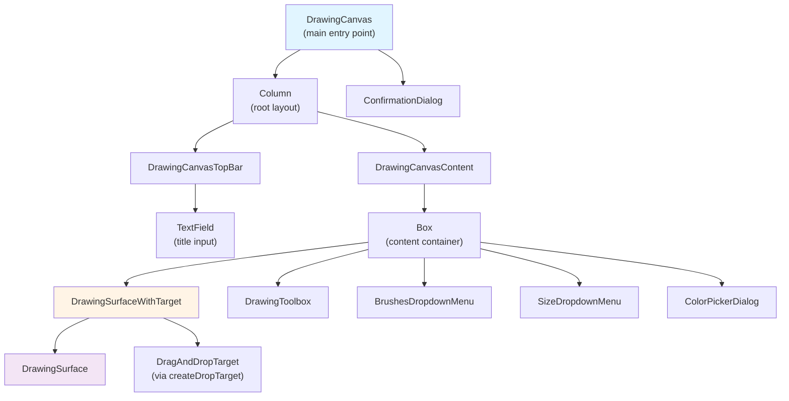
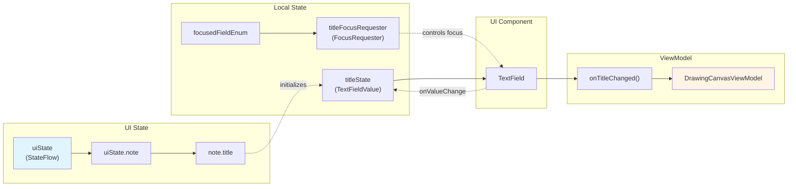
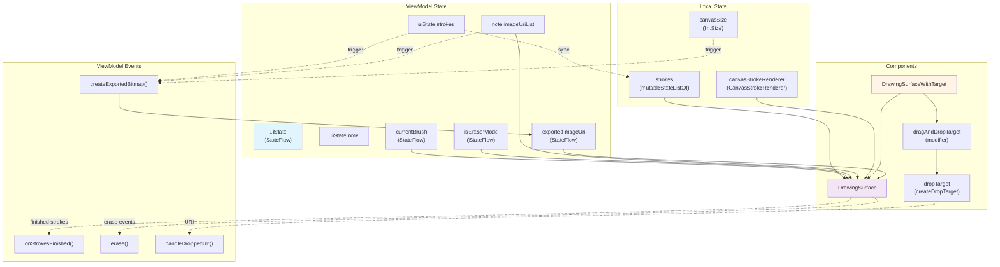
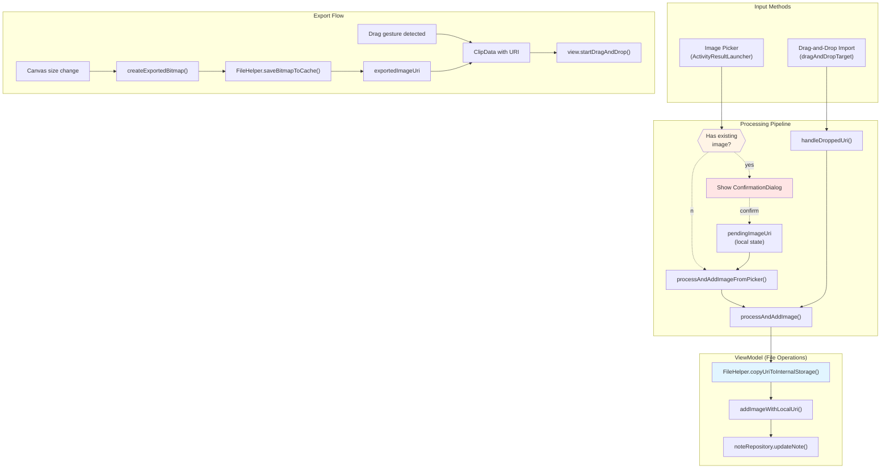

<!-- source: DeepWiki mcp.deepwiki.com · repo android/cahier · extra page Drawing Canvas UI · fetched 2026-10-23 -->

# Drawing Canvas UI

<details>
<summary>Relevant source files</summary>

The following files were used as context for generating this wiki page:

- [app/src/main/java/com/example/cahier/ui/DrawingCanvas.kt](app/src/main/java/com/example/cahier/ui/DrawingCanvas.kt)
- [app/src/main/java/com/example/cahier/ui/utils/DragAndDropUtils.kt](app/src/main/java/com/example/cahier/ui/utils/DragAndDropUtils.kt)
- [app/src/main/java/com/example/cahier/ui/viewmodels/DrawingCanvasViewModel.kt](app/src/main/java/com/example/cahier/ui/viewmodels/DrawingCanvasViewModel.kt)

</details>


## Purpose and Scope

This document details the `DrawingCanvas` composable and its child components, which provide the user interface for creating and editing drawing notes. The page covers the layout structure, title editing, image management, and how these UI components integrate with `DrawingCanvasViewModel` for state management and persistence.

For information about the low-level drawing surface implementation and stroke rendering, see [Drawing Surface & Stroke Rendering](#3.1.2). For details about brush controls and the toolbox UI, see [Drawing Toolbox & Brush System](#3.1.3). For image file management utilities, see [File Management](#6.1).

## Component Hierarchy

The Drawing Canvas UI is organized as a hierarchical tree of composable functions that work together to provide the drawing experience.

**Diagram: Drawing Canvas Composable Hierarchy**



Sources: [app/src/main/java/com/example/cahier/ui/DrawingCanvas.kt:87-140](), [app/src/main/java/com/example/cahier/ui/DrawingCanvas.kt:142-184](), [app/src/main/java/com/example/cahier/ui/DrawingCanvas.kt:190-265](), [app/src/main/java/com/example/cahier/ui/DrawingCanvas.kt:268-366]()

## Main Container: DrawingCanvas

The `DrawingCanvas` composable is the top-level entry point for the drawing note UI, defined at [app/src/main/java/com/example/cahier/ui/DrawingCanvas.kt:88-140](). It serves as the container that coordinates all child components and manages the overall screen state.

### Structure and Responsibilities

| Responsibility | Implementation |
|---------------|----------------|
| Navigation | Receives `navigateUp: () -> Unit` callback for back navigation |
| ViewModel injection | Uses `hiltViewModel()` to obtain `DrawingCanvasViewModel` instance |
| State collection | Collects `uiState` via `collectAsStateWithLifecycle()` |
| Image replacement flow | Manages confirmation dialog when replacing existing images |
| Layout organization | Wraps children in `Column` with system bar padding |

### Image Picker Launcher

The component initializes an `ActivityResultLauncher` for picking images from the device gallery:

```kotlin
val imagePickerLauncher = rememberLauncherForActivityResult(
    contract = ActivityResultContracts.PickVisualMedia()
) { uri: Uri? -> ... }
```

The launcher is created at [app/src/main/java/com/example/cahier/ui/DrawingCanvas.kt:97-108]() and handles two scenarios:

1. **No existing image**: Directly calls `drawingCanvasViewModel.processAndAddImageFromPicker(it)`
2. **Existing image present**: Shows confirmation dialog before replacing

### Confirmation Dialog

When an image already exists on the canvas, attempting to add another image triggers a `ConfirmationDialog` [app/src/main/java/com/example/cahier/ui/DrawingCanvas.kt:110-124]():

- Stores pending URI in `pendingImageUri` state
- Shows dialog with title and text from string resources `R.string.replace_image_title` and `R.string.replace_image_text`
- On confirmation: calls `drawingCanvasViewModel.replaceImage(pendingImageUri)`
- On dismissal: clears pending state without modification

### Layout Structure

The root layout is a `Column` with modifier chain [app/src/main/java/com/example/cahier/ui/DrawingCanvas.kt:126-132]():

```kotlin
Column(
    modifier = modifier
        .fillMaxSize()
        .statusBarsPadding()
        .navigationBarsPadding()
        .imePadding()
)
```

This ensures proper spacing for system UI elements (status bar, navigation bar) and adjusts for on-screen keyboard.

Sources: [app/src/main/java/com/example/cahier/ui/DrawingCanvas.kt:87-140]()

## Top Bar: DrawingCanvasTopBar

The `DrawingCanvasTopBar` composable [app/src/main/java/com/example/cahier/ui/DrawingCanvas.kt:142-184]() provides a title editing interface at the top of the drawing canvas.

### Component Composition

**Diagram: DrawingCanvasTopBar Data Flow**



Sources: [app/src/main/java/com/example/cahier/ui/DrawingCanvas.kt:142-184]()

### State Management

The top bar maintains several state variables:

| State Variable | Type | Purpose | Persistence |
|---------------|------|---------|-------------|
| `titleState` | `TextFieldValue` | Current title text and cursor position | Saved via `rememberSaveable` |
| `focusedFieldEnum` | `FocusedFieldEnum` | Tracks which field has focus | Saved via `rememberSaveable` |
| `titleFocusRequester` | `FocusRequester` | Programmatic focus control | Remembered (not saved) |

The `titleState` is initialized from `uiState.note.title` at [app/src/main/java/com/example/cahier/ui/DrawingCanvas.kt:148-150]().

### Focus Management

Focus is managed through a combination of `FocusRequester` and `LaunchedEffect`:

- When `focusedFieldEnum` changes to `FocusedFieldEnum.Title`, a `LaunchedEffect` [app/src/main/java/com/example/cahier/ui/DrawingCanvas.kt:154-158]() requests focus
- The `TextField` has an `onFocusChanged` modifier that updates `focusedFieldEnum` when focused
- This pattern enables both programmatic and user-initiated focus changes

### TextField Configuration

The title `TextField` is configured at [app/src/main/java/com/example/cahier/ui/DrawingCanvas.kt:164-182]() with these properties:

- **Single line**: Prevents multi-line titles
- **IME action**: `ImeAction.Done` shows "Done" button on keyboard
- **Placeholder**: Uses `R.string.drawing_title` resource
- **Weight modifier**: `Modifier.weight(1f)` allows it to fill available horizontal space
- **Value change handler**: Immediately calls `drawingCanvasViewModel.onTitleChanged(newTitle.text)`

Sources: [app/src/main/java/com/example/cahier/ui/DrawingCanvas.kt:142-184]()

## Content Area: DrawingCanvasContent

The `DrawingCanvasContent` composable [app/src/main/java/com/example/cahier/ui/DrawingCanvas.kt:190-265]() contains the main drawing surface and associated controls.

### Adaptive Layout Strategy

The content area adapts its layout based on screen size using `WindowSizeClass`:

```kotlin
val windowSizeClass = calculateWindowSizeClass(activity)
val isCompact = windowSizeClass.widthSizeClass == WindowWidthSizeClass.Compact
```

**Toolbox Positioning by Screen Size**

| Screen Size Class | Position | Modifier |
|------------------|----------|----------|
| Compact (phone) | Vertical on right edge | `align(Alignment.CenterEnd)` + `padding(end = 8.dp)` |
| Medium/Expanded (tablet) | Horizontal at top | `align(Alignment.TopCenter)` + `padding(8.dp)` |

The toolbox receives `isVertical = isCompact` parameter to adjust its internal layout accordingly [app/src/main/java/com/example/cahier/ui/DrawingCanvas.kt:224-226]().

### State Collection

The content area collects several state flows from the ViewModel:

```kotlin
val canUndo by drawingCanvasViewModel.canUndo.collectAsStateWithLifecycle()
val canRedo by drawingCanvasViewModel.canRedo.collectAsStateWithLifecycle()
val customBrushes by drawingCanvasViewModel.customBrushes.collectAsStateWithLifecycle()
```

These states are passed to `DrawingToolbox` to enable/disable UI controls [app/src/main/java/com/example/cahier/ui/DrawingCanvas.kt:201-206]().

### Child Components and Dialogs

The content area orchestrates several child components within a `Box` layout:

1. **DrawingSurfaceWithTarget**: Background layer, fills entire available space
2. **DrawingToolbox**: Positioned based on screen size (see table above)
3. **BrushesDropdownMenu**: Overlay menu for brush selection [app/src/main/java/com/example/cahier/ui/DrawingCanvas.kt:237-245]()
4. **SizeDropdownMenu**: Overlay menu for brush size selection [app/src/main/java/com/example/cahier/ui/DrawingCanvas.kt:247-254]()
5. **ColorPickerDialog**: Full-screen dialog for color selection [app/src/main/java/com/example/cahier/ui/DrawingCanvas.kt:256-263]()

Each menu/dialog is controlled by a local `rememberSaveable` boolean state that survives configuration changes.

Sources: [app/src/main/java/com/example/cahier/ui/DrawingCanvas.kt:190-265]()

## Drawing Surface Integration: DrawingSurfaceWithTarget

The `DrawingSurfaceWithTarget` composable [app/src/main/java/com/example/cahier/ui/DrawingCanvas.kt:268-366]() wraps the low-level `DrawingSurface` and adds drag-and-drop capabilities and export functionality.

### Component Architecture

**Diagram: DrawingSurfaceWithTarget Integration Flow**



Sources: [app/src/main/java/com/example/cahier/ui/DrawingCanvas.kt:268-366]()

### State Collection and Synchronization

The wrapper collects multiple state flows at [app/src/main/java/com/example/cahier/ui/DrawingCanvas.kt:273-276]():

- `uiState`: Contains note data and strokes
- `exportedImageUri`: Generated bitmap for drag-and-drop export
- `currentBrush`: Active brush configuration
- `isEraserMode`: Boolean toggle for drawing vs erasing

The strokes from `uiState` are synchronized with a local `mutableStateListOf<Stroke>()` via `LaunchedEffect` [app/src/main/java/com/example/cahier/ui/DrawingCanvas.kt:289-294](). This local list is necessary because the `DrawingSurface` needs a mutable list that it can modify during drawing.

### Canvas Size Tracking and Export

The wrapper tracks canvas size using `onSizeChanged` modifier [app/src/main/java/com/example/cahier/ui/DrawingCanvas.kt:313]():

```kotlin
.onSizeChanged { canvasSize = it }
```

A `LaunchedEffect` observes changes to strokes, images, and canvas size [app/src/main/java/com/example/cahier/ui/DrawingCanvas.kt:296-308](). When any of these change and the canvas has non-zero size, it triggers:

```kotlin
drawingCanvasViewModel.createExportedBitmap(canvasSize.width, canvasSize.height)
```

This generates a bitmap combining the background image and all strokes, which is used for drag-and-drop export (see Image Export section below).

### Drag-and-Drop Import

The wrapper implements drag-and-drop import using the `dragAndDropTarget` modifier [app/src/main/java/com/example/cahier/ui/DrawingCanvas.kt:314-319]():

```kotlin
.dragAndDropTarget(
    shouldStartDragAndDrop = { event ->
        event.mimeTypes().any { it.startsWith("image/") }
    },
    target = dropTarget
)
```

The `dropTarget` is created using the utility function from [app/src/main/java/com/example/cahier/ui/utils/DragAndDropUtils.kt:30-45]():

```kotlin
val dropTarget = remember {
    createDropTarget(activity) { uri, permissions ->
        drawingCanvasViewModel.handleDroppedUri(uri, permissions)
    }
}
```

This utility handles:
- Extracting URI from the drag event
- Requesting drag-and-drop permissions from the activity
- Passing both to the ViewModel for processing

Sources: [app/src/main/java/com/example/cahier/ui/DrawingCanvas.kt:268-366](), [app/src/main/java/com/example/cahier/ui/utils/DragAndDropUtils.kt:29-45]()

### Drag-and-Drop Export

The export mechanism uses Android's View-based drag system rather than Compose's `dragAndDropSource` modifier. This is explicitly documented in a comment at [app/src/main/java/com/example/cahier/ui/DrawingCanvas.kt:343-350]():

> While Jetpack Compose offers the `dragAndDropSource` modifier, a custom implementation using the Android View system's `startDragAndDrop` is necessary here. This is because the Ink API's drawing gestures conflict with the long-press-to-drag gesture when using the standard Compose modifier, preventing drag detection.

The export flow:
1. User initiates drag gesture in `DrawingSurface` (detected by custom gesture handling)
2. `DrawingSurface` calls the `onStartDrag` callback [app/src/main/java/com/example/cahier/ui/DrawingCanvas.kt:331-358]()
3. Callback creates `ClipData` with exported bitmap URI
4. Calls `view.startDragAndDrop()` with flags `View.DRAG_FLAG_GLOBAL or View.DRAG_FLAG_GLOBAL_URI_READ`

The `exportedUri` used in the `ClipData` is generated by the `createExportedBitmap()` function discussed in the ViewModel Integration section below.

Sources: [app/src/main/java/com/example/cahier/ui/DrawingCanvas.kt:331-358]()

## Image Handling Flows

The Drawing Canvas UI supports three image-related workflows: picking from gallery, importing via drag-and-drop, and exporting via drag-and-drop.

**Diagram: Image Handling Data Flow**



Sources: [app/src/main/java/com/example/cahier/ui/DrawingCanvas.kt:97-124](), [app/src/main/java/com/example/cahier/ui/DrawingCanvas.kt:283-287](), [app/src/main/java/com/example/cahier/ui/DrawingCanvas.kt:331-358]()

### Image Picker Flow

1. User taps image picker button in toolbox
2. `imagePickerLauncher` launches with `ActivityResultContracts.PickVisualMedia()`
3. Result handler checks if `uiState.note.imageUriList?.isNotEmpty()` [app/src/main/java/com/example/cahier/ui/DrawingCanvas.kt:101]()
4. If empty: directly calls `drawingCanvasViewModel.processAndAddImageFromPicker(it)`
5. If not empty: stores URI in `pendingImageUri` and shows confirmation dialog
6. On confirmation: calls `drawingCanvasViewModel.replaceImage(pendingImageUri)`

Both `processAndAddImageFromPicker()` and `replaceImage()` ultimately call the same `processAndAddImage()` function in the ViewModel.

### Drag-and-Drop Import Flow

1. User drags image file over the canvas
2. `dragAndDropTarget` modifier checks if MIME type starts with "image/" [app/src/main/java/com/example/cahier/ui/DrawingCanvas.kt:315-316]()
3. If match: `dropTarget.onDrop()` is called with the event
4. `createDropTarget` utility extracts URI and requests permissions [app/src/main/java/com/example/cahier/ui/utils/DragAndDropUtils.kt:35-42]()
5. Calls `drawingCanvasViewModel.handleDroppedUri(uri, permissions)` [app/src/main/java/com/example/cahier/ui/DrawingCanvas.kt:285]()

Note: Unlike the picker flow, drag-and-drop does not show a confirmation dialog when replacing existing images. It directly replaces the image.

### Export Bitmap Generation

The `createExportedBitmap()` function in the ViewModel [app/src/main/java/com/example/cahier/ui/viewmodels/DrawingCanvasViewModel.kt:227-277]() performs these steps:

1. Retrieves background image URI from `uiState.note.imageUriList`
2. If present, loads bitmap using Coil `ImageLoader`
3. Creates new bitmap with canvas dimensions
4. Draws background color (black for night mode, white otherwise)
5. If background bitmap exists, scales and centers it on canvas
6. Uses `CanvasStrokeRenderer` to render all strokes on top
7. Saves combined bitmap to cache via `FileHelper.saveBitmapToCache()`
8. Updates `exportedImageUri` state flow

This exported URI is then available for the drag-and-drop export mechanism.

Sources: [app/src/main/java/com/example/cahier/ui/viewmodels/DrawingCanvasViewModel.kt:227-277]()

## ViewModel Integration

The Drawing Canvas UI integrates closely with `DrawingCanvasViewModel` for state management and business logic.

### State Flow Collection

The UI collects multiple state flows from the ViewModel:

| State Flow | Type | Purpose | Collected In |
|-----------|------|---------|--------------|
| `uiState` | `StateFlow<CahierUiState>` | Note data and strokes | `DrawingCanvas`, `DrawingSurfaceWithTarget` |
| `currentBrush` | `StateFlow<Brush>` | Active brush configuration | `DrawingSurfaceWithTarget` |
| `isEraserMode` | `StateFlow<Boolean>` | Drawing vs erasing toggle | `DrawingSurfaceWithTarget` |
| `canUndo` | `StateFlow<Boolean>` | Undo button enabled state | `DrawingCanvasContent` |
| `canRedo` | `StateFlow<Boolean>` | Redo button enabled state | `DrawingCanvasContent` |
| `exportedImageUri` | `StateFlow<Uri?>` | Bitmap for export | `DrawingSurfaceWithTarget` |
| `customBrushes` | `StateFlow<List<CustomBrush>>` | Available custom brushes | `DrawingCanvasContent` |

All state flows are collected using `collectAsStateWithLifecycle()` for proper lifecycle management.

### Event Handlers Passed to Child Components

The UI passes several ViewModel functions as callbacks to child components:

**Title Editing**
- `onTitleChanged(newTitle: String)` - Called by `TextField` on every text change [app/src/main/java/com/example/cahier/ui/DrawingCanvas.kt:168]()

**Stroke Management**
- `onStrokesFinished(finishedStrokes: List<Stroke>)` - Called by `DrawingSurface` when strokes complete [app/src/main/java/com/example/cahier/ui/DrawingCanvas.kt:326]()
- `erase(x: Float, y: Float)` - Called during eraser mode touch events [app/src/main/java/com/example/cahier/ui/DrawingCanvas.kt:328]()
- `startErase()` - Called when eraser mode drag begins [app/src/main/java/com/example/cahier/ui/DrawingCanvas.kt:329]()
- `endErase()` - Called when eraser mode drag ends [app/src/main/java/com/example/cahier/ui/DrawingCanvas.kt:330]()

**Brush Controls**
- `changeBrush(brushFamily)` - Called by brush selection menu [app/src/main/java/com/example/cahier/ui/DrawingCanvas.kt:241]()
- `changeBrushColor(color)` - Called by color picker [app/src/main/java/com/example/cahier/ui/DrawingCanvas.kt:260]()
- `changeBrushSize(size)` - Called by size menu [app/src/main/java/com/example/cahier/ui/DrawingCanvas.kt:251]()

**History Operations**
- `undo()` - Called by undo button [app/src/main/java/com/example/cahier/ui/DrawingCanvas.kt:231]()
- `redo()` - Called by redo button [app/src/main/java/com/example/cahier/ui/DrawingCanvas.kt:232]()

**Image Operations**
- `processAndAddImageFromPicker(uri)` - Called by image picker result [app/src/main/java/com/example/cahier/ui/DrawingCanvas.kt:105]()
- `replaceImage(uri)` - Called after confirmation dialog [app/src/main/java/com/example/cahier/ui/DrawingCanvas.kt:113]()
- `handleDroppedUri(uri, permissions)` - Called by drag-and-drop target [app/src/main/java/com/example/cahier/ui/DrawingCanvas.kt:285]()

**Utility Functions**
- `getCurrentBrush()` - Called by `DrawingSurface` to get current brush state [app/src/main/java/com/example/cahier/ui/DrawingCanvas.kt:360]()

### ViewModel State Initialization

The ViewModel initializes state in its `init` block [app/src/main/java/com/example/cahier/ui/viewmodels/DrawingCanvasViewModel.kt:116-157]():

1. Retrieves `noteId` from `SavedStateHandle` navigation argument
2. Collects note stream from repository via `noteRepository.getNoteStream(noteId)`
3. If note has `strokesData`, deserializes strokes via `noteRepository.getNoteStrokes(note.id)`
4. Restores custom brush if note has `clientBrushFamilyId` (unless user has manually selected a brush in current session)
5. Updates `_uiState` with note and strokes
6. Initializes history with loaded strokes
7. Loads custom brushes via `loadCustomBrushes()` which calls `CustomBrushes.getBrushes(context)`

### Lifecycle Management

The ViewModel overrides `onCleared()` [app/src/main/java/com/example/cahier/ui/viewmodels/DrawingCanvasViewModel.kt:448-453]() to ensure strokes are saved when the ViewModel is destroyed:

```kotlin
override fun onCleared() {
    super.onCleared()
    viewModelScope.launch {
        saveStrokes()
    }
}
```

This guarantees that work-in-progress drawings are persisted even if the user doesn't explicitly save.

Sources: [app/src/main/java/com/example/cahier/ui/viewmodels/DrawingCanvasViewModel.kt:67-157](), [app/src/main/java/com/example/cahier/ui/viewmodels/DrawingCanvasViewModel.kt:448-453]()

## Summary

The Drawing Canvas UI implements a sophisticated composable hierarchy that separates concerns effectively:

- **DrawingCanvas**: Top-level coordinator managing navigation, image picker, and confirmation dialogs
- **DrawingCanvasTopBar**: Title editing with focus management and state persistence
- **DrawingCanvasContent**: Adaptive layout container positioning toolbox based on screen size
- **DrawingSurfaceWithTarget**: Integration layer adding drag-and-drop and export to the drawing surface

The architecture enables clean separation between UI state (managed by composables) and business logic (managed by `DrawingCanvasViewModel`), with unidirectional data flow through state flows and callback functions. Image handling is unified through a common processing pipeline regardless of input source (picker or drag-and-drop), while export functionality is tightly integrated with canvas size changes to maintain an up-to-date exportable bitmap.

---

