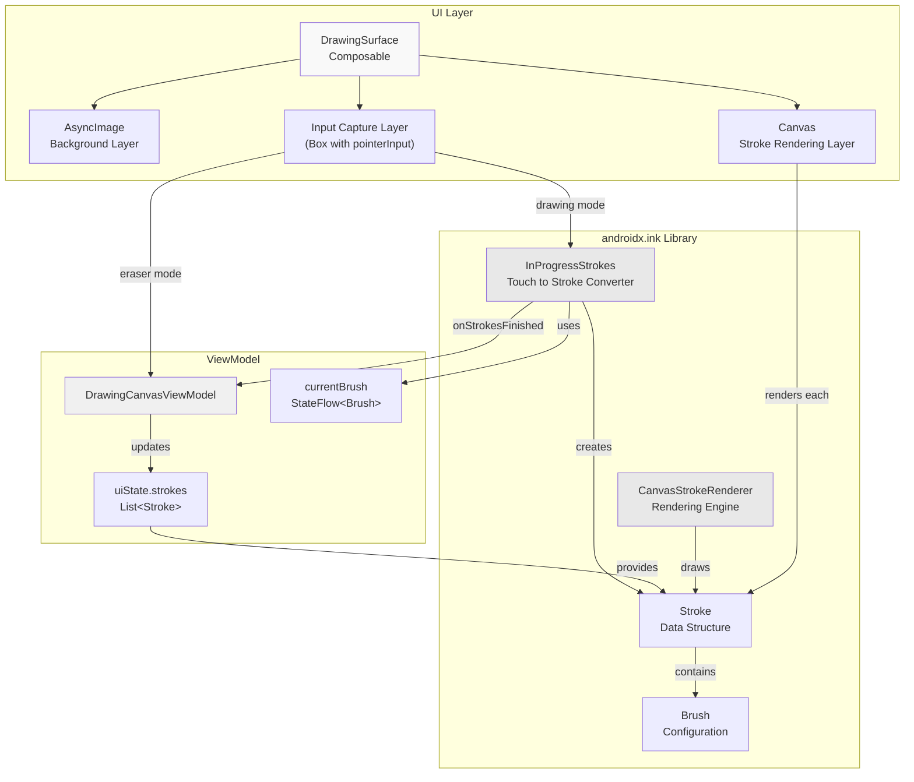
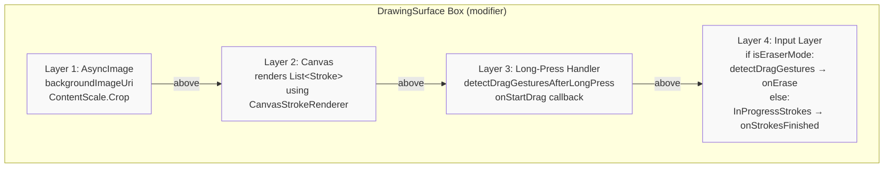
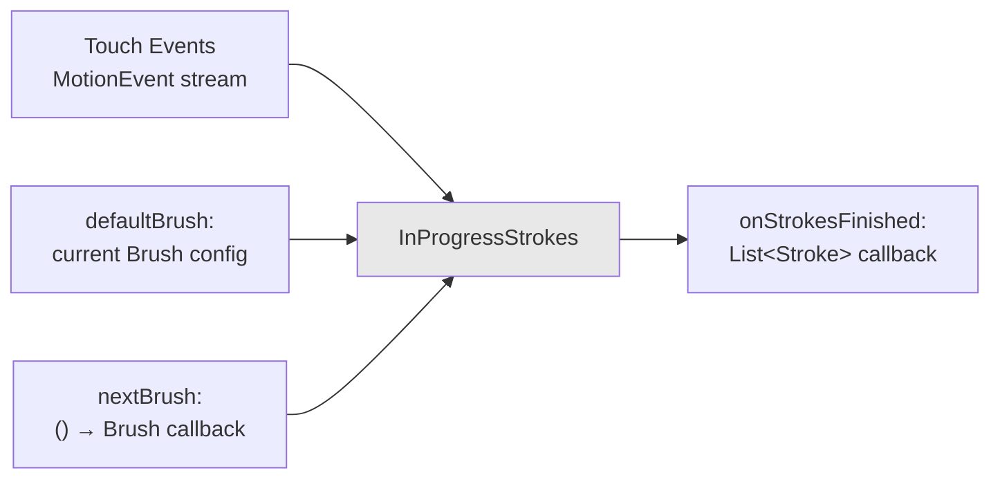
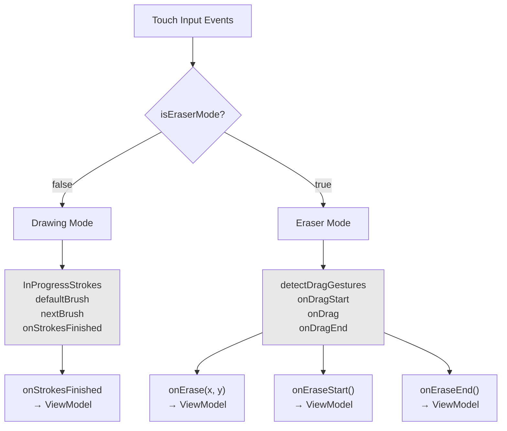
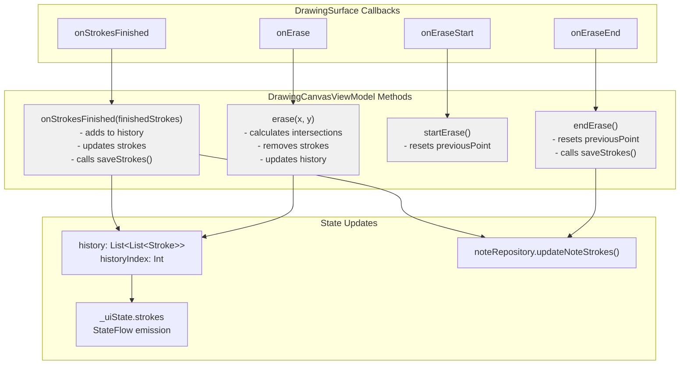
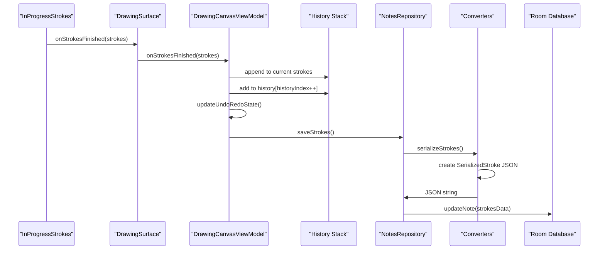
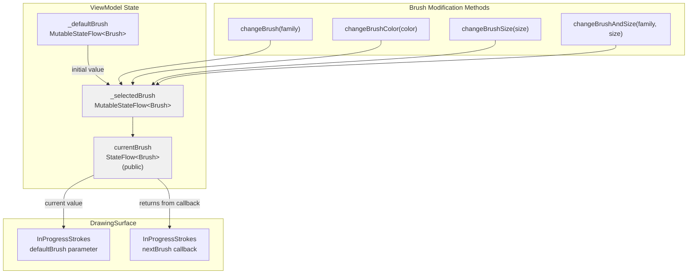

<!-- source: DeepWiki mcp.deepwiki.com · repo android/cahier · extra page Drawing Surface & Stroke Rendering · fetched 2026-10-23 -->

# Drawing Surface & Stroke Rendering

<details>
<summary>Relevant source files</summary>

The following files were used as context for generating this wiki page:

- [app/build.gradle.kts](app/build.gradle.kts)
- [app/src/main/java/com/example/cahier/ui/DrawingSurface.kt](app/src/main/java/com/example/cahier/ui/DrawingSurface.kt)
- [app/src/main/java/com/example/cahier/ui/viewmodels/DrawingCanvasViewModel.kt](app/src/main/java/com/example/cahier/ui/viewmodels/DrawingCanvasViewModel.kt)
- [gradle/libs.versions.toml](gradle/libs.versions.toml)

</details>


## Purpose and Scope

This document explains the low-level drawing surface implementation, stroke capture mechanics, and rendering pipeline in the Cahier application. It covers the `DrawingSurface` composable, integration with the androidx.ink library, and how touch input is transformed into rendered strokes on screen.

For high-level UI structure and layout of the drawing canvas, see [Drawing Canvas UI](#3.1.1). For brush selection and configuration, see [Drawing Toolbox & Brush System](#3.1.3). For stroke persistence and serialization, see [Stroke Serialization](#4.3).

---

## Architecture Overview

The drawing surface system consists of three main layers: input capture, stroke processing, and rendering. The `DrawingSurface` composable orchestrates these layers by integrating the androidx.ink library's `InProgressStrokes` and `CanvasStrokeRenderer` components.



**Diagram: Drawing Surface Architecture**

The system operates in two modes: drawing mode uses `InProgressStrokes` for stroke capture, while eraser mode uses custom hit-testing logic (covered in [Eraser Mode](#3.1.5)).

Sources: [app/src/main/java/com/example/cahier/ui/DrawingSurface.kt:52-140]()

---

## DrawingSurface Component Structure

The `DrawingSurface` composable is implemented as a layered `Box` that stacks background image, rendered strokes, and input capture layers. This structure allows independent management of each visual element while maintaining correct z-ordering.

### Component Signature

The composable accepts the following parameters:

| Parameter | Type | Purpose |
|-----------|------|---------|
| `strokes` | `List<Stroke>` | Completed strokes to render |
| `canvasStrokeRenderer` | `CanvasStrokeRenderer` | androidx.ink rendering engine |
| `onStrokesFinished` | `(List<Stroke>) -> Unit` | Callback when strokes complete |
| `onErase` | `(Float, Float) -> Unit` | Callback for eraser touch events |
| `onEraseStart` | `() -> Unit` | Callback when erasing begins |
| `onEraseEnd` | `() -> Unit` | Callback when erasing ends |
| `currentBrush` | `Brush` | Active brush configuration |
| `onGetNextBrush` | `() -> Brush` | Supplies brush for next stroke |
| `isEraserMode` | `Boolean` | Toggle between draw/erase |
| `backgroundImageUri` | `String?` | Optional background image |
| `onStartDrag` | `() -> Unit` | Callback for long-press drag |

Sources: [app/src/main/java/com/example/cahier/ui/DrawingSurface.kt:53-66]()

### Layer Structure



**Diagram: DrawingSurface Layer Stack**

Each layer is a separate composable within the parent `Box`, with higher layers positioned above lower ones in z-order.

Sources: [app/src/main/java/com/example/cahier/ui/DrawingSurface.kt:67-139]()

---

## androidx.ink Library Integration

The drawing surface integrates two critical androidx.ink components: `InProgressStrokes` for stroke capture and `CanvasStrokeRenderer` for rendering.

### Key androidx.ink Dependencies

The application depends on multiple androidx.ink libraries, each providing specific functionality:

| Library | Version | Purpose |
|---------|---------|---------|
| `androidx.ink:ink-authoring-compose` | 1.0.0-beta01 | `InProgressStrokes` composable |
| `androidx.ink:ink-rendering` | 1.0.0-beta01 | `CanvasStrokeRenderer` engine |
| `androidx.ink:ink-strokes` | 1.0.0-beta01 | `Stroke` data structure |
| `androidx.ink:ink-brush` | 1.0.0-beta01 | `Brush` configuration |
| `androidx.ink:ink-brush-compose` | 1.0.0-beta01 | Compose color integration |
| `androidx.ink:ink-geometry` | 1.0.0-beta01 | Geometric primitives |

Sources: [gradle/libs.versions.toml:9,44-50,84-86](), [app/build.gradle.kts:118-128]()

### InProgressStrokes Component

`InProgressStrokes` is a composable from `androidx.ink.authoring.compose` that captures touch input and converts it into `Stroke` objects. It is conditionally rendered when not in eraser mode:



**Diagram: InProgressStrokes Data Flow**

The `defaultBrush` parameter provides the initial brush configuration, while `nextBrush` allows dynamic brush changes during stroke creation. When touch input completes, the `onStrokesFinished` callback receives the completed strokes.

Sources: [app/src/main/java/com/example/cahier/ui/DrawingSurface.kt:133-138]()

### CanvasStrokeRenderer Usage

`CanvasStrokeRenderer` is instantiated in the `DrawingCanvasViewModel` and passed to `DrawingSurface`. It provides the `draw` method for rendering strokes:

```kotlin
// In DrawingSurface.kt, inside Canvas composable:
canvasStrokeRenderer.draw(
    stroke = stroke,
    canvas = canvas.nativeCanvas,
    strokeToScreenTransform = Matrix()
)
```

The renderer requires an Android `Canvas` (accessed via `nativeCanvas`) and a transformation matrix. The identity matrix (`Matrix()`) indicates no transformation is applied.

Sources: [app/src/main/java/com/example/cahier/ui/DrawingSurface.kt:90-94]()

---

## Stroke Rendering Pipeline

The rendering pipeline transforms the list of completed strokes into visual output on the screen. This process occurs within the Compose `Canvas` composable using `CanvasStrokeRenderer`.

### Rendering Process Flow

```mermaid
sequenceDiagram
    participant UISTATE as "uiState.strokes"
    participant CANVAS as "Canvas Composable"
    participant CTX as "DrawContext"
    participant NATIVE as "NativeCanvas"
    participant CSR as "CanvasStrokeRenderer"
    participant SCREEN as "Screen"
    
    UISTATE->>CANVAS: List&lt;Stroke&gt;
    CANVAS->>CANVAS: forEach stroke
    CANVAS->>CTX: get drawContext
    CTX->>NATIVE: get nativeCanvas
    CANVAS->>CANVAS: determine BlendMode<br/>(Multiply for highlighter)
    CANVAS->>CTX: withSaveLayer(blendMode)
    CTX->>NATIVE: withSave
    NATIVE->>CSR: draw(stroke, canvas, Matrix())
    CSR->>SCREEN: render pixels
```

**Diagram: Stroke Rendering Sequence**

Each stroke is rendered individually within a save/restore layer context, allowing for proper blend mode application without affecting other strokes.

Sources: [app/src/main/java/com/example/cahier/ui/DrawingSurface.kt:77-98]()

### Blend Mode Handling

The rendering pipeline applies different blend modes based on brush type:

| Brush Type | Blend Mode | Purpose |
|------------|------------|---------|
| `StockBrushes.highlighter()` | `BlendMode.Multiply` | Simulates transparent highlighter effect |
| All other brushes | `BlendMode.SrcOver` | Standard opaque drawing |

The blend mode determination occurs for each stroke:

```kotlin
val blendMode = if (stroke.brush.family == StockBrushes.highlighter()) {
    BlendMode.Multiply
} else {
    BlendMode.SrcOver
}
```

This check compares the stroke's brush family against the stock highlighter brush to decide the rendering behavior.

Sources: [app/src/main/java/com/example/cahier/ui/DrawingSurface.kt:80-84]()

### Canvas Layer Management

The rendering uses Compose's `withSaveLayer` to isolate each stroke's rendering:

```kotlin
drawContext.canvas.withSaveLayer(
    drawContext.size.toRect(),
    androidx.compose.ui.graphics.Paint().apply { 
        this.blendMode = blendMode 
    }
) {
    canvas.withSave {
        canvasStrokeRenderer.draw(stroke, canvas, Matrix())
    }
}
```

This double-nesting (`withSaveLayer` and `withSave`) ensures:
1. Blend mode is applied correctly to the entire stroke
2. Canvas state is restored after each stroke render
3. Strokes don't interfere with each other's rendering

Sources: [app/src/main/java/com/example/cahier/ui/DrawingSurface.kt:85-96]()

---

## Input Capture System

The input capture system handles touch events differently based on the current mode (drawing or erasing). It uses Compose's `pointerInput` modifier to intercept and process touch events.

### Mode-Based Input Routing



**Diagram: Input Routing Based on Mode**

The conditional rendering ensures only one input handler is active at a time, preventing conflicts between drawing and erasing.

Sources: [app/src/main/java/com/example/cahier/ui/DrawingSurface.kt:118-138]()

### Drawing Mode Input Implementation

In drawing mode, `InProgressStrokes` handles all input capture:

```kotlin
if (!isEraserMode) {
    InProgressStrokes(
        defaultBrush = currentBrush,
        nextBrush = onGetNextBrush,
        onStrokesFinished = onStrokesFinished,
    )
}
```

The component internally manages:
- Touch event tracking
- Motion prediction (via `androidx.input:input-motionprediction`)
- Stroke construction from touch points
- Brush application to strokes

When input completes (touch up), `onStrokesFinished` is invoked with the completed strokes.

Sources: [app/src/main/java/com/example/cahier/ui/DrawingSurface.kt:132-138](), [app/build.gradle.kts:130-131]()

### Eraser Mode Input Implementation

In eraser mode, a custom `pointerInput` handler captures drag gestures:

```kotlin
if (isEraserMode) {
    Box(
        modifier = Modifier
            .fillMaxSize()
            .pointerInput(Unit) {
                detectDragGestures(
                    onDragStart = { onEraseStart() },
                    onDragEnd = { onEraseEnd() }
                ) { change, _ ->
                    onErase(change.position.x, change.position.y)
                    change.consume()
                }
            }
    )
}
```

Each drag event invokes `onErase` with x/y coordinates. The `change.consume()` call prevents the event from propagating to lower layers.

Sources: [app/src/main/java/com/example/cahier/ui/DrawingSurface.kt:118-131]()

### Long-Press Drag Detection

A separate layer captures long-press drag gestures for initiating drag-and-drop operations:

```kotlin
Box(
    modifier = Modifier
        .fillMaxSize()
        .pointerInputWithSiblingFallthrough {
            detectDragGesturesAfterLongPress(
                onDragStart = {
                    onStartDrag()
                },
                onDrag = { change, _ ->
                    change.consume()
                },
                onDragEnd = {
                    // Do nothing.
                }
            )
        }
)
```

The `pointerInputWithSiblingFallthrough` utility (a custom extension) allows events to fall through to the drawing/eraser input layer if the long-press is not detected.

Sources: [app/src/main/java/com/example/cahier/ui/DrawingSurface.kt:100-116]()

---

## Interaction with DrawingCanvasViewModel

The `DrawingSurface` delegates all business logic to `DrawingCanvasViewModel` through callback functions. This maintains separation between UI and state management.

### Callback Mapping



**Diagram: ViewModel Callback Processing**

All callback methods modify the stroke history and trigger persistence through the repository layer.

Sources: [app/src/main/java/com/example/cahier/ui/viewmodels/DrawingCanvasViewModel.kt:302-330]()

### onStrokesFinished Processing

The `onStrokesFinished` callback in `DrawingCanvasViewModel` executes the following sequence:

1. Retrieves current strokes from history at `historyIndex`
2. Appends finished strokes to current strokes
3. Calls `updateStrokes()` to manage history stack
4. Invokes `saveStrokes()` to persist to database

```kotlin
@UiThread
fun onStrokesFinished(finishedStrokes: List<Stroke>) {
    val currentStrokes = history.getOrElse(historyIndex) { emptyList() }
    val newStrokes = currentStrokes + finishedStrokes
    updateStrokes(newStrokes)
    viewModelScope.launch {
        saveStrokes()
    }
}
```

The `@UiThread` annotation indicates this method must be called from the main thread, as required by the androidx.ink library.

Sources: [app/src/main/java/com/example/cahier/ui/viewmodels/DrawingCanvasViewModel.kt:301-309]()

### Stroke Persistence Flow



**Diagram: Stroke Persistence Sequence**

The persistence flow is asynchronous, allowing the UI to remain responsive while serialization and database updates occur.

Sources: [app/src/main/java/com/example/cahier/ui/viewmodels/DrawingCanvasViewModel.kt:279-288,302-309]()

---

## Brush State Management

The current brush configuration flows from `DrawingCanvasViewModel` to `InProgressStrokes` through the `DrawingSurface` component. This enables dynamic brush changes during drawing sessions.

### Brush Flow Architecture



**Diagram: Brush State Flow**

The `currentBrush` StateFlow provides reactive brush updates to the UI. The `nextBrush` callback allows `InProgressStrokes` to query the current brush configuration during stroke construction.

Sources: [app/src/main/java/com/example/cahier/ui/viewmodels/DrawingCanvasViewModel.kt:82-93,358-402]()

### Default Brush Initialization

The default brush is configured based on the system's night mode setting:

```kotlin
private val _defaultBrush = MutableStateFlow(
    Brush.createWithComposeColor(
        family = StockBrushes.pressurePen(),
        color = if (currentNightMode == AppCompatDelegate.MODE_NIGHT_YES)
            Color.White else Color.Gray,
        size = 5F,
        epsilon = 0.1F
    )
)
```

The brush uses:
- `StockBrushes.pressurePen()` family for pressure-sensitive strokes
- White color in dark mode, gray in light mode
- 5F size (in density-independent pixels)
- 0.1F epsilon (tolerance for curve approximation)

Sources: [app/src/main/java/com/example/cahier/ui/viewmodels/DrawingCanvasViewModel.kt:80-90]()

### Brush Configuration Parameters

The `Brush` class from `androidx.ink.brush` accepts the following key parameters:

| Parameter | Type | Purpose |
|-----------|------|---------|
| `family` | `BrushFamily` | Defines brush behavior (pressure-pen, marker, highlighter, etc.) |
| `color` | `Color` (Compose) | Stroke color with alpha channel |
| `size` | `Float` | Base stroke width in dp |
| `epsilon` | `Float` | Curve simplification tolerance |

The `createWithComposeColor` extension function from `androidx.ink.brush.compose` enables Jetpack Compose `Color` integration.

Sources: [app/src/main/java/com/example/cahier/ui/viewmodels/DrawingCanvasViewModel.kt:30-35,82-90]()

---

## Performance Considerations

The stroke rendering system is optimized for smooth, responsive drawing through several techniques:

### CanvasStrokeRenderer Creation

The renderer is instantiated with optional performance flags:

```kotlin
val strokeRenderer = CanvasStrokeRenderer.create(forcePathRendering = true)
```

The `forcePathRendering` flag ensures consistent rendering behavior across devices by using path-based rendering instead of texture-based rendering.

Sources: [app/src/main/java/com/example/cahier/ui/viewmodels/DrawingCanvasViewModel.kt:272]()

### Rendering Optimization Strategies

| Strategy | Implementation | Benefit |
|----------|----------------|---------|
| Native Canvas | Uses `canvas.nativeCanvas` | Direct Android Canvas API access |
| Identity Transform | `Matrix()` with no transformations | Eliminates matrix multiplication overhead |
| Save/Restore Layers | `withSave` and `withSaveLayer` | Isolates rendering state changes |
| Per-Stroke Rendering | `forEach` loop over strokes | Allows early termination if needed |

The rendering pipeline avoids unnecessary state changes and leverages the androidx.ink library's optimized native rendering implementation.

Sources: [app/src/main/java/com/example/cahier/ui/DrawingSurface.kt:77-98]()

### Input Prediction

The application includes motion prediction support through the `androidx.input:input-motionprediction` library. This reduces perceived latency by predicting stylus motion:

```kotlin
// Dependency in build.gradle.kts
implementation(libs.androidx.input.motionprediction)
```

Motion prediction is automatically integrated when `InProgressStrokes` is used with stylus input.

Sources: [app/build.gradle.kts:130-131](), [gradle/libs.versions.toml:30]()

---

## Summary

The drawing surface and stroke rendering system provides a layered, modular architecture for capturing and displaying ink strokes:

- **DrawingSurface** orchestrates background rendering, stroke display, and input capture in a layered `Box` structure
- **androidx.ink integration** handles low-level stroke capture (`InProgressStrokes`) and rendering (`CanvasStrokeRenderer`)
- **Mode-based input routing** separates drawing and erasing behavior through conditional rendering
- **ViewModel callbacks** maintain separation between UI and business logic
- **Blend mode handling** enables special effects like highlighter transparency
- **Performance optimizations** include native canvas rendering, identity transforms, and motion prediction support

The system's architecture enables smooth, responsive drawing while maintaining clean separation of concerns and testability.

Sources: [app/src/main/java/com/example/cahier/ui/DrawingSurface.kt:1-170](), [app/src/main/java/com/example/cahier/ui/viewmodels/DrawingCanvasViewModel.kt:1-459]()

---

