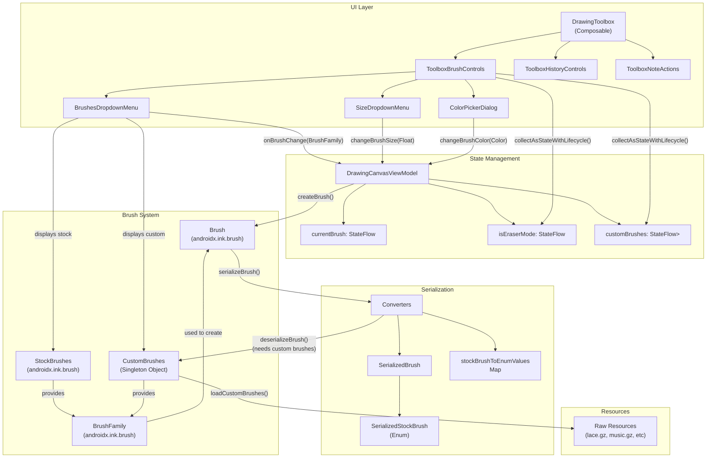
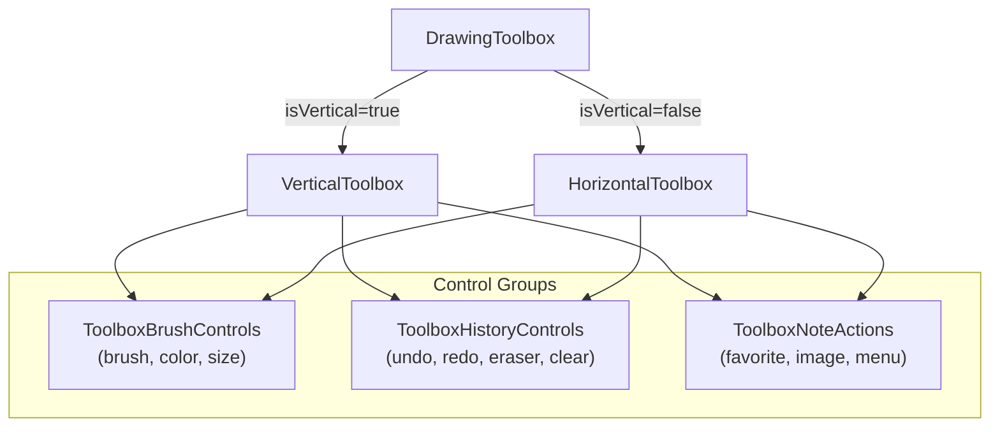
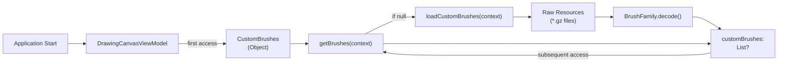
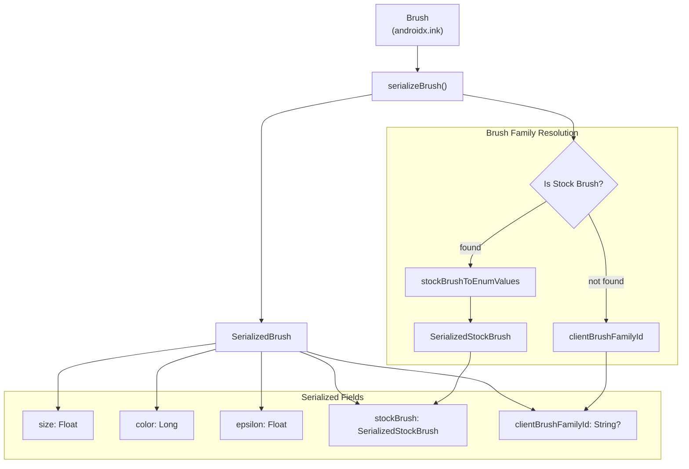
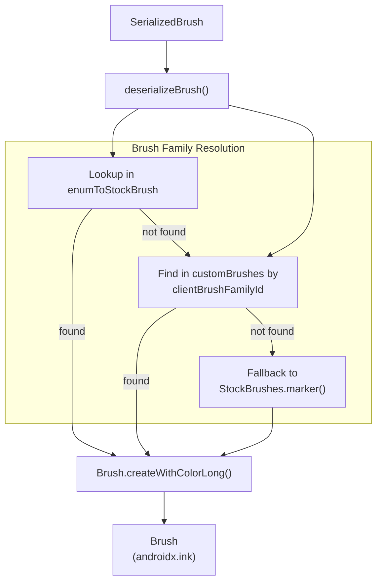

<!-- source: DeepWiki mcp.deepwiki.com · repo android/cahier · extra page Drawing Toolbox & Brush System · fetched 2026-10-23 -->

# Drawing Toolbox & Brush System

<details>
<summary>Relevant source files</summary>

The following files were used as context for generating this wiki page:

- [app/src/androidTest/java/com/example/cahier/data/OfflineNotesRepositoryTest.kt](app/src/androidTest/java/com/example/cahier/data/OfflineNotesRepositoryTest.kt)
- [app/src/main/java/com/example/cahier/ui/Converters.kt](app/src/main/java/com/example/cahier/ui/Converters.kt)
- [app/src/main/java/com/example/cahier/ui/CustomBrushes.kt](app/src/main/java/com/example/cahier/ui/CustomBrushes.kt)
- [app/src/main/java/com/example/cahier/ui/DrawingToolbox.kt](app/src/main/java/com/example/cahier/ui/DrawingToolbox.kt)
- [app/src/main/res/raw/lace.gz](app/src/main/res/raw/lace.gz)
- [app/src/main/res/raw/music.gz](app/src/main/res/raw/music.gz)
- [app/src/main/res/raw/shadow.gz](app/src/main/res/raw/shadow.gz)

</details>


## Purpose and Scope

This document describes the drawing toolbox UI and the brush system that powers ink rendering in Cahier. The toolbox provides user controls for selecting brushes, adjusting colors and sizes, and managing drawing state. The brush system manages both stock brushes (from androidx.ink) and custom brushes (loaded from compressed resources), along with their serialization for persistence.

For information about the drawing surface and stroke rendering, see [Drawing Surface & Stroke Rendering](#3.1.2). For information about undo/redo functionality, see [Stroke History & Undo/Redo](#3.1.4). For stroke serialization details, see [Stroke Serialization](#4.3).

---

## System Overview

The Drawing Toolbox & Brush System consists of four main components:

1. **DrawingToolbox UI** - Composable that renders brush controls, history controls, and note actions
2. **Brush Selection** - Dropdown menus for choosing from stock and custom brushes
3. **CustomBrushes Singleton** - Lazy-loads custom brush families from compressed raw resources
4. **Brush Serialization** - Maps brushes to persistent formats via `Converters`

The system supports two categories of brushes:
- **Stock Brushes**: Provided by `StockBrushes` from androidx.ink library (marker, pressurePen, highlighter, dashedLine)
- **Custom Brushes**: Loaded from raw resources (lace, music, shadow, and others)

---

## Architecture Diagram

**Title: Drawing Toolbox & Brush System Architecture**



**Sources:**
- [app/src/main/java/com/example/cahier/ui/DrawingToolbox.kt:62-104]()
- [app/src/main/java/com/example/cahier/ui/CustomBrushes.kt:32-72]()
- [app/src/main/java/com/example/cahier/ui/Converters.kt:45-113]()

---

## DrawingToolbox Composable

The `DrawingToolbox` composable is the main container for all drawing controls. It adapts its layout based on the `isVertical` parameter, rendering controls in either a vertical `Column` or horizontal `Row`.

### Component Structure



### Key Parameters

| Parameter | Type | Description |
|-----------|------|-------------|
| `drawingCanvasViewModel` | `DrawingCanvasViewModel` | State management for drawing operations |
| `imagePickerLauncher` | `ActivityResultLauncher<PickVisualMediaRequest>` | Launches image picker for adding images |
| `canUndo` | `Boolean` | Whether undo operation is available |
| `canRedo` | `Boolean` | Whether redo operation is available |
| `onUndo` | `() -> Unit` | Callback for undo action |
| `onRedo` | `() -> Unit` | Callback for redo action |
| `onExit` | `() -> Unit` | Callback for exiting the drawing canvas |
| `isVertical` | `Boolean` | Layout orientation (vertical for portrait, horizontal for landscape) |
| `onColorPickerClick` | `() -> Unit` | Opens color picker dialog |

**Sources:**
- [app/src/main/java/com/example/cahier/ui/DrawingToolbox.kt:62-104]()

---

## Stock Brushes

Stock brushes are provided by the androidx.ink library's `StockBrushes` class. Cahier supports four stock brush types:

### Supported Stock Brushes

| Brush Type | Function | Icon Resource | Description |
|------------|----------|---------------|-------------|
| Pressure Pen | `StockBrushes.pressurePen()` | `R.drawable.stylus_pen_24px` | Pressure-sensitive pen for writing |
| Marker | `StockBrushes.marker()` | `R.drawable.ink_marker_24px` | Uniform-width marker |
| Highlighter | `StockBrushes.highlighter()` | `R.drawable.ink_highlighter_24px` | Semi-transparent highlighter |
| Dashed Line | `StockBrushes.dashedLine()` | `R.drawable.road_24px` | Dashed line pattern |

Stock brushes are displayed in the `BrushesDropdownMenu` composable and mapped to enum values for serialization.

**Sources:**
- [app/src/main/java/com/example/cahier/ui/DrawingToolbox.kt:440-479]()
- [app/src/main/java/com/example/cahier/ui/Converters.kt:50-58]()

---

## Custom Brushes System

Custom brushes are loaded from compressed raw resources and managed by the `CustomBrushes` singleton object. Each custom brush consists of a name, icon resource, and `BrushFamily` instance decoded from compressed data.

### Custom Brush Loading Flow



### CustomBrushes Implementation

The `CustomBrushes` object uses double-checked locking to ensure thread-safe lazy initialization:

```kotlin
// Pattern used in CustomBrushes.kt
fun getBrushes(context: Context): List<CustomBrush> {
    return customBrushes ?: synchronized(this) {
        customBrushes ?: loadCustomBrushes(context).also { customBrushes = it }
    }
}
```

### Custom Brush Definitions

| Brush Name | Raw Resource | Icon | clientBrushFamilyId |
|------------|--------------|------|---------------------|
| Calligraphy | `R.raw.calligraphy` | `R.drawable.draw_24px` | "Calligraphy" |
| Flag Banner | `R.raw.flag_banner` | `R.drawable.flag_24px` | "Flag Banner" |
| Graffiti | `R.raw.graffiti` | `R.drawable.format_paint_24px` | "Graffiti" |
| Groovy | `R.raw.groovy` | `R.drawable.bubble_chart_24px` | "Groovy" |
| Holiday lights | `R.raw.holiday_lights` | `R.drawable.lightbulb_24px` | "Holiday lights" |
| Lace | `R.raw.lace` | `R.drawable.styler_24px` | "Lace" |
| Music | `R.raw.music` | `R.drawable.music_note_24px` | "Music" |
| Shadow | `R.raw.shadow` | `R.drawable.blur_on_24px` | "Shadow" |
| Twisted yarn | `R.raw.twisted_yarn` | `R.drawable.line_weight_24px` | "Twisted yarn" |
| Wet paint | `R.raw.wet_paint` | `R.drawable.water_drop_24px` | "Wet paint" |

The `clientBrushFamilyId` is set to the brush name and is used during deserialization to restore custom brushes from persisted strokes.

**Sources:**
- [app/src/main/java/com/example/cahier/ui/CustomBrushes.kt:32-71]()
- [app/src/main/res/raw/lace.gz]()
- [app/src/main/res/raw/music.gz]()
- [app/src/main/res/raw/shadow.gz]()

---

## Brush Serialization System

The `Converters` class handles serialization and deserialization of brushes for persistence. Brushes are serialized to `SerializedBrush` structures that include size, color, epsilon, and brush family identification.

### Serialization Strategy



### Stock Brush Enum Mapping

The `Converters` class maintains bidirectional mappings between `BrushFamily` instances and `SerializedStockBrush` enum values:

```kotlin
// Mapping structure in Converters.kt
private val stockBrushToEnumValues = mapOf(
    StockBrushes.marker() to SerializedStockBrush.MarkerLatest,
    StockBrushes.pressurePen() to SerializedStockBrush.PressurePenLatest,
    StockBrushes.highlighter() to SerializedStockBrush.HighlighterLatest,
    StockBrushes.dashedLine() to SerializedStockBrush.DashedLineLatest,
)

private val enumToStockBrush =
    stockBrushToEnumValues.entries.associate { (key, value) -> value to key }
```

### Deserialization Strategy



The deserialization process requires access to the `CustomBrushes` list to restore custom brushes. The `deserializeBrush()` method accepts `customBrushes: List<CustomBrush>` as a parameter.

**Sources:**
- [app/src/main/java/com/example/cahier/ui/Converters.kt:45-113]()
- [app/src/androidTest/java/com/example/cahier/data/OfflineNotesRepositoryTest.kt:52-78]()

---

## Brush Controls UI

The `ToolboxBrushControls` composable provides three interactive controls: brush selection, color selection, and size selection.

### Control Components

| Control | Icon | Function | Effect |
|---------|------|----------|--------|
| Brush Selector | `R.drawable.brush_24px` | Opens `BrushesDropdownMenu` | Changes current brush family |
| Color Picker | `R.drawable.palette_24px` | Opens `ColorPickerDialog` | Changes brush color, disables eraser mode |
| Size Selector | `R.drawable.line_weight_24px` | Opens `SizeDropdownMenu` | Changes brush size |

### Brush Selection Menu

The `BrushesDropdownMenu` displays stock brushes first, followed by a divider and custom brushes (if any are loaded). Each brush item shows an icon and name.

**Menu Structure:**
1. Stock brushes (always present)
   - Pressure Pen
   - Marker
   - Highlighter
   - Dashed Line
2. Horizontal divider (if custom brushes exist)
3. "Custom Brush" label (if custom brushes exist)
4. Custom brushes (dynamically loaded)

When a brush is selected, the menu calls `drawingCanvasViewModel.changeBrush(newBrush)` and closes.

### Size Selection Menu

The `SizeDropdownMenu` provides five predefined sizes: 5px, 10px, 15px, 20px, and 25px. These are hardcoded in the composable:

```kotlin
val sizes = listOf(5f, 10f, 15f, 20f, 25f)
```

Selecting a size calls `drawingCanvasViewModel.changeBrushSize(newSize)` and closes the menu.

**Sources:**
- [app/src/main/java/com/example/cahier/ui/DrawingToolbox.kt:106-211]()
- [app/src/main/java/com/example/cahier/ui/DrawingToolbox.kt:404-424]()
- [app/src/main/java/com/example/cahier/ui/DrawingToolbox.kt:426-502]()

---

## History Controls

The `ToolboxHistoryControls` composable provides undo, redo, eraser toggle, and clear canvas functionality.

### Control Components

| Control | Icon | Enabled State | Function |
|---------|------|---------------|----------|
| Undo | `R.drawable.undo_24px` | `canUndo` | Reverts last action |
| Redo | `R.drawable.redo_24px` | `canRedo` | Restores undone action |
| Eraser | `R.drawable.ink_eraser_24px` | Always enabled | Toggles eraser mode |
| Clear | `R.drawable.clear_all_24px` | Always enabled | Clears all strokes |

### Eraser Mode Visual Feedback

The eraser and brush controls provide visual feedback for the current mode:

- **Eraser button**: Background highlighted with `MaterialTheme.colorScheme.inversePrimary` when `isEraserMode` is true
- **Brush button**: Background highlighted with `MaterialTheme.colorScheme.inversePrimary` when `isEraserMode` is false

This creates mutually exclusive visual states to clearly indicate the active mode.

**Sources:**
- [app/src/main/java/com/example/cahier/ui/DrawingToolbox.kt:213-304]()

---

## Note Actions Controls

The `ToolboxNoteActions` composable provides controls for note-level operations: favorite toggle, image addition, and menu options.

### Control Components

| Control | Icon | Function |
|---------|------|----------|
| Favorite | `R.drawable.favorite_24px` (unfilled)<br/>`R.drawable.favorite_24px_filled` (filled) | Toggles note favorite status |
| Add Image | `R.drawable.image_24px` | Launches image picker |
| Menu | `R.drawable.menu_24px` | Opens dropdown with Exit option |

The favorite icon uses conditional rendering and tinting:
- Filled icon with primary color when favorited
- Outlined icon with default content color when not favorited

**Sources:**
- [app/src/main/java/com/example/cahier/ui/DrawingToolbox.kt:306-401]()

---

## Integration with DrawingCanvasViewModel

The toolbox interacts with `DrawingCanvasViewModel` through several methods:

### ViewModel Methods Called by Toolbox

| Method | Parameters | Purpose |
|--------|------------|---------|
| `changeBrush()` | `newBrush: BrushFamily` | Updates current brush family |
| `changeBrushColor()` | `color: Color` | Updates brush color |
| `changeBrushSize()` | `size: Float` | Updates brush size |
| `setEraserMode()` | `enabled: Boolean` | Toggles eraser mode |
| `toggleFavorite()` | None | Toggles note favorite status |

### State Flows Observed by Toolbox

| StateFlow | Type | Usage |
|-----------|------|-------|
| `customBrushes` | `StateFlow<List<CustomBrush>>` | Populates custom brush menu items |
| `isEraserMode` | `StateFlow<Boolean>` | Controls eraser/brush button highlighting |
| `uiState` | `StateFlow<CahierUiState>` | Provides note favorite status |

The toolbox uses `collectAsStateWithLifecycle()` to observe these state flows and automatically recompose when values change.

**Sources:**
- [app/src/main/java/com/example/cahier/ui/DrawingToolbox.kt:113-141]()
- [app/src/main/java/com/example/cahier/ui/DrawingToolbox.kt:258-294]()
- [app/src/main/java/com/example/cahier/ui/DrawingToolbox.kt:339-355]()

---

## Data Model: CustomBrush

The `CustomBrush` data class encapsulates a custom brush definition:

```kotlin
data class CustomBrush(
    val name: String,           // Display name
    val icon: Int,              // Drawable resource ID
    val brushFamily: BrushFamily // androidx.ink brush definition
)
```

This structure allows the UI to display brush names and icons while the drawing system uses the `BrushFamily` for actual stroke rendering. The `brushFamily.clientBrushFamilyId` is set to the brush name to enable deserialization.

**Sources:**
- [app/src/main/java/com/example/cahier/ui/CustomBrushes.kt:64]()
- [app/src/main/java/com/example/cahier/ui/DrawingToolbox.kt:488-499]()

---

