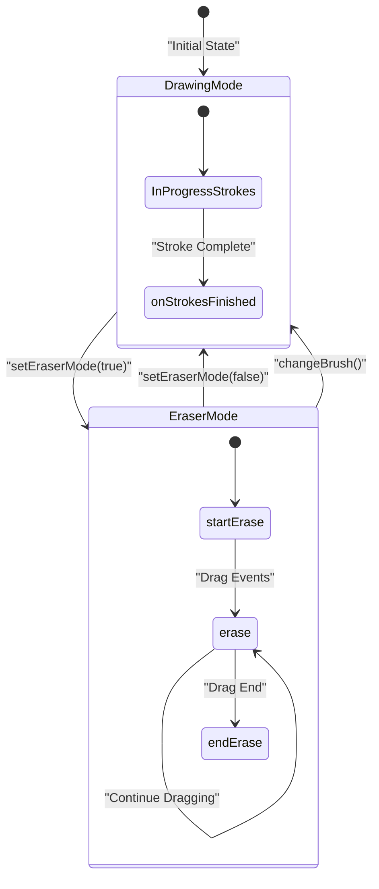
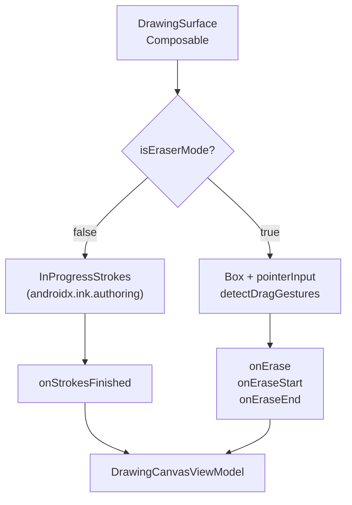
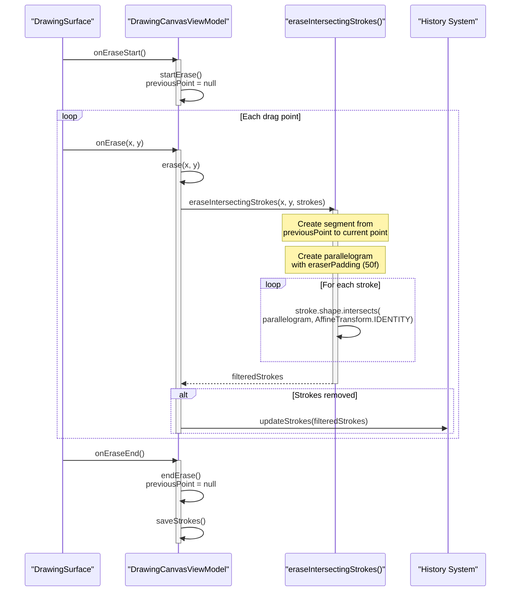
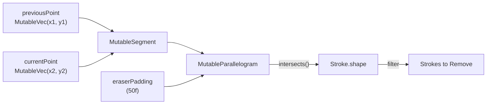
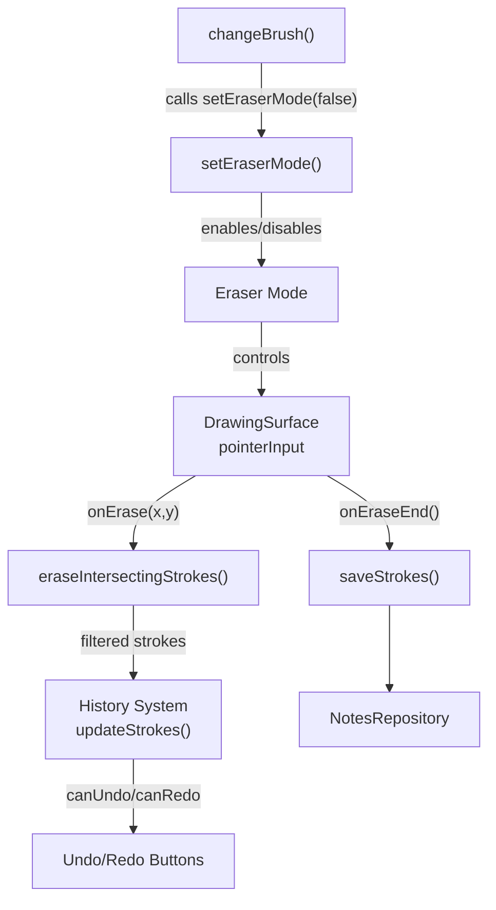

<!-- source: DeepWiki mcp.deepwiki.com · repo android/cahier · extra page Eraser Mode · fetched 2026-10-23 -->

# Eraser Mode

<details>
<summary>Relevant source files</summary>

The following files were used as context for generating this wiki page:

- [app/src/main/java/com/example/cahier/ui/DrawingSurface.kt](app/src/main/java/com/example/cahier/ui/DrawingSurface.kt)
- [app/src/main/java/com/example/cahier/ui/viewmodels/DrawingCanvasViewModel.kt](app/src/main/java/com/example/cahier/ui/viewmodels/DrawingCanvasViewModel.kt)

</details>


## Purpose and Scope

Eraser Mode is a drawing tool state in the Cahier application that allows users to remove existing strokes from the drawing canvas by dragging their finger or stylus across them. This document covers the implementation of eraser mode, including state management, input handling, and the stroke intersection algorithm used to determine which strokes to remove.

For information about the drawing system that eraser mode operates within, see [Drawing Notes System](#3.1). For details about brush selection and the drawing toolbox, see [Drawing Toolbox & Brush System](#3.1.3). For information about how eraser operations are integrated with undo/redo, see [Stroke History & Undo/Redo](#3.1.4).

## Eraser Mode State Management

Eraser mode is managed as a boolean state flag in `DrawingCanvasViewModel`. When enabled, the drawing surface switches from stroke capture mode (using `InProgressStrokes`) to eraser mode (using custom drag gesture detection).

### State Variables

The ViewModel maintains the following state:

| Variable | Type | Purpose |
|----------|------|---------|
| `_isEraserMode` | `MutableStateFlow<Boolean>` | Internal mutable state for eraser mode |
| `isEraserMode` | `StateFlow<Boolean>` | Public observable state exposed to UI |
| `previousPoint` | `MutableVec?` | Tracks the previous touch point for segment-based erasure |
| `eraserPadding` | `Float` (50f) | Defines the width of the eraser hit area |

**Diagram: Eraser Mode State Flow**



Sources:
- [app/src/main/java/com/example/cahier/ui/viewmodels/DrawingCanvasViewModel.kt:95-99]()
- [app/src/main/java/com/example/cahier/ui/viewmodels/DrawingCanvasViewModel.kt:404-406]()
- [app/src/main/java/com/example/cahier/ui/viewmodels/DrawingCanvasViewModel.kt:358-370]()

### Toggling Eraser Mode

The `setEraserMode()` function updates the eraser mode state:

```kotlin
fun setEraserMode(enabled: Boolean) {
    _isEraserMode.update { enabled }
}
```

Eraser mode is automatically disabled when the user selects a brush in the `changeBrush()` function, ensuring a clean transition back to drawing mode.

Sources:
- [app/src/main/java/com/example/cahier/ui/viewmodels/DrawingCanvasViewModel.kt:404-406]()
- [app/src/main/java/com/example/cahier/ui/viewmodels/DrawingCanvasViewModel.kt:358-359]()

## UI Integration and Input Handling

The `DrawingSurface` composable conditionally renders different input handling systems based on the `isEraserMode` parameter.

**Diagram: DrawingSurface Input Branching**



Sources:
- [app/src/main/java/com/example/cahier/ui/DrawingSurface.kt:118-138]()

### Drawing Mode Input

When `isEraserMode` is `false`, the surface uses `InProgressStrokes` from the androidx.ink library, which captures stylus/touch input and creates `Stroke` objects that are passed to `onStrokesFinished()`.

Sources:
- [app/src/main/java/com/example/cahier/ui/DrawingSurface.kt:133-138]()

### Eraser Mode Input

When `isEraserMode` is `true`, the surface replaces `InProgressStrokes` with a `Box` that uses `pointerInput` with `detectDragGestures`:

```kotlin
Box(
    modifier = Modifier
        .fillMaxSize()
        .pointerInput(Unit) {
            detectDragGestures(
                onDragStart = { onEraseStart() },
                onDragEnd = { onEraseEnd() }
            ) { change, _ ->
                onErase(change.position.x, change.position.y)
                change.consume()
            }
        }
)
```

This captures drag gestures and invokes the eraser callbacks:
- `onEraseStart()`: Called when the user begins dragging
- `onErase(x, y)`: Called continuously during dragging with current touch coordinates
- `onEraseEnd()`: Called when the user lifts their finger/stylus

Sources:
- [app/src/main/java/com/example/cahier/ui/DrawingSurface.kt:118-131]()

## Stroke Intersection and Removal Algorithm

The core of eraser mode is the intersection detection algorithm that determines which strokes should be removed based on the eraser path.

**Diagram: Eraser Algorithm Flow**



Sources:
- [app/src/main/java/com/example/cahier/ui/viewmodels/DrawingCanvasViewModel.kt:311-330]()
- [app/src/main/java/com/example/cahier/ui/viewmodels/DrawingCanvasViewModel.kt:332-356]()

### Segment-Based Hit Testing

The eraser uses a segment-based approach rather than point-based testing. This creates a more natural erasing experience by considering the path of the eraser movement, not just discrete touch points.

**Key Algorithm Steps:**

1. **Previous Point Tracking**: The algorithm maintains `previousPoint: MutableVec?` which stores the last touch position
2. **Segment Creation**: On each touch event, a `MutableSegment` is created from `previousPoint` to the current point
3. **Parallelogram Construction**: The segment is expanded into a `MutableParallelogram` using `populateFromSegmentAndPadding()` with `eraserPadding = 50f`
4. **Intersection Testing**: Each stroke's shape is tested against the parallelogram using `stroke.shape.intersects(parallelogram, AffineTransform.IDENTITY)`
5. **Stroke Removal**: All intersecting strokes are collected and removed from the current stroke list

Sources:
- [app/src/main/java/com/example/cahier/ui/viewmodels/DrawingCanvasViewModel.kt:332-356]()

### Implementation Details

The `eraseIntersectingStrokes()` function implements the algorithm:

| Component | Type | Purpose |
|-----------|------|---------|
| `MutableVec` | androidx.ink.geometry | Represents 2D points for eraser path |
| `MutableSegment` | androidx.ink.geometry | Line segment between two consecutive touch points |
| `MutableParallelogram` | androidx.ink.geometry | Hit area around the segment |
| `eraserPadding` | Float (50f) | Half-width of the eraser in pixels |
| `AffineTransform.IDENTITY` | androidx.ink.geometry | No transformation applied during intersection test |

The function returns a new list with intersecting strokes removed:

```kotlin
private fun eraseIntersectingStrokes(
    currentX: Float,
    currentY: Float,
    currentStrokes: List<Stroke>,
): List<Stroke> {
    val prev = previousPoint
    previousPoint = MutableVec(currentX, currentY)
    
    if (prev == null) return currentStrokes
    
    val segment = MutableSegment(prev, MutableVec(currentX, currentY))
    val parallelogram = MutableParallelogram()
        .populateFromSegmentAndPadding(segment, eraserPadding)
    
    val strokesToRemove = currentStrokes.filter { stroke ->
        stroke.shape.intersects(parallelogram, AffineTransform.IDENTITY)
    }
    
    return if (strokesToRemove.isNotEmpty()) {
        currentStrokes - strokesToRemove.toSet()
    } else {
        currentStrokes
    }
}
```

Sources:
- [app/src/main/java/com/example/cahier/ui/viewmodels/DrawingCanvasViewModel.kt:332-356]()

**Diagram: Parallelogram Hit Area Construction**



Sources:
- [app/src/main/java/com/example/cahier/ui/viewmodels/DrawingCanvasViewModel.kt:343-345]()
- [app/src/main/java/com/example/cahier/ui/viewmodels/DrawingCanvasViewModel.kt:347-349]()

## Integration with Drawing Features

Eraser mode integrates seamlessly with other drawing system features:

### History and Undo/Redo

When strokes are erased, the operation is added to the history stack through `updateStrokes()`, making erasure fully reversible:

1. `erase(x, y)` calls `eraseIntersectingStrokes()` to get the new stroke list
2. If the stroke count changed, `updateStrokes(strokesAfterErase)` is called
3. `updateStrokes()` clears forward history, appends the new state, and increments `historyIndex`
4. Users can undo eraser operations just like drawing operations

Sources:
- [app/src/main/java/com/example/cahier/ui/viewmodels/DrawingCanvasViewModel.kt:321-330]()
- [app/src/main/java/com/example/cahier/ui/viewmodels/DrawingCanvasViewModel.kt:168-177]()

### Persistence

When the user finishes erasing (on `onEraseEnd()`), the ViewModel calls `saveStrokes()` to persist the updated stroke list to the repository:

```kotlin
fun endErase() {
    previousPoint = null
    viewModelScope.launch { saveStrokes() }
}
```

This ensures that erased strokes are removed from the database immediately, maintaining consistency between UI state and persisted data.

Sources:
- [app/src/main/java/com/example/cahier/ui/viewmodels/DrawingCanvasViewModel.kt:315-318]()
- [app/src/main/java/com/example/cahier/ui/viewmodels/DrawingCanvasViewModel.kt:279-288]()

### Brush Switching

When the user selects a brush from the toolbox, eraser mode is automatically disabled:

```kotlin
fun changeBrush(brushFamily: BrushFamily) {
    setEraserMode(false)
    // ... update brush state
}
```

This provides intuitive behavior: selecting a drawing tool immediately puts the user back into drawing mode.

Sources:
- [app/src/main/java/com/example/cahier/ui/viewmodels/DrawingCanvasViewModel.kt:358-370]()

**Diagram: Eraser Mode Integration Points**



Sources:
- [app/src/main/java/com/example/cahier/ui/viewmodels/DrawingCanvasViewModel.kt:311-330]()
- [app/src/main/java/com/example/cahier/ui/viewmodels/DrawingCanvasViewModel.kt:358-359]()
- [app/src/main/java/com/example/cahier/ui/viewmodels/DrawingCanvasViewModel.kt:315-318]()

## Summary

Eraser Mode provides stroke removal functionality through:

- **State Management**: Boolean flag in `DrawingCanvasViewModel` that controls mode switching
- **Conditional Rendering**: `DrawingSurface` switches between `InProgressStrokes` and custom gesture detection based on mode
- **Segment-Based Algorithm**: Uses `MutableSegment` and `MutableParallelogram` with 50-pixel padding for natural erasing behavior
- **Intersection Testing**: Leverages androidx.ink library's `intersects()` method for efficient hit detection
- **Full Removal**: Strokes that intersect the eraser path are completely removed (not partially erased)
- **History Integration**: Eraser operations are added to the undo/redo stack like any other drawing operation
- **Immediate Persistence**: Changes are saved to the database when the user finishes erasing

The eraser implementation demonstrates effective use of the androidx.ink geometry primitives and integrates cleanly with the existing drawing architecture without requiring special-case handling in other systems.

---

