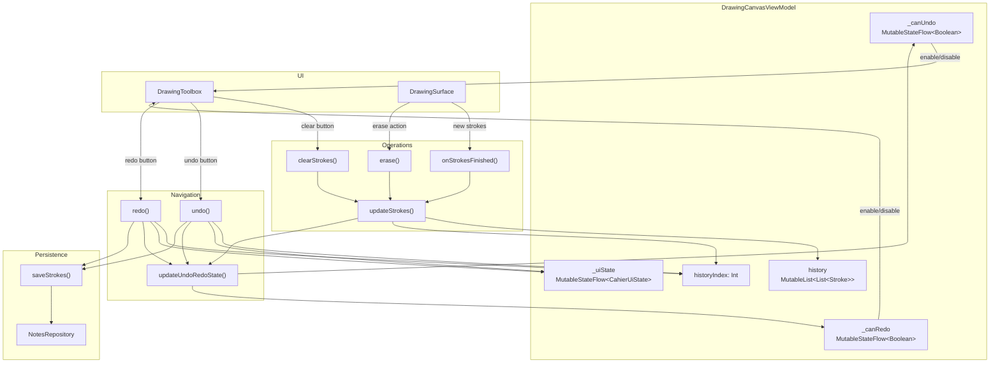
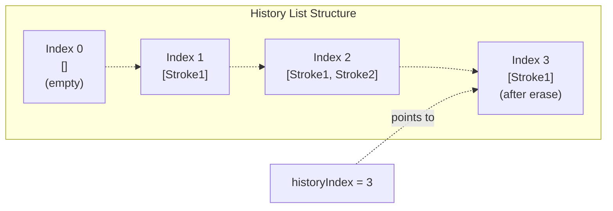
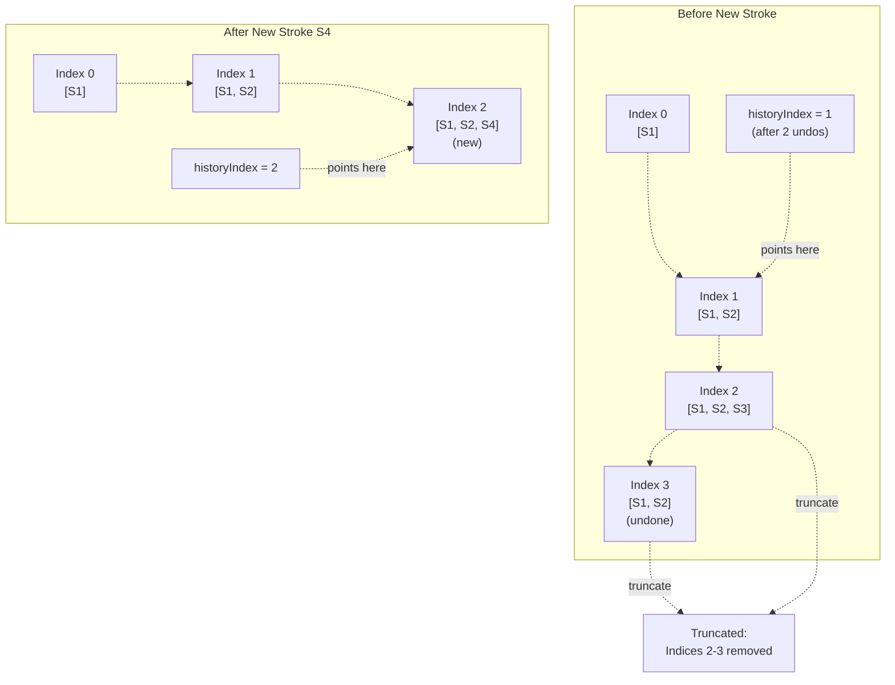
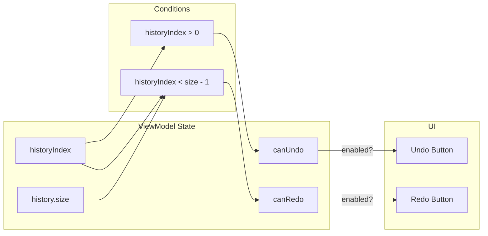
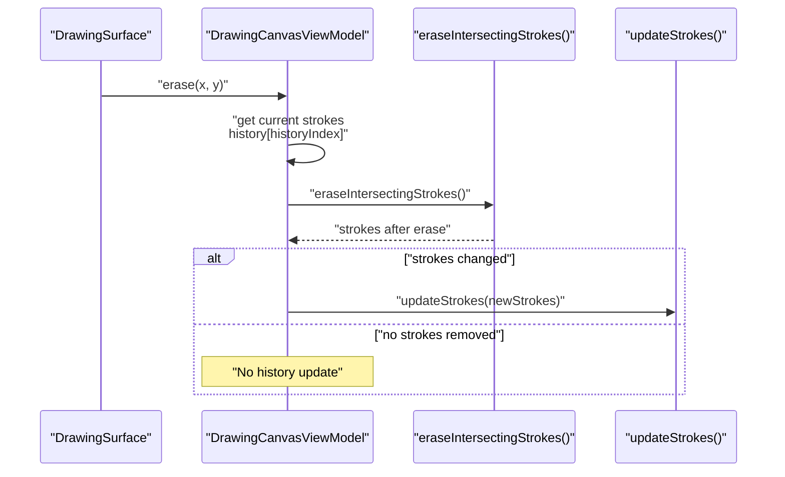

<!-- source: DeepWiki mcp.deepwiki.com · repo android/cahier · extra page Stroke History & Undo/Redo · fetched 2026-10-23 -->

# Stroke History & Undo/Redo

<details>
<summary>Relevant source files</summary>

The following files were used as context for generating this wiki page:

- [app/src/androidTest/java/com/example/cahier/ui/viewmodels/DrawingCanvasViewModelTest.kt](app/src/androidTest/java/com/example/cahier/ui/viewmodels/DrawingCanvasViewModelTest.kt)
- [app/src/main/java/com/example/cahier/ui/viewmodels/DrawingCanvasViewModel.kt](app/src/main/java/com/example/cahier/ui/viewmodels/DrawingCanvasViewModel.kt)

</details>


## Purpose and Scope

This document details the stroke history system implementation in the DrawingCanvasViewModel, which enables undo and redo operations for drawing strokes. The system maintains a linear history of stroke states, allowing users to navigate backward and forward through their drawing actions.

For information about stroke serialization and persistence, see [Stroke Serialization](#4.3). For details about the drawing surface and stroke capture, see [Drawing Surface & Stroke Rendering](#3.1.2). For the eraser implementation that integrates with history, see [Eraser Mode](#3.1.5).

## Architecture Overview

The history system is implemented entirely within `DrawingCanvasViewModel` using a list-based snapshot approach. Each entry in the history represents a complete snapshot of all strokes at a given point in time. The system maintains a current position index within this history, enabling navigation in both directions.



**Sources:** [app/src/main/java/com/example/cahier/ui/viewmodels/DrawingCanvasViewModel.kt:101-106](), [app/src/main/java/com/example/cahier/ui/viewmodels/DrawingCanvasViewModel.kt:168-200]()

## Data Structures

The history system uses three core state variables defined in `DrawingCanvasViewModel`:

| Variable | Type | Purpose |
|----------|------|---------|
| `history` | `MutableList<List<Stroke>>` | Stores snapshots of stroke states at each history point |
| `historyIndex` | `Int` | Current position within the history list (0-based) |
| `_canUndo` | `MutableStateFlow<Boolean>` | Indicates whether undo operation is available |
| `_canRedo` | `MutableStateFlow<Boolean>` | Indicates whether redo operation is available |

The `history` list contains complete snapshots rather than incremental changes. Each entry is an immutable `List<Stroke>` representing all strokes present at that point in time. This snapshot-based approach simplifies implementation and ensures consistency, though it requires more memory than a differential approach.



**Sources:** [app/src/main/java/com/example/cahier/ui/viewmodels/DrawingCanvasViewModel.kt:101-102](), [app/src/main/java/com/example/cahier/ui/viewmodels/DrawingCanvasViewModel.kt:103-106]()

## History Initialization

The history system is initialized when the ViewModel loads a note from the repository. The initialization logic ensures that the history starts with the persisted stroke state.

```mermaid
sequenceDiagram
    participant VM as "DrawingCanvasViewModel"
    participant REPO as "NotesRepository"
    participant HIST as "history list"
    
    VM->>REPO: "getNoteStream(noteId)"
    REPO-->>VM: "Note with strokesData"
    VM->>REPO: "getNoteStrokes(noteId)"
    REPO-->>VM: "List&lt;Stroke&gt;"
    
    alt "history is empty"
        VM->>HIST: "clear()"
        VM->>HIST: "add(initialStrokes)"
        VM->>VM: "historyIndex = 0"
        VM->>VM: "updateUndoRedoState()"
    else "history exists"
        VM->>VM: "restore strokes[historyIndex]"
        VM->>VM: "updateUndoRedoState()"
    end
```

The initialization occurs in the `init` block and handles two scenarios:

1. **First load:** If `history` is empty, it initializes with the persisted strokes at index 0
2. **Configuration change:** If `history` already exists (ViewModel survived rotation), it restores the current state without resetting

**Sources:** [app/src/main/java/com/example/cahier/ui/viewmodels/DrawingCanvasViewModel.kt:116-157]()

## Adding to History

New stroke states are added to the history via the `updateStrokes()` private method. This method is called by all operations that modify the stroke list, including:

- `onStrokesFinished()` - when user completes drawing strokes
- `erase()` - when eraser removes strokes
- `clearStrokes()` - when user clears the canvas

### History Truncation

A critical aspect of `updateStrokes()` is that it truncates any forward history when new strokes are added. This maintains a linear history and prevents divergent timelines.



The truncation logic at [app/src/main/java/com/example/cahier/ui/viewmodels/DrawingCanvasViewModel.kt:169-170]() ensures:
```kotlin
if (historyIndex < history.size - 1) {
    history.subList(historyIndex + 1, history.size).clear()
}
```

After truncation, the new stroke state is appended, and `historyIndex` is incremented to point to it.

**Sources:** [app/src/main/java/com/example/cahier/ui/viewmodels/DrawingCanvasViewModel.kt:168-177](), [app/src/main/java/com/example/cahier/ui/viewmodels/DrawingCanvasViewModel.kt:302-309]()

## Undo Operation

The `undo()` method navigates backward in the history by decrementing `historyIndex` and restoring the strokes at that position.

```mermaid
sequenceDiagram
    participant UI as "DrawingToolbox"
    participant VM as "DrawingCanvasViewModel"
    participant HIST as "history[historyIndex]"
    participant STATE as "_uiState"
    participant REPO as "NotesRepository"
    
    UI->>VM: "undo()"
    
    alt "canUndo.value == true"
        VM->>VM: "historyIndex--"
        VM->>HIST: "get strokes at new index"
        HIST-->>VM: "List&lt;Stroke&gt;"
        VM->>STATE: "update(strokes)"
        VM->>VM: "updateUndoRedoState()"
        VM->>REPO: "saveStrokes()"
    else "canUndo.value == false"
        Note over VM: "No operation"
    end
```

The implementation at [app/src/main/java/com/example/cahier/ui/viewmodels/DrawingCanvasViewModel.kt:184-191]() is straightforward:

1. Checks `canUndo.value` to ensure operation is valid
2. Decrements `historyIndex`
3. Updates `_uiState` with strokes from `history[historyIndex]`
4. Calls `updateUndoRedoState()` to refresh undo/redo availability
5. Persists the change via `saveStrokes()`

**Sources:** [app/src/main/java/com/example/cahier/ui/viewmodels/DrawingCanvasViewModel.kt:184-191]()

## Redo Operation

The `redo()` method is the inverse of `undo()`, navigating forward by incrementing `historyIndex`.

```mermaid
sequenceDiagram
    participant UI as "DrawingToolbox"
    participant VM as "DrawingCanvasViewModel"
    participant HIST as "history[historyIndex]"
    participant STATE as "_uiState"
    participant REPO as "NotesRepository"
    
    UI->>VM: "redo()"
    
    alt "canRedo.value == true"
        VM->>VM: "historyIndex++"
        VM->>HIST: "get strokes at new index"
        HIST-->>VM: "List&lt;Stroke&gt;"
        VM->>STATE: "update(strokes)"
        VM->>VM: "updateUndoRedoState()"
        VM->>REPO: "saveStrokes()"
    else "canRedo.value == false"
        Note over VM: "No operation"
    end
```

The logic at [app/src/main/java/com/example/cahier/ui/viewmodels/DrawingCanvasViewModel.kt:193-200]() mirrors `undo()`:

1. Checks `canRedo.value`
2. Increments `historyIndex`
3. Updates UI state
4. Refreshes undo/redo availability
5. Persists the change

**Sources:** [app/src/main/java/com/example/cahier/ui/viewmodels/DrawingCanvasViewModel.kt:193-200]()

## State Management

The `updateUndoRedoState()` private method maintains the `canUndo` and `canRedo` StateFlows based on the current `historyIndex` position.

### Undo/Redo Availability Rules

| State Variable | Condition | Meaning |
|----------------|-----------|---------|
| `_canUndo.value` | `historyIndex > 0` | Can navigate backward; not at the beginning |
| `_canRedo.value` | `historyIndex < history.size - 1` | Can navigate forward; not at the end |

The implementation at [app/src/main/java/com/example/cahier/ui/viewmodels/DrawingCanvasViewModel.kt:179-182]():
```kotlin
private fun updateUndoRedoState() {
    _canUndo.value = historyIndex > 0
    _canRedo.value = historyIndex < history.size - 1
}
```

These StateFlows are exposed as public read-only flows and observed by the `DrawingToolbox` UI component to enable/disable undo and redo buttons.



**Sources:** [app/src/main/java/com/example/cahier/ui/viewmodels/DrawingCanvasViewModel.kt:103-106](), [app/src/main/java/com/example/cahier/ui/viewmodels/DrawingCanvasViewModel.kt:179-182]()

## Integration with Drawing Operations

### Stroke Completion

When the user finishes drawing strokes, `onStrokesFinished()` is called by `DrawingSurface` with the completed strokes. This method:

1. Retrieves current strokes from `history[historyIndex]`
2. Appends the new strokes
3. Calls `updateStrokes()` to add the new state to history
4. Persists via `saveStrokes()`

**Sources:** [app/src/main/java/com/example/cahier/ui/viewmodels/DrawingCanvasViewModel.kt:302-309]()

### Eraser Integration

The eraser mode integrates with history through the `erase()` method. Each erase action that removes strokes creates a new history entry:



The conditional update at [app/src/main/java/com/example/cahier/ui/viewmodels/DrawingCanvasViewModel.kt:327-329]() ensures history is only modified when strokes are actually removed:
```kotlin
if (strokesAfterErase.size != strokesBeforeErase.size) {
    updateStrokes(strokesAfterErase)
}
```

This optimization prevents unnecessary history entries during eraser movement when no strokes are touched. However, note that `saveStrokes()` is called in `endErase()` at [app/src/main/java/com/example/cahier/ui/viewmodels/DrawingCanvasViewModel.kt:315-318](), ensuring persistence after the erase gesture completes.

**Sources:** [app/src/main/java/com/example/cahier/ui/viewmodels/DrawingCanvasViewModel.kt:321-330](), [app/src/main/java/com/example/cahier/ui/viewmodels/DrawingCanvasViewModel.kt:315-318]()

### Clear Operations

The `clearStrokes()` method adds an empty stroke list to history if strokes currently exist:

```kotlin
fun clearStrokes() {
    if (_uiState.value.strokes.isNotEmpty()) {
        updateStrokes(emptyList())
        viewModelScope.launch { saveStrokes() }
    }
}
```

This creates a history entry that users can undo to restore all cleared strokes.

**Sources:** [app/src/main/java/com/example/cahier/ui/viewmodels/DrawingCanvasViewModel.kt:408-413]()

## Persistence After History Navigation

Every undo and redo operation triggers `saveStrokes()` to persist the current state to the database. This ensures that:

1. The note's persisted state always matches what the user sees
2. Closing and reopening the note shows the current history position
3. Crash recovery works correctly with the last saved state

The `saveStrokes()` method at [app/src/main/java/com/example/cahier/ui/viewmodels/DrawingCanvasViewModel.kt:279-288]() retrieves strokes from the current history position:
```kotlin
suspend fun saveStrokes() {
    if (historyIndex >= 0 && historyIndex < history.size) {
        val strokesToSave = history[historyIndex]
        val clientBrushFamilyId =
            strokesToSave.firstOrNull()?.brush?.family?.clientBrushFamilyId
        noteRepository.updateNoteStrokes(noteId, strokesToSave, clientBrushFamilyId)
    } else if (history.isEmpty()) {
        noteRepository.updateNoteStrokes(noteId, emptyList(), null)
    }
}
```

**Sources:** [app/src/main/java/com/example/cahier/ui/viewmodels/DrawingCanvasViewModel.kt:279-288](), [app/src/main/java/com/example/cahier/ui/viewmodels/DrawingCanvasViewModel.kt:184-200]()

## ViewModel Cleanup

When the ViewModel is cleared (activity destroyed or user navigates away), `onCleared()` ensures the current state is persisted:

```kotlin
override fun onCleared() {
    super.onCleared()
    viewModelScope.launch {
        saveStrokes()
    }
}
```

This guarantees no unsaved changes are lost even if the user hasn't performed an explicit save action.

**Sources:** [app/src/main/java/com/example/cahier/ui/viewmodels/DrawingCanvasViewModel.kt:448-453]()

## Testing

The history system is tested in `DrawingCanvasViewModelTest` to verify correct behavior across undo/redo operations.

### Key Test Cases

| Test | Purpose | Implementation |
|------|---------|----------------|
| `initial_state_is_correct` | Verifies `canUndo` and `canRedo` are false initially | [DrawingCanvasViewModelTest.kt:103-108]() |
| `undo_restores_previous_strokes` | Tests full undo/redo cycle with state verification | [DrawingCanvasViewModelTest.kt:158-179]() |
| `clearStrokes_clears_and_saves_empty_strokes` | Verifies history update and persistence after clear | [DrawingCanvasViewModelTest.kt:182-198]() |

### Undo/Redo Test Flow

The test at [app/src/androidTest/java/com/example/cahier/ui/viewmodels/DrawingCanvasViewModelTest.kt:158-179]() validates:

1. **After stroke added:** `canUndo = true`, `canRedo = false`, 1 stroke in state
2. **After undo:** `canUndo = false`, `canRedo = true`, 0 strokes in state
3. **After redo:** `canUndo = true`, `canRedo = false`, 1 stroke in state

This confirms the bidirectional navigation and state flag correctness.

**Sources:** [app/src/androidTest/java/com/example/cahier/ui/viewmodels/DrawingCanvasViewModelTest.kt:158-179](), [app/src/androidTest/java/com/example/cahier/ui/viewmodels/DrawingCanvasViewModelTest.kt:103-108](), [app/src/androidTest/java/com/example/cahier/ui/viewmodels/DrawingCanvasViewModelTest.kt:182-198]()

## Performance Considerations

The snapshot-based approach trades memory for simplicity. Each history entry stores a complete copy of all strokes:

- **Memory usage:** O(n × m) where n is history depth and m is average stroke count
- **Time complexity:** O(1) for undo/redo operations (just index change)
- **Persistence:** O(m) for serialization of current stroke list

For typical use cases (dozens of strokes, limited undo depth), this approach is acceptable. The `androidx.ink.strokes.Stroke` class uses efficient internal representations, and the history size naturally limits itself as users continue drawing (truncation on new strokes).

No explicit history size limit is implemented, relying instead on the natural truncation behavior and user's drawing patterns. Extended drawing sessions with many undo operations could accumulate significant memory, but the app's drawing-focused nature makes this unlikely in practice.

**Sources:** [app/src/main/java/com/example/cahier/ui/viewmodels/DrawingCanvasViewModel.kt:101-102](), [app/src/main/java/com/example/cahier/ui/viewmodels/DrawingCanvasViewModel.kt:168-177]()

---

