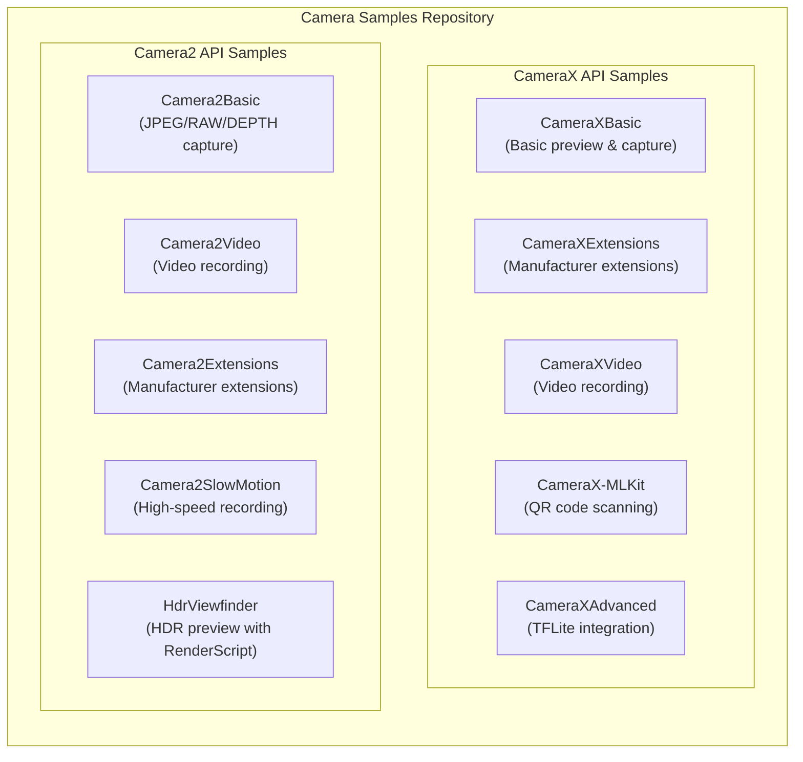
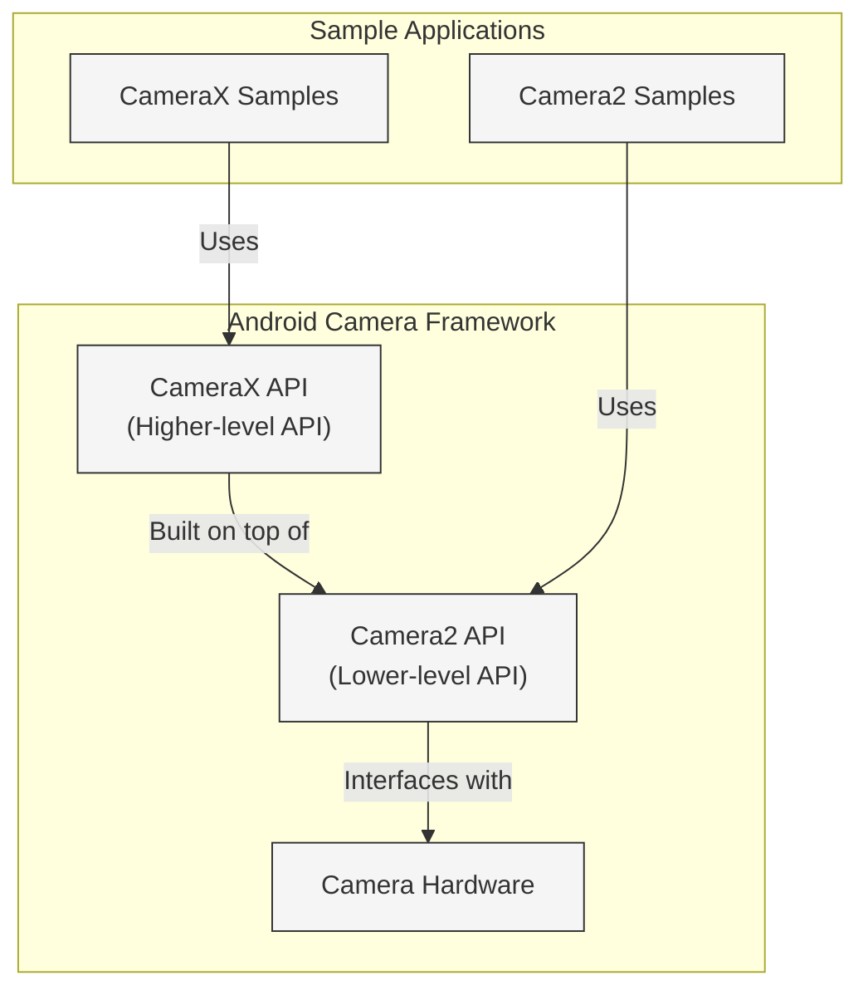

<!-- source: DeepWiki mcp.deepwiki.com · repo android/camera-samples · page 1 Overview · fetched 2026-10-23 -->

# Overview

Relevant source files

The following files were used as context for generating this wiki page:

- [CameraXExtensions/README.md](CameraXExtensions/README.md)
- [CameraXExtensions/screenshots/camerax_camera_extensions_screenshot.png](CameraXExtensions/screenshots/camerax_camera_extensions_screenshot.png)
- [CameraXExtensions/screenshots/camerax_extensions_architecture_diagram.png](CameraXExtensions/screenshots/camerax_extensions_architecture_diagram.png)
- [README.md](README.md)

## Purpose and Scope

This document provides a high-level introduction to the Android Camera Samples repository. This repository contains a collection of Android Studio projects that demonstrate how to use the [Camera2](https://developer.android.com/training/camera2) and [CameraX](https://developer.android.com/training/camerax) APIs in Android applications. Each sample focuses on different camera functionality, from basic preview and capture to advanced features like HDR, slow-motion video, and machine learning integration.

For detailed information about the overall architecture, see [Architecture Overview](#2). For specifics about CameraX samples, see [CameraX Samples](#3), and for Camera2 samples, see [Camera2 Samples](#4).

Sources: [README.md:1-21]()

## Repository Structure

The Camera Samples repository is organized into independent Android Studio projects, each demonstrating specific camera capabilities. The samples are divided into two main categories based on the API they use: CameraX or Camera2.

Sources: [README.md:1-21]()

## Samples Overview

The repository contains multiple samples that demonstrate various aspects of Android camera development, from basic functionality to advanced features.

| Sample | API | Description |
|--------|-----|-------------|
| CameraXBasic | CameraX | Demonstrates basic camera preview, image capture, and simple image analysis |
| CameraXAdvanced | CameraX | Shows integration with TensorFlow Lite and other advanced features |
| CameraXVideo | CameraX | Demonstrates video capture capabilities using CameraX VideoCapture API |
| CameraX-MLKit | CameraX | Shows how to use CameraX's MlKitAnalyzer to build a QR-code scanner |
| CameraXExtensions | CameraX | Demonstrates manufacturer-specific extensions (Auto, Bokeh, Face Retouch, HDR, Night) |
| Camera2Basic | Camera2 | Shows capturing of JPEG, RAW, and DEPTH images directly from the camera sensor |
| Camera2Video | Camera2 | Demonstrates video recording using Camera2 API and MediaRecorder |
| Camera2Extensions | Camera2 | Shows Camera2 extension live preview and still capture |
| Camera2SlowMotion | Camera2 | Demonstrates high-speed video recording in a constrained camera capture session |
| HdrViewfinder | Camera2 | Shows use of RenderScript to display a live HDR feed from camera frames |

Sources: [README.md:7-21](), [CameraXExtensions/README.md:5-18]()

## API Relationship

The following diagram illustrates the relationship between the two camera APIs demonstrated in this repository and how they interact with the Android camera framework.

Sources: [README.md:3-5]()

## Key Features

The repository demonstrates various camera functionalities across different samples:

1. **Basic Camera Operations**
   - Camera preview
   - Still image capture
   - Permission handling

2. **Advanced Camera Features**
   - Video recording (standard and slow-motion)
   - RAW image capture
   - Depth imaging
   - HDR processing

3. **Manufacturer Extensions**
   - Bokeh effect
   - Night mode
   - HDR
   - Face retouch
   - Auto mode

4. **Integration with Other Technologies**
   - ML Kit for QR code scanning
   - TensorFlow Lite
   - RenderScript for image processing

5. **Architecture Patterns**
   - MVVM architecture (particularly in CameraXExtensions)
   - Single Activity, Multiple Fragments design
   - Pipeline pattern for video processing

Sources: [README.md:7-21](), [CameraXExtensions/README.md:32-36]()

## Developer Benefits

This repository provides several benefits for Android developers working with camera functionality:

1. **Learning Resources**: Ready-to-use examples that demonstrate camera implementation best practices
2. **Code Reference**: Working code that can be used as a reference for specific camera features
3. **Architecture Guidance**: Examples of well-structured camera applications using modern Android architecture patterns
4. **Feature Exploration**: Demonstration of advanced camera capabilities that may not be obvious from the API documentation alone
5. **Cross-API Comparison**: The ability to compare implementation approaches between CameraX and Camera2

The samples are designed to be built and run independently, allowing developers to focus on specific camera features that meet their application needs.

Sources: [README.md:1-21](), [CameraXExtensions/README.md:9-18]()

---

