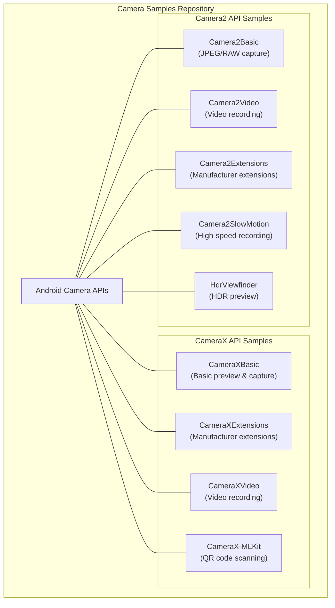
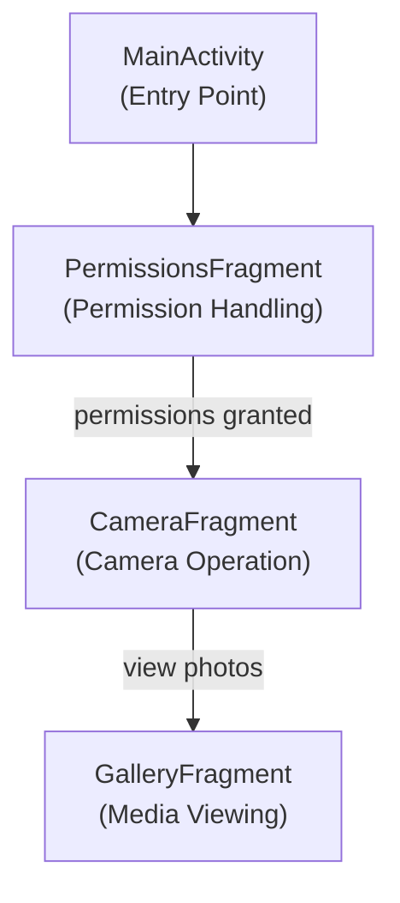
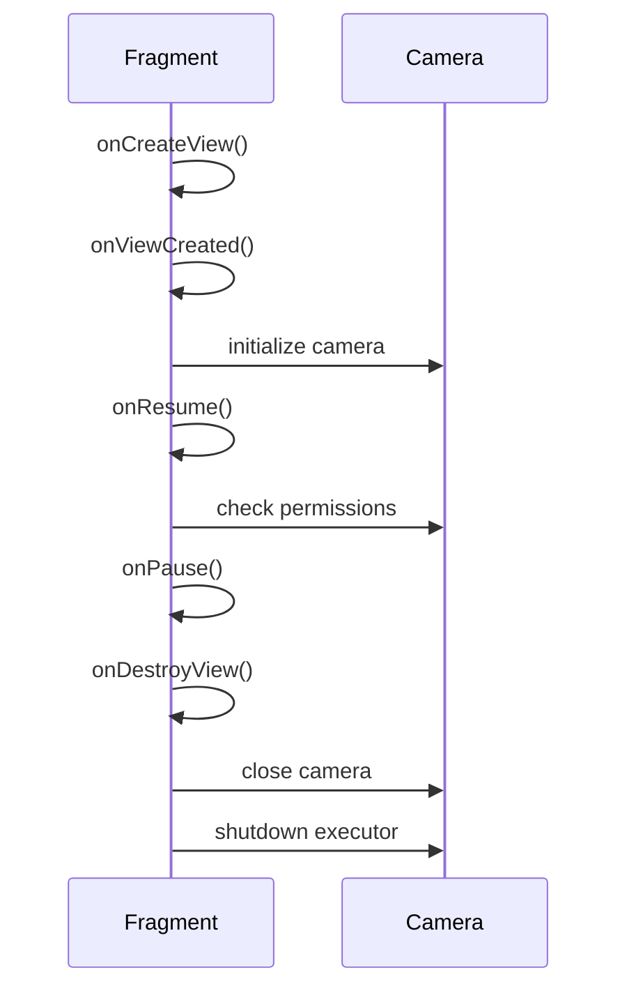
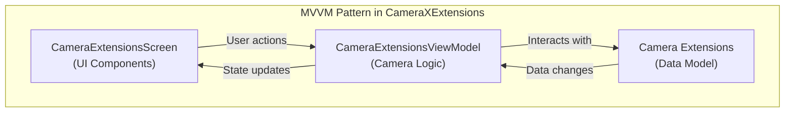
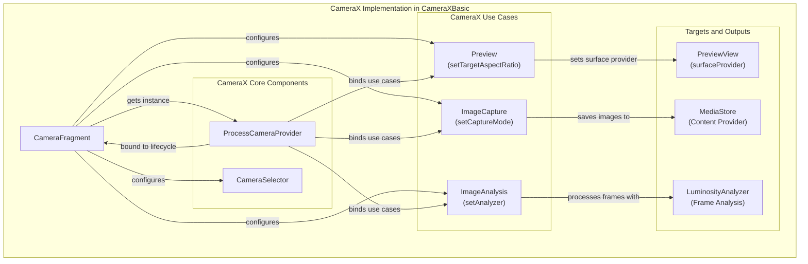
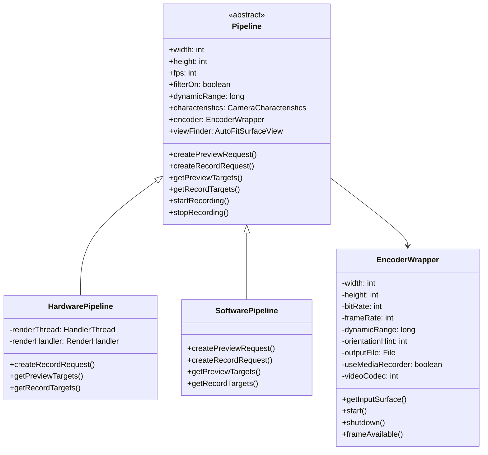
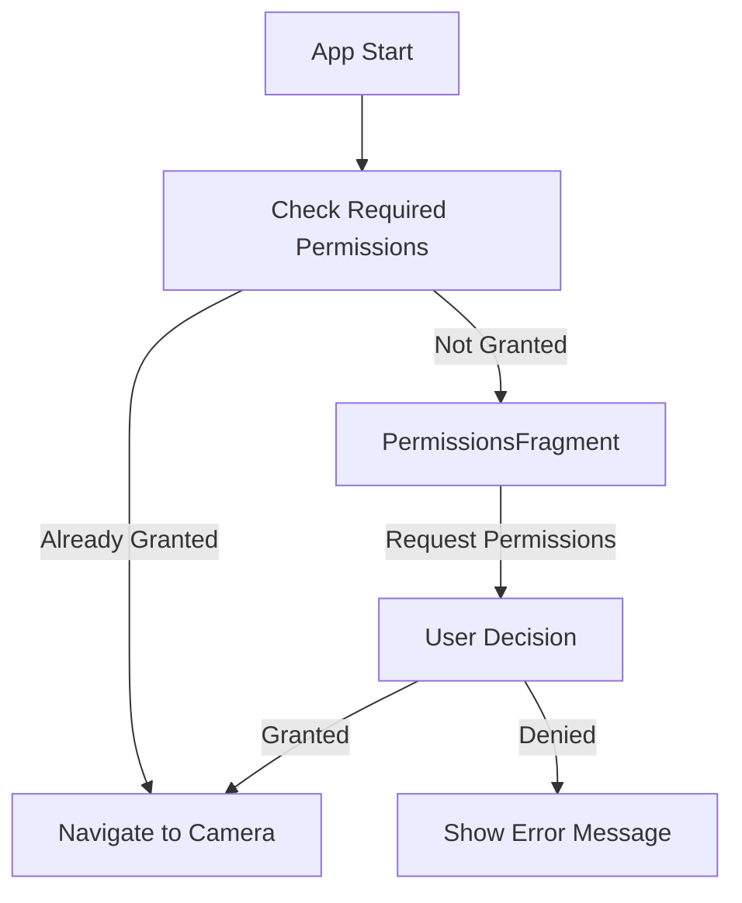

<!-- source: DeepWiki mcp.deepwiki.com · repo android/camera-samples · page 2 Architecture Overview · fetched 2026-10-23 -->

# Architecture Overview

<details>
<summary>Relevant source files</summary>

The following files were used as context for generating this wiki page:

- [Camera2Video/app/src/main/java/com/example/android/camera2/video/EncoderWrapper.kt](Camera2Video/app/src/main/java/com/example/android/camera2/video/EncoderWrapper.kt)
- [Camera2Video/app/src/main/java/com/example/android/camera2/video/HardwarePipeline.kt](Camera2Video/app/src/main/java/com/example/android/camera2/video/HardwarePipeline.kt)
- [Camera2Video/app/src/main/java/com/example/android/camera2/video/Pipeline.kt](Camera2Video/app/src/main/java/com/example/android/camera2/video/Pipeline.kt)
- [Camera2Video/app/src/main/java/com/example/android/camera2/video/SoftwarePipeline.kt](Camera2Video/app/src/main/java/com/example/android/camera2/video/SoftwarePipeline.kt)
- [Camera2Video/app/src/main/java/com/example/android/camera2/video/fragments/PreviewFragment.kt](Camera2Video/app/src/main/java/com/example/android/camera2/video/fragments/PreviewFragment.kt)
- [CameraXBasic/app/build.gradle](CameraXBasic/app/build.gradle)
- [CameraXBasic/app/src/main/java/com/android/example/cameraxbasic/fragments/CameraFragment.kt](CameraXBasic/app/src/main/java/com/android/example/cameraxbasic/fragments/CameraFragment.kt)
- [CameraXBasic/app/src/main/java/com/android/example/cameraxbasic/fragments/PermissionsFragment.kt](CameraXBasic/app/src/main/java/com/android/example/cameraxbasic/fragments/PermissionsFragment.kt)
- [CameraXBasic/build.gradle](CameraXBasic/build.gradle)
- [CameraXExtensions/README.md](CameraXExtensions/README.md)
- [CameraXExtensions/screenshots/camerax_camera_extensions_screenshot.png](CameraXExtensions/screenshots/camerax_camera_extensions_screenshot.png)
- [CameraXExtensions/screenshots/camerax_extensions_architecture_diagram.png](CameraXExtensions/screenshots/camerax_extensions_architecture_diagram.png)
- [README.md](README.md)

</details>


This document provides a comprehensive overview of the architecture used in the Android Camera Samples repository. It focuses on explaining the high-level organization of the samples, the two distinct approaches to camera implementation (CameraX and Camera2), and how the various components interact. 

For detailed implementation specifics, refer to [CameraX API Fundamentals](#2.1) or [Camera2 API Fundamentals](#2.2).

## Repository Organization

The camera samples repository is organized into two distinct categories based on the Android camera API used. Each sample application demonstrates specific camera features while following consistent architectural patterns.

### Repository Structure Diagram



Sources: [README.md:1-21]()

## API Relationship and Core Concepts

Understanding the relationship between Camera2 and CameraX is fundamental to grasping the architecture of the samples.

### API Hierarchy Diagram

```mermaid
graph TD
    subgraph "Android Camera APIs"
        Camera2["Camera2 API"]
        CameraX["CameraX API"]
    end
    
    subgraph "Implementation Details"
        CameraX --> "Lifecycle-aware"
        CameraX --> "Use case-based"
        CameraX --> "Error handling"
        
        Camera2 --> "Direct control"
        Camera2 --> "Complex callbacks"
        Camera2 --> "Manual configuration"
    end
    
    CameraX --"Built on top of"--> Camera2
```

Sources: [CameraXBasic/app/build.gradle:74-89]()

Key concepts to understand:

1. **CameraX API**: A higher-level abstraction that:
   - Simplifies camera development through predefined use cases
   - Handles lifecycle management automatically
   - Provides consistent behavior across devices
   - Is built on top of Camera2 API

2. **Camera2 API**: A lower-level API that:
   - Offers maximum control over camera hardware
   - Requires more complex implementation
   - Provides direct access to camera features

## Common Architectural Patterns

Several architectural patterns appear consistently across the sample applications:

### Single Activity with Multiple Fragments

Most samples utilize a single activity with multiple fragments for different screens:



Sources: [CameraXBasic/app/src/main/java/com/android/example/cameraxbasic/fragments/CameraFragment.kt:73-674](), [CameraXBasic/app/src/main/java/com/android/example/cameraxbasic/fragments/PermissionsFragment.kt:38-87]()

### Lifecycle-Aware Camera Management

Camera resources are carefully managed according to Android activity/fragment lifecycles:



Sources: [CameraXBasic/app/src/main/java/com/android/example/cameraxbasic/fragments/CameraFragment.kt:130-151](), [CameraXBasic/app/src/main/java/com/android/example/cameraxbasic/fragments/CameraFragment.kt:179-214]()

### MVVM Architecture

The CameraXExtensions sample notably employs Model-View-ViewModel architecture:



Sources: [CameraXExtensions/README.md:31-36]()

## CameraX Architecture

The CameraX samples demonstrate the use of predefined use cases for camera operations.

### CameraX Implementation Diagram



Sources: [CameraXBasic/app/src/main/java/com/android/example/cameraxbasic/fragments/CameraFragment.kt:234-306]()

Key components of CameraX implementation:

1. **ProcessCameraProvider**: Central component that binds camera lifecycle
   ```kotlin
   // Get instance of ProcessCameraProvider
   cameraProvider = ProcessCameraProvider.getInstance(requireContext()).await()
   ```

2. **Use Cases**:
   - **Preview**: For camera viewfinder display
     ```kotlin
     preview = Preview.Builder()
             .setTargetAspectRatio(screenAspectRatio)
             .setTargetRotation(rotation)
             .build()
     ```
   
   - **ImageCapture**: For taking photos
     ```kotlin
     imageCapture = ImageCapture.Builder()
             .setCaptureMode(ImageCapture.CAPTURE_MODE_MINIMIZE_LATENCY)
             .setTargetAspectRatio(screenAspectRatio)
             .setTargetRotation(rotation)
             .build()
     ```
   
   - **ImageAnalysis**: For processing camera frames
     ```kotlin
     imageAnalyzer = ImageAnalysis.Builder()
             .setTargetAspectRatio(screenAspectRatio)
             .setTargetRotation(rotation)
             .build()
             .also {
                 it.setAnalyzer(cameraExecutor, LuminosityAnalyzer { luma ->
                     // Process the frame
                 })
             }
     ```

3. **Binding Use Cases**: All use cases are bound to the lifecycle
   ```kotlin
   camera = cameraProvider.bindToLifecycle(
           this, cameraSelector, preview, imageCapture, imageAnalyzer)
   ```

Sources: [CameraXBasic/app/src/main/java/com/android/example/cameraxbasic/fragments/CameraFragment.kt:271-306]()

## Camera2 Architecture

The Camera2 samples demonstrate direct camera control through a more complex but flexible API.

### Camera2 Implementation Diagram

```mermaid
graph TD
    subgraph "Camera2 Implementation in Camera2Video"
        PreviewFragment["PreviewFragment"]
        
        subgraph "Camera Components"
            CameraManager["CameraManager<br>(System Service)"]
            CameraDevice["CameraDevice<br>(Camera Hardware)"]
            CameraCaptureSession["CameraCaptureSession<br>(Data Flow)"]
        end
        
        subgraph "Capture Control"
            CaptureRequest["CaptureRequest<br>(Camera Parameters)"]
            PreviewRequest["Preview Request"]
            RecordRequest["Record Request"]
        end
        
        subgraph "Pipeline Architecture"
            Pipeline["Pipeline<br>(Abstract Class)"]
            HardwarePipeline["HardwarePipeline<br>(OpenGL)"]
            SoftwarePipeline["SoftwarePipeline<br>(Direct)"]
            EncoderWrapper["EncoderWrapper<br>(Media Encoding)"]
        end
        
        PreviewFragment --"gets system service"--> CameraManager
        CameraManager --"openCamera()"--> CameraDevice
        
        PreviewFragment --"creates based on args"--> Pipeline
        Pipeline <|-- HardwarePipeline
        Pipeline <|-- SoftwarePipeline
        
        PreviewFragment --"creates"--> EncoderWrapper
        
        CameraDevice --"createCaptureSession()"--> CameraCaptureSession
        CameraDevice --"createCaptureRequest()"--> CaptureRequest
        CaptureRequest --> PreviewRequest
        CaptureRequest --> RecordRequest
        
        Pipeline --"creates"--> PreviewRequest
        Pipeline --"creates"--> RecordRequest
        
        CameraCaptureSession --"setRepeatingRequest()"--> PreviewRequest
        CameraCaptureSession --"setRepeatingRequest()"--> RecordRequest
        
        HardwarePipeline --"sends frames to"--> EncoderWrapper
        SoftwarePipeline --"sends frames to"--> EncoderWrapper
    end
```

Sources: [Camera2Video/app/src/main/java/com/example/android/camera2/video/fragments/PreviewFragment.kt:76-414]()

Key components of Camera2 implementation:

1. **CameraManager**: System service that manages camera devices
   ```kotlin
   private val cameraManager: CameraManager by lazy {
       val context = requireContext().applicationContext
       context.getSystemService(Context.CAMERA_SERVICE) as CameraManager
   }
   ```

2. **CameraDevice**: Represents the camera hardware, opened asynchronously
   ```kotlin
   private suspend fun openCamera(
           manager: CameraManager,
           cameraId: String,
           handler: Handler? = null
   ): CameraDevice = suspendCancellableCoroutine { cont ->
       manager.openCamera(cameraId, object : CameraDevice.StateCallback() {
           override fun onOpened(device: CameraDevice) = cont.resume(device)
           // Error handling omitted
       }, handler)
   }
   ```

3. **CameraCaptureSession**: Controls the data flow from the camera
   ```kotlin
   private suspend fun createCaptureSession(
           device: CameraDevice,
           targets: List<Surface>,
           handler: Handler,
           recordingCompleteOnClose: Boolean
   ): CameraCaptureSession = suspendCoroutine { cont ->
       val stateCallback = object: CameraCaptureSession.StateCallback() {
           override fun onConfigured(session: CameraCaptureSession) = cont.resume(session)
           // Other callbacks omitted
       }
       setupSessionWithDynamicRangeProfile(device, targets, handler, stateCallback)
   }
   ```

Sources: [Camera2Video/app/src/main/java/com/example/android/camera2/video/fragments/PreviewFragment.kt:415-510]()

## Video Processing Pipeline Architecture

The Camera2Video sample showcases a specialized pipeline architecture for video processing:

### Pipeline Class Diagram



Sources: [Camera2Video/app/src/main/java/com/example/android/camera2/video/Pipeline.kt:28-67](), [Camera2Video/app/src/main/java/com/example/android/camera2/video/HardwarePipeline.kt:325-390](), [Camera2Video/app/src/main/java/com/example/android/camera2/video/SoftwarePipeline.kt:29-73](), [Camera2Video/app/src/main/java/com/example/android/camera2/video/EncoderWrapper.kt:41-254]()

This pipeline architecture provides:

1. **Abstraction**: The `Pipeline` abstract class defines the interface for all pipeline implementations
   ```kotlin
   abstract class Pipeline(width: Int, height: Int, fps: Int, filterOn: Boolean,
           dynamicRange: Long, characteristics: CameraCharacteristics, encoder: EncoderWrapper,
           viewFinder: AutoFitSurfaceView) {
       // Abstract methods for camera control
       public abstract fun createRecordRequest(session: CameraCaptureSession,
               previewStabilization: Boolean): CaptureRequest
       public abstract fun getPreviewTargets(): List<Surface>
       public abstract fun getRecordTargets(): List<Surface>
       // Other methods...
   }
   ```

2. **Alternative Implementations**:
   - **HardwarePipeline**: Uses OpenGL for efficient processing, applying visual effects via shaders
   - **SoftwarePipeline**: Simpler implementation that routes camera output directly to targets

3. **Encoding Layer**: `EncoderWrapper` handles video encoding through either `MediaCodec` or `MediaRecorder`
   ```kotlin
   class EncoderWrapper(width: Int, height: Int, bitRate: Int, frameRate: Int,
           dynamicRange: Long, orientationHint: Int, outputFile: File,
           useMediaRecorder: Boolean, videoCodec: Int) {
       // Methods for media encoding
   }
   ```

Sources: [Camera2Video/app/src/main/java/com/example/android/camera2/video/fragments/PreviewFragment.kt:93-102]()

## Permission Handling

All samples implement consistent permission handling to access the camera and storage:



Sources: [CameraXBasic/app/src/main/java/com/android/example/cameraxbasic/fragments/PermissionsFragment.kt:38-87]()

The permission flow usually includes:

1. Checking for required permissions (camera, sometimes storage)
2. Requesting missing permissions if needed
3. Proceeding to camera functionality when permissions are granted
4. Showing appropriate error messages when permissions are denied

## Conclusion

The Camera Samples repository demonstrates two distinct approaches to implementing camera functionality in Android:

1. **CameraX-based samples**: Provide simpler, more concise implementations with built-in lifecycle management and use-case abstraction, ideal for most camera applications.

2. **Camera2-based samples**: Offer greater control and customization at the cost of increased complexity, appropriate for specialized camera applications with advanced requirements.

Both approaches follow similar architectural principles regarding lifecycle management, permission handling, and UI organization, but differ significantly in how they interact with the camera hardware.

For specific implementations, refer to [CameraX Samples](#3) or [Camera2 Samples](#4).

---

