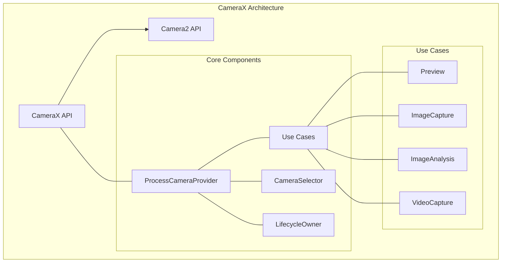
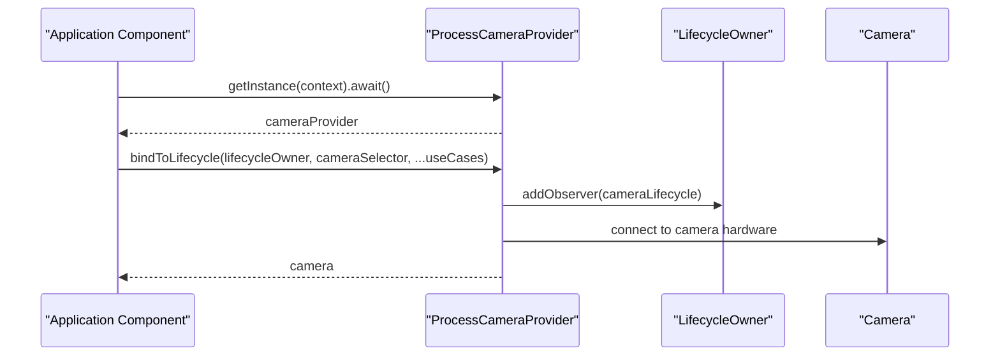
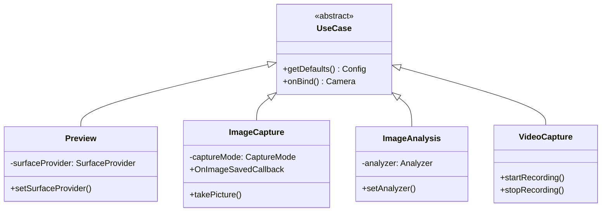
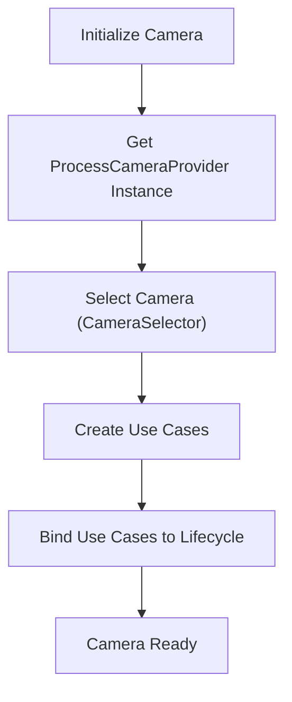
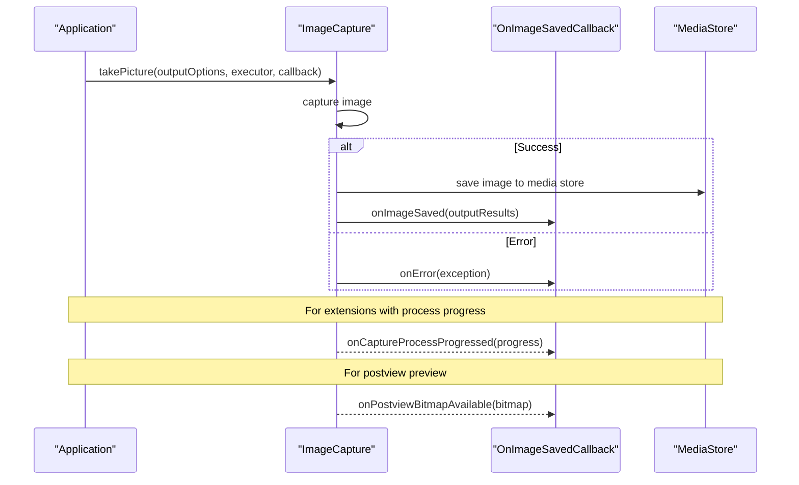
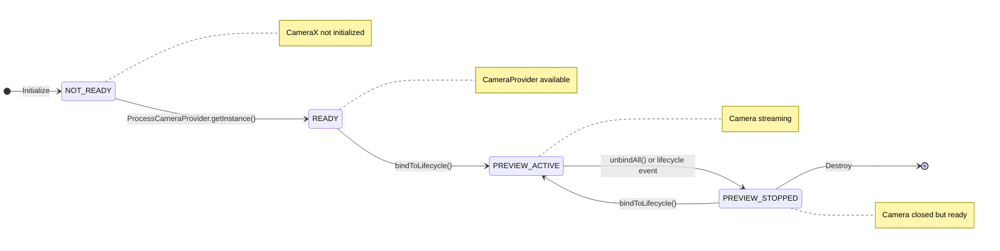
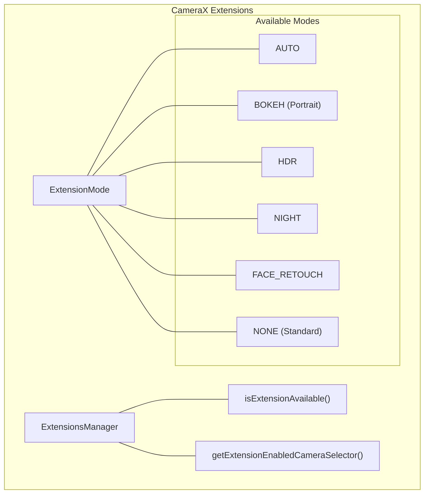
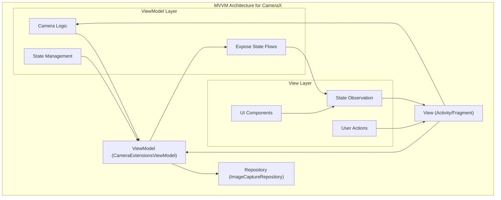
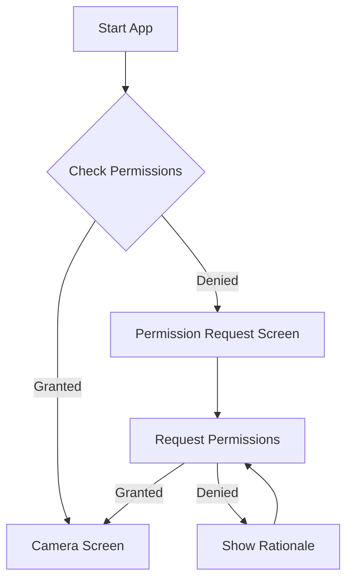

<!-- source: DeepWiki mcp.deepwiki.com · repo android/camera-samples · page 2.1 CameraX API Fundamentals · fetched 2026-10-23 -->

# CameraX API Fundamentals

<details>
<summary>Relevant source files</summary>

The following files were used as context for generating this wiki page:

- [CameraXBasic/app/build.gradle](CameraXBasic/app/build.gradle)
- [CameraXBasic/app/src/main/java/com/android/example/cameraxbasic/fragments/CameraFragment.kt](CameraXBasic/app/src/main/java/com/android/example/cameraxbasic/fragments/CameraFragment.kt)
- [CameraXBasic/app/src/main/java/com/android/example/cameraxbasic/fragments/PermissionsFragment.kt](CameraXBasic/app/src/main/java/com/android/example/cameraxbasic/fragments/PermissionsFragment.kt)
- [CameraXBasic/build.gradle](CameraXBasic/build.gradle)
- [CameraXExtensions/app/src/main/java/com/example/android/cameraxextensions/MainActivity.kt](CameraXExtensions/app/src/main/java/com/example/android/cameraxextensions/MainActivity.kt)
- [CameraXExtensions/app/src/main/java/com/example/android/cameraxextensions/model/CameraUiAction.kt](CameraXExtensions/app/src/main/java/com/example/android/cameraxextensions/model/CameraUiAction.kt)
- [CameraXExtensions/app/src/main/java/com/example/android/cameraxextensions/model/CameraUiState.kt](CameraXExtensions/app/src/main/java/com/example/android/cameraxextensions/model/CameraUiState.kt)
- [CameraXExtensions/app/src/main/java/com/example/android/cameraxextensions/model/PermissionState.kt](CameraXExtensions/app/src/main/java/com/example/android/cameraxextensions/model/PermissionState.kt)
- [CameraXExtensions/app/src/main/java/com/example/android/cameraxextensions/ui/CameraExtensionsScreen.kt](CameraXExtensions/app/src/main/java/com/example/android/cameraxextensions/ui/CameraExtensionsScreen.kt)
- [CameraXExtensions/app/src/main/java/com/example/android/cameraxextensions/ui/FocusPointDrawable.kt](CameraXExtensions/app/src/main/java/com/example/android/cameraxextensions/ui/FocusPointDrawable.kt)
- [CameraXExtensions/app/src/main/java/com/example/android/cameraxextensions/viewmodel/CameraExtensionsViewModel.kt](CameraXExtensions/app/src/main/java/com/example/android/cameraxextensions/viewmodel/CameraExtensionsViewModel.kt)
- [CameraXExtensions/app/src/main/java/com/example/android/cameraxextensions/viewmodel/CameraExtensionsViewModelFactory.kt](CameraXExtensions/app/src/main/java/com/example/android/cameraxextensions/viewmodel/CameraExtensionsViewModelFactory.kt)
- [CameraXExtensions/app/src/main/java/com/example/android/cameraxextensions/viewstate/CameraPreviewScreenViewState.kt](CameraXExtensions/app/src/main/java/com/example/android/cameraxextensions/viewstate/CameraPreviewScreenViewState.kt)
- [CameraXExtensions/app/src/main/res/layout/activity_main.xml](CameraXExtensions/app/src/main/res/layout/activity_main.xml)
- [CameraXExtensions/app/src/main/res/values/strings.xml](CameraXExtensions/app/src/main/res/values/strings.xml)

</details>


This page explains the fundamental architecture, components, and lifecycle management of the CameraX API as implemented in the Android Camera Samples. For information about specific CameraX sample applications, see [CameraX Samples](#3).

## Overview

CameraX is a Jetpack library designed to make camera app development easier. It provides a consistent and easy-to-use API that works across most Android devices, while leveraging the capabilities of the underlying Camera2 API. This abstraction helps developers focus on what they want to accomplish rather than handling the complex edge cases of the camera subsystem.



Sources:
- [CameraXBasic/app/src/main/java/com/android/example/cameraxbasic/fragments/CameraFragment.kt:67-674]()
- [CameraXBasic/app/build.gradle:74-85]()

## Core Components

### ProcessCameraProvider

`ProcessCameraProvider` is the main entry point for CameraX. It's a singleton that:

1. Manages the camera lifecycle
2. Binds camera use cases to the lifecycle owner
3. Handles device-specific compatibility issues



Sources:
- [CameraXBasic/app/src/main/java/com/android/example/cameraxbasic/fragments/CameraFragment.kt:235-237]()
- [CameraXExtensions/app/src/main/java/com/example/android/cameraxextensions/viewmodel/CameraExtensionsViewModel.kt:112-114]()

### Camera Use Cases

CameraX defines a set of "use cases" that represent common camera operations:

| Use Case | Purpose | Main Methods |
|----------|---------|--------------|
| Preview | Display camera preview | `setSurfaceProvider()` |
| ImageCapture | Take photos | `takePicture()` |
| ImageAnalysis | Process frames | `setAnalyzer()` |
| VideoCapture | Record video | `startRecording()` |

Each use case can be configured independently and combined to run simultaneously.



Sources:
- [CameraXBasic/app/src/main/java/com/android/example/cameraxbasic/fragments/CameraFragment.kt:272-306]()
- [CameraXExtensions/app/src/main/java/com/example/android/cameraxextensions/viewmodel/CameraExtensionsViewModel.kt:81-88]()

## Implementing CameraX

### Setting Up Dependencies

To use CameraX, you need to add the following dependencies to your app's build.gradle:

```
// CameraX core library
implementation "androidx.camera:camera-core:$camerax_version"

// CameraX Camera2 extensions
implementation "androidx.camera:camera-camera2:$camerax_version"

// CameraX Lifecycle library
implementation "androidx.camera:camera-lifecycle:$camerax_version"

// CameraX View class
implementation "androidx.camera:camera-view:$camerax_version"

// Optional: CameraX Extensions library
implementation "androidx.camera:camera-extensions:$camerax_version"
```

Sources:
- [CameraXBasic/app/build.gradle:74-89]()

### Getting a Camera Provider

The first step in using CameraX is to get an instance of the `ProcessCameraProvider`:



Sources:
- [CameraXBasic/app/src/main/java/com/android/example/cameraxbasic/fragments/CameraFragment.kt:235-237]()
- [CameraXExtensions/app/src/main/java/com/example/android/cameraxextensions/viewmodel/CameraExtensionsViewModel.kt:104-146]()

### Camera Selection

The `CameraSelector` class is used to select which camera to use (typically front or back):

```kotlin
// Back camera
val cameraSelector = CameraSelector.DEFAULT_BACK_CAMERA

// Front camera
val cameraSelector = CameraSelector.DEFAULT_FRONT_CAMERA

// Custom camera selector
val cameraSelector = CameraSelector.Builder()
    .requireLensFacing(CameraSelector.LENS_FACING_BACK)
    .build()
```

Sources:
- [CameraXBasic/app/src/main/java/com/android/example/cameraxbasic/fragments/CameraFragment.kt:239-243]()
- [CameraXExtensions/app/src/main/java/com/example/android/cameraxextensions/viewmodel/CameraExtensionsViewModel.kt:391-396]()

### Creating Use Cases

Each use case is created with a builder pattern that allows configuration of various parameters:

#### Preview Use Case

```kotlin
val preview = Preview.Builder()
    .setTargetAspectRatio(screenAspectRatio)
    .setTargetRotation(rotation)
    .build()

// Connect the preview to a PreviewView in the layout
preview.setSurfaceProvider(previewView.surfaceProvider)
```

Sources:
- [CameraXBasic/app/src/main/java/com/android/example/cameraxbasic/fragments/CameraFragment.kt:272-277]()
- [CameraXBasic/app/src/main/java/com/android/example/cameraxbasic/fragments/CameraFragment.kt:323]()

#### ImageCapture Use Case

```kotlin
val imageCapture = ImageCapture.Builder()
    .setCaptureMode(ImageCapture.CAPTURE_MODE_MINIMIZE_LATENCY)
    .setTargetAspectRatio(screenAspectRatio)
    .setTargetRotation(rotation)
    .build()
```

Sources:
- [CameraXBasic/app/src/main/java/com/android/example/cameraxbasic/fragments/CameraFragment.kt:280-288]()
- [CameraXExtensions/app/src/main/java/com/example/android/cameraxextensions/viewmodel/CameraExtensionsViewModel.kt:81-83]()

#### ImageAnalysis Use Case

```kotlin
val imageAnalyzer = ImageAnalysis.Builder()
    .setTargetAspectRatio(screenAspectRatio)
    .setTargetRotation(rotation)
    .build()
    .also {
        it.setAnalyzer(executor, YourAnalyzer())
    }
```

Sources:
- [CameraXBasic/app/src/main/java/com/android/example/cameraxbasic/fragments/CameraFragment.kt:291-306]()

### Binding Use Cases to Camera Lifecycle

One of the key features of CameraX is that it's lifecycle-aware. You bind use cases to a lifecycle owner:

```kotlin
// Must unbind the use-cases before rebinding them
cameraProvider.unbindAll()

// A variable number of use-cases can be passed here
camera = cameraProvider.bindToLifecycle(
    lifecycleOwner,
    cameraSelector, 
    preview, 
    imageCapture, 
    imageAnalyzer
)
```

Sources:
- [CameraXBasic/app/src/main/java/com/android/example/cameraxbasic/fragments/CameraFragment.kt:309-320]()
- [CameraXExtensions/app/src/main/java/com/example/android/cameraxextensions/viewmodel/CameraExtensionsViewModel.kt:170-193]()

### Taking Photos

With the `ImageCapture` use case, you can take photos:



Sources:
- [CameraXBasic/app/src/main/java/com/android/example/cameraxbasic/fragments/CameraFragment.kt:492-518]()
- [CameraXExtensions/app/src/main/java/com/example/android/cameraxextensions/viewmodel/CameraExtensionsViewModel.kt:317-359]()

### Image Analysis

The `ImageAnalysis` use case allows processing of camera frames. You must implement an `ImageAnalysis.Analyzer`:

```kotlin
class YourAnalyzer : ImageAnalysis.Analyzer {
    override fun analyze(image: ImageProxy) {
        // Process the image
        
        // Important! Must close the image when done
        image.close()
    }
}
```

Sources:
- [CameraXBasic/app/src/main/java/com/android/example/cameraxbasic/fragments/CameraFragment.kt:591-666]()

## Lifecycle Management

CameraX is designed to work seamlessly with Android's lifecycle components. Here's how it manages lifecycle events:



Sources:
- [CameraXExtensions/app/src/main/java/com/example/android/cameraxextensions/model/CameraUiState.kt:42-65]()
- [CameraXExtensions/app/src/main/java/com/example/android/cameraxextensions/viewmodel/CameraExtensionsViewModel.kt:104-146]()
- [CameraXExtensions/app/src/main/java/com/example/android/cameraxextensions/viewmodel/CameraExtensionsViewModel.kt:154-215]()

CameraX automatically handles:
- Closing the camera when the lifecycle owner is stopped
- Reopening the camera when the lifecycle owner returns to an active state
- Managing device rotation changes
- Dealing with app switching and multi-window modes

The `CameraState` enum in the CameraXExtensions sample illustrates these states:

| State | Description |
|-------|-------------|
| NOT_READY | Camera hasn't been initialized |
| READY | Camera is open and available for preview |
| PREVIEW_ACTIVE | Camera preview is streaming |
| PREVIEW_STOPPED | Camera is initialized but preview has been stopped |

Sources:
- [CameraXExtensions/app/src/main/java/com/example/android/cameraxextensions/model/CameraUiState.kt:42-65]()

## Camera Extensions

CameraX Extensions provide enhanced photography capabilities through vendor-specific camera extensions:



Sources:
- [CameraXExtensions/app/src/main/java/com/example/android/cameraxextensions/viewmodel/CameraExtensionsViewModel.kt:114]()
- [CameraXExtensions/app/src/main/java/com/example/android/cameraxextensions/viewmodel/CameraExtensionsViewModel.kt:126-134]()
- [CameraXExtensions/app/src/main/java/com/example/android/cameraxextensions/MainActivity.kt:62-69]()

Using CameraX Extensions involves:

1. Getting an `ExtensionsManager` instance:
   ```kotlin
   val extensionsManager = ExtensionsManager.getInstanceAsync(context, cameraProvider).await()
   ```

2. Checking which extensions are available:
   ```kotlin
   val isHdrAvailable = extensionsManager.isExtensionAvailable(
       cameraSelector, ExtensionMode.HDR)
   ```

3. Applying an extension to the camera selector:
   ```kotlin
   val extendedSelector = extensionsManager.getExtensionEnabledCameraSelector(
       cameraSelector, ExtensionMode.HDR)
   ```

4. Using the extended selector when binding use cases:
   ```kotlin
   cameraProvider.bindToLifecycle(
       lifecycleOwner, extendedSelector, preview, imageCapture)
   ```

Sources:
- [CameraXExtensions/app/src/main/java/com/example/android/cameraxextensions/viewmodel/CameraExtensionsViewModel.kt:112-144]()
- [CameraXExtensions/app/src/main/java/com/example/android/cameraxextensions/viewmodel/CameraExtensionsViewModel.kt:161-168]()

## Camera State Management Using MVVM

The CameraXExtensions sample demonstrates a robust architecture for managing camera state using the MVVM pattern:



Sources:
- [CameraXExtensions/app/src/main/java/com/example/android/cameraxextensions/MainActivity.kt:117-125]()
- [CameraXExtensions/app/src/main/java/com/example/android/cameraxextensions/viewmodel/CameraExtensionsViewModel.kt:90-95]()

Key aspects of this pattern:

1. **ViewModel**: Contains camera logic and exposes state as flows:
   ```kotlin
   class CameraExtensionsViewModel {
       // State exposed as flows for the UI to observe
       val cameraUiState: Flow<CameraUiState>
       val captureUiState: Flow<CaptureState>
       
       // Camera operations
       fun initializeCamera() { ... }
       fun startPreview(lifecycleOwner: LifecycleOwner, previewView: PreviewView) { ... }
       fun capturePhoto() { ... }
   }
   ```

2. **UI State**: Well-defined state classes representing UI state:
   ```kotlin
   data class CameraUiState(
       val cameraState: CameraState = CameraState.NOT_READY,
       val availableExtensions: List<Int> = emptyList(),
       val availableCameraLens: List<Int> = listOf(LENS_FACING_BACK),
       val cameraLens: Int = LENS_FACING_BACK,
       val extensionMode: Int = ExtensionMode.NONE
   )
   ```

3. **UI Actions**: User actions passed to the ViewModel:
   ```kotlin
   sealed class CameraUiAction {
       object ShutterButtonClick : CameraUiAction()
       object SwitchCameraClick : CameraUiAction()
       class SelectCameraExtension(val extension: Int) : CameraUiAction()
       // ...
   }
   ```

Sources:
- [CameraXExtensions/app/src/main/java/com/example/android/cameraxextensions/model/CameraUiState.kt:31-39]()
- [CameraXExtensions/app/src/main/java/com/example/android/cameraxextensions/model/CameraUiAction.kt:25-34]()
- [CameraXExtensions/app/src/main/java/com/example/android/cameraxextensions/viewmodel/CameraExtensionsViewModel.kt:90-95]()

## Permissions Handling

CameraX applications require the camera permission and (for older Android versions) the storage permission:

```kotlin
val PERMISSIONS_REQUIRED = arrayOf(
    Manifest.permission.CAMERA,
    Manifest.permission.WRITE_EXTERNAL_STORAGE // For Android 9 and below
)
```

The recommended pattern is to check and request permissions before navigating to the camera screen:



Sources:
- [CameraXBasic/app/src/main/java/com/android/example/cameraxbasic/fragments/PermissionsFragment.kt:32-87]()
- [CameraXExtensions/app/src/main/java/com/example/android/cameraxextensions/MainActivity.kt:142-151]()

## Advanced Features

### Camera Focus and Zoom

CameraX provides APIs for implementing touch-to-focus and pinch-to-zoom:

```kotlin
// Focus
val meteringPoint = previewView.meteringPointFactory.createPoint(x, y)
val action = FocusMeteringAction.Builder(meteringPoint).build()
camera.cameraControl.startFocusAndMetering(action)

// Zoom
val currentZoomRatio = camera.cameraInfo.zoomState.value?.zoomRatio ?: 1f
camera.cameraControl.setZoomRatio(scaleFactor * currentZoomRatio)
```

Sources:
- [CameraXExtensions/app/src/main/java/com/example/android/cameraxextensions/viewmodel/CameraExtensionsViewModel.kt:378-389]()
- [CameraXExtensions/app/src/main/java/com/example/android/cameraxextensions/ui/CameraExtensionsScreen.kt:169-205]()

### Camera State Observation

CameraX provides a way to observe the camera's state and handle errors:

```kotlin
cameraInfo.cameraState.observe(lifecycleOwner) { cameraState ->
    when (cameraState.type) {
        CameraState.Type.PENDING_OPEN -> { /* Camera is about to open */ }
        CameraState.Type.OPENING -> { /* Camera is opening */ }
        CameraState.Type.OPEN -> { /* Camera is open */ }
        CameraState.Type.CLOSING -> { /* Camera is closing */ }
        CameraState.Type.CLOSED -> { /* Camera is closed */ }
    }
    
    cameraState.error?.let { error ->
        // Handle specific error codes
        when (error.code) {
            CameraState.ERROR_CAMERA_IN_USE -> { /* Camera in use */ }
            CameraState.ERROR_MAX_CAMERAS_IN_USE -> { /* Too many cameras */ }
            // Other error codes...
        }
    }
}
```

Sources:
- [CameraXBasic/app/src/main/java/com/android/example/cameraxbasic/fragments/CameraFragment.kt:334-422]()

## Conclusion

CameraX provides a powerful yet easy-to-use API for developing camera applications on Android. Its key advantages include:

1. **Simplified API**: Abstracts the complexity of Camera2 with use case-based APIs
2. **Lifecycle Awareness**: Automatically manages camera resources based on app lifecycle
3. **Device Compatibility**: Works consistently across different Android devices
4. **Extensions Support**: Leverages vendor-specific camera features
5. **Modern Architecture**: Designed to work with Jetpack libraries and MVVM patterns

For more detailed implementations, explore the CameraX sample applications: [CameraXBasic](#3.1), [CameraXExtensions](#3.2), [CameraXVideo](#3.3), and [CameraX-MLKit](#3.4).

---

