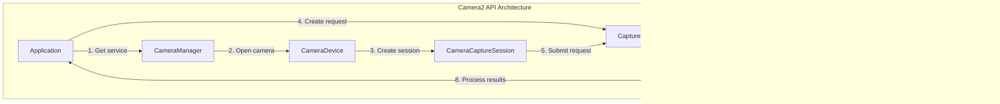
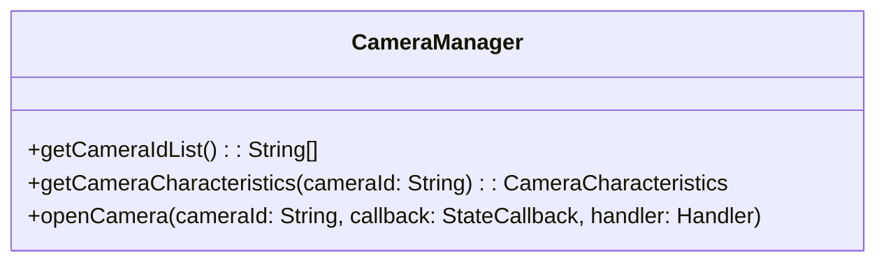
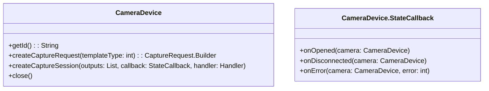
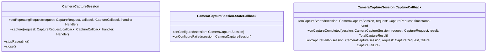
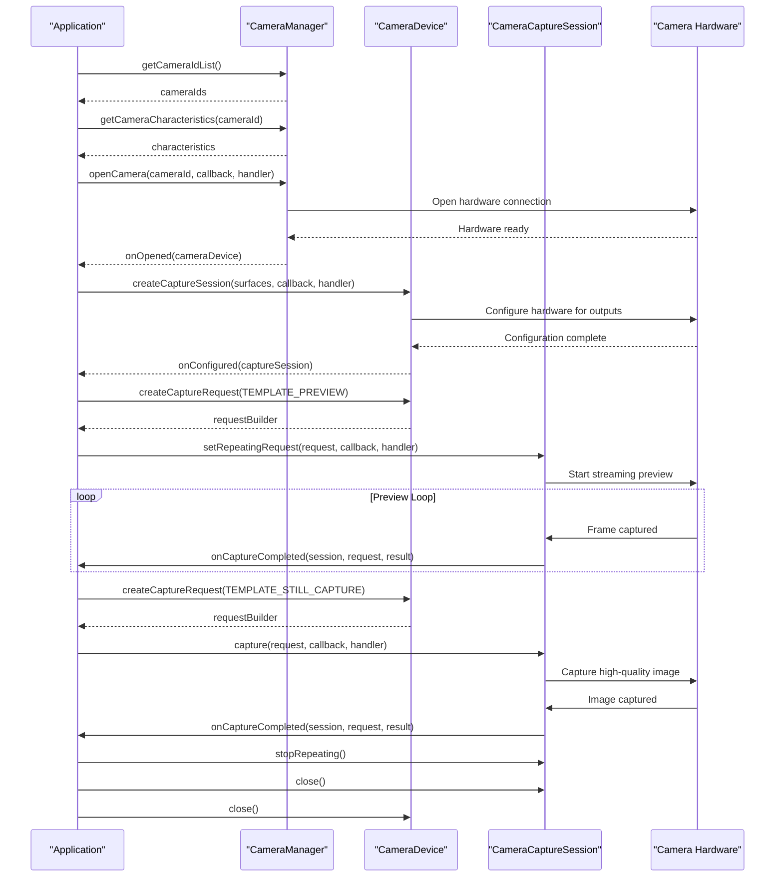
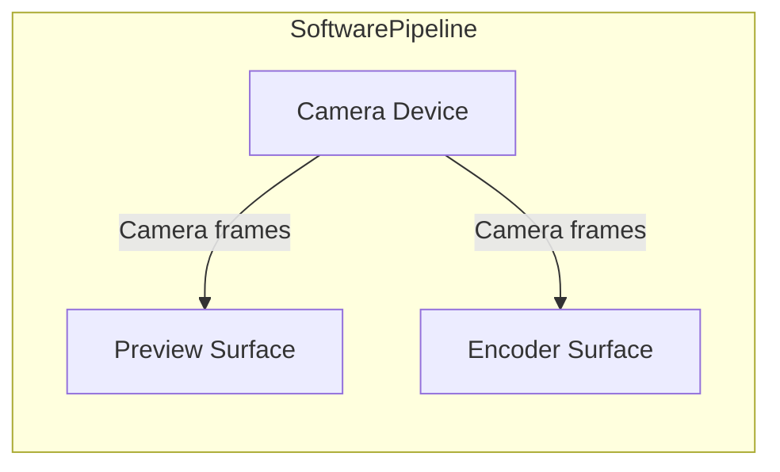
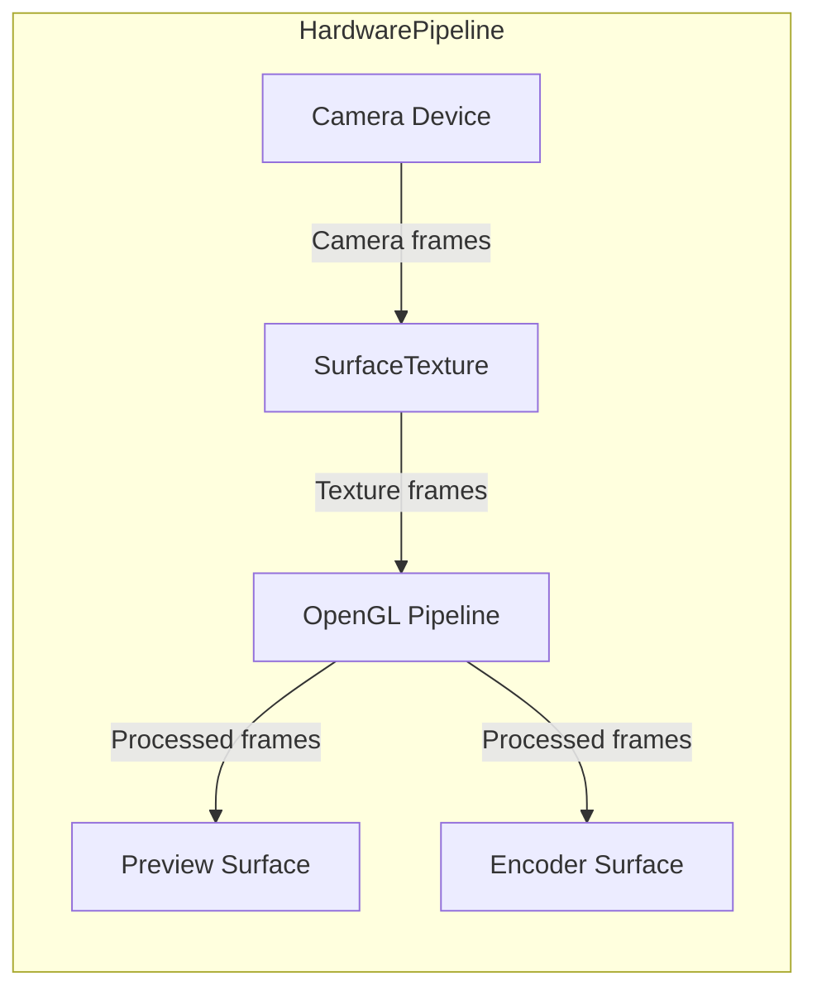

<!-- source: DeepWiki mcp.deepwiki.com · repo android/camera-samples · page 2.2 Camera2 API Fundamentals · fetched 2026-10-23 -->

# Camera2 API Fundamentals

<details>
<summary>Relevant source files</summary>

The following files were used as context for generating this wiki page:

- [Camera2Extensions/app/build.gradle](Camera2Extensions/app/build.gradle)
- [Camera2Extensions/app/src/main/java/com/example/android/camera2/extensions/ZoomUtil.kt](Camera2Extensions/app/src/main/java/com/example/android/camera2/extensions/ZoomUtil.kt)
- [Camera2Extensions/app/src/main/java/com/example/android/camera2/extensions/fragments/CameraFragment.kt](Camera2Extensions/app/src/main/java/com/example/android/camera2/extensions/fragments/CameraFragment.kt)
- [Camera2Extensions/app/src/main/res/layout/fragment_camera.xml](Camera2Extensions/app/src/main/res/layout/fragment_camera.xml)
- [Camera2Extensions/app/src/main/res/values/strings.xml](Camera2Extensions/app/src/main/res/values/strings.xml)
- [Camera2Extensions/build.gradle](Camera2Extensions/build.gradle)
- [Camera2Extensions/gradle/wrapper/gradle-wrapper.properties](Camera2Extensions/gradle/wrapper/gradle-wrapper.properties)
- [Camera2Extensions/settings.gradle](Camera2Extensions/settings.gradle)
- [Camera2Video/app/src/main/java/com/example/android/camera2/video/EncoderWrapper.kt](Camera2Video/app/src/main/java/com/example/android/camera2/video/EncoderWrapper.kt)
- [Camera2Video/app/src/main/java/com/example/android/camera2/video/HardwarePipeline.kt](Camera2Video/app/src/main/java/com/example/android/camera2/video/HardwarePipeline.kt)
- [Camera2Video/app/src/main/java/com/example/android/camera2/video/Pipeline.kt](Camera2Video/app/src/main/java/com/example/android/camera2/video/Pipeline.kt)
- [Camera2Video/app/src/main/java/com/example/android/camera2/video/SoftwarePipeline.kt](Camera2Video/app/src/main/java/com/example/android/camera2/video/SoftwarePipeline.kt)
- [Camera2Video/app/src/main/java/com/example/android/camera2/video/fragments/PreviewFragment.kt](Camera2Video/app/src/main/java/com/example/android/camera2/video/fragments/PreviewFragment.kt)

</details>


This document explains the core architecture, components, and workflow of the Camera2 API in Android. It covers the fundamental building blocks needed to understand how to capture images and videos using the lower-level Camera2 API. For information about the higher-level CameraX API, which is built on top of Camera2, see [CameraX API Fundamentals](#2.1).

## Introduction to Camera2 API

The Camera2 API, introduced in Android 5.0 (API level 21), provides a more advanced camera control interface compared to the original Camera API. It follows an asynchronous, pipeline-based architecture that gives developers fine-grained control over the camera hardware, including manual focus, exposure, and post-processing capabilities.

Camera2 API is designed for applications that require precise camera control, such as:
- Professional photography apps
- Advanced video recording with custom processing
- Computational photography applications
- Apps that need access to raw sensor data

Sources:
- [Camera2Extensions/app/src/main/java/com/example/android/camera2/extensions/fragments/CameraFragment.kt:83-88]()
- [Camera2Video/app/src/main/java/com/example/android/camera2/video/fragments/PreviewFragment.kt:112-115]()

## Core Architecture

The Camera2 API follows a request-based architecture where applications submit capture requests to the camera device and receive callbacks when captures are completed.

### Architecture Diagram



Sources:
- [Camera2Video/app/src/main/java/com/example/android/camera2/video/fragments/PreviewFragment.kt:254-273]()
- [Camera2Extensions/app/src/main/java/com/example/android/camera2/extensions/fragments/CameraFragment.kt:555-559]()

## Key Components

### CameraManager

The `CameraManager` is the entry point to the Camera2 API. It's a system service that:
- Enumerates available cameras
- Provides access to camera characteristics
- Opens connections to camera devices



Example usage:
```kotlin
val cameraManager = context.getSystemService(Context.CAMERA_SERVICE) as CameraManager
```

Sources:
- [Camera2Video/app/src/main/java/com/example/android/camera2/video/fragments/PreviewFragment.kt:112-115]()
- [Camera2Extensions/app/src/main/java/com/example/android/camera2/extensions/fragments/CameraFragment.kt:85-88]()

### CameraDevice

`CameraDevice` represents a connection to a physical camera. It's obtained by calling `CameraManager.openCamera()` which returns the device through a callback.



Opening a camera is an asynchronous operation that requires a callback:

```kotlin
cameraManager.openCamera(cameraId, object : CameraDevice.StateCallback() {
    override fun onOpened(device: CameraDevice) {
        // Camera opened successfully
    }
    
    override fun onDisconnected(device: CameraDevice) {
        // Camera disconnected
    }
    
    override fun onError(device: CameraDevice, error: Int) {
        // Error occurred
    }
}, handler)
```

Sources:
- [Camera2Video/app/src/main/java/com/example/android/camera2/video/fragments/PreviewFragment.kt:416-443]()
- [Camera2Extensions/app/src/main/java/com/example/android/camera2/extensions/fragments/CameraFragment.kt:563-589]()

### CameraCaptureSession

A `CameraCaptureSession` manages the flow of capture requests to the camera and the resulting frames to output targets. Creating a session requires specifying the output surfaces where camera frames will be delivered.



Session creation example:

```kotlin
cameraDevice.createCaptureSession(
    outputSurfaces,  // List of output surfaces
    object : CameraCaptureSession.StateCallback() {
        override fun onConfigured(session: CameraCaptureSession) {
            // Session configured successfully
        }
        
        override fun onConfigureFailed(session: CameraCaptureSession) {
            // Session configuration failed
        }
    }, 
    handler
)
```

Sources:
- [Camera2Video/app/src/main/java/com/example/android/camera2/video/fragments/PreviewFragment.kt:482-509]()
- [Camera2Extensions/app/src/main/java/com/example/android/camera2/extensions/fragments/CameraFragment.kt:670-708]()

### CaptureRequest

`CaptureRequest` defines all the parameters for a single capture operation, including:
- Output targets (surfaces)
- Camera parameters (focus mode, exposure, etc.)
- Processing parameters

Requests are created using a builder pattern:

```kotlin
val captureRequestBuilder = cameraDevice.createCaptureRequest(CameraDevice.TEMPLATE_PREVIEW)
captureRequestBuilder.addTarget(previewSurface)
captureRequestBuilder.set(CaptureRequest.CONTROL_AF_MODE, CaptureRequest.CONTROL_AF_MODE_CONTINUOUS_PICTURE)
val captureRequest = captureRequestBuilder.build()
```

The Camera2 API provides several template types for common use cases:
- `TEMPLATE_PREVIEW` - For camera preview
- `TEMPLATE_STILL_CAPTURE` - For high-quality still image capture
- `TEMPLATE_RECORD` - For video recording
- `TEMPLATE_VIDEO_SNAPSHOT` - For still image capture during video recording
- `TEMPLATE_MANUAL` - For full manual control

Sources:
- [Camera2Video/app/src/main/java/com/example/android/camera2/video/fragments/PreviewFragment.kt:148-155]()
- [Camera2Video/app/src/main/java/com/example/android/camera2/video/SoftwarePipeline.kt:34-46]()
- [Camera2Video/app/src/main/java/com/example/android/camera2/video/SoftwarePipeline.kt:48-63]()

### CaptureResult

`CaptureResult` contains the output metadata from a completed capture request, such as:
- Timestamp
- Exposure time
- Sensor sensitivity (ISO)
- Auto-focus state
- Auto-exposure state

These results are delivered through the `CameraCaptureSession.CaptureCallback` interface.

Sources:
- [Camera2Extensions/app/src/main/java/com/example/android/camera2/extensions/fragments/CameraFragment.kt:306-348]()
- [Camera2Video/app/src/main/java/com/example/android/camera2/video/fragments/PreviewFragment.kt:305-313]()

### CameraCharacteristics

`CameraCharacteristics` provides static information about a camera device, including:
- Sensor information (size, format)
- Supported features
- Physical characteristics (focal length, lens orientation)
- Available capabilities

Example usage:

```kotlin
val characteristics = cameraManager.getCameraCharacteristics(cameraId)
val sensorOrientation = characteristics.get(CameraCharacteristics.SENSOR_ORIENTATION)
val supportedHardwareLevel = characteristics.get(CameraCharacteristics.INFO_SUPPORTED_HARDWARE_LEVEL)
```

Sources:
- [Camera2Extensions/app/src/main/java/com/example/android/camera2/extensions/fragments/CameraFragment.kt:470-471]()
- [Camera2Video/app/src/main/java/com/example/android/camera2/video/fragments/PreviewFragment.kt:118-120]()
- [Camera2Extensions/app/src/main/java/com/example/android/camera2/extensions/ZoomUtil.kt:26-32]()

## Camera2 Capture Pipeline

The Camera2 API operates using a pipeline model where requests flow from the application to the camera hardware, and results flow back to the application.

### Capture Pipeline Diagram



Sources:
- [Camera2Video/app/src/main/java/com/example/android/camera2/video/fragments/PreviewFragment.kt:254-273]()
- [Camera2Extensions/app/src/main/java/com/example/android/camera2/extensions/fragments/CameraFragment.kt:555-707]()

## Opening a Camera and Creating a Session

Opening a camera and creating a capture session are asynchronous operations that require callbacks to handle completion or failure.

### Opening a Camera

The process of opening a camera typically involves:

1. Getting the camera service
2. Obtaining a list of available cameras
3. Selecting a camera based on criteria (front/back, capabilities)
4. Opening the camera with a callback

Example using Kotlin coroutines:

```kotlin
private suspend fun openCamera(
    manager: CameraManager,
    cameraId: String,
    handler: Handler? = null
): CameraDevice = suspendCancellableCoroutine { cont ->
    manager.openCamera(cameraId, object : CameraDevice.StateCallback() {
        override fun onOpened(device: CameraDevice) = cont.resume(device)

        override fun onDisconnected(device: CameraDevice) {
            Log.w(TAG, "Camera $cameraId has been disconnected")
            requireActivity().finish()
        }

        override fun onError(device: CameraDevice, error: Int) {
            val msg = when(error) {
                ERROR_CAMERA_DEVICE -> "Fatal (device)"
                ERROR_CAMERA_DISABLED -> "Device policy"
                ERROR_CAMERA_IN_USE -> "Camera in use"
                ERROR_CAMERA_SERVICE -> "Fatal (service)"
                ERROR_MAX_CAMERAS_IN_USE -> "Maximum cameras in use"
                else -> "Unknown"
            }
            val exc = RuntimeException("Camera $cameraId error: ($error) $msg")
            if (cont.isActive) cont.resumeWithException(exc)
        }
    }, handler)
}
```

Sources:
- [Camera2Video/app/src/main/java/com/example/android/camera2/video/fragments/PreviewFragment.kt:416-443]()
- [Camera2Extensions/app/src/main/java/com/example/android/camera2/extensions/fragments/CameraFragment.kt:563-589]()

### Creating a Capture Session

Creating a capture session involves:

1. Defining output surfaces (preview, recording, image capture)
2. Creating a session configuration
3. Handling session configuration callbacks

Example:

```kotlin
private suspend fun createCaptureSession(
    device: CameraDevice,
    targets: List<Surface>,
    handler: Handler
): CameraCaptureSession = suspendCoroutine { cont ->
    val stateCallback = object: CameraCaptureSession.StateCallback() {
        override fun onConfigured(session: CameraCaptureSession) = cont.resume(session)

        override fun onConfigureFailed(session: CameraCaptureSession) {
            val exc = RuntimeException("Camera ${device.id} session configuration failed")
            cont.resumeWithException(exc)
        }
    }
    
    device.createCaptureSession(targets, stateCallback, handler)
}
```

Sources:
- [Camera2Video/app/src/main/java/com/example/android/camera2/video/fragments/PreviewFragment.kt:482-509]()
- [Camera2Extensions/app/src/main/java/com/example/android/camera2/extensions/fragments/CameraFragment.kt:670-724]()

## Capture Request Types and Workflows

The Camera2 API supports different types of capture requests for various use cases. There are two main ways to submit capture requests:

### Repeating Requests

These are continuous requests used for preview or video recording:

```kotlin
session.setRepeatingRequest(previewRequest, captureCallback, backgroundHandler)
```

Sources:
- [Camera2Video/app/src/main/java/com/example/android/camera2/video/fragments/PreviewFragment.kt:269-273]()
- [Camera2Video/app/src/main/java/com/example/android/camera2/video/fragments/PreviewFragment.kt:304-313]()

### Single Capture Requests

These are one-time requests, typically used for capturing still images:

```kotlin
session.capture(stillCaptureRequest, captureCallback, backgroundHandler)
```

Sources:
- [Camera2Extensions/app/src/main/java/com/example/android/camera2/extensions/fragments/CameraFragment.kt:520-527]()

## Request Templates and Configuration

Camera2 API provides predefined templates that set up capture parameters for common use cases:

| Template Constant | Purpose |
|-------------------|---------|
| `TEMPLATE_PREVIEW` | Camera preview, optimized for viewfinder performance |
| `TEMPLATE_STILL_CAPTURE` | High-quality photo capture |
| `TEMPLATE_RECORD` | Video recording, balanced configuration |
| `TEMPLATE_VIDEO_SNAPSHOT` | Still image while recording video |
| `TEMPLATE_ZERO_SHUTTER_LAG` | Continually capturing full-resolution images |
| `TEMPLATE_MANUAL` | All automatic settings turned off for manual control |

Example of creating a preview request:

```kotlin
// Create a request builder using a template
val requestBuilder = cameraDevice.createCaptureRequest(CameraDevice.TEMPLATE_PREVIEW)

// Add the preview surface as a target
requestBuilder.addTarget(previewSurface)

// Configure auto-focus mode
requestBuilder.set(CaptureRequest.CONTROL_AF_MODE, CaptureRequest.CONTROL_AF_MODE_CONTINUOUS_PICTURE)

// Build the final request
val previewRequest = requestBuilder.build()
```

Sources:
- [Camera2Video/app/src/main/java/com/example/android/camera2/video/SoftwarePipeline.kt:34-63]()
- [Camera2Video/app/src/main/java/com/example/android/camera2/video/fragments/PreviewFragment.kt:148-155]()

## Processing Pipeline Implementations

The Camera2 API allows for different processing pipeline implementations depending on the application requirements. The camera samples demonstrate two main approaches:

### Software Pipeline

Processes frames through the CPU, providing flexibility but potentially lower performance:



Key characteristics:
- Uses CPU for processing
- Simple configuration
- Direct camera-to-output routing
- Lower performance for complex operations

Sources:
- [Camera2Video/app/src/main/java/com/example/android/camera2/video/SoftwarePipeline.kt:29-72]()

### Hardware Pipeline

Processes frames using GPU acceleration via OpenGL, providing better performance for complex operations:



Key characteristics:
- Uses GPU for processing via OpenGL
- More complex setup
- Can apply image filters and effects efficiently
- Better performance for real-time processing

Sources:
- [Camera2Video/app/src/main/java/com/example/android/camera2/video/HardwarePipeline.kt:325-389]()
- [Camera2Video/app/src/main/java/com/example/android/camera2/video/Pipeline.kt:28-67]()

## Advanced Features and Capabilities

The Camera2 API provides access to advanced camera features that vary based on the device hardware capabilities.

### Preview Stabilization

Enables video stabilization specifically for preview:

```kotlin
requestBuilder.set(CaptureRequest.CONTROL_VIDEO_STABILIZATION_MODE,
        CaptureRequest.CONTROL_VIDEO_STABILIZATION_MODE_PREVIEW_STABILIZATION)
```

Sources:
- [Camera2Video/app/src/main/java/com/example/android/camera2/video/SoftwarePipeline.kt:41-44]()
- [Camera2Video/app/src/main/java/com/example/android/camera2/video/fragments/PreviewFragment.kt:524-527]()

### High Dynamic Range (HDR)

The API supports different HDR modes including HLG10, HDR10, and HDR10+:

```kotlin
// When creating a session with HDR support
sessionConfig.setColorSpace(ColorSpace.Named.values()[colorSpace])
```

Sources:
- [Camera2Video/app/src/main/java/com/example/android/camera2/video/fragments/PreviewFragment.kt:468-469]()
- [Camera2Video/app/src/main/java/com/example/android/camera2/video/HardwarePipeline.kt:559-591]()

### Zoom Control

Camera2 API allows for smooth zoom operations:

```kotlin
// Using zoom ratio
requestBuilder.set(CaptureRequest.CONTROL_ZOOM_RATIO, zoomRatio)

// Or using crop region
val rect = ZoomUtil.getZoomCropRect(zoomRatio, characteristics)
requestBuilder.set(CaptureRequest.SCALER_CROP_REGION, rect)
```

Sources:
- [Camera2Extensions/app/src/main/java/com/example/android/camera2/extensions/fragments/CameraFragment.kt:695]()
- [Camera2Extensions/app/src/main/java/com/example/android/camera2/extensions/ZoomUtil.kt:24-56]()

### Auto Focus Control

Enables tap-to-focus functionality:

```kotlin
// Set auto-focus regions based on touch point
requestBuilder.set(CaptureRequest.CONTROL_AF_REGIONS, focusRegions)
requestBuilder.set(CaptureRequest.CONTROL_AF_MODE, CaptureRequest.CONTROL_AF_MODE_AUTO)
requestBuilder.set(CaptureRequest.CONTROL_AF_TRIGGER, CaptureRequest.CONTROL_AF_TRIGGER_START)
```

Sources:
- [Camera2Extensions/app/src/main/java/com/example/android/camera2/extensions/fragments/CameraFragment.kt:321-328]()

## Conclusion

The Camera2 API provides low-level control over camera hardware through an asynchronous, request-based architecture. Understanding the fundamental components and their interactions is key to developing advanced camera applications.

While Camera2 offers extensive capabilities, it requires careful handling of its asynchronous nature and proper resource management. For simpler use cases, consider using the CameraX API [CameraX API Fundamentals](#2.1), which provides a higher-level abstraction built on top of Camera2.

Sources:
- [Camera2Video/app/src/main/java/com/example/android/camera2/video/fragments/PreviewFragment.kt]()
- [Camera2Extensions/app/src/main/java/com/example/android/camera2/extensions/fragments/CameraFragment.kt]()

---

