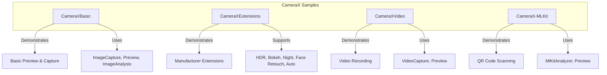
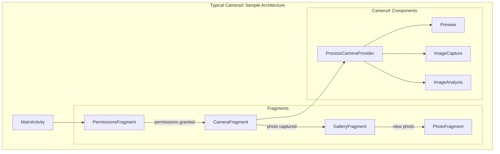
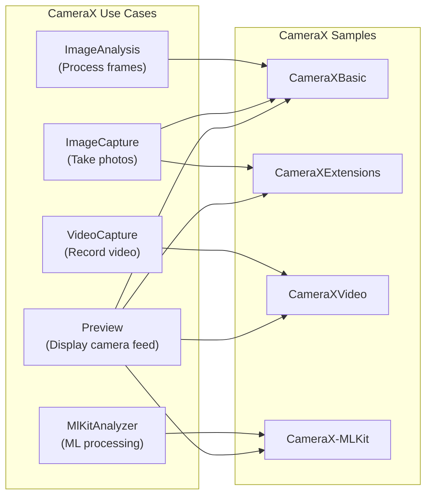
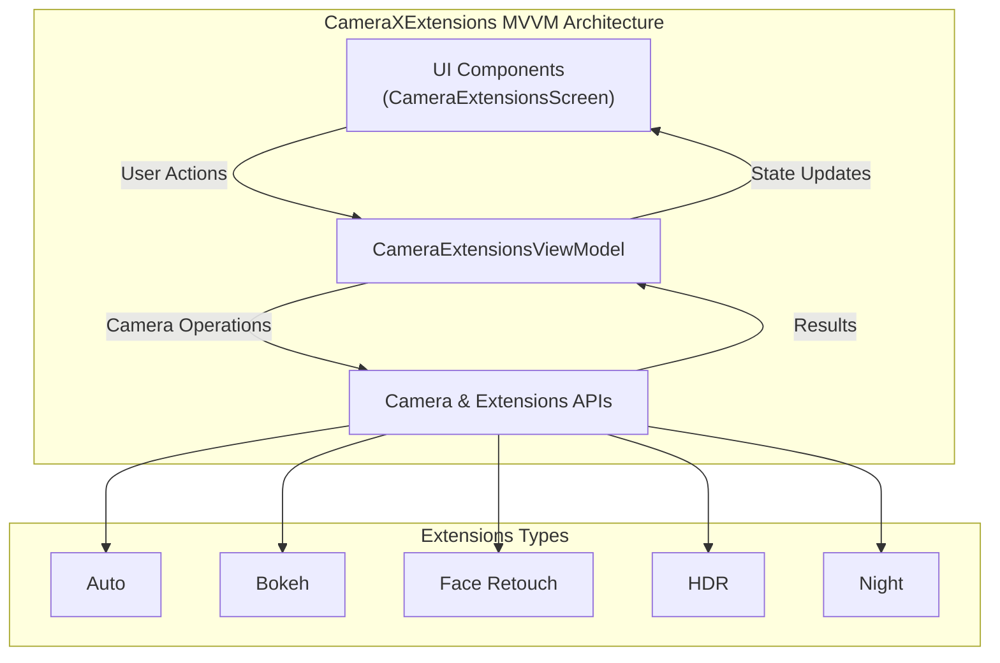

<!-- source: DeepWiki mcp.deepwiki.com · repo android/camera-samples · page 3 CameraX Samples · fetched 2026-10-23 -->

# CameraX Samples

<details>
<summary>Relevant source files</summary>

The following files were used as context for generating this wiki page:

- [CameraXBasic/app/src/main/AndroidManifest.xml](CameraXBasic/app/src/main/AndroidManifest.xml)
- [CameraXBasic/app/src/main/java/com/android/example/cameraxbasic/MainActivity.kt](CameraXBasic/app/src/main/java/com/android/example/cameraxbasic/MainActivity.kt)
- [CameraXBasic/app/src/main/java/com/android/example/cameraxbasic/fragments/PhotoFragment.kt](CameraXBasic/app/src/main/java/com/android/example/cameraxbasic/fragments/PhotoFragment.kt)
- [CameraXExtensions/README.md](CameraXExtensions/README.md)
- [CameraXExtensions/screenshots/camerax_camera_extensions_screenshot.png](CameraXExtensions/screenshots/camerax_camera_extensions_screenshot.png)
- [CameraXExtensions/screenshots/camerax_extensions_architecture_diagram.png](CameraXExtensions/screenshots/camerax_extensions_architecture_diagram.png)
- [README.md](README.md)

</details>


This document provides an overview of the CameraX sample applications in the camera-samples repository, highlighting their key features and use cases. For deeper technical details about individual samples, refer to their dedicated wiki pages: [CameraXBasic](#3.1), [CameraXExtensions](#3.2), [CameraXVideo](#3.3), and [CameraX-MLKit](#3.4). For CameraX API fundamentals, see [CameraX API Fundamentals](#2.1).

## CameraX Samples Overview

The repository contains four primary CameraX sample applications that demonstrate different aspects of camera functionality using the CameraX API:



Sources: [README.md:9-19](), [CameraXExtensions/README.md:1-16]()

## Key Features and Use Cases

Each CameraX sample demonstrates specific features and use cases:

| Sample | Key Features | Primary Use Cases |
|--------|--------------|-------------------|
| **CameraXBasic** | Camera preview, photo capture, image analysis | Basic photography app |
| **CameraXExtensions** | Manufacturer extensions (HDR, Night, etc.) | Enhanced photography |
| **CameraXVideo** | Video recording | Video capture app |
| **CameraX-MLKit** | QR code scanning | ML integration |

Sources: [README.md:9-19]()

## Common Architecture Patterns

The CameraX samples follow consistent architectural patterns:



Sources: [CameraXBasic/app/src/main/java/com/android/example/cameraxbasic/MainActivity.kt:34-37](), [CameraXBasic/app/src/main/java/com/android/example/cameraxbasic/fragments/PhotoFragment.kt:31-32]()

### 1. Single Activity Pattern

Most CameraX samples use a single-activity pattern with fragments for specific functionality. The activity serves as the entry point and container for fragments.

```kotlin
/**
 * Main entry point into our app. This app follows the single-activity pattern, and all
 * functionality is implemented in the form of fragments.
 */
class MainActivity : AppCompatActivity() {
    // ...
}
```

Sources: [CameraXBasic/app/src/main/java/com/android/example/cameraxbasic/MainActivity.kt:34-38]()

### 2. Fragment-Based UI

The samples leverage fragments for different screens and functionalities:
- **PermissionsFragment**: Handles camera permissions
- **CameraFragment**: Manages camera preview and capture
- **GalleryFragment**: Displays captured photos
- **PhotoFragment**: Shows individual photos

Sources: [CameraXBasic/app/src/main/java/com/android/example/cameraxbasic/fragments/PhotoFragment.kt:31-32]()

### 3. CameraX Use Cases

The samples demonstrate various CameraX use cases:



Sources: [README.md:9-19]()

## CameraXBasic

CameraXBasic demonstrates fundamental CameraX functionality:
- Camera preview using the Preview use case
- Photo capture using the ImageCapture use case
- Image analysis using the ImageAnalysis use case
- Permission handling
- Navigation between preview and gallery

The app follows the single-activity pattern with different fragments for specific functionality.

Sources: [README.md:11](), [CameraXBasic/app/src/main/java/com/android/example/cameraxbasic/MainActivity.kt:34-38]()

## CameraXExtensions

CameraXExtensions demonstrates how to use manufacturer-specific camera extensions with CameraX. It follows an MVVM architecture pattern:



Key features:
- Display camera preview using Preview use case
- Query supported extensions
- Select different extensions (Auto, Bokeh, Face Retouch, HDR, Night)
- Capture still images with the selected extension

Sources: [CameraXExtensions/README.md:2-18](), [CameraXExtensions/README.md:32-36]()

## CameraXVideo

CameraXVideo demonstrates video recording capabilities using the CameraX VideoCapture API:
- Camera preview
- Video recording using VideoCapture use case
- Video playback

Sources: [README.md:13]()

## CameraX-MLKit

CameraX-MLKit demonstrates integration between CameraX and ML Kit:
- Camera preview
- QR code scanning and detection using MlKitAnalyzer
- Real-time frame analysis

Sources: [README.md:14]()

## Android Manifest Integration

CameraX samples require camera permissions and declare camera features in the manifest:

```xml
<uses-feature android:name="android.hardware.camera" />
<uses-permission android:name="android.permission.CAMERA" />
```

They can also register as system camera apps:

```xml
<!-- Register as a system camera app -->
<intent-filter>
    <action android:name="android.media.action.IMAGE_CAPTURE" />
    <action android:name="android.media.action.STILL_IMAGE_CAMERA"/>
    <action android:name="android.media.action.VIDEO_CAMERA" />
    <category android:name="android.intent.category.DEFAULT"/>
</intent-filter>
```

Sources: [CameraXBasic/app/src/main/AndroidManifest.xml:27-30](), [CameraXBasic/app/src/main/AndroidManifest.xml:58-64]()

## Conclusion

The CameraX samples provide practical examples of implementing camera functionality using the CameraX API. They demonstrate different use cases and architectural patterns that can be applied to real-world camera applications. For more detailed information about each sample, refer to their dedicated wiki pages.

---

