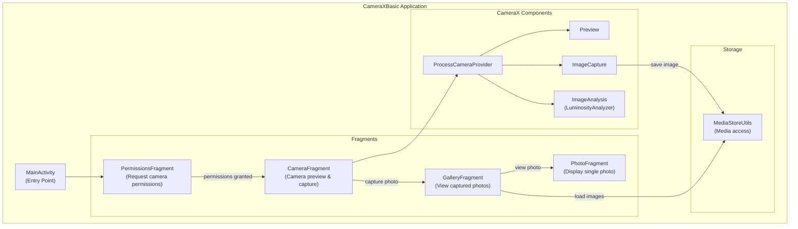
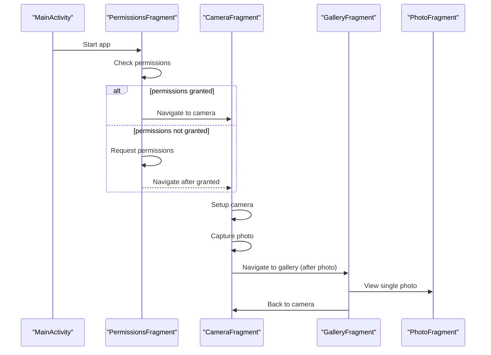
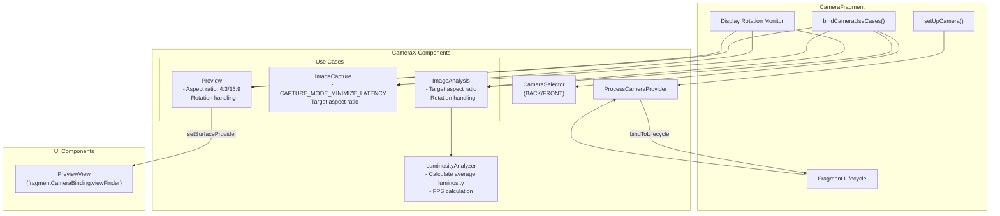
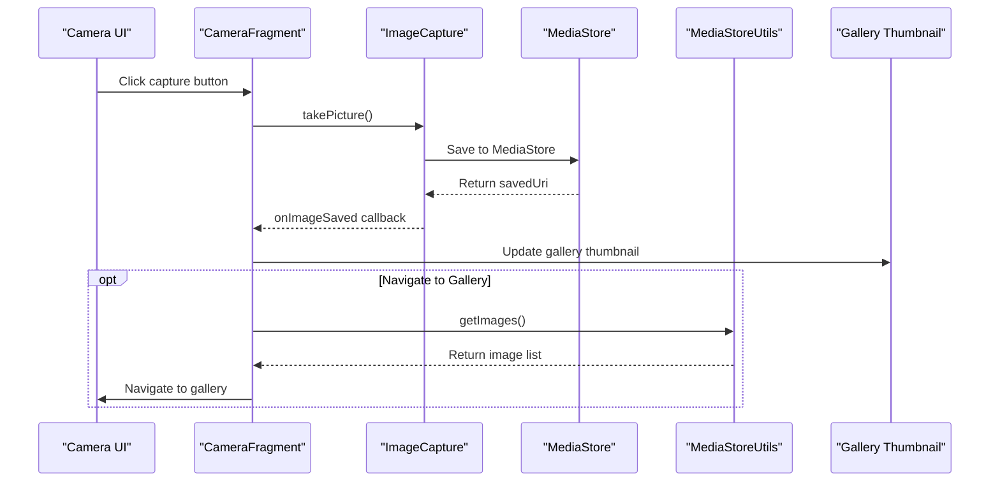
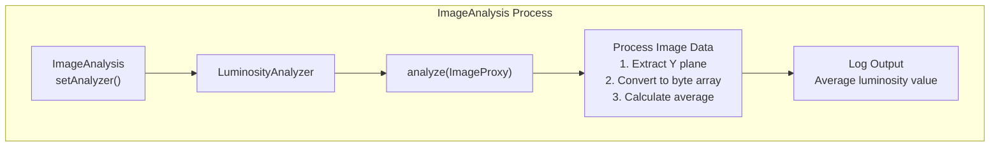
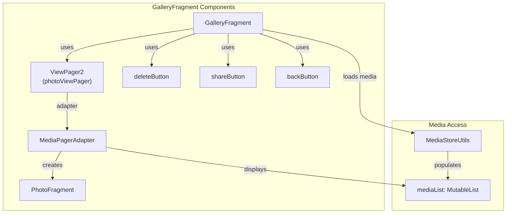
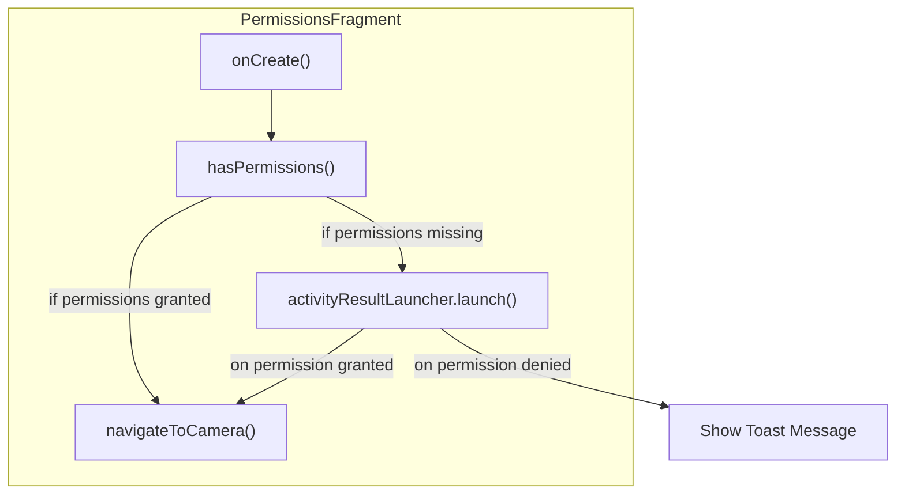

<!-- source: DeepWiki mcp.deepwiki.com · repo android/camera-samples · page 3.1 CameraXBasic · fetched 2026-10-23 -->

# CameraXBasic

<details>
<summary>Relevant source files</summary>

The following files were used as context for generating this wiki page:

- [CameraXBasic/app/build.gradle](CameraXBasic/app/build.gradle)
- [CameraXBasic/app/src/main/AndroidManifest.xml](CameraXBasic/app/src/main/AndroidManifest.xml)
- [CameraXBasic/app/src/main/java/com/android/example/cameraxbasic/MainActivity.kt](CameraXBasic/app/src/main/java/com/android/example/cameraxbasic/MainActivity.kt)
- [CameraXBasic/app/src/main/java/com/android/example/cameraxbasic/fragments/CameraFragment.kt](CameraXBasic/app/src/main/java/com/android/example/cameraxbasic/fragments/CameraFragment.kt)
- [CameraXBasic/app/src/main/java/com/android/example/cameraxbasic/fragments/GalleryFragment.kt](CameraXBasic/app/src/main/java/com/android/example/cameraxbasic/fragments/GalleryFragment.kt)
- [CameraXBasic/app/src/main/java/com/android/example/cameraxbasic/fragments/PermissionsFragment.kt](CameraXBasic/app/src/main/java/com/android/example/cameraxbasic/fragments/PermissionsFragment.kt)
- [CameraXBasic/app/src/main/java/com/android/example/cameraxbasic/fragments/PhotoFragment.kt](CameraXBasic/app/src/main/java/com/android/example/cameraxbasic/fragments/PhotoFragment.kt)
- [CameraXBasic/app/src/main/java/com/android/example/cameraxbasic/utils/MediaStoreUtils.kt](CameraXBasic/app/src/main/java/com/android/example/cameraxbasic/utils/MediaStoreUtils.kt)
- [CameraXBasic/app/src/main/res/layout-land/camera_ui_container.xml](CameraXBasic/app/src/main/res/layout-land/camera_ui_container.xml)
- [CameraXBasic/app/src/main/res/layout/camera_ui_container.xml](CameraXBasic/app/src/main/res/layout/camera_ui_container.xml)
- [CameraXBasic/app/src/main/res/layout/fragment_gallery.xml](CameraXBasic/app/src/main/res/layout/fragment_gallery.xml)
- [CameraXBasic/build.gradle](CameraXBasic/build.gradle)
- [CameraXBasic/gradle.properties](CameraXBasic/gradle.properties)

</details>


CameraXBasic is a sample application that demonstrates how to implement camera functionality using the CameraX API in Android. This sample shows how to build a basic camera app with features including camera preview, photo capture, and image analysis while following best practices for lifecycle management and permissions handling.

For information about other CameraX samples like video recording, see [CameraXVideo](#3.3), or for manufacturer extensions, see [CameraXExtensions](#3.2).

## 1. Application Architecture

CameraXBasic follows a single-activity architecture with multiple fragments. It uses the Navigation Component to handle fragment transitions and the CameraX library to manage camera operations.

### 1.1 Component Overview



Sources: [CameraXBasic/app/src/main/java/com/android/example/cameraxbasic/MainActivity.kt:38-86](), [CameraXBasic/app/src/main/java/com/android/example/cameraxbasic/fragments/CameraFragment.kt:73-674](), [CameraXBasic/app/src/main/java/com/android/example/cameraxbasic/fragments/PermissionsFragment.kt:38-87](), [CameraXBasic/app/src/main/java/com/android/example/cameraxbasic/fragments/GalleryFragment.kt:44-191](), [CameraXBasic/app/src/main/java/com/android/example/cameraxbasic/fragments/PhotoFragment.kt:32-54]()

### 1.2 Navigation Flow



Sources: [CameraXBasic/app/src/main/java/com/android/example/cameraxbasic/fragments/PermissionsFragment.kt:40-79](), [CameraXBasic/app/src/main/java/com/android/example/cameraxbasic/fragments/CameraFragment.kt:467-518](), [CameraXBasic/app/src/main/java/com/android/example/cameraxbasic/fragments/CameraFragment.kt:552-563]()

## 2. CameraX Implementation

The core functionality of CameraXBasic relies on CameraX API components, which provide a simplified interface for camera operations compared to Camera2 API.

### 2.1 CameraX Use Cases and Binding



Sources: [CameraXBasic/app/src/main/java/com/android/example/cameraxbasic/fragments/CameraFragment.kt:235-328](), [CameraXBasic/app/src/main/java/com/android/example/cameraxbasic/fragments/CameraFragment.kt:591-664]()

### 2.2 Camera Setup and Configuration

The CameraFragment implements the core camera functionality through several key steps:

1. **Camera Provider Setup**:
   ```kotlin
   private suspend fun setUpCamera() {
       cameraProvider = ProcessCameraProvider.getInstance(requireContext()).await()
       // Select lens facing based on available cameras
       // Bind camera use cases
   }
   ```

2. **Use Case Binding**:
   - Camera Preview
   - Image Capture
   - Image Analysis

The setup occurs in `setUpCamera()` which runs asynchronously using coroutines, and the actual binding happens in `bindCameraUseCases()`.

Sources: [CameraXBasic/app/src/main/java/com/android/example/cameraxbasic/fragments/CameraFragment.kt:235-250](), [CameraXBasic/app/src/main/java/com/android/example/cameraxbasic/fragments/CameraFragment.kt:253-327]()

### 2.3 CameraX Dependencies

The app integrates CameraX through the following dependencies:

| Component | Description | Gradle Dependency |
|-----------|-------------|-------------------|
| CameraX Core | Base CameraX functionality | `androidx.camera:camera-core` |
| Camera2 Integration | Integration with Camera2 | `androidx.camera:camera-camera2` |
| Lifecycle Integration | Lifecycle awareness | `androidx.camera:camera-lifecycle` |
| CameraX View | UI components | `androidx.camera:camera-view` |

Sources: [CameraXBasic/app/build.gradle:74-89]()

## 3. Key Functionalities

### 3.1 Image Capture Process



Sources: [CameraXBasic/app/src/main/java/com/android/example/cameraxbasic/fragments/CameraFragment.kt:467-518](), [CameraXBasic/app/src/main/java/com/android/example/cameraxbasic/utils/MediaStoreUtils.kt:72-94]()

The image capture process in CameraXBasic is handled by the `ImageCapture` use case:

1. The user taps the capture button, which triggers the `takePicture()` method
2. A file name is generated with a timestamp using `SimpleDateFormat`
3. `ContentValues` for MediaStore are created with display name, MIME type, and relative path
4. A callback monitors the image capture progress
5. After successful capture, the gallery thumbnail is updated
6. The new image is made available through the gallery button

Sources: [CameraXBasic/app/src/main/java/com/android/example/cameraxbasic/fragments/CameraFragment.kt:467-531]()

### 3.2 Camera Switching

The app supports switching between front and back cameras:

```kotlin
cameraUiContainerBinding?.cameraSwitchButton?.setOnClickListener {
    lensFacing = if (CameraSelector.LENS_FACING_FRONT == lensFacing) {
        CameraSelector.LENS_FACING_BACK
    } else {
        CameraSelector.LENS_FACING_FRONT
    }
    // Re-bind use cases to update selected camera
    bindCameraUseCases()
}
```

The switch process:
1. Toggles the `lensFacing` value between front and back
2. Rebinds all camera use cases with the new lens facing
3. Updates the UI to reflect the new camera

Sources: [CameraXBasic/app/src/main/java/com/android/example/cameraxbasic/fragments/CameraFragment.kt:533-549](), [CameraXBasic/app/src/main/java/com/android/example/cameraxbasic/fragments/CameraFragment.kt:567-583]()

### 3.3 Image Analysis with LuminosityAnalyzer

CameraXBasic implements a custom image analyzer that computes the average luminosity of camera frames:



Sources: [CameraXBasic/app/src/main/java/com/android/example/cameraxbasic/fragments/CameraFragment.kt:591-664]()

The `LuminosityAnalyzer` class:
1. Receives image frames from the camera
2. Extracts the luminance (Y) plane from the YUV image format
3. Calculates the average luminosity value
4. Tracks frames per second
5. Reports results through a listener callback

Sources: [CameraXBasic/app/src/main/java/com/android/example/cameraxbasic/fragments/CameraFragment.kt:591-664]()

## 4. Gallery Implementation

After capturing photos, users can view, share, and delete them through the Gallery functionality.

### 4.1 Gallery Fragment Structure



Sources: [CameraXBasic/app/src/main/java/com/android/example/cameraxbasic/fragments/GalleryFragment.kt:44-190](), [CameraXBasic/app/src/main/java/com/android/example/cameraxbasic/fragments/PhotoFragment.kt:32-54]()

The Gallery functionality:
1. Uses `ViewPager2` with a custom adapter to display photos
2. Retrieves images from `MediaStoreUtils`
3. Provides buttons for deleting and sharing photos
4. Supports navigation back to camera

Sources: [CameraXBasic/app/src/main/java/com/android/example/cameraxbasic/fragments/GalleryFragment.kt:79-184](), [CameraXBasic/app/src/main/res/layout/fragment_gallery.xml:17-78]()

## 5. Media Storage and Access

CameraXBasic uses `MediaStoreUtils` to access and manage photos:

### 5.1 MediaStore Operations

| Operation | Function | Description |
|-----------|----------|-------------|
| Get Latest Image | `getLatestImageFilename()` | Retrieves the most recent captured photo |
| Get All Images | `getImages()` | Returns a list of all app photos as `MediaStoreFile` objects |
| Media Collection Access | `mediaStoreCollection` | URI for accessing the app's media collection |

The app doesn't request external storage permissions, so it can only access photos taken within the app. On Android 10+ (API 29+), images are stored in the shared media collection. On older versions, they are stored in the app's external files directory.

Sources: [CameraXBasic/app/src/main/java/com/android/example/cameraxbasic/utils/MediaStoreUtils.kt:40-102]()

## 6. Permissions Handling

CameraXBasic requires the `CAMERA` permission, and on Android 9 (API 28) and below, it also needs `WRITE_EXTERNAL_STORAGE`.



Sources: [CameraXBasic/app/src/main/java/com/android/example/cameraxbasic/fragments/PermissionsFragment.kt:38-87](), [CameraXBasic/app/src/main/AndroidManifest.xml:27-30]()

The permissions flow:
1. `PermissionsFragment` checks if required permissions are granted
2. If not, it requests permissions using the Activity Result API
3. After permissions are granted, it navigates to the camera fragment
4. If permissions are denied, it shows a toast message

Sources: [CameraXBasic/app/src/main/java/com/android/example/cameraxbasic/fragments/PermissionsFragment.kt:40-79]()

## 7. Technical Considerations

### 7.1 Camera State Management

CameraXBasic monitors the camera state using observers to handle various camera states and errors:

```kotlin
private fun observeCameraState(cameraInfo: CameraInfo) {
    cameraInfo.cameraState.observe(viewLifecycleOwner) { cameraState ->
        // Handle camera states: PENDING_OPEN, OPENING, OPEN, CLOSING, CLOSED
        // Handle camera errors
    }
}
```

This allows the app to respond to camera availability changes and detect error conditions such as:
- Camera in use by another app
- Maximum cameras in use
- Camera disabled
- Fatal errors

Sources: [CameraXBasic/app/src/main/java/com/android/example/cameraxbasic/fragments/CameraFragment.kt:334-423]()

### 7.2 Handling Screen Rotation

CameraXBasic handles orientation changes seamlessly:

1. Configures the activity to handle configuration changes: `android:configChanges="orientation|screenLayout|screenSize|smallestScreenSize"`
2. Uses `onConfigurationChanged()` to update camera settings without rebuilding the fragments
3. Updates the target rotation for `ImageCapture` and `ImageAnalysis` when display rotation changes

Sources: [CameraXBasic/app/src/main/AndroidManifest.xml:48](), [CameraXBasic/app/src/main/java/com/android/example/cameraxbasic/fragments/CameraFragment.kt:224-232](), [CameraXBasic/app/src/main/java/com/android/example/cameraxbasic/fragments/CameraFragment.kt:118-128]()

## 8. Summary

CameraXBasic demonstrates a complete implementation of a camera application using CameraX. Key takeaways:

1. **Architecture**: Single activity with multiple fragments using Navigation Component
2. **Camera**: CameraX implementation with Preview, ImageCapture, and ImageAnalysis use cases
3. **UI**: Camera controls for capture, gallery access, and switching cameras
4. **Storage**: MediaStore implementation for saving and retrieving photos
5. **Permissions**: Runtime permission handling for camera and storage

This sample provides a solid foundation for developers who want to implement camera functionality in their Android applications using the CameraX API.

Sources: [CameraXBasic/app/build.gradle:54-111](), [CameraXBasic/app/src/main/java/com/android/example/cameraxbasic/fragments/CameraFragment.kt:67-674]()

---

