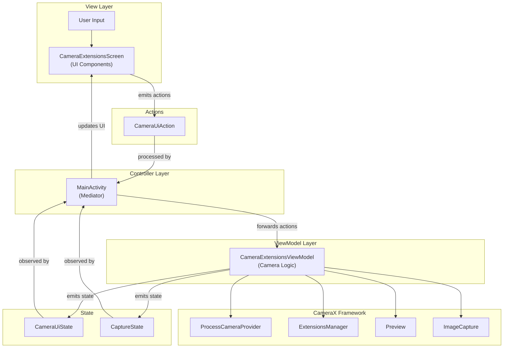
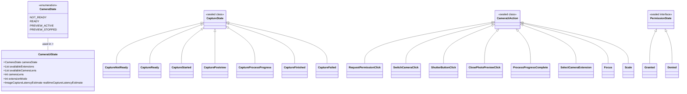
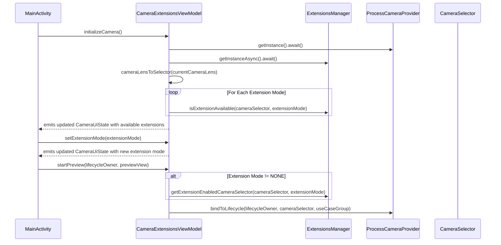
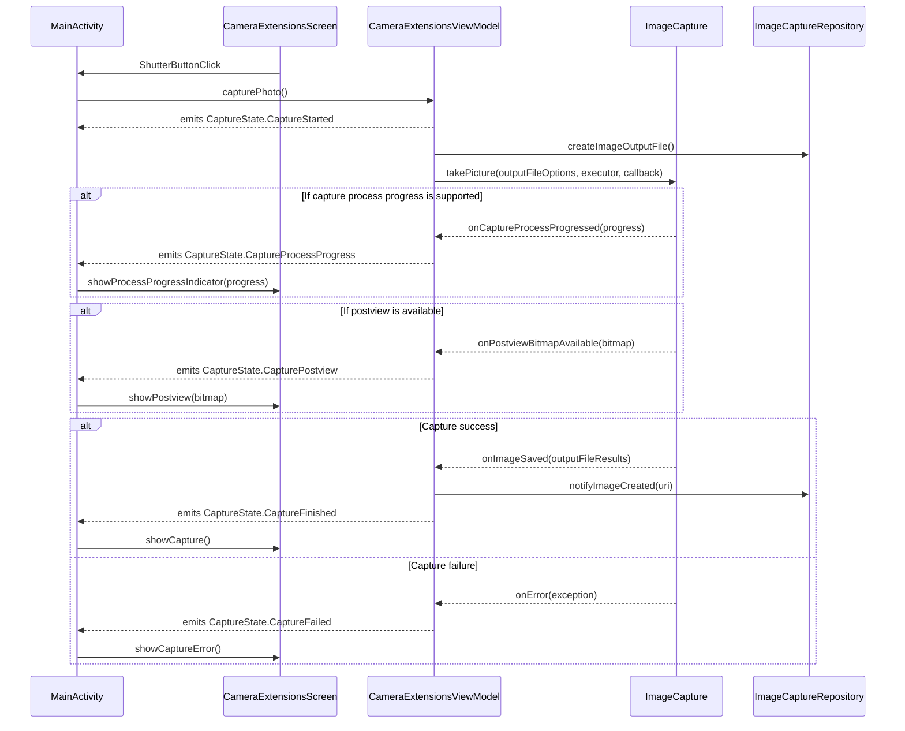

<!-- source: DeepWiki mcp.deepwiki.com · repo android/camera-samples · page 3.2 CameraXExtensions · fetched 2026-10-23 -->

# CameraXExtensions

Relevant source files

The following files were used as context for generating this wiki page:

- [CameraXExtensions/README.md](CameraXExtensions/README.md)
- [CameraXExtensions/app/build.gradle](CameraXExtensions/app/build.gradle)
- [CameraXExtensions/app/src/main/java/com/example/android/cameraxextensions/MainActivity.kt](CameraXExtensions/app/src/main/java/com/example/android/cameraxextensions/MainActivity.kt)
- [CameraXExtensions/app/src/main/java/com/example/android/cameraxextensions/model/CameraUiAction.kt](CameraXExtensions/app/src/main/java/com/example/android/cameraxextensions/model/CameraUiAction.kt)
- [CameraXExtensions/app/src/main/java/com/example/android/cameraxextensions/model/CameraUiState.kt](CameraXExtensions/app/src/main/java/com/example/android/cameraxextensions/model/CameraUiState.kt)
- [CameraXExtensions/app/src/main/java/com/example/android/cameraxextensions/model/PermissionState.kt](CameraXExtensions/app/src/main/java/com/example/android/cameraxextensions/model/PermissionState.kt)
- [CameraXExtensions/app/src/main/java/com/example/android/cameraxextensions/ui/CameraExtensionsScreen.kt](CameraXExtensions/app/src/main/java/com/example/android/cameraxextensions/ui/CameraExtensionsScreen.kt)
- [CameraXExtensions/app/src/main/java/com/example/android/cameraxextensions/ui/FocusPointDrawable.kt](CameraXExtensions/app/src/main/java/com/example/android/cameraxextensions/ui/FocusPointDrawable.kt)
- [CameraXExtensions/app/src/main/java/com/example/android/cameraxextensions/viewmodel/CameraExtensionsViewModel.kt](CameraXExtensions/app/src/main/java/com/example/android/cameraxextensions/viewmodel/CameraExtensionsViewModel.kt)
- [CameraXExtensions/app/src/main/java/com/example/android/cameraxextensions/viewmodel/CameraExtensionsViewModelFactory.kt](CameraXExtensions/app/src/main/java/com/example/android/cameraxextensions/viewmodel/CameraExtensionsViewModelFactory.kt)
- [CameraXExtensions/app/src/main/java/com/example/android/cameraxextensions/viewstate/CameraPreviewScreenViewState.kt](CameraXExtensions/app/src/main/java/com/example/android/cameraxextensions/viewstate/CameraPreviewScreenViewState.kt)
- [CameraXExtensions/app/src/main/res/layout/activity_main.xml](CameraXExtensions/app/src/main/res/layout/activity_main.xml)
- [CameraXExtensions/app/src/main/res/values/strings.xml](CameraXExtensions/app/src/main/res/values/strings.xml)
- [CameraXExtensions/build.gradle](CameraXExtensions/build.gradle)
- [CameraXExtensions/gradle.properties](CameraXExtensions/gradle.properties)
- [CameraXExtensions/gradle/wrapper/gradle-wrapper.properties](CameraXExtensions/gradle/wrapper/gradle-wrapper.properties)
- [CameraXExtensions/screenshots/camerax_camera_extensions_screenshot.png](CameraXExtensions/screenshots/camerax_camera_extensions_screenshot.png)
- [CameraXExtensions/screenshots/camerax_extensions_architecture_diagram.png](CameraXExtensions/screenshots/camerax_extensions_architecture_diagram.png)
- [README.md](README.md)

CameraXExtensions is a sample application that demonstrates how to use Camera Extensions with the CameraX API to capture enhanced photos. This page explains the architecture, key components, and implementation details of the application, focusing on how it leverages vendor-specific camera extensions such as HDR, Night mode, Bokeh, and Face Retouch to improve photo quality.

For information about basic CameraX functionality without extensions, see [CameraXBasic](#3.1).

## Introduction

CameraXExtensions showcases how to access and utilize device manufacturer-specific camera extensions through the CameraX Extensions API. The sample demonstrates:

1. Detecting available camera extensions on a device
2. Displaying a camera preview with the selected extension
3. Switching between different extensions (HDR, Night mode, Bokeh, Face Retouch)
4. Capturing photos with the applied extension
5. Handling capture process progress and latency estimates

This implementation uses MVVM architecture with Kotlin coroutines and flows for reactive state management.

Sources: [CameraXExtensions/README.md:1-54](), [CameraXExtensions/app/build.gradle:68-114]()

## Architecture Overview

The application follows the MVVM (Model-View-ViewModel) architectural pattern with unidirectional data flow:

The architecture has the following key components:

1. **View**: `CameraExtensionsScreen` handles UI rendering and user input
2. **Controller**: `MainActivity` mediates between the view and view model
3. **ViewModel**: `CameraExtensionsViewModel` contains camera logic and state management
4. **State**: `CameraUiState` and `CaptureState` represent UI and capture state
5. **Actions**: `CameraUiAction` represents user interactions

Sources: [CameraXExtensions/README.md:32-36](), [CameraXExtensions/app/src/main/java/com/example/android/cameraxextensions/MainActivity.kt:56-392](), [CameraXExtensions/app/src/main/java/com/example/android/cameraxextensions/viewmodel/CameraExtensionsViewModel.kt:67-411]()

## Key Components

### State Management Components

The application uses a unidirectional data flow with clearly defined states and actions:

- `CameraUiState`: Tracks camera state, available extensions, and selected extension
- `CaptureState`: Represents different stages of photo capture (ready, started, process, finished)
- `CameraUiAction`: Defines user actions (switch camera, take photo, select extension)
- `PermissionState`: Manages camera permission states

Sources: [CameraXExtensions/app/src/main/java/com/example/android/cameraxextensions/model/CameraUiState.kt:31-109](), [CameraXExtensions/app/src/main/java/com/example/android/cameraxextensions/model/CameraUiAction.kt:25-34](), [CameraXExtensions/app/src/main/java/com/example/android/cameraxextensions/model/PermissionState.kt:19-22]()

### View Components

The UI is primarily managed by `CameraExtensionsScreen` which:

1. Encapsulates the UI components
2. Provides a declarative API for updating UI state
3. Emits user actions through a flow

Key UI components include:
- Camera preview using `PreviewView`
- Extension selector using `RecyclerView` with a horizontal scrolling layout
- Shutter button for capturing photos
- Lens switching button
- Focus point indicator
- Process progress indicator
- Capture latency estimate display
- Captured photo preview

Sources: [CameraXExtensions/app/src/main/java/com/example/android/cameraxextensions/ui/CameraExtensionsScreen.kt:65-454](), [CameraXExtensions/app/src/main/res/layout/activity_main.xml:17-196]()

### ViewModel Component

`CameraExtensionsViewModel` is responsible for:

1. **Camera initialization**: Setting up the camera and checking available extensions
2. **Preview management**: Starting and stopping the camera preview
3. **Extension handling**: Setting the current extension mode
4. **Photo capture**: Taking photos with the selected extension
5. **State communication**: Emitting camera and capture state

Key methods include:
- `initializeCamera()`: Sets up the camera and finds available extensions
- `startPreview()`: Starts the camera preview
- `capturePhoto()`: Takes a photo with the current extension
- `setExtensionMode()`: Changes the current camera extension
- `switchCamera()`: Toggles between front and back cameras

Sources: [CameraXExtensions/app/src/main/java/com/example/android/cameraxextensions/viewmodel/CameraExtensionsViewModel.kt:97-410]()

## Camera Extensions

### Available Extensions

The application supports the following camera extensions:

| Extension | Description | Constant |
|-----------|-------------|----------|
| None | Standard camera processing | `ExtensionMode.NONE` |
| Auto | Automatic mode selection | `ExtensionMode.AUTO` |
| HDR | High Dynamic Range | `ExtensionMode.HDR` |
| Night | Low-light enhancement | `ExtensionMode.NIGHT` |
| Bokeh | Portrait mode with background blur | `ExtensionMode.BOKEH` |
| Face Retouch | Skin smoothing and face enhancement | `ExtensionMode.FACE_RETOUCH` |

The available extensions depend on device hardware and manufacturer support. The application checks which extensions are available during initialization.

Sources: [CameraXExtensions/app/src/main/java/com/example/android/cameraxextensions/MainActivity.kt:62-68](), [CameraXExtensions/app/src/main/java/com/example/android/cameraxextensions/viewmodel/CameraExtensionsViewModel.kt:126-134]()

### Extension Detection and Selection

The process for detecting and selecting extensions involves:

The application:
1. Gets instances of `ProcessCameraProvider` and `ExtensionsManager`
2. Checks which extensions are available for the current camera lens
3. Updates the UI with available extensions
4. Applies the selected extension when starting the preview
5. Uses `getExtensionEnabledCameraSelector` to apply the extension to the camera

Sources: [CameraXExtensions/app/src/main/java/com/example/android/cameraxextensions/viewmodel/CameraExtensionsViewModel.kt:104-145](), [CameraXExtensions/app/src/main/java/com/example/android/cameraxextensions/viewmodel/CameraExtensionsViewModel.kt:154-194](), [CameraXExtensions/app/src/main/java/com/example/android/cameraxextensions/viewmodel/CameraExtensionsViewModel.kt:365-376]()

## Photo Capture Implementation

### Capture Process

The photo capture process involves:

The capture process includes:
1. Creating an output file for the captured image
2. Taking a photo with the `ImageCapture` use case
3. Tracking capture progress if supported
4. Displaying a postview bitmap if available
5. Handling the saved image or capture failure

Sources: [CameraXExtensions/app/src/main/java/com/example/android/cameraxextensions/viewmodel/CameraExtensionsViewModel.kt:293-359](), [CameraXExtensions/app/src/main/java/com/example/android/cameraxextensions/MainActivity.kt:200-274]()

### Capture Progress and Latency Estimation

A unique feature of the application is its ability to:

1. **Show capture process progress**: For certain extensions like Night mode that require multiple frames to be processed
2. **Display capture latency estimates**: For indicating to users how long capture might take

The application uses:
- `ImageCapture.getImageCaptureCapabilities()` to check if process progress is supported
- `ImageCapture.onCaptureProcessProgressed()` to track capture progress
- `ImageCapture.realtimeCaptureLatencyEstimate` to get estimated capture latency

Sources: [CameraXExtensions/app/src/main/java/com/example/android/cameraxextensions/viewmodel/CameraExtensionsViewModel.kt:308-315](), [CameraXExtensions/app/src/main/java/com/example/android/cameraxextensions/viewmodel/CameraExtensionsViewModel.kt:348-352](), [CameraXExtensions/app/src/main/java/com/example/android/cameraxextensions/viewmodel/CameraExtensionsViewModel.kt:217-239]()

## User Interaction Handling

### Camera Controls

The application supports the following camera interactions:

| Interaction | Action | Implementation |
|-------------|--------|----------------|
| Tap extension | Select camera extension | Horizontal scrolling RecyclerView with snap-to-center behavior |
| Tap shutter | Capture photo | Emits ShutterButtonClick action |
| Tap switch | Toggle front/back camera | Emits SwitchCameraClick action with rotation animation |
| Tap focus | Focus at point | Emits Focus action with MeteringPoint, shows focus animation |
| Pinch | Zoom camera | Emits Scale action with scaleFactor |
| Double tap | Toggle front/back camera | Alternative way to switch cameras |
| Back button | Exit photo preview | Handles back press in post-capture screen |

The interaction flow is:
1. User performs action on UI
2. `CameraExtensionsScreen` emits a `CameraUiAction`
3. `MainActivity` processes the action and forwards it to the ViewModel
4. ViewModel performs the camera operation
5. State changes are emitted back to MainActivity
6. UI is updated based on the new state

Sources: [CameraXExtensions/app/src/main/java/com/example/android/cameraxextensions/ui/CameraExtensionsScreen.kt:147-205](), [CameraXExtensions/app/src/main/java/com/example/android/cameraxextensions/MainActivity.kt:166-192]()

### Permission Management

The application handles camera permissions by:

1. Checking permission status on start and resume
2. Showing a permission request screen if permission is not granted
3. Providing a rationale if permission has been denied previously
4. Enabling camera functionality only after permission is granted

The permission state is represented by a `PermissionState` sealed interface with `Granted` and `Denied` subclasses.

Sources: [CameraXExtensions/app/src/main/java/com/example/android/cameraxextensions/MainActivity.kt:142-160](), [CameraXExtensions/app/src/main/java/com/example/android/cameraxextensions/MainActivity.kt:283-298](), [CameraXExtensions/app/src/main/java/com/example/android/cameraxextensions/model/PermissionState.kt:19-22]()

## Integration with CameraX

CameraXExtensions builds on top of CameraX, which is a Jetpack library that simplifies camera development. The key CameraX components used are:

1. **ProcessCameraProvider**: Camera lifecycle management and use case binding
2. **ExtensionsManager**: Query and enable camera extensions
3. **Preview**: Camera preview use case
4. **ImageCapture**: Photo capture use case

The application uses these components to:
- Bind camera lifecycle to the activity lifecycle
- Configure preview and image capture use cases
- Apply vendor-specific extensions to captures
- Handle camera capabilities like postview and process progress

Sources: [CameraXExtensions/app/build.gradle:73-79](), [CameraXExtensions/build.gradle:23-24](), [CameraXExtensions/app/src/main/java/com/example/android/cameraxextensions/viewmodel/CameraExtensionsViewModel.kt:154-194]()

## Summary

CameraXExtensions demonstrates how to:
1. Use the CameraX Extensions API to leverage vendor-specific camera features
2. Implement a clean MVVM architecture with unidirectional data flow
3. Handle complex camera operations like extension selection and photo capture
4. Provide a responsive and feature-rich camera experience

The sample serves as a reference for developers who want to incorporate camera extensions into their applications to provide enhanced photography features like HDR, Night mode, Bokeh effects, and Face Retouch.

---

