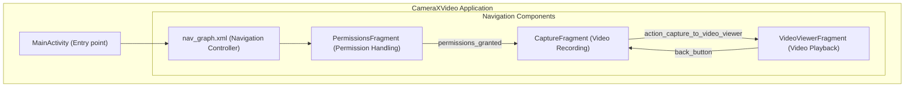
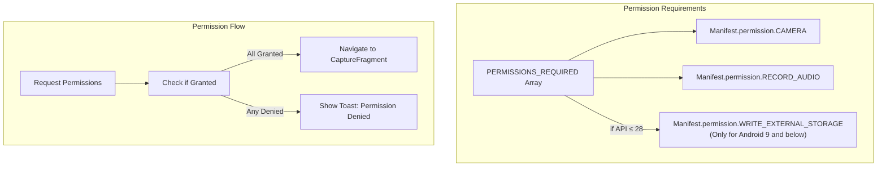
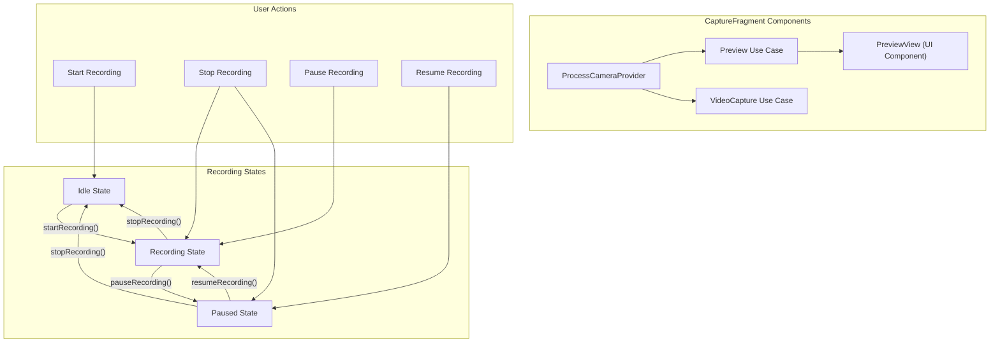
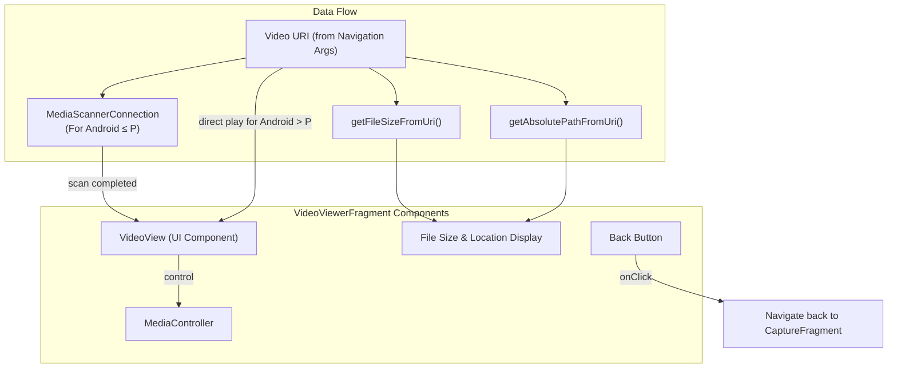

<!-- source: DeepWiki mcp.deepwiki.com · repo android/camera-samples · page 3.3 CameraXVideo · fetched 2026-10-23 -->

# CameraXVideo

Relevant source files

The following files were used as context for generating this wiki page:

- [CameraXVideo/app/src/main/java/com/example/android/camerax/video/fragments/PermissionsFragment.kt](CameraXVideo/app/src/main/java/com/example/android/camerax/video/fragments/PermissionsFragment.kt)
- [CameraXVideo/app/src/main/java/com/example/android/camerax/video/fragments/VideoViewerFragment.kt](CameraXVideo/app/src/main/java/com/example/android/camerax/video/fragments/VideoViewerFragment.kt)
- [CameraXVideo/app/src/main/res/drawable-hdpi/ic_back.xml](CameraXVideo/app/src/main/res/drawable-hdpi/ic_back.xml)
- [CameraXVideo/app/src/main/res/layout/fragment_permission.xml](CameraXVideo/app/src/main/res/layout/fragment_permission.xml)
- [CameraXVideo/app/src/main/res/layout/fragment_video_viewer.xml](CameraXVideo/app/src/main/res/layout/fragment_video_viewer.xml)
- [CameraXVideo/app/src/main/res/navigation/nav_graph.xml](CameraXVideo/app/src/main/res/navigation/nav_graph.xml)
- [CameraXVideo/app/src/main/res/values/strings.xml](CameraXVideo/app/src/main/res/values/strings.xml)

## Purpose and Scope

This document provides a detailed explanation of the CameraXVideo sample application, which demonstrates how to implement video recording functionality using the CameraX API. The sample showcases camera initialization, video capture, and playback capabilities through a simple Android application.

For information about basic image capture using CameraX, see [CameraXBasic](#3.1). For information about Camera2 API video recording, see [Camera2Video](#4.2).

## Application Architecture

CameraXVideo is structured as a single-activity application that uses the Navigation component to navigate between fragments. The application follows a simple flow from permission handling to camera capture to video playback.

### Navigation Flow Diagram

Sources: [CameraXVideo/app/src/main/res/navigation/nav_graph.xml:17-64](), [CameraXVideo/app/src/main/java/com/example/android/camerax/video/fragments/PermissionsFragment.kt:41-104](), [CameraXVideo/app/src/main/java/com/example/android/camerax/video/fragments/VideoViewerFragment.kt:44-173]()

### Fragment Responsibilities

The application is divided into three main fragments, each with specific responsibilities:

1. **PermissionsFragment**: Handles camera and audio permissions requests
2. **CaptureFragment**: Manages camera preview and video recording
3. **VideoViewerFragment**: Plays back recorded videos and displays metadata

## Permissions Handling

The PermissionsFragment is responsible for requesting all necessary permissions before allowing the user to access the camera functionality.

### Required Permissions

Sources: [CameraXVideo/app/src/main/java/com/example/android/camerax/video/fragments/PermissionsFragment.kt:37-39](), [CameraXVideo/app/src/main/java/com/example/android/camerax/video/fragments/PermissionsFragment.kt:48-53]()

The `PermissionsFragment` uses the Activity Result API to request permissions and handle the results:

1. It defines an array of required permissions (camera and audio)
2. For Android 9 (API 28) and below, it also adds storage permission to the array
3. When permissions are granted, it navigates to the `CaptureFragment` for video recording
4. If permissions are denied, it displays a toast message

## Video Recording

The CaptureFragment implements video recording using CameraX's VideoCapture API. It provides a user interface for controlling video recording with options to start, stop, pause, and resume recording sessions.

### Video Recording Lifecycle

Sources: [CameraXVideo/app/src/main/res/values/strings.xml:19-26]()

Key VideoCapture API features demonstrated in the sample:

1. **Camera and Video Configuration**: Setting up the VideoCapture use case with appropriate resolution and quality settings
2. **Recording Controls**: Starting, stopping, pausing, and resuming video recording
3. **Output Configuration**: Managing the output file location and format
4. **Error Handling**: Managing exceptions and camera connection issues

## Video Playback

After recording a video, the application navigates to the VideoViewerFragment to play back the recorded content.

### Video Playback Implementation

Sources: [CameraXVideo/app/src/main/java/com/example/android/camerax/video/fragments/VideoViewerFragment.kt:49-172](), [CameraXVideo/app/src/main/res/layout/fragment_video_viewer.xml:16-52]()

The VideoViewerFragment handles:

1. **Receiving the Video URI**: The URI is passed through the navigation component as an argument
2. **Media Scanner Integration**: For Android 9 and below, it forces the MediaScanner to rescan the file
3. **Video Playback**: Uses Android's VideoView and MediaController components to play the recorded video
4. **Metadata Display**: Shows file size and absolute file path information
5. **Navigation**: Provides a back button to return to the camera capture interface

Key methods:

- `showVideo(uri: Uri)`: Sets up the VideoView with the recorded video URI and displays file metadata
- `getAbsolutePathFromUri(contentUri: Uri)`: Helper method to retrieve the file path from a content URI
- `getFileSizeFromUri(contentUri: Uri)`: Helper method to retrieve the file size from a content URI

## Key Implementation Details

### Fragment Transitions

The application uses the Navigation component to handle fragment transitions:

| From | To | Action ID | Description |
|------|----|-----------|----|
| PermissionsFragment | CaptureFragment | action_permissions_to_capture | Navigates to camera capture after permissions are granted |
| CaptureFragment | VideoViewerFragment | action_capture_to_video_viewer | Navigates to video playback after recording |
| VideoViewerFragment | CaptureFragment | (back button) | Returns to camera capture from video playback |

Sources: [CameraXVideo/app/src/main/res/navigation/nav_graph.xml:29-33](), [CameraXVideo/app/src/main/res/navigation/nav_graph.xml:45-47](), [CameraXVideo/app/src/main/java/com/example/android/camerax/video/fragments/VideoViewerFragment.kt:92-94]()

### Permissions Handling

The application handles permissions differently based on the Android version:

- For all versions: Camera and audio permissions are required
- For Android 9 (API 28) and below: External storage write permission is also required

The permissions are requested using the modern Activity Result API which provides a cleaner approach to permission handling.

Sources: [CameraXVideo/app/src/main/java/com/example/android/camerax/video/fragments/PermissionsFragment.kt:48-53](), [CameraXVideo/app/src/main/java/com/example/android/camerax/video/fragments/PermissionsFragment.kt:81-96]()

### Video File Management

The sample demonstrates proper handling of video files across different Android versions:

- For Android 10+ (API 29+): Files are managed through MediaStore APIs
- For Android 9 and below: The application uses MediaScannerConnection to ensure the recorded video is properly indexed

Sources: [CameraXVideo/app/src/main/java/com/example/android/camerax/video/fragments/VideoViewerFragment.kt:74-89]()

## Conclusion

The CameraXVideo sample demonstrates a complete implementation of video recording functionality using the CameraX API. It showcases proper permission handling, camera lifecycle management, video recording controls, and playback functionality, all while following Android best practices.

Key takeaways from this sample:

1. Using CameraX significantly simplifies video recording implementation compared to the Camera2 API
2. The Navigation component provides a clean way to handle screen transitions in camera applications
3. Permission handling should be adapted based on Android version
4. Proper media file management requires different approaches on pre-Android 10 and Android 10+ devices

---

