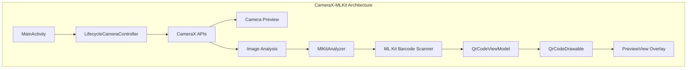
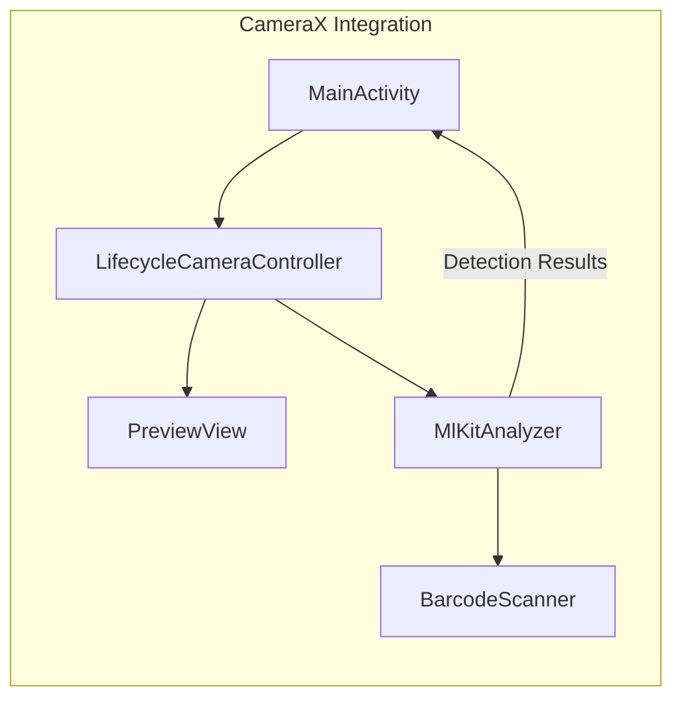
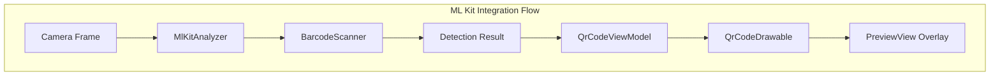
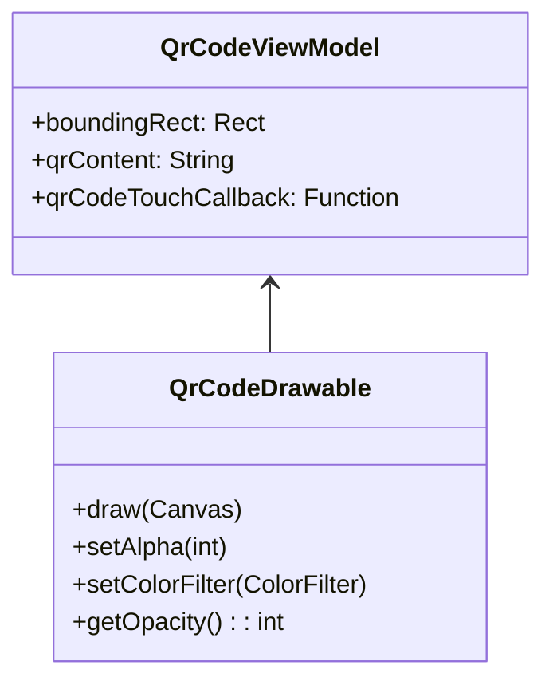
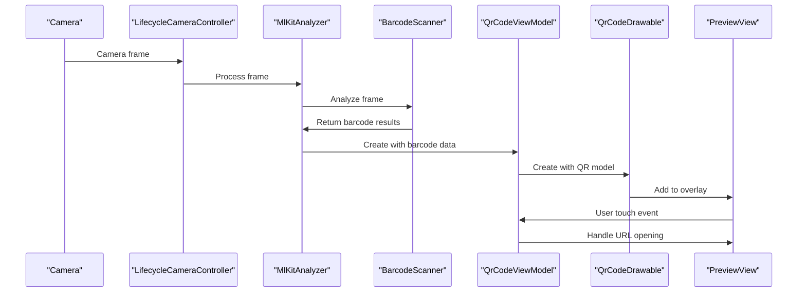

<!-- source: DeepWiki mcp.deepwiki.com · repo android/camera-samples · page 3.4 CameraX-MLKit · fetched 2026-10-23 -->

# CameraX-MLKit

<details>
<summary>Relevant source files</summary>

The following files were used as context for generating this wiki page:

- [CameraX-MLKit/app/build.gradle](CameraX-MLKit/app/build.gradle)
- [CameraX-MLKit/app/src/androidTest/java/com/example/camerax_mlkit/ExampleInstrumentedTest.kt](CameraX-MLKit/app/src/androidTest/java/com/example/camerax_mlkit/ExampleInstrumentedTest.kt)
- [CameraX-MLKit/app/src/main/AndroidManifest.xml](CameraX-MLKit/app/src/main/AndroidManifest.xml)
- [CameraX-MLKit/app/src/main/java/com/example/camerax_mlkit/MainActivity.kt](CameraX-MLKit/app/src/main/java/com/example/camerax_mlkit/MainActivity.kt)
- [CameraX-MLKit/app/src/main/java/com/example/camerax_mlkit/QrCodeDrawable.kt](CameraX-MLKit/app/src/main/java/com/example/camerax_mlkit/QrCodeDrawable.kt)
- [CameraX-MLKit/app/src/main/java/com/example/camerax_mlkit/QrCodeViewModel.kt](CameraX-MLKit/app/src/main/java/com/example/camerax_mlkit/QrCodeViewModel.kt)
- [CameraX-MLKit/app/src/main/res/drawable-v24/ic_launcher_foreground.xml](CameraX-MLKit/app/src/main/res/drawable-v24/ic_launcher_foreground.xml)
- [CameraX-MLKit/app/src/main/res/drawable/ic_launcher_background.xml](CameraX-MLKit/app/src/main/res/drawable/ic_launcher_background.xml)
- [CameraX-MLKit/app/src/main/res/layout/activity_main.xml](CameraX-MLKit/app/src/main/res/layout/activity_main.xml)
- [CameraX-MLKit/app/src/main/res/mipmap-anydpi-v26/ic_launcher.xml](CameraX-MLKit/app/src/main/res/mipmap-anydpi-v26/ic_launcher.xml)
- [CameraX-MLKit/app/src/main/res/mipmap-anydpi-v26/ic_launcher_round.xml](CameraX-MLKit/app/src/main/res/mipmap-anydpi-v26/ic_launcher_round.xml)
- [CameraX-MLKit/app/src/main/res/values-night/themes.xml](CameraX-MLKit/app/src/main/res/values-night/themes.xml)

</details>


## Purpose and Scope

This document provides a detailed explanation of the CameraX-MLKit sample application, which demonstrates how to integrate CameraX with ML Kit for QR code scanning on Android. The sample application showcases real-time QR code detection using the camera feed and provides interactive functionality for detected QR codes.

For information about other CameraX samples, see [CameraX Samples](#3).

## Overview

The CameraX-MLKit sample demonstrates how to use the CameraX API alongside Google's ML Kit to implement a QR code scanner. It processes camera frames in real-time, detects QR codes, displays them with visual indicators, and allows users to interact with the detected QR codes.

Key features include:

- Real-time camera preview using CameraX
- QR code detection using ML Kit
- Visual highlighting of detected QR codes
- Interactive QR code handling (opening URLs when tapped)

Sources: [CameraX-MLKit/app/src/main/java/com/example/camerax_mlkit/MainActivity.kt:39-135]()

## System Architecture

The system follows a straightforward architecture pattern, utilizing CameraX's integration with ML Kit to perform image analysis without complex boilerplate code.



Sources: [CameraX-MLKit/app/src/main/java/com/example/camerax_mlkit/MainActivity.kt:61-98]()

## Key Components

### MainActivity

The `MainActivity` class serves as the entry point and controller for the application. It:
- Manages camera permissions
- Initializes the camera controller
- Sets up ML Kit barcode scanning
- Handles the detection results and UI updates

Sources: [CameraX-MLKit/app/src/main/java/com/example/camerax_mlkit/MainActivity.kt:39-135]()

### CameraX Integration



The application uses a `LifecycleCameraController` to manage the camera lifecycle and bind it to the activity's lifecycle. This simplifies camera operations by automatically handling lifecycle events.

Key code segments:
- Camera controller setup: [CameraX-MLKit/app/src/main/java/com/example/camerax_mlkit/MainActivity.kt:62-63]()
- ML Kit analyzer setup: [CameraX-MLKit/app/src/main/java/com/example/camerax_mlkit/MainActivity.kt:70-94]()
- Lifecycle binding: [CameraX-MLKit/app/src/main/java/com/example/camerax_mlkit/MainActivity.kt:96-97]()

Sources: [CameraX-MLKit/app/src/main/java/com/example/camerax_mlkit/MainActivity.kt:61-98]()

### ML Kit Integration

The sample uses ML Kit's barcode scanning functionality to detect QR codes in camera frames. The integration is accomplished using the `MlKitAnalyzer` class, which bridges CameraX's image analysis with ML Kit's detection capabilities.



The barcode scanner is configured to specifically detect QR codes:

```
val options = BarcodeScannerOptions.Builder()
    .setBarcodeFormats(Barcode.FORMAT_QR_CODE)
    .build()
```

Sources: [CameraX-MLKit/app/src/main/java/com/example/camerax_mlkit/MainActivity.kt:65-68](), [CameraX-MLKit/app/src/main/java/com/example/camerax_mlkit/MainActivity.kt:70-94]()

### QR Code Visualization and Interaction

When a QR code is detected, the application:
1. Creates a `QrCodeViewModel` to encapsulate the QR code data
2. Creates a `QrCodeDrawable` to visually represent the QR code
3. Adds the drawable to the PreviewView's overlay
4. Sets up touch handling for the detected QR code



Sources: [CameraX-MLKit/app/src/main/java/com/example/camerax_mlkit/QrCodeViewModel.kt:33-58](), [CameraX-MLKit/app/src/main/java/com/example/camerax_mlkit/QrCodeDrawable.kt:30-86]()

## Data Flow

The following diagram illustrates the complete data flow from camera frame capture to QR code display and interaction:



Sources: [CameraX-MLKit/app/src/main/java/com/example/camerax_mlkit/MainActivity.kt:70-94](), [CameraX-MLKit/app/src/main/java/com/example/camerax_mlkit/QrCodeViewModel.kt:33-58]()

## Components in Detail

### QrCodeViewModel

The `QrCodeViewModel` class encapsulates the data for a detected QR code:

| Property | Description |
|----------|-------------|
| `boundingRect` | The rectangle defining the QR code's position in the frame |
| `qrContent` | The decoded content of the QR code (e.g., URL) |
| `qrCodeTouchCallback` | A callback function handling touch events on the QR code |

For URL QR codes, the touch callback opens the URL in a browser when the QR code is tapped.

Sources: [CameraX-MLKit/app/src/main/java/com/example/camerax_mlkit/QrCodeViewModel.kt:33-58]()

### QrCodeDrawable

The `QrCodeDrawable` class is responsible for visually representing the detected QR code in the UI:

- Draws a yellow bounding box around the QR code
- Displays the QR code content in a yellow rectangle below the bounding box
- Handles visual properties like alpha and color filtering

The drawing is done in the `draw` method, which uses Android's Canvas API to render the visual elements.

Sources: [CameraX-MLKit/app/src/main/java/com/example/camerax_mlkit/QrCodeDrawable.kt:30-86]()

## Implementation Details

### Camera Permission Handling

The application requires camera permission to function. Permission handling is implemented in the `MainActivity`:

- Checks if permission is already granted at startup
- Requests permission if not already granted
- Proceeds with camera initialization only after permission is granted

Sources: [CameraX-MLKit/app/src/main/java/com/example/camerax_mlkit/MainActivity.kt:49-56](), [CameraX-MLKit/app/src/main/java/com/example/camerax_mlkit/MainActivity.kt:120-134]()

### Resource Management

The application properly manages resources to prevent leaks:

- The camera controller is bound to the activity's lifecycle
- The barcode scanner is closed in `onDestroy`
- The camera executor is shut down in `onDestroy`

```kotlin
override fun onDestroy() {
    super.onDestroy()
    cameraExecutor.shutdown()
    barcodeScanner.close()
}
```

Sources: [CameraX-MLKit/app/src/main/java/com/example/camerax_mlkit/MainActivity.kt:105-109]()

## Dependencies

The sample application relies on the following key dependencies:

| Dependency | Purpose |
|------------|---------|
| CameraX Core | Camera functionality base |
| CameraX Camera2 | Camera2 implementation for CameraX |
| CameraX Lifecycle | Lifecycle management for camera |
| CameraX View | UI components like PreviewView |
| CameraX MLKit Vision | Integration between CameraX and ML Kit |
| ML Kit Barcode Scanning | QR code detection |

Sources: [CameraX-MLKit/app/build.gradle:54-72]()

## Conclusion

The CameraX-MLKit sample demonstrates a clean, efficient implementation of QR code scanning using CameraX and ML Kit. By leveraging these APIs, the sample achieves sophisticated camera functionality with minimal boilerplate code. The design pattern used in this sample can be extended to support other ML Kit vision features beyond QR code scanning.

---

