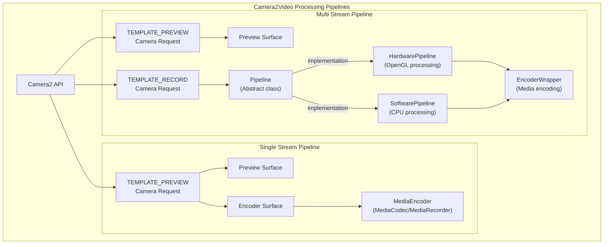
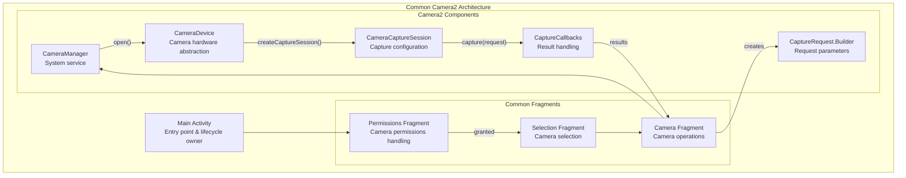

<!-- source: DeepWiki mcp.deepwiki.com · repo android/camera-samples · page 4 Camera2 Samples · fetched 2026-10-23 -->

# Camera2 Samples

Relevant source files

The following files were used as context for generating this wiki page:

- [Camera2Video/app/src/main/java/com/example/android/camera2/video/fragments/DynamicRangeFragment.kt](Camera2Video/app/src/main/java/com/example/android/camera2/video/fragments/DynamicRangeFragment.kt)
- [Camera2Video/app/src/main/java/com/example/android/camera2/video/fragments/EncodeApiFragment.kt](Camera2Video/app/src/main/java/com/example/android/camera2/video/fragments/EncodeApiFragment.kt)
- [Camera2Video/app/src/main/java/com/example/android/camera2/video/fragments/FilterFragment.kt](Camera2Video/app/src/main/java/com/example/android/camera2/video/fragments/FilterFragment.kt)
- [Camera2Video/app/src/main/java/com/example/android/camera2/video/fragments/PreviewStabilizationFragment.kt](Camera2Video/app/src/main/java/com/example/android/camera2/video/fragments/PreviewStabilizationFragment.kt)
- [Camera2Video/app/src/main/java/com/example/android/camera2/video/fragments/RecordModeFragment.kt](Camera2Video/app/src/main/java/com/example/android/camera2/video/fragments/RecordModeFragment.kt)
- [Camera2Video/app/src/main/java/com/example/android/camera2/video/fragments/SelectorFragment.kt](Camera2Video/app/src/main/java/com/example/android/camera2/video/fragments/SelectorFragment.kt)
- [Camera2Video/app/src/main/java/com/example/android/camera2/video/fragments/TransferFragment.kt](Camera2Video/app/src/main/java/com/example/android/camera2/video/fragments/TransferFragment.kt)
- [Camera2Video/app/src/main/java/com/example/android/camera2/video/fragments/VideoCodecFragment.kt](Camera2Video/app/src/main/java/com/example/android/camera2/video/fragments/VideoCodecFragment.kt)
- [Camera2Video/app/src/main/res/navigation/nav_graph.xml](Camera2Video/app/src/main/res/navigation/nav_graph.xml)
- [CameraXExtensions/README.md](CameraXExtensions/README.md)
- [CameraXExtensions/screenshots/camerax_camera_extensions_screenshot.png](CameraXExtensions/screenshots/camerax_camera_extensions_screenshot.png)
- [CameraXExtensions/screenshots/camerax_extensions_architecture_diagram.png](CameraXExtensions/screenshots/camerax_extensions_architecture_diagram.png)
- [README.md](README.md)

This document provides a comprehensive overview of the Camera2 API sample applications contained within the Android Camera Samples repository. The Camera2 API provides a lower-level interface to camera devices on Android, offering more granular control over camera hardware compared to the higher-level CameraX API. For information about CameraX samples, see [CameraX Samples](#3).

## Overview of Camera2 Samples

The Camera Samples repository includes five distinct Camera2 API sample applications, each demonstrating different capabilities and implementation patterns:

| Sample | Main Focus | Key Features |
|--------|------------|--------------|
| Camera2Basic | Still image capture | JPEG, RAW and DEPTH image capture |
| Camera2Video | Video recording | Advanced video configurations, hardware and software processing pipelines |
| Camera2Extensions | Vendor extensions | HDR, Night mode, Bokeh effects |
| Camera2SlowMotion | High-speed recording | Constrained camera capture sessions for slow-motion video |
| HdrViewfinder | Real-time processing | RenderScript to display live HDR feed from camera frames |

Each sample demonstrates recommended implementation patterns and handles camera lifecycle management, permissions, and error cases following Android best practices.

Sources: [README.md:1-21]()

## Camera2Video Sample Architecture

The Camera2Video sample is the most comprehensive Camera2 implementation in the repository, demonstrating a sophisticated configuration flow and multiple video processing approaches.

### Navigation Structure

Camera2Video uses Android's Navigation component to guide users through a series of configuration screens before capturing video.

```mermaid
flowchart TD
    subgraph "Camera2Video Navigation Flow"
        permissions["PermissionsFragment<br>Camera permissions"]
        selector["SelectorFragment<br>Camera & resolution selection"]
        dynamic_range["DynamicRangeFragment<br>HDR profile selection"]
        color_space["ColorSpaceFragment<br>Color space selection"]
        preview_stab["PreviewStabilizationFragment<br>Stabilization toggle"]
        encode_api["EncodeApiFragment<br>MediaCodec vs MediaRecorder"]
        video_codec["VideoCodecFragment<br>Codec selection<br>(H264/HEVC/AV1)"]
        record_mode["RecordModeFragment<br>Single vs Multi stream"]
        filter["FilterFragment<br>Portrait filter toggle"]
        transfer["TransferFragment<br>HDR transfer functions"]
        preview["PreviewFragment<br>Camera preview & recording"]
        
        permissions --> selector
        selector --> dynamic_range
        dynamic_range --> color_space
        color_space --> preview_stab
        preview_stab --> encode_api
        encode_api --> video_codec
        video_codec --> record_mode
        record_mode --> filter
        filter --> transfer
        transfer --> preview
        
        %% Direct navigation paths based on hardware support
        selector -->|"No HDR"| color_space
        selector -->|"No HDR/Color space"| preview_stab
        selector -->|"Basic configuration"| encode_api
        dynamic_range -->|"No Color space"| preview_stab
        dynamic_range -->|"Basic configuration"| encode_api
        color_space -->|"No stabilization"| encode_api
        filter -->|"Standard dynamic range"| preview
        record_mode -->|"Multi-stream mode"| preview
    end
```

The navigation graph implements conditional paths based on device capabilities. For example, HDR-capable devices will proceed through dynamic range configuration, while devices without HDR support skip directly to other configuration steps.

Sources: [Camera2Video/app/src/main/res/navigation/nav_graph.xml:1-483](), [Camera2Video/app/src/main/java/com/example/android/camera2/video/fragments/SelectorFragment.kt:57-125]()

### Configuration Options

The Camera2Video sample offers numerous configuration options, demonstrating the flexibility of the Camera2 API:

1. **Camera Selection**: Lists all camera devices and their supported resolutions/framerates
2. **Dynamic Range Profiles**: For HDR-capable devices, offers selection between:
   - Standard
   - HLG10
   - HDR10
   - HDR10+
   - Dolby Vision (multiple variants)
3. **Color Space Selection**: Available on Android 14+ devices
4. **Preview Stabilization**: Toggle for electronic video stabilization
5. **Encoding API**: Choose between MediaRecorder (simpler) or MediaCodec (more control)
6. **Video Codec**: H.264 (standard), HEVC or AV1 (for HDR content)
7. **Recording Mode**: Single-stream or multi-stream processing
8. **Filters**: Optional video processing filters
9. **Transfer Functions**: HDR transfer modes (PQ, HLG, Linear)

Sources: [Camera2Video/app/src/main/java/com/example/android/camera2/video/fragments/DynamicRangeFragment.kt:117-152](), [Camera2Video/app/src/main/java/com/example/android/camera2/video/fragments/VideoCodecFragment.kt:74-130](), [Camera2Video/app/src/main/java/com/example/android/camera2/video/fragments/TransferFragment.kt:74-109]()

### Processing Pipeline Architecture

The Camera2Video sample implements two distinct video processing pipelines:

#### Single Stream Mode
Uses a single camera output stream for both preview and recording, which is efficient but provides fewer customization options.

#### Multi Stream Mode
Uses separate camera output streams for preview and recording, enabling more advanced processing:
- **Hardware Pipeline**: Uses OpenGL shaders for GPU-accelerated processing
- **Software Pipeline**: Processes frames on CPU, useful for custom algorithms
- Both pipelines feed into the EncoderWrapper which handles video encoding

Sources: [Camera2Video/app/src/main/java/com/example/android/camera2/video/fragments/RecordModeFragment.kt:39-97]()

## Camera2Basic Sample

Camera2Basic demonstrates fundamental Camera2 API operations, focusing on still image capture in various formats:

- JPEG capture: Standard compressed photography
- RAW capture: Unprocessed sensor data for post-processing
- DEPTH capture: Depth map information from compatible camera sensors

The sample illustrates the basic Camera2 workflow:
1. Camera device selection
2. Creating capture session
3. Building capture requests
4. Handling capture results
5. Processing captured images

Sources: [README.md:15-15]()

## Camera2Extensions Sample

Camera2Extensions showcases how to use vendor-specific camera extensions with the Camera2 API. Manufacturer extensions can significantly enhance image quality for specific scenarios:

- HDR (High Dynamic Range): Better handling of scenes with bright and dark areas
- Night mode: Improved low-light photography
- Bokeh: Portrait mode with background blur effects
- Face Retouch: Facial enhancements for portrait photography

The sample demonstrates both live preview with extensions applied and capturing still images with these extensions.

Sources: [README.md:18-18](), [CameraXExtensions/README.md:3-20]()

## Camera2SlowMotion Sample

Camera2SlowMotion demonstrates high-speed video capture for creating slow-motion videos using constrained camera capture sessions. This sample shows:

- Querying camera capabilities for high-speed video support
- Creating high-speed capture sessions
- Configuring camera for high frame rate capture
- Proper handling of the resulting high-speed video streams

Camera2SlowMotion is particularly useful for understanding the specialized configuration required for high-speed capture, which differs from standard video recording.

Sources: [README.md:16-16]()

## HdrViewfinder Sample

The HdrViewfinder sample demonstrates real-time HDR processing using RenderScript with the Camera2 API. This advanced sample shows:

- Using Camera2 API to capture consecutive frames with different exposure settings
- Processing these frames with RenderScript to create an HDR effect in real-time
- Displaying the processed HDR output in the viewfinder

This sample is valuable for understanding advanced image processing techniques that can be applied to camera frames before display or recording.

Sources: [README.md:20-20]()

## Key Implementation Patterns

The Camera2 samples share several common implementation patterns:

### Fragment-Based UI Architecture

All samples use a fragment-based UI architecture, separating specific camera operations into distinct fragments:

### Camera Lifecycle Management

All Camera2 samples carefully manage camera device lifecycles:

1. Opening camera devices asynchronously
2. Creating and managing capture sessions
3. Properly closing camera resources when not in use
4. Handling activity/fragment lifecycle events

### Request Configuration

Camera2 samples demonstrate proper request configuration:

1. Using appropriate template types (PREVIEW, STILL_CAPTURE, RECORD)
2. Setting specific capture parameters (ISO, exposure time, etc.)
3. Targeting appropriate surfaces (TextureView, ImageReader, etc.)
4. Handling capture results and metadata

### Error Handling

The samples implement robust error handling for:
- Permission denials
- Camera disconnection events
- Device capability limitations
- Capture failures

This consistent architecture makes the samples valuable references for Camera2 API implementations, from basic to advanced use cases.

## Conclusion

The Camera2 samples provide comprehensive reference implementations for various camera scenarios using the Camera2 API. Together they demonstrate a progression from basic camera operations to advanced capabilities like HDR processing and high-speed video recording, serving as valuable learning resources and starting points for camera application development.

---

