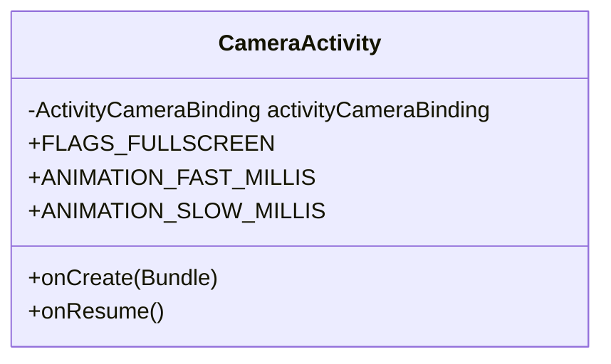
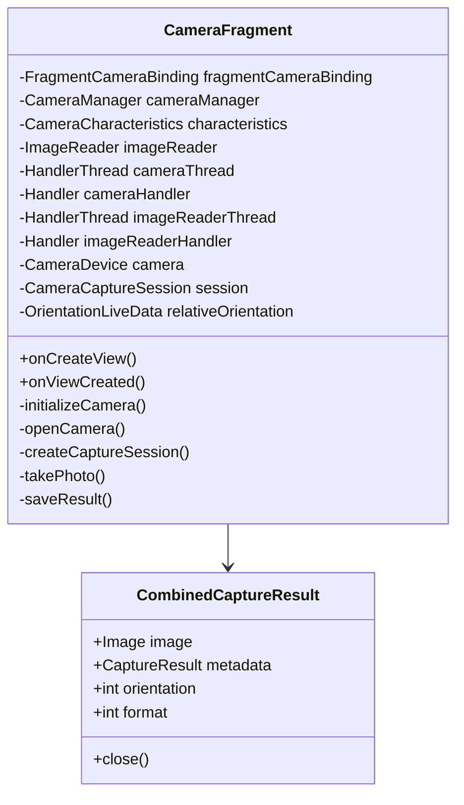
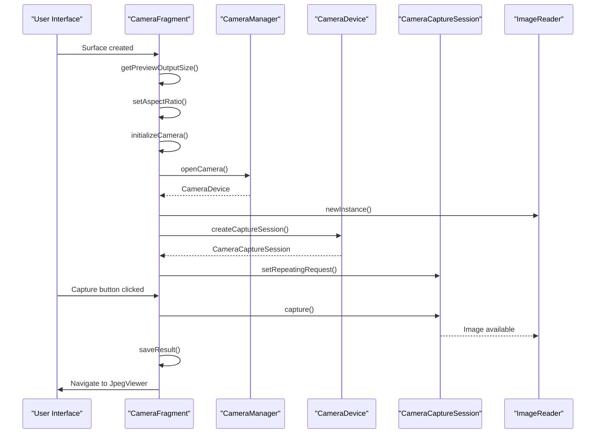
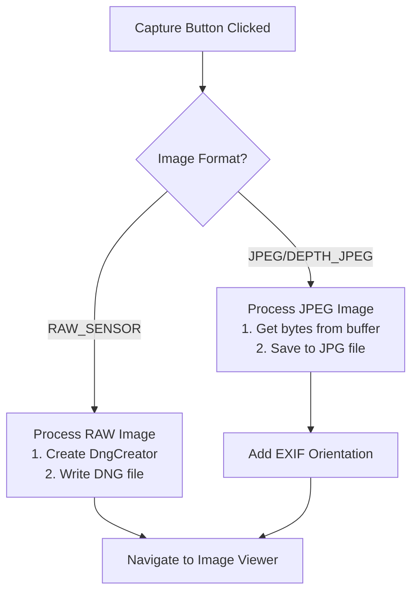

<!-- source: DeepWiki mcp.deepwiki.com · repo android/camera-samples · page 4.1 Camera2Basic · fetched 2026-10-23 -->

# Camera2Basic

Relevant source files

The following files were used as context for generating this wiki page:

- [Camera2Basic/app/build.gradle](Camera2Basic/app/build.gradle)
- [Camera2Basic/app/src/main/AndroidManifest.xml](Camera2Basic/app/src/main/AndroidManifest.xml)
- [Camera2Basic/app/src/main/java/com/example/android/camera2/basic/CameraActivity.kt](Camera2Basic/app/src/main/java/com/example/android/camera2/basic/CameraActivity.kt)
- [Camera2Basic/app/src/main/java/com/example/android/camera2/basic/fragments/CameraFragment.kt](Camera2Basic/app/src/main/java/com/example/android/camera2/basic/fragments/CameraFragment.kt)
- [Camera2Basic/app/src/main/res/layout-land/fragment_camera.xml](Camera2Basic/app/src/main/res/layout-land/fragment_camera.xml)
- [Camera2Basic/app/src/main/res/layout/fragment_camera.xml](Camera2Basic/app/src/main/res/layout/fragment_camera.xml)
- [Camera2Basic/build.gradle](Camera2Basic/build.gradle)
- [Camera2Basic/gradle/wrapper/gradle-wrapper.properties](Camera2Basic/gradle/wrapper/gradle-wrapper.properties)
- [Camera2Basic/utils/build.gradle](Camera2Basic/utils/build.gradle)
- [Camera2Basic/utils/src/main/AndroidManifest.xml](Camera2Basic/utils/src/main/AndroidManifest.xml)
- [Camera2SlowMotion/app/build.gradle](Camera2SlowMotion/app/build.gradle)
- [Camera2SlowMotion/app/src/main/java/com/example/android/camera2/slowmo/CameraActivity.kt](Camera2SlowMotion/app/src/main/java/com/example/android/camera2/slowmo/CameraActivity.kt)
- [Camera2SlowMotion/app/src/main/java/com/example/android/camera2/slowmo/fragments/CameraFragment.kt](Camera2SlowMotion/app/src/main/java/com/example/android/camera2/slowmo/fragments/CameraFragment.kt)
- [Camera2SlowMotion/app/src/main/java/com/example/android/camera2/slowmo/fragments/SelectorFragment.kt](Camera2SlowMotion/app/src/main/java/com/example/android/camera2/slowmo/fragments/SelectorFragment.kt)
- [Camera2SlowMotion/app/src/main/res/xml/file_paths.xml](Camera2SlowMotion/app/src/main/res/xml/file_paths.xml)

## Purpose and Scope

Camera2Basic is a sample application that demonstrates how to implement basic camera functionality using the Android Camera2 API. This application showcases camera preview, still image capture in both JPEG and RAW formats, and image viewing capabilities. It serves as a foundational example for developers looking to implement low-level camera features in their Android applications.

Unlike other samples in the repository that use the higher-level CameraX API (see [CameraXBasic](#3.1)), Camera2Basic provides direct access to the Camera2 API, offering more control over camera hardware and capture processes.

## Architecture Overview

Camera2Basic follows a single-activity, multiple-fragment architecture pattern common in modern Android applications. The application is built using Kotlin and leverages coroutines for asynchronous camera operations.

```mermaid
graph TD
    subgraph "Camera2Basic Application"
        CameraActivity["CameraActivity<br>(Entry point)"]
        
        subgraph "Fragments"
            PermissionFragment["PermissionsFragment<br>(Camera permissions)"]
            SelectorFragment["SelectorFragment<br>(Camera selection)"]
            CameraFragment["CameraFragment<br>(Preview & capture)"]
            JpegViewerFragment["JpegViewerFragment<br>(View captured photos)"]
        end
        
        subgraph "Camera Components"
            CameraManager["CameraManager"]
            CameraDevice["CameraDevice"]
            CameraCaptureSession["CameraCaptureSession"]
            ImageReader["ImageReader<br>(Buffer for captures)"]
        end
        
        subgraph "Storage"
            FileOutput["File Output<br>(Image storage)"]
        end
        
        CameraActivity --> PermissionFragment
        PermissionFragment -- "permissions granted" --> SelectorFragment
        SelectorFragment -- "camera selected" --> CameraFragment
        CameraFragment -- "photo captured" --> JpegViewerFragment
        
        CameraFragment --> CameraManager
        CameraManager --> CameraDevice
        CameraDevice --> CameraCaptureSession
        CameraCaptureSession --> ImageReader
        ImageReader --> FileOutput
    end
```

Sources: [Camera2Basic/app/src/main/java/com/example/android/camera2/basic/fragments/CameraFragment.kt:74-495](), [Camera2Basic/app/src/main/java/com/example/android/camera2/basic/CameraActivity.kt:1-56]()

## Main Components

### CameraActivity

CameraActivity serves as the entry point and container for all fragments. It sets up the immersive fullscreen UI and manages the fragment container where camera functionality is displayed.

Sources: [Camera2Basic/app/src/main/java/com/example/android/camera2/basic/CameraActivity.kt:24-56]()

### CameraFragment

CameraFragment is the core component responsible for camera preview and image capture functionality. It manages the camera lifecycle, configures capture requests, processes captured images, and navigates to the image viewer after capture.

Sources: [Camera2Basic/app/src/main/java/com/example/android/camera2/basic/fragments/CameraFragment.kt:74-495]()

## Camera Operations Implementation

### Camera Initialization Flow

The camera initialization process in Camera2Basic follows a specific sequence to set up the camera for preview and capture:

Sources: [Camera2Basic/app/src/main/java/com/example/android/camera2/basic/fragments/CameraFragment.kt:198-260](), [Camera2Basic/app/src/main/java/com/example/android/camera2/basic/fragments/CameraFragment.kt:322-404]()

### Camera Lifecycle Management

Camera2Basic carefully manages the camera lifecycle to ensure resources are properly acquired and released:

| Lifecycle Phase | Actions |
|-----------------|---------|
| onViewCreated   | Set up SurfaceHolder callback and orientation observer |
| Surface Created | Initialize camera |
| initializeCamera | Open camera, create ImageReader, start capture session |
| onStop          | Close camera |
| onDestroy       | Quit handler threads |
| onDestroyView   | Release view binding |

Sources: [Camera2Basic/app/src/main/java/com/example/android/camera2/basic/fragments/CameraFragment.kt:147-188](), [Camera2Basic/app/src/main/java/com/example/android/camera2/basic/fragments/CameraFragment.kt:446-464]()

## Key Technical Features

### Image Capture Workflow

The image capture process in Camera2Basic is implemented as a coroutine that handles the synchronization between capture requests and image availability:

1. The camera fragment creates a still capture request when the capture button is clicked
2. The request is submitted to the capture session
3. The onCaptureStarted callback triggers a UI animation
4. The onCaptureCompleted callback receives metadata for the captured image
5. The image is retrieved from the ImageReader's queue
6. EXIF orientation data is computed
7. The image is saved to a file in the appropriate format (JPEG or RAW)
8. Navigation to the viewer fragment occurs with the file path as an argument

Sources: [Camera2Basic/app/src/main/java/com/example/android/camera2/basic/fragments/CameraFragment.kt:322-444]()

### Multi-Format Support

Camera2Basic demonstrates support for different image formats:

Sources: [Camera2Basic/app/src/main/java/com/example/android/camera2/basic/fragments/CameraFragment.kt:406-444]()

### Asynchronous Operations with Coroutines

Camera2Basic leverages Kotlin coroutines to handle asynchronous camera operations while maintaining clean, readable code:

| Camera Operation | Coroutine Implementation |
|------------------|--------------------------|
| Camera Initialization | lifecycleScope.launch |
| Opening Camera | suspendCancellableCoroutine |
| Creating Capture Session | suspendCoroutine |
| Taking Photo | suspendCoroutine |
| Saving Result | suspendCoroutine |

This approach transforms callback-based Camera2 API into sequential, synchronous-looking code, making it easier to understand and maintain.

Sources: [Camera2Basic/app/src/main/java/com/example/android/camera2/basic/fragments/CameraFragment.kt:264-290](), [Camera2Basic/app/src/main/java/com/example/android/camera2/basic/fragments/CameraFragment.kt:297-315]()

## UI Implementation

The Camera2Basic UI is minimalist, focusing on the camera preview and capture functionality:

| UI Element | Purpose |
|------------|---------|
| AutoFitSurfaceView | Displays camera preview with appropriate aspect ratio |
| CaptureButton | Triggers photo capture when clicked |
| Overlay | Provides visual feedback during capture (white flash animation) |

The layout adapts automatically to portrait and landscape orientations with dedicated layout files.

Sources: [Camera2Basic/app/src/main/res/layout/fragment_camera.xml:17-42](), [Camera2Basic/app/src/main/res/layout-land/fragment_camera.xml:17-42]()

## Error Handling

Camera2Basic implements comprehensive error handling for various camera-related failures:

| Error Type | Handling Approach |
|------------|-------------------|
| Camera Disconnection | Log warning and finish activity |
| Camera Device Errors | Translate error codes to descriptive messages, log, throw exception |
| Capture Session Setup Failures | Throw RuntimeException with descriptive message |
| Image Dequeuing Timeouts | Use a timeout handler, throw TimeoutException if image is not available |
| File I/O Errors | Catch IOException, log error, propagate exception |

Sources: [Camera2Basic/app/src/main/java/com/example/android/camera2/basic/fragments/CameraFragment.kt:271-289](), [Camera2Basic/app/src/main/java/com/example/android/camera2/basic/fragments/CameraFragment.kt:309-313]()

## Permissions

Camera2Basic requires the camera permission, declared in the manifest file. Permission handling is delegated to a separate permissions fragment, which ensures the camera is only accessed when permissions are granted.

Sources: [Camera2Basic/app/src/main/AndroidManifest.xml:21-25]()

## Summary

Camera2Basic demonstrates a complete implementation of basic camera functionality using the Android Camera2 API. It showcases:

1. Camera device selection and configuration
2. Camera preview setup
3. Still image capture in both JPEG and RAW formats
4. Proper camera lifecycle management
5. Orientation handling for captured images
6. Error handling for various camera-related failures

This sample serves as a foundational reference for developers implementing advanced camera features using the Camera2 API, providing direct access to camera hardware with more control than the higher-level CameraX API.

---

