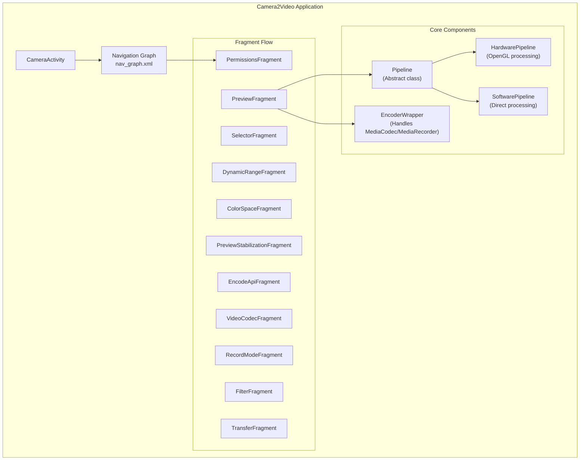
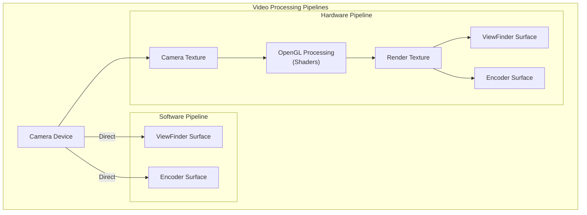
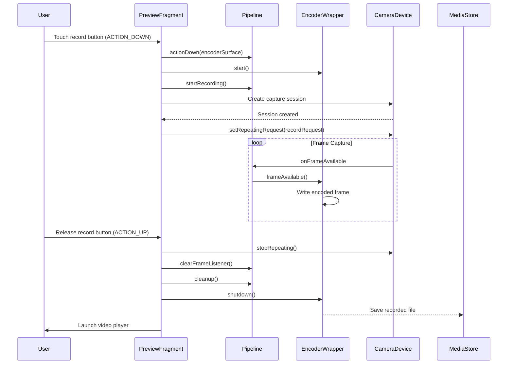
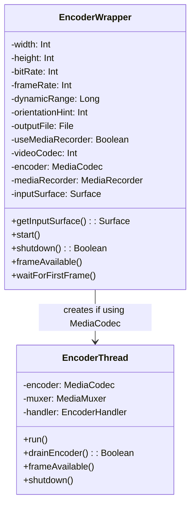
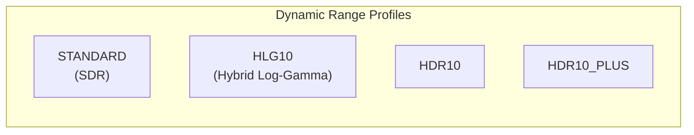
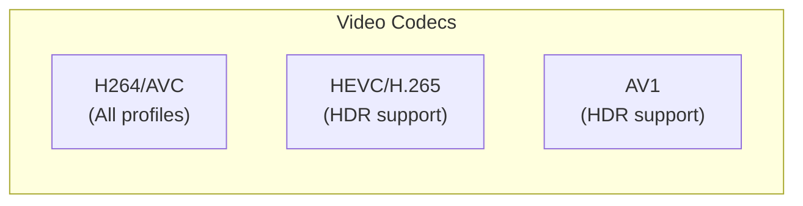
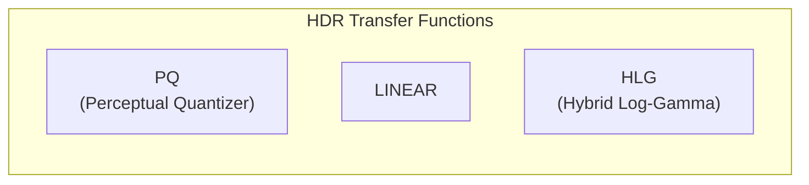
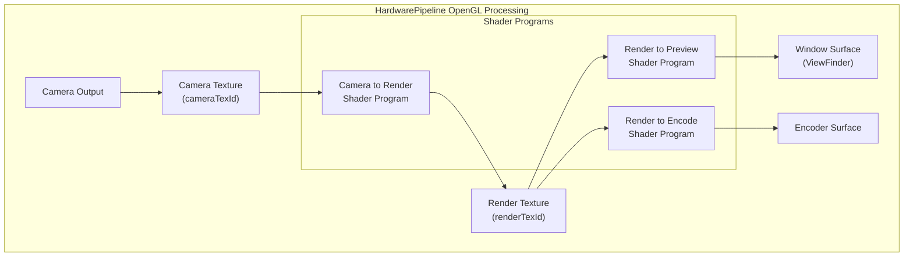

<!-- source: DeepWiki mcp.deepwiki.com · repo android/camera-samples · page 4.2 Camera2Video · fetched 2026-10-23 -->

# Camera2Video

<details>
<summary>Relevant source files</summary>

The following files were used as context for generating this wiki page:

- [Camera2SlowMotion/utils/build.gradle](Camera2SlowMotion/utils/build.gradle)
- [Camera2Video/app/build.gradle](Camera2Video/app/build.gradle)
- [Camera2Video/app/src/main/java/com/example/android/camera2/video/CameraActivity.kt](Camera2Video/app/src/main/java/com/example/android/camera2/video/CameraActivity.kt)
- [Camera2Video/app/src/main/java/com/example/android/camera2/video/EncoderWrapper.kt](Camera2Video/app/src/main/java/com/example/android/camera2/video/EncoderWrapper.kt)
- [Camera2Video/app/src/main/java/com/example/android/camera2/video/HardwarePipeline.kt](Camera2Video/app/src/main/java/com/example/android/camera2/video/HardwarePipeline.kt)
- [Camera2Video/app/src/main/java/com/example/android/camera2/video/Pipeline.kt](Camera2Video/app/src/main/java/com/example/android/camera2/video/Pipeline.kt)
- [Camera2Video/app/src/main/java/com/example/android/camera2/video/SoftwarePipeline.kt](Camera2Video/app/src/main/java/com/example/android/camera2/video/SoftwarePipeline.kt)
- [Camera2Video/app/src/main/java/com/example/android/camera2/video/fragments/DynamicRangeFragment.kt](Camera2Video/app/src/main/java/com/example/android/camera2/video/fragments/DynamicRangeFragment.kt)
- [Camera2Video/app/src/main/java/com/example/android/camera2/video/fragments/EncodeApiFragment.kt](Camera2Video/app/src/main/java/com/example/android/camera2/video/fragments/EncodeApiFragment.kt)
- [Camera2Video/app/src/main/java/com/example/android/camera2/video/fragments/FilterFragment.kt](Camera2Video/app/src/main/java/com/example/android/camera2/video/fragments/FilterFragment.kt)
- [Camera2Video/app/src/main/java/com/example/android/camera2/video/fragments/PreviewFragment.kt](Camera2Video/app/src/main/java/com/example/android/camera2/video/fragments/PreviewFragment.kt)
- [Camera2Video/app/src/main/java/com/example/android/camera2/video/fragments/PreviewStabilizationFragment.kt](Camera2Video/app/src/main/java/com/example/android/camera2/video/fragments/PreviewStabilizationFragment.kt)
- [Camera2Video/app/src/main/java/com/example/android/camera2/video/fragments/RecordModeFragment.kt](Camera2Video/app/src/main/java/com/example/android/camera2/video/fragments/RecordModeFragment.kt)
- [Camera2Video/app/src/main/java/com/example/android/camera2/video/fragments/SelectorFragment.kt](Camera2Video/app/src/main/java/com/example/android/camera2/video/fragments/SelectorFragment.kt)
- [Camera2Video/app/src/main/java/com/example/android/camera2/video/fragments/TransferFragment.kt](Camera2Video/app/src/main/java/com/example/android/camera2/video/fragments/TransferFragment.kt)
- [Camera2Video/app/src/main/java/com/example/android/camera2/video/fragments/VideoCodecFragment.kt](Camera2Video/app/src/main/java/com/example/android/camera2/video/fragments/VideoCodecFragment.kt)
- [Camera2Video/app/src/main/res/navigation/nav_graph.xml](Camera2Video/app/src/main/res/navigation/nav_graph.xml)
- [Camera2Video/build.gradle](Camera2Video/build.gradle)
- [Camera2Video/gradle/wrapper/gradle-wrapper.properties](Camera2Video/gradle/wrapper/gradle-wrapper.properties)
- [Camera2Video/utils/build.gradle](Camera2Video/utils/build.gradle)

</details>


## Purpose and Scope

This document provides a detailed overview of the Camera2Video sample application, which demonstrates advanced video recording using the Android Camera2 API. The application showcases the implementation of video recording with configurable options including dynamic range profiles (HDR), different video codecs, recording modes, and video processing pipelines (hardware and software). For information about basic Camera2 usage, see [Camera2 API Fundamentals](#2.2), and for other Camera2 samples, refer to [Camera2 Samples](#4).

## Architecture Overview

Camera2Video is structured as a single activity (`CameraActivity`) with multiple configuration fragments that guide the user through a series of choices before reaching the preview and recording screen. The application uses a fragment-based navigation pattern managed by the Android Navigation component.



Sources:
- [Camera2Video/app/src/main/res/navigation/nav_graph.xml]()
- [Camera2Video/app/src/main/java/com/example/android/camera2/video/CameraActivity.kt]()
- [Camera2Video/app/src/main/java/com/example/android/camera2/video/Pipeline.kt]()

## Navigation Flow

The application follows a step-by-step configuration process, allowing users to customize various aspects of video recording. Each step is represented by a fragment that captures user input.

```mermaid
flowchart TD
    subgraph "Camera2Video Navigation Flow"
        Permission["PermissionsFragment<br>Camera Permissions"]
        Selector["SelectorFragment<br>Camera, Resolution, FPS"]
        DynamicRange["DynamicRangeFragment<br>HDR Options"]
        ColorSpace["ColorSpaceFragment<br>Color Space Profile"]
        PreviewStab["PreviewStabilizationFragment<br>Video Stabilization"]
        EncodeApi["EncodeApiFragment<br>MediaCodec/MediaRecorder"]
        VideoCodec["VideoCodecFragment<br>H.264/HEVC/AV1"]
        RecordMode["RecordModeFragment<br>Single/Multi-stream"]
        Filter["FilterFragment<br>Portrait Effect"]
        Transfer["TransferFragment<br>HDR Transfer Function"]
        Preview["PreviewFragment<br>Video Recording"]
        
        Permission --> Selector
        Selector --> DynamicRange
        DynamicRange --> ColorSpace
        ColorSpace --> PreviewStab
        PreviewStab --> EncodeApi
        EncodeApi --> VideoCodec
        VideoCodec --> RecordMode
        RecordMode --> Filter
        Filter --> Transfer
        Transfer --> Preview
        
        %% Conditional paths based on choices
        Selector -- "Non-HDR" --> EncodeApi
        DynamicRange -- "No ColorSpace Support" --> PreviewStab
        ColorSpace -- "No Preview Stabilization" --> EncodeApi
        Filter -- "Standard Dynamic Range" --> Preview
        RecordMode -- "Multi-stream" --> Preview
    end
```



Sources:
- [Camera2Video/app/src/main/res/navigation/nav_graph.xml]()
- [Camera2Video/app/src/main/java/com/example/android/camera2/video/fragments/SelectorFragment.kt]()
- [Camera2Video/app/src/main/java/com/example/android/camera2/video/fragments/DynamicRangeFragment.kt]()
- [Camera2Video/app/src/main/java/com/example/android/camera2/video/fragments/FilterFragment.kt]()
- [Camera2Video/app/src/main/java/com/example/android/camera2/video/fragments/RecordModeFragment.kt]()

## Processing Pipelines

Camera2Video implements two distinct processing pipelines for video recording, allowing for different processing capabilities and performance characteristics.



Sources:
- [Camera2Video/app/src/main/java/com/example/android/camera2/video/Pipeline.kt]()
- [Camera2Video/app/src/main/java/com/example/android/camera2/video/fragments/HardwarePipeline.kt]()
- [Camera2Video/app/src/main/java/com/example/android/camera2/video/SoftwarePipeline.kt]()

### Software Pipeline

The software pipeline provides a direct path from camera to output:

- Camera frames are sent simultaneously to both the preview surface and encoder surface
- No intermediate processing is performed on the frames
- Simple implementation with minimal overhead
- Limited flexibility for frame modification

Key implementation:
```kotlin
// SoftwarePipeline creates recording request with targets for both preview and encoding
override fun createRecordRequest(session: CameraCaptureSession, previewStabilization: Boolean): CaptureRequest {
    return session.device.createCaptureRequest(CameraDevice.TEMPLATE_RECORD).apply {
        // Add both targets directly
        addTarget(viewFinder.holder.surface)
        addTarget(encoder.getInputSurface())
        // ...
    }.build()
}
```

Sources:
- [Camera2Video/app/src/main/java/com/example/android/camera2/video/SoftwarePipeline.kt:33-72]()

### Hardware Pipeline

The hardware pipeline leverages OpenGL ES for frame processing:

1. Camera frames are rendered to an OpenGL texture
2. OpenGL shaders process the frames (applying filters, color transformations)
3. Processed frames are rendered to both the preview surface and encoder surface

Key features:
- Supports HDR video processing with different transfer functions (PQ, LINEAR, HLG)
- Implements a portrait filter effect through shaders
- Handles color space transformations
- More flexibility but higher complexity

Sources:
- [Camera2Video/app/src/main/java/com/example/android/camera2/video/fragments/HardwarePipeline.kt:17-345]()

## Video Recording Implementation

The core video recording functionality is implemented in the `PreviewFragment`, which handles camera session creation, recording control, and file management.



Sources:
- [Camera2Video/app/src/main/java/com/example/android/camera2/video/fragments/PreviewFragment.kt:76-546]()

## Encoder Implementation

The `EncoderWrapper` class provides a unified interface for video encoding, supporting both MediaCodec and MediaRecorder APIs.



Key features:
- Unified interface regardless of encoding method
- Support for MediaCodec (more control) and MediaRecorder (simpler API)
- HDR metadata support for HDR10, HLG10, and other dynamic range profiles
- Encoding thread for MediaCodec to handle buffer processing asynchronously
- Video muxing with appropriate metadata

Sources:
- [Camera2Video/app/src/main/java/com/example/android/camera2/video/EncoderWrapper.kt:17-512]()

## Configuration Options

Camera2Video offers a rich set of configuration options to demonstrate various video recording capabilities.

### Dynamic Range Profiles



Sources:
- [Camera2Video/app/src/main/java/com/example/android/camera2/video/fragments/DynamicRangeFragment.kt:122-137]()

### Video Codecs



Sources:
- [Camera2Video/app/src/main/java/com/example/android/camera2/video/fragments/VideoCodecFragment.kt:80-96]()

### Recording Modes

Two distinct recording modes are supported:

1. **Multi-stream mode**: Uses separate capture sessions for preview and recording
   - Creates a preview session initially
   - Switches to recording session when recording starts
   - More control over preview and recording quality

2. **Single-stream mode**: Uses a single stream for both preview and recording
   - Hardware pipeline processes frames and sends to both outputs
   - More efficient but less control over individual streams

Sources:
- [Camera2Video/app/src/main/java/com/example/android/camera2/video/fragments/RecordModeFragment.kt:89-96]()

### Transfer Functions for HDR

When using HDR, the application supports different transfer functions for the preview output:



Sources:
- [Camera2Video/app/src/main/java/com/example/android/camera2/video/fragments/TransferFragment.kt:79-96]()

## Hardware Pipeline Implementation Details

The `HardwarePipeline` class uses OpenGL ES for processing camera frames before encoding. This enables advanced effects and transforms.



Key components:

1. **Camera Texture**: Receives camera output frames
2. **Render Texture**: Intermediate texture for processing 
3. **Shader Programs**:
   - Camera to Render: Applies initial processing (e.g., portrait filter)
   - Render to Preview: Transforms for display (handling HDR transfer functions)
   - Render to Encode: Prepares for encoding

4. **HDR Processing**: When using HDR profiles, appropriate color space transforms are applied

Sources:
- [Camera2Video/app/src/main/java/com/example/android/camera2/video/fragments/HardwarePipeline.kt:325-345]()
- [Camera2Video/app/src/main/java/com/example/android/camera2/video/fragments/HardwarePipeline.kt:793-907]()

## PreviewFragment Implementation

The `PreviewFragment` is responsible for:

1. Creating camera resources and capture sessions
2. Handling user interaction for recording
3. Managing recording state and file handling
4. Coordinating between pipeline and encoder components

Key aspects of implementation:

```kotlin
// Pipeline creation based on hardware/software selection
private val pipeline: Pipeline by lazy {
    if (args.useHardware) {
        HardwarePipeline(args.width, args.height, args.fps, args.filterOn, args.transfer,
                args.dynamicRange, characteristics, encoder, fragmentBinding.viewFinder)
    } else {
        SoftwarePipeline(args.width, args.height, args.fps, args.filterOn,
                args.dynamicRange, characteristics, encoder, fragmentBinding.viewFinder)
    }
}
```

Sources:
- [Camera2Video/app/src/main/java/com/example/android/camera2/video/fragments/PreviewFragment.kt:93-101]()
- [Camera2Video/app/src/main/java/com/example/android/camera2/video/fragments/PreviewFragment.kt:276-329]() (Recording start)
- [Camera2Video/app/src/main/java/com/example/android/camera2/video/fragments/PreviewFragment.kt:332-407]() (Recording stop)

## Conclusion

Camera2Video provides a comprehensive example of advanced video recording using the Android Camera2 API, showcasing:

1. Multiple processing pipelines (hardware/software) for different capabilities
2. Support for HDR video recording with various dynamic range profiles
3. Multiple video codecs including HDR-capable ones (HEVC, AV1)
4. OpenGL-based video processing for effects and transformations
5. Flexible encoder configuration with both MediaCodec and MediaRecorder

This sample serves as a reference implementation for developers looking to implement advanced video recording features in their applications.

---

