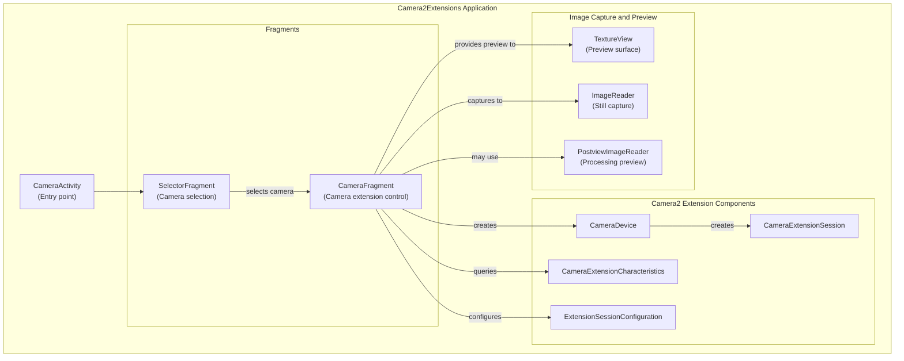
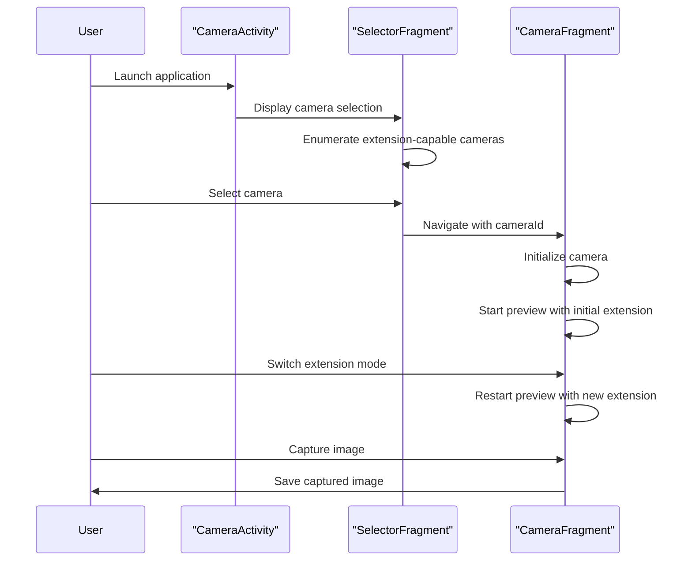
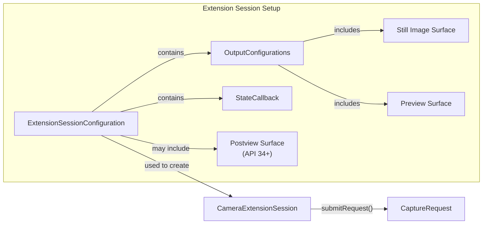
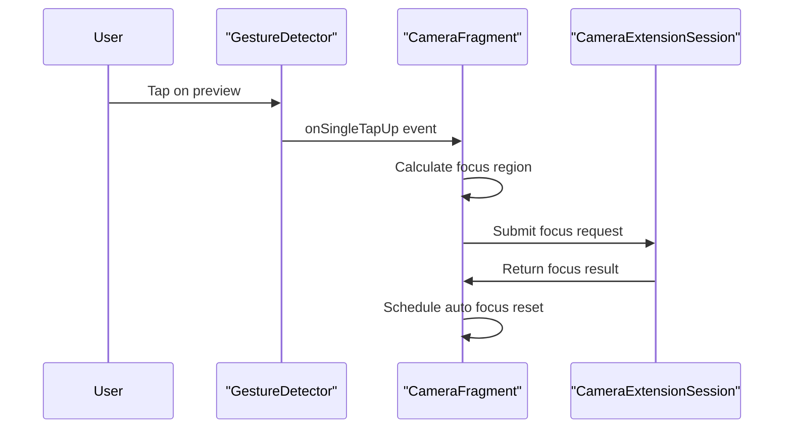

<!-- source: DeepWiki mcp.deepwiki.com · repo android/camera-samples · page 4.3 Camera2Extensions · fetched 2026-10-23 -->

# Camera2Extensions

<details>
<summary>Relevant source files</summary>

The following files were used as context for generating this wiki page:

- [Camera2Extensions/.gitignore](Camera2Extensions/.gitignore)
- [Camera2Extensions/app/build.gradle](Camera2Extensions/app/build.gradle)
- [Camera2Extensions/app/src/main/AndroidManifest.xml](Camera2Extensions/app/src/main/AndroidManifest.xml)
- [Camera2Extensions/app/src/main/java/com/example/android/camera2/extensions/CameraActivity.kt](Camera2Extensions/app/src/main/java/com/example/android/camera2/extensions/CameraActivity.kt)
- [Camera2Extensions/app/src/main/java/com/example/android/camera2/extensions/ZoomUtil.kt](Camera2Extensions/app/src/main/java/com/example/android/camera2/extensions/ZoomUtil.kt)
- [Camera2Extensions/app/src/main/java/com/example/android/camera2/extensions/fragments/CameraFragment.kt](Camera2Extensions/app/src/main/java/com/example/android/camera2/extensions/fragments/CameraFragment.kt)
- [Camera2Extensions/app/src/main/java/com/example/android/camera2/extensions/fragments/SelectorFragment.kt](Camera2Extensions/app/src/main/java/com/example/android/camera2/extensions/fragments/SelectorFragment.kt)
- [Camera2Extensions/app/src/main/res/layout-land/fragment_camera.xml](Camera2Extensions/app/src/main/res/layout-land/fragment_camera.xml)
- [Camera2Extensions/app/src/main/res/layout/fragment_camera.xml](Camera2Extensions/app/src/main/res/layout/fragment_camera.xml)
- [Camera2Extensions/app/src/main/res/navigation/nav_graph.xml](Camera2Extensions/app/src/main/res/navigation/nav_graph.xml)
- [Camera2Extensions/app/src/main/res/values/strings.xml](Camera2Extensions/app/src/main/res/values/strings.xml)
- [Camera2Extensions/app/src/test/java/com/example/android/camera2/extensions/InstrumentedTests.kt](Camera2Extensions/app/src/test/java/com/example/android/camera2/extensions/InstrumentedTests.kt)
- [Camera2Extensions/build.gradle](Camera2Extensions/build.gradle)
- [Camera2Extensions/gradle/wrapper/gradle-wrapper.properties](Camera2Extensions/gradle/wrapper/gradle-wrapper.properties)
- [Camera2Extensions/settings.gradle](Camera2Extensions/settings.gradle)

</details>


This document provides a comprehensive overview of the Camera2Extensions sample application, which demonstrates how to use Android's Camera2 API with vendor-specific camera extensions like HDR, Night mode, and Bokeh. For information about the equivalent CameraX implementation, see [CameraXExtensions](#3.2).

## Overview

Camera2Extensions showcases how to leverage the Camera Extension APIs (introduced in Android 12/API 31) with the lower-level Camera2 API. Camera extensions allow applications to use vendor-optimized implementations for specific camera features such as HDR, Night mode, Bokeh, and more. This sample illustrates how to:

- Detect and enumerate available camera extensions
- Create and manage Camera Extension sessions
- Switch between different extension modes
- Capture still images with extension processing
- Support advanced features like extension strength adjustment and capture progress monitoring (Android 14/API 34+)

Sources:
[Camera2Extensions/app/build.gradle:23-30]()
[Camera2Extensions/app/src/main/java/com/example/android/camera2/extensions/fragments/CameraFragment.kt:73-77]()

## Architecture

The Camera2Extensions application follows a single-activity, multiple-fragment architecture pattern common in modern Android applications. The application provides a simple UI for camera selection, extension switching, and image capture.



Sources:
[Camera2Extensions/app/src/main/java/com/example/android/camera2/extensions/CameraActivity.kt:31-35]()
[Camera2Extensions/app/src/main/java/com/example/android/camera2/extensions/fragments/SelectorFragment.kt:38-39]()
[Camera2Extensions/app/src/main/java/com/example/android/camera2/extensions/fragments/CameraFragment.kt:79-118]()

## Navigation Flow

The application starts by displaying the SelectorFragment, which enumerates available cameras with extension support. Once a camera is selected, the application navigates to the CameraFragment where camera extensions can be used.



Sources:
[Camera2Extensions/app/src/main/res/navigation/nav_graph.xml:18-53]()
[Camera2Extensions/app/src/main/java/com/example/android/camera2/extensions/fragments/SelectorFragment.kt:63-66]()

## Key Components

### Camera Extension Characteristics

The `CameraExtensionCharacteristics` class provides information about supported extensions for a specific camera. The application uses this to:

1. Determine which extensions are available for the selected camera
2. Get supported output sizes for each extension
3. Check for advanced features like extension strength adjustment and capture progress monitoring (API 34+)

```kotlin
// Get extension characteristics for a camera
val extensionCharacteristics = cameraManager.getCameraExtensionCharacteristics(cameraId)

// Get supported extensions
val supportedExtensions = extensionCharacteristics.supportedExtensions

// Get supported sizes for a specific extension and output format
val jpegSizes = extensionCharacteristics.getExtensionSupportedSizes(
    extension, ImageFormat.JPEG
)
```

Sources:
[Camera2Extensions/app/src/main/java/com/example/android/camera2/extensions/fragments/CameraFragment.kt:469-485]()
[Camera2Extensions/app/src/main/java/com/example/android/camera2/extensions/fragments/SelectorFragment.kt:96-97]()

### Camera Extension Session

The `CameraExtensionSession` manages the camera pipeline for a specific extension mode. Key responsibilities include:

1. Processing preview frames with the selected extension
2. Handling still capture requests
3. Providing information about the capture process (API 34+)

```kotlin
// Create extension session configuration
val extensionConfiguration = ExtensionSessionConfiguration(
    currentExtension,
    outputConfig,
    executor,
    sessionStateCallback
)

// Create the extension session
cameraDevice.createExtensionSession(extensionConfiguration)
```

Sources:
[Camera2Extensions/app/src/main/java/com/example/android/camera2/extensions/fragments/CameraFragment.kt:673-717]()

## Camera Extension Features

### Supported Extensions

The application can use any of the standard camera extensions provided by Android:

| Extension ID | Description |
|-------------|-------------|
| `CameraExtensionCharacteristics.EXTENSION_AUTOMATIC` | Automatic mode (vendor optimized) |
| `CameraExtensionCharacteristics.EXTENSION_FACE_RETOUCH` | Face retouch mode |
| `CameraExtensionCharacteristics.EXTENSION_BOKEH` | Portrait/bokeh mode |
| `CameraExtensionCharacteristics.EXTENSION_HDR` | High Dynamic Range mode |
| `CameraExtensionCharacteristics.EXTENSION_NIGHT` | Night mode for low light |
| `CameraExtensionCharacteristics.EXTENSION_BEAUTY` | Beauty mode |

The application allows users to cycle through all the supported extensions by clicking the "Switch" button at the top of the screen.

Sources:
[Camera2Extensions/app/src/main/java/com/example/android/camera2/extensions/fragments/CameraFragment.kt:492-505]()
[Camera2Extensions/app/src/main/java/com/example/android/camera2/extensions/fragments/CameraFragment.kt:1158-1195]()

### Extension Session Configuration

To use an extension, the application must:

1. Create appropriate output surfaces (preview and capture)
2. Configure the extension session with these surfaces
3. Submit capture requests through the extension session

The session configuration involves creating a preview surface for the TextureView and an ImageReader for still image capture. In API 34+, an additional PostviewImageReader can be added to show processing previews.



Sources:
[Camera2Extensions/app/src/main/java/com/example/android/camera2/extensions/fragments/CameraFragment.kt:659-724]()

## Advanced Features (API 34+)

Android 14 (API 34) introduced several enhancements to the Camera Extensions API that this sample demonstrates:

### Extension Strength

Some extensions support adjustable strength, allowing the application to control the intensity of the effect:

```kotlin
// Check if extension strength is available
isExtensionStrengthAvailable =
  extensionCharacteristics.getAvailableCaptureRequestKeys(currentExtension)
    .contains(CaptureRequest.EXTENSION_STRENGTH)

// Set extension strength in capture request
captureBuilder.set(CaptureRequest.EXTENSION_STRENGTH, extensionStrength)
```

The UI includes a slider that appears when strength adjustment is available, allowing users to modify the extension effect in real-time.

Sources:
[Camera2Extensions/app/src/main/java/com/example/android/camera2/extensions/fragments/CameraFragment.kt:538-546]()
[Camera2Extensions/app/src/main/java/com/example/android/camera2/extensions/fragments/CameraFragment.kt:389-410]()

### Capture Process Progress

Extensions like Night mode often require multiple frames or extended processing time. API 34 allows monitoring this process:

1. Check if capture process progress is available for the extension
2. Get still capture latency information
3. Monitor capture callbacks for progress updates

The UI displays a progress indicator showing the current stage:
- "Hold Still" during initial capture
- "Processing" during image processing

```kotlin
// Check if capture process progress is available
isCaptureProcessProgressAvailable =
  extensionCharacteristics.isCaptureProcessProgressAvailable(currentExtension)

// Get still capture latency
cameraExtensionSession.realtimeStillCaptureLatency?.let {
  stillCaptureLatency = it
}

// Handle progress updates in callback
override fun onCaptureProcessProgressed(
  session: CameraExtensionSession,
  request: CaptureRequest,
  progress: Int,
) {
  captureProcessingProgress = progress
  updateProgressInfo()
}
```

Sources:
[Camera2Extensions/app/src/main/java/com/example/android/camera2/extensions/fragments/CameraFragment.kt:542-546]()
[Camera2Extensions/app/src/main/java/com/example/android/camera2/extensions/fragments/CameraFragment.kt:890-898]()
[Camera2Extensions/app/src/main/java/com/example/android/camera2/extensions/fragments/CameraFragment.kt:374-382]()

### Postview Support

Postview provides a low-resolution preview of the captured image during processing:

```kotlin
// Check if postview is available
isPostviewAvailable = extensionCharacteristics.isPostviewAvailable(currentExtension)

// Create postview image reader
val postviewImageReader = createPostviewImageReader()

// Add to session configuration
extensionConfiguration.postviewOutputConfiguration = OutputConfiguration(postviewImageReader.surface)
```

When available, the postview image is displayed in the progress UI during capture processing.

Sources:
[Camera2Extensions/app/src/main/java/com/example/android/camera2/extensions/fragments/CameraFragment.kt:795-842]()
[Camera2Extensions/app/src/main/java/com/example/android/camera2/extensions/fragments/CameraFragment.kt:848-885]()

## User Interaction Features

### Tap to Focus

The application supports tap-to-focus, allowing users to specify a focus region by tapping on the preview:



Sources:
[Camera2Extensions/app/src/main/java/com/example/android/camera2/extensions/fragments/CameraFragment.kt:248-252]()
[Camera2Extensions/app/src/main/java/com/example/android/camera2/extensions/fragments/CameraFragment.kt:1112-1210]()

### Zoom Support

The application supports pinch-to-zoom through a ScaleGestureDetector:

```kotlin
// Check if zoom is supported
private fun hasZoomSupport(): Boolean {
    return ZoomUtil.maxZoom(characteristics) > ZoomUtil.minZoom()
}

// Apply zoom in capture request
set(CaptureRequest.CONTROL_ZOOM_RATIO, zoomRatio)
```

Sources:
[Camera2Extensions/app/src/main/java/com/example/android/camera2/extensions/fragments/CameraFragment.kt:256-272]()
[Camera2Extensions/app/src/main/java/com/example/android/camera2/extensions/ZoomUtil.kt:17-57]()

## Implementation Details

### Camera Selection Process

The SelectorFragment enumerates all cameras that:
1. Support backwards compatibility
2. Have at least one supported extension
3. Optionally support JPEG_R format (on Android 15+)

```kotlin
private fun enumerateExtensionCameras(cameraManager: CameraManager): List<CameraInfo> {
    val availableCameras: MutableList<CameraInfo> = mutableListOf()

    cameraManager.cameraIdList.forEach { id ->
        val characteristics = cameraManager.getCameraCharacteristics(id)
        val extensionCharacteristics = cameraManager.getCameraExtensionCharacteristics(id)
        val capabilities = characteristics.get(
                CameraCharacteristics.REQUEST_AVAILABLE_CAPABILITIES)!!

        // Return cameras that declare to be backward compatible
        if (capabilities.contains(CameraCharacteristics
                                  .REQUEST_AVAILABLE_CAPABILITIES_BACKWARD_COMPATIBLE) &&
            extensionCharacteristics.supportedExtensions.isNotEmpty()) {
            availableCameras.add(CameraInfo("$orientation ($id)", id))
        }
    }
    return availableCameras
}
```

Sources:
[Camera2Extensions/app/src/main/java/com/example/android/camera2/extensions/fragments/SelectorFragment.kt:89-120]()

### Capture Process

The still image capture process involves:

1. Setting up the still image reader with the appropriate size and format
2. Submitting a capture request with the selected extension
3. Processing the captured image

For API 34+, additional steps include:
- Starting capture progress monitoring
- Updating the UI with the current process state
- Displaying postview image if available

```kotlin
private fun takePicture() {
    if (Build.VERSION.SDK_INT >= Build.VERSION_CODES.UPSIDE_DOWN_CAKE) {
        // Retrieves the still capture latency info
        cameraExtensionSession.realtimeStillCaptureLatency?.let {
            stillCaptureLatency = it
            progressStartTimestampMs = SystemClock.elapsedRealtime()
        }
        captureProcessingProgress = -1
        showCaptureProgressUI()
    }
    submitRequest(
        CameraDevice.TEMPLATE_STILL_CAPTURE,
        if (isPostviewAvailable) {
            listOf(stillImageReader.surface, postviewImageReader!!.surface)
        } else {
            listOf(stillImageReader.surface)
        },
        false
    ) { request ->
        request.apply {
            set(CaptureRequest.CONTROL_ZOOM_RATIO, zoomRatio)
            setTag(STILL_CAPTURE_TAG)
        }
    }
}
```

Sources:
[Camera2Extensions/app/src/main/java/com/example/android/camera2/extensions/fragments/CameraFragment.kt:890-913]()
[Camera2Extensions/app/src/main/java/com/example/android/camera2/extensions/fragments/CameraFragment.kt:739-790]()

## Conclusion

The Camera2Extensions sample demonstrates how to leverage vendor-specific camera extensions using the Camera2 API. It showcases basic functionality across all supported Android versions (API 31+) and advanced features introduced in Android 14 (API 34+) such as extension strength adjustment, capture process monitoring, and postview support.

This implementation provides a foundation for developing sophisticated camera applications that utilize the full capabilities of device-specific camera enhancements while maintaining compatibility across different Android devices.

Sources:
[Camera2Extensions/app/src/main/java/com/example/android/camera2/extensions/fragments/CameraFragment.kt:73-77]()
[Camera2Extensions/app/build.gradle:23-30]()

---

