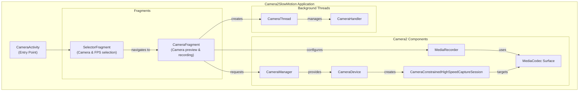
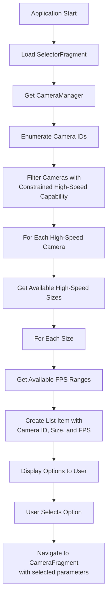
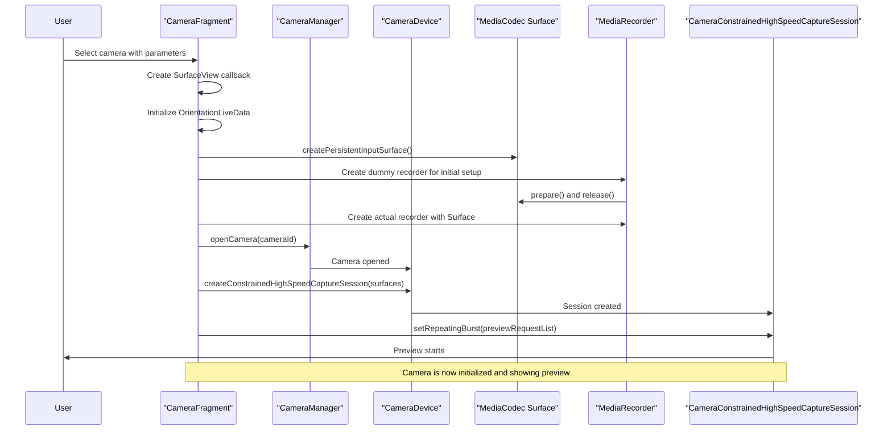
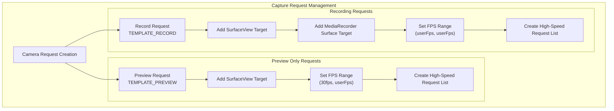
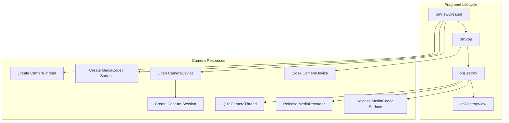

<!-- source: DeepWiki mcp.deepwiki.com · repo android/camera-samples · page 4.4 Camera2SlowMotion · fetched 2026-10-23 -->

# Camera2SlowMotion

<details>
<summary>Relevant source files</summary>

The following files were used as context for generating this wiki page:

- [Camera2Basic/app/src/main/java/com/example/android/camera2/basic/CameraActivity.kt](Camera2Basic/app/src/main/java/com/example/android/camera2/basic/CameraActivity.kt)
- [Camera2Basic/app/src/main/java/com/example/android/camera2/basic/fragments/CameraFragment.kt](Camera2Basic/app/src/main/java/com/example/android/camera2/basic/fragments/CameraFragment.kt)
- [Camera2SlowMotion/app/build.gradle](Camera2SlowMotion/app/build.gradle)
- [Camera2SlowMotion/app/src/main/java/com/example/android/camera2/slowmo/CameraActivity.kt](Camera2SlowMotion/app/src/main/java/com/example/android/camera2/slowmo/CameraActivity.kt)
- [Camera2SlowMotion/app/src/main/java/com/example/android/camera2/slowmo/fragments/CameraFragment.kt](Camera2SlowMotion/app/src/main/java/com/example/android/camera2/slowmo/fragments/CameraFragment.kt)
- [Camera2SlowMotion/app/src/main/java/com/example/android/camera2/slowmo/fragments/SelectorFragment.kt](Camera2SlowMotion/app/src/main/java/com/example/android/camera2/slowmo/fragments/SelectorFragment.kt)
- [Camera2SlowMotion/app/src/main/res/xml/file_paths.xml](Camera2SlowMotion/app/src/main/res/xml/file_paths.xml)
- [Camera2SlowMotion/build.gradle](Camera2SlowMotion/build.gradle)
- [Camera2SlowMotion/gradle/wrapper/gradle-wrapper.properties](Camera2SlowMotion/gradle/wrapper/gradle-wrapper.properties)
- [CameraUtils/build.gradle](CameraUtils/build.gradle)
- [CameraUtils/gradle/wrapper/gradle-wrapper.properties](CameraUtils/gradle/wrapper/gradle-wrapper.properties)
- [HdrViewfinder/Application/build.gradle](HdrViewfinder/Application/build.gradle)
- [HdrViewfinder/gradle/wrapper/gradle-wrapper.properties](HdrViewfinder/gradle/wrapper/gradle-wrapper.properties)

</details>


## Purpose and Scope

The Camera2SlowMotion sample demonstrates how to implement high-speed (slow-motion) video recording using the Android Camera2 API's constrained high-speed video recording functionality. This document details the architecture, implementation, and workflow of the Camera2SlowMotion sample application. For regular video recording with Camera2 API, see [Camera2Video](#4.2).

## System Overview

Camera2SlowMotion showcases the usage of `CameraConstrainedHighSpeedCaptureSession` to record videos at elevated frame rates (beyond standard 30fps), which can be played back at normal speed to achieve a slow-motion effect. The application allows users to:

1. Select a camera capable of high-speed recording
2. Choose from available resolution and FPS combinations
3. Record slow-motion videos with simple touch controls
4. Automatically play the captured video upon completion

### System Architecture Diagram



Sources: [Camera2SlowMotion/app/src/main/java/com/example/android/camera2/slowmo/fragments/CameraFragment.kt:71-478](), [Camera2SlowMotion/app/src/main/java/com/example/android/camera2/slowmo/fragments/SelectorFragment.kt:40-131](), [Camera2SlowMotion/app/src/main/java/com/example/android/camera2/slowmo/CameraActivity.kt:24-56]()

## Camera Selection and Configuration

The application starts with a selector screen that enumerates all cameras supporting high-speed video recording.

### Camera Enumeration Process



Sources: [Camera2SlowMotion/app/src/main/java/com/example/android/camera2/slowmo/fragments/SelectorFragment.kt:89-129]()

The `SelectorFragment` implements this process by:

1. Obtaining the system's `CameraManager` service
2. Iterating through available cameras
3. Checking for `REQUEST_AVAILABLE_CAPABILITIES_CONSTRAINED_HIGH_SPEED_VIDEO` capability
4. For supported cameras, querying compatible sizes and FPS ranges
5. Presenting these options in a RecyclerView list
6. Navigating to `CameraFragment` with the selected parameters when an option is chosen

## Camera Initialization and Setup

When the `CameraFragment` is launched with specific camera parameters, it performs a series of initialization steps to set up the camera and recording components.

### Camera Setup Workflow



Sources: [Camera2SlowMotion/app/src/main/java/com/example/android/camera2/slowmo/fragments/CameraFragment.kt:196-218](), [Camera2SlowMotion/app/src/main/java/com/example/android/camera2/slowmo/fragments/CameraFragment.kt:289-379]()

Key components involved in the setup process:

1. **MediaCodec Surface Creation**: A persistent input surface is created to be used by the MediaRecorder. This approach allows the surface to be included in the camera session configuration without having to prepare the MediaRecorder in advance.

   ```
   // Get a persistent Surface from MediaCodec
   val surface = MediaCodec.createPersistentInputSurface()
   
   // Pre-configure a MediaRecorder with the surface
   createRecorder(surface).apply {
       prepare()
       release()
   }
   ```

2. **CameraDevice Opening**: Uses a coroutine to asynchronously open the camera device.

3. **Capture Session Creation**: Creates a specialized `CameraConstrainedHighSpeedCaptureSession` instead of a regular capture session, which is required for high-speed recording.

4. **Preview Configuration**: Sets up preview requests with a target FPS range appropriate for preview (default 30fps).

## High-Speed Video Recording

The core functionality of the app is recording videos at high frame rates. This requires specific handling in the Camera2 API.

### High-Speed Recording Components

| Component | Purpose |
|-----------|---------|
| `CameraConstrainedHighSpeedCaptureSession` | Specialized session type required for high-speed capture |
| `MediaRecorder` | Handles encoding and saving video to file |
| `Range<Integer>` | Specifies the target FPS range for recording |
| `previewRequestList` | Optimized capture requests for preview only |
| `recordRequestList` | Optimized capture requests for recording |

Sources: [Camera2SlowMotion/app/src/main/java/com/example/android/camera2/slowmo/fragments/CameraFragment.kt:151-178](), [Camera2SlowMotion/app/src/main/java/com/example/android/camera2/slowmo/fragments/CameraFragment.kt:229-239]()

### Key Recording Process

The application uses a touch-to-record mechanism with these steps:

1. On touch down:
   - Lock screen orientation
   - Switch from preview to recording requests
   - Start MediaRecorder
   - Begin recording animation

2. On touch up:
   - Stop recording
   - Scan file to make it available to media apps
   - Launch an intent to play the recorded video
   - Return to SelectorFragment

Sources: [Camera2SlowMotion/app/src/main/java/com/example/android/camera2/slowmo/fragments/CameraFragment.kt:311-378]()

### Request Handling Details

A critical aspect of high-speed recording is the creation and management of specialized capture requests:



Sources: [Camera2SlowMotion/app/src/main/java/com/example/android/camera2/slowmo/fragments/CameraFragment.kt:151-178]()

Important technical details:

1. The preview request uses asymmetric FPS range (`FPS_PREVIEW_ONLY, args.fps`) because:
   - It allows the camera to run at lower frame rates during preview
   - This can save power when not recording
   - The higher upper bound ensures compatibility with recording

2. The recording request uses a symmetrical FPS range (`args.fps, args.fps`):
   - This forces the camera to capture exactly at the specified frame rate
   - Required for consistent slow-motion recording
   
3. Both request lists are created using `session.createHighSpeedRequestList()`:
   - This generates highly optimized capture requests
   - Required for constrained high-speed sessions
   - Must be used with `setRepeatingBurst()` instead of regular `setRepeatingRequest()`

## MediaRecorder Configuration

The `MediaRecorder` is configured specifically for high-speed video recording:

```kotlin
private fun createRecorder(surface: Surface) = MediaRecorder().apply {
    setAudioSource(MediaRecorder.AudioSource.MIC)
    setVideoSource(MediaRecorder.VideoSource.SURFACE)
    setOutputFormat(MediaRecorder.OutputFormat.MPEG_4)
    setOutputFile(outputFile.absolutePath)
    setVideoEncodingBitRate(RECORDER_VIDEO_BITRATE)
    setVideoFrameRate(args.fps)
    setVideoSize(args.width, args.height)
    setVideoEncoder(MediaRecorder.VideoEncoder.H264)
    setAudioEncoder(MediaRecorder.AudioEncoder.AAC)
    setInputSurface(surface)
}
```

Sources: [Camera2SlowMotion/app/src/main/java/com/example/android/camera2/slowmo/fragments/CameraFragment.kt:229-239]()

Key configuration points:
- Uses H.264 video encoder which has broad compatibility and good performance
- Sets frame rate to the user-selected value
- Uses a relatively high bit rate (10Mbps) to maintain quality
- Uses AAC audio encoder for good quality audio
- Takes input from the persistent `MediaCodec` surface

## Resource Management

Proper resource management is crucial in camera applications to prevent leaks and ensure system stability.

### Resource Lifecycle



Sources: [Camera2SlowMotion/app/src/main/java/com/example/android/camera2/slowmo/fragments/CameraFragment.kt:438-457]()

The application carefully manages resources through the fragment lifecycle:

1. `onViewCreated`: 
   - Sets up SurfaceHolder callbacks
   - Initializes orientation listener

2. `onStop`: 
   - Closes the camera device 

3. `onDestroy`: 
   - Quits camera thread safely
   - Releases MediaRecorder 
   - Releases persistent MediaCodec surface

4. `onDestroyView`: 
   - Nullifies view binding references

This careful resource management ensures that camera resources are properly released, preventing resource leaks and camera service crashes.

## Error Handling

The application implements robust error handling for camera operations, which are prone to various errors:

1. Camera opening errors:
   - Device policy restrictions
   - Camera already in use
   - Service errors
   - Maximum cameras in use

2. Session configuration errors:
   - Runtime exceptions when session configuration fails

All camera operations use coroutines with proper exception handling, ensuring that errors are logged and propagated appropriately.

Sources: [Camera2SlowMotion/app/src/main/java/com/example/android/camera2/slowmo/fragments/CameraFragment.kt:396-408](), [Camera2SlowMotion/app/src/main/java/com/example/android/camera2/slowmo/fragments/CameraFragment.kt:430-434]()

## Technical Requirements

The Camera2SlowMotion sample has the following requirements:

- Minimum SDK version: 23 (Android 6.0 Marshmallow)
- Target SDK version: 29 (Android 10)
- Requires a device with high-speed video recording capability
- Camera permissions must be granted

Sources: [Camera2SlowMotion/app/build.gradle:23-31]()

## Summary

The Camera2SlowMotion sample demonstrates the complete workflow for implementing high-speed video recording using the Camera2 API. It showcases several advanced Camera2 techniques:

1. Using `CameraConstrainedHighSpeedCaptureSession` for high-speed recording
2. Creating appropriate capture request lists for preview and recording
3. Setting up `MediaRecorder` with a persistent `MediaCodec` surface
4. Managing camera lifecycle and resources properly
5. Handling touch-based recording control

This implementation provides developers with a comprehensive example of how to develop camera applications that leverage the high-speed recording capabilities available on modern Android devices.

---

