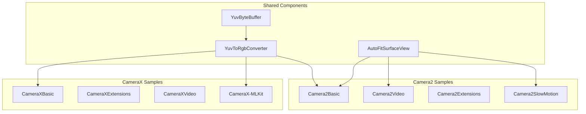
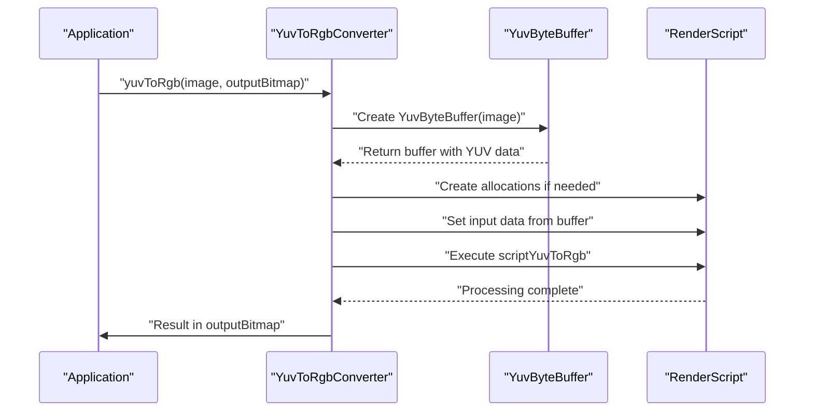
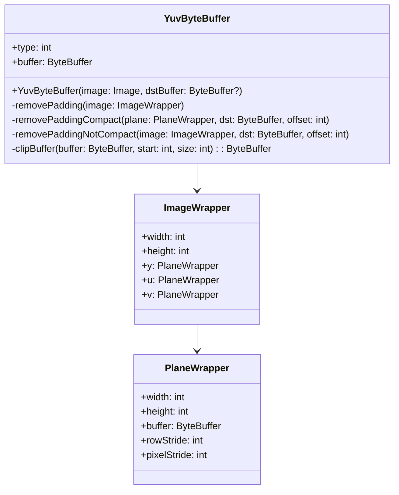
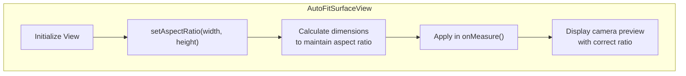
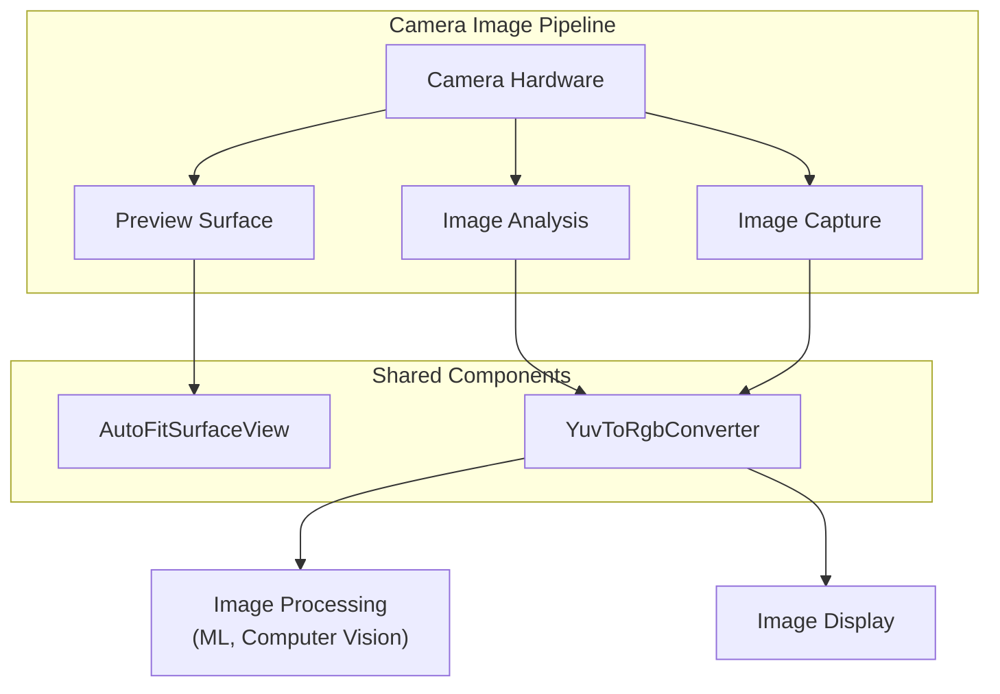

<!-- source: DeepWiki mcp.deepwiki.com · repo android/camera-samples · page 5 Shared Components · fetched 2026-10-23 -->

# Shared Components

<details>
<summary>Relevant source files</summary>

The following files were used as context for generating this wiki page:

- [Camera2Video/utils/src/main/java/com/example/android/camera/utils/AutoFitSurfaceView.kt](Camera2Video/utils/src/main/java/com/example/android/camera/utils/AutoFitSurfaceView.kt)
- [CameraUtils/lib/build.gradle](CameraUtils/lib/build.gradle)
- [CameraUtils/lib/src/main/java/com/example/android/camera/utils/Yuv.kt](CameraUtils/lib/src/main/java/com/example/android/camera/utils/Yuv.kt)
- [CameraUtils/lib/src/main/java/com/example/android/camera/utils/YuvToRgbConverter.kt](CameraUtils/lib/src/main/java/com/example/android/camera/utils/YuvToRgbConverter.kt)

</details>


This page documents the reusable utilities and components found across the Android Camera Samples repository. These components provide standardized functionality for common camera operations like image format conversion and preview display, reducing code duplication and ensuring consistency across sample applications.

For specific details about YUV conversion utilities, see [YUV Conversion Utilities](#5.1). For information about UI components, see [UI Components](#5.2).

## Overview of Shared Components

The camera samples repository contains several common utilities that are leveraged by multiple sample applications to handle routine camera-related tasks.

**Diagram: Shared Components Architecture**

Sources: [CameraUtils/lib/src/main/java/com/example/android/camera/utils/YuvToRgbConverter.kt](), [CameraUtils/lib/src/main/java/com/example/android/camera/utils/Yuv.kt](), [Camera2Video/utils/src/main/java/com/example/android/camera/utils/AutoFitSurfaceView.kt]()

## YUV Conversion Utilities

The repository includes utilities for handling YUV format images (the native format produced by camera sensors) and converting them to RGB format for display or processing.

### YuvToRgbConverter

`YuvToRgbConverter` is a helper class that converts camera images from `ImageFormat.YUV_420_888` format to RGB bitmaps. It uses Android's RenderScript for efficient image processing.

**Diagram: YuvToRgbConverter Operation Flow**

Sources: [CameraUtils/lib/src/main/java/com/example/android/camera/utils/YuvToRgbConverter.kt:44-99]()

Key components of `YuvToRgbConverter`:
- RenderScript context and script intrinsic for YUV to RGB conversion
- Input and output allocations for buffer management
- Synchronized conversion method to prevent concurrent modification issues

The class handles:
1. Setting up RenderScript and required allocations
2. Preparing YUV data with proper format handling
3. Executing the conversion operation
4. Copying the result to the output bitmap

### YuvByteBuffer

`YuvByteBuffer` is a utility class that handles different YUV image formats (specifically `YUV_420_888` and `NV21`). It detects the format type and properly arranges the Y, U, and V data planes, removing any padding to create a compact, standardized buffer.

**Diagram: YuvByteBuffer Internal Structure**

Sources: [CameraUtils/lib/src/main/java/com/example/android/camera/utils/Yuv.kt:47-191]()

The `YuvByteBuffer` class provides a consistent interface for handling YUV data, regardless of the specific format or padding provided by the camera hardware. This is particularly important for consistent image processing across different devices.

## UI Components

### AutoFitSurfaceView

`AutoFitSurfaceView` is a custom `SurfaceView` implementation that can be adjusted to match a specific aspect ratio. It ensures that camera preview frames are displayed correctly without distortion by performing center-crop transformation.

**Diagram: AutoFitSurfaceView Operation**

Sources: [Camera2Video/utils/src/main/java/com/example/android/camera/utils/AutoFitSurfaceView.kt:29-79]()

Key features of `AutoFitSurfaceView`:
- Accepts camera resolution dimensions and calculates the appropriate aspect ratio
- Overrides `onMeasure()` to calculate view dimensions that preserve this ratio
- Performs center-crop transformation to maximize visible area while maintaining the ratio
- Sets fixed size on the surface holder to match camera resolution

This component is particularly useful in Camera2 API samples where direct management of preview surfaces is required.

## Integration with Camera Samples

These shared components are integrated into the camera sample applications to provide consistent functionality across the repository.

**Diagram: Component Integration in Camera Pipeline**

Sources: [CameraUtils/lib/src/main/java/com/example/android/camera/utils/YuvToRgbConverter.kt](), [Camera2Video/utils/src/main/java/com/example/android/camera/utils/AutoFitSurfaceView.kt]()

## Usage Examples

### Using YuvToRgbConverter

The `YuvToRgbConverter` is typically used in image analysis scenarios, such as:
- Processing camera frames for computer vision tasks
- Displaying camera preview frames in an ImageView
- Converting camera images for ML processing

Example pattern:
```kotlin
// Create converter once
val converter = YuvToRgbConverter(context)

// In image analysis callback:
fun analyze(image: ImageProxy) {
    // Create output bitmap
    val bitmap = Bitmap.createBitmap(image.width, image.height, Bitmap.Config.ARGB_8888)
    
    // Convert YUV to RGB
    converter.yuvToRgb(image.image!!, bitmap)
    
    // Process the bitmap (ML, computer vision, display)
    
    image.close()
}
```

### Using AutoFitSurfaceView

The `AutoFitSurfaceView` is typically used for displaying camera previews:

Example pattern:
```kotlin
// In layout XML
// <com.example.android.camera.utils.AutoFitSurfaceView
//     android:id="@+id/viewFinder"
//     android:layout_width="match_parent"
//     android:layout_height="match_parent" />

// In code
val viewFinder = findViewById<AutoFitSurfaceView>(R.id.viewFinder)

// Set aspect ratio based on camera resolution
viewFinder.setAspectRatio(previewSize.width, previewSize.height)

// Use the surface for camera preview
camera.setPreviewDisplay(viewFinder.holder)
```

## Summary

The shared components in the Camera Samples repository provide foundational functionality that simplifies camera application development:

| Component | Purpose | Primary Use Cases |
|-----------|---------|-------------------|
| YuvToRgbConverter | Convert YUV images to RGB bitmaps | Image analysis, ML processing, preview display |
| YuvByteBuffer | Handle YUV data formats and padding | Supporting YuvToRgbConverter, direct YUV processing |
| AutoFitSurfaceView | Display camera preview with correct aspect ratio | Camera preview display in Camera2 samples |

These components abstract away common complexities in camera application development, allowing the sample applications to focus on demonstrating specific camera features rather than reimplementing basic functionality.

---

