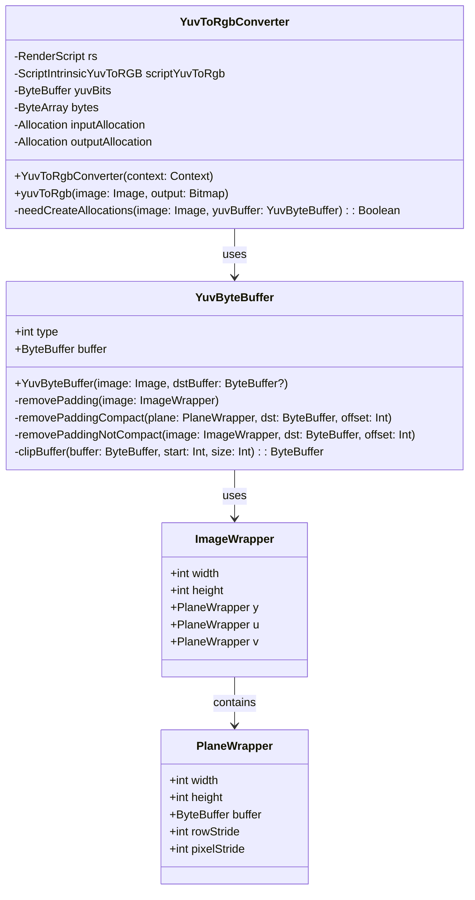
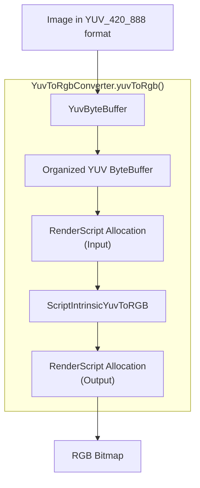
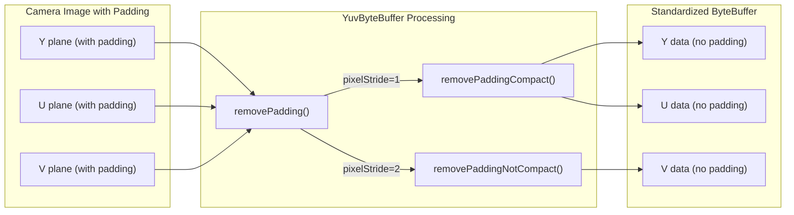
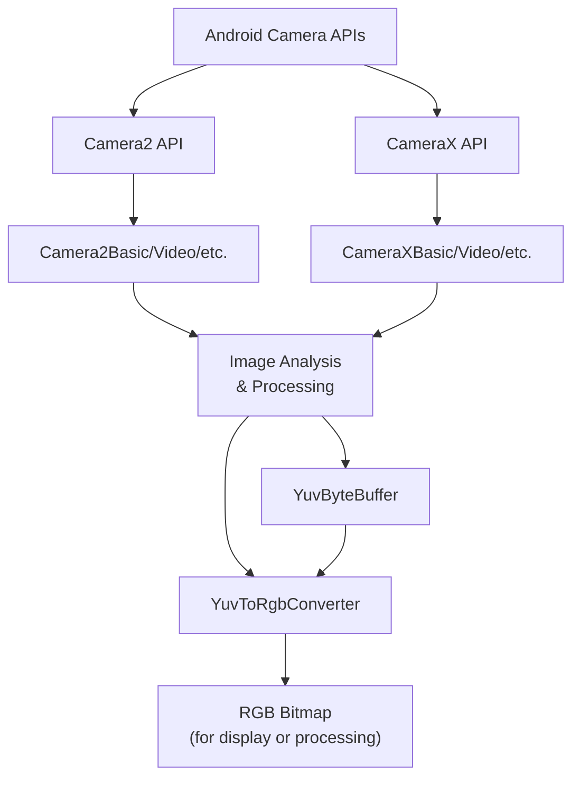

<!-- source: DeepWiki mcp.deepwiki.com · repo android/camera-samples · page 5.1 YUV Conversion Utilities · fetched 2026-10-23 -->

# YUV Conversion Utilities

Relevant source files

The following files were used as context for generating this wiki page:

- [Camera2Basic/utils/src/main/java/com/example/android/camera/utils/Yuv.kt](Camera2Basic/utils/src/main/java/com/example/android/camera/utils/Yuv.kt)
- [Camera2Basic/utils/src/main/java/com/example/android/camera/utils/YuvToRgbConverter.kt](Camera2Basic/utils/src/main/java/com/example/android/camera/utils/YuvToRgbConverter.kt)
- [Camera2SlowMotion/utils/src/main/java/com/example/android/camera/utils/Yuv.kt](Camera2SlowMotion/utils/src/main/java/com/example/android/camera/utils/Yuv.kt)
- [Camera2SlowMotion/utils/src/main/java/com/example/android/camera/utils/YuvToRgbConverter.kt](Camera2SlowMotion/utils/src/main/java/com/example/android/camera/utils/YuvToRgbConverter.kt)
- [Camera2Video/utils/src/main/java/com/example/android/camera/utils/Yuv.kt](Camera2Video/utils/src/main/java/com/example/android/camera/utils/Yuv.kt)
- [Camera2Video/utils/src/main/java/com/example/android/camera/utils/YuvToRgbConverter.kt](Camera2Video/utils/src/main/java/com/example/android/camera/utils/YuvToRgbConverter.kt)
- [CameraUtils/lib/build.gradle](CameraUtils/lib/build.gradle)
- [CameraUtils/lib/src/main/java/com/example/android/camera/utils/Yuv.kt](CameraUtils/lib/src/main/java/com/example/android/camera/utils/Yuv.kt)
- [CameraUtils/lib/src/main/java/com/example/android/camera/utils/YuvToRgbConverter.kt](CameraUtils/lib/src/main/java/com/example/android/camera/utils/YuvToRgbConverter.kt)

## Purpose and Scope

This document details the YUV conversion utilities used throughout the Android Camera Samples repository. These utilities enable conversion between YUV image formats (commonly produced by camera sensors) and RGB formats (required for display and processing). The utilities are shared components used across both Camera2 API and CameraX samples.

Sources: [CameraUtils/lib/src/main/java/com/example/android/camera/utils/YuvToRgbConverter.kt:30-43]()

## Understanding YUV Image Formats

YUV is a color encoding system commonly used in digital video and image processing. Android camera APIs typically deliver frames in YUV_420_888 format, which must be converted to RGB for display or further processing.

The YUV_420_888 format can be represented in various layouts including:

| Format | Description | Layout Example |
|--------|-------------|----------------|
| I420 (YUV_420_888) | Y plane followed by U plane then V plane, without interleaving | Y Y Y Y Y Y Y Y U U V V |
| NV21 | Y plane followed by interleaved V and U planes (V first) | Y Y Y Y Y Y Y Y V U V U |
| YV12/NV12 | Similar to above with U and V swapped | Y Y Y Y Y Y Y Y U V U V |

The "420" in YUV_420_888 indicates that for every 4 luminosity (Y) pixels, there are 2 chroma pixels (U and V), as chroma channels are downsampled.

Sources: [CameraUtils/lib/src/main/java/com/example/android/camera/utils/Yuv.kt:8-41]()

## Core Components

The YUV conversion utilities consist of two main classes:

Sources: 
- [CameraUtils/lib/src/main/java/com/example/android/camera/utils/YuvToRgbConverter.kt:44-99]()
- [CameraUtils/lib/src/main/java/com/example/android/camera/utils/Yuv.kt:46-191]()

### YuvToRgbConverter

The `YuvToRgbConverter` class provides functionality to convert an `Image` object in YUV_420_888 format to an RGB `Bitmap`. It uses Android's RenderScript API to perform efficient GPU-accelerated conversion.

#### Key Features:

1. **Thread Safety**: The `yuvToRgb()` method is synchronized to ensure thread safety.
2. **Resource Reuse**: Allocations and byte arrays are reused when possible to minimize garbage collection.
3. **Format Adaptation**: Handles both direct YUV_420_888 and NV21 format conversion.

#### Usage Example:

1. Create a converter instance with context
2. Call `yuvToRgb(image, bitmap)` to perform the conversion

Sources: [CameraUtils/lib/src/main/java/com/example/android/camera/utils/YuvToRgbConverter.kt:56-90]()

### YuvByteBuffer

The `YuvByteBuffer` class converts a camera `Image` object to a standardized ByteBuffer in either YUV_420_888 or NV21 format, handling various platform-specific YUV format variations.

#### Key Features:

1. **Format Detection**: Automatically detects if the source image should be treated as YUV_420_888 or NV21 based on pixel stride.
2. **Padding Removal**: Handles the removal of row padding which commonly exists in camera output.
3. **Memory Efficiency**: Can reuse an existing ByteBuffer to minimize allocations.

Sources: [CameraUtils/lib/src/main/java/com/example/android/camera/utils/Yuv.kt:47-111]()

## YUV Processing Implementation Details

### Padding Removal

Camera images often include padding for memory alignment. The `YuvByteBuffer` class removes this padding through two methods:

1. `removePaddingCompact()`: For planes with pixel stride of 1 (typically Y plane)
2. `removePaddingNotCompact()`: For planes with pixel stride of 2 (typically UV planes in NV21 format)

Sources: 
- [CameraUtils/lib/src/main/java/com/example/android/camera/utils/Yuv.kt:113-151]()

### RenderScript Conversion Process

The `YuvToRgbConverter` uses RenderScript to efficiently convert YUV data to RGB format:

1. Creates appropriate RenderScript Type and Allocation for YUV data
2. Copies the YUV data from ByteBuffer to the input Allocation
3. Uses `ScriptIntrinsicYuvToRGB` to perform the conversion
4. Copies the result to the output Bitmap

Sources: 
- [CameraUtils/lib/src/main/java/com/example/android/camera/utils/YuvToRgbConverter.kt:61-89]()

## Limitations and Performance Considerations

The YUV conversion utilities have some limitations that should be considered:

1. **Limited Testing**: As noted in the code comments, these utilities have been tested on a limited number of devices and are not considered production-ready.

2. **Multiple Memory Copies**: The conversion process requires multiple memory copies, which may impact performance in real-time applications.

3. **RenderScript Dependency**: The implementation uses RenderScript, which is now deprecated in newer Android versions. However, it remains widely supported in existing devices.

For production applications requiring maximum performance, alternative implementations (such as those using the NDK or Vulkan compute) might be more appropriate.

Sources: 
- [CameraUtils/lib/src/main/java/com/example/android/camera/utils/YuvToRgbConverter.kt:36-42]()

## Integration in Camera Samples

The YUV conversion utilities are shared components used across multiple camera samples in the repository. They are typically utilized in image analysis pipelines where camera frames need to be processed or displayed.

The utilities can be found in the following locations across the samples:

- `CameraUtils/lib/src/main/java/com/example/android/camera/utils/`
- `Camera2Basic/utils/src/main/java/com/example/android/camera/utils/`
- `Camera2Video/utils/src/main/java/com/example/android/camera/utils/`
- `Camera2SlowMotion/utils/src/main/java/com/example/android/camera/utils/`

This shared implementation ensures consistent behavior across all camera samples while demonstrating proper image format conversion.

Sources:
- [CameraUtils/lib/src/main/java/com/example/android/camera/utils/YuvToRgbConverter.kt:1-99]()
- [Camera2Basic/utils/src/main/java/com/example/android/camera/utils/YuvToRgbConverter.kt:1-99]()
- [Camera2Video/utils/src/main/java/com/example/android/camera/utils/YuvToRgbConverter.kt:1-99]()
- [Camera2SlowMotion/utils/src/main/java/com/example/android/camera/utils/YuvToRgbConverter.kt:1-99]()

---

