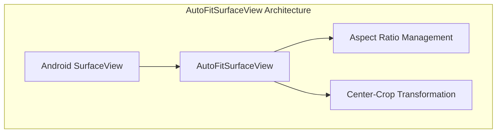
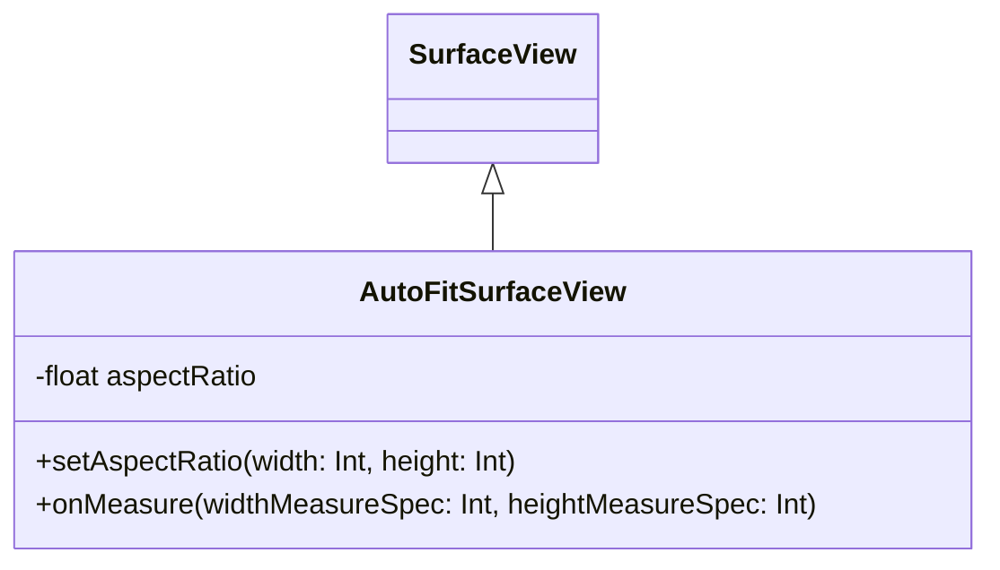
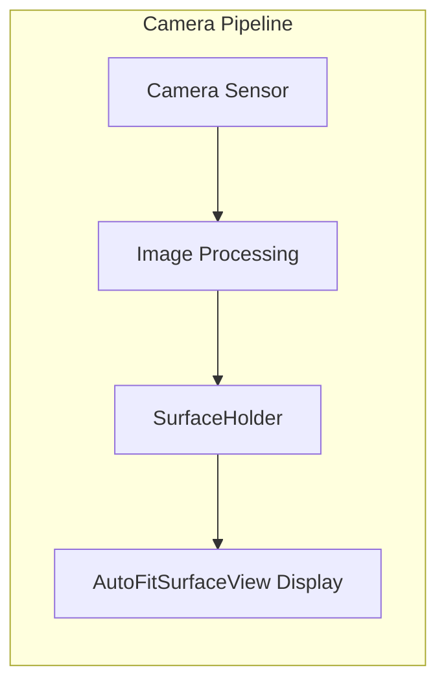
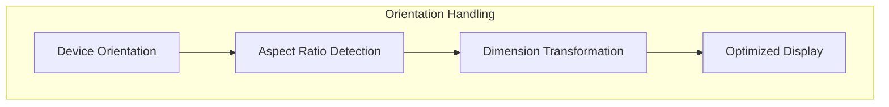

<!-- source: DeepWiki mcp.deepwiki.com · repo android/camera-samples · page 5.2 UI Components · fetched 2026-10-23 -->

# UI Components

<details>
<summary>Relevant source files</summary>

The following files were used as context for generating this wiki page:

- [Camera2Video/utils/src/main/java/com/example/android/camera/utils/AutoFitSurfaceView.kt](Camera2Video/utils/src/main/java/com/example/android/camera/utils/AutoFitSurfaceView.kt)

</details>


## Purpose and Overview

This page documents the shared UI components used across the camera sample applications in the repository. These components handle camera preview rendering, aspect ratio management, and frame transformation. For information about image processing utilities, see [YUV Conversion Utilities](#5.1).

The camera samples repository includes specialized UI components designed to handle the unique challenges of displaying camera preview feeds on Android devices, particularly addressing aspect ratio differences between camera sensors and device screens.

## Core UI Components

### AutoFitSurfaceView

The `AutoFitSurfaceView` is a custom implementation of Android's `SurfaceView` that handles aspect ratio adjustments and performs center-crop transformations of camera preview frames. This component is critical for providing a proper camera preview experience without distortion.



Sources: [Camera2Video/utils/src/main/java/com/example/android/camera/utils/AutoFitSurfaceView.kt:29-79]()

#### Key Features

- **Aspect Ratio Management**: Automatically adjusts the view dimensions based on the camera resolution's aspect ratio
- **Center-Crop Transformation**: Ensures the preview fills the available space without distorting the image
- **Surface Holder Management**: Sets fixed size on the underlying surface holder to match camera resolution

#### Implementation Details

The component maintains an aspect ratio property and provides a method to set this ratio based on camera resolution:



Sources: [Camera2Video/utils/src/main/java/com/example/android/camera/utils/AutoFitSurfaceView.kt:29-79]()

#### Aspect Ratio Calculation

The `setAspectRatio` method calculates the aspect ratio from the provided width and height:

```
aspectRatio = width.toFloat() / height.toFloat()
```

This ratio is then used during view measurement to adjust the view's dimensions.

Sources: [Camera2Video/utils/src/main/java/com/example/android/camera/utils/AutoFitSurfaceView.kt:44-49]()

#### Center-Crop Logic

The `onMeasure` implementation performs the following operations:

1. Gets the requested width and height from measure specs
2. If no aspect ratio is set, it uses the requested dimensions as is
3. When an aspect ratio is set, it calculates new dimensions that:
   - Fill the available space
   - Maintain the specified aspect ratio
   - May extend beyond the originally requested dimensions to avoid letterboxing

The center-crop approach ensures the view always fills its container while preserving the correct aspect ratio, potentially cropping parts of the image rather than showing black bars.

Sources: [Camera2Video/utils/src/main/java/com/example/android/camera/utils/AutoFitSurfaceView.kt:51-74]()

## Integration with Camera Pipeline

The `AutoFitSurfaceView` fits into the camera display pipeline as follows:



When integrating with camera samples:

1. The component is included in the layout XML
2. After determining the optimal camera resolution, the app calls `setAspectRatio` with the resolution dimensions
3. The view automatically adjusts its size during the next layout pass
4. The camera system renders directly to the view's surface holder

## Usage in Sample Applications

The `AutoFitSurfaceView` is used in multiple camera samples to handle preview display:

| Sample App | Usage Context |
|------------|---------------|
| Camera2Video | Main camera preview display |
| Camera2Basic | Preview surface for still image capture |
| Camera2SlowMotion | High-speed video preview |

## Screen Orientation Handling

The component intelligently handles screen orientation changes:



When the device orientation changes (portrait vs. landscape), the view adapts by:

1. Detecting the current orientation
2. Inverting the aspect ratio calculation if needed (`1f / aspectRatio`)
3. Recalculating the view dimensions to maintain proper display

Sources: [Camera2Video/utils/src/main/java/com/example/android/camera/utils/AutoFitSurfaceView.kt:62-69]()

## Performance Considerations

`AutoFitSurfaceView` uses `SurfaceView` as its base class, providing several advantages for camera previews:

- **Hardware Acceleration**: Direct rendering path to display
- **Thread Isolation**: UI thread isn't blocked by preview rendering
- **Memory Efficiency**: No intermediate buffers needed for preview frames

These characteristics make it well-suited for camera applications where performance and battery efficiency are critical.

---

