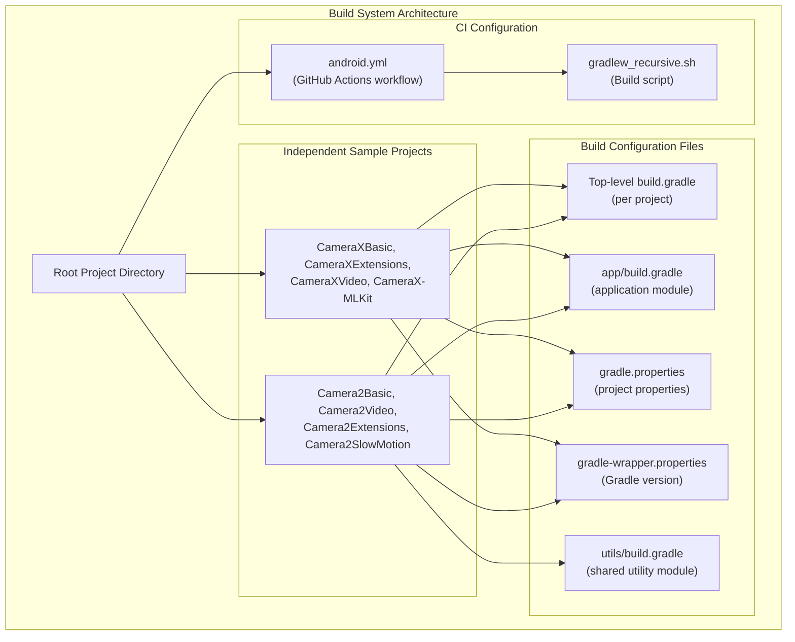
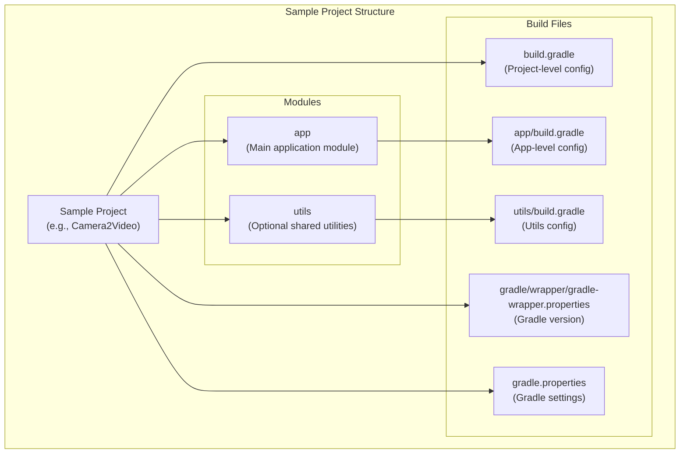
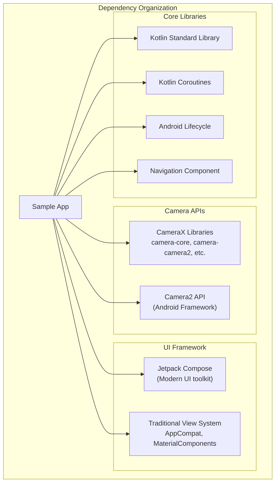
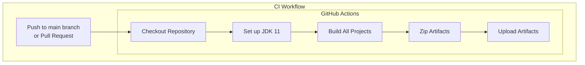

<!-- source: DeepWiki mcp.deepwiki.com · repo android/camera-samples · page 6 Build Configuration and CI · fetched 2026-10-23 -->

# Build Configuration and CI

<details>
<summary>Relevant source files</summary>

The following files were used as context for generating this wiki page:

- [.github/scripts/gradlew_recursive.sh](.github/scripts/gradlew_recursive.sh)
- [.github/workflows/android.yml](.github/workflows/android.yml)
- [Camera2SlowMotion/utils/build.gradle](Camera2SlowMotion/utils/build.gradle)
- [Camera2Video/app/build.gradle](Camera2Video/app/build.gradle)
- [Camera2Video/app/src/main/java/com/example/android/camera2/video/CameraActivity.kt](Camera2Video/app/src/main/java/com/example/android/camera2/video/CameraActivity.kt)
- [Camera2Video/build.gradle](Camera2Video/build.gradle)
- [Camera2Video/gradle/wrapper/gradle-wrapper.properties](Camera2Video/gradle/wrapper/gradle-wrapper.properties)
- [Camera2Video/utils/build.gradle](Camera2Video/utils/build.gradle)
- [CameraXExtensions/app/build.gradle](CameraXExtensions/app/build.gradle)
- [CameraXExtensions/build.gradle](CameraXExtensions/build.gradle)
- [CameraXExtensions/gradle.properties](CameraXExtensions/gradle.properties)
- [CameraXExtensions/gradle/wrapper/gradle-wrapper.properties](CameraXExtensions/gradle/wrapper/gradle-wrapper.properties)

</details>


This document provides technical details about the build configuration and continuous integration setup for the Android camera samples repository. It explains the Gradle build system architecture, dependency management, and the GitHub Actions CI pipeline used to build and test the samples.

## Build System Architecture

The camera-samples repository is organized as a collection of independent Android projects, each demonstrating different aspects of the Camera2 or CameraX APIs. Each sample has its own build configuration, while following consistent patterns and sharing some common utilities.



Sources: [CameraXExtensions/build.gradle](), [Camera2Video/build.gradle](), [CameraXExtensions/app/build.gradle](), [Camera2Video/app/build.gradle](), [Camera2Video/utils/build.gradle](), [.github/workflows/android.yml]()

## Sample Project Structure

Each camera sample is structured as a standalone Android application with its own build configuration. Some samples include a shared `utils` module for common functionality.



Sources: [Camera2Video/build.gradle](), [Camera2Video/app/build.gradle](), [Camera2Video/utils/build.gradle](), [Camera2Video/gradle/wrapper/gradle-wrapper.properties]()

## Gradle Configuration

### Top-Level Build Files

Each sample has a top-level `build.gradle` file that defines common configuration elements, including:

1. Kotlin version
2. Java compatibility version
3. Repository sources (Google, Maven Central)
4. Common dependencies and plugins
5. Version variables for shared dependencies

Example from CameraXExtensions:

```
ext.kotlin_version = '1.9.22'
ext.java_version = JavaVersion.VERSION_11
ext.camerax_version = '1.4.1'
ext.coroutines_version = '1.8.1'
ext.lifecycle_version = '2.8.0'
```

Sources: [CameraXExtensions/build.gradle:18-26]()

Different samples may use different versions based on their requirements:

| Sample | Kotlin Version | Java Version | Gradle Version |
|--------|---------------|--------------|---------------|
| CameraXExtensions | 1.9.22 | 11 | 8.0 |
| Camera2Video | 1.8.0 | 1.8 | 7.5.1 |

Sources: [CameraXExtensions/build.gradle:18-26](), [Camera2Video/build.gradle:19-22](), [CameraXExtensions/gradle/wrapper/gradle-wrapper.properties:19](), [Camera2Video/gradle/wrapper/gradle-wrapper.properties:6]()

### App-Level Build Files

The app-level `build.gradle` files define the configuration for each application module:

1. Android SDK versions (compile, min, target)
2. Application ID
3. Version code and name
4. Build types (debug/release)
5. Module-specific dependencies
6. Feature flags (viewBinding, compose, etc.)

Example from CameraXExtensions app module:

```
compileSdk 34
defaultConfig {
    applicationId "com.example.android.cameraxextensions"
    minSdk 24
    targetSdk 34
    versionCode 1
    versionName "1.0.0"
}
```

Sources: [CameraXExtensions/app/build.gradle:28-40]()

### Release Build Configuration

Several samples define release build types with optimization settings:

```
buildTypes {
    release {
        minifyEnabled true
        shrinkResources true
        proguardFiles getDefaultProguardFile('proguard-android-optimize.txt'), 'proguard-rules.pro'
    }
}
```

Sources: [CameraXExtensions/app/build.gradle:50-56]()

### Shared Utility Modules

Some samples like Camera2Video include a `utils` module that provides shared functionality. These are configured as Android library modules:

```
apply plugin: 'com.android.library'
apply plugin: 'kotlin-android'

android {
    compileSdkVersion 33
    defaultConfig {
        minSdkVersion 21
        targetSdkVersion 33
    }
}
```

Sources: [Camera2Video/utils/build.gradle:17-31]()

## Dependency Management

### Key Dependencies

The samples use various dependencies depending on their focus area:

1. **CameraX Libraries**
   - camera-core
   - camera-camera2
   - camera-lifecycle
   - camera-view
   - camera-extensions

2. **Camera2 Support**
   - Direct use of Camera2 API

3. **UI Frameworks**
   - AppCompat
   - Material Components
   - Jetpack Compose (in newer samples)
   - ConstraintLayout

4. **Other Common Dependencies**
   - Kotlin Coroutines
   - Lifecycle components
   - Navigation components
   - Image loading libraries (e.g., Coil)



Sources: [CameraXExtensions/app/build.gradle:68-114](), [Camera2Video/app/build.gradle:67-86]()

### Version Management

Library versions are typically defined as variables in the top-level build.gradle:

```
ext.camerax_version = '1.4.1'
ext.coroutines_version = '1.8.1'
ext.lifecycle_version = '2.8.0'
```

These variables are then referenced in the dependency declarations:

```
implementation "androidx.camera:camera-core:$camerax_version"
implementation "androidx.camera:camera-camera2:$camerax_version"
```

Sources: [CameraXExtensions/build.gradle:23-25](), [CameraXExtensions/app/build.gradle:73-79]()

## Continuous Integration

The repository uses GitHub Actions for continuous integration. The workflow is defined in the `.github/workflows/android.yml` file.



Sources: [.github/workflows/android.yml:15-44]()

### CI Workflow Execution

1. **Triggers**:
   - Push to the main branch
   - Pull requests to the main branch

2. **Runner Environment**:
   - Ubuntu 18.04
   - JDK 11

3. **Build Steps**:
   - Check out the code
   - Set up Java environment
   - Build all projects using `gradlew_recursive.sh`
   - Zip build artifacts (APKs, AABs, AARs, SOs)
   - Upload artifacts for later access

Sources: [.github/workflows/android.yml:17-44]()

### Recursive Build Script

The CI workflow uses a shell script to build all sample projects:

```bash
for GRADLEW in `find . -name "gradlew"` ; do
    SAMPLE=$(dirname "${GRADLEW}")
    bash "$GRADLEW" -p "$SAMPLE" -Pci --no-parallel --stacktrace $@
done
```

This script:
1. Finds all `gradlew` wrapper scripts in the repository
2. For each found wrapper, builds the corresponding project
3. Passes `-Pci` flag to indicate CI environment
4. Disables parallel compilation to avoid resource contention
5. Passes through any additional arguments

Sources: [.github/scripts/gradlew_recursive.sh:21-25]()

## Build Customization and Extension

The build system supports several customization options:

1. **Build Features**:
   - ViewBinding: `buildFeatures { viewBinding true }`
   - Compose: `buildFeatures { compose true }`

2. **Compiler Options**:
   - Java compatibility: `compileOptions { sourceCompatibility, targetCompatibility }`
   - Kotlin target: `kotlinOptions { jvmTarget = ... }`
   - Compose compiler: `composeOptions { kotlinCompilerExtensionVersion = ... }`

3. **Testing Setup**:
   - Shared test directories: `sourceSets { ... }`
   - Test instrumentation runners

Sources: [Camera2Video/app/build.gradle:62-64](), [CameraXExtensions/app/build.gradle:42-48](), [Camera2Video/app/build.gradle:33-40](), [Camera2Video/app/build.gradle:51-60]()

## Summary

The camera-samples repository uses a modular Gradle build system with independent projects for each sample. This organization allows each sample to use appropriate versions of libraries and build tools while maintaining a consistent structure. The CI system builds all samples automatically for every push and pull request to ensure code quality and compatibility.

For information about the camera samples architectures and implementations, see [Architecture Overview](#2).

---

