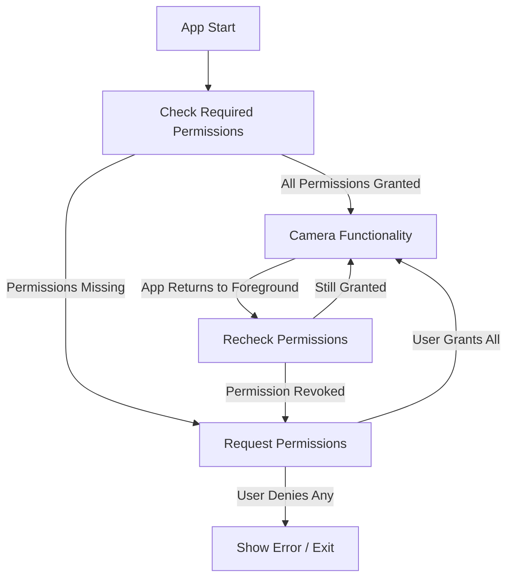
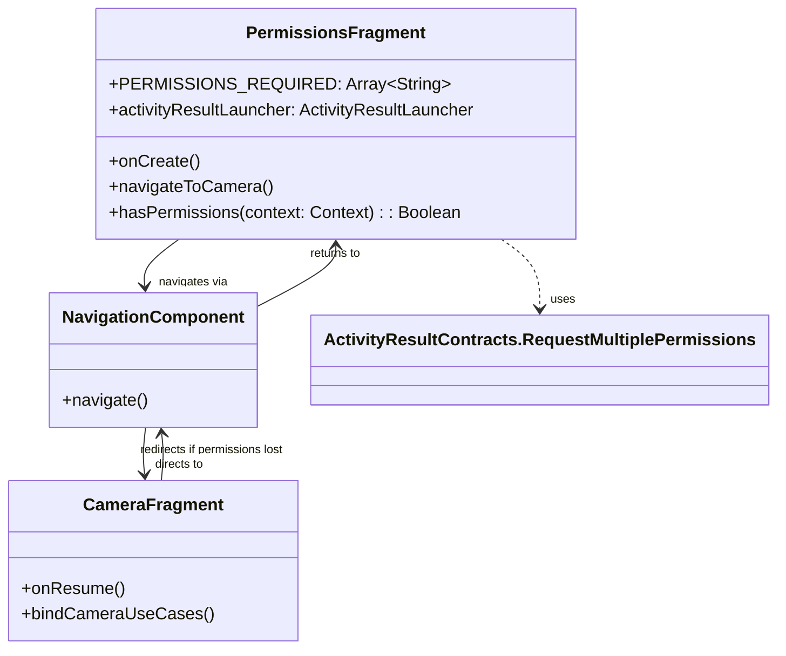
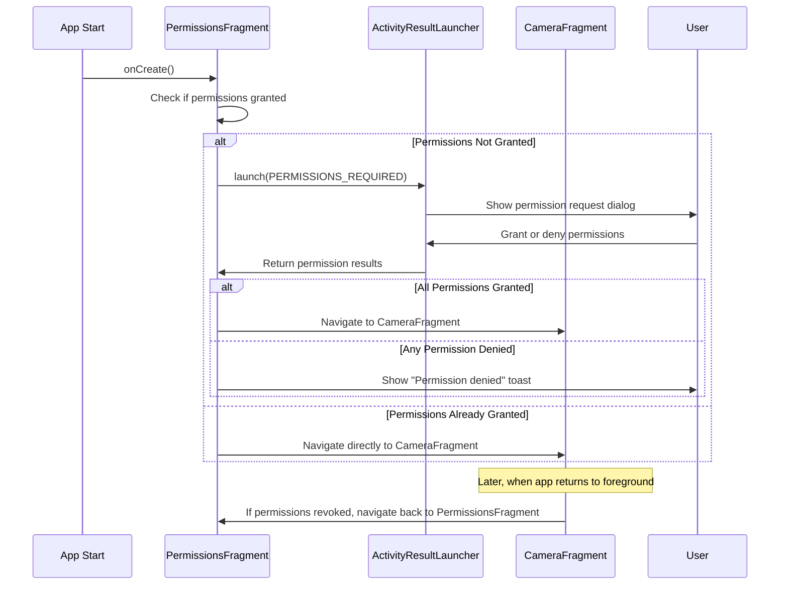
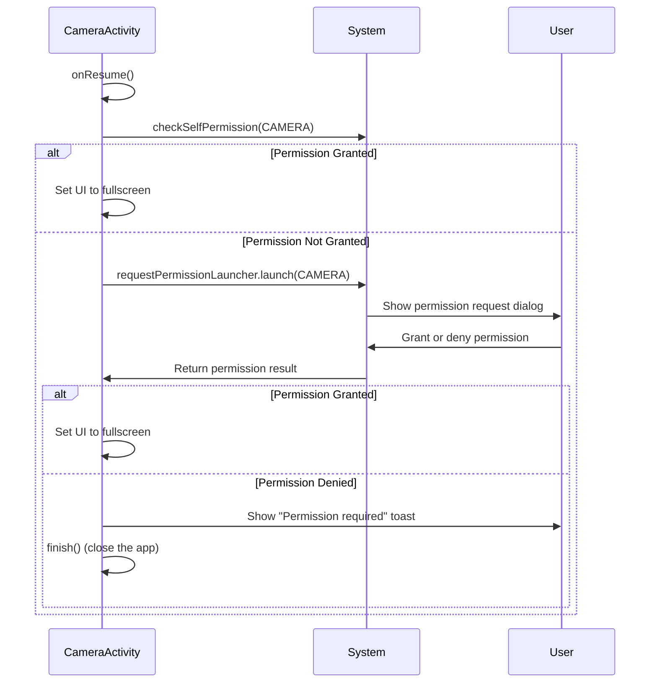

<!-- source: DeepWiki mcp.deepwiki.com · repo android/camera-samples · page 7 Permissions Handling · fetched 2026-10-23 -->

# Permissions Handling

<details>
<summary>Relevant source files</summary>

The following files were used as context for generating this wiki page:

- [Camera2Extensions/.gitignore](Camera2Extensions/.gitignore)
- [Camera2Extensions/app/src/main/AndroidManifest.xml](Camera2Extensions/app/src/main/AndroidManifest.xml)
- [Camera2Extensions/app/src/main/java/com/example/android/camera2/extensions/CameraActivity.kt](Camera2Extensions/app/src/main/java/com/example/android/camera2/extensions/CameraActivity.kt)
- [Camera2Extensions/app/src/main/java/com/example/android/camera2/extensions/fragments/SelectorFragment.kt](Camera2Extensions/app/src/main/java/com/example/android/camera2/extensions/fragments/SelectorFragment.kt)
- [Camera2Extensions/app/src/main/res/layout-land/fragment_camera.xml](Camera2Extensions/app/src/main/res/layout-land/fragment_camera.xml)
- [Camera2Extensions/app/src/main/res/navigation/nav_graph.xml](Camera2Extensions/app/src/main/res/navigation/nav_graph.xml)
- [Camera2Extensions/app/src/test/java/com/example/android/camera2/extensions/InstrumentedTests.kt](Camera2Extensions/app/src/test/java/com/example/android/camera2/extensions/InstrumentedTests.kt)
- [CameraXBasic/app/build.gradle](CameraXBasic/app/build.gradle)
- [CameraXBasic/app/src/main/java/com/android/example/cameraxbasic/fragments/CameraFragment.kt](CameraXBasic/app/src/main/java/com/android/example/cameraxbasic/fragments/CameraFragment.kt)
- [CameraXBasic/app/src/main/java/com/android/example/cameraxbasic/fragments/PermissionsFragment.kt](CameraXBasic/app/src/main/java/com/android/example/cameraxbasic/fragments/PermissionsFragment.kt)
- [CameraXBasic/build.gradle](CameraXBasic/build.gradle)
- [CameraXVideo/app/src/main/java/com/example/android/camerax/video/fragments/PermissionsFragment.kt](CameraXVideo/app/src/main/java/com/example/android/camerax/video/fragments/PermissionsFragment.kt)
- [CameraXVideo/app/src/main/res/layout/fragment_permission.xml](CameraXVideo/app/src/main/res/layout/fragment_permission.xml)
- [CameraXVideo/app/src/main/res/navigation/nav_graph.xml](CameraXVideo/app/src/main/res/navigation/nav_graph.xml)

</details>


This document explains how camera and storage permissions are handled across the Android camera samples repository. It covers the permission requirements, request mechanisms, and lifecycle management strategies implemented in both CameraX and Camera2 sample applications.

## Overview of Required Permissions

Android camera applications require specific runtime permissions to function properly:

1. **Camera Permission**: All samples require `Manifest.permission.CAMERA` to access the device's camera hardware.
2. **Audio Recording Permission**: Video recording samples require `Manifest.permission.RECORD_AUDIO`.
3. **Storage Permission**: For Android 9 (API level 28) and below, `Manifest.permission.WRITE_EXTERNAL_STORAGE` is required to save media to external storage.

### Permission Requirements by Sample

| Sample | Camera | Record Audio | External Storage | 
|--------|:------:|:------------:|:----------------:|
| CameraXBasic | Yes | No | Yes (Android ≤ 9) |
| CameraXVideo | Yes | Yes | Yes (Android ≤ 9) |
| Camera2Basic | Yes | No | Yes (Android ≤ 9) |
| Camera2Video | Yes | Yes | Yes (Android ≤ 9) |
| Camera2Extensions | Yes | No | No |

Sources:
- [CameraXBasic/app/src/main/java/com/android/example/cameraxbasic/fragments/PermissionsFragment.kt:32-47]()
- [CameraXVideo/app/src/main/java/com/example/android/camerax/video/fragments/PermissionsFragment.kt:37-52]()
- [Camera2Extensions/app/src/main/AndroidManifest.xml:22-24]()

### Generic Permission Flow

The diagram below illustrates the general permission handling flow implemented across the samples:



## Permission Handling Approaches

The camera samples implement two primary approaches to permission handling:

1. **Fragment-based approach**: Used in CameraX samples, with a dedicated `PermissionsFragment` that handles permission requests before navigating to camera functionality.

2. **Activity-based approach**: Used in some Camera2 samples, where permission requests are handled directly in the main activity.

## CameraX Permission Handling Implementation

The CameraX samples (CameraXBasic and CameraXVideo) use a dedicated `PermissionsFragment` that handles all permission-related logic.

### Permission Component Architecture



Sources:
- [CameraXBasic/app/src/main/java/com/android/example/cameraxbasic/fragments/PermissionsFragment.kt:38-87]()
- [CameraXVideo/app/src/main/java/com/example/android/camerax/video/fragments/PermissionsFragment.kt:44-104]()

### Permission Request Flow in CameraXBasic

The diagram below shows the complete permission request flow in the CameraXBasic sample:



Sources:
- [CameraXBasic/app/src/main/java/com/android/example/cameraxbasic/fragments/PermissionsFragment.kt:40-79]()
- [CameraXBasic/app/src/main/java/com/android/example/cameraxbasic/fragments/CameraFragment.kt:130-139]()

### Key Implementation Details

#### 1. Required Permissions Definition

In CameraXBasic, the permissions array is initialized with just the camera permission:

```kotlin
private var PERMISSIONS_REQUIRED = arrayOf(Manifest.permission.CAMERA)
```

In CameraXVideo, both camera and audio recording permissions are required:

```kotlin
private var PERMISSIONS_REQUIRED = arrayOf(
    Manifest.permission.CAMERA,
    Manifest.permission.RECORD_AUDIO)
```

#### 2. Storage Permission for Android 9 and Below

Both samples add the storage permission for Android 9 and below:

```kotlin
if (Build.VERSION.SDK_INT <= Build.VERSION_CODES.P) {
    val permissionList = PERMISSIONS_REQUIRED.toMutableList()
    permissionList.add(Manifest.permission.WRITE_EXTERNAL_STORAGE)
    PERMISSIONS_REQUIRED = permissionList.toTypedArray()
}
```

#### 3. Permission Check Method

A utility method checks if all required permissions are granted:

```kotlin
fun hasPermissions(context: Context) = PERMISSIONS_REQUIRED.all {
    ContextCompat.checkSelfPermission(context, it) == PackageManager.PERMISSION_GRANTED
}
```

#### 4. Permission Request Using ActivityResultLauncher

Permissions are requested using the AndroidX Activity Result API:

```kotlin
private val activityResultLauncher =
    registerForActivityResult(ActivityResultContracts.RequestMultiplePermissions())
    { permissions ->
        // Handle Permission granted/rejected
        var permissionGranted = true
        permissions.entries.forEach {
            if (it.key in PERMISSIONS_REQUIRED && it.value == false)
                permissionGranted = false
        }
        if (!permissionGranted) {
            Toast.makeText(context, "Permission request denied", Toast.LENGTH_LONG).show()
        } else {
            navigateToCamera()
        }
    }
```

#### 5. Permission Rechecking on Resume

CameraXBasic rechecks permissions in `CameraFragment.onResume()`:

```kotlin
override fun onResume() {
    super.onResume()
    // Make sure that all permissions are still present, since the
    // user could have removed them while the app was in paused state.
    if (!PermissionsFragment.hasPermissions(requireContext())) {
        Navigation.findNavController(requireActivity(), R.id.fragment_container).navigate(
                CameraFragmentDirections.actionCameraToPermissions()
        )
    }
}
```

Sources:
- [CameraXBasic/app/src/main/java/com/android/example/cameraxbasic/fragments/PermissionsFragment.kt:32-86]()
- [CameraXVideo/app/src/main/java/com/example/android/camerax/video/fragments/PermissionsFragment.kt:37-79]()
- [CameraXBasic/app/src/main/java/com/android/example/cameraxbasic/fragments/CameraFragment.kt:130-139]()

## Camera2 Permission Handling Implementation

The Camera2 samples take a different approach to permission handling, often implementing it at the activity level.

### Camera2Extensions Permission Flow

The Camera2Extensions sample handles permissions at the activity level in `CameraActivity`:



### Key Implementation Details

#### 1. Permission Check in onResume

```kotlin
override fun onResume() {
    super.onResume()
    if (ContextCompat.checkSelfPermission(this, Manifest.permission.CAMERA) ==
        PackageManager.PERMISSION_GRANTED) {
        container.postDelayed({
                                  @Suppress("DEPRECATION")
                                  container.systemUiVisibility = FLAGS_FULLSCREEN
                              },
                              IMMERSIVE_FLAG_TIMEOUT)
    } else  {
        requestPermissionLauncher.launch(Manifest.permission.CAMERA)
    }
}
```

#### 2. Single Permission Request Using ActivityResultLauncher

```kotlin
private val requestPermissionLauncher =
    registerForActivityResult(
        ActivityResultContracts.RequestPermission()
    ) { isGranted: Boolean ->
        if (isGranted) {
            // Set UI to fullscreen mode
            container.postDelayed({
                                      @Suppress("DEPRECATION")
                                      container.systemUiVisibility = FLAGS_FULLSCREEN
                                  },
                                  IMMERSIVE_FLAG_TIMEOUT)
        } else {
            Toast.makeText(this, R.string.permission_required,
                           Toast.LENGTH_SHORT).show()
            finish()
        }
    }
```

Sources:
- [Camera2Extensions/app/src/main/java/com/example/android/camera2/extensions/CameraActivity.kt:40-77]()
- [Camera2Extensions/app/src/main/AndroidManifest.xml:22-24]()

## Navigation Integration

Permission handling is integrated with the Android Navigation Component in the CameraX samples:

```xml
<navigation
    xmlns:android="http://schemas.android.com/apk/res/android"
    xmlns:app="http://schemas.android.com/apk/res-auto"
    android:id="@+id/nav_graph"
    app:startDestination="@id/permissions_fragment">

    <fragment
        android:id="@+id/permissions_fragment"
        android:name="com.example.android.camerax.video.fragments.PermissionsFragment"
        android:label="Permissions" >

        <action
            android:id="@+id/action_permissions_to_capture"
            app:destination="@id/capture_fragment"
            app:popUpTo="@id/permissions_fragment"
            app:popUpToInclusive="true"/>

    </fragment>
    ...
</navigation>
```

The permission fragment is set as the start destination, and navigation actions are defined to move to the camera functionality after permissions are granted.

Sources:
- [CameraXVideo/app/src/main/res/navigation/nav_graph.xml:17-35]()

## Permission Handling Best Practices

Based on the implementations in the camera samples, several best practices emerge:

### 1. Dedicated Permission Handling Component

Using a dedicated fragment or class for permission handling provides a clean separation of concerns. This approach is demonstrated in the CameraX samples with the `PermissionsFragment`.

### 2. Version-Specific Permission Logic

Different Android versions have different permission requirements. The samples handle this by conditionally adding the external storage permission for Android 9 and below.

### 3. Permission Rechecking on Resume

Since users can revoke permissions while the app is in the background, it's important to recheck permissions when the app returns to the foreground, as shown in `CameraFragment.onResume()`.

### 4. Graceful Handling of Permission Denial

When permissions are denied, the samples either show a toast message or close the app gracefully. This prevents crashes and provides feedback to the user.

### 5. Using the Activity Result API

All samples use the modern AndroidX Activity Result API for permission requests instead of the older `onRequestPermissionsResult()` callback, providing a more structured approach to permission handling.

Sources:
- [CameraXBasic/app/src/main/java/com/android/example/cameraxbasic/fragments/PermissionsFragment.kt:65-79]()
- [CameraXBasic/app/src/main/java/com/android/example/cameraxbasic/fragments/CameraFragment.kt:130-139]()
- [Camera2Extensions/app/src/main/java/com/example/android/camera2/extensions/CameraActivity.kt:40-58]()

These permission handling patterns ensure a smooth user experience while respecting user control over app permissions. They also serve as excellent reference implementations for developers creating their own camera applications.