# Page: Overview

# Overview

<details>
<summary>Relevant source files</summary>

The following files were used as context for generating this wiki page:

- [CameraXExtensions/README.md](CameraXExtensions/README.md)
- [CameraXExtensions/screenshots/camerax_camera_extensions_screenshot.png](CameraXExtensions/screenshots/camerax_camera_extensions_screenshot.png)
- [CameraXExtensions/screenshots/camerax_extensions_architecture_diagram.png](CameraXExtensions/screenshots/camerax_extensions_architecture_diagram.png)
- [README.md](README.md)

</details>


## Purpose and Scope

This document provides a high-level introduction to the Android Camera Samples repository. This repository contains a collection of Android Studio projects that demonstrate how to use the [Camera2](https://developer.android.com/training/camera2) and [CameraX](https://developer.android.com/training/camerax) APIs in Android applications. Each sample focuses on different camera functionality, from basic preview and capture to advanced features like HDR, slow-motion video, and machine learning integration.

For detailed information about the overall architecture, see [Architecture Overview](#2). For specifics about CameraX samples, see [CameraX Samples](#3), and for Camera2 samples, see [Camera2 Samples](#4).

Sources: [README.md:1-21]()

## Repository Structure

The Camera Samples repository is organized into independent Android Studio projects, each demonstrating specific camera capabilities. The samples are divided into two main categories based on the API they use: CameraX or Camera2.

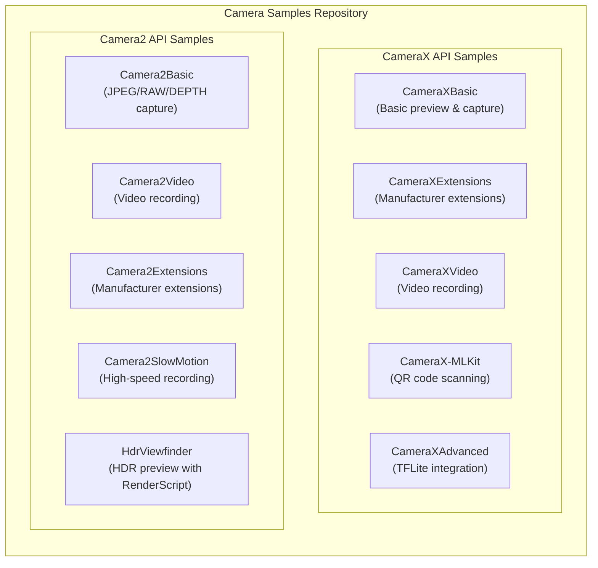

Sources: [README.md:1-21]()

## Samples Overview

The repository contains multiple samples that demonstrate various aspects of Android camera development, from basic functionality to advanced features.

| Sample | API | Description |
|--------|-----|-------------|
| CameraXBasic | CameraX | Demonstrates basic camera preview, image capture, and simple image analysis |
| CameraXAdvanced | CameraX | Shows integration with TensorFlow Lite and other advanced features |
| CameraXVideo | CameraX | Demonstrates video capture capabilities using CameraX VideoCapture API |
| CameraX-MLKit | CameraX | Shows how to use CameraX's MlKitAnalyzer to build a QR-code scanner |
| CameraXExtensions | CameraX | Demonstrates manufacturer-specific extensions (Auto, Bokeh, Face Retouch, HDR, Night) |
| Camera2Basic | Camera2 | Shows capturing of JPEG, RAW, and DEPTH images directly from the camera sensor |
| Camera2Video | Camera2 | Demonstrates video recording using Camera2 API and MediaRecorder |
| Camera2Extensions | Camera2 | Shows Camera2 extension live preview and still capture |
| Camera2SlowMotion | Camera2 | Demonstrates high-speed video recording in a constrained camera capture session |
| HdrViewfinder | Camera2 | Shows use of RenderScript to display a live HDR feed from camera frames |

Sources: [README.md:7-21](), [CameraXExtensions/README.md:5-18]()

## API Relationship

The following diagram illustrates the relationship between the two camera APIs demonstrated in this repository and how they interact with the Android camera framework.

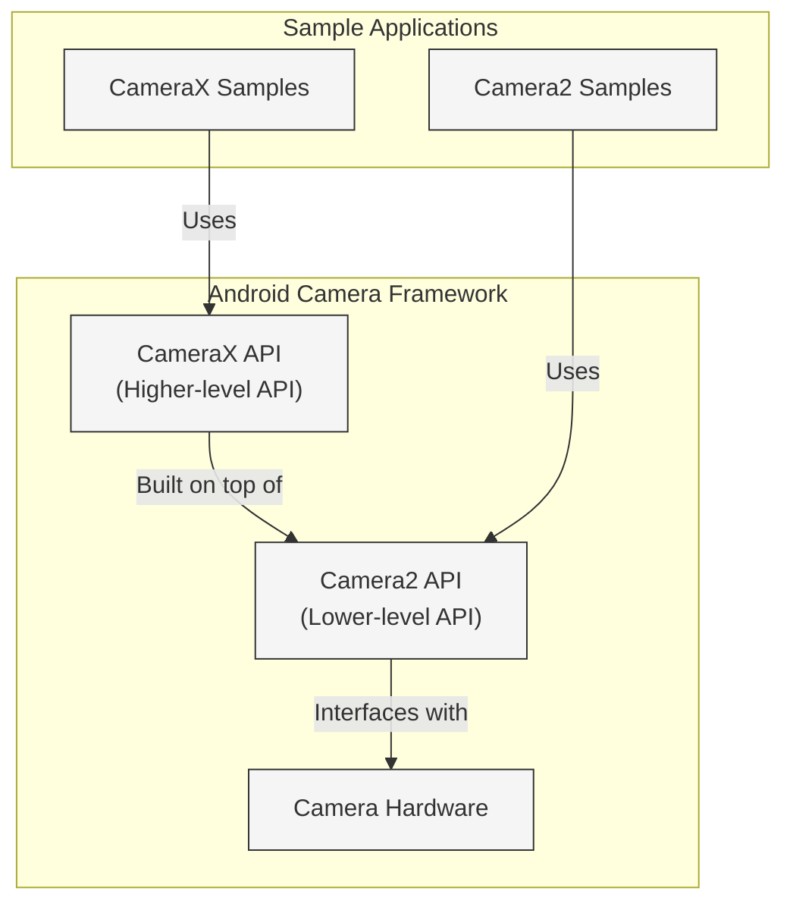

Sources: [README.md:3-5]()

## Key Features

The repository demonstrates various camera functionalities across different samples:

1. **Basic Camera Operations**
   - Camera preview
   - Still image capture
   - Permission handling

2. **Advanced Camera Features**
   - Video recording (standard and slow-motion)
   - RAW image capture
   - Depth imaging
   - HDR processing

3. **Manufacturer Extensions**
   - Bokeh effect
   - Night mode
   - HDR
   - Face retouch
   - Auto mode

4. **Integration with Other Technologies**
   - ML Kit for QR code scanning
   - TensorFlow Lite
   - RenderScript for image processing

5. **Architecture Patterns**
   - MVVM architecture (particularly in CameraXExtensions)
   - Single Activity, Multiple Fragments design
   - Pipeline pattern for video processing

Sources: [README.md:7-21](), [CameraXExtensions/README.md:32-36]()

## Developer Benefits

This repository provides several benefits for Android developers working with camera functionality:

1. **Learning Resources**: Ready-to-use examples that demonstrate camera implementation best practices
2. **Code Reference**: Working code that can be used as a reference for specific camera features
3. **Architecture Guidance**: Examples of well-structured camera applications using modern Android architecture patterns
4. **Feature Exploration**: Demonstration of advanced camera capabilities that may not be obvious from the API documentation alone
5. **Cross-API Comparison**: The ability to compare implementation approaches between CameraX and Camera2

The samples are designed to be built and run independently, allowing developers to focus on specific camera features that meet their application needs.

Sources: [README.md:1-21](), [CameraXExtensions/README.md:9-18]()

---

# Page: Architecture Overview

# Architecture Overview

<details>
<summary>Relevant source files</summary>

The following files were used as context for generating this wiki page:

- [Camera2Video/app/src/main/java/com/example/android/camera2/video/EncoderWrapper.kt](Camera2Video/app/src/main/java/com/example/android/camera2/video/EncoderWrapper.kt)
- [Camera2Video/app/src/main/java/com/example/android/camera2/video/HardwarePipeline.kt](Camera2Video/app/src/main/java/com/example/android/camera2/video/HardwarePipeline.kt)
- [Camera2Video/app/src/main/java/com/example/android/camera2/video/Pipeline.kt](Camera2Video/app/src/main/java/com/example/android/camera2/video/Pipeline.kt)
- [Camera2Video/app/src/main/java/com/example/android/camera2/video/SoftwarePipeline.kt](Camera2Video/app/src/main/java/com/example/android/camera2/video/SoftwarePipeline.kt)
- [Camera2Video/app/src/main/java/com/example/android/camera2/video/fragments/PreviewFragment.kt](Camera2Video/app/src/main/java/com/example/android/camera2/video/fragments/PreviewFragment.kt)
- [CameraXBasic/app/build.gradle](CameraXBasic/app/build.gradle)
- [CameraXBasic/app/src/main/java/com/android/example/cameraxbasic/fragments/CameraFragment.kt](CameraXBasic/app/src/main/java/com/android/example/cameraxbasic/fragments/CameraFragment.kt)
- [CameraXBasic/app/src/main/java/com/android/example/cameraxbasic/fragments/PermissionsFragment.kt](CameraXBasic/app/src/main/java/com/android/example/cameraxbasic/fragments/PermissionsFragment.kt)
- [CameraXBasic/build.gradle](CameraXBasic/build.gradle)
- [CameraXExtensions/README.md](CameraXExtensions/README.md)
- [CameraXExtensions/screenshots/camerax_camera_extensions_screenshot.png](CameraXExtensions/screenshots/camerax_camera_extensions_screenshot.png)
- [CameraXExtensions/screenshots/camerax_extensions_architecture_diagram.png](CameraXExtensions/screenshots/camerax_extensions_architecture_diagram.png)
- [README.md](README.md)

</details>


This document provides a comprehensive overview of the architecture used in the Android Camera Samples repository. It focuses on explaining the high-level organization of the samples, the two distinct approaches to camera implementation (CameraX and Camera2), and how the various components interact. 

For detailed implementation specifics, refer to [CameraX API Fundamentals](#2.1) or [Camera2 API Fundamentals](#2.2).

## Repository Organization

The camera samples repository is organized into two distinct categories based on the Android camera API used. Each sample application demonstrates specific camera features while following consistent architectural patterns.

### Repository Structure Diagram

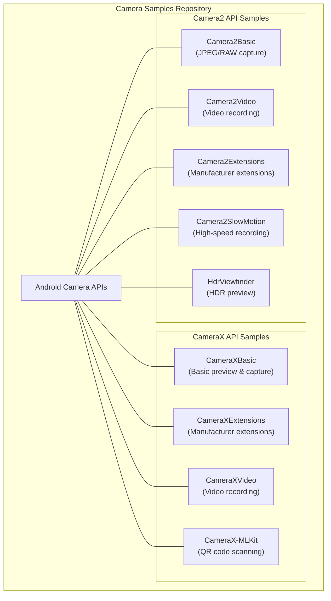

Sources: [README.md:1-21]()

## API Relationship and Core Concepts

Understanding the relationship between Camera2 and CameraX is fundamental to grasping the architecture of the samples.

### API Hierarchy Diagram

```mermaid
graph TD
    subgraph "Android Camera APIs"
        Camera2["Camera2 API"]
        CameraX["CameraX API"]
    end
    
    subgraph "Implementation Details"
        CameraX --> "Lifecycle-aware"
        CameraX --> "Use case-based"
        CameraX --> "Error handling"
        
        Camera2 --> "Direct control"
        Camera2 --> "Complex callbacks"
        Camera2 --> "Manual configuration"
    end
    
    CameraX --"Built on top of"--> Camera2
```

Sources: [CameraXBasic/app/build.gradle:74-89]()

Key concepts to understand:

1. **CameraX API**: A higher-level abstraction that:
   - Simplifies camera development through predefined use cases
   - Handles lifecycle management automatically
   - Provides consistent behavior across devices
   - Is built on top of Camera2 API

2. **Camera2 API**: A lower-level API that:
   - Offers maximum control over camera hardware
   - Requires more complex implementation
   - Provides direct access to camera features

## Common Architectural Patterns

Several architectural patterns appear consistently across the sample applications:

### Single Activity with Multiple Fragments

Most samples utilize a single activity with multiple fragments for different screens:

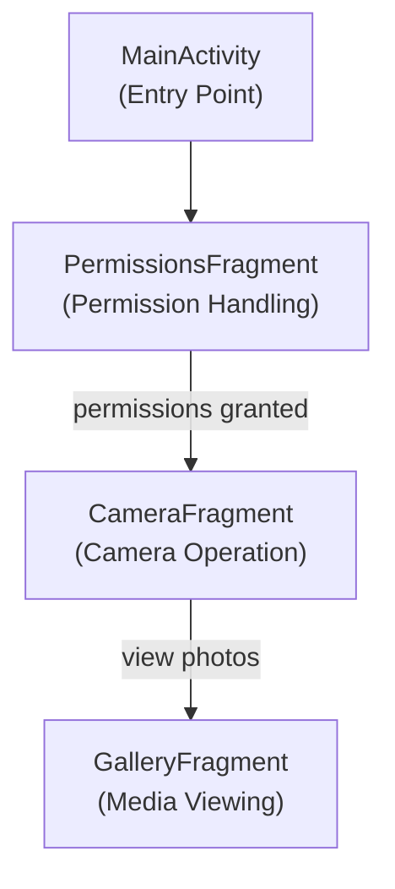

Sources: [CameraXBasic/app/src/main/java/com/android/example/cameraxbasic/fragments/CameraFragment.kt:73-674](), [CameraXBasic/app/src/main/java/com/android/example/cameraxbasic/fragments/PermissionsFragment.kt:38-87]()

### Lifecycle-Aware Camera Management

Camera resources are carefully managed according to Android activity/fragment lifecycles:

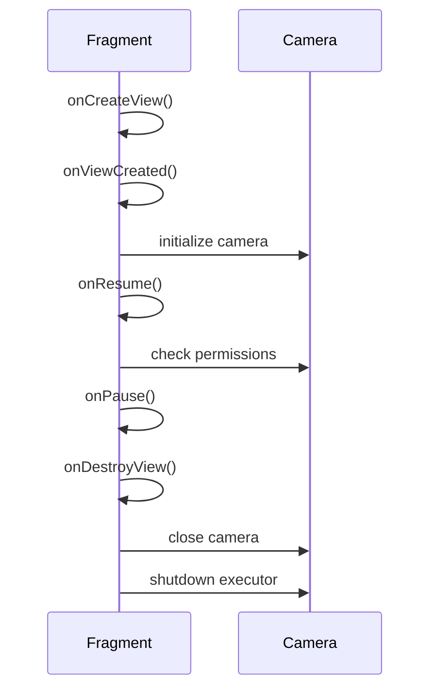

Sources: [CameraXBasic/app/src/main/java/com/android/example/cameraxbasic/fragments/CameraFragment.kt:130-151](), [CameraXBasic/app/src/main/java/com/android/example/cameraxbasic/fragments/CameraFragment.kt:179-214]()

### MVVM Architecture

The CameraXExtensions sample notably employs Model-View-ViewModel architecture:

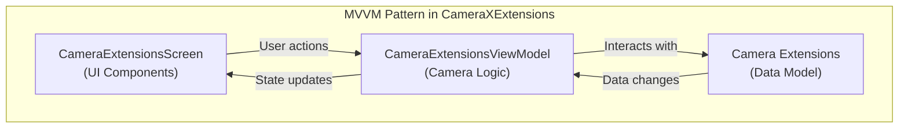

Sources: [CameraXExtensions/README.md:31-36]()

## CameraX Architecture

The CameraX samples demonstrate the use of predefined use cases for camera operations.

### CameraX Implementation Diagram

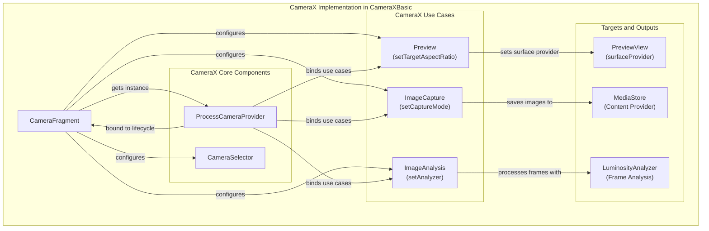

Sources: [CameraXBasic/app/src/main/java/com/android/example/cameraxbasic/fragments/CameraFragment.kt:234-306]()

Key components of CameraX implementation:

1. **ProcessCameraProvider**: Central component that binds camera lifecycle
   ```kotlin
   // Get instance of ProcessCameraProvider
   cameraProvider = ProcessCameraProvider.getInstance(requireContext()).await()
   ```

2. **Use Cases**:
   - **Preview**: For camera viewfinder display
     ```kotlin
     preview = Preview.Builder()
             .setTargetAspectRatio(screenAspectRatio)
             .setTargetRotation(rotation)
             .build()
     ```
   
   - **ImageCapture**: For taking photos
     ```kotlin
     imageCapture = ImageCapture.Builder()
             .setCaptureMode(ImageCapture.CAPTURE_MODE_MINIMIZE_LATENCY)
             .setTargetAspectRatio(screenAspectRatio)
             .setTargetRotation(rotation)
             .build()
     ```
   
   - **ImageAnalysis**: For processing camera frames
     ```kotlin
     imageAnalyzer = ImageAnalysis.Builder()
             .setTargetAspectRatio(screenAspectRatio)
             .setTargetRotation(rotation)
             .build()
             .also {
                 it.setAnalyzer(cameraExecutor, LuminosityAnalyzer { luma ->
                     // Process the frame
                 })
             }
     ```

3. **Binding Use Cases**: All use cases are bound to the lifecycle
   ```kotlin
   camera = cameraProvider.bindToLifecycle(
           this, cameraSelector, preview, imageCapture, imageAnalyzer)
   ```

Sources: [CameraXBasic/app/src/main/java/com/android/example/cameraxbasic/fragments/CameraFragment.kt:271-306]()

## Camera2 Architecture

The Camera2 samples demonstrate direct camera control through a more complex but flexible API.

### Camera2 Implementation Diagram

```mermaid
graph TD
    subgraph "Camera2 Implementation in Camera2Video"
        PreviewFragment["PreviewFragment"]
        
        subgraph "Camera Components"
            CameraManager["CameraManager<br>(System Service)"]
            CameraDevice["CameraDevice<br>(Camera Hardware)"]
            CameraCaptureSession["CameraCaptureSession<br>(Data Flow)"]
        end
        
        subgraph "Capture Control"
            CaptureRequest["CaptureRequest<br>(Camera Parameters)"]
            PreviewRequest["Preview Request"]
            RecordRequest["Record Request"]
        end
        
        subgraph "Pipeline Architecture"
            Pipeline["Pipeline<br>(Abstract Class)"]
            HardwarePipeline["HardwarePipeline<br>(OpenGL)"]
            SoftwarePipeline["SoftwarePipeline<br>(Direct)"]
            EncoderWrapper["EncoderWrapper<br>(Media Encoding)"]
        end
        
        PreviewFragment --"gets system service"--> CameraManager
        CameraManager --"openCamera()"--> CameraDevice
        
        PreviewFragment --"creates based on args"--> Pipeline
        Pipeline <|-- HardwarePipeline
        Pipeline <|-- SoftwarePipeline
        
        PreviewFragment --"creates"--> EncoderWrapper
        
        CameraDevice --"createCaptureSession()"--> CameraCaptureSession
        CameraDevice --"createCaptureRequest()"--> CaptureRequest
        CaptureRequest --> PreviewRequest
        CaptureRequest --> RecordRequest
        
        Pipeline --"creates"--> PreviewRequest
        Pipeline --"creates"--> RecordRequest
        
        CameraCaptureSession --"setRepeatingRequest()"--> PreviewRequest
        CameraCaptureSession --"setRepeatingRequest()"--> RecordRequest
        
        HardwarePipeline --"sends frames to"--> EncoderWrapper
        SoftwarePipeline --"sends frames to"--> EncoderWrapper
    end
```

Sources: [Camera2Video/app/src/main/java/com/example/android/camera2/video/fragments/PreviewFragment.kt:76-414]()

Key components of Camera2 implementation:

1. **CameraManager**: System service that manages camera devices
   ```kotlin
   private val cameraManager: CameraManager by lazy {
       val context = requireContext().applicationContext
       context.getSystemService(Context.CAMERA_SERVICE) as CameraManager
   }
   ```

2. **CameraDevice**: Represents the camera hardware, opened asynchronously
   ```kotlin
   private suspend fun openCamera(
           manager: CameraManager,
           cameraId: String,
           handler: Handler? = null
   ): CameraDevice = suspendCancellableCoroutine { cont ->
       manager.openCamera(cameraId, object : CameraDevice.StateCallback() {
           override fun onOpened(device: CameraDevice) = cont.resume(device)
           // Error handling omitted
       }, handler)
   }
   ```

3. **CameraCaptureSession**: Controls the data flow from the camera
   ```kotlin
   private suspend fun createCaptureSession(
           device: CameraDevice,
           targets: List<Surface>,
           handler: Handler,
           recordingCompleteOnClose: Boolean
   ): CameraCaptureSession = suspendCoroutine { cont ->
       val stateCallback = object: CameraCaptureSession.StateCallback() {
           override fun onConfigured(session: CameraCaptureSession) = cont.resume(session)
           // Other callbacks omitted
       }
       setupSessionWithDynamicRangeProfile(device, targets, handler, stateCallback)
   }
   ```

Sources: [Camera2Video/app/src/main/java/com/example/android/camera2/video/fragments/PreviewFragment.kt:415-510]()

## Video Processing Pipeline Architecture

The Camera2Video sample showcases a specialized pipeline architecture for video processing:

### Pipeline Class Diagram

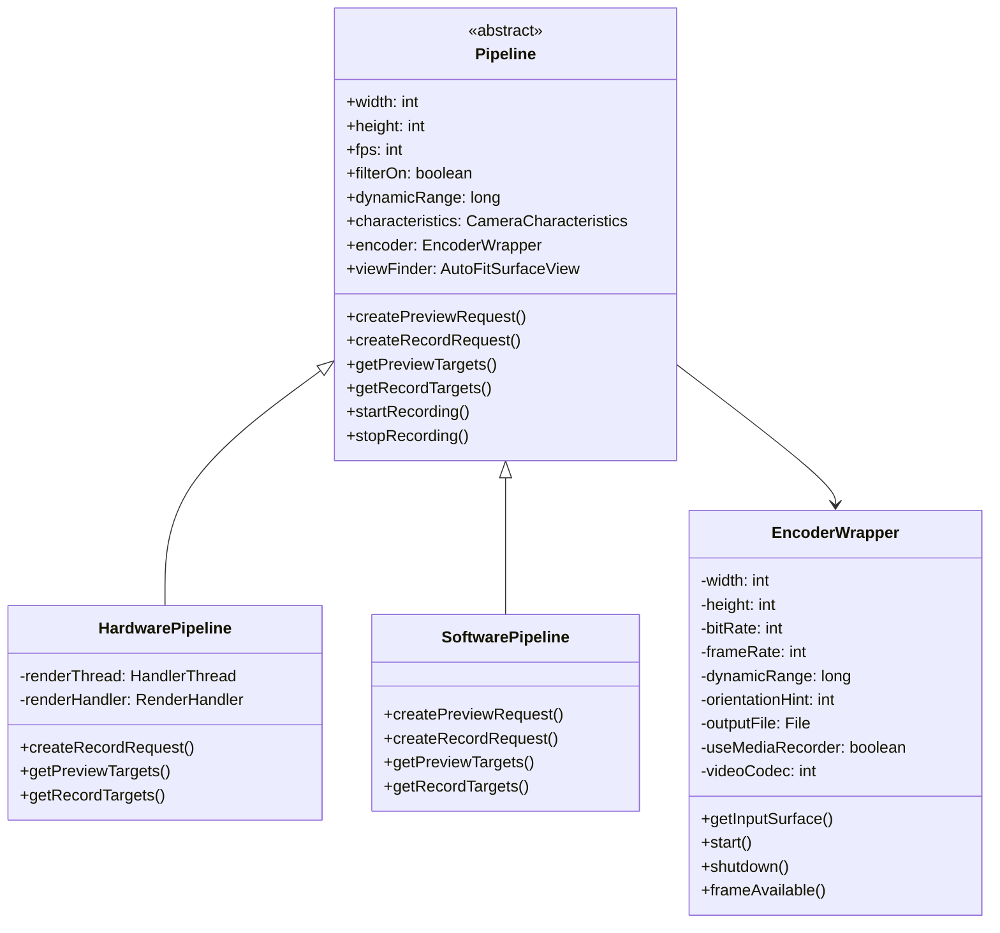

Sources: [Camera2Video/app/src/main/java/com/example/android/camera2/video/Pipeline.kt:28-67](), [Camera2Video/app/src/main/java/com/example/android/camera2/video/HardwarePipeline.kt:325-390](), [Camera2Video/app/src/main/java/com/example/android/camera2/video/SoftwarePipeline.kt:29-73](), [Camera2Video/app/src/main/java/com/example/android/camera2/video/EncoderWrapper.kt:41-254]()

This pipeline architecture provides:

1. **Abstraction**: The `Pipeline` abstract class defines the interface for all pipeline implementations
   ```kotlin
   abstract class Pipeline(width: Int, height: Int, fps: Int, filterOn: Boolean,
           dynamicRange: Long, characteristics: CameraCharacteristics, encoder: EncoderWrapper,
           viewFinder: AutoFitSurfaceView) {
       // Abstract methods for camera control
       public abstract fun createRecordRequest(session: CameraCaptureSession,
               previewStabilization: Boolean): CaptureRequest
       public abstract fun getPreviewTargets(): List<Surface>
       public abstract fun getRecordTargets(): List<Surface>
       // Other methods...
   }
   ```

2. **Alternative Implementations**:
   - **HardwarePipeline**: Uses OpenGL for efficient processing, applying visual effects via shaders
   - **SoftwarePipeline**: Simpler implementation that routes camera output directly to targets

3. **Encoding Layer**: `EncoderWrapper` handles video encoding through either `MediaCodec` or `MediaRecorder`
   ```kotlin
   class EncoderWrapper(width: Int, height: Int, bitRate: Int, frameRate: Int,
           dynamicRange: Long, orientationHint: Int, outputFile: File,
           useMediaRecorder: Boolean, videoCodec: Int) {
       // Methods for media encoding
   }
   ```

Sources: [Camera2Video/app/src/main/java/com/example/android/camera2/video/fragments/PreviewFragment.kt:93-102]()

## Permission Handling

All samples implement consistent permission handling to access the camera and storage:

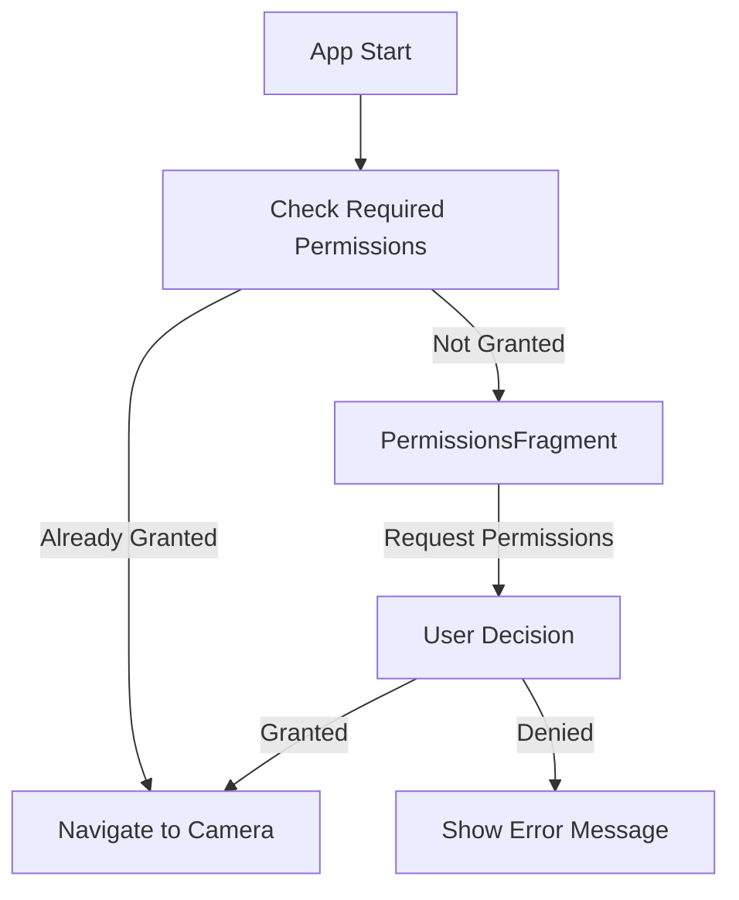

Sources: [CameraXBasic/app/src/main/java/com/android/example/cameraxbasic/fragments/PermissionsFragment.kt:38-87]()

The permission flow usually includes:

1. Checking for required permissions (camera, sometimes storage)
2. Requesting missing permissions if needed
3. Proceeding to camera functionality when permissions are granted
4. Showing appropriate error messages when permissions are denied

## Conclusion

The Camera Samples repository demonstrates two distinct approaches to implementing camera functionality in Android:

1. **CameraX-based samples**: Provide simpler, more concise implementations with built-in lifecycle management and use-case abstraction, ideal for most camera applications.

2. **Camera2-based samples**: Offer greater control and customization at the cost of increased complexity, appropriate for specialized camera applications with advanced requirements.

Both approaches follow similar architectural principles regarding lifecycle management, permission handling, and UI organization, but differ significantly in how they interact with the camera hardware.

For specific implementations, refer to [CameraX Samples](#3) or [Camera2 Samples](#4).

---

# Page: CameraX API Fundamentals

# CameraX API Fundamentals

<details>
<summary>Relevant source files</summary>

The following files were used as context for generating this wiki page:

- [CameraXBasic/app/build.gradle](CameraXBasic/app/build.gradle)
- [CameraXBasic/app/src/main/java/com/android/example/cameraxbasic/fragments/CameraFragment.kt](CameraXBasic/app/src/main/java/com/android/example/cameraxbasic/fragments/CameraFragment.kt)
- [CameraXBasic/app/src/main/java/com/android/example/cameraxbasic/fragments/PermissionsFragment.kt](CameraXBasic/app/src/main/java/com/android/example/cameraxbasic/fragments/PermissionsFragment.kt)
- [CameraXBasic/build.gradle](CameraXBasic/build.gradle)
- [CameraXExtensions/app/src/main/java/com/example/android/cameraxextensions/MainActivity.kt](CameraXExtensions/app/src/main/java/com/example/android/cameraxextensions/MainActivity.kt)
- [CameraXExtensions/app/src/main/java/com/example/android/cameraxextensions/model/CameraUiAction.kt](CameraXExtensions/app/src/main/java/com/example/android/cameraxextensions/model/CameraUiAction.kt)
- [CameraXExtensions/app/src/main/java/com/example/android/cameraxextensions/model/CameraUiState.kt](CameraXExtensions/app/src/main/java/com/example/android/cameraxextensions/model/CameraUiState.kt)
- [CameraXExtensions/app/src/main/java/com/example/android/cameraxextensions/model/PermissionState.kt](CameraXExtensions/app/src/main/java/com/example/android/cameraxextensions/model/PermissionState.kt)
- [CameraXExtensions/app/src/main/java/com/example/android/cameraxextensions/ui/CameraExtensionsScreen.kt](CameraXExtensions/app/src/main/java/com/example/android/cameraxextensions/ui/CameraExtensionsScreen.kt)
- [CameraXExtensions/app/src/main/java/com/example/android/cameraxextensions/ui/FocusPointDrawable.kt](CameraXExtensions/app/src/main/java/com/example/android/cameraxextensions/ui/FocusPointDrawable.kt)
- [CameraXExtensions/app/src/main/java/com/example/android/cameraxextensions/viewmodel/CameraExtensionsViewModel.kt](CameraXExtensions/app/src/main/java/com/example/android/cameraxextensions/viewmodel/CameraExtensionsViewModel.kt)
- [CameraXExtensions/app/src/main/java/com/example/android/cameraxextensions/viewmodel/CameraExtensionsViewModelFactory.kt](CameraXExtensions/app/src/main/java/com/example/android/cameraxextensions/viewmodel/CameraExtensionsViewModelFactory.kt)
- [CameraXExtensions/app/src/main/java/com/example/android/cameraxextensions/viewstate/CameraPreviewScreenViewState.kt](CameraXExtensions/app/src/main/java/com/example/android/cameraxextensions/viewstate/CameraPreviewScreenViewState.kt)
- [CameraXExtensions/app/src/main/res/layout/activity_main.xml](CameraXExtensions/app/src/main/res/layout/activity_main.xml)
- [CameraXExtensions/app/src/main/res/values/strings.xml](CameraXExtensions/app/src/main/res/values/strings.xml)

</details>


This page explains the fundamental architecture, components, and lifecycle management of the CameraX API as implemented in the Android Camera Samples. For information about specific CameraX sample applications, see [CameraX Samples](#3).

## Overview

CameraX is a Jetpack library designed to make camera app development easier. It provides a consistent and easy-to-use API that works across most Android devices, while leveraging the capabilities of the underlying Camera2 API. This abstraction helps developers focus on what they want to accomplish rather than handling the complex edge cases of the camera subsystem.

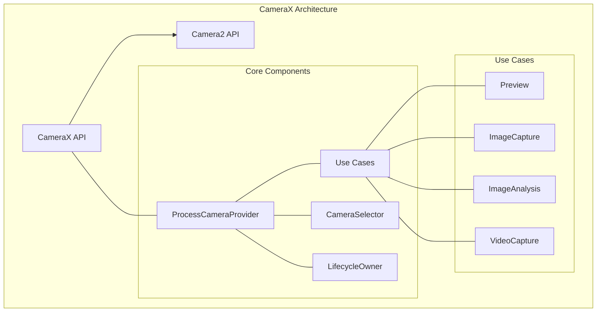

Sources:
- [CameraXBasic/app/src/main/java/com/android/example/cameraxbasic/fragments/CameraFragment.kt:67-674]()
- [CameraXBasic/app/build.gradle:74-85]()

## Core Components

### ProcessCameraProvider

`ProcessCameraProvider` is the main entry point for CameraX. It's a singleton that:

1. Manages the camera lifecycle
2. Binds camera use cases to the lifecycle owner
3. Handles device-specific compatibility issues

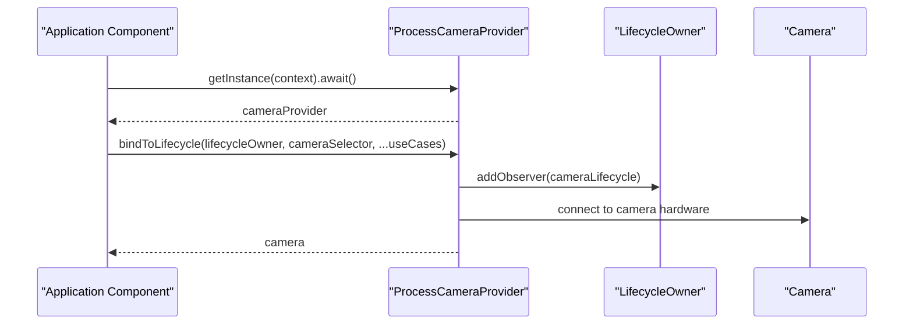

Sources:
- [CameraXBasic/app/src/main/java/com/android/example/cameraxbasic/fragments/CameraFragment.kt:235-237]()
- [CameraXExtensions/app/src/main/java/com/example/android/cameraxextensions/viewmodel/CameraExtensionsViewModel.kt:112-114]()

### Camera Use Cases

CameraX defines a set of "use cases" that represent common camera operations:

| Use Case | Purpose | Main Methods |
|----------|---------|--------------|
| Preview | Display camera preview | `setSurfaceProvider()` |
| ImageCapture | Take photos | `takePicture()` |
| ImageAnalysis | Process frames | `setAnalyzer()` |
| VideoCapture | Record video | `startRecording()` |

Each use case can be configured independently and combined to run simultaneously.

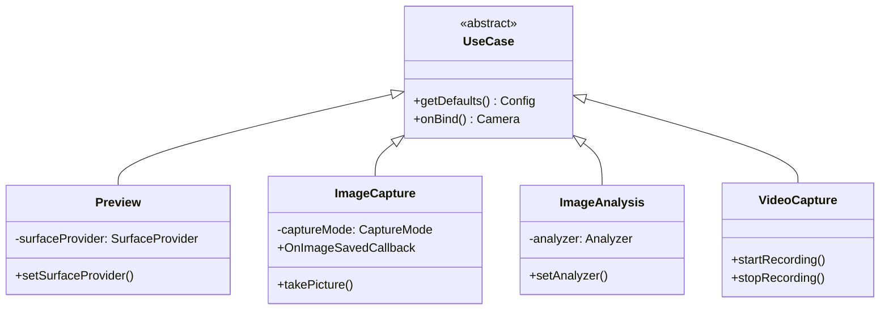

Sources:
- [CameraXBasic/app/src/main/java/com/android/example/cameraxbasic/fragments/CameraFragment.kt:272-306]()
- [CameraXExtensions/app/src/main/java/com/example/android/cameraxextensions/viewmodel/CameraExtensionsViewModel.kt:81-88]()

## Implementing CameraX

### Setting Up Dependencies

To use CameraX, you need to add the following dependencies to your app's build.gradle:

```
// CameraX core library
implementation "androidx.camera:camera-core:$camerax_version"

// CameraX Camera2 extensions
implementation "androidx.camera:camera-camera2:$camerax_version"

// CameraX Lifecycle library
implementation "androidx.camera:camera-lifecycle:$camerax_version"

// CameraX View class
implementation "androidx.camera:camera-view:$camerax_version"

// Optional: CameraX Extensions library
implementation "androidx.camera:camera-extensions:$camerax_version"
```

Sources:
- [CameraXBasic/app/build.gradle:74-89]()

### Getting a Camera Provider

The first step in using CameraX is to get an instance of the `ProcessCameraProvider`:

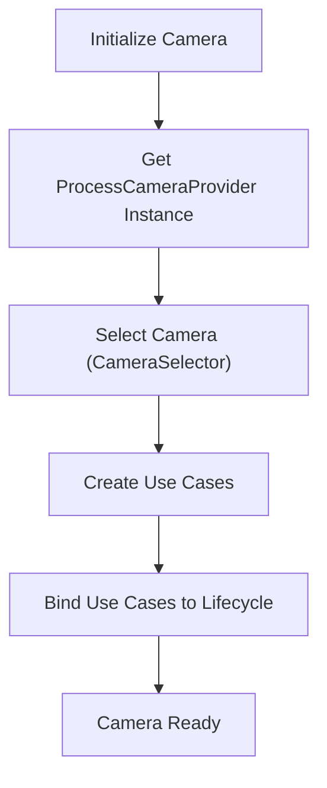

Sources:
- [CameraXBasic/app/src/main/java/com/android/example/cameraxbasic/fragments/CameraFragment.kt:235-237]()
- [CameraXExtensions/app/src/main/java/com/example/android/cameraxextensions/viewmodel/CameraExtensionsViewModel.kt:104-146]()

### Camera Selection

The `CameraSelector` class is used to select which camera to use (typically front or back):

```kotlin
// Back camera
val cameraSelector = CameraSelector.DEFAULT_BACK_CAMERA

// Front camera
val cameraSelector = CameraSelector.DEFAULT_FRONT_CAMERA

// Custom camera selector
val cameraSelector = CameraSelector.Builder()
    .requireLensFacing(CameraSelector.LENS_FACING_BACK)
    .build()
```

Sources:
- [CameraXBasic/app/src/main/java/com/android/example/cameraxbasic/fragments/CameraFragment.kt:239-243]()
- [CameraXExtensions/app/src/main/java/com/example/android/cameraxextensions/viewmodel/CameraExtensionsViewModel.kt:391-396]()

### Creating Use Cases

Each use case is created with a builder pattern that allows configuration of various parameters:

#### Preview Use Case

```kotlin
val preview = Preview.Builder()
    .setTargetAspectRatio(screenAspectRatio)
    .setTargetRotation(rotation)
    .build()

// Connect the preview to a PreviewView in the layout
preview.setSurfaceProvider(previewView.surfaceProvider)
```

Sources:
- [CameraXBasic/app/src/main/java/com/android/example/cameraxbasic/fragments/CameraFragment.kt:272-277]()
- [CameraXBasic/app/src/main/java/com/android/example/cameraxbasic/fragments/CameraFragment.kt:323]()

#### ImageCapture Use Case

```kotlin
val imageCapture = ImageCapture.Builder()
    .setCaptureMode(ImageCapture.CAPTURE_MODE_MINIMIZE_LATENCY)
    .setTargetAspectRatio(screenAspectRatio)
    .setTargetRotation(rotation)
    .build()
```

Sources:
- [CameraXBasic/app/src/main/java/com/android/example/cameraxbasic/fragments/CameraFragment.kt:280-288]()
- [CameraXExtensions/app/src/main/java/com/example/android/cameraxextensions/viewmodel/CameraExtensionsViewModel.kt:81-83]()

#### ImageAnalysis Use Case

```kotlin
val imageAnalyzer = ImageAnalysis.Builder()
    .setTargetAspectRatio(screenAspectRatio)
    .setTargetRotation(rotation)
    .build()
    .also {
        it.setAnalyzer(executor, YourAnalyzer())
    }
```

Sources:
- [CameraXBasic/app/src/main/java/com/android/example/cameraxbasic/fragments/CameraFragment.kt:291-306]()

### Binding Use Cases to Camera Lifecycle

One of the key features of CameraX is that it's lifecycle-aware. You bind use cases to a lifecycle owner:

```kotlin
// Must unbind the use-cases before rebinding them
cameraProvider.unbindAll()

// A variable number of use-cases can be passed here
camera = cameraProvider.bindToLifecycle(
    lifecycleOwner,
    cameraSelector, 
    preview, 
    imageCapture, 
    imageAnalyzer
)
```

Sources:
- [CameraXBasic/app/src/main/java/com/android/example/cameraxbasic/fragments/CameraFragment.kt:309-320]()
- [CameraXExtensions/app/src/main/java/com/example/android/cameraxextensions/viewmodel/CameraExtensionsViewModel.kt:170-193]()

### Taking Photos

With the `ImageCapture` use case, you can take photos:

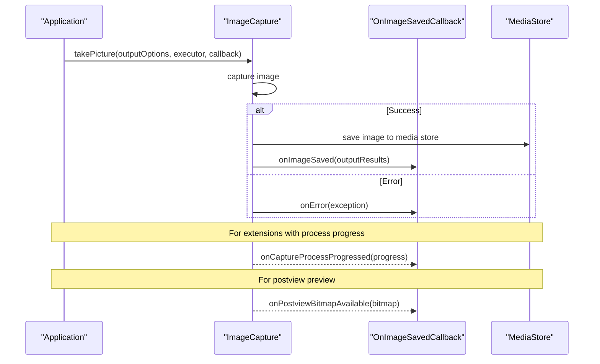

Sources:
- [CameraXBasic/app/src/main/java/com/android/example/cameraxbasic/fragments/CameraFragment.kt:492-518]()
- [CameraXExtensions/app/src/main/java/com/example/android/cameraxextensions/viewmodel/CameraExtensionsViewModel.kt:317-359]()

### Image Analysis

The `ImageAnalysis` use case allows processing of camera frames. You must implement an `ImageAnalysis.Analyzer`:

```kotlin
class YourAnalyzer : ImageAnalysis.Analyzer {
    override fun analyze(image: ImageProxy) {
        // Process the image
        
        // Important! Must close the image when done
        image.close()
    }
}
```

Sources:
- [CameraXBasic/app/src/main/java/com/android/example/cameraxbasic/fragments/CameraFragment.kt:591-666]()

## Lifecycle Management

CameraX is designed to work seamlessly with Android's lifecycle components. Here's how it manages lifecycle events:

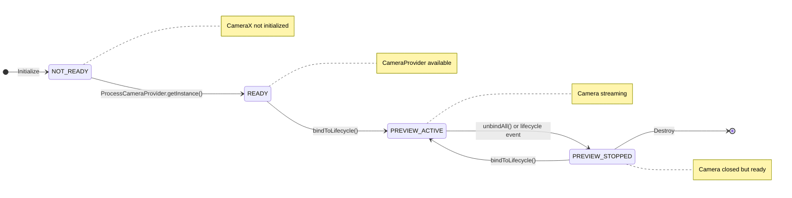

Sources:
- [CameraXExtensions/app/src/main/java/com/example/android/cameraxextensions/model/CameraUiState.kt:42-65]()
- [CameraXExtensions/app/src/main/java/com/example/android/cameraxextensions/viewmodel/CameraExtensionsViewModel.kt:104-146]()
- [CameraXExtensions/app/src/main/java/com/example/android/cameraxextensions/viewmodel/CameraExtensionsViewModel.kt:154-215]()

CameraX automatically handles:
- Closing the camera when the lifecycle owner is stopped
- Reopening the camera when the lifecycle owner returns to an active state
- Managing device rotation changes
- Dealing with app switching and multi-window modes

The `CameraState` enum in the CameraXExtensions sample illustrates these states:

| State | Description |
|-------|-------------|
| NOT_READY | Camera hasn't been initialized |
| READY | Camera is open and available for preview |
| PREVIEW_ACTIVE | Camera preview is streaming |
| PREVIEW_STOPPED | Camera is initialized but preview has been stopped |

Sources:
- [CameraXExtensions/app/src/main/java/com/example/android/cameraxextensions/model/CameraUiState.kt:42-65]()

## Camera Extensions

CameraX Extensions provide enhanced photography capabilities through vendor-specific camera extensions:

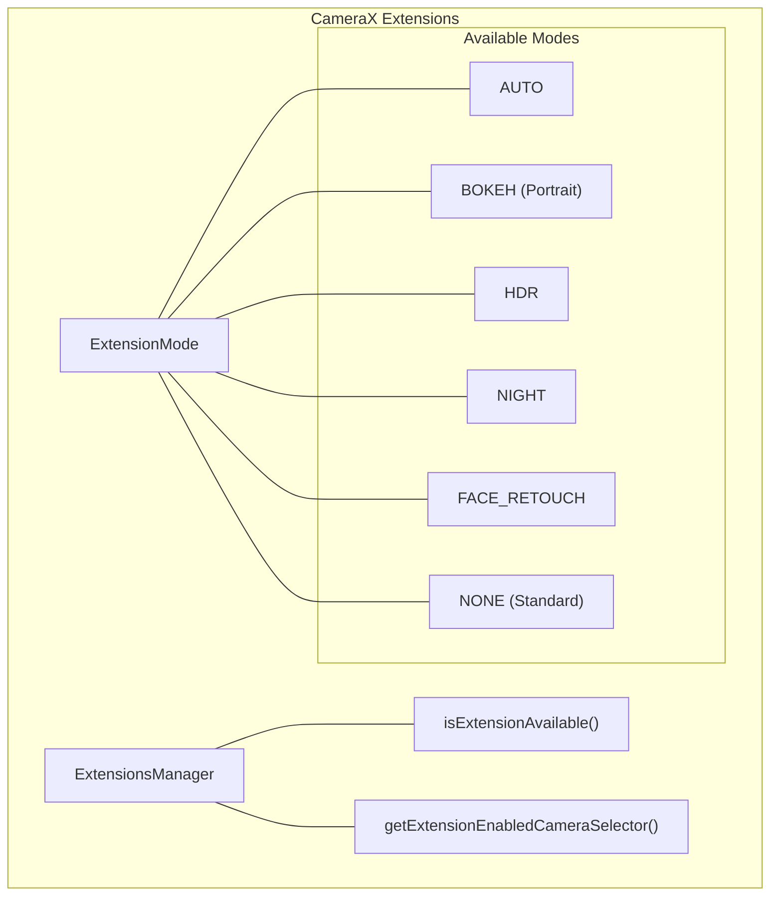

Sources:
- [CameraXExtensions/app/src/main/java/com/example/android/cameraxextensions/viewmodel/CameraExtensionsViewModel.kt:114]()
- [CameraXExtensions/app/src/main/java/com/example/android/cameraxextensions/viewmodel/CameraExtensionsViewModel.kt:126-134]()
- [CameraXExtensions/app/src/main/java/com/example/android/cameraxextensions/MainActivity.kt:62-69]()

Using CameraX Extensions involves:

1. Getting an `ExtensionsManager` instance:
   ```kotlin
   val extensionsManager = ExtensionsManager.getInstanceAsync(context, cameraProvider).await()
   ```

2. Checking which extensions are available:
   ```kotlin
   val isHdrAvailable = extensionsManager.isExtensionAvailable(
       cameraSelector, ExtensionMode.HDR)
   ```

3. Applying an extension to the camera selector:
   ```kotlin
   val extendedSelector = extensionsManager.getExtensionEnabledCameraSelector(
       cameraSelector, ExtensionMode.HDR)
   ```

4. Using the extended selector when binding use cases:
   ```kotlin
   cameraProvider.bindToLifecycle(
       lifecycleOwner, extendedSelector, preview, imageCapture)
   ```

Sources:
- [CameraXExtensions/app/src/main/java/com/example/android/cameraxextensions/viewmodel/CameraExtensionsViewModel.kt:112-144]()
- [CameraXExtensions/app/src/main/java/com/example/android/cameraxextensions/viewmodel/CameraExtensionsViewModel.kt:161-168]()

## Camera State Management Using MVVM

The CameraXExtensions sample demonstrates a robust architecture for managing camera state using the MVVM pattern:

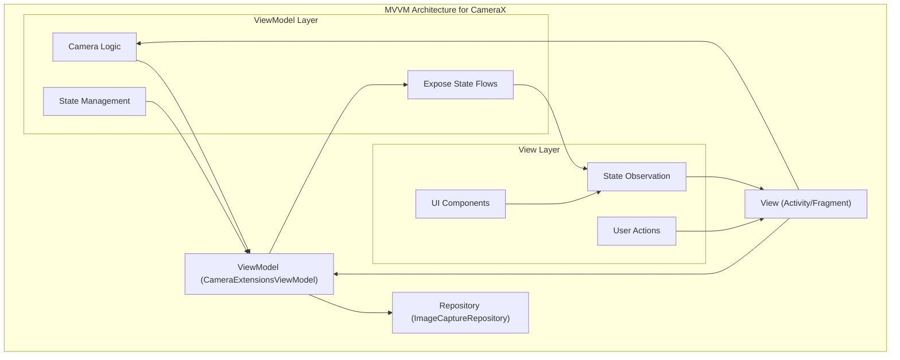

Sources:
- [CameraXExtensions/app/src/main/java/com/example/android/cameraxextensions/MainActivity.kt:117-125]()
- [CameraXExtensions/app/src/main/java/com/example/android/cameraxextensions/viewmodel/CameraExtensionsViewModel.kt:90-95]()

Key aspects of this pattern:

1. **ViewModel**: Contains camera logic and exposes state as flows:
   ```kotlin
   class CameraExtensionsViewModel {
       // State exposed as flows for the UI to observe
       val cameraUiState: Flow<CameraUiState>
       val captureUiState: Flow<CaptureState>
       
       // Camera operations
       fun initializeCamera() { ... }
       fun startPreview(lifecycleOwner: LifecycleOwner, previewView: PreviewView) { ... }
       fun capturePhoto() { ... }
   }
   ```

2. **UI State**: Well-defined state classes representing UI state:
   ```kotlin
   data class CameraUiState(
       val cameraState: CameraState = CameraState.NOT_READY,
       val availableExtensions: List<Int> = emptyList(),
       val availableCameraLens: List<Int> = listOf(LENS_FACING_BACK),
       val cameraLens: Int = LENS_FACING_BACK,
       val extensionMode: Int = ExtensionMode.NONE
   )
   ```

3. **UI Actions**: User actions passed to the ViewModel:
   ```kotlin
   sealed class CameraUiAction {
       object ShutterButtonClick : CameraUiAction()
       object SwitchCameraClick : CameraUiAction()
       class SelectCameraExtension(val extension: Int) : CameraUiAction()
       // ...
   }
   ```

Sources:
- [CameraXExtensions/app/src/main/java/com/example/android/cameraxextensions/model/CameraUiState.kt:31-39]()
- [CameraXExtensions/app/src/main/java/com/example/android/cameraxextensions/model/CameraUiAction.kt:25-34]()
- [CameraXExtensions/app/src/main/java/com/example/android/cameraxextensions/viewmodel/CameraExtensionsViewModel.kt:90-95]()

## Permissions Handling

CameraX applications require the camera permission and (for older Android versions) the storage permission:

```kotlin
val PERMISSIONS_REQUIRED = arrayOf(
    Manifest.permission.CAMERA,
    Manifest.permission.WRITE_EXTERNAL_STORAGE // For Android 9 and below
)
```

The recommended pattern is to check and request permissions before navigating to the camera screen:

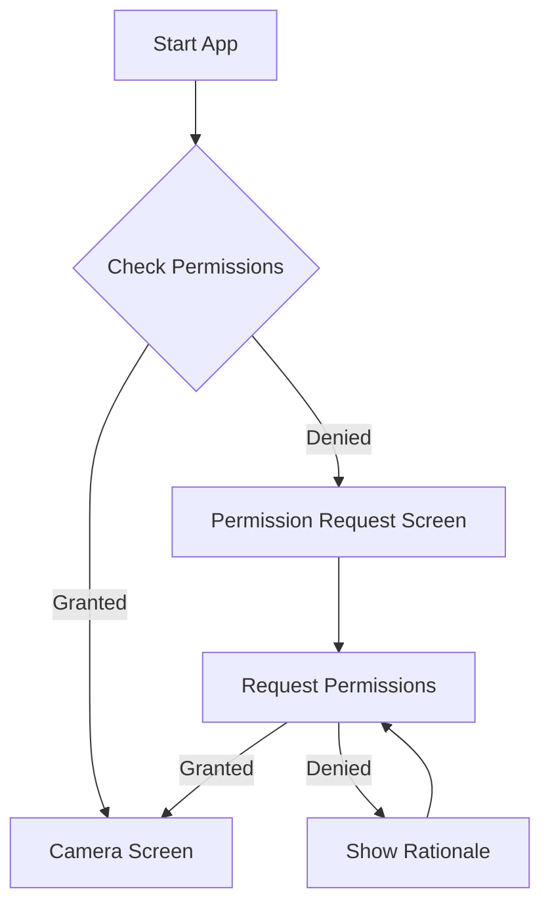

Sources:
- [CameraXBasic/app/src/main/java/com/android/example/cameraxbasic/fragments/PermissionsFragment.kt:32-87]()
- [CameraXExtensions/app/src/main/java/com/example/android/cameraxextensions/MainActivity.kt:142-151]()

## Advanced Features

### Camera Focus and Zoom

CameraX provides APIs for implementing touch-to-focus and pinch-to-zoom:

```kotlin
// Focus
val meteringPoint = previewView.meteringPointFactory.createPoint(x, y)
val action = FocusMeteringAction.Builder(meteringPoint).build()
camera.cameraControl.startFocusAndMetering(action)

// Zoom
val currentZoomRatio = camera.cameraInfo.zoomState.value?.zoomRatio ?: 1f
camera.cameraControl.setZoomRatio(scaleFactor * currentZoomRatio)
```

Sources:
- [CameraXExtensions/app/src/main/java/com/example/android/cameraxextensions/viewmodel/CameraExtensionsViewModel.kt:378-389]()
- [CameraXExtensions/app/src/main/java/com/example/android/cameraxextensions/ui/CameraExtensionsScreen.kt:169-205]()

### Camera State Observation

CameraX provides a way to observe the camera's state and handle errors:

```kotlin
cameraInfo.cameraState.observe(lifecycleOwner) { cameraState ->
    when (cameraState.type) {
        CameraState.Type.PENDING_OPEN -> { /* Camera is about to open */ }
        CameraState.Type.OPENING -> { /* Camera is opening */ }
        CameraState.Type.OPEN -> { /* Camera is open */ }
        CameraState.Type.CLOSING -> { /* Camera is closing */ }
        CameraState.Type.CLOSED -> { /* Camera is closed */ }
    }
    
    cameraState.error?.let { error ->
        // Handle specific error codes
        when (error.code) {
            CameraState.ERROR_CAMERA_IN_USE -> { /* Camera in use */ }
            CameraState.ERROR_MAX_CAMERAS_IN_USE -> { /* Too many cameras */ }
            // Other error codes...
        }
    }
}
```

Sources:
- [CameraXBasic/app/src/main/java/com/android/example/cameraxbasic/fragments/CameraFragment.kt:334-422]()

## Conclusion

CameraX provides a powerful yet easy-to-use API for developing camera applications on Android. Its key advantages include:

1. **Simplified API**: Abstracts the complexity of Camera2 with use case-based APIs
2. **Lifecycle Awareness**: Automatically manages camera resources based on app lifecycle
3. **Device Compatibility**: Works consistently across different Android devices
4. **Extensions Support**: Leverages vendor-specific camera features
5. **Modern Architecture**: Designed to work with Jetpack libraries and MVVM patterns

For more detailed implementations, explore the CameraX sample applications: [CameraXBasic](#3.1), [CameraXExtensions](#3.2), [CameraXVideo](#3.3), and [CameraX-MLKit](#3.4).

---

# Page: Camera2 API Fundamentals

# Camera2 API Fundamentals

<details>
<summary>Relevant source files</summary>

The following files were used as context for generating this wiki page:

- [Camera2Extensions/app/build.gradle](Camera2Extensions/app/build.gradle)
- [Camera2Extensions/app/src/main/java/com/example/android/camera2/extensions/ZoomUtil.kt](Camera2Extensions/app/src/main/java/com/example/android/camera2/extensions/ZoomUtil.kt)
- [Camera2Extensions/app/src/main/java/com/example/android/camera2/extensions/fragments/CameraFragment.kt](Camera2Extensions/app/src/main/java/com/example/android/camera2/extensions/fragments/CameraFragment.kt)
- [Camera2Extensions/app/src/main/res/layout/fragment_camera.xml](Camera2Extensions/app/src/main/res/layout/fragment_camera.xml)
- [Camera2Extensions/app/src/main/res/values/strings.xml](Camera2Extensions/app/src/main/res/values/strings.xml)
- [Camera2Extensions/build.gradle](Camera2Extensions/build.gradle)
- [Camera2Extensions/gradle/wrapper/gradle-wrapper.properties](Camera2Extensions/gradle/wrapper/gradle-wrapper.properties)
- [Camera2Extensions/settings.gradle](Camera2Extensions/settings.gradle)
- [Camera2Video/app/src/main/java/com/example/android/camera2/video/EncoderWrapper.kt](Camera2Video/app/src/main/java/com/example/android/camera2/video/EncoderWrapper.kt)
- [Camera2Video/app/src/main/java/com/example/android/camera2/video/HardwarePipeline.kt](Camera2Video/app/src/main/java/com/example/android/camera2/video/HardwarePipeline.kt)
- [Camera2Video/app/src/main/java/com/example/android/camera2/video/Pipeline.kt](Camera2Video/app/src/main/java/com/example/android/camera2/video/Pipeline.kt)
- [Camera2Video/app/src/main/java/com/example/android/camera2/video/SoftwarePipeline.kt](Camera2Video/app/src/main/java/com/example/android/camera2/video/SoftwarePipeline.kt)
- [Camera2Video/app/src/main/java/com/example/android/camera2/video/fragments/PreviewFragment.kt](Camera2Video/app/src/main/java/com/example/android/camera2/video/fragments/PreviewFragment.kt)

</details>


This document explains the core architecture, components, and workflow of the Camera2 API in Android. It covers the fundamental building blocks needed to understand how to capture images and videos using the lower-level Camera2 API. For information about the higher-level CameraX API, which is built on top of Camera2, see [CameraX API Fundamentals](#2.1).

## Introduction to Camera2 API

The Camera2 API, introduced in Android 5.0 (API level 21), provides a more advanced camera control interface compared to the original Camera API. It follows an asynchronous, pipeline-based architecture that gives developers fine-grained control over the camera hardware, including manual focus, exposure, and post-processing capabilities.

Camera2 API is designed for applications that require precise camera control, such as:
- Professional photography apps
- Advanced video recording with custom processing
- Computational photography applications
- Apps that need access to raw sensor data

Sources:
- [Camera2Extensions/app/src/main/java/com/example/android/camera2/extensions/fragments/CameraFragment.kt:83-88]()
- [Camera2Video/app/src/main/java/com/example/android/camera2/video/fragments/PreviewFragment.kt:112-115]()

## Core Architecture

The Camera2 API follows a request-based architecture where applications submit capture requests to the camera device and receive callbacks when captures are completed.

### Architecture Diagram

```mermaid
flowchart TB
    subgraph "Camera2 API Architecture"
        App["Application"]
        CM["CameraManager"]
        CD["CameraDevice"]
        CCS["CameraCaptureSession"]
        CR["CaptureRequest"]
        CResult["CaptureResult"]
        CCB["CaptureCallback"]
        
        App -- "1. Get service" --> CM
        CM -- "2. Open camera" --> CD
        CD -- "3. Create session" --> CCS
        App -- "4. Create request" --> CR
        CCS -- "5. Submit request" --> CR
        CR -- "6. Process capture" --> CResult
        CResult -- "7. Deliver results" --> CCB
        CCB -- "8. Process results" --> App
    end
```

Sources:
- [Camera2Video/app/src/main/java/com/example/android/camera2/video/fragments/PreviewFragment.kt:254-273]()
- [Camera2Extensions/app/src/main/java/com/example/android/camera2/extensions/fragments/CameraFragment.kt:555-559]()

## Key Components

### CameraManager

The `CameraManager` is the entry point to the Camera2 API. It's a system service that:
- Enumerates available cameras
- Provides access to camera characteristics
- Opens connections to camera devices

```mermaid
classDiagram
    class CameraManager {
        +getCameraIdList(): String[]
        +getCameraCharacteristics(cameraId: String): CameraCharacteristics
        +openCamera(cameraId: String, callback: StateCallback, handler: Handler)
    }
```

Example usage:
```kotlin
val cameraManager = context.getSystemService(Context.CAMERA_SERVICE) as CameraManager
```

Sources:
- [Camera2Video/app/src/main/java/com/example/android/camera2/video/fragments/PreviewFragment.kt:112-115]()
- [Camera2Extensions/app/src/main/java/com/example/android/camera2/extensions/fragments/CameraFragment.kt:85-88]()

### CameraDevice

`CameraDevice` represents a connection to a physical camera. It's obtained by calling `CameraManager.openCamera()` which returns the device through a callback.

```mermaid
classDiagram
    class CameraDevice {
        +getId(): String
        +createCaptureRequest(templateType: int): CaptureRequest.Builder
        +createCaptureSession(outputs: List, callback: StateCallback, handler: Handler)
        +close()
    }
    
    class CameraDevice.StateCallback {
        +onOpened(camera: CameraDevice)
        +onDisconnected(camera: CameraDevice)
        +onError(camera: CameraDevice, error: int)
    }
```

Opening a camera is an asynchronous operation that requires a callback:

```kotlin
cameraManager.openCamera(cameraId, object : CameraDevice.StateCallback() {
    override fun onOpened(device: CameraDevice) {
        // Camera opened successfully
    }
    
    override fun onDisconnected(device: CameraDevice) {
        // Camera disconnected
    }
    
    override fun onError(device: CameraDevice, error: Int) {
        // Error occurred
    }
}, handler)
```

Sources:
- [Camera2Video/app/src/main/java/com/example/android/camera2/video/fragments/PreviewFragment.kt:416-443]()
- [Camera2Extensions/app/src/main/java/com/example/android/camera2/extensions/fragments/CameraFragment.kt:563-589]()

### CameraCaptureSession

A `CameraCaptureSession` manages the flow of capture requests to the camera and the resulting frames to output targets. Creating a session requires specifying the output surfaces where camera frames will be delivered.

```mermaid
classDiagram
    class CameraCaptureSession {
        +setRepeatingRequest(request: CaptureRequest, callback: CaptureCallback, handler: Handler)
        +capture(request: CaptureRequest, callback: CaptureCallback, handler: Handler)
        +stopRepeating()
        +close()
    }
    
    class CameraCaptureSession.StateCallback {
        +onConfigured(session: CameraCaptureSession)
        +onConfigureFailed(session: CameraCaptureSession)
    }
    
    class CameraCaptureSession.CaptureCallback {
        +onCaptureStarted(session: CameraCaptureSession, request: CaptureRequest, timestamp: long)
        +onCaptureCompleted(session: CameraCaptureSession, request: CaptureRequest, result: TotalCaptureResult)
        +onCaptureFailed(session: CameraCaptureSession, request: CaptureRequest, failure: CaptureFailure)
    }
```

Session creation example:

```kotlin
cameraDevice.createCaptureSession(
    outputSurfaces,  // List of output surfaces
    object : CameraCaptureSession.StateCallback() {
        override fun onConfigured(session: CameraCaptureSession) {
            // Session configured successfully
        }
        
        override fun onConfigureFailed(session: CameraCaptureSession) {
            // Session configuration failed
        }
    }, 
    handler
)
```

Sources:
- [Camera2Video/app/src/main/java/com/example/android/camera2/video/fragments/PreviewFragment.kt:482-509]()
- [Camera2Extensions/app/src/main/java/com/example/android/camera2/extensions/fragments/CameraFragment.kt:670-708]()

### CaptureRequest

`CaptureRequest` defines all the parameters for a single capture operation, including:
- Output targets (surfaces)
- Camera parameters (focus mode, exposure, etc.)
- Processing parameters

Requests are created using a builder pattern:

```kotlin
val captureRequestBuilder = cameraDevice.createCaptureRequest(CameraDevice.TEMPLATE_PREVIEW)
captureRequestBuilder.addTarget(previewSurface)
captureRequestBuilder.set(CaptureRequest.CONTROL_AF_MODE, CaptureRequest.CONTROL_AF_MODE_CONTINUOUS_PICTURE)
val captureRequest = captureRequestBuilder.build()
```

The Camera2 API provides several template types for common use cases:
- `TEMPLATE_PREVIEW` - For camera preview
- `TEMPLATE_STILL_CAPTURE` - For high-quality still image capture
- `TEMPLATE_RECORD` - For video recording
- `TEMPLATE_VIDEO_SNAPSHOT` - For still image capture during video recording
- `TEMPLATE_MANUAL` - For full manual control

Sources:
- [Camera2Video/app/src/main/java/com/example/android/camera2/video/fragments/PreviewFragment.kt:148-155]()
- [Camera2Video/app/src/main/java/com/example/android/camera2/video/SoftwarePipeline.kt:34-46]()
- [Camera2Video/app/src/main/java/com/example/android/camera2/video/SoftwarePipeline.kt:48-63]()

### CaptureResult

`CaptureResult` contains the output metadata from a completed capture request, such as:
- Timestamp
- Exposure time
- Sensor sensitivity (ISO)
- Auto-focus state
- Auto-exposure state

These results are delivered through the `CameraCaptureSession.CaptureCallback` interface.

Sources:
- [Camera2Extensions/app/src/main/java/com/example/android/camera2/extensions/fragments/CameraFragment.kt:306-348]()
- [Camera2Video/app/src/main/java/com/example/android/camera2/video/fragments/PreviewFragment.kt:305-313]()

### CameraCharacteristics

`CameraCharacteristics` provides static information about a camera device, including:
- Sensor information (size, format)
- Supported features
- Physical characteristics (focal length, lens orientation)
- Available capabilities

Example usage:

```kotlin
val characteristics = cameraManager.getCameraCharacteristics(cameraId)
val sensorOrientation = characteristics.get(CameraCharacteristics.SENSOR_ORIENTATION)
val supportedHardwareLevel = characteristics.get(CameraCharacteristics.INFO_SUPPORTED_HARDWARE_LEVEL)
```

Sources:
- [Camera2Extensions/app/src/main/java/com/example/android/camera2/extensions/fragments/CameraFragment.kt:470-471]()
- [Camera2Video/app/src/main/java/com/example/android/camera2/video/fragments/PreviewFragment.kt:118-120]()
- [Camera2Extensions/app/src/main/java/com/example/android/camera2/extensions/ZoomUtil.kt:26-32]()

## Camera2 Capture Pipeline

The Camera2 API operates using a pipeline model where requests flow from the application to the camera hardware, and results flow back to the application.

### Capture Pipeline Diagram

```mermaid
sequenceDiagram
    participant App as "Application"
    participant CM as "CameraManager"
    participant CD as "CameraDevice"
    participant CCS as "CameraCaptureSession"
    participant CH as "Camera Hardware"
    
    App->>CM: getCameraIdList()
    CM-->>App: cameraIds
    App->>CM: getCameraCharacteristics(cameraId)
    CM-->>App: characteristics
    
    App->>CM: openCamera(cameraId, callback, handler)
    CM->>CH: Open hardware connection
    CH-->>CM: Hardware ready
    CM-->>App: onOpened(cameraDevice)
    
    App->>CD: createCaptureSession(surfaces, callback, handler)
    CD->>CH: Configure hardware for outputs
    CH-->>CD: Configuration complete
    CD-->>App: onConfigured(captureSession)
    
    App->>CD: createCaptureRequest(TEMPLATE_PREVIEW)
    CD-->>App: requestBuilder
    App->>CCS: setRepeatingRequest(request, callback, handler)
    CCS->>CH: Start streaming preview
    
    loop Preview Loop
        CH->>CCS: Frame captured
        CCS->>App: onCaptureCompleted(session, request, result)
    end
    
    App->>CD: createCaptureRequest(TEMPLATE_STILL_CAPTURE)
    CD-->>App: requestBuilder
    App->>CCS: capture(request, callback, handler)
    CCS->>CH: Capture high-quality image
    CH->>CCS: Image captured
    CCS->>App: onCaptureCompleted(session, request, result)
    
    App->>CCS: stopRepeating()
    App->>CCS: close()
    App->>CD: close()
```

Sources:
- [Camera2Video/app/src/main/java/com/example/android/camera2/video/fragments/PreviewFragment.kt:254-273]()
- [Camera2Extensions/app/src/main/java/com/example/android/camera2/extensions/fragments/CameraFragment.kt:555-707]()

## Opening a Camera and Creating a Session

Opening a camera and creating a capture session are asynchronous operations that require callbacks to handle completion or failure.

### Opening a Camera

The process of opening a camera typically involves:

1. Getting the camera service
2. Obtaining a list of available cameras
3. Selecting a camera based on criteria (front/back, capabilities)
4. Opening the camera with a callback

Example using Kotlin coroutines:

```kotlin
private suspend fun openCamera(
    manager: CameraManager,
    cameraId: String,
    handler: Handler? = null
): CameraDevice = suspendCancellableCoroutine { cont ->
    manager.openCamera(cameraId, object : CameraDevice.StateCallback() {
        override fun onOpened(device: CameraDevice) = cont.resume(device)

        override fun onDisconnected(device: CameraDevice) {
            Log.w(TAG, "Camera $cameraId has been disconnected")
            requireActivity().finish()
        }

        override fun onError(device: CameraDevice, error: Int) {
            val msg = when(error) {
                ERROR_CAMERA_DEVICE -> "Fatal (device)"
                ERROR_CAMERA_DISABLED -> "Device policy"
                ERROR_CAMERA_IN_USE -> "Camera in use"
                ERROR_CAMERA_SERVICE -> "Fatal (service)"
                ERROR_MAX_CAMERAS_IN_USE -> "Maximum cameras in use"
                else -> "Unknown"
            }
            val exc = RuntimeException("Camera $cameraId error: ($error) $msg")
            if (cont.isActive) cont.resumeWithException(exc)
        }
    }, handler)
}
```

Sources:
- [Camera2Video/app/src/main/java/com/example/android/camera2/video/fragments/PreviewFragment.kt:416-443]()
- [Camera2Extensions/app/src/main/java/com/example/android/camera2/extensions/fragments/CameraFragment.kt:563-589]()

### Creating a Capture Session

Creating a capture session involves:

1. Defining output surfaces (preview, recording, image capture)
2. Creating a session configuration
3. Handling session configuration callbacks

Example:

```kotlin
private suspend fun createCaptureSession(
    device: CameraDevice,
    targets: List<Surface>,
    handler: Handler
): CameraCaptureSession = suspendCoroutine { cont ->
    val stateCallback = object: CameraCaptureSession.StateCallback() {
        override fun onConfigured(session: CameraCaptureSession) = cont.resume(session)

        override fun onConfigureFailed(session: CameraCaptureSession) {
            val exc = RuntimeException("Camera ${device.id} session configuration failed")
            cont.resumeWithException(exc)
        }
    }
    
    device.createCaptureSession(targets, stateCallback, handler)
}
```

Sources:
- [Camera2Video/app/src/main/java/com/example/android/camera2/video/fragments/PreviewFragment.kt:482-509]()
- [Camera2Extensions/app/src/main/java/com/example/android/camera2/extensions/fragments/CameraFragment.kt:670-724]()

## Capture Request Types and Workflows

The Camera2 API supports different types of capture requests for various use cases. There are two main ways to submit capture requests:

### Repeating Requests

These are continuous requests used for preview or video recording:

```kotlin
session.setRepeatingRequest(previewRequest, captureCallback, backgroundHandler)
```

Sources:
- [Camera2Video/app/src/main/java/com/example/android/camera2/video/fragments/PreviewFragment.kt:269-273]()
- [Camera2Video/app/src/main/java/com/example/android/camera2/video/fragments/PreviewFragment.kt:304-313]()

### Single Capture Requests

These are one-time requests, typically used for capturing still images:

```kotlin
session.capture(stillCaptureRequest, captureCallback, backgroundHandler)
```

Sources:
- [Camera2Extensions/app/src/main/java/com/example/android/camera2/extensions/fragments/CameraFragment.kt:520-527]()

## Request Templates and Configuration

Camera2 API provides predefined templates that set up capture parameters for common use cases:

| Template Constant | Purpose |
|-------------------|---------|
| `TEMPLATE_PREVIEW` | Camera preview, optimized for viewfinder performance |
| `TEMPLATE_STILL_CAPTURE` | High-quality photo capture |
| `TEMPLATE_RECORD` | Video recording, balanced configuration |
| `TEMPLATE_VIDEO_SNAPSHOT` | Still image while recording video |
| `TEMPLATE_ZERO_SHUTTER_LAG` | Continually capturing full-resolution images |
| `TEMPLATE_MANUAL` | All automatic settings turned off for manual control |

Example of creating a preview request:

```kotlin
// Create a request builder using a template
val requestBuilder = cameraDevice.createCaptureRequest(CameraDevice.TEMPLATE_PREVIEW)

// Add the preview surface as a target
requestBuilder.addTarget(previewSurface)

// Configure auto-focus mode
requestBuilder.set(CaptureRequest.CONTROL_AF_MODE, CaptureRequest.CONTROL_AF_MODE_CONTINUOUS_PICTURE)

// Build the final request
val previewRequest = requestBuilder.build()
```

Sources:
- [Camera2Video/app/src/main/java/com/example/android/camera2/video/SoftwarePipeline.kt:34-63]()
- [Camera2Video/app/src/main/java/com/example/android/camera2/video/fragments/PreviewFragment.kt:148-155]()

## Processing Pipeline Implementations

The Camera2 API allows for different processing pipeline implementations depending on the application requirements. The camera samples demonstrate two main approaches:

### Software Pipeline

Processes frames through the CPU, providing flexibility but potentially lower performance:

```mermaid
flowchart LR
    subgraph "SoftwarePipeline"
        Camera["Camera Device"]
        Preview["Preview Surface"]
        Encoder["Encoder Surface"]
        
        Camera -- "Camera frames" --> Preview
        Camera -- "Camera frames" --> Encoder
    end
```

Key characteristics:
- Uses CPU for processing
- Simple configuration
- Direct camera-to-output routing
- Lower performance for complex operations

Sources:
- [Camera2Video/app/src/main/java/com/example/android/camera2/video/SoftwarePipeline.kt:29-72]()

### Hardware Pipeline

Processes frames using GPU acceleration via OpenGL, providing better performance for complex operations:

```mermaid
flowchart LR
    subgraph "HardwarePipeline"
        Camera["Camera Device"]
        Texture["SurfaceTexture"]
        GLPipeline["OpenGL Pipeline"]
        PreviewSurface["Preview Surface"]
        EncoderSurface["Encoder Surface"]
        
        Camera -- "Camera frames" --> Texture
        Texture -- "Texture frames" --> GLPipeline
        GLPipeline -- "Processed frames" --> PreviewSurface
        GLPipeline -- "Processed frames" --> EncoderSurface
    end
```

Key characteristics:
- Uses GPU for processing via OpenGL
- More complex setup
- Can apply image filters and effects efficiently
- Better performance for real-time processing

Sources:
- [Camera2Video/app/src/main/java/com/example/android/camera2/video/HardwarePipeline.kt:325-389]()
- [Camera2Video/app/src/main/java/com/example/android/camera2/video/Pipeline.kt:28-67]()

## Advanced Features and Capabilities

The Camera2 API provides access to advanced camera features that vary based on the device hardware capabilities.

### Preview Stabilization

Enables video stabilization specifically for preview:

```kotlin
requestBuilder.set(CaptureRequest.CONTROL_VIDEO_STABILIZATION_MODE,
        CaptureRequest.CONTROL_VIDEO_STABILIZATION_MODE_PREVIEW_STABILIZATION)
```

Sources:
- [Camera2Video/app/src/main/java/com/example/android/camera2/video/SoftwarePipeline.kt:41-44]()
- [Camera2Video/app/src/main/java/com/example/android/camera2/video/fragments/PreviewFragment.kt:524-527]()

### High Dynamic Range (HDR)

The API supports different HDR modes including HLG10, HDR10, and HDR10+:

```kotlin
// When creating a session with HDR support
sessionConfig.setColorSpace(ColorSpace.Named.values()[colorSpace])
```

Sources:
- [Camera2Video/app/src/main/java/com/example/android/camera2/video/fragments/PreviewFragment.kt:468-469]()
- [Camera2Video/app/src/main/java/com/example/android/camera2/video/HardwarePipeline.kt:559-591]()

### Zoom Control

Camera2 API allows for smooth zoom operations:

```kotlin
// Using zoom ratio
requestBuilder.set(CaptureRequest.CONTROL_ZOOM_RATIO, zoomRatio)

// Or using crop region
val rect = ZoomUtil.getZoomCropRect(zoomRatio, characteristics)
requestBuilder.set(CaptureRequest.SCALER_CROP_REGION, rect)
```

Sources:
- [Camera2Extensions/app/src/main/java/com/example/android/camera2/extensions/fragments/CameraFragment.kt:695]()
- [Camera2Extensions/app/src/main/java/com/example/android/camera2/extensions/ZoomUtil.kt:24-56]()

### Auto Focus Control

Enables tap-to-focus functionality:

```kotlin
// Set auto-focus regions based on touch point
requestBuilder.set(CaptureRequest.CONTROL_AF_REGIONS, focusRegions)
requestBuilder.set(CaptureRequest.CONTROL_AF_MODE, CaptureRequest.CONTROL_AF_MODE_AUTO)
requestBuilder.set(CaptureRequest.CONTROL_AF_TRIGGER, CaptureRequest.CONTROL_AF_TRIGGER_START)
```

Sources:
- [Camera2Extensions/app/src/main/java/com/example/android/camera2/extensions/fragments/CameraFragment.kt:321-328]()

## Conclusion

The Camera2 API provides low-level control over camera hardware through an asynchronous, request-based architecture. Understanding the fundamental components and their interactions is key to developing advanced camera applications.

While Camera2 offers extensive capabilities, it requires careful handling of its asynchronous nature and proper resource management. For simpler use cases, consider using the CameraX API [CameraX API Fundamentals](#2.1), which provides a higher-level abstraction built on top of Camera2.

Sources:
- [Camera2Video/app/src/main/java/com/example/android/camera2/video/fragments/PreviewFragment.kt]()
- [Camera2Extensions/app/src/main/java/com/example/android/camera2/extensions/fragments/CameraFragment.kt]()

---

# Page: CameraX Samples

# CameraX Samples

<details>
<summary>Relevant source files</summary>

The following files were used as context for generating this wiki page:

- [CameraXBasic/app/src/main/AndroidManifest.xml](CameraXBasic/app/src/main/AndroidManifest.xml)
- [CameraXBasic/app/src/main/java/com/android/example/cameraxbasic/MainActivity.kt](CameraXBasic/app/src/main/java/com/android/example/cameraxbasic/MainActivity.kt)
- [CameraXBasic/app/src/main/java/com/android/example/cameraxbasic/fragments/PhotoFragment.kt](CameraXBasic/app/src/main/java/com/android/example/cameraxbasic/fragments/PhotoFragment.kt)
- [CameraXExtensions/README.md](CameraXExtensions/README.md)
- [CameraXExtensions/screenshots/camerax_camera_extensions_screenshot.png](CameraXExtensions/screenshots/camerax_camera_extensions_screenshot.png)
- [CameraXExtensions/screenshots/camerax_extensions_architecture_diagram.png](CameraXExtensions/screenshots/camerax_extensions_architecture_diagram.png)
- [README.md](README.md)

</details>


This document provides an overview of the CameraX sample applications in the camera-samples repository, highlighting their key features and use cases. For deeper technical details about individual samples, refer to their dedicated wiki pages: [CameraXBasic](#3.1), [CameraXExtensions](#3.2), [CameraXVideo](#3.3), and [CameraX-MLKit](#3.4). For CameraX API fundamentals, see [CameraX API Fundamentals](#2.1).

## CameraX Samples Overview

The repository contains four primary CameraX sample applications that demonstrate different aspects of camera functionality using the CameraX API:

```mermaid
graph TD
    subgraph "CameraX Samples"
        CXBasic["CameraXBasic"]
        CXExtensions["CameraXExtensions"]
        CXVideo["CameraXVideo"]
        CXMLKit["CameraX-MLKit"]
    end
    
    CXBasic --> |"Demonstrates"| Basic["Basic Preview & Capture"]
    CXBasic --> |"Uses"| BasicUseCases["ImageCapture, Preview, ImageAnalysis"]
    
    CXExtensions --> |"Demonstrates"| Extensions["Manufacturer Extensions"]
    CXExtensions --> |"Supports"| ExtTypes["HDR, Bokeh, Night, Face Retouch, Auto"]
    
    CXVideo --> |"Demonstrates"| Video["Video Recording"]
    CXVideo --> |"Uses"| VideoUseCases["VideoCapture, Preview"]
    
    CXMLKit --> |"Demonstrates"| MLQR["QR Code Scanning"]
    CXMLKit --> |"Uses"| MLUseCases["MlKitAnalyzer, Preview"]
```

Sources: [README.md:9-19](), [CameraXExtensions/README.md:1-16]()

## Key Features and Use Cases

Each CameraX sample demonstrates specific features and use cases:

| Sample | Key Features | Primary Use Cases |
|--------|--------------|-------------------|
| **CameraXBasic** | Camera preview, photo capture, image analysis | Basic photography app |
| **CameraXExtensions** | Manufacturer extensions (HDR, Night, etc.) | Enhanced photography |
| **CameraXVideo** | Video recording | Video capture app |
| **CameraX-MLKit** | QR code scanning | ML integration |

Sources: [README.md:9-19]()

## Common Architecture Patterns

The CameraX samples follow consistent architectural patterns:

```mermaid
graph TD
    subgraph "Typical CameraX Sample Architecture"
        MainActivity["MainActivity"]
        
        subgraph "Fragments"
            PermissionsFragment["PermissionsFragment"]
            CameraFragment["CameraFragment"]
            GalleryFragment["GalleryFragment"]
            PhotoFragment["PhotoFragment"]
        end
        
        subgraph "CameraX Components"
            ProcessCameraProvider["ProcessCameraProvider"]
            Preview["Preview"]
            ImageCapture["ImageCapture"]
            ImageAnalysis["ImageAnalysis"]
        end
    end
    
    MainActivity --> PermissionsFragment
    PermissionsFragment -- "permissions granted" --> CameraFragment
    CameraFragment -- "photo captured" --> GalleryFragment
    GalleryFragment -- "view photo" --> PhotoFragment
    
    CameraFragment --> ProcessCameraProvider
    ProcessCameraProvider --> Preview
    ProcessCameraProvider --> ImageCapture
    ProcessCameraProvider --> ImageAnalysis
```

Sources: [CameraXBasic/app/src/main/java/com/android/example/cameraxbasic/MainActivity.kt:34-37](), [CameraXBasic/app/src/main/java/com/android/example/cameraxbasic/fragments/PhotoFragment.kt:31-32]()

### 1. Single Activity Pattern

Most CameraX samples use a single-activity pattern with fragments for specific functionality. The activity serves as the entry point and container for fragments.

```kotlin
/**
 * Main entry point into our app. This app follows the single-activity pattern, and all
 * functionality is implemented in the form of fragments.
 */
class MainActivity : AppCompatActivity() {
    // ...
}
```

Sources: [CameraXBasic/app/src/main/java/com/android/example/cameraxbasic/MainActivity.kt:34-38]()

### 2. Fragment-Based UI

The samples leverage fragments for different screens and functionalities:
- **PermissionsFragment**: Handles camera permissions
- **CameraFragment**: Manages camera preview and capture
- **GalleryFragment**: Displays captured photos
- **PhotoFragment**: Shows individual photos

Sources: [CameraXBasic/app/src/main/java/com/android/example/cameraxbasic/fragments/PhotoFragment.kt:31-32]()

### 3. CameraX Use Cases

The samples demonstrate various CameraX use cases:

```mermaid
graph LR
    subgraph "CameraX Use Cases"
        Preview["Preview<br>(Display camera feed)"]
        ImageCapture["ImageCapture<br>(Take photos)"]
        ImageAnalysis["ImageAnalysis<br>(Process frames)"]
        VideoCapture["VideoCapture<br>(Record video)"]
        MlKitAnalyzer["MlKitAnalyzer<br>(ML processing)"]
    end
    
    subgraph "CameraX Samples"
        CXBasic["CameraXBasic"]
        CXExtensions["CameraXExtensions"]
        CXVideo["CameraXVideo"]
        CXMLKit["CameraX-MLKit"]
    end
    
    Preview --> CXBasic & CXExtensions & CXVideo & CXMLKit
    ImageCapture --> CXBasic & CXExtensions
    ImageAnalysis --> CXBasic
    VideoCapture --> CXVideo
    MlKitAnalyzer --> CXMLKit
```

Sources: [README.md:9-19]()

## CameraXBasic

CameraXBasic demonstrates fundamental CameraX functionality:
- Camera preview using the Preview use case
- Photo capture using the ImageCapture use case
- Image analysis using the ImageAnalysis use case
- Permission handling
- Navigation between preview and gallery

The app follows the single-activity pattern with different fragments for specific functionality.

Sources: [README.md:11](), [CameraXBasic/app/src/main/java/com/android/example/cameraxbasic/MainActivity.kt:34-38]()

## CameraXExtensions

CameraXExtensions demonstrates how to use manufacturer-specific camera extensions with CameraX. It follows an MVVM architecture pattern:

```mermaid
graph TD
    subgraph "CameraXExtensions MVVM Architecture"
        View["UI Components<br>(CameraExtensionsScreen)"]
        ViewModel["CameraExtensionsViewModel"]
        Model["Camera & Extensions APIs"]
        
        View -- "User Actions" --> ViewModel
        ViewModel -- "State Updates" --> View
        ViewModel -- "Camera Operations" --> Model
        Model -- "Results" --> ViewModel
    end
    
    subgraph "Extensions Types"
        Auto["Auto"]
        Bokeh["Bokeh"]
        FaceRetouch["Face Retouch"]
        HDR["HDR"]
        Night["Night"]
    end
    
    Model --> Auto & Bokeh & FaceRetouch & HDR & Night
```

Key features:
- Display camera preview using Preview use case
- Query supported extensions
- Select different extensions (Auto, Bokeh, Face Retouch, HDR, Night)
- Capture still images with the selected extension

Sources: [CameraXExtensions/README.md:2-18](), [CameraXExtensions/README.md:32-36]()

## CameraXVideo

CameraXVideo demonstrates video recording capabilities using the CameraX VideoCapture API:
- Camera preview
- Video recording using VideoCapture use case
- Video playback

Sources: [README.md:13]()

## CameraX-MLKit

CameraX-MLKit demonstrates integration between CameraX and ML Kit:
- Camera preview
- QR code scanning and detection using MlKitAnalyzer
- Real-time frame analysis

Sources: [README.md:14]()

## Android Manifest Integration

CameraX samples require camera permissions and declare camera features in the manifest:

```xml
<uses-feature android:name="android.hardware.camera" />
<uses-permission android:name="android.permission.CAMERA" />
```

They can also register as system camera apps:

```xml
<!-- Register as a system camera app -->
<intent-filter>
    <action android:name="android.media.action.IMAGE_CAPTURE" />
    <action android:name="android.media.action.STILL_IMAGE_CAMERA"/>
    <action android:name="android.media.action.VIDEO_CAMERA" />
    <category android:name="android.intent.category.DEFAULT"/>
</intent-filter>
```

Sources: [CameraXBasic/app/src/main/AndroidManifest.xml:27-30](), [CameraXBasic/app/src/main/AndroidManifest.xml:58-64]()

## Conclusion

The CameraX samples provide practical examples of implementing camera functionality using the CameraX API. They demonstrate different use cases and architectural patterns that can be applied to real-world camera applications. For more detailed information about each sample, refer to their dedicated wiki pages.

---

# Page: CameraXBasic

# CameraXBasic

<details>
<summary>Relevant source files</summary>

The following files were used as context for generating this wiki page:

- [CameraXBasic/app/build.gradle](CameraXBasic/app/build.gradle)
- [CameraXBasic/app/src/main/AndroidManifest.xml](CameraXBasic/app/src/main/AndroidManifest.xml)
- [CameraXBasic/app/src/main/java/com/android/example/cameraxbasic/MainActivity.kt](CameraXBasic/app/src/main/java/com/android/example/cameraxbasic/MainActivity.kt)
- [CameraXBasic/app/src/main/java/com/android/example/cameraxbasic/fragments/CameraFragment.kt](CameraXBasic/app/src/main/java/com/android/example/cameraxbasic/fragments/CameraFragment.kt)
- [CameraXBasic/app/src/main/java/com/android/example/cameraxbasic/fragments/GalleryFragment.kt](CameraXBasic/app/src/main/java/com/android/example/cameraxbasic/fragments/GalleryFragment.kt)
- [CameraXBasic/app/src/main/java/com/android/example/cameraxbasic/fragments/PermissionsFragment.kt](CameraXBasic/app/src/main/java/com/android/example/cameraxbasic/fragments/PermissionsFragment.kt)
- [CameraXBasic/app/src/main/java/com/android/example/cameraxbasic/fragments/PhotoFragment.kt](CameraXBasic/app/src/main/java/com/android/example/cameraxbasic/fragments/PhotoFragment.kt)
- [CameraXBasic/app/src/main/java/com/android/example/cameraxbasic/utils/MediaStoreUtils.kt](CameraXBasic/app/src/main/java/com/android/example/cameraxbasic/utils/MediaStoreUtils.kt)
- [CameraXBasic/app/src/main/res/layout-land/camera_ui_container.xml](CameraXBasic/app/src/main/res/layout-land/camera_ui_container.xml)
- [CameraXBasic/app/src/main/res/layout/camera_ui_container.xml](CameraXBasic/app/src/main/res/layout/camera_ui_container.xml)
- [CameraXBasic/app/src/main/res/layout/fragment_gallery.xml](CameraXBasic/app/src/main/res/layout/fragment_gallery.xml)
- [CameraXBasic/build.gradle](CameraXBasic/build.gradle)
- [CameraXBasic/gradle.properties](CameraXBasic/gradle.properties)

</details>


CameraXBasic is a sample application that demonstrates how to implement camera functionality using the CameraX API in Android. This sample shows how to build a basic camera app with features including camera preview, photo capture, and image analysis while following best practices for lifecycle management and permissions handling.

For information about other CameraX samples like video recording, see [CameraXVideo](#3.3), or for manufacturer extensions, see [CameraXExtensions](#3.2).

## 1. Application Architecture

CameraXBasic follows a single-activity architecture with multiple fragments. It uses the Navigation Component to handle fragment transitions and the CameraX library to manage camera operations.

### 1.1 Component Overview

```mermaid
graph TD
    subgraph "CameraXBasic Application"
        MainActivity["MainActivity<br>(Entry Point)"]
        
        subgraph "Fragments"
            PermissionsFragment["PermissionsFragment<br>(Request camera permissions)"]
            CameraFragment["CameraFragment<br>(Camera preview & capture)"]
            GalleryFragment["GalleryFragment<br>(View captured photos)"]
            PhotoFragment["PhotoFragment<br>(Display single photo)"]
        end
        
        subgraph "CameraX Components"
            CameraProvider["ProcessCameraProvider"]
            Preview["Preview"]
            ImageCapture["ImageCapture"]
            ImageAnalysis["ImageAnalysis<br>(LuminosityAnalyzer)"]
        end
        
        subgraph "Storage"
            MediaStoreUtils["MediaStoreUtils<br>(Media access)"]
        end
        
        MainActivity --> PermissionsFragment
        PermissionsFragment -- "permissions granted" --> CameraFragment
        
        CameraFragment -- "capture photo" --> GalleryFragment
        GalleryFragment -- "view photo" --> PhotoFragment
        
        CameraFragment --> CameraProvider
        CameraProvider --> Preview
        CameraProvider --> ImageCapture
        CameraProvider --> ImageAnalysis
        
        ImageCapture -- "save image" --> MediaStoreUtils
        GalleryFragment -- "load images" --> MediaStoreUtils
    end
```

Sources: [CameraXBasic/app/src/main/java/com/android/example/cameraxbasic/MainActivity.kt:38-86](), [CameraXBasic/app/src/main/java/com/android/example/cameraxbasic/fragments/CameraFragment.kt:73-674](), [CameraXBasic/app/src/main/java/com/android/example/cameraxbasic/fragments/PermissionsFragment.kt:38-87](), [CameraXBasic/app/src/main/java/com/android/example/cameraxbasic/fragments/GalleryFragment.kt:44-191](), [CameraXBasic/app/src/main/java/com/android/example/cameraxbasic/fragments/PhotoFragment.kt:32-54]()

### 1.2 Navigation Flow

```mermaid
sequenceDiagram
    participant MA as "MainActivity"
    participant PF as "PermissionsFragment"
    participant CF as "CameraFragment"
    participant GF as "GalleryFragment"
    participant PH as "PhotoFragment"
    
    MA->>PF: Start app
    PF->>PF: Check permissions
    alt permissions granted
        PF->>CF: Navigate to camera
    else permissions not granted
        PF->>PF: Request permissions
        PF-->>CF: Navigate after granted
    end
    CF->>CF: Setup camera
    CF->>CF: Capture photo
    CF->>GF: Navigate to gallery (after photo)
    GF->>PH: View single photo
    GF->>CF: Back to camera
```

Sources: [CameraXBasic/app/src/main/java/com/android/example/cameraxbasic/fragments/PermissionsFragment.kt:40-79](), [CameraXBasic/app/src/main/java/com/android/example/cameraxbasic/fragments/CameraFragment.kt:467-518](), [CameraXBasic/app/src/main/java/com/android/example/cameraxbasic/fragments/CameraFragment.kt:552-563]()

## 2. CameraX Implementation

The core functionality of CameraXBasic relies on CameraX API components, which provide a simplified interface for camera operations compared to Camera2 API.

### 2.1 CameraX Use Cases and Binding

```mermaid
graph TD
    subgraph "CameraFragment"
        bindUseCase["bindCameraUseCases()"]
        setupCamera["setUpCamera()"]
        
        lifecycle["Fragment Lifecycle"]
        display["Display Rotation Monitor"]
    end
    
    subgraph "CameraX Components"
        provider["ProcessCameraProvider"]
        selector["CameraSelector<br>(BACK/FRONT)"]
        
        subgraph "Use Cases"
            preview["Preview<br>- Aspect ratio: 4:3/16:9<br>- Rotation handling"]
            imageCapture["ImageCapture<br>- CAPTURE_MODE_MINIMIZE_LATENCY<br>- Target aspect ratio"]
            imageAnalysis["ImageAnalysis<br>- Target aspect ratio<br>- Rotation handling"]
        end
        
        analyzer["LuminosityAnalyzer<br>- Calculate average luminosity<br>- FPS calculation"]
    end
    
    subgraph "UI Components"
        viewFinder["PreviewView<br>(fragmentCameraBinding.viewFinder)"]
    end
    
    setupCamera --> provider
    bindUseCase --> selector
    bindUseCase --> preview
    bindUseCase --> imageCapture
    bindUseCase --> imageAnalysis
    
    lifecycle --> provider
    display --> preview
    display --> imageCapture
    display --> imageAnalysis
    
    imageAnalysis --> analyzer
    
    preview -- "setSurfaceProvider" --> viewFinder
    
    provider -- "bindToLifecycle" --> lifecycle
```

Sources: [CameraXBasic/app/src/main/java/com/android/example/cameraxbasic/fragments/CameraFragment.kt:235-328](), [CameraXBasic/app/src/main/java/com/android/example/cameraxbasic/fragments/CameraFragment.kt:591-664]()

### 2.2 Camera Setup and Configuration

The CameraFragment implements the core camera functionality through several key steps:

1. **Camera Provider Setup**:
   ```kotlin
   private suspend fun setUpCamera() {
       cameraProvider = ProcessCameraProvider.getInstance(requireContext()).await()
       // Select lens facing based on available cameras
       // Bind camera use cases
   }
   ```

2. **Use Case Binding**:
   - Camera Preview
   - Image Capture
   - Image Analysis

The setup occurs in `setUpCamera()` which runs asynchronously using coroutines, and the actual binding happens in `bindCameraUseCases()`.

Sources: [CameraXBasic/app/src/main/java/com/android/example/cameraxbasic/fragments/CameraFragment.kt:235-250](), [CameraXBasic/app/src/main/java/com/android/example/cameraxbasic/fragments/CameraFragment.kt:253-327]()

### 2.3 CameraX Dependencies

The app integrates CameraX through the following dependencies:

| Component | Description | Gradle Dependency |
|-----------|-------------|-------------------|
| CameraX Core | Base CameraX functionality | `androidx.camera:camera-core` |
| Camera2 Integration | Integration with Camera2 | `androidx.camera:camera-camera2` |
| Lifecycle Integration | Lifecycle awareness | `androidx.camera:camera-lifecycle` |
| CameraX View | UI components | `androidx.camera:camera-view` |

Sources: [CameraXBasic/app/build.gradle:74-89]()

## 3. Key Functionalities

### 3.1 Image Capture Process

```mermaid
sequenceDiagram
    participant UI as "Camera UI"
    participant CF as "CameraFragment"
    participant IC as "ImageCapture"
    participant MS as "MediaStore"
    participant MSU as "MediaStoreUtils"
    participant GT as "Gallery Thumbnail"
    
    UI->>CF: Click capture button
    CF->>IC: takePicture()
    IC->>MS: Save to MediaStore
    MS-->>IC: Return savedUri
    IC-->>CF: onImageSaved callback
    CF->>GT: Update gallery thumbnail
    opt Navigate to Gallery
        CF->>MSU: getImages()
        MSU-->>CF: Return image list
        CF->>UI: Navigate to gallery
    end
```

Sources: [CameraXBasic/app/src/main/java/com/android/example/cameraxbasic/fragments/CameraFragment.kt:467-518](), [CameraXBasic/app/src/main/java/com/android/example/cameraxbasic/utils/MediaStoreUtils.kt:72-94]()

The image capture process in CameraXBasic is handled by the `ImageCapture` use case:

1. The user taps the capture button, which triggers the `takePicture()` method
2. A file name is generated with a timestamp using `SimpleDateFormat`
3. `ContentValues` for MediaStore are created with display name, MIME type, and relative path
4. A callback monitors the image capture progress
5. After successful capture, the gallery thumbnail is updated
6. The new image is made available through the gallery button

Sources: [CameraXBasic/app/src/main/java/com/android/example/cameraxbasic/fragments/CameraFragment.kt:467-531]()

### 3.2 Camera Switching

The app supports switching between front and back cameras:

```kotlin
cameraUiContainerBinding?.cameraSwitchButton?.setOnClickListener {
    lensFacing = if (CameraSelector.LENS_FACING_FRONT == lensFacing) {
        CameraSelector.LENS_FACING_BACK
    } else {
        CameraSelector.LENS_FACING_FRONT
    }
    // Re-bind use cases to update selected camera
    bindCameraUseCases()
}
```

The switch process:
1. Toggles the `lensFacing` value between front and back
2. Rebinds all camera use cases with the new lens facing
3. Updates the UI to reflect the new camera

Sources: [CameraXBasic/app/src/main/java/com/android/example/cameraxbasic/fragments/CameraFragment.kt:533-549](), [CameraXBasic/app/src/main/java/com/android/example/cameraxbasic/fragments/CameraFragment.kt:567-583]()

### 3.3 Image Analysis with LuminosityAnalyzer

CameraXBasic implements a custom image analyzer that computes the average luminosity of camera frames:

```mermaid
graph TD
    subgraph "ImageAnalysis Process"
        imageAnalyzer["ImageAnalysis<br>setAnalyzer()"]
        luminosityAnalyzer["LuminosityAnalyzer"]
        analyze["analyze(ImageProxy)"]
        processImage["Process Image Data<br>1. Extract Y plane<br>2. Convert to byte array<br>3. Calculate average"]
        logOutput["Log Output<br>Average luminosity value"]
    end
    
    imageAnalyzer --> luminosityAnalyzer
    luminosityAnalyzer --> analyze
    analyze --> processImage
    processImage --> logOutput
```

Sources: [CameraXBasic/app/src/main/java/com/android/example/cameraxbasic/fragments/CameraFragment.kt:591-664]()

The `LuminosityAnalyzer` class:
1. Receives image frames from the camera
2. Extracts the luminance (Y) plane from the YUV image format
3. Calculates the average luminosity value
4. Tracks frames per second
5. Reports results through a listener callback

Sources: [CameraXBasic/app/src/main/java/com/android/example/cameraxbasic/fragments/CameraFragment.kt:591-664]()

## 4. Gallery Implementation

After capturing photos, users can view, share, and delete them through the Gallery functionality.

### 4.1 Gallery Fragment Structure

```mermaid
graph TD
    subgraph "GalleryFragment Components"
        galleryFragment["GalleryFragment"]
        viewPager["ViewPager2<br>(photoViewPager)"]
        adapter["MediaPagerAdapter"]
        photoFragment["PhotoFragment"]
        
        deleteButton["deleteButton"]
        shareButton["shareButton"]
        backButton["backButton"]
    end
    
    subgraph "Media Access"
        mediaStoreUtils["MediaStoreUtils"]
        mediaList["mediaList: MutableList<MediaStoreFile>"]
    end
    
    galleryFragment -- "uses" --> viewPager
    viewPager -- "adapter" --> adapter
    adapter -- "creates" --> photoFragment
    
    galleryFragment -- "uses" --> deleteButton
    galleryFragment -- "uses" --> shareButton
    galleryFragment -- "uses" --> backButton
    
    galleryFragment -- "loads media" --> mediaStoreUtils
    mediaStoreUtils -- "populates" --> mediaList
    adapter -- "displays" --> mediaList
```

Sources: [CameraXBasic/app/src/main/java/com/android/example/cameraxbasic/fragments/GalleryFragment.kt:44-190](), [CameraXBasic/app/src/main/java/com/android/example/cameraxbasic/fragments/PhotoFragment.kt:32-54]()

The Gallery functionality:
1. Uses `ViewPager2` with a custom adapter to display photos
2. Retrieves images from `MediaStoreUtils`
3. Provides buttons for deleting and sharing photos
4. Supports navigation back to camera

Sources: [CameraXBasic/app/src/main/java/com/android/example/cameraxbasic/fragments/GalleryFragment.kt:79-184](), [CameraXBasic/app/src/main/res/layout/fragment_gallery.xml:17-78]()

## 5. Media Storage and Access

CameraXBasic uses `MediaStoreUtils` to access and manage photos:

### 5.1 MediaStore Operations

| Operation | Function | Description |
|-----------|----------|-------------|
| Get Latest Image | `getLatestImageFilename()` | Retrieves the most recent captured photo |
| Get All Images | `getImages()` | Returns a list of all app photos as `MediaStoreFile` objects |
| Media Collection Access | `mediaStoreCollection` | URI for accessing the app's media collection |

The app doesn't request external storage permissions, so it can only access photos taken within the app. On Android 10+ (API 29+), images are stored in the shared media collection. On older versions, they are stored in the app's external files directory.

Sources: [CameraXBasic/app/src/main/java/com/android/example/cameraxbasic/utils/MediaStoreUtils.kt:40-102]()

## 6. Permissions Handling

CameraXBasic requires the `CAMERA` permission, and on Android 9 (API 28) and below, it also needs `WRITE_EXTERNAL_STORAGE`.

```mermaid
graph TD
    subgraph "PermissionsFragment"
        onCreate["onCreate()"]
        checkPermissions["hasPermissions()"]
        requestPermissions["activityResultLauncher.launch()"]
        navigateToCamera["navigateToCamera()"]
    end
    
    onCreate --> checkPermissions
    
    checkPermissions -- "if permissions granted" --> navigateToCamera
    checkPermissions -- "if permissions missing" --> requestPermissions
    requestPermissions -- "on permission granted" --> navigateToCamera
    requestPermissions -- "on permission denied" --> showToast["Show Toast Message"]
```

Sources: [CameraXBasic/app/src/main/java/com/android/example/cameraxbasic/fragments/PermissionsFragment.kt:38-87](), [CameraXBasic/app/src/main/AndroidManifest.xml:27-30]()

The permissions flow:
1. `PermissionsFragment` checks if required permissions are granted
2. If not, it requests permissions using the Activity Result API
3. After permissions are granted, it navigates to the camera fragment
4. If permissions are denied, it shows a toast message

Sources: [CameraXBasic/app/src/main/java/com/android/example/cameraxbasic/fragments/PermissionsFragment.kt:40-79]()

## 7. Technical Considerations

### 7.1 Camera State Management

CameraXBasic monitors the camera state using observers to handle various camera states and errors:

```kotlin
private fun observeCameraState(cameraInfo: CameraInfo) {
    cameraInfo.cameraState.observe(viewLifecycleOwner) { cameraState ->
        // Handle camera states: PENDING_OPEN, OPENING, OPEN, CLOSING, CLOSED
        // Handle camera errors
    }
}
```

This allows the app to respond to camera availability changes and detect error conditions such as:
- Camera in use by another app
- Maximum cameras in use
- Camera disabled
- Fatal errors

Sources: [CameraXBasic/app/src/main/java/com/android/example/cameraxbasic/fragments/CameraFragment.kt:334-423]()

### 7.2 Handling Screen Rotation

CameraXBasic handles orientation changes seamlessly:

1. Configures the activity to handle configuration changes: `android:configChanges="orientation|screenLayout|screenSize|smallestScreenSize"`
2. Uses `onConfigurationChanged()` to update camera settings without rebuilding the fragments
3. Updates the target rotation for `ImageCapture` and `ImageAnalysis` when display rotation changes

Sources: [CameraXBasic/app/src/main/AndroidManifest.xml:48](), [CameraXBasic/app/src/main/java/com/android/example/cameraxbasic/fragments/CameraFragment.kt:224-232](), [CameraXBasic/app/src/main/java/com/android/example/cameraxbasic/fragments/CameraFragment.kt:118-128]()

## 8. Summary

CameraXBasic demonstrates a complete implementation of a camera application using CameraX. Key takeaways:

1. **Architecture**: Single activity with multiple fragments using Navigation Component
2. **Camera**: CameraX implementation with Preview, ImageCapture, and ImageAnalysis use cases
3. **UI**: Camera controls for capture, gallery access, and switching cameras
4. **Storage**: MediaStore implementation for saving and retrieving photos
5. **Permissions**: Runtime permission handling for camera and storage

This sample provides a solid foundation for developers who want to implement camera functionality in their Android applications using the CameraX API.

Sources: [CameraXBasic/app/build.gradle:54-111](), [CameraXBasic/app/src/main/java/com/android/example/cameraxbasic/fragments/CameraFragment.kt:67-674]()

---

# Page: CameraXExtensions

# CameraXExtensions

<details>
<summary>Relevant source files</summary>

The following files were used as context for generating this wiki page:

- [CameraXExtensions/README.md](CameraXExtensions/README.md)
- [CameraXExtensions/app/build.gradle](CameraXExtensions/app/build.gradle)
- [CameraXExtensions/app/src/main/java/com/example/android/cameraxextensions/MainActivity.kt](CameraXExtensions/app/src/main/java/com/example/android/cameraxextensions/MainActivity.kt)
- [CameraXExtensions/app/src/main/java/com/example/android/cameraxextensions/model/CameraUiAction.kt](CameraXExtensions/app/src/main/java/com/example/android/cameraxextensions/model/CameraUiAction.kt)
- [CameraXExtensions/app/src/main/java/com/example/android/cameraxextensions/model/CameraUiState.kt](CameraXExtensions/app/src/main/java/com/example/android/cameraxextensions/model/CameraUiState.kt)
- [CameraXExtensions/app/src/main/java/com/example/android/cameraxextensions/model/PermissionState.kt](CameraXExtensions/app/src/main/java/com/example/android/cameraxextensions/model/PermissionState.kt)
- [CameraXExtensions/app/src/main/java/com/example/android/cameraxextensions/ui/CameraExtensionsScreen.kt](CameraXExtensions/app/src/main/java/com/example/android/cameraxextensions/ui/CameraExtensionsScreen.kt)
- [CameraXExtensions/app/src/main/java/com/example/android/cameraxextensions/ui/FocusPointDrawable.kt](CameraXExtensions/app/src/main/java/com/example/android/cameraxextensions/ui/FocusPointDrawable.kt)
- [CameraXExtensions/app/src/main/java/com/example/android/cameraxextensions/viewmodel/CameraExtensionsViewModel.kt](CameraXExtensions/app/src/main/java/com/example/android/cameraxextensions/viewmodel/CameraExtensionsViewModel.kt)
- [CameraXExtensions/app/src/main/java/com/example/android/cameraxextensions/viewmodel/CameraExtensionsViewModelFactory.kt](CameraXExtensions/app/src/main/java/com/example/android/cameraxextensions/viewmodel/CameraExtensionsViewModelFactory.kt)
- [CameraXExtensions/app/src/main/java/com/example/android/cameraxextensions/viewstate/CameraPreviewScreenViewState.kt](CameraXExtensions/app/src/main/java/com/example/android/cameraxextensions/viewstate/CameraPreviewScreenViewState.kt)
- [CameraXExtensions/app/src/main/res/layout/activity_main.xml](CameraXExtensions/app/src/main/res/layout/activity_main.xml)
- [CameraXExtensions/app/src/main/res/values/strings.xml](CameraXExtensions/app/src/main/res/values/strings.xml)
- [CameraXExtensions/build.gradle](CameraXExtensions/build.gradle)
- [CameraXExtensions/gradle.properties](CameraXExtensions/gradle.properties)
- [CameraXExtensions/gradle/wrapper/gradle-wrapper.properties](CameraXExtensions/gradle/wrapper/gradle-wrapper.properties)
- [CameraXExtensions/screenshots/camerax_camera_extensions_screenshot.png](CameraXExtensions/screenshots/camerax_camera_extensions_screenshot.png)
- [CameraXExtensions/screenshots/camerax_extensions_architecture_diagram.png](CameraXExtensions/screenshots/camerax_extensions_architecture_diagram.png)
- [README.md](README.md)

</details>


CameraXExtensions is a sample application that demonstrates how to use Camera Extensions with the CameraX API to capture enhanced photos. This page explains the architecture, key components, and implementation details of the application, focusing on how it leverages vendor-specific camera extensions such as HDR, Night mode, Bokeh, and Face Retouch to improve photo quality.

For information about basic CameraX functionality without extensions, see [CameraXBasic](#3.1).

## Introduction

CameraXExtensions showcases how to access and utilize device manufacturer-specific camera extensions through the CameraX Extensions API. The sample demonstrates:

1. Detecting available camera extensions on a device
2. Displaying a camera preview with the selected extension
3. Switching between different extensions (HDR, Night mode, Bokeh, Face Retouch)
4. Capturing photos with the applied extension
5. Handling capture process progress and latency estimates

This implementation uses MVVM architecture with Kotlin coroutines and flows for reactive state management.

Sources: [CameraXExtensions/README.md:1-54](), [CameraXExtensions/app/build.gradle:68-114]()

## Architecture Overview

The application follows the MVVM (Model-View-ViewModel) architectural pattern with unidirectional data flow:

```mermaid
flowchart TD
    subgraph "View Layer"
        CameraExtensionsScreen["CameraExtensionsScreen\n(UI Components)"]
        UserInput["User Input"]
    end

    subgraph "Controller Layer"
        MainActivity["MainActivity\n(Mediator)"]
    end

    subgraph "ViewModel Layer"
        CameraExtensionsViewModel["CameraExtensionsViewModel\n(Camera Logic)"]
    end

    subgraph "CameraX Framework"
        ProcessCameraProvider["ProcessCameraProvider"]
        ExtensionsManager["ExtensionsManager"]
        Preview["Preview"]
        ImageCapture["ImageCapture"]
    end

    subgraph "State" 
        CameraUiState["CameraUiState"]
        CaptureState["CaptureState"]
    end

    subgraph "Actions"
        CameraUiAction["CameraUiAction"]
    end

    UserInput --> CameraExtensionsScreen
    CameraExtensionsScreen -- "emits actions" --> CameraUiAction
    CameraUiAction -- "processed by" --> MainActivity
    MainActivity -- "forwards actions" --> CameraExtensionsViewModel
    
    CameraExtensionsViewModel -- "emits state" --> CameraUiState
    CameraExtensionsViewModel -- "emits state" --> CaptureState
    CameraUiState -- "observed by" --> MainActivity
    CaptureState -- "observed by" --> MainActivity
    MainActivity -- "updates UI" --> CameraExtensionsScreen
    
    CameraExtensionsViewModel --> ProcessCameraProvider
    CameraExtensionsViewModel --> ExtensionsManager
    CameraExtensionsViewModel --> Preview
    CameraExtensionsViewModel --> ImageCapture
```

The architecture has the following key components:

1. **View**: `CameraExtensionsScreen` handles UI rendering and user input
2. **Controller**: `MainActivity` mediates between the view and view model
3. **ViewModel**: `CameraExtensionsViewModel` contains camera logic and state management
4. **State**: `CameraUiState` and `CaptureState` represent UI and capture state
5. **Actions**: `CameraUiAction` represents user interactions

Sources: [CameraXExtensions/README.md:32-36](), [CameraXExtensions/app/src/main/java/com/example/android/cameraxextensions/MainActivity.kt:56-392](), [CameraXExtensions/app/src/main/java/com/example/android/cameraxextensions/viewmodel/CameraExtensionsViewModel.kt:67-411]()

## Key Components

### State Management Components

The application uses a unidirectional data flow with clearly defined states and actions:

```mermaid
classDiagram
    class CameraUiState {
        +CameraState cameraState
        +List<Int> availableExtensions
        +List<Int> availableCameraLens
        +int cameraLens
        +int extensionMode
        +ImageCaptureLatencyEstimate realtimeCaptureLatencyEstimate
    }
    
    class CameraState {
        <<enumeration>>
        NOT_READY
        READY
        PREVIEW_ACTIVE
        PREVIEW_STOPPED
    }
    
    class CaptureState {
        <<sealed class>>
    }
    
    CaptureState <|-- CaptureNotReady
    CaptureState <|-- CaptureReady
    CaptureState <|-- CaptureStarted
    CaptureState <|-- CapturePostview
    CaptureState <|-- CaptureProcessProgress
    CaptureState <|-- CaptureFinished
    CaptureState <|-- CaptureFailed
    
    class CameraUiAction {
        <<sealed class>>
    }
    
    CameraUiAction <|-- RequestPermissionClick
    CameraUiAction <|-- SwitchCameraClick
    CameraUiAction <|-- ShutterButtonClick
    CameraUiAction <|-- ClosePhotoPreviewClick
    CameraUiAction <|-- ProcessProgressComplete
    CameraUiAction <|-- SelectCameraExtension
    CameraUiAction <|-- Focus
    CameraUiAction <|-- Scale
    
    CameraState -- CameraUiState : used in >
    
    class PermissionState {
        <<sealed interface>>
    }
    
    PermissionState <|-- Granted
    PermissionState <|-- Denied
```

- `CameraUiState`: Tracks camera state, available extensions, and selected extension
- `CaptureState`: Represents different stages of photo capture (ready, started, process, finished)
- `CameraUiAction`: Defines user actions (switch camera, take photo, select extension)
- `PermissionState`: Manages camera permission states

Sources: [CameraXExtensions/app/src/main/java/com/example/android/cameraxextensions/model/CameraUiState.kt:31-109](), [CameraXExtensions/app/src/main/java/com/example/android/cameraxextensions/model/CameraUiAction.kt:25-34](), [CameraXExtensions/app/src/main/java/com/example/android/cameraxextensions/model/PermissionState.kt:19-22]()

### View Components

The UI is primarily managed by `CameraExtensionsScreen` which:

1. Encapsulates the UI components
2. Provides a declarative API for updating UI state
3. Emits user actions through a flow

Key UI components include:
- Camera preview using `PreviewView`
- Extension selector using `RecyclerView` with a horizontal scrolling layout
- Shutter button for capturing photos
- Lens switching button
- Focus point indicator
- Process progress indicator
- Capture latency estimate display
- Captured photo preview

Sources: [CameraXExtensions/app/src/main/java/com/example/android/cameraxextensions/ui/CameraExtensionsScreen.kt:65-454](), [CameraXExtensions/app/src/main/res/layout/activity_main.xml:17-196]()

### ViewModel Component

`CameraExtensionsViewModel` is responsible for:

1. **Camera initialization**: Setting up the camera and checking available extensions
2. **Preview management**: Starting and stopping the camera preview
3. **Extension handling**: Setting the current extension mode
4. **Photo capture**: Taking photos with the selected extension
5. **State communication**: Emitting camera and capture state

Key methods include:
- `initializeCamera()`: Sets up the camera and finds available extensions
- `startPreview()`: Starts the camera preview
- `capturePhoto()`: Takes a photo with the current extension
- `setExtensionMode()`: Changes the current camera extension
- `switchCamera()`: Toggles between front and back cameras

Sources: [CameraXExtensions/app/src/main/java/com/example/android/cameraxextensions/viewmodel/CameraExtensionsViewModel.kt:97-410]()

## Camera Extensions

### Available Extensions

The application supports the following camera extensions:

| Extension | Description | Constant |
|-----------|-------------|----------|
| None | Standard camera processing | `ExtensionMode.NONE` |
| Auto | Automatic mode selection | `ExtensionMode.AUTO` |
| HDR | High Dynamic Range | `ExtensionMode.HDR` |
| Night | Low-light enhancement | `ExtensionMode.NIGHT` |
| Bokeh | Portrait mode with background blur | `ExtensionMode.BOKEH` |
| Face Retouch | Skin smoothing and face enhancement | `ExtensionMode.FACE_RETOUCH` |

The available extensions depend on device hardware and manufacturer support. The application checks which extensions are available during initialization.

Sources: [CameraXExtensions/app/src/main/java/com/example/android/cameraxextensions/MainActivity.kt:62-68](), [CameraXExtensions/app/src/main/java/com/example/android/cameraxextensions/viewmodel/CameraExtensionsViewModel.kt:126-134]()

### Extension Detection and Selection

The process for detecting and selecting extensions involves:

```mermaid
sequenceDiagram
    participant MainActivity
    participant CameraExtensionsViewModel
    participant ExtensionsManager
    participant ProcessCameraProvider
    participant CameraSelector
    
    MainActivity->>CameraExtensionsViewModel: initializeCamera()
    CameraExtensionsViewModel->>ProcessCameraProvider: getInstance().await()
    CameraExtensionsViewModel->>ExtensionsManager: getInstanceAsync().await()
    CameraExtensionsViewModel->>CameraExtensionsViewModel: cameraLensToSelector(currentCameraLens)
    
    loop For Each Extension Mode
        CameraExtensionsViewModel->>ExtensionsManager: isExtensionAvailable(cameraSelector, extensionMode)
    end
    
    CameraExtensionsViewModel-->>MainActivity: emits updated CameraUiState with available extensions
    
    MainActivity->>CameraExtensionsViewModel: setExtensionMode(extensionMode)
    CameraExtensionsViewModel-->>MainActivity: emits updated CameraUiState with new extension mode
    
    MainActivity->>CameraExtensionsViewModel: startPreview(lifecycleOwner, previewView)
    alt Extension Mode != NONE
        CameraExtensionsViewModel->>ExtensionsManager: getExtensionEnabledCameraSelector(cameraSelector, extensionMode)
    end
    CameraExtensionsViewModel->>ProcessCameraProvider: bindToLifecycle(lifecycleOwner, cameraSelector, useCaseGroup)
```

The application:
1. Gets instances of `ProcessCameraProvider` and `ExtensionsManager`
2. Checks which extensions are available for the current camera lens
3. Updates the UI with available extensions
4. Applies the selected extension when starting the preview
5. Uses `getExtensionEnabledCameraSelector` to apply the extension to the camera

Sources: [CameraXExtensions/app/src/main/java/com/example/android/cameraxextensions/viewmodel/CameraExtensionsViewModel.kt:104-145](), [CameraXExtensions/app/src/main/java/com/example/android/cameraxextensions/viewmodel/CameraExtensionsViewModel.kt:154-194](), [CameraXExtensions/app/src/main/java/com/example/android/cameraxextensions/viewmodel/CameraExtensionsViewModel.kt:365-376]()

## Photo Capture Implementation

### Capture Process

The photo capture process involves:

```mermaid
sequenceDiagram
    participant MainActivity
    participant CameraExtensionsScreen
    participant CameraExtensionsViewModel
    participant ImageCapture
    participant ImageCaptureRepository
    
    CameraExtensionsScreen->>MainActivity: ShutterButtonClick
    MainActivity->>CameraExtensionsViewModel: capturePhoto()
    CameraExtensionsViewModel-->>MainActivity: emits CaptureState.CaptureStarted
    
    CameraExtensionsViewModel->>ImageCaptureRepository: createImageOutputFile()
    CameraExtensionsViewModel->>ImageCapture: takePicture(outputFileOptions, executor, callback)
    
    alt If capture process progress is supported
        ImageCapture-->>CameraExtensionsViewModel: onCaptureProcessProgressed(progress)
        CameraExtensionsViewModel-->>MainActivity: emits CaptureState.CaptureProcessProgress
        MainActivity->>CameraExtensionsScreen: showProcessProgressIndicator(progress)
    end
    
    alt If postview is available
        ImageCapture-->>CameraExtensionsViewModel: onPostviewBitmapAvailable(bitmap)
        CameraExtensionsViewModel-->>MainActivity: emits CaptureState.CapturePostview
        MainActivity->>CameraExtensionsScreen: showPostview(bitmap)
    end
    
    alt Capture success
        ImageCapture-->>CameraExtensionsViewModel: onImageSaved(outputFileResults)
        CameraExtensionsViewModel->>ImageCaptureRepository: notifyImageCreated(uri)
        CameraExtensionsViewModel-->>MainActivity: emits CaptureState.CaptureFinished
        MainActivity->>CameraExtensionsScreen: showCapture()
    else Capture failure
        ImageCapture-->>CameraExtensionsViewModel: onError(exception)
        CameraExtensionsViewModel-->>MainActivity: emits CaptureState.CaptureFailed
        MainActivity->>CameraExtensionsScreen: showCaptureError()
    end
```

The capture process includes:
1. Creating an output file for the captured image
2. Taking a photo with the `ImageCapture` use case
3. Tracking capture progress if supported
4. Displaying a postview bitmap if available
5. Handling the saved image or capture failure

Sources: [CameraXExtensions/app/src/main/java/com/example/android/cameraxextensions/viewmodel/CameraExtensionsViewModel.kt:293-359](), [CameraXExtensions/app/src/main/java/com/example/android/cameraxextensions/MainActivity.kt:200-274]()

### Capture Progress and Latency Estimation

A unique feature of the application is its ability to:

1. **Show capture process progress**: For certain extensions like Night mode that require multiple frames to be processed
2. **Display capture latency estimates**: For indicating to users how long capture might take

The application uses:
- `ImageCapture.getImageCaptureCapabilities()` to check if process progress is supported
- `ImageCapture.onCaptureProcessProgressed()` to track capture progress
- `ImageCapture.realtimeCaptureLatencyEstimate` to get estimated capture latency

Sources: [CameraXExtensions/app/src/main/java/com/example/android/cameraxextensions/viewmodel/CameraExtensionsViewModel.kt:308-315](), [CameraXExtensions/app/src/main/java/com/example/android/cameraxextensions/viewmodel/CameraExtensionsViewModel.kt:348-352](), [CameraXExtensions/app/src/main/java/com/example/android/cameraxextensions/viewmodel/CameraExtensionsViewModel.kt:217-239]()

## User Interaction Handling

### Camera Controls

The application supports the following camera interactions:

| Interaction | Action | Implementation |
|-------------|--------|----------------|
| Tap extension | Select camera extension | Horizontal scrolling RecyclerView with snap-to-center behavior |
| Tap shutter | Capture photo | Emits ShutterButtonClick action |
| Tap switch | Toggle front/back camera | Emits SwitchCameraClick action with rotation animation |
| Tap focus | Focus at point | Emits Focus action with MeteringPoint, shows focus animation |
| Pinch | Zoom camera | Emits Scale action with scaleFactor |
| Double tap | Toggle front/back camera | Alternative way to switch cameras |
| Back button | Exit photo preview | Handles back press in post-capture screen |

The interaction flow is:
1. User performs action on UI
2. `CameraExtensionsScreen` emits a `CameraUiAction`
3. `MainActivity` processes the action and forwards it to the ViewModel
4. ViewModel performs the camera operation
5. State changes are emitted back to MainActivity
6. UI is updated based on the new state

Sources: [CameraXExtensions/app/src/main/java/com/example/android/cameraxextensions/ui/CameraExtensionsScreen.kt:147-205](), [CameraXExtensions/app/src/main/java/com/example/android/cameraxextensions/MainActivity.kt:166-192]()

### Permission Management

The application handles camera permissions by:

1. Checking permission status on start and resume
2. Showing a permission request screen if permission is not granted
3. Providing a rationale if permission has been denied previously
4. Enabling camera functionality only after permission is granted

The permission state is represented by a `PermissionState` sealed interface with `Granted` and `Denied` subclasses.

Sources: [CameraXExtensions/app/src/main/java/com/example/android/cameraxextensions/MainActivity.kt:142-160](), [CameraXExtensions/app/src/main/java/com/example/android/cameraxextensions/MainActivity.kt:283-298](), [CameraXExtensions/app/src/main/java/com/example/android/cameraxextensions/model/PermissionState.kt:19-22]()

## Integration with CameraX

CameraXExtensions builds on top of CameraX, which is a Jetpack library that simplifies camera development. The key CameraX components used are:

1. **ProcessCameraProvider**: Camera lifecycle management and use case binding
2. **ExtensionsManager**: Query and enable camera extensions
3. **Preview**: Camera preview use case
4. **ImageCapture**: Photo capture use case

The application uses these components to:
- Bind camera lifecycle to the activity lifecycle
- Configure preview and image capture use cases
- Apply vendor-specific extensions to captures
- Handle camera capabilities like postview and process progress

Sources: [CameraXExtensions/app/build.gradle:73-79](), [CameraXExtensions/build.gradle:23-24](), [CameraXExtensions/app/src/main/java/com/example/android/cameraxextensions/viewmodel/CameraExtensionsViewModel.kt:154-194]()

## Summary

CameraXExtensions demonstrates how to:
1. Use the CameraX Extensions API to leverage vendor-specific camera features
2. Implement a clean MVVM architecture with unidirectional data flow
3. Handle complex camera operations like extension selection and photo capture
4. Provide a responsive and feature-rich camera experience

The sample serves as a reference for developers who want to incorporate camera extensions into their applications to provide enhanced photography features like HDR, Night mode, Bokeh effects, and Face Retouch.

---

# Page: CameraXVideo

# CameraXVideo

<details>
<summary>Relevant source files</summary>

The following files were used as context for generating this wiki page:

- [CameraXVideo/app/src/main/java/com/example/android/camerax/video/fragments/PermissionsFragment.kt](CameraXVideo/app/src/main/java/com/example/android/camerax/video/fragments/PermissionsFragment.kt)
- [CameraXVideo/app/src/main/java/com/example/android/camerax/video/fragments/VideoViewerFragment.kt](CameraXVideo/app/src/main/java/com/example/android/camerax/video/fragments/VideoViewerFragment.kt)
- [CameraXVideo/app/src/main/res/drawable-hdpi/ic_back.xml](CameraXVideo/app/src/main/res/drawable-hdpi/ic_back.xml)
- [CameraXVideo/app/src/main/res/layout/fragment_permission.xml](CameraXVideo/app/src/main/res/layout/fragment_permission.xml)
- [CameraXVideo/app/src/main/res/layout/fragment_video_viewer.xml](CameraXVideo/app/src/main/res/layout/fragment_video_viewer.xml)
- [CameraXVideo/app/src/main/res/navigation/nav_graph.xml](CameraXVideo/app/src/main/res/navigation/nav_graph.xml)
- [CameraXVideo/app/src/main/res/values/strings.xml](CameraXVideo/app/src/main/res/values/strings.xml)

</details>


## Purpose and Scope

This document provides a detailed explanation of the CameraXVideo sample application, which demonstrates how to implement video recording functionality using the CameraX API. The sample showcases camera initialization, video capture, and playback capabilities through a simple Android application.

For information about basic image capture using CameraX, see [CameraXBasic](#3.1). For information about Camera2 API video recording, see [Camera2Video](#4.2).

## Application Architecture

CameraXVideo is structured as a single-activity application that uses the Navigation component to navigate between fragments. The application follows a simple flow from permission handling to camera capture to video playback.

### Navigation Flow Diagram

```mermaid
graph TD
    subgraph "CameraXVideo Application"
        MainActivity["MainActivity (Entry point)"]
        
        subgraph "Navigation Components"
            NavGraph["nav_graph.xml (Navigation Controller)"]
            PermissionsFragment["PermissionsFragment (Permission Handling)"]
            CaptureFragment["CaptureFragment (Video Recording)"]
            VideoViewerFragment["VideoViewerFragment (Video Playback)"]
        end
        
        MainActivity --> NavGraph
        NavGraph --> PermissionsFragment
        
        PermissionsFragment -- "permissions_granted" --> CaptureFragment
        CaptureFragment -- "action_capture_to_video_viewer" --> VideoViewerFragment
        VideoViewerFragment -- "back_button" --> CaptureFragment
    end
```

Sources: [CameraXVideo/app/src/main/res/navigation/nav_graph.xml:17-64](), [CameraXVideo/app/src/main/java/com/example/android/camerax/video/fragments/PermissionsFragment.kt:41-104](), [CameraXVideo/app/src/main/java/com/example/android/camerax/video/fragments/VideoViewerFragment.kt:44-173]()

### Fragment Responsibilities

The application is divided into three main fragments, each with specific responsibilities:

1. **PermissionsFragment**: Handles camera and audio permissions requests
2. **CaptureFragment**: Manages camera preview and video recording
3. **VideoViewerFragment**: Plays back recorded videos and displays metadata

## Permissions Handling

The PermissionsFragment is responsible for requesting all necessary permissions before allowing the user to access the camera functionality.

### Required Permissions

```mermaid
graph TD
    subgraph "Permission Requirements"
        PermissionsRequired["PERMISSIONS_REQUIRED Array"]
        Camera["Manifest.permission.CAMERA"]
        Audio["Manifest.permission.RECORD_AUDIO"]
        Storage["Manifest.permission.WRITE_EXTERNAL_STORAGE<br>(Only for Android 9 and below)"]
        
        PermissionsRequired --> Camera
        PermissionsRequired --> Audio
        PermissionsRequired -- "if API ≤ 28" --> Storage
    end
    
    subgraph "Permission Flow"
        Request["Request Permissions"]
        Check["Check if Granted"]
        Navigate["Navigate to CaptureFragment"]
        Deny["Show Toast: Permission Denied"]
        
        Request --> Check
        Check -- "All Granted" --> Navigate
        Check -- "Any Denied" --> Deny
    end
```

Sources: [CameraXVideo/app/src/main/java/com/example/android/camerax/video/fragments/PermissionsFragment.kt:37-39](), [CameraXVideo/app/src/main/java/com/example/android/camerax/video/fragments/PermissionsFragment.kt:48-53]()

The `PermissionsFragment` uses the Activity Result API to request permissions and handle the results:

1. It defines an array of required permissions (camera and audio)
2. For Android 9 (API 28) and below, it also adds storage permission to the array
3. When permissions are granted, it navigates to the `CaptureFragment` for video recording
4. If permissions are denied, it displays a toast message

## Video Recording

The CaptureFragment implements video recording using CameraX's VideoCapture API. It provides a user interface for controlling video recording with options to start, stop, pause, and resume recording sessions.

### Video Recording Lifecycle

```mermaid
graph TD
    subgraph "CaptureFragment Components"
        CameraProvider["ProcessCameraProvider"]
        PreviewUseCase["Preview Use Case"]
        VideoCaptureUseCase["VideoCapture Use Case"]
        PreviewView["PreviewView (UI Component)"]
    end
    
    subgraph "Recording States"
        Idle["Idle State"]
        Recording["Recording State"]
        Paused["Paused State"]
    end
    
    subgraph "User Actions"
        StartButton["Start Recording"]
        StopButton["Stop Recording"]
        PauseButton["Pause Recording"]
        ResumeButton["Resume Recording"]
    end
    
    CameraProvider --> PreviewUseCase
    CameraProvider --> VideoCaptureUseCase
    PreviewUseCase --> PreviewView
    
    Idle -- "startRecording()" --> Recording
    Recording -- "pauseRecording()" --> Paused
    Paused -- "resumeRecording()" --> Recording
    Recording -- "stopRecording()" --> Idle
    Paused -- "stopRecording()" --> Idle
    
    StartButton --> Idle
    PauseButton --> Recording
    ResumeButton --> Paused
    StopButton --> Recording
    StopButton --> Paused
```

Sources: [CameraXVideo/app/src/main/res/values/strings.xml:19-26]()

Key VideoCapture API features demonstrated in the sample:

1. **Camera and Video Configuration**: Setting up the VideoCapture use case with appropriate resolution and quality settings
2. **Recording Controls**: Starting, stopping, pausing, and resuming video recording
3. **Output Configuration**: Managing the output file location and format
4. **Error Handling**: Managing exceptions and camera connection issues

## Video Playback

After recording a video, the application navigates to the VideoViewerFragment to play back the recorded content.

### Video Playback Implementation

```mermaid
graph TD
    subgraph "VideoViewerFragment Components"
        VideoView["VideoView (UI Component)"]
        MediaController["MediaController"]
        FileInfo["File Size & Location Display"]
        BackButton["Back Button"]
    end
    
    subgraph "Data Flow"
        URI["Video URI (from Navigation Args)"]
        FileSize["getFileSizeFromUri()"]
        FilePath["getAbsolutePathFromUri()"]
        MediaScanner["MediaScannerConnection<br>(For Android ≤ P)"]
    end
    
    URI --> MediaScanner
    MediaScanner -- "scan completed" --> VideoView
    URI -- "direct play for Android > P" --> VideoView
    URI --> FileSize
    URI --> FilePath
    FileSize --> FileInfo
    FilePath --> FileInfo
    
    VideoView -- "control" --> MediaController
    BackButton -- "onClick" --> Navigation["Navigate back to CaptureFragment"]
```

Sources: [CameraXVideo/app/src/main/java/com/example/android/camerax/video/fragments/VideoViewerFragment.kt:49-172](), [CameraXVideo/app/src/main/res/layout/fragment_video_viewer.xml:16-52]()

The VideoViewerFragment handles:

1. **Receiving the Video URI**: The URI is passed through the navigation component as an argument
2. **Media Scanner Integration**: For Android 9 and below, it forces the MediaScanner to rescan the file
3. **Video Playback**: Uses Android's VideoView and MediaController components to play the recorded video
4. **Metadata Display**: Shows file size and absolute file path information
5. **Navigation**: Provides a back button to return to the camera capture interface

Key methods:

- `showVideo(uri: Uri)`: Sets up the VideoView with the recorded video URI and displays file metadata
- `getAbsolutePathFromUri(contentUri: Uri)`: Helper method to retrieve the file path from a content URI
- `getFileSizeFromUri(contentUri: Uri)`: Helper method to retrieve the file size from a content URI

## Key Implementation Details

### Fragment Transitions

The application uses the Navigation component to handle fragment transitions:

| From | To | Action ID | Description |
|------|----|-----------|----|
| PermissionsFragment | CaptureFragment | action_permissions_to_capture | Navigates to camera capture after permissions are granted |
| CaptureFragment | VideoViewerFragment | action_capture_to_video_viewer | Navigates to video playback after recording |
| VideoViewerFragment | CaptureFragment | (back button) | Returns to camera capture from video playback |

Sources: [CameraXVideo/app/src/main/res/navigation/nav_graph.xml:29-33](), [CameraXVideo/app/src/main/res/navigation/nav_graph.xml:45-47](), [CameraXVideo/app/src/main/java/com/example/android/camerax/video/fragments/VideoViewerFragment.kt:92-94]()

### Permissions Handling

The application handles permissions differently based on the Android version:

- For all versions: Camera and audio permissions are required
- For Android 9 (API 28) and below: External storage write permission is also required

The permissions are requested using the modern Activity Result API which provides a cleaner approach to permission handling.

Sources: [CameraXVideo/app/src/main/java/com/example/android/camerax/video/fragments/PermissionsFragment.kt:48-53](), [CameraXVideo/app/src/main/java/com/example/android/camerax/video/fragments/PermissionsFragment.kt:81-96]()

### Video File Management

The sample demonstrates proper handling of video files across different Android versions:

- For Android 10+ (API 29+): Files are managed through MediaStore APIs
- For Android 9 and below: The application uses MediaScannerConnection to ensure the recorded video is properly indexed

Sources: [CameraXVideo/app/src/main/java/com/example/android/camerax/video/fragments/VideoViewerFragment.kt:74-89]()

## Conclusion

The CameraXVideo sample demonstrates a complete implementation of video recording functionality using the CameraX API. It showcases proper permission handling, camera lifecycle management, video recording controls, and playback functionality, all while following Android best practices.

Key takeaways from this sample:

1. Using CameraX significantly simplifies video recording implementation compared to the Camera2 API
2. The Navigation component provides a clean way to handle screen transitions in camera applications
3. Permission handling should be adapted based on Android version
4. Proper media file management requires different approaches on pre-Android 10 and Android 10+ devices

---

# Page: CameraX-MLKit

# CameraX-MLKit

<details>
<summary>Relevant source files</summary>

The following files were used as context for generating this wiki page:

- [CameraX-MLKit/app/build.gradle](CameraX-MLKit/app/build.gradle)
- [CameraX-MLKit/app/src/androidTest/java/com/example/camerax_mlkit/ExampleInstrumentedTest.kt](CameraX-MLKit/app/src/androidTest/java/com/example/camerax_mlkit/ExampleInstrumentedTest.kt)
- [CameraX-MLKit/app/src/main/AndroidManifest.xml](CameraX-MLKit/app/src/main/AndroidManifest.xml)
- [CameraX-MLKit/app/src/main/java/com/example/camerax_mlkit/MainActivity.kt](CameraX-MLKit/app/src/main/java/com/example/camerax_mlkit/MainActivity.kt)
- [CameraX-MLKit/app/src/main/java/com/example/camerax_mlkit/QrCodeDrawable.kt](CameraX-MLKit/app/src/main/java/com/example/camerax_mlkit/QrCodeDrawable.kt)
- [CameraX-MLKit/app/src/main/java/com/example/camerax_mlkit/QrCodeViewModel.kt](CameraX-MLKit/app/src/main/java/com/example/camerax_mlkit/QrCodeViewModel.kt)
- [CameraX-MLKit/app/src/main/res/drawable-v24/ic_launcher_foreground.xml](CameraX-MLKit/app/src/main/res/drawable-v24/ic_launcher_foreground.xml)
- [CameraX-MLKit/app/src/main/res/drawable/ic_launcher_background.xml](CameraX-MLKit/app/src/main/res/drawable/ic_launcher_background.xml)
- [CameraX-MLKit/app/src/main/res/layout/activity_main.xml](CameraX-MLKit/app/src/main/res/layout/activity_main.xml)
- [CameraX-MLKit/app/src/main/res/mipmap-anydpi-v26/ic_launcher.xml](CameraX-MLKit/app/src/main/res/mipmap-anydpi-v26/ic_launcher.xml)
- [CameraX-MLKit/app/src/main/res/mipmap-anydpi-v26/ic_launcher_round.xml](CameraX-MLKit/app/src/main/res/mipmap-anydpi-v26/ic_launcher_round.xml)
- [CameraX-MLKit/app/src/main/res/values-night/themes.xml](CameraX-MLKit/app/src/main/res/values-night/themes.xml)

</details>


## Purpose and Scope

This document provides a detailed explanation of the CameraX-MLKit sample application, which demonstrates how to integrate CameraX with ML Kit for QR code scanning on Android. The sample application showcases real-time QR code detection using the camera feed and provides interactive functionality for detected QR codes.

For information about other CameraX samples, see [CameraX Samples](#3).

## Overview

The CameraX-MLKit sample demonstrates how to use the CameraX API alongside Google's ML Kit to implement a QR code scanner. It processes camera frames in real-time, detects QR codes, displays them with visual indicators, and allows users to interact with the detected QR codes.

Key features include:

- Real-time camera preview using CameraX
- QR code detection using ML Kit
- Visual highlighting of detected QR codes
- Interactive QR code handling (opening URLs when tapped)

Sources: [CameraX-MLKit/app/src/main/java/com/example/camerax_mlkit/MainActivity.kt:39-135]()

## System Architecture

The system follows a straightforward architecture pattern, utilizing CameraX's integration with ML Kit to perform image analysis without complex boilerplate code.

```mermaid
graph TD
    subgraph "CameraX-MLKit Architecture"
        A["MainActivity"] --> B["LifecycleCameraController"]
        B --> C["CameraX APIs"]
        C --> D["Camera Preview"]
        C --> E["Image Analysis"]
        E --> F["MlKitAnalyzer"]
        F --> G["ML Kit Barcode Scanner"]
        G --> H["QrCodeViewModel"]
        H --> I["QrCodeDrawable"]
        I --> J["PreviewView Overlay"]
    end
```

Sources: [CameraX-MLKit/app/src/main/java/com/example/camerax_mlkit/MainActivity.kt:61-98]()

## Key Components

### MainActivity

The `MainActivity` class serves as the entry point and controller for the application. It:
- Manages camera permissions
- Initializes the camera controller
- Sets up ML Kit barcode scanning
- Handles the detection results and UI updates

Sources: [CameraX-MLKit/app/src/main/java/com/example/camerax_mlkit/MainActivity.kt:39-135]()

### CameraX Integration

```mermaid
graph LR
    subgraph "CameraX Integration"
        A["MainActivity"] --> B["LifecycleCameraController"]
        B --> C["PreviewView"]
        B --> D["MlKitAnalyzer"]
        D --> E["BarcodeScanner"]
        D -- "Detection Results" --> A
    end
```

The application uses a `LifecycleCameraController` to manage the camera lifecycle and bind it to the activity's lifecycle. This simplifies camera operations by automatically handling lifecycle events.

Key code segments:
- Camera controller setup: [CameraX-MLKit/app/src/main/java/com/example/camerax_mlkit/MainActivity.kt:62-63]()
- ML Kit analyzer setup: [CameraX-MLKit/app/src/main/java/com/example/camerax_mlkit/MainActivity.kt:70-94]()
- Lifecycle binding: [CameraX-MLKit/app/src/main/java/com/example/camerax_mlkit/MainActivity.kt:96-97]()

Sources: [CameraX-MLKit/app/src/main/java/com/example/camerax_mlkit/MainActivity.kt:61-98]()

### ML Kit Integration

The sample uses ML Kit's barcode scanning functionality to detect QR codes in camera frames. The integration is accomplished using the `MlKitAnalyzer` class, which bridges CameraX's image analysis with ML Kit's detection capabilities.

```mermaid
graph TD
    subgraph "ML Kit Integration Flow"
        A["Camera Frame"] --> B["MlKitAnalyzer"]
        B --> C["BarcodeScanner"]
        C --> D["Detection Result"]
        D --> E["QrCodeViewModel"]
        E --> F["QrCodeDrawable"]
        F --> G["PreviewView Overlay"]
    end
```

The barcode scanner is configured to specifically detect QR codes:

```
val options = BarcodeScannerOptions.Builder()
    .setBarcodeFormats(Barcode.FORMAT_QR_CODE)
    .build()
```

Sources: [CameraX-MLKit/app/src/main/java/com/example/camerax_mlkit/MainActivity.kt:65-68](), [CameraX-MLKit/app/src/main/java/com/example/camerax_mlkit/MainActivity.kt:70-94]()

### QR Code Visualization and Interaction

When a QR code is detected, the application:
1. Creates a `QrCodeViewModel` to encapsulate the QR code data
2. Creates a `QrCodeDrawable` to visually represent the QR code
3. Adds the drawable to the PreviewView's overlay
4. Sets up touch handling for the detected QR code

```mermaid
classDiagram
    class QrCodeViewModel {
        +boundingRect: Rect
        +qrContent: String
        +qrCodeTouchCallback: Function
    }
    class QrCodeDrawable {
        +draw(Canvas)
        +setAlpha(int)
        +setColorFilter(ColorFilter)
        +getOpacity(): int
    }
    QrCodeViewModel <-- QrCodeDrawable
```

Sources: [CameraX-MLKit/app/src/main/java/com/example/camerax_mlkit/QrCodeViewModel.kt:33-58](), [CameraX-MLKit/app/src/main/java/com/example/camerax_mlkit/QrCodeDrawable.kt:30-86]()

## Data Flow

The following diagram illustrates the complete data flow from camera frame capture to QR code display and interaction:

```mermaid
sequenceDiagram
    participant C as "Camera"
    participant LC as "LifecycleCameraController"
    participant MA as "MlKitAnalyzer"
    participant BS as "BarcodeScanner"
    participant VM as "QrCodeViewModel"
    participant DR as "QrCodeDrawable"
    participant PV as "PreviewView"
    
    C->>LC: Camera frame
    LC->>MA: Process frame
    MA->>BS: Analyze frame
    BS->>MA: Return barcode results
    MA->>VM: Create with barcode data
    VM->>DR: Create with QR model
    DR->>PV: Add to overlay
    PV->>VM: User touch event
    VM->>PV: Handle URL opening
```

Sources: [CameraX-MLKit/app/src/main/java/com/example/camerax_mlkit/MainActivity.kt:70-94](), [CameraX-MLKit/app/src/main/java/com/example/camerax_mlkit/QrCodeViewModel.kt:33-58]()

## Components in Detail

### QrCodeViewModel

The `QrCodeViewModel` class encapsulates the data for a detected QR code:

| Property | Description |
|----------|-------------|
| `boundingRect` | The rectangle defining the QR code's position in the frame |
| `qrContent` | The decoded content of the QR code (e.g., URL) |
| `qrCodeTouchCallback` | A callback function handling touch events on the QR code |

For URL QR codes, the touch callback opens the URL in a browser when the QR code is tapped.

Sources: [CameraX-MLKit/app/src/main/java/com/example/camerax_mlkit/QrCodeViewModel.kt:33-58]()

### QrCodeDrawable

The `QrCodeDrawable` class is responsible for visually representing the detected QR code in the UI:

- Draws a yellow bounding box around the QR code
- Displays the QR code content in a yellow rectangle below the bounding box
- Handles visual properties like alpha and color filtering

The drawing is done in the `draw` method, which uses Android's Canvas API to render the visual elements.

Sources: [CameraX-MLKit/app/src/main/java/com/example/camerax_mlkit/QrCodeDrawable.kt:30-86]()

## Implementation Details

### Camera Permission Handling

The application requires camera permission to function. Permission handling is implemented in the `MainActivity`:

- Checks if permission is already granted at startup
- Requests permission if not already granted
- Proceeds with camera initialization only after permission is granted

Sources: [CameraX-MLKit/app/src/main/java/com/example/camerax_mlkit/MainActivity.kt:49-56](), [CameraX-MLKit/app/src/main/java/com/example/camerax_mlkit/MainActivity.kt:120-134]()

### Resource Management

The application properly manages resources to prevent leaks:

- The camera controller is bound to the activity's lifecycle
- The barcode scanner is closed in `onDestroy`
- The camera executor is shut down in `onDestroy`

```kotlin
override fun onDestroy() {
    super.onDestroy()
    cameraExecutor.shutdown()
    barcodeScanner.close()
}
```

Sources: [CameraX-MLKit/app/src/main/java/com/example/camerax_mlkit/MainActivity.kt:105-109]()

## Dependencies

The sample application relies on the following key dependencies:

| Dependency | Purpose |
|------------|---------|
| CameraX Core | Camera functionality base |
| CameraX Camera2 | Camera2 implementation for CameraX |
| CameraX Lifecycle | Lifecycle management for camera |
| CameraX View | UI components like PreviewView |
| CameraX MLKit Vision | Integration between CameraX and ML Kit |
| ML Kit Barcode Scanning | QR code detection |

Sources: [CameraX-MLKit/app/build.gradle:54-72]()

## Conclusion

The CameraX-MLKit sample demonstrates a clean, efficient implementation of QR code scanning using CameraX and ML Kit. By leveraging these APIs, the sample achieves sophisticated camera functionality with minimal boilerplate code. The design pattern used in this sample can be extended to support other ML Kit vision features beyond QR code scanning.

---

# Page: Camera2 Samples

# Camera2 Samples

<details>
<summary>Relevant source files</summary>

The following files were used as context for generating this wiki page:

- [Camera2Video/app/src/main/java/com/example/android/camera2/video/fragments/DynamicRangeFragment.kt](Camera2Video/app/src/main/java/com/example/android/camera2/video/fragments/DynamicRangeFragment.kt)
- [Camera2Video/app/src/main/java/com/example/android/camera2/video/fragments/EncodeApiFragment.kt](Camera2Video/app/src/main/java/com/example/android/camera2/video/fragments/EncodeApiFragment.kt)
- [Camera2Video/app/src/main/java/com/example/android/camera2/video/fragments/FilterFragment.kt](Camera2Video/app/src/main/java/com/example/android/camera2/video/fragments/FilterFragment.kt)
- [Camera2Video/app/src/main/java/com/example/android/camera2/video/fragments/PreviewStabilizationFragment.kt](Camera2Video/app/src/main/java/com/example/android/camera2/video/fragments/PreviewStabilizationFragment.kt)
- [Camera2Video/app/src/main/java/com/example/android/camera2/video/fragments/RecordModeFragment.kt](Camera2Video/app/src/main/java/com/example/android/camera2/video/fragments/RecordModeFragment.kt)
- [Camera2Video/app/src/main/java/com/example/android/camera2/video/fragments/SelectorFragment.kt](Camera2Video/app/src/main/java/com/example/android/camera2/video/fragments/SelectorFragment.kt)
- [Camera2Video/app/src/main/java/com/example/android/camera2/video/fragments/TransferFragment.kt](Camera2Video/app/src/main/java/com/example/android/camera2/video/fragments/TransferFragment.kt)
- [Camera2Video/app/src/main/java/com/example/android/camera2/video/fragments/VideoCodecFragment.kt](Camera2Video/app/src/main/java/com/example/android/camera2/video/fragments/VideoCodecFragment.kt)
- [Camera2Video/app/src/main/res/navigation/nav_graph.xml](Camera2Video/app/src/main/res/navigation/nav_graph.xml)
- [CameraXExtensions/README.md](CameraXExtensions/README.md)
- [CameraXExtensions/screenshots/camerax_camera_extensions_screenshot.png](CameraXExtensions/screenshots/camerax_camera_extensions_screenshot.png)
- [CameraXExtensions/screenshots/camerax_extensions_architecture_diagram.png](CameraXExtensions/screenshots/camerax_extensions_architecture_diagram.png)
- [README.md](README.md)

</details>


This document provides a comprehensive overview of the Camera2 API sample applications contained within the Android Camera Samples repository. The Camera2 API provides a lower-level interface to camera devices on Android, offering more granular control over camera hardware compared to the higher-level CameraX API. For information about CameraX samples, see [CameraX Samples](#3).

## Overview of Camera2 Samples

The Camera Samples repository includes five distinct Camera2 API sample applications, each demonstrating different capabilities and implementation patterns:

| Sample | Main Focus | Key Features |
|--------|------------|--------------|
| Camera2Basic | Still image capture | JPEG, RAW and DEPTH image capture |
| Camera2Video | Video recording | Advanced video configurations, hardware and software processing pipelines |
| Camera2Extensions | Vendor extensions | HDR, Night mode, Bokeh effects |
| Camera2SlowMotion | High-speed recording | Constrained camera capture sessions for slow-motion video |
| HdrViewfinder | Real-time processing | RenderScript to display live HDR feed from camera frames |

Each sample demonstrates recommended implementation patterns and handles camera lifecycle management, permissions, and error cases following Android best practices.

Sources: [README.md:1-21]()

## Camera2Video Sample Architecture

The Camera2Video sample is the most comprehensive Camera2 implementation in the repository, demonstrating a sophisticated configuration flow and multiple video processing approaches.

### Navigation Structure

Camera2Video uses Android's Navigation component to guide users through a series of configuration screens before capturing video.

```mermaid
flowchart TD
    subgraph "Camera2Video Navigation Flow"
        permissions["PermissionsFragment<br>Camera permissions"]
        selector["SelectorFragment<br>Camera & resolution selection"]
        dynamic_range["DynamicRangeFragment<br>HDR profile selection"]
        color_space["ColorSpaceFragment<br>Color space selection"]
        preview_stab["PreviewStabilizationFragment<br>Stabilization toggle"]
        encode_api["EncodeApiFragment<br>MediaCodec vs MediaRecorder"]
        video_codec["VideoCodecFragment<br>Codec selection<br>(H264/HEVC/AV1)"]
        record_mode["RecordModeFragment<br>Single vs Multi stream"]
        filter["FilterFragment<br>Portrait filter toggle"]
        transfer["TransferFragment<br>HDR transfer functions"]
        preview["PreviewFragment<br>Camera preview & recording"]
        
        permissions --> selector
        selector --> dynamic_range
        dynamic_range --> color_space
        color_space --> preview_stab
        preview_stab --> encode_api
        encode_api --> video_codec
        video_codec --> record_mode
        record_mode --> filter
        filter --> transfer
        transfer --> preview
        
        %% Direct navigation paths based on hardware support
        selector -->|"No HDR"| color_space
        selector -->|"No HDR/Color space"| preview_stab
        selector -->|"Basic configuration"| encode_api
        dynamic_range -->|"No Color space"| preview_stab
        dynamic_range -->|"Basic configuration"| encode_api
        color_space -->|"No stabilization"| encode_api
        filter -->|"Standard dynamic range"| preview
        record_mode -->|"Multi-stream mode"| preview
    end
```

The navigation graph implements conditional paths based on device capabilities. For example, HDR-capable devices will proceed through dynamic range configuration, while devices without HDR support skip directly to other configuration steps.

Sources: [Camera2Video/app/src/main/res/navigation/nav_graph.xml:1-483](), [Camera2Video/app/src/main/java/com/example/android/camera2/video/fragments/SelectorFragment.kt:57-125]()

### Configuration Options

The Camera2Video sample offers numerous configuration options, demonstrating the flexibility of the Camera2 API:

1. **Camera Selection**: Lists all camera devices and their supported resolutions/framerates
2. **Dynamic Range Profiles**: For HDR-capable devices, offers selection between:
   - Standard
   - HLG10
   - HDR10
   - HDR10+
   - Dolby Vision (multiple variants)
3. **Color Space Selection**: Available on Android 14+ devices
4. **Preview Stabilization**: Toggle for electronic video stabilization
5. **Encoding API**: Choose between MediaRecorder (simpler) or MediaCodec (more control)
6. **Video Codec**: H.264 (standard), HEVC or AV1 (for HDR content)
7. **Recording Mode**: Single-stream or multi-stream processing
8. **Filters**: Optional video processing filters
9. **Transfer Functions**: HDR transfer modes (PQ, HLG, Linear)

Sources: [Camera2Video/app/src/main/java/com/example/android/camera2/video/fragments/DynamicRangeFragment.kt:117-152](), [Camera2Video/app/src/main/java/com/example/android/camera2/video/fragments/VideoCodecFragment.kt:74-130](), [Camera2Video/app/src/main/java/com/example/android/camera2/video/fragments/TransferFragment.kt:74-109]()

### Processing Pipeline Architecture

The Camera2Video sample implements two distinct video processing pipelines:

```mermaid
flowchart TD
    subgraph "Camera2Video Processing Pipelines"
        camera["Camera2 API"]
        
        subgraph "Single Stream Pipeline"
            preview_request["TEMPLATE_PREVIEW<br>Camera Request"]
            preview_surface["Preview Surface"]
            encoder_surface["Encoder Surface"]
            encoder1["MediaEncoder<br>(MediaCodec/MediaRecorder)"]
        end
        
        subgraph "Multi Stream Pipeline"
            preview_request2["TEMPLATE_PREVIEW<br>Camera Request"]
            record_request["TEMPLATE_RECORD<br>Camera Request"]
            preview_surface2["Preview Surface"]
            process_pipeline["Pipeline<br>(Abstract class)"]
            hardware_pipeline["HardwarePipeline<br>(OpenGL processing)"]
            software_pipeline["SoftwarePipeline<br>(CPU processing)"]
            encoder2["EncoderWrapper<br>(Media encoding)"]
        end
        
        camera --> preview_request
        preview_request --> preview_surface
        preview_request --> encoder_surface
        encoder_surface --> encoder1
        
        camera --> preview_request2
        camera --> record_request
        preview_request2 --> preview_surface2
        record_request --> process_pipeline
        process_pipeline -- "implementation" --> hardware_pipeline
        process_pipeline -- "implementation" --> software_pipeline
        hardware_pipeline --> encoder2
        software_pipeline --> encoder2
    end
```

#### Single Stream Mode
Uses a single camera output stream for both preview and recording, which is efficient but provides fewer customization options.

#### Multi Stream Mode
Uses separate camera output streams for preview and recording, enabling more advanced processing:
- **Hardware Pipeline**: Uses OpenGL shaders for GPU-accelerated processing
- **Software Pipeline**: Processes frames on CPU, useful for custom algorithms
- Both pipelines feed into the EncoderWrapper which handles video encoding

Sources: [Camera2Video/app/src/main/java/com/example/android/camera2/video/fragments/RecordModeFragment.kt:39-97]()

## Camera2Basic Sample

Camera2Basic demonstrates fundamental Camera2 API operations, focusing on still image capture in various formats:

- JPEG capture: Standard compressed photography
- RAW capture: Unprocessed sensor data for post-processing
- DEPTH capture: Depth map information from compatible camera sensors

The sample illustrates the basic Camera2 workflow:
1. Camera device selection
2. Creating capture session
3. Building capture requests
4. Handling capture results
5. Processing captured images

Sources: [README.md:15-15]()

## Camera2Extensions Sample

Camera2Extensions showcases how to use vendor-specific camera extensions with the Camera2 API. Manufacturer extensions can significantly enhance image quality for specific scenarios:

- HDR (High Dynamic Range): Better handling of scenes with bright and dark areas
- Night mode: Improved low-light photography
- Bokeh: Portrait mode with background blur effects
- Face Retouch: Facial enhancements for portrait photography

The sample demonstrates both live preview with extensions applied and capturing still images with these extensions.

Sources: [README.md:18-18](), [CameraXExtensions/README.md:3-20]()

## Camera2SlowMotion Sample

Camera2SlowMotion demonstrates high-speed video capture for creating slow-motion videos using constrained camera capture sessions. This sample shows:

- Querying camera capabilities for high-speed video support
- Creating high-speed capture sessions
- Configuring camera for high frame rate capture
- Proper handling of the resulting high-speed video streams

Camera2SlowMotion is particularly useful for understanding the specialized configuration required for high-speed capture, which differs from standard video recording.

Sources: [README.md:16-16]()

## HdrViewfinder Sample

The HdrViewfinder sample demonstrates real-time HDR processing using RenderScript with the Camera2 API. This advanced sample shows:

- Using Camera2 API to capture consecutive frames with different exposure settings
- Processing these frames with RenderScript to create an HDR effect in real-time
- Displaying the processed HDR output in the viewfinder

This sample is valuable for understanding advanced image processing techniques that can be applied to camera frames before display or recording.

Sources: [README.md:20-20]()

## Key Implementation Patterns

The Camera2 samples share several common implementation patterns:

### Fragment-Based UI Architecture

All samples use a fragment-based UI architecture, separating specific camera operations into distinct fragments:

```mermaid
flowchart TD
    subgraph "Common Camera2 Architecture"
        activity["Main Activity<br>Entry point & lifecycle owner"]
        
        subgraph "Common Fragments"
            permissions["Permissions Fragment<br>Camera permissions handling"]
            camera_fragment["Camera Fragment<br>Camera operations"]
            selection_fragment["Selection Fragment<br>Camera selection"]
        end
        
        subgraph "Camera2 Components"
            camera_manager["CameraManager<br>System service"]
            camera_device["CameraDevice<br>Camera hardware abstraction"]
            session["CameraCaptureSession<br>Capture configuration"]
            request_builder["CaptureRequest.Builder<br>Request parameters"]
            callbacks["CaptureCallbacks<br>Result handling"]
        end
        
        activity --> permissions
        permissions -- "granted" --> selection_fragment
        selection_fragment --> camera_fragment
        
        camera_fragment --> camera_manager
        camera_manager -- "open()" --> camera_device
        camera_device -- "createCaptureSession()" --> session
        camera_fragment -- "creates" --> request_builder
        session -- "capture(request)" --> callbacks
        callbacks -- "results" --> camera_fragment
    end
```

### Camera Lifecycle Management

All Camera2 samples carefully manage camera device lifecycles:

1. Opening camera devices asynchronously
2. Creating and managing capture sessions
3. Properly closing camera resources when not in use
4. Handling activity/fragment lifecycle events

### Request Configuration

Camera2 samples demonstrate proper request configuration:

1. Using appropriate template types (PREVIEW, STILL_CAPTURE, RECORD)
2. Setting specific capture parameters (ISO, exposure time, etc.)
3. Targeting appropriate surfaces (TextureView, ImageReader, etc.)
4. Handling capture results and metadata

### Error Handling

The samples implement robust error handling for:
- Permission denials
- Camera disconnection events
- Device capability limitations
- Capture failures

This consistent architecture makes the samples valuable references for Camera2 API implementations, from basic to advanced use cases.

## Conclusion

The Camera2 samples provide comprehensive reference implementations for various camera scenarios using the Camera2 API. Together they demonstrate a progression from basic camera operations to advanced capabilities like HDR processing and high-speed video recording, serving as valuable learning resources and starting points for camera application development.

---

# Page: Camera2Basic

# Camera2Basic

<details>
<summary>Relevant source files</summary>

The following files were used as context for generating this wiki page:

- [Camera2Basic/app/build.gradle](Camera2Basic/app/build.gradle)
- [Camera2Basic/app/src/main/AndroidManifest.xml](Camera2Basic/app/src/main/AndroidManifest.xml)
- [Camera2Basic/app/src/main/java/com/example/android/camera2/basic/CameraActivity.kt](Camera2Basic/app/src/main/java/com/example/android/camera2/basic/CameraActivity.kt)
- [Camera2Basic/app/src/main/java/com/example/android/camera2/basic/fragments/CameraFragment.kt](Camera2Basic/app/src/main/java/com/example/android/camera2/basic/fragments/CameraFragment.kt)
- [Camera2Basic/app/src/main/res/layout-land/fragment_camera.xml](Camera2Basic/app/src/main/res/layout-land/fragment_camera.xml)
- [Camera2Basic/app/src/main/res/layout/fragment_camera.xml](Camera2Basic/app/src/main/res/layout/fragment_camera.xml)
- [Camera2Basic/build.gradle](Camera2Basic/build.gradle)
- [Camera2Basic/gradle/wrapper/gradle-wrapper.properties](Camera2Basic/gradle/wrapper/gradle-wrapper.properties)
- [Camera2Basic/utils/build.gradle](Camera2Basic/utils/build.gradle)
- [Camera2Basic/utils/src/main/AndroidManifest.xml](Camera2Basic/utils/src/main/AndroidManifest.xml)
- [Camera2SlowMotion/app/build.gradle](Camera2SlowMotion/app/build.gradle)
- [Camera2SlowMotion/app/src/main/java/com/example/android/camera2/slowmo/CameraActivity.kt](Camera2SlowMotion/app/src/main/java/com/example/android/camera2/slowmo/CameraActivity.kt)
- [Camera2SlowMotion/app/src/main/java/com/example/android/camera2/slowmo/fragments/CameraFragment.kt](Camera2SlowMotion/app/src/main/java/com/example/android/camera2/slowmo/fragments/CameraFragment.kt)
- [Camera2SlowMotion/app/src/main/java/com/example/android/camera2/slowmo/fragments/SelectorFragment.kt](Camera2SlowMotion/app/src/main/java/com/example/android/camera2/slowmo/fragments/SelectorFragment.kt)
- [Camera2SlowMotion/app/src/main/res/xml/file_paths.xml](Camera2SlowMotion/app/src/main/res/xml/file_paths.xml)

</details>


## Purpose and Scope

Camera2Basic is a sample application that demonstrates how to implement basic camera functionality using the Android Camera2 API. This application showcases camera preview, still image capture in both JPEG and RAW formats, and image viewing capabilities. It serves as a foundational example for developers looking to implement low-level camera features in their Android applications.

Unlike other samples in the repository that use the higher-level CameraX API (see [CameraXBasic](#3.1)), Camera2Basic provides direct access to the Camera2 API, offering more control over camera hardware and capture processes.

## Architecture Overview

Camera2Basic follows a single-activity, multiple-fragment architecture pattern common in modern Android applications. The application is built using Kotlin and leverages coroutines for asynchronous camera operations.

```mermaid
graph TD
    subgraph "Camera2Basic Application"
        CameraActivity["CameraActivity<br>(Entry point)"]
        
        subgraph "Fragments"
            PermissionFragment["PermissionsFragment<br>(Camera permissions)"]
            SelectorFragment["SelectorFragment<br>(Camera selection)"]
            CameraFragment["CameraFragment<br>(Preview & capture)"]
            JpegViewerFragment["JpegViewerFragment<br>(View captured photos)"]
        end
        
        subgraph "Camera Components"
            CameraManager["CameraManager"]
            CameraDevice["CameraDevice"]
            CameraCaptureSession["CameraCaptureSession"]
            ImageReader["ImageReader<br>(Buffer for captures)"]
        end
        
        subgraph "Storage"
            FileOutput["File Output<br>(Image storage)"]
        end
        
        CameraActivity --> PermissionFragment
        PermissionFragment -- "permissions granted" --> SelectorFragment
        SelectorFragment -- "camera selected" --> CameraFragment
        CameraFragment -- "photo captured" --> JpegViewerFragment
        
        CameraFragment --> CameraManager
        CameraManager --> CameraDevice
        CameraDevice --> CameraCaptureSession
        CameraCaptureSession --> ImageReader
        ImageReader --> FileOutput
    end
```

Sources: [Camera2Basic/app/src/main/java/com/example/android/camera2/basic/fragments/CameraFragment.kt:74-495](), [Camera2Basic/app/src/main/java/com/example/android/camera2/basic/CameraActivity.kt:1-56]()

## Main Components

### CameraActivity

CameraActivity serves as the entry point and container for all fragments. It sets up the immersive fullscreen UI and manages the fragment container where camera functionality is displayed.

```mermaid
classDiagram
    class CameraActivity {
        -ActivityCameraBinding activityCameraBinding
        +onCreate(Bundle)
        +onResume()
        +FLAGS_FULLSCREEN
        +ANIMATION_FAST_MILLIS
        +ANIMATION_SLOW_MILLIS
    }
```

Sources: [Camera2Basic/app/src/main/java/com/example/android/camera2/basic/CameraActivity.kt:24-56]()

### CameraFragment

CameraFragment is the core component responsible for camera preview and image capture functionality. It manages the camera lifecycle, configures capture requests, processes captured images, and navigates to the image viewer after capture.

```mermaid
classDiagram
    class CameraFragment {
        -FragmentCameraBinding fragmentCameraBinding
        -CameraManager cameraManager
        -CameraCharacteristics characteristics
        -ImageReader imageReader
        -HandlerThread cameraThread
        -Handler cameraHandler
        -HandlerThread imageReaderThread
        -Handler imageReaderHandler
        -CameraDevice camera
        -CameraCaptureSession session
        -OrientationLiveData relativeOrientation
        +onCreateView()
        +onViewCreated()
        -initializeCamera()
        -openCamera()
        -createCaptureSession()
        -takePhoto()
        -saveResult()
    }

    class CombinedCaptureResult {
        +Image image
        +CaptureResult metadata
        +int orientation
        +int format
        +close()
    }

    CameraFragment --> CombinedCaptureResult
```

Sources: [Camera2Basic/app/src/main/java/com/example/android/camera2/basic/fragments/CameraFragment.kt:74-495]()

## Camera Operations Implementation

### Camera Initialization Flow

The camera initialization process in Camera2Basic follows a specific sequence to set up the camera for preview and capture:

```mermaid
sequenceDiagram
    participant UI as "User Interface"
    participant CF as "CameraFragment"
    participant CM as "CameraManager"
    participant CD as "CameraDevice"
    participant CS as "CameraCaptureSession"
    participant IR as "ImageReader"
    
    UI->>CF: Surface created
    CF->>CF: getPreviewOutputSize()
    CF->>CF: setAspectRatio()
    CF->>CF: initializeCamera()
    
    CF->>CM: openCamera()
    CM-->>CF: CameraDevice
    
    CF->>IR: newInstance()
    
    CF->>CD: createCaptureSession()
    CD-->>CF: CameraCaptureSession
    
    CF->>CS: setRepeatingRequest()
    
    UI->>CF: Capture button clicked
    CF->>CS: capture()
    CS-->>IR: Image available
    CF->>CF: saveResult()
    CF->>UI: Navigate to JpegViewer
```

Sources: [Camera2Basic/app/src/main/java/com/example/android/camera2/basic/fragments/CameraFragment.kt:198-260](), [Camera2Basic/app/src/main/java/com/example/android/camera2/basic/fragments/CameraFragment.kt:322-404]()

### Camera Lifecycle Management

Camera2Basic carefully manages the camera lifecycle to ensure resources are properly acquired and released:

| Lifecycle Phase | Actions |
|-----------------|---------|
| onViewCreated   | Set up SurfaceHolder callback and orientation observer |
| Surface Created | Initialize camera |
| initializeCamera | Open camera, create ImageReader, start capture session |
| onStop          | Close camera |
| onDestroy       | Quit handler threads |
| onDestroyView   | Release view binding |

Sources: [Camera2Basic/app/src/main/java/com/example/android/camera2/basic/fragments/CameraFragment.kt:147-188](), [Camera2Basic/app/src/main/java/com/example/android/camera2/basic/fragments/CameraFragment.kt:446-464]()

## Key Technical Features

### Image Capture Workflow

The image capture process in Camera2Basic is implemented as a coroutine that handles the synchronization between capture requests and image availability:

1. The camera fragment creates a still capture request when the capture button is clicked
2. The request is submitted to the capture session
3. The onCaptureStarted callback triggers a UI animation
4. The onCaptureCompleted callback receives metadata for the captured image
5. The image is retrieved from the ImageReader's queue
6. EXIF orientation data is computed
7. The image is saved to a file in the appropriate format (JPEG or RAW)
8. Navigation to the viewer fragment occurs with the file path as an argument

Sources: [Camera2Basic/app/src/main/java/com/example/android/camera2/basic/fragments/CameraFragment.kt:322-444]()

### Multi-Format Support

Camera2Basic demonstrates support for different image formats:

```mermaid
flowchart TD
    CaptureButton["Capture Button Clicked"]
    FormatCheck{"Image Format?"}
    
    JpegProcess["Process JPEG Image<br>1. Get bytes from buffer<br>2. Save to JPG file"]
    RawProcess["Process RAW Image<br>1. Create DngCreator<br>2. Write DNG file"]
    
    CaptureButton --> FormatCheck
    FormatCheck -->|"JPEG/DEPTH_JPEG"| JpegProcess
    FormatCheck -->|"RAW_SENSOR"| RawProcess
    
    JpegProcess --> ExifData["Add EXIF Orientation"]
    RawProcess --> ViewImage["Navigate to Image Viewer"]
    ExifData --> ViewImage
```

Sources: [Camera2Basic/app/src/main/java/com/example/android/camera2/basic/fragments/CameraFragment.kt:406-444]()

### Asynchronous Operations with Coroutines

Camera2Basic leverages Kotlin coroutines to handle asynchronous camera operations while maintaining clean, readable code:

| Camera Operation | Coroutine Implementation |
|------------------|--------------------------|
| Camera Initialization | lifecycleScope.launch |
| Opening Camera | suspendCancellableCoroutine |
| Creating Capture Session | suspendCoroutine |
| Taking Photo | suspendCoroutine |
| Saving Result | suspendCoroutine |

This approach transforms callback-based Camera2 API into sequential, synchronous-looking code, making it easier to understand and maintain.

Sources: [Camera2Basic/app/src/main/java/com/example/android/camera2/basic/fragments/CameraFragment.kt:264-290](), [Camera2Basic/app/src/main/java/com/example/android/camera2/basic/fragments/CameraFragment.kt:297-315]()

## UI Implementation

The Camera2Basic UI is minimalist, focusing on the camera preview and capture functionality:

| UI Element | Purpose |
|------------|---------|
| AutoFitSurfaceView | Displays camera preview with appropriate aspect ratio |
| CaptureButton | Triggers photo capture when clicked |
| Overlay | Provides visual feedback during capture (white flash animation) |

The layout adapts automatically to portrait and landscape orientations with dedicated layout files.

Sources: [Camera2Basic/app/src/main/res/layout/fragment_camera.xml:17-42](), [Camera2Basic/app/src/main/res/layout-land/fragment_camera.xml:17-42]()

## Error Handling

Camera2Basic implements comprehensive error handling for various camera-related failures:

| Error Type | Handling Approach |
|------------|-------------------|
| Camera Disconnection | Log warning and finish activity |
| Camera Device Errors | Translate error codes to descriptive messages, log, throw exception |
| Capture Session Setup Failures | Throw RuntimeException with descriptive message |
| Image Dequeuing Timeouts | Use a timeout handler, throw TimeoutException if image is not available |
| File I/O Errors | Catch IOException, log error, propagate exception |

Sources: [Camera2Basic/app/src/main/java/com/example/android/camera2/basic/fragments/CameraFragment.kt:271-289](), [Camera2Basic/app/src/main/java/com/example/android/camera2/basic/fragments/CameraFragment.kt:309-313]()

## Permissions

Camera2Basic requires the camera permission, declared in the manifest file. Permission handling is delegated to a separate permissions fragment, which ensures the camera is only accessed when permissions are granted.

Sources: [Camera2Basic/app/src/main/AndroidManifest.xml:21-25]()

## Summary

Camera2Basic demonstrates a complete implementation of basic camera functionality using the Android Camera2 API. It showcases:

1. Camera device selection and configuration
2. Camera preview setup
3. Still image capture in both JPEG and RAW formats
4. Proper camera lifecycle management
5. Orientation handling for captured images
6. Error handling for various camera-related failures

This sample serves as a foundational reference for developers implementing advanced camera features using the Camera2 API, providing direct access to camera hardware with more control than the higher-level CameraX API.

---

# Page: Camera2Video

# Camera2Video

<details>
<summary>Relevant source files</summary>

The following files were used as context for generating this wiki page:

- [Camera2SlowMotion/utils/build.gradle](Camera2SlowMotion/utils/build.gradle)
- [Camera2Video/app/build.gradle](Camera2Video/app/build.gradle)
- [Camera2Video/app/src/main/java/com/example/android/camera2/video/CameraActivity.kt](Camera2Video/app/src/main/java/com/example/android/camera2/video/CameraActivity.kt)
- [Camera2Video/app/src/main/java/com/example/android/camera2/video/EncoderWrapper.kt](Camera2Video/app/src/main/java/com/example/android/camera2/video/EncoderWrapper.kt)
- [Camera2Video/app/src/main/java/com/example/android/camera2/video/HardwarePipeline.kt](Camera2Video/app/src/main/java/com/example/android/camera2/video/HardwarePipeline.kt)
- [Camera2Video/app/src/main/java/com/example/android/camera2/video/Pipeline.kt](Camera2Video/app/src/main/java/com/example/android/camera2/video/Pipeline.kt)
- [Camera2Video/app/src/main/java/com/example/android/camera2/video/SoftwarePipeline.kt](Camera2Video/app/src/main/java/com/example/android/camera2/video/SoftwarePipeline.kt)
- [Camera2Video/app/src/main/java/com/example/android/camera2/video/fragments/DynamicRangeFragment.kt](Camera2Video/app/src/main/java/com/example/android/camera2/video/fragments/DynamicRangeFragment.kt)
- [Camera2Video/app/src/main/java/com/example/android/camera2/video/fragments/EncodeApiFragment.kt](Camera2Video/app/src/main/java/com/example/android/camera2/video/fragments/EncodeApiFragment.kt)
- [Camera2Video/app/src/main/java/com/example/android/camera2/video/fragments/FilterFragment.kt](Camera2Video/app/src/main/java/com/example/android/camera2/video/fragments/FilterFragment.kt)
- [Camera2Video/app/src/main/java/com/example/android/camera2/video/fragments/PreviewFragment.kt](Camera2Video/app/src/main/java/com/example/android/camera2/video/fragments/PreviewFragment.kt)
- [Camera2Video/app/src/main/java/com/example/android/camera2/video/fragments/PreviewStabilizationFragment.kt](Camera2Video/app/src/main/java/com/example/android/camera2/video/fragments/PreviewStabilizationFragment.kt)
- [Camera2Video/app/src/main/java/com/example/android/camera2/video/fragments/RecordModeFragment.kt](Camera2Video/app/src/main/java/com/example/android/camera2/video/fragments/RecordModeFragment.kt)
- [Camera2Video/app/src/main/java/com/example/android/camera2/video/fragments/SelectorFragment.kt](Camera2Video/app/src/main/java/com/example/android/camera2/video/fragments/SelectorFragment.kt)
- [Camera2Video/app/src/main/java/com/example/android/camera2/video/fragments/TransferFragment.kt](Camera2Video/app/src/main/java/com/example/android/camera2/video/fragments/TransferFragment.kt)
- [Camera2Video/app/src/main/java/com/example/android/camera2/video/fragments/VideoCodecFragment.kt](Camera2Video/app/src/main/java/com/example/android/camera2/video/fragments/VideoCodecFragment.kt)
- [Camera2Video/app/src/main/res/navigation/nav_graph.xml](Camera2Video/app/src/main/res/navigation/nav_graph.xml)
- [Camera2Video/build.gradle](Camera2Video/build.gradle)
- [Camera2Video/gradle/wrapper/gradle-wrapper.properties](Camera2Video/gradle/wrapper/gradle-wrapper.properties)
- [Camera2Video/utils/build.gradle](Camera2Video/utils/build.gradle)

</details>


## Purpose and Scope

This document provides a detailed overview of the Camera2Video sample application, which demonstrates advanced video recording using the Android Camera2 API. The application showcases the implementation of video recording with configurable options including dynamic range profiles (HDR), different video codecs, recording modes, and video processing pipelines (hardware and software). For information about basic Camera2 usage, see [Camera2 API Fundamentals](#2.2), and for other Camera2 samples, refer to [Camera2 Samples](#4).

## Architecture Overview

Camera2Video is structured as a single activity (`CameraActivity`) with multiple configuration fragments that guide the user through a series of choices before reaching the preview and recording screen. The application uses a fragment-based navigation pattern managed by the Android Navigation component.

```mermaid
graph TD
    subgraph "Camera2Video Application"
        CameraActivity["CameraActivity"]
        NavGraph["Navigation Graph<br>nav_graph.xml"]
        
        subgraph "Core Components"
            Pipeline["Pipeline<br>(Abstract class)"]
            HardwarePipeline["HardwarePipeline<br>(OpenGL processing)"]
            SoftwarePipeline["SoftwarePipeline<br>(Direct processing)"]
            EncoderWrapper["EncoderWrapper<br>(Handles MediaCodec/MediaRecorder)"]
        end
        
        subgraph "Fragment Flow"
            Permissions["PermissionsFragment"]
            Selector["SelectorFragment"]
            DynamicRange["DynamicRangeFragment"]
            ColorSpace["ColorSpaceFragment"]
            PreviewStabilization["PreviewStabilizationFragment"]
            EncodeApi["EncodeApiFragment"]
            VideoCodec["VideoCodecFragment"]
            RecordMode["RecordModeFragment"]
            Filter["FilterFragment"]
            Transfer["TransferFragment"]
            Preview["PreviewFragment"]
        end
        
        CameraActivity --> NavGraph
        NavGraph --> Permissions
        
        Pipeline --> HardwarePipeline
        Pipeline --> SoftwarePipeline
        Preview --> Pipeline
        Preview --> EncoderWrapper
    end
```

Sources:
- [Camera2Video/app/src/main/res/navigation/nav_graph.xml]()
- [Camera2Video/app/src/main/java/com/example/android/camera2/video/CameraActivity.kt]()
- [Camera2Video/app/src/main/java/com/example/android/camera2/video/Pipeline.kt]()

## Navigation Flow

The application follows a step-by-step configuration process, allowing users to customize various aspects of video recording. Each step is represented by a fragment that captures user input.

```mermaid
flowchart TD
    subgraph "Camera2Video Navigation Flow"
        Permission["PermissionsFragment<br>Camera Permissions"]
        Selector["SelectorFragment<br>Camera, Resolution, FPS"]
        DynamicRange["DynamicRangeFragment<br>HDR Options"]
        ColorSpace["ColorSpaceFragment<br>Color Space Profile"]
        PreviewStab["PreviewStabilizationFragment<br>Video Stabilization"]
        EncodeApi["EncodeApiFragment<br>MediaCodec/MediaRecorder"]
        VideoCodec["VideoCodecFragment<br>H.264/HEVC/AV1"]
        RecordMode["RecordModeFragment<br>Single/Multi-stream"]
        Filter["FilterFragment<br>Portrait Effect"]
        Transfer["TransferFragment<br>HDR Transfer Function"]
        Preview["PreviewFragment<br>Video Recording"]
        
        Permission --> Selector
        Selector --> DynamicRange
        DynamicRange --> ColorSpace
        ColorSpace --> PreviewStab
        PreviewStab --> EncodeApi
        EncodeApi --> VideoCodec
        VideoCodec --> RecordMode
        RecordMode --> Filter
        Filter --> Transfer
        Transfer --> Preview
        
        %% Conditional paths based on choices
        Selector -- "Non-HDR" --> EncodeApi
        DynamicRange -- "No ColorSpace Support" --> PreviewStab
        ColorSpace -- "No Preview Stabilization" --> EncodeApi
        Filter -- "Standard Dynamic Range" --> Preview
        RecordMode -- "Multi-stream" --> Preview
    end
```

Sources:
- [Camera2Video/app/src/main/res/navigation/nav_graph.xml]()
- [Camera2Video/app/src/main/java/com/example/android/camera2/video/fragments/SelectorFragment.kt]()
- [Camera2Video/app/src/main/java/com/example/android/camera2/video/fragments/DynamicRangeFragment.kt]()
- [Camera2Video/app/src/main/java/com/example/android/camera2/video/fragments/FilterFragment.kt]()
- [Camera2Video/app/src/main/java/com/example/android/camera2/video/fragments/RecordModeFragment.kt]()

## Processing Pipelines

Camera2Video implements two distinct processing pipelines for video recording, allowing for different processing capabilities and performance characteristics.

```mermaid
graph TD
    subgraph "Video Processing Pipelines"
        Camera["Camera Device"]
        
        subgraph "Software Pipeline"
            SW_Preview["ViewFinder Surface"]
            SW_Encoder["Encoder Surface"]
        end
        
        subgraph "Hardware Pipeline"
            HW_Camera["Camera Texture"]
            HW_Render["Render Texture"]
            HW_Processing["OpenGL Processing<br>(Shaders)"]
            HW_Preview["ViewFinder Surface"]
            HW_Encoder["Encoder Surface"]
        end
        
        Camera -- "Direct" --> SW_Preview
        Camera -- "Direct" --> SW_Encoder
        
        Camera --> HW_Camera
        HW_Camera --> HW_Processing
        HW_Processing --> HW_Render
        HW_Render --> HW_Preview
        HW_Render --> HW_Encoder
    end
```

Sources:
- [Camera2Video/app/src/main/java/com/example/android/camera2/video/Pipeline.kt]()
- [Camera2Video/app/src/main/java/com/example/android/camera2/video/fragments/HardwarePipeline.kt]()
- [Camera2Video/app/src/main/java/com/example/android/camera2/video/SoftwarePipeline.kt]()

### Software Pipeline

The software pipeline provides a direct path from camera to output:

- Camera frames are sent simultaneously to both the preview surface and encoder surface
- No intermediate processing is performed on the frames
- Simple implementation with minimal overhead
- Limited flexibility for frame modification

Key implementation:
```kotlin
// SoftwarePipeline creates recording request with targets for both preview and encoding
override fun createRecordRequest(session: CameraCaptureSession, previewStabilization: Boolean): CaptureRequest {
    return session.device.createCaptureRequest(CameraDevice.TEMPLATE_RECORD).apply {
        // Add both targets directly
        addTarget(viewFinder.holder.surface)
        addTarget(encoder.getInputSurface())
        // ...
    }.build()
}
```

Sources:
- [Camera2Video/app/src/main/java/com/example/android/camera2/video/SoftwarePipeline.kt:33-72]()

### Hardware Pipeline

The hardware pipeline leverages OpenGL ES for frame processing:

1. Camera frames are rendered to an OpenGL texture
2. OpenGL shaders process the frames (applying filters, color transformations)
3. Processed frames are rendered to both the preview surface and encoder surface

Key features:
- Supports HDR video processing with different transfer functions (PQ, LINEAR, HLG)
- Implements a portrait filter effect through shaders
- Handles color space transformations
- More flexibility but higher complexity

Sources:
- [Camera2Video/app/src/main/java/com/example/android/camera2/video/fragments/HardwarePipeline.kt:17-345]()

## Video Recording Implementation

The core video recording functionality is implemented in the `PreviewFragment`, which handles camera session creation, recording control, and file management.

```mermaid
sequenceDiagram
    participant User
    participant PreviewFragment
    participant Pipeline
    participant EncoderWrapper
    participant CameraDevice
    participant MediaStore

    User->>PreviewFragment: Touch record button (ACTION_DOWN)
    PreviewFragment->>Pipeline: actionDown(encoderSurface)
    PreviewFragment->>EncoderWrapper: start()
    PreviewFragment->>Pipeline: startRecording()
    PreviewFragment->>CameraDevice: Create capture session
    CameraDevice-->>PreviewFragment: Session created
    PreviewFragment->>CameraDevice: setRepeatingRequest(recordRequest)
    
    loop Frame Capture
        CameraDevice->>Pipeline: onFrameAvailable
        Pipeline->>EncoderWrapper: frameAvailable()
        EncoderWrapper->>EncoderWrapper: Write encoded frame
    end
    
    User->>PreviewFragment: Release record button (ACTION_UP)
    PreviewFragment->>CameraDevice: stopRepeating()
    PreviewFragment->>Pipeline: clearFrameListener()
    PreviewFragment->>Pipeline: cleanup()
    PreviewFragment->>EncoderWrapper: shutdown()
    EncoderWrapper-->>MediaStore: Save recorded file
    PreviewFragment->>User: Launch video player
```

Sources:
- [Camera2Video/app/src/main/java/com/example/android/camera2/video/fragments/PreviewFragment.kt:76-546]()

## Encoder Implementation

The `EncoderWrapper` class provides a unified interface for video encoding, supporting both MediaCodec and MediaRecorder APIs.

```mermaid
classDiagram
    class EncoderWrapper {
        -width: Int
        -height: Int
        -bitRate: Int
        -frameRate: Int
        -dynamicRange: Long
        -orientationHint: Int
        -outputFile: File
        -useMediaRecorder: Boolean
        -videoCodec: Int
        -encoder: MediaCodec
        -mediaRecorder: MediaRecorder
        -inputSurface: Surface
        +getInputSurface(): Surface
        +start()
        +shutdown(): Boolean
        +frameAvailable()
        +waitForFirstFrame()
    }
    
    class EncoderThread {
        -encoder: MediaCodec
        -muxer: MediaMuxer
        -handler: EncoderHandler
        +run()
        +drainEncoder(): Boolean
        +frameAvailable()
        +shutdown()
    }
    
    EncoderWrapper --> EncoderThread : creates if using MediaCodec
```

Key features:
- Unified interface regardless of encoding method
- Support for MediaCodec (more control) and MediaRecorder (simpler API)
- HDR metadata support for HDR10, HLG10, and other dynamic range profiles
- Encoding thread for MediaCodec to handle buffer processing asynchronously
- Video muxing with appropriate metadata

Sources:
- [Camera2Video/app/src/main/java/com/example/android/camera2/video/EncoderWrapper.kt:17-512]()

## Configuration Options

Camera2Video offers a rich set of configuration options to demonstrate various video recording capabilities.

### Dynamic Range Profiles

```mermaid
graph LR
    subgraph "Dynamic Range Profiles"
        Standard["STANDARD<br>(SDR)"]
        HLG10["HLG10<br>(Hybrid Log-Gamma)"]
        HDR10["HDR10"]
        HDR10Plus["HDR10_PLUS"]
    end
```

Sources:
- [Camera2Video/app/src/main/java/com/example/android/camera2/video/fragments/DynamicRangeFragment.kt:122-137]()

### Video Codecs

```mermaid
graph LR
    subgraph "Video Codecs"
        H264["H264/AVC<br>(All profiles)"]
        HEVC["HEVC/H.265<br>(HDR support)"]
        AV1["AV1<br>(HDR support)"]
    end
```

Sources:
- [Camera2Video/app/src/main/java/com/example/android/camera2/video/fragments/VideoCodecFragment.kt:80-96]()

### Recording Modes

Two distinct recording modes are supported:

1. **Multi-stream mode**: Uses separate capture sessions for preview and recording
   - Creates a preview session initially
   - Switches to recording session when recording starts
   - More control over preview and recording quality

2. **Single-stream mode**: Uses a single stream for both preview and recording
   - Hardware pipeline processes frames and sends to both outputs
   - More efficient but less control over individual streams

Sources:
- [Camera2Video/app/src/main/java/com/example/android/camera2/video/fragments/RecordModeFragment.kt:89-96]()

### Transfer Functions for HDR

When using HDR, the application supports different transfer functions for the preview output:

```mermaid
graph LR
    subgraph "HDR Transfer Functions"
        PQ["PQ<br>(Perceptual Quantizer)"]
        LINEAR["LINEAR"]
        HLG["HLG<br>(Hybrid Log-Gamma)"]
    end
```

Sources:
- [Camera2Video/app/src/main/java/com/example/android/camera2/video/fragments/TransferFragment.kt:79-96]()

## Hardware Pipeline Implementation Details

The `HardwarePipeline` class uses OpenGL ES for processing camera frames before encoding. This enables advanced effects and transforms.

```mermaid
graph TD
    subgraph "HardwarePipeline OpenGL Processing"
        Camera["Camera Output"]
        CameraTex["Camera Texture<br>(cameraTexId)"]
        RenderTex["Render Texture<br>(renderTexId)"]
        WindowSurface["Window Surface<br>(ViewFinder)"]
        EncoderSurface["Encoder Surface"]
        
        subgraph "Shader Programs"
            CameraToRender["Camera to Render<br>Shader Program"]
            RenderToPreview["Render to Preview<br>Shader Program"]
            RenderToEncode["Render to Encode<br>Shader Program"]
        end
        
        Camera --> CameraTex
        CameraTex --> CameraToRender
        CameraToRender --> RenderTex
        RenderTex --> RenderToPreview
        RenderTex --> RenderToEncode
        RenderToPreview --> WindowSurface
        RenderToEncode --> EncoderSurface
    end
```

Key components:

1. **Camera Texture**: Receives camera output frames
2. **Render Texture**: Intermediate texture for processing 
3. **Shader Programs**:
   - Camera to Render: Applies initial processing (e.g., portrait filter)
   - Render to Preview: Transforms for display (handling HDR transfer functions)
   - Render to Encode: Prepares for encoding

4. **HDR Processing**: When using HDR profiles, appropriate color space transforms are applied

Sources:
- [Camera2Video/app/src/main/java/com/example/android/camera2/video/fragments/HardwarePipeline.kt:325-345]()
- [Camera2Video/app/src/main/java/com/example/android/camera2/video/fragments/HardwarePipeline.kt:793-907]()

## PreviewFragment Implementation

The `PreviewFragment` is responsible for:

1. Creating camera resources and capture sessions
2. Handling user interaction for recording
3. Managing recording state and file handling
4. Coordinating between pipeline and encoder components

Key aspects of implementation:

```kotlin
// Pipeline creation based on hardware/software selection
private val pipeline: Pipeline by lazy {
    if (args.useHardware) {
        HardwarePipeline(args.width, args.height, args.fps, args.filterOn, args.transfer,
                args.dynamicRange, characteristics, encoder, fragmentBinding.viewFinder)
    } else {
        SoftwarePipeline(args.width, args.height, args.fps, args.filterOn,
                args.dynamicRange, characteristics, encoder, fragmentBinding.viewFinder)
    }
}
```

Sources:
- [Camera2Video/app/src/main/java/com/example/android/camera2/video/fragments/PreviewFragment.kt:93-101]()
- [Camera2Video/app/src/main/java/com/example/android/camera2/video/fragments/PreviewFragment.kt:276-329]() (Recording start)
- [Camera2Video/app/src/main/java/com/example/android/camera2/video/fragments/PreviewFragment.kt:332-407]() (Recording stop)

## Conclusion

Camera2Video provides a comprehensive example of advanced video recording using the Android Camera2 API, showcasing:

1. Multiple processing pipelines (hardware/software) for different capabilities
2. Support for HDR video recording with various dynamic range profiles
3. Multiple video codecs including HDR-capable ones (HEVC, AV1)
4. OpenGL-based video processing for effects and transformations
5. Flexible encoder configuration with both MediaCodec and MediaRecorder

This sample serves as a reference implementation for developers looking to implement advanced video recording features in their applications.

---

# Page: Camera2Video Navigation and UI Flow

# Camera2Video Navigation and UI Flow

<details>
<summary>Relevant source files</summary>

The following files were used as context for generating this wiki page:

- [Camera2Video/app/src/main/java/com/example/android/camera2/video/fragments/DynamicRangeFragment.kt](Camera2Video/app/src/main/java/com/example/android/camera2/video/fragments/DynamicRangeFragment.kt)
- [Camera2Video/app/src/main/java/com/example/android/camera2/video/fragments/EncodeApiFragment.kt](Camera2Video/app/src/main/java/com/example/android/camera2/video/fragments/EncodeApiFragment.kt)
- [Camera2Video/app/src/main/java/com/example/android/camera2/video/fragments/FilterFragment.kt](Camera2Video/app/src/main/java/com/example/android/camera2/video/fragments/FilterFragment.kt)
- [Camera2Video/app/src/main/java/com/example/android/camera2/video/fragments/PreviewStabilizationFragment.kt](Camera2Video/app/src/main/java/com/example/android/camera2/video/fragments/PreviewStabilizationFragment.kt)
- [Camera2Video/app/src/main/java/com/example/android/camera2/video/fragments/RecordModeFragment.kt](Camera2Video/app/src/main/java/com/example/android/camera2/video/fragments/RecordModeFragment.kt)
- [Camera2Video/app/src/main/java/com/example/android/camera2/video/fragments/SelectorFragment.kt](Camera2Video/app/src/main/java/com/example/android/camera2/video/fragments/SelectorFragment.kt)
- [Camera2Video/app/src/main/java/com/example/android/camera2/video/fragments/TransferFragment.kt](Camera2Video/app/src/main/java/com/example/android/camera2/video/fragments/TransferFragment.kt)
- [Camera2Video/app/src/main/java/com/example/android/camera2/video/fragments/VideoCodecFragment.kt](Camera2Video/app/src/main/java/com/example/android/camera2/video/fragments/VideoCodecFragment.kt)
- [Camera2Video/app/src/main/res/layout/fragment_preview.xml](Camera2Video/app/src/main/res/layout/fragment_preview.xml)
- [Camera2Video/app/src/main/res/navigation/nav_graph.xml](Camera2Video/app/src/main/res/navigation/nav_graph.xml)
- [Camera2Video/app/src/main/res/values/strings.xml](Camera2Video/app/src/main/res/values/strings.xml)
- [Camera2Video/utils/src/main/res/drawable/ic_shutter_focused.xml](Camera2Video/utils/src/main/res/drawable/ic_shutter_focused.xml)
- [Camera2Video/utils/src/main/res/drawable/ic_shutter_pressed.xml](Camera2Video/utils/src/main/res/drawable/ic_shutter_pressed.xml)

</details>


## Purpose and Scope

This document explains the navigation architecture and user interface flow of the Camera2Video sample application. It details how users progress through configuration screens to set up video recording parameters and how the application transitions between different fragments. For information about the video processing pipelines used in Camera2Video, see [Camera2Video Processing Pipelines](#4.2.2).

## Navigation Architecture Overview

The Camera2Video application follows a single-activity pattern with multiple fragments. Navigation between fragments is managed using the Android Navigation Component, with a well-defined navigation graph that coordinates the user's journey through the app.

```mermaid
flowchart TD
    subgraph "Camera2Video Navigation Architecture"
        A["CameraActivity"] --> B["FragmentContainerView<br>(R.id.fragment_container)"]
        B --> C["NavHostFragment"]
        C --> D["Navigation Controller"]
        D --> E["nav_graph.xml"]
    end
```

Sources: [Camera2Video/app/src/main/res/navigation/nav_graph.xml:17-483]()

## Fragment Sequence and Flow

The Camera2Video application guides users through a sequence of configuration screens before reaching the camera preview and recording interface. The sequence is designed to progressively collect all necessary configuration parameters for video recording.

```mermaid
flowchart LR
    subgraph "Fragment Flow Sequence"
        A["PermissionsFragment"] --> B["SelectorFragment"]
        B --> C["DynamicRangeFragment"]
        C --> D["ColorSpaceFragment"]
        D --> E["PreviewStabilizationFragment"]
        E --> F["EncodeApiFragment"]
        F --> G["VideoCodecFragment"]
        G --> H["RecordModeFragment"]
        H --> I["FilterFragment"]
        I --> J["TransferFragment"]
        J --> K["PreviewFragment"]
    end
```

Sources: [Camera2Video/app/src/main/res/navigation/nav_graph.xml:23-481]()

### Conditional Navigation

Not all users will navigate through every fragment in the sequence. The app dynamically determines which screens to show based on:

1. Device capabilities (supported features)
2. User selections
3. Compatibility requirements between options

```mermaid
flowchart TD
    subgraph "Conditional Navigation Example"
        A["SelectorFragment"] --> B{Check device<br>capabilities}
        B -->|"Supports<br>DynamicRangeProfiles"| C["DynamicRangeFragment"]
        B -->|"Supports<br>ColorSpaceProfiles"| D["ColorSpaceFragment"]
        B -->|"Supports<br>PreviewStabilization"| E["PreviewStabilizationFragment"]
        B -->|"No special<br>capabilities"| F["EncodeApiFragment"]
        
        C --> G{Check next<br>capability}
        G -->|"Supports<br>ColorSpaces"| D
        G -->|"Supports<br>PreviewStabilization"| E
        G -->|"No other<br>capabilities"| F
    end
```

Sources: 
- [Camera2Video/app/src/main/java/com/example/android/camera2/video/fragments/SelectorFragment.kt:68-122]()
- [Camera2Video/app/src/main/java/com/example/android/camera2/video/fragments/DynamicRangeFragment.kt:76-96]()

## Navigation Graph Structure

The application's navigation is defined in `nav_graph.xml`, which specifies:
- All possible destinations (fragments)
- Actions that connect destinations
- Arguments passed between destinations
- Start destination

Here's a simplified visual representation of the navigation graph:

```mermaid
graph TD
    subgraph "Camera2Video Navigation Graph"
        PF["permissions_fragment<br>PermissionsFragment"]
        SF["selector_fragment<br>SelectorFragment"]
        DRF["dynamic_range_fragment<br>DynamicRangeFragment"]
        CSF["color_space_fragment<br>ColorSpaceFragment"]
        PSF["preview_stabilization_fragment<br>PreviewStabilizationFragment"]
        EAF["encode_api_fragment<br>EncodeApiFragment"]
        VCF["video_codec_fragment<br>VideoCodecFragment"]
        RMF["record_mode_fragment<br>RecordModeFragment"]
        FF["filter_fragment<br>FilterFragment"]
        TF["transfer_fragment<br>TransferFragment"]
        PVF["preview_fragment<br>PreviewFragment"]

        PF -->|"action_permissions_to_selector"| SF
        SF -->|"action_selector_to_dynamic_range"| DRF
        SF -->|"action_selector_to_color_space"| CSF
        SF -->|"action_selector_to_preview_stabilization"| PSF
        SF -->|"action_selector_to_encode_api"| EAF
        DRF -->|"action_dynamic_range_to_color_space"| CSF
        DRF -->|"action_dynamic_range_to_preview_stabilization"| PSF
        DRF -->|"action_dynamic_range_to_encode_api"| EAF
        CSF -->|"action_color_space_to_preview_stabilization"| PSF
        CSF -->|"action_color_space_to_encode_api"| EAF
        PSF -->|"action_preview_stabilization_to_encode_api"| EAF
        EAF -->|"action_encode_api_to_video_codec"| VCF
        VCF -->|"action_video_codec_to_record_mode"| RMF
        RMF -->|"action_record_mode_to_filter"| FF
        RMF -->|"action_record_mode_to_preview"| PVF
        FF -->|"action_filter_to_transfer"| TF
        FF -->|"action_filter_to_preview"| PVF
        TF -->|"action_transfer_to_preview"| PVF
        PVF -->|"action_preview_to_permissions"| PF
    end
```

Sources: [Camera2Video/app/src/main/res/navigation/nav_graph.xml:17-483]()

## Fragment Descriptions and Purpose

Each fragment in the navigation flow serves a specific purpose in configuring the camera for video recording:

| Fragment | Purpose | Key Parameters Set |
|----------|---------|-------------------|
| PermissionsFragment | Requests camera permissions | N/A |
| SelectorFragment | Camera, resolution, and FPS selection | cameraId, width, height, fps |
| DynamicRangeFragment | HDR capabilities configuration | dynamicRange |
| ColorSpaceFragment | Color space selection | colorSpace |
| PreviewStabilizationFragment | Video stabilization toggle | previewStabilization |
| EncodeApiFragment | Encoding API selection (MediaCodec/MediaRecorder) | useMediaRecorder |
| VideoCodecFragment | Video codec selection (H.264, HEVC, AV1) | videoCodec |
| RecordModeFragment | Single or multi-stream recording | N/A (controls navigation path) |
| FilterFragment | Portrait filter toggle | filterOn |
| TransferFragment | Transfer function for HDR content | transfer |
| PreviewFragment | Camera preview and recording | N/A (uses all parameters) |

Sources:
- [Camera2Video/app/src/main/res/navigation/nav_graph.xml:23-481]()
- [Camera2Video/app/src/main/java/com/example/android/camera2/video/fragments/SelectorFragment.kt:40-189]()
- [Camera2Video/app/src/main/java/com/example/android/camera2/video/fragments/DynamicRangeFragment.kt:40-153]()

## Parameter Propagation

A key aspect of the Camera2Video navigation flow is how configuration parameters are accumulated and passed between fragments. The application uses the Navigation Component's Safe Args feature to safely pass typed arguments.

```mermaid
sequenceDiagram
    participant SF as SelectorFragment
    participant DRF as DynamicRangeFragment
    participant CSF as ColorSpaceFragment
    participant PSF as PreviewStabilizationFragment
    participant EAF as EncodeApiFragment
    participant PVF as PreviewFragment

    SF->>DRF: cameraId, width, height, fps
    DRF->>CSF: + dynamicRange
    CSF->>PSF: + colorSpace
    PSF->>EAF: + previewStabilization
    EAF->>PVF: + useMediaRecorder, videoCodec, filterOn, useHardware, transfer
    Note over PVF: All parameters available for camera configuration
```

Sources:
- [Camera2Video/app/src/main/res/navigation/nav_graph.xml:65-473]()
- [Camera2Video/app/src/main/java/com/example/android/camera2/video/fragments/DynamicRangeFragment.kt:76-96]()

### Navigation Argument Building Pattern

Each fragment follows a consistent pattern for propagating parameters:

1. Receive arguments from the previous fragment using `navArgs()`
2. Let the user make a selection for the current parameter
3. Add the new parameter to existing ones and navigate to the next appropriate fragment

For example, in the `DynamicRangeFragment`:

```kotlin
// 1. Receive arguments
private val args: DynamicRangeFragmentArgs by navArgs()

// 2. User makes selection (dynamicRangeProfile)

// 3. Navigate with all parameters
navController.navigate(
    DynamicRangeFragmentDirections.actionDynamicRangeToColorSpace(
        args.cameraId, args.width, args.height, args.fps, dynamicRangeProfile))
```

Sources: [Camera2Video/app/src/main/java/com/example/android/camera2/video/fragments/DynamicRangeFragment.kt:76-96]()

## UI Implementation

Each configuration fragment in Camera2Video follows a consistent UI pattern:

```mermaid
graph TD
    subgraph "Configuration Fragment UI Pattern"
        A["Fragment<br>Creates RecyclerView"] --> B["Set LinearLayoutManager"]
        B --> C["Generate options list<br>based on device capabilities"]
        C --> D["Create GenericListAdapter"]
        D --> E["Set click listeners<br>for navigation"]
    end
```

### Selection UI

The configuration fragments use a simple list-based UI:
- `RecyclerView` with `LinearLayoutManager`
- `GenericListAdapter` with a standard Android list item layout
- Click listeners that navigate to the next fragment with selected parameters

Sources:
- [Camera2Video/app/src/main/java/com/example/android/camera2/video/fragments/SelectorFragment.kt:46-125]()
- [Camera2Video/app/src/main/java/com/example/android/camera2/video/fragments/FilterFragment.kt:45-80]()

### Camera Preview UI

The `PreviewFragment` uses a different UI layout designed for camera preview and recording:
- `AutoFitSurfaceView` for camera preview
- Overlay view for potential effects
- Capture button for starting/stopping recording
- Timer to show recording duration

Sources:
- [Camera2Video/app/src/main/res/layout/fragment_preview.xml:17-51]()

## Feature-Based Navigation Paths

The Camera2Video application dynamically adjusts its navigation path based on device capabilities and user selections. This creates multiple possible paths through the application.

```mermaid
flowchart TD
    subgraph "Feature-Based Navigation Paths"
        Start["Start"] --> Permissions["PermissionsFragment"]
        Permissions --> Selector["SelectorFragment"]
        
        Selector --> |"Device supports<br>DynamicRange"| DynamicRange["DynamicRangeFragment"]
        Selector --> |"Device supports<br>ColorSpace only"| ColorSpace["ColorSpaceFragment"]
        Selector --> |"Device supports<br>PreviewStabilization only"| Stabilization["PreviewStabilizationFragment"]
        Selector --> |"Basic device"| EncodeApi["EncodeApiFragment"]
        
        DynamicRange --> |"HDR selection"| ColorSpace
        DynamicRange --> |"No ColorSpace<br>support"| Stabilization
        DynamicRange --> |"No advanced<br>features"| EncodeApi
        
        ColorSpace --> Stabilization
        ColorSpace --> |"No PreviewStabilization<br>support"| EncodeApi
        
        Stabilization --> EncodeApi
        
        EncodeApi --> VideoCodec["VideoCodecFragment"]
        VideoCodec --> RecordMode["RecordModeFragment"]
        
        RecordMode --> |"Single-stream"| Filter["FilterFragment"]
        RecordMode --> |"Multi-stream"| Preview["PreviewFragment"]
        
        Filter --> |"Standard<br>dynamic range"| Preview
        Filter --> |"HDR"| Transfer["TransferFragment"]
        
        Transfer --> Preview
    end
```

Sources:
- [Camera2Video/app/src/main/java/com/example/android/camera2/video/fragments/SelectorFragment.kt:68-122]()
- [Camera2Video/app/src/main/java/com/example/android/camera2/video/fragments/DynamicRangeFragment.kt:76-96]()
- [Camera2Video/app/src/main/java/com/example/android/camera2/video/fragments/FilterFragment.kt:64-76]()
- [Camera2Video/app/src/main/java/com/example/android/camera2/video/fragments/RecordModeFragment.kt:62-78]()

## User Interaction Flow

From the user's perspective, the Camera2Video application presents a series of configuration screens, each with simple list-based choices. The user selects one option on each screen and progressively builds up their desired video recording configuration.

1. User grants camera permissions
2. User selects a camera and its resolution/FPS
3. User navigates through feature-specific configuration screens based on device capabilities
4. User arrives at the preview screen where they can start/stop recording

The app intelligently skips irrelevant configuration screens based on prior selections and device capabilities, presenting only contextually relevant options at each step.

Sources:
- [Camera2Video/app/src/main/res/navigation/nav_graph.xml:23-481]()
- [Camera2Video/app/src/main/java/com/example/android/camera2/video/fragments/SelectorFragment.kt:68-122]()

## Summary

The Camera2Video application demonstrates a sophisticated navigation and UI flow that:

1. Progressively builds up video recording configuration
2. Adapts to device capabilities
3. Provides contextual options based on previous selections
4. Passes configuration parameters between fragments
5. Culminates in a camera preview and recording interface

This design allows the app to support a wide range of Android devices with varying camera capabilities while providing a streamlined user experience.

---

# Page: Camera2Video Processing Pipelines

# Camera2Video Processing Pipelines

<details>
<summary>Relevant source files</summary>

The following files were used as context for generating this wiki page:

- [Camera2Video/.gitignore](Camera2Video/.gitignore)
- [Camera2Video/app/src/main/java/com/example/android/camera2/video/EncoderWrapper.kt](Camera2Video/app/src/main/java/com/example/android/camera2/video/EncoderWrapper.kt)
- [Camera2Video/app/src/main/java/com/example/android/camera2/video/HardwarePipeline.kt](Camera2Video/app/src/main/java/com/example/android/camera2/video/HardwarePipeline.kt)
- [Camera2Video/app/src/main/java/com/example/android/camera2/video/Pipeline.kt](Camera2Video/app/src/main/java/com/example/android/camera2/video/Pipeline.kt)
- [Camera2Video/app/src/main/java/com/example/android/camera2/video/SoftwarePipeline.kt](Camera2Video/app/src/main/java/com/example/android/camera2/video/SoftwarePipeline.kt)
- [Camera2Video/app/src/main/java/com/example/android/camera2/video/fragments/PreviewFragment.kt](Camera2Video/app/src/main/java/com/example/android/camera2/video/fragments/PreviewFragment.kt)

</details>


## Purpose and Scope

This document provides a detailed explanation of the processing pipelines in the Camera2Video sample application. It focuses on the architecture and implementation of the two main processing approaches: Hardware Pipeline and Software Pipeline, which handle camera frames from capture to encoding. For information about the Camera2Video navigation and UI flow, see [Camera2Video Navigation and UI Flow](#4.2.1).

## Pipeline Architecture Overview

The Camera2Video sample demonstrates two distinct approaches to process camera frames for video recording:

1. **Software Pipeline**: A simple approach that directly routes camera frames to both preview and encoder surfaces
2. **Hardware Pipeline**: A more complex approach that leverages OpenGL ES for frame processing, enabling effects and HDR support

Both pipelines inherit from an abstract `Pipeline` class that defines their common interface.

```mermaid
classDiagram
    direction TB
    
    class "Pipeline" {
        <<abstract>>
        +createPreviewRequest()
        +createRecordRequest()
        +getPreviewTargets()
        +getRecordTargets()
        +startRecording()
        +stopRecording()
        +cleanup()
    }
    
    class "SoftwarePipeline" {
        -width: Int
        -height: Int
        -fps: Int
        -filterOn: Boolean
        -dynamicRange: Long
        +createRecordRequest()
        +getPreviewTargets()
        +getRecordTargets()
    }
    
    class "HardwarePipeline" {
        -width: Int
        -height: Int
        -fps: Int
        -filterOn: Boolean
        -dynamicRange: Long
        -transfer: Int
        -renderThread: HandlerThread
        -renderHandler: RenderHandler
        +createRecordRequest()
        +startRecording()
        +stopRecording()
        +getPreviewTargets()
        +getRecordTargets()
    }
    
    class "EncoderWrapper" {
        -width: Int
        -height: Int
        -bitRate: Int
        -frameRate: Int
        -dynamicRange: Long
        -mimeType: String
        +getInputSurface()
        +start()
        +shutdown()
        +frameAvailable()
    }
    
    class "PreviewFragment" {
        -pipeline: Pipeline
        -encoder: EncoderWrapper
        +initializeCamera()
        +onViewCreated()
    }
    
    Pipeline <|-- SoftwarePipeline
    Pipeline <|-- HardwarePipeline
    PreviewFragment --> Pipeline : creates
    PreviewFragment --> EncoderWrapper : creates
    SoftwarePipeline --> EncoderWrapper : uses
    HardwarePipeline --> EncoderWrapper : uses
```

Sources:
- [Camera2Video/app/src/main/java/com/example/android/camera2/video/Pipeline.kt:28-67]()
- [Camera2Video/app/src/main/java/com/example/android/camera2/video/SoftwarePipeline.kt:29-72]()
- [Camera2Video/app/src/main/java/com/example/android/camera2/video/HardwarePipeline.kt:325-390]()
- [Camera2Video/app/src/main/java/com/example/android/camera2/video/fragments/PreviewFragment.kt:93-101]()

## Pipeline Selection

The `PreviewFragment` instantiates either a `HardwarePipeline` or `SoftwarePipeline` based on user selection from the UI. The selection is passed as a navigation argument (`args.useHardware`).

```mermaid
sequenceDiagram
    participant "User" as User
    participant "PreviewFragment" as Preview
    participant "Pipeline" as Pipeline
    participant "EncoderWrapper" as Encoder
    participant "Camera" as Camera
    
    User->>Preview: Select pipeline type
    Preview->>Encoder: Create encoder
    
    alt useHardware = true
        Preview->>Pipeline: Create HardwarePipeline
    else useHardware = false
        Preview->>Pipeline: Create SoftwarePipeline
    end
    
    Preview->>Camera: Open camera
    Preview->>Pipeline: createResources(surface)
    Preview->>Pipeline: getPreviewTargets()
    Preview->>Camera: Create capture session with targets
    
    User->>Preview: Press record button
    Preview->>Pipeline: actionDown(encoderSurface)
    Preview->>Encoder: start()
    Preview->>Pipeline: startRecording()
    
    loop While recording
        Camera->>Pipeline: Frame arrives
        Pipeline->>Encoder: frameAvailable()
    end
    
    User->>Preview: Release record button
    Preview->>Pipeline: stopRecording()
    Preview->>Encoder: shutdown()
    Preview->>Pipeline: cleanup()
```

Sources:
- [Camera2Video/app/src/main/java/com/example/android/camera2/video/fragments/PreviewFragment.kt:93-101]()
- [Camera2Video/app/src/main/java/com/example/android/camera2/video/fragments/PreviewFragment.kt:254-413]()

## Abstract Pipeline Interface

The `Pipeline` abstract class defines the common interface that both pipeline implementations must follow. It declares methods for creating capture requests, managing surfaces, and controlling the recording process.

| Method | Description |
|--------|-------------|
| `createPreviewRequest()` | Creates a capture request for preview only |
| `createRecordRequest()` | Creates a capture request for recording |
| `getPreviewTargets()` | Returns surfaces used for preview |
| `getRecordTargets()` | Returns surfaces used for recording |
| `startRecording()` | Starts the recording process |
| `stopRecording()` | Stops the recording process |
| `actionDown()` | Called when recording button is pressed |
| `destroyWindowSurface()` | Destroys the window surface |
| `setPreviewSize()` | Sets the preview size |
| `createResources()` | Creates necessary resources |
| `clearFrameListener()` | Clears the frame listener |
| `cleanup()` | Cleans up resources |

Sources:
- [Camera2Video/app/src/main/java/com/example/android/camera2/video/Pipeline.kt:28-67]()

## Software Pipeline Implementation

The `SoftwarePipeline` provides a straightforward implementation that directly connects camera output to both preview and encoder surfaces without additional processing.

### Key Characteristics

- Minimal overhead, as frames are not processed before encoding
- Uses the Camera2 API's standard templates (`TEMPLATE_PREVIEW` and `TEMPLATE_RECORD`)
- Directly routes camera frames to both the viewfinder and encoder surfaces
- No GPU involvement or custom image processing

### Frame Flow

```mermaid
flowchart LR
    subgraph "SoftwarePipeline"
        direction LR
        C["Camera2 API"] --> V["ViewFinder Surface"]
        C --> E["Encoder Surface"]
    end
    
    style C stroke-width:2px
    style V stroke-width:2px
    style E stroke-width:2px
```

### Implementation Details

The software pipeline's record request connects camera output directly to both the viewfinder and encoder:

- For preview, it returns only the viewfinder surface
- For recording, it returns both viewfinder and encoder surfaces

Sources:
- [Camera2Video/app/src/main/java/com/example/android/camera2/video/SoftwarePipeline.kt:29-72]()

## Hardware Pipeline Implementation

The `HardwarePipeline` uses OpenGL ES for frame processing, enabling advanced features like filtering and HDR support. It runs on a dedicated rendering thread to avoid blocking the main UI thread.

### Key Characteristics

- Employs OpenGL ES for frame processing
- Runs on a dedicated `RenderThread` with a message handler architecture
- Supports HDR video with different transfer functions (HLG, PQ, Linear)
- Can apply effects like portrait mode to the video stream
- Manages complex surface chain using EGL/GLES

### Frame Flow

```mermaid
flowchart LR
    subgraph "HardwarePipeline"
        direction LR
        C["Camera2 API"] --> T["Camera Texture\n(cameraTexture)"]
        T --> G["OpenGL Shaders\n(GLES30)"]
        G --> R["Render Texture\n(renderTexture)"]
        R --> V["ViewFinder Surface"]
        R --> E["Encoder Surface"]
    end
    
    style C stroke-width:2px
    style T stroke-width:2px
    style G stroke-width:2px
    style R stroke-width:2px
    style V stroke-width:2px
    style E stroke-width:2px
```

### OpenGL Pipeline Components

The hardware pipeline uses several OpenGL components to process frames:

1. **Textures**: 
   - `cameraTexId`: Used to receive frames from the camera
   - `renderTexId`: Used for intermediate rendering with effects
   - `windowTexId`: Used for display surface when needed

2. **Shader Programs**:
   - `cameraToRenderShaderProgram`: Processes frames from camera to render texture
   - `renderToPreviewShaderProgram`: Processes frames from render texture to preview
   - `renderToEncodeShaderProgram`: Processes frames from render texture to encoder

3. **EGL Surfaces**:
   - `eglRenderSurface`: For rendering operations
   - `eglEncoderSurface`: For writing to encoder
   - `eglWindowSurface`: For display

### Message Handler Architecture

The `HardwarePipeline` uses a message-based architecture with `RenderHandler` to manage OpenGL operations:

```mermaid
sequenceDiagram
    participant Main as "Main Thread"
    participant RT as "RenderHandler (Render Thread)"
    participant GL as "OpenGL ES"
    participant Cam as "Camera"
    participant Enc as "Encoder"
    
    Main->>RT: MSG_CREATE_RESOURCES
    RT->>GL: Initialize EGL, create textures
    
    Cam->>RT: onFrameAvailable callback
    RT->>RT: MSG_ON_FRAME_AVAILABLE
    RT->>GL: Draw frame to renderTexture
    alt if recording
        RT->>GL: Draw to encoderSurface
        RT->>Enc: frameAvailable()
    end
    RT->>GL: Draw to windowSurface
    
    Main->>RT: MSG_ACTION_DOWN
    RT->>GL: Setup encoder surface
    
    Main->>RT: MSG_CLEANUP
    RT->>GL: Release resources
```

Sources:
- [Camera2Video/app/src/main/java/com/example/android/camera2/video/HardwarePipeline.kt:325-390]()
- [Camera2Video/app/src/main/java/com/example/android/camera2/video/HardwarePipeline.kt:423-903]()

### HDR Support

The hardware pipeline supports High Dynamic Range (HDR) video with different transfer functions:

- **HLG (Hybrid Log-Gamma)**
- **PQ (Perceptual Quantization)** 
- **Linear**

For HDR, it configures appropriate color spaces and shaders:

```mermaid
flowchart TD
    subgraph "HDR Processing"
        direction TB
        Camera["Camera2 API\n(HDR Capture)"] --> YUV["YUV to RGB\nConversion"]
        YUV --> Transfer["Transfer Function Processing\n(HLG/PQ/Linear)"]
        Transfer --> Effects["Optional Effects\n(e.g., Portrait)"]
        Effects --> Output["HDR Output\n(Encoder/Display)"]
    end
```

The transfer function selection affects shaders used for processing and the color space configuration of EGL surfaces.

Sources:
- [Camera2Video/app/src/main/java/com/example/android/camera2/video/HardwarePipeline.kt:560-602]()
- [Camera2Video/app/src/main/java/com/example/android/camera2/video/HardwarePipeline.kt:790-823]()

### Filter Effects

The hardware pipeline can apply filter effects when `filterOn` is true. The current implementation includes a portrait effect that darkens the edges of the frame:

- For HDR content: [Camera2Video/app/src/main/java/com/example/android/camera2/video/HardwarePipeline.kt:171-222]()
- For SDR content: [Camera2Video/app/src/main/java/com/example/android/camera2/video/HardwarePipeline.kt:283-294]()

## EncoderWrapper Integration

Both pipelines use the `EncoderWrapper` class to handle video encoding. This class provides a consistent interface regardless of whether `MediaRecorder` or `MediaCodec` is used for encoding.

### Key Features

- Supports both `MediaRecorder` and `MediaCodec` APIs
- Handles HDR video encoding with proper profiles (HDR10, HLG10, HDR10+)
- Supports multiple video codecs (H.264, HEVC, AV1)
- Manages encoding thread when using `MediaCodec`

### Encoder Setup Flow

```mermaid
flowchart TB
    subgraph "EncoderWrapper Setup"
        Init["Initialize EncoderWrapper\nwith parameters"] --> Choice{"useMediaRecorder?"}
        
        Choice -->|"Yes"| MR["Setup MediaRecorder\nwith persistent surface"]
        Choice -->|"No"| MC["Setup MediaCodec\nwith appropriate format"]
        
        MC --> Thread["Create EncoderThread\nfor frame handling"]
        
        MR --> Surface["Create input Surface"]
        Thread --> Surface
    end
```

### MediaCodec vs MediaRecorder

The `EncoderWrapper` supports two encoding approaches:

1. **MediaRecorder** (when `useMediaRecorder` is true):
   - Simpler API with less control
   - Handles audio recording automatically
   - All encoding and muxing is handled internally

2. **MediaCodec** (when `useMediaRecorder` is false):
   - More control over encoding parameters
   - Requires manual frame handling via `EncoderThread`
   - Uses `MediaMuxer` for combining encoded data into a container

Sources:
- [Camera2Video/app/src/main/java/com/example/android/camera2/video/EncoderWrapper.kt:41-512]()
- [Camera2Video/app/src/main/java/com/example/android/camera2/video/fragments/PreviewFragment.kt:230-246]()

## Full Recording Flow

The complete flow from camera to encoded video file involves several components working together:

```mermaid
sequenceDiagram
    participant User as "User"
    participant PF as "PreviewFragment"
    participant CP as "Camera Pipeline"
    participant C2 as "Camera2 API"
    participant EW as "EncoderWrapper"
    
    User->>PF: Select pipeline type (Hardware/Software)
    PF->>PF: createEncoder()
    PF->>CP: Create Pipeline (Hardware/Software)
    PF->>PF: initializeCamera()
    PF->>C2: openCamera()
    PF->>CP: createResources(surface)
    PF->>CP: getPreviewTargets()
    PF->>C2: createCaptureSession(targets)
    PF->>C2: setRepeatingRequest(previewRequest)
    
    User->>PF: Press record button
    PF->>CP: actionDown(encoderSurface)
    PF->>EW: start()
    PF->>CP: startRecording()
    
    alt software pipeline
        C2->>CP: Frame captured
        CP->>EW: Frame sent directly to encoder
    else hardware pipeline
        C2->>CP: Frame captured (SurfaceTexture callback)
        CP->>CP: Process frame with OpenGL
        CP->>EW: frameAvailable()
    end
    
    EW->>EW: Encode frame
    
    User->>PF: Release record button
    PF->>C2: stopRepeating()
    PF->>C2: close session
    PF->>CP: clearFrameListener()
    PF->>CP: cleanup()
    PF->>EW: shutdown()
    EW->>EW: Finalize video file
    PF->>User: Launch video player with recording
```

Sources:
- [Camera2Video/app/src/main/java/com/example/android/camera2/video/fragments/PreviewFragment.kt:254-408]()

## Performance Considerations

### Software Pipeline
- **Advantages**: Simpler implementation, less CPU/GPU overhead
- **Disadvantages**: Limited flexibility, no frame processing capability

### Hardware Pipeline
- **Advantages**: Supports effects and HDR processing, more flexibility
- **Disadvantages**: Higher complexity, more resource-intensive, potential for dropped frames

The appropriate pipeline should be chosen based on the requirements of the video capture:
- Use Software Pipeline for basic recording needs
- Use Hardware Pipeline when HDR or effects are required

Sources:
- [Camera2Video/app/src/main/java/com/example/android/camera2/video/fragments/PreviewFragment.kt:93-101]()

## Conclusion

The Camera2Video sample demonstrates two approaches to video recording pipelines using the Camera2 API:

1. The **Software Pipeline** provides a direct path from camera to encoder with minimal overhead.
2. The **Hardware Pipeline** offers advanced features like HDR support and effects through OpenGL ES processing.

Both pipelines work with the `EncoderWrapper` to handle video encoding. The choice between them depends on the specific requirements of the video recording application.

---

# Page: Camera2Extensions

# Camera2Extensions

<details>
<summary>Relevant source files</summary>

The following files were used as context for generating this wiki page:

- [Camera2Extensions/.gitignore](Camera2Extensions/.gitignore)
- [Camera2Extensions/app/build.gradle](Camera2Extensions/app/build.gradle)
- [Camera2Extensions/app/src/main/AndroidManifest.xml](Camera2Extensions/app/src/main/AndroidManifest.xml)
- [Camera2Extensions/app/src/main/java/com/example/android/camera2/extensions/CameraActivity.kt](Camera2Extensions/app/src/main/java/com/example/android/camera2/extensions/CameraActivity.kt)
- [Camera2Extensions/app/src/main/java/com/example/android/camera2/extensions/ZoomUtil.kt](Camera2Extensions/app/src/main/java/com/example/android/camera2/extensions/ZoomUtil.kt)
- [Camera2Extensions/app/src/main/java/com/example/android/camera2/extensions/fragments/CameraFragment.kt](Camera2Extensions/app/src/main/java/com/example/android/camera2/extensions/fragments/CameraFragment.kt)
- [Camera2Extensions/app/src/main/java/com/example/android/camera2/extensions/fragments/SelectorFragment.kt](Camera2Extensions/app/src/main/java/com/example/android/camera2/extensions/fragments/SelectorFragment.kt)
- [Camera2Extensions/app/src/main/res/layout-land/fragment_camera.xml](Camera2Extensions/app/src/main/res/layout-land/fragment_camera.xml)
- [Camera2Extensions/app/src/main/res/layout/fragment_camera.xml](Camera2Extensions/app/src/main/res/layout/fragment_camera.xml)
- [Camera2Extensions/app/src/main/res/navigation/nav_graph.xml](Camera2Extensions/app/src/main/res/navigation/nav_graph.xml)
- [Camera2Extensions/app/src/main/res/values/strings.xml](Camera2Extensions/app/src/main/res/values/strings.xml)
- [Camera2Extensions/app/src/test/java/com/example/android/camera2/extensions/InstrumentedTests.kt](Camera2Extensions/app/src/test/java/com/example/android/camera2/extensions/InstrumentedTests.kt)
- [Camera2Extensions/build.gradle](Camera2Extensions/build.gradle)
- [Camera2Extensions/gradle/wrapper/gradle-wrapper.properties](Camera2Extensions/gradle/wrapper/gradle-wrapper.properties)
- [Camera2Extensions/settings.gradle](Camera2Extensions/settings.gradle)

</details>


This document provides a comprehensive overview of the Camera2Extensions sample application, which demonstrates how to use Android's Camera2 API with vendor-specific camera extensions like HDR, Night mode, and Bokeh. For information about the equivalent CameraX implementation, see [CameraXExtensions](#3.2).

## Overview

Camera2Extensions showcases how to leverage the Camera Extension APIs (introduced in Android 12/API 31) with the lower-level Camera2 API. Camera extensions allow applications to use vendor-optimized implementations for specific camera features such as HDR, Night mode, Bokeh, and more. This sample illustrates how to:

- Detect and enumerate available camera extensions
- Create and manage Camera Extension sessions
- Switch between different extension modes
- Capture still images with extension processing
- Support advanced features like extension strength adjustment and capture progress monitoring (Android 14/API 34+)

Sources:
[Camera2Extensions/app/build.gradle:23-30]()
[Camera2Extensions/app/src/main/java/com/example/android/camera2/extensions/fragments/CameraFragment.kt:73-77]()

## Architecture

The Camera2Extensions application follows a single-activity, multiple-fragment architecture pattern common in modern Android applications. The application provides a simple UI for camera selection, extension switching, and image capture.

```mermaid
graph TD
    subgraph "Camera2Extensions Application"
        CameraActivity["CameraActivity<br>(Entry point)"]
        
        subgraph "Fragments"
            SelectorFragment["SelectorFragment<br>(Camera selection)"]
            CameraFragment["CameraFragment<br>(Camera extension control)"]
        end
        
        subgraph "Camera2 Extension Components"
            CameraDevice["CameraDevice"]
            CameraExtensionSession["CameraExtensionSession"]
            ExtensionCharacteristics["CameraExtensionCharacteristics"]
            ExtensionSessionConfiguration["ExtensionSessionConfiguration"]
        end
        
        subgraph "Image Capture and Preview"
            TextureView["TextureView<br>(Preview surface)"]
            ImageReader["ImageReader<br>(Still capture)"]
            PostviewImageReader["PostviewImageReader<br>(Processing preview)"]
        end
        
        SelectorFragment --> |"selects camera"| CameraFragment
        CameraActivity --> SelectorFragment
        
        CameraFragment --> |"creates"| CameraDevice
        CameraFragment --> |"queries"| ExtensionCharacteristics
        CameraDevice --> |"creates"| CameraExtensionSession
        CameraFragment --> |"configures"| ExtensionSessionConfiguration
        
        CameraFragment --> |"provides preview to"| TextureView
        CameraFragment --> |"captures to"| ImageReader
        CameraFragment --> |"may use"| PostviewImageReader
    end
```

Sources:
[Camera2Extensions/app/src/main/java/com/example/android/camera2/extensions/CameraActivity.kt:31-35]()
[Camera2Extensions/app/src/main/java/com/example/android/camera2/extensions/fragments/SelectorFragment.kt:38-39]()
[Camera2Extensions/app/src/main/java/com/example/android/camera2/extensions/fragments/CameraFragment.kt:79-118]()

## Navigation Flow

The application starts by displaying the SelectorFragment, which enumerates available cameras with extension support. Once a camera is selected, the application navigates to the CameraFragment where camera extensions can be used.

```mermaid
sequenceDiagram
    participant User
    participant CameraActivity as "CameraActivity"
    participant SelectorFragment as "SelectorFragment"
    participant CameraFragment as "CameraFragment"
    
    User->>CameraActivity: Launch application
    CameraActivity->>SelectorFragment: Display camera selection
    SelectorFragment->>SelectorFragment: Enumerate extension-capable cameras
    User->>SelectorFragment: Select camera
    SelectorFragment->>CameraFragment: Navigate with cameraId
    CameraFragment->>CameraFragment: Initialize camera
    CameraFragment->>CameraFragment: Start preview with initial extension
    User->>CameraFragment: Switch extension mode
    CameraFragment->>CameraFragment: Restart preview with new extension
    User->>CameraFragment: Capture image
    CameraFragment->>User: Save captured image
```

Sources:
[Camera2Extensions/app/src/main/res/navigation/nav_graph.xml:18-53]()
[Camera2Extensions/app/src/main/java/com/example/android/camera2/extensions/fragments/SelectorFragment.kt:63-66]()

## Key Components

### Camera Extension Characteristics

The `CameraExtensionCharacteristics` class provides information about supported extensions for a specific camera. The application uses this to:

1. Determine which extensions are available for the selected camera
2. Get supported output sizes for each extension
3. Check for advanced features like extension strength adjustment and capture progress monitoring (API 34+)

```kotlin
// Get extension characteristics for a camera
val extensionCharacteristics = cameraManager.getCameraExtensionCharacteristics(cameraId)

// Get supported extensions
val supportedExtensions = extensionCharacteristics.supportedExtensions

// Get supported sizes for a specific extension and output format
val jpegSizes = extensionCharacteristics.getExtensionSupportedSizes(
    extension, ImageFormat.JPEG
)
```

Sources:
[Camera2Extensions/app/src/main/java/com/example/android/camera2/extensions/fragments/CameraFragment.kt:469-485]()
[Camera2Extensions/app/src/main/java/com/example/android/camera2/extensions/fragments/SelectorFragment.kt:96-97]()

### Camera Extension Session

The `CameraExtensionSession` manages the camera pipeline for a specific extension mode. Key responsibilities include:

1. Processing preview frames with the selected extension
2. Handling still capture requests
3. Providing information about the capture process (API 34+)

```kotlin
// Create extension session configuration
val extensionConfiguration = ExtensionSessionConfiguration(
    currentExtension,
    outputConfig,
    executor,
    sessionStateCallback
)

// Create the extension session
cameraDevice.createExtensionSession(extensionConfiguration)
```

Sources:
[Camera2Extensions/app/src/main/java/com/example/android/camera2/extensions/fragments/CameraFragment.kt:673-717]()

## Camera Extension Features

### Supported Extensions

The application can use any of the standard camera extensions provided by Android:

| Extension ID | Description |
|-------------|-------------|
| `CameraExtensionCharacteristics.EXTENSION_AUTOMATIC` | Automatic mode (vendor optimized) |
| `CameraExtensionCharacteristics.EXTENSION_FACE_RETOUCH` | Face retouch mode |
| `CameraExtensionCharacteristics.EXTENSION_BOKEH` | Portrait/bokeh mode |
| `CameraExtensionCharacteristics.EXTENSION_HDR` | High Dynamic Range mode |
| `CameraExtensionCharacteristics.EXTENSION_NIGHT` | Night mode for low light |
| `CameraExtensionCharacteristics.EXTENSION_BEAUTY` | Beauty mode |

The application allows users to cycle through all the supported extensions by clicking the "Switch" button at the top of the screen.

Sources:
[Camera2Extensions/app/src/main/java/com/example/android/camera2/extensions/fragments/CameraFragment.kt:492-505]()
[Camera2Extensions/app/src/main/java/com/example/android/camera2/extensions/fragments/CameraFragment.kt:1158-1195]()

### Extension Session Configuration

To use an extension, the application must:

1. Create appropriate output surfaces (preview and capture)
2. Configure the extension session with these surfaces
3. Submit capture requests through the extension session

The session configuration involves creating a preview surface for the TextureView and an ImageReader for still image capture. In API 34+, an additional PostviewImageReader can be added to show processing previews.

```mermaid
graph LR
    subgraph "Extension Session Setup"
        ExtConfig["ExtensionSessionConfiguration"]
        Outputs["OutputConfigurations"]
        Callback["StateCallback"]
        
        StillSurface["Still Image Surface"]
        PreviewSurface["Preview Surface"]
        PostviewSurface["Postview Surface<br>(API 34+)"]
    end
    
    ExtConfig -->|"contains"| Outputs
    ExtConfig -->|"contains"| Callback
    Outputs -->|"includes"| StillSurface
    Outputs -->|"includes"| PreviewSurface
    ExtConfig -->|"may include"| PostviewSurface
    
    ExtConfig -->|"used to create"| ExtSession["CameraExtensionSession"]
    
    ExtSession -->|"submitRequest()"| CaptureRequest["CaptureRequest"]
```

Sources:
[Camera2Extensions/app/src/main/java/com/example/android/camera2/extensions/fragments/CameraFragment.kt:659-724]()

## Advanced Features (API 34+)

Android 14 (API 34) introduced several enhancements to the Camera Extensions API that this sample demonstrates:

### Extension Strength

Some extensions support adjustable strength, allowing the application to control the intensity of the effect:

```kotlin
// Check if extension strength is available
isExtensionStrengthAvailable =
  extensionCharacteristics.getAvailableCaptureRequestKeys(currentExtension)
    .contains(CaptureRequest.EXTENSION_STRENGTH)

// Set extension strength in capture request
captureBuilder.set(CaptureRequest.EXTENSION_STRENGTH, extensionStrength)
```

The UI includes a slider that appears when strength adjustment is available, allowing users to modify the extension effect in real-time.

Sources:
[Camera2Extensions/app/src/main/java/com/example/android/camera2/extensions/fragments/CameraFragment.kt:538-546]()
[Camera2Extensions/app/src/main/java/com/example/android/camera2/extensions/fragments/CameraFragment.kt:389-410]()

### Capture Process Progress

Extensions like Night mode often require multiple frames or extended processing time. API 34 allows monitoring this process:

1. Check if capture process progress is available for the extension
2. Get still capture latency information
3. Monitor capture callbacks for progress updates

The UI displays a progress indicator showing the current stage:
- "Hold Still" during initial capture
- "Processing" during image processing

```kotlin
// Check if capture process progress is available
isCaptureProcessProgressAvailable =
  extensionCharacteristics.isCaptureProcessProgressAvailable(currentExtension)

// Get still capture latency
cameraExtensionSession.realtimeStillCaptureLatency?.let {
  stillCaptureLatency = it
}

// Handle progress updates in callback
override fun onCaptureProcessProgressed(
  session: CameraExtensionSession,
  request: CaptureRequest,
  progress: Int,
) {
  captureProcessingProgress = progress
  updateProgressInfo()
}
```

Sources:
[Camera2Extensions/app/src/main/java/com/example/android/camera2/extensions/fragments/CameraFragment.kt:542-546]()
[Camera2Extensions/app/src/main/java/com/example/android/camera2/extensions/fragments/CameraFragment.kt:890-898]()
[Camera2Extensions/app/src/main/java/com/example/android/camera2/extensions/fragments/CameraFragment.kt:374-382]()

### Postview Support

Postview provides a low-resolution preview of the captured image during processing:

```kotlin
// Check if postview is available
isPostviewAvailable = extensionCharacteristics.isPostviewAvailable(currentExtension)

// Create postview image reader
val postviewImageReader = createPostviewImageReader()

// Add to session configuration
extensionConfiguration.postviewOutputConfiguration = OutputConfiguration(postviewImageReader.surface)
```

When available, the postview image is displayed in the progress UI during capture processing.

Sources:
[Camera2Extensions/app/src/main/java/com/example/android/camera2/extensions/fragments/CameraFragment.kt:795-842]()
[Camera2Extensions/app/src/main/java/com/example/android/camera2/extensions/fragments/CameraFragment.kt:848-885]()

## User Interaction Features

### Tap to Focus

The application supports tap-to-focus, allowing users to specify a focus region by tapping on the preview:

```mermaid
sequenceDiagram
    participant User
    participant GestureDetector as "GestureDetector"
    participant CameraFragment as "CameraFragment"
    participant ExtensionSession as "CameraExtensionSession"
    
    User->>GestureDetector: Tap on preview
    GestureDetector->>CameraFragment: onSingleTapUp event
    CameraFragment->>CameraFragment: Calculate focus region
    CameraFragment->>ExtensionSession: Submit focus request
    ExtensionSession->>CameraFragment: Return focus result
    CameraFragment->>CameraFragment: Schedule auto focus reset
```

Sources:
[Camera2Extensions/app/src/main/java/com/example/android/camera2/extensions/fragments/CameraFragment.kt:248-252]()
[Camera2Extensions/app/src/main/java/com/example/android/camera2/extensions/fragments/CameraFragment.kt:1112-1210]()

### Zoom Support

The application supports pinch-to-zoom through a ScaleGestureDetector:

```kotlin
// Check if zoom is supported
private fun hasZoomSupport(): Boolean {
    return ZoomUtil.maxZoom(characteristics) > ZoomUtil.minZoom()
}

// Apply zoom in capture request
set(CaptureRequest.CONTROL_ZOOM_RATIO, zoomRatio)
```

Sources:
[Camera2Extensions/app/src/main/java/com/example/android/camera2/extensions/fragments/CameraFragment.kt:256-272]()
[Camera2Extensions/app/src/main/java/com/example/android/camera2/extensions/ZoomUtil.kt:17-57]()

## Implementation Details

### Camera Selection Process

The SelectorFragment enumerates all cameras that:
1. Support backwards compatibility
2. Have at least one supported extension
3. Optionally support JPEG_R format (on Android 15+)

```kotlin
private fun enumerateExtensionCameras(cameraManager: CameraManager): List<CameraInfo> {
    val availableCameras: MutableList<CameraInfo> = mutableListOf()

    cameraManager.cameraIdList.forEach { id ->
        val characteristics = cameraManager.getCameraCharacteristics(id)
        val extensionCharacteristics = cameraManager.getCameraExtensionCharacteristics(id)
        val capabilities = characteristics.get(
                CameraCharacteristics.REQUEST_AVAILABLE_CAPABILITIES)!!

        // Return cameras that declare to be backward compatible
        if (capabilities.contains(CameraCharacteristics
                                  .REQUEST_AVAILABLE_CAPABILITIES_BACKWARD_COMPATIBLE) &&
            extensionCharacteristics.supportedExtensions.isNotEmpty()) {
            availableCameras.add(CameraInfo("$orientation ($id)", id))
        }
    }
    return availableCameras
}
```

Sources:
[Camera2Extensions/app/src/main/java/com/example/android/camera2/extensions/fragments/SelectorFragment.kt:89-120]()

### Capture Process

The still image capture process involves:

1. Setting up the still image reader with the appropriate size and format
2. Submitting a capture request with the selected extension
3. Processing the captured image

For API 34+, additional steps include:
- Starting capture progress monitoring
- Updating the UI with the current process state
- Displaying postview image if available

```kotlin
private fun takePicture() {
    if (Build.VERSION.SDK_INT >= Build.VERSION_CODES.UPSIDE_DOWN_CAKE) {
        // Retrieves the still capture latency info
        cameraExtensionSession.realtimeStillCaptureLatency?.let {
            stillCaptureLatency = it
            progressStartTimestampMs = SystemClock.elapsedRealtime()
        }
        captureProcessingProgress = -1
        showCaptureProgressUI()
    }
    submitRequest(
        CameraDevice.TEMPLATE_STILL_CAPTURE,
        if (isPostviewAvailable) {
            listOf(stillImageReader.surface, postviewImageReader!!.surface)
        } else {
            listOf(stillImageReader.surface)
        },
        false
    ) { request ->
        request.apply {
            set(CaptureRequest.CONTROL_ZOOM_RATIO, zoomRatio)
            setTag(STILL_CAPTURE_TAG)
        }
    }
}
```

Sources:
[Camera2Extensions/app/src/main/java/com/example/android/camera2/extensions/fragments/CameraFragment.kt:890-913]()
[Camera2Extensions/app/src/main/java/com/example/android/camera2/extensions/fragments/CameraFragment.kt:739-790]()

## Conclusion

The Camera2Extensions sample demonstrates how to leverage vendor-specific camera extensions using the Camera2 API. It showcases basic functionality across all supported Android versions (API 31+) and advanced features introduced in Android 14 (API 34+) such as extension strength adjustment, capture process monitoring, and postview support.

This implementation provides a foundation for developing sophisticated camera applications that utilize the full capabilities of device-specific camera enhancements while maintaining compatibility across different Android devices.

Sources:
[Camera2Extensions/app/src/main/java/com/example/android/camera2/extensions/fragments/CameraFragment.kt:73-77]()
[Camera2Extensions/app/build.gradle:23-30]()

---

# Page: Camera2SlowMotion

# Camera2SlowMotion

<details>
<summary>Relevant source files</summary>

The following files were used as context for generating this wiki page:

- [Camera2Basic/app/src/main/java/com/example/android/camera2/basic/CameraActivity.kt](Camera2Basic/app/src/main/java/com/example/android/camera2/basic/CameraActivity.kt)
- [Camera2Basic/app/src/main/java/com/example/android/camera2/basic/fragments/CameraFragment.kt](Camera2Basic/app/src/main/java/com/example/android/camera2/basic/fragments/CameraFragment.kt)
- [Camera2SlowMotion/app/build.gradle](Camera2SlowMotion/app/build.gradle)
- [Camera2SlowMotion/app/src/main/java/com/example/android/camera2/slowmo/CameraActivity.kt](Camera2SlowMotion/app/src/main/java/com/example/android/camera2/slowmo/CameraActivity.kt)
- [Camera2SlowMotion/app/src/main/java/com/example/android/camera2/slowmo/fragments/CameraFragment.kt](Camera2SlowMotion/app/src/main/java/com/example/android/camera2/slowmo/fragments/CameraFragment.kt)
- [Camera2SlowMotion/app/src/main/java/com/example/android/camera2/slowmo/fragments/SelectorFragment.kt](Camera2SlowMotion/app/src/main/java/com/example/android/camera2/slowmo/fragments/SelectorFragment.kt)
- [Camera2SlowMotion/app/src/main/res/xml/file_paths.xml](Camera2SlowMotion/app/src/main/res/xml/file_paths.xml)
- [Camera2SlowMotion/build.gradle](Camera2SlowMotion/build.gradle)
- [Camera2SlowMotion/gradle/wrapper/gradle-wrapper.properties](Camera2SlowMotion/gradle/wrapper/gradle-wrapper.properties)
- [CameraUtils/build.gradle](CameraUtils/build.gradle)
- [CameraUtils/gradle/wrapper/gradle-wrapper.properties](CameraUtils/gradle/wrapper/gradle-wrapper.properties)
- [HdrViewfinder/Application/build.gradle](HdrViewfinder/Application/build.gradle)
- [HdrViewfinder/gradle/wrapper/gradle-wrapper.properties](HdrViewfinder/gradle/wrapper/gradle-wrapper.properties)

</details>


## Purpose and Scope

The Camera2SlowMotion sample demonstrates how to implement high-speed (slow-motion) video recording using the Android Camera2 API's constrained high-speed video recording functionality. This document details the architecture, implementation, and workflow of the Camera2SlowMotion sample application. For regular video recording with Camera2 API, see [Camera2Video](#4.2).

## System Overview

Camera2SlowMotion showcases the usage of `CameraConstrainedHighSpeedCaptureSession` to record videos at elevated frame rates (beyond standard 30fps), which can be played back at normal speed to achieve a slow-motion effect. The application allows users to:

1. Select a camera capable of high-speed recording
2. Choose from available resolution and FPS combinations
3. Record slow-motion videos with simple touch controls
4. Automatically play the captured video upon completion

### System Architecture Diagram

```mermaid
graph TD
    subgraph "Camera2SlowMotion Application"
        CA["CameraActivity<br>(Entry Point)"]
        
        subgraph "Fragments"
            SF["SelectorFragment<br>(Camera & FPS selection)"]
            CF["CameraFragment<br>(Camera preview & recording)"]
        end
        
        subgraph "Camera2 Components"
            CM["CameraManager"]
            CD["CameraDevice"]
            CHCS["CameraConstrainedHighSpeedCaptureSession"]
            MR["MediaRecorder"]
            MS["MediaCodec Surface"]
        end
        
        subgraph "Background Threads"
            CHT["CameraThread"]
            CH["CameraHandler"]
        end
        
        CA --> SF
        SF -- "navigates to" --> CF
        
        CF -- "requests" --> CM
        CM -- "provides" --> CD
        CF -- "creates" --> CHT
        CHT -- "manages" --> CH
        
        CD -- "creates" --> CHCS
        CF -- "configures" --> MR
        MR -- "uses" --> MS
        CHCS -- "targets" --> MS
    end
```

Sources: [Camera2SlowMotion/app/src/main/java/com/example/android/camera2/slowmo/fragments/CameraFragment.kt:71-478](), [Camera2SlowMotion/app/src/main/java/com/example/android/camera2/slowmo/fragments/SelectorFragment.kt:40-131](), [Camera2SlowMotion/app/src/main/java/com/example/android/camera2/slowmo/CameraActivity.kt:24-56]()

## Camera Selection and Configuration

The application starts with a selector screen that enumerates all cameras supporting high-speed video recording.

### Camera Enumeration Process

```mermaid
flowchart TD
    Start["Application Start"] --> LoadSelector["Load SelectorFragment"]
    LoadSelector --> GetCameraManager["Get CameraManager"]
    GetCameraManager --> EnumerateCameras["Enumerate Camera IDs"]
    EnumerateCameras --> FilterHighSpeed["Filter Cameras with<br>Constrained High-Speed Capability"]
    FilterHighSpeed --> ForEachCamera["For Each High-Speed Camera"]
    ForEachCamera --> GetSizes["Get Available High-Speed Sizes"]
    GetSizes --> ForEachSize["For Each Size"]
    ForEachSize --> GetFpsRanges["Get Available FPS Ranges"]
    GetFpsRanges --> CreateListItem["Create List Item with<br>Camera ID, Size, and FPS"]
    CreateListItem --> DisplayList["Display Options to User"]
    DisplayList --> UserSelection["User Selects Option"]
    UserSelection --> NavigateToCamera["Navigate to CameraFragment<br>with selected parameters"]
```

Sources: [Camera2SlowMotion/app/src/main/java/com/example/android/camera2/slowmo/fragments/SelectorFragment.kt:89-129]()

The `SelectorFragment` implements this process by:

1. Obtaining the system's `CameraManager` service
2. Iterating through available cameras
3. Checking for `REQUEST_AVAILABLE_CAPABILITIES_CONSTRAINED_HIGH_SPEED_VIDEO` capability
4. For supported cameras, querying compatible sizes and FPS ranges
5. Presenting these options in a RecyclerView list
6. Navigating to `CameraFragment` with the selected parameters when an option is chosen

## Camera Initialization and Setup

When the `CameraFragment` is launched with specific camera parameters, it performs a series of initialization steps to set up the camera and recording components.

### Camera Setup Workflow

```mermaid
sequenceDiagram
    participant User
    participant CF as "CameraFragment"
    participant CM as "CameraManager"
    participant CD as "CameraDevice"
    participant MS as "MediaCodec Surface"
    participant MR as "MediaRecorder"
    participant CHCS as "CameraConstrainedHighSpeedCaptureSession"
    
    User->>CF: Select camera with parameters
    CF->>CF: Create SurfaceView callback
    CF->>CF: Initialize OrientationLiveData
    CF->>MS: createPersistentInputSurface()
    CF->>MR: Create dummy recorder for initial setup
    MR->>MS: prepare() and release()
    CF->>MR: Create actual recorder with Surface
    
    CF->>CM: openCamera(cameraId)
    CM->>CD: Camera opened
    
    CF->>CD: createConstrainedHighSpeedCaptureSession(surfaces)
    CD->>CHCS: Session created
    
    CF->>CHCS: setRepeatingBurst(previewRequestList)
    CHCS->>User: Preview starts
    
    Note over CF,CHCS: Camera is now initialized and showing preview
```

Sources: [Camera2SlowMotion/app/src/main/java/com/example/android/camera2/slowmo/fragments/CameraFragment.kt:196-218](), [Camera2SlowMotion/app/src/main/java/com/example/android/camera2/slowmo/fragments/CameraFragment.kt:289-379]()

Key components involved in the setup process:

1. **MediaCodec Surface Creation**: A persistent input surface is created to be used by the MediaRecorder. This approach allows the surface to be included in the camera session configuration without having to prepare the MediaRecorder in advance.

   ```
   // Get a persistent Surface from MediaCodec
   val surface = MediaCodec.createPersistentInputSurface()
   
   // Pre-configure a MediaRecorder with the surface
   createRecorder(surface).apply {
       prepare()
       release()
   }
   ```

2. **CameraDevice Opening**: Uses a coroutine to asynchronously open the camera device.

3. **Capture Session Creation**: Creates a specialized `CameraConstrainedHighSpeedCaptureSession` instead of a regular capture session, which is required for high-speed recording.

4. **Preview Configuration**: Sets up preview requests with a target FPS range appropriate for preview (default 30fps).

## High-Speed Video Recording

The core functionality of the app is recording videos at high frame rates. This requires specific handling in the Camera2 API.

### High-Speed Recording Components

| Component | Purpose |
|-----------|---------|
| `CameraConstrainedHighSpeedCaptureSession` | Specialized session type required for high-speed capture |
| `MediaRecorder` | Handles encoding and saving video to file |
| `Range<Integer>` | Specifies the target FPS range for recording |
| `previewRequestList` | Optimized capture requests for preview only |
| `recordRequestList` | Optimized capture requests for recording |

Sources: [Camera2SlowMotion/app/src/main/java/com/example/android/camera2/slowmo/fragments/CameraFragment.kt:151-178](), [Camera2SlowMotion/app/src/main/java/com/example/android/camera2/slowmo/fragments/CameraFragment.kt:229-239]()

### Key Recording Process

The application uses a touch-to-record mechanism with these steps:

1. On touch down:
   - Lock screen orientation
   - Switch from preview to recording requests
   - Start MediaRecorder
   - Begin recording animation

2. On touch up:
   - Stop recording
   - Scan file to make it available to media apps
   - Launch an intent to play the recorded video
   - Return to SelectorFragment

Sources: [Camera2SlowMotion/app/src/main/java/com/example/android/camera2/slowmo/fragments/CameraFragment.kt:311-378]()

### Request Handling Details

A critical aspect of high-speed recording is the creation and management of specialized capture requests:

```mermaid
graph TD
    subgraph "Capture Request Management"
        CR["Camera Request Creation"]
        
        subgraph "Preview Only Requests"
            PR["Preview Request<br>TEMPLATE_PREVIEW"]
            PSF["Add SurfaceView Target"]
            PFR["Set FPS Range<br>(30fps, userFps)"]
            PCR["Create High-Speed Request List"]
        end
        
        subgraph "Recording Requests"
            RR["Record Request<br>TEMPLATE_RECORD"]
            RPSF["Add SurfaceView Target"]
            RMSF["Add MediaRecorder Surface Target"]
            RFR["Set FPS Range<br>(userFps, userFps)"]
            RCR["Create High-Speed Request List"]
        end
        
        CR --> PR
        PR --> PSF
        PSF --> PFR
        PFR --> PCR
        
        CR --> RR
        RR --> RPSF
        RPSF --> RMSF
        RMSF --> RFR
        RFR --> RCR
    end
```

Sources: [Camera2SlowMotion/app/src/main/java/com/example/android/camera2/slowmo/fragments/CameraFragment.kt:151-178]()

Important technical details:

1. The preview request uses asymmetric FPS range (`FPS_PREVIEW_ONLY, args.fps`) because:
   - It allows the camera to run at lower frame rates during preview
   - This can save power when not recording
   - The higher upper bound ensures compatibility with recording

2. The recording request uses a symmetrical FPS range (`args.fps, args.fps`):
   - This forces the camera to capture exactly at the specified frame rate
   - Required for consistent slow-motion recording
   
3. Both request lists are created using `session.createHighSpeedRequestList()`:
   - This generates highly optimized capture requests
   - Required for constrained high-speed sessions
   - Must be used with `setRepeatingBurst()` instead of regular `setRepeatingRequest()`

## MediaRecorder Configuration

The `MediaRecorder` is configured specifically for high-speed video recording:

```kotlin
private fun createRecorder(surface: Surface) = MediaRecorder().apply {
    setAudioSource(MediaRecorder.AudioSource.MIC)
    setVideoSource(MediaRecorder.VideoSource.SURFACE)
    setOutputFormat(MediaRecorder.OutputFormat.MPEG_4)
    setOutputFile(outputFile.absolutePath)
    setVideoEncodingBitRate(RECORDER_VIDEO_BITRATE)
    setVideoFrameRate(args.fps)
    setVideoSize(args.width, args.height)
    setVideoEncoder(MediaRecorder.VideoEncoder.H264)
    setAudioEncoder(MediaRecorder.AudioEncoder.AAC)
    setInputSurface(surface)
}
```

Sources: [Camera2SlowMotion/app/src/main/java/com/example/android/camera2/slowmo/fragments/CameraFragment.kt:229-239]()

Key configuration points:
- Uses H.264 video encoder which has broad compatibility and good performance
- Sets frame rate to the user-selected value
- Uses a relatively high bit rate (10Mbps) to maintain quality
- Uses AAC audio encoder for good quality audio
- Takes input from the persistent `MediaCodec` surface

## Resource Management

Proper resource management is crucial in camera applications to prevent leaks and ensure system stability.

### Resource Lifecycle

```mermaid
graph TD
    subgraph "Fragment Lifecycle"
        onViewCreated --> onStop
        onStop --> onDestroy
        onDestroy --> onDestroyView
    end
    
    subgraph "Camera Resources"
        createCameraThread["Create CameraThread"]
        createSurface["Create MediaCodec Surface"]
        openCamera["Open CameraDevice"]
        createSession["Create Capture Session"]
        closeCamera["Close CameraDevice"]
        quitThread["Quit CameraThread"]
        releaseRecorder["Release MediaRecorder"]
        releaseSurface["Release MediaCodec Surface"]
    end
    
    onViewCreated --> createCameraThread
    onViewCreated --> createSurface
    onViewCreated --> openCamera
    openCamera --> createSession
    
    onStop --> closeCamera
    
    onDestroy --> quitThread
    onDestroy --> releaseRecorder
    onDestroy --> releaseSurface
```

Sources: [Camera2SlowMotion/app/src/main/java/com/example/android/camera2/slowmo/fragments/CameraFragment.kt:438-457]()

The application carefully manages resources through the fragment lifecycle:

1. `onViewCreated`: 
   - Sets up SurfaceHolder callbacks
   - Initializes orientation listener

2. `onStop`: 
   - Closes the camera device 

3. `onDestroy`: 
   - Quits camera thread safely
   - Releases MediaRecorder 
   - Releases persistent MediaCodec surface

4. `onDestroyView`: 
   - Nullifies view binding references

This careful resource management ensures that camera resources are properly released, preventing resource leaks and camera service crashes.

## Error Handling

The application implements robust error handling for camera operations, which are prone to various errors:

1. Camera opening errors:
   - Device policy restrictions
   - Camera already in use
   - Service errors
   - Maximum cameras in use

2. Session configuration errors:
   - Runtime exceptions when session configuration fails

All camera operations use coroutines with proper exception handling, ensuring that errors are logged and propagated appropriately.

Sources: [Camera2SlowMotion/app/src/main/java/com/example/android/camera2/slowmo/fragments/CameraFragment.kt:396-408](), [Camera2SlowMotion/app/src/main/java/com/example/android/camera2/slowmo/fragments/CameraFragment.kt:430-434]()

## Technical Requirements

The Camera2SlowMotion sample has the following requirements:

- Minimum SDK version: 23 (Android 6.0 Marshmallow)
- Target SDK version: 29 (Android 10)
- Requires a device with high-speed video recording capability
- Camera permissions must be granted

Sources: [Camera2SlowMotion/app/build.gradle:23-31]()

## Summary

The Camera2SlowMotion sample demonstrates the complete workflow for implementing high-speed video recording using the Camera2 API. It showcases several advanced Camera2 techniques:

1. Using `CameraConstrainedHighSpeedCaptureSession` for high-speed recording
2. Creating appropriate capture request lists for preview and recording
3. Setting up `MediaRecorder` with a persistent `MediaCodec` surface
4. Managing camera lifecycle and resources properly
5. Handling touch-based recording control

This implementation provides developers with a comprehensive example of how to develop camera applications that leverage the high-speed recording capabilities available on modern Android devices.

---

# Page: Shared Components

# Shared Components

<details>
<summary>Relevant source files</summary>

The following files were used as context for generating this wiki page:

- [Camera2Video/utils/src/main/java/com/example/android/camera/utils/AutoFitSurfaceView.kt](Camera2Video/utils/src/main/java/com/example/android/camera/utils/AutoFitSurfaceView.kt)
- [CameraUtils/lib/build.gradle](CameraUtils/lib/build.gradle)
- [CameraUtils/lib/src/main/java/com/example/android/camera/utils/Yuv.kt](CameraUtils/lib/src/main/java/com/example/android/camera/utils/Yuv.kt)
- [CameraUtils/lib/src/main/java/com/example/android/camera/utils/YuvToRgbConverter.kt](CameraUtils/lib/src/main/java/com/example/android/camera/utils/YuvToRgbConverter.kt)

</details>


This page documents the reusable utilities and components found across the Android Camera Samples repository. These components provide standardized functionality for common camera operations like image format conversion and preview display, reducing code duplication and ensuring consistency across sample applications.

For specific details about YUV conversion utilities, see [YUV Conversion Utilities](#5.1). For information about UI components, see [UI Components](#5.2).

## Overview of Shared Components

The camera samples repository contains several common utilities that are leveraged by multiple sample applications to handle routine camera-related tasks.

**Diagram: Shared Components Architecture**
```mermaid
graph TD
    subgraph "Shared Components"
        YuvConverter["YuvToRgbConverter"]
        YuvBuffer["YuvByteBuffer"]
        AutoFitView["AutoFitSurfaceView"]
    end
    
    subgraph "CameraX Samples"
        CXBasic["CameraXBasic"]
        CXExtensions["CameraXExtensions"]
        CXVideo["CameraXVideo"]
        CXML["CameraX-MLKit"]
    end
    
    subgraph "Camera2 Samples"
        C2Basic["Camera2Basic"]
        C2Video["Camera2Video"]
        C2Extensions["Camera2Extensions"]
        C2SlowMotion["Camera2SlowMotion"]
    end
    
    YuvConverter --> CXBasic
    YuvConverter --> CXML
    YuvConverter --> C2Basic
    
    YuvBuffer --> YuvConverter
    
    AutoFitView --> C2Video
    AutoFitView --> C2Basic
    AutoFitView --> C2SlowMotion
```
Sources: [CameraUtils/lib/src/main/java/com/example/android/camera/utils/YuvToRgbConverter.kt](), [CameraUtils/lib/src/main/java/com/example/android/camera/utils/Yuv.kt](), [Camera2Video/utils/src/main/java/com/example/android/camera/utils/AutoFitSurfaceView.kt]()

## YUV Conversion Utilities

The repository includes utilities for handling YUV format images (the native format produced by camera sensors) and converting them to RGB format for display or processing.

### YuvToRgbConverter

`YuvToRgbConverter` is a helper class that converts camera images from `ImageFormat.YUV_420_888` format to RGB bitmaps. It uses Android's RenderScript for efficient image processing.

**Diagram: YuvToRgbConverter Operation Flow**
```mermaid
sequenceDiagram
    participant App as "Application"
    participant Converter as "YuvToRgbConverter"
    participant YuvBuffer as "YuvByteBuffer"
    participant RS as "RenderScript"
    
    App->>Converter: "yuvToRgb(image, outputBitmap)"
    Converter->>YuvBuffer: "Create YuvByteBuffer(image)"
    YuvBuffer-->>Converter: "Return buffer with YUV data"
    Converter->>RS: "Create allocations if needed"
    Converter->>RS: "Set input data from buffer"
    Converter->>RS: "Execute scriptYuvToRgb"
    RS-->>Converter: "Processing complete"
    Converter->>App: "Result in outputBitmap"
```
Sources: [CameraUtils/lib/src/main/java/com/example/android/camera/utils/YuvToRgbConverter.kt:44-99]()

Key components of `YuvToRgbConverter`:
- RenderScript context and script intrinsic for YUV to RGB conversion
- Input and output allocations for buffer management
- Synchronized conversion method to prevent concurrent modification issues

The class handles:
1. Setting up RenderScript and required allocations
2. Preparing YUV data with proper format handling
3. Executing the conversion operation
4. Copying the result to the output bitmap

### YuvByteBuffer

`YuvByteBuffer` is a utility class that handles different YUV image formats (specifically `YUV_420_888` and `NV21`). It detects the format type and properly arranges the Y, U, and V data planes, removing any padding to create a compact, standardized buffer.

**Diagram: YuvByteBuffer Internal Structure**
```mermaid
classDiagram
    class YuvByteBuffer {
        +type: int
        +buffer: ByteBuffer
        +YuvByteBuffer(image: Image, dstBuffer: ByteBuffer?)
        -removePadding(image: ImageWrapper)
        -removePaddingCompact(plane: PlaneWrapper, dst: ByteBuffer, offset: int)
        -removePaddingNotCompact(image: ImageWrapper, dst: ByteBuffer, offset: int)
        -clipBuffer(buffer: ByteBuffer, start: int, size: int): ByteBuffer
    }
    
    class ImageWrapper {
        +width: int
        +height: int
        +y: PlaneWrapper
        +u: PlaneWrapper
        +v: PlaneWrapper
    }
    
    class PlaneWrapper {
        +width: int
        +height: int
        +buffer: ByteBuffer
        +rowStride: int
        +pixelStride: int
    }
    
    YuvByteBuffer --> ImageWrapper
    ImageWrapper --> PlaneWrapper
```
Sources: [CameraUtils/lib/src/main/java/com/example/android/camera/utils/Yuv.kt:47-191]()

The `YuvByteBuffer` class provides a consistent interface for handling YUV data, regardless of the specific format or padding provided by the camera hardware. This is particularly important for consistent image processing across different devices.

## UI Components

### AutoFitSurfaceView

`AutoFitSurfaceView` is a custom `SurfaceView` implementation that can be adjusted to match a specific aspect ratio. It ensures that camera preview frames are displayed correctly without distortion by performing center-crop transformation.

**Diagram: AutoFitSurfaceView Operation**
```mermaid
graph TD
    subgraph "AutoFitSurfaceView"
        Init["Initialize View"]
        SetAspect["setAspectRatio(width, height)"]
        Calculate["Calculate dimensions<br>to maintain aspect ratio"]
        Measure["Apply in onMeasure()"]
        Display["Display camera preview<br>with correct ratio"]
    end
    
    Init --> SetAspect
    SetAspect --> Calculate
    Calculate --> Measure
    Measure --> Display
```
Sources: [Camera2Video/utils/src/main/java/com/example/android/camera/utils/AutoFitSurfaceView.kt:29-79]()

Key features of `AutoFitSurfaceView`:
- Accepts camera resolution dimensions and calculates the appropriate aspect ratio
- Overrides `onMeasure()` to calculate view dimensions that preserve this ratio
- Performs center-crop transformation to maximize visible area while maintaining the ratio
- Sets fixed size on the surface holder to match camera resolution

This component is particularly useful in Camera2 API samples where direct management of preview surfaces is required.

## Integration with Camera Samples

These shared components are integrated into the camera sample applications to provide consistent functionality across the repository.

**Diagram: Component Integration in Camera Pipeline**
```mermaid
graph TD
    subgraph "Camera Image Pipeline"
        Camera["Camera Hardware"]
        Preview["Preview Surface"]
        ImageCapture["Image Capture"]
        ImageAnalysis["Image Analysis"]
    end
    
    subgraph "Shared Components"
        AutoFitView["AutoFitSurfaceView"]
        YuvConverter["YuvToRgbConverter"]
    end
    
    Camera --> Preview
    Camera --> ImageCapture
    Camera --> ImageAnalysis
    
    Preview --> AutoFitView
    ImageAnalysis --> YuvConverter
    ImageCapture --> YuvConverter
    
    YuvConverter --> Processing["Image Processing<br>(ML, Computer Vision)"]
    YuvConverter --> Display["Image Display"]
```
Sources: [CameraUtils/lib/src/main/java/com/example/android/camera/utils/YuvToRgbConverter.kt](), [Camera2Video/utils/src/main/java/com/example/android/camera/utils/AutoFitSurfaceView.kt]()

## Usage Examples

### Using YuvToRgbConverter

The `YuvToRgbConverter` is typically used in image analysis scenarios, such as:
- Processing camera frames for computer vision tasks
- Displaying camera preview frames in an ImageView
- Converting camera images for ML processing

Example pattern:
```kotlin
// Create converter once
val converter = YuvToRgbConverter(context)

// In image analysis callback:
fun analyze(image: ImageProxy) {
    // Create output bitmap
    val bitmap = Bitmap.createBitmap(image.width, image.height, Bitmap.Config.ARGB_8888)
    
    // Convert YUV to RGB
    converter.yuvToRgb(image.image!!, bitmap)
    
    // Process the bitmap (ML, computer vision, display)
    
    image.close()
}
```

### Using AutoFitSurfaceView

The `AutoFitSurfaceView` is typically used for displaying camera previews:

Example pattern:
```kotlin
// In layout XML
// <com.example.android.camera.utils.AutoFitSurfaceView
//     android:id="@+id/viewFinder"
//     android:layout_width="match_parent"
//     android:layout_height="match_parent" />

// In code
val viewFinder = findViewById<AutoFitSurfaceView>(R.id.viewFinder)

// Set aspect ratio based on camera resolution
viewFinder.setAspectRatio(previewSize.width, previewSize.height)

// Use the surface for camera preview
camera.setPreviewDisplay(viewFinder.holder)
```

## Summary

The shared components in the Camera Samples repository provide foundational functionality that simplifies camera application development:

| Component | Purpose | Primary Use Cases |
|-----------|---------|-------------------|
| YuvToRgbConverter | Convert YUV images to RGB bitmaps | Image analysis, ML processing, preview display |
| YuvByteBuffer | Handle YUV data formats and padding | Supporting YuvToRgbConverter, direct YUV processing |
| AutoFitSurfaceView | Display camera preview with correct aspect ratio | Camera preview display in Camera2 samples |

These components abstract away common complexities in camera application development, allowing the sample applications to focus on demonstrating specific camera features rather than reimplementing basic functionality.

---

# Page: YUV Conversion Utilities

# YUV Conversion Utilities

<details>
<summary>Relevant source files</summary>

The following files were used as context for generating this wiki page:

- [Camera2Basic/utils/src/main/java/com/example/android/camera/utils/Yuv.kt](Camera2Basic/utils/src/main/java/com/example/android/camera/utils/Yuv.kt)
- [Camera2Basic/utils/src/main/java/com/example/android/camera/utils/YuvToRgbConverter.kt](Camera2Basic/utils/src/main/java/com/example/android/camera/utils/YuvToRgbConverter.kt)
- [Camera2SlowMotion/utils/src/main/java/com/example/android/camera/utils/Yuv.kt](Camera2SlowMotion/utils/src/main/java/com/example/android/camera/utils/Yuv.kt)
- [Camera2SlowMotion/utils/src/main/java/com/example/android/camera/utils/YuvToRgbConverter.kt](Camera2SlowMotion/utils/src/main/java/com/example/android/camera/utils/YuvToRgbConverter.kt)
- [Camera2Video/utils/src/main/java/com/example/android/camera/utils/Yuv.kt](Camera2Video/utils/src/main/java/com/example/android/camera/utils/Yuv.kt)
- [Camera2Video/utils/src/main/java/com/example/android/camera/utils/YuvToRgbConverter.kt](Camera2Video/utils/src/main/java/com/example/android/camera/utils/YuvToRgbConverter.kt)
- [CameraUtils/lib/build.gradle](CameraUtils/lib/build.gradle)
- [CameraUtils/lib/src/main/java/com/example/android/camera/utils/Yuv.kt](CameraUtils/lib/src/main/java/com/example/android/camera/utils/Yuv.kt)
- [CameraUtils/lib/src/main/java/com/example/android/camera/utils/YuvToRgbConverter.kt](CameraUtils/lib/src/main/java/com/example/android/camera/utils/YuvToRgbConverter.kt)

</details>


## Purpose and Scope

This document details the YUV conversion utilities used throughout the Android Camera Samples repository. These utilities enable conversion between YUV image formats (commonly produced by camera sensors) and RGB formats (required for display and processing). The utilities are shared components used across both Camera2 API and CameraX samples.

Sources: [CameraUtils/lib/src/main/java/com/example/android/camera/utils/YuvToRgbConverter.kt:30-43]()

## Understanding YUV Image Formats

YUV is a color encoding system commonly used in digital video and image processing. Android camera APIs typically deliver frames in YUV_420_888 format, which must be converted to RGB for display or further processing.

The YUV_420_888 format can be represented in various layouts including:

| Format | Description | Layout Example |
|--------|-------------|----------------|
| I420 (YUV_420_888) | Y plane followed by U plane then V plane, without interleaving | Y Y Y Y<br>Y Y Y Y<br>U U V V |
| NV21 | Y plane followed by interleaved V and U planes (V first) | Y Y Y Y<br>Y Y Y Y<br>V U V U |
| YV12/NV12 | Similar to above with U and V swapped | Y Y Y Y<br>Y Y Y Y<br>U V U V |

The "420" in YUV_420_888 indicates that for every 4 luminosity (Y) pixels, there are 2 chroma pixels (U and V), as chroma channels are downsampled.

Sources: [CameraUtils/lib/src/main/java/com/example/android/camera/utils/Yuv.kt:8-41]()

## Core Components

The YUV conversion utilities consist of two main classes:

```mermaid
classDiagram
    class YuvToRgbConverter {
        -RenderScript rs
        -ScriptIntrinsicYuvToRGB scriptYuvToRgb
        -ByteBuffer yuvBits
        -ByteArray bytes
        -Allocation inputAllocation
        -Allocation outputAllocation
        +YuvToRgbConverter(context: Context)
        +yuvToRgb(image: Image, output: Bitmap)
        -needCreateAllocations(image: Image, yuvBuffer: YuvByteBuffer): Boolean
    }
    
    class YuvByteBuffer {
        +int type
        +ByteBuffer buffer
        +YuvByteBuffer(image: Image, dstBuffer: ByteBuffer?)
        -removePadding(image: ImageWrapper)
        -removePaddingCompact(plane: PlaneWrapper, dst: ByteBuffer, offset: Int)
        -removePaddingNotCompact(image: ImageWrapper, dst: ByteBuffer, offset: Int)
        -clipBuffer(buffer: ByteBuffer, start: Int, size: Int): ByteBuffer
    }
    
    class ImageWrapper {
        +int width
        +int height
        +PlaneWrapper y
        +PlaneWrapper u
        +PlaneWrapper v
    }
    
    class PlaneWrapper {
        +int width
        +int height
        +ByteBuffer buffer
        +int rowStride
        +int pixelStride
    }
    
    YuvByteBuffer --> ImageWrapper: uses
    ImageWrapper --> PlaneWrapper: contains
    YuvToRgbConverter --> YuvByteBuffer: uses
```

Sources: 
- [CameraUtils/lib/src/main/java/com/example/android/camera/utils/YuvToRgbConverter.kt:44-99]()
- [CameraUtils/lib/src/main/java/com/example/android/camera/utils/Yuv.kt:46-191]()

### YuvToRgbConverter

The `YuvToRgbConverter` class provides functionality to convert an `Image` object in YUV_420_888 format to an RGB `Bitmap`. It uses Android's RenderScript API to perform efficient GPU-accelerated conversion.

```mermaid
flowchart TD
    A["Image in YUV_420_888 format"] --> B["YuvByteBuffer"]
    B --> C["Organized YUV ByteBuffer"]
    C --> D["RenderScript Allocation<br>(Input)"]
    D --> E["ScriptIntrinsicYuvToRGB"]
    E --> F["RenderScript Allocation<br>(Output)"]
    F --> G["RGB Bitmap"]
    
    subgraph "YuvToRgbConverter.yuvToRgb()"
        B
        C
        D
        E
        F
    end
```

#### Key Features:

1. **Thread Safety**: The `yuvToRgb()` method is synchronized to ensure thread safety.
2. **Resource Reuse**: Allocations and byte arrays are reused when possible to minimize garbage collection.
3. **Format Adaptation**: Handles both direct YUV_420_888 and NV21 format conversion.

#### Usage Example:

1. Create a converter instance with context
2. Call `yuvToRgb(image, bitmap)` to perform the conversion

Sources: [CameraUtils/lib/src/main/java/com/example/android/camera/utils/YuvToRgbConverter.kt:56-90]()

### YuvByteBuffer

The `YuvByteBuffer` class converts a camera `Image` object to a standardized ByteBuffer in either YUV_420_888 or NV21 format, handling various platform-specific YUV format variations.

#### Key Features:

1. **Format Detection**: Automatically detects if the source image should be treated as YUV_420_888 or NV21 based on pixel stride.
2. **Padding Removal**: Handles the removal of row padding which commonly exists in camera output.
3. **Memory Efficiency**: Can reuse an existing ByteBuffer to minimize allocations.

Sources: [CameraUtils/lib/src/main/java/com/example/android/camera/utils/Yuv.kt:47-111]()

## YUV Processing Implementation Details

### Padding Removal

Camera images often include padding for memory alignment. The `YuvByteBuffer` class removes this padding through two methods:

1. `removePaddingCompact()`: For planes with pixel stride of 1 (typically Y plane)
2. `removePaddingNotCompact()`: For planes with pixel stride of 2 (typically UV planes in NV21 format)

```mermaid
flowchart LR
    subgraph "Camera Image with Padding"
        A1["Y plane (with padding)"]
        A2["U plane (with padding)"]
        A3["V plane (with padding)"]
    end
    
    subgraph "YuvByteBuffer Processing"
        B1["removePadding()"]
        B2["removePaddingCompact()"]
        B3["removePaddingNotCompact()"]
    end
    
    subgraph "Standardized ByteBuffer"
        C1["Y data (no padding)"]
        C2["U data (no padding)"]
        C3["V data (no padding)"]
    end
    
    A1 --> B1
    A2 --> B1
    A3 --> B1
    
    B1 -- "pixelStride=1" --> B2
    B1 -- "pixelStride=2" --> B3
    
    B2 --> C1
    B2 --> C2
    B3 --> C3
```

Sources: 
- [CameraUtils/lib/src/main/java/com/example/android/camera/utils/Yuv.kt:113-151]()

### RenderScript Conversion Process

The `YuvToRgbConverter` uses RenderScript to efficiently convert YUV data to RGB format:

1. Creates appropriate RenderScript Type and Allocation for YUV data
2. Copies the YUV data from ByteBuffer to the input Allocation
3. Uses `ScriptIntrinsicYuvToRGB` to perform the conversion
4. Copies the result to the output Bitmap

Sources: 
- [CameraUtils/lib/src/main/java/com/example/android/camera/utils/YuvToRgbConverter.kt:61-89]()

## Limitations and Performance Considerations

The YUV conversion utilities have some limitations that should be considered:

1. **Limited Testing**: As noted in the code comments, these utilities have been tested on a limited number of devices and are not considered production-ready.

2. **Multiple Memory Copies**: The conversion process requires multiple memory copies, which may impact performance in real-time applications.

3. **RenderScript Dependency**: The implementation uses RenderScript, which is now deprecated in newer Android versions. However, it remains widely supported in existing devices.

For production applications requiring maximum performance, alternative implementations (such as those using the NDK or Vulkan compute) might be more appropriate.

Sources: 
- [CameraUtils/lib/src/main/java/com/example/android/camera/utils/YuvToRgbConverter.kt:36-42]()

## Integration in Camera Samples

The YUV conversion utilities are shared components used across multiple camera samples in the repository. They are typically utilized in image analysis pipelines where camera frames need to be processed or displayed.

```mermaid
flowchart TD
    A["Android Camera APIs"] --> B["Camera2 API"]
    A --> C["CameraX API"]
    
    B --> D["Camera2Basic/Video/etc."]
    C --> E["CameraXBasic/Video/etc."]
    
    D --> F["Image Analysis<br>& Processing"]
    E --> F
    
    F --> G["YuvToRgbConverter"]
    F --> H["YuvByteBuffer"]
    
    G --> I["RGB Bitmap<br>(for display or processing)"]
    H --> G
```

The utilities can be found in the following locations across the samples:

- `CameraUtils/lib/src/main/java/com/example/android/camera/utils/`
- `Camera2Basic/utils/src/main/java/com/example/android/camera/utils/`
- `Camera2Video/utils/src/main/java/com/example/android/camera/utils/`
- `Camera2SlowMotion/utils/src/main/java/com/example/android/camera/utils/`

This shared implementation ensures consistent behavior across all camera samples while demonstrating proper image format conversion.

Sources:
- [CameraUtils/lib/src/main/java/com/example/android/camera/utils/YuvToRgbConverter.kt:1-99]()
- [Camera2Basic/utils/src/main/java/com/example/android/camera/utils/YuvToRgbConverter.kt:1-99]()
- [Camera2Video/utils/src/main/java/com/example/android/camera/utils/YuvToRgbConverter.kt:1-99]()
- [Camera2SlowMotion/utils/src/main/java/com/example/android/camera/utils/YuvToRgbConverter.kt:1-99]()

---

# Page: UI Components

# UI Components

<details>
<summary>Relevant source files</summary>

The following files were used as context for generating this wiki page:

- [Camera2Video/utils/src/main/java/com/example/android/camera/utils/AutoFitSurfaceView.kt](Camera2Video/utils/src/main/java/com/example/android/camera/utils/AutoFitSurfaceView.kt)

</details>


## Purpose and Overview

This page documents the shared UI components used across the camera sample applications in the repository. These components handle camera preview rendering, aspect ratio management, and frame transformation. For information about image processing utilities, see [YUV Conversion Utilities](#5.1).

The camera samples repository includes specialized UI components designed to handle the unique challenges of displaying camera preview feeds on Android devices, particularly addressing aspect ratio differences between camera sensors and device screens.

## Core UI Components

### AutoFitSurfaceView

The `AutoFitSurfaceView` is a custom implementation of Android's `SurfaceView` that handles aspect ratio adjustments and performs center-crop transformations of camera preview frames. This component is critical for providing a proper camera preview experience without distortion.

```mermaid
graph TD
    subgraph "AutoFitSurfaceView Architecture"
        ASV["AutoFitSurfaceView"]
        SV["Android SurfaceView"]
        ARM["Aspect Ratio Management"]
        CCT["Center-Crop Transformation"]
        
        SV --> ASV
        ASV --> ARM
        ASV --> CCT
    end
```

Sources: [Camera2Video/utils/src/main/java/com/example/android/camera/utils/AutoFitSurfaceView.kt:29-79]()

#### Key Features

- **Aspect Ratio Management**: Automatically adjusts the view dimensions based on the camera resolution's aspect ratio
- **Center-Crop Transformation**: Ensures the preview fills the available space without distorting the image
- **Surface Holder Management**: Sets fixed size on the underlying surface holder to match camera resolution

#### Implementation Details

The component maintains an aspect ratio property and provides a method to set this ratio based on camera resolution:

```mermaid
classDiagram
    class AutoFitSurfaceView {
        -float aspectRatio
        +setAspectRatio(width: Int, height: Int)
        +onMeasure(widthMeasureSpec: Int, heightMeasureSpec: Int)
    }
    SurfaceView <|-- AutoFitSurfaceView
```

Sources: [Camera2Video/utils/src/main/java/com/example/android/camera/utils/AutoFitSurfaceView.kt:29-79]()

#### Aspect Ratio Calculation

The `setAspectRatio` method calculates the aspect ratio from the provided width and height:

```
aspectRatio = width.toFloat() / height.toFloat()
```

This ratio is then used during view measurement to adjust the view's dimensions.

Sources: [Camera2Video/utils/src/main/java/com/example/android/camera/utils/AutoFitSurfaceView.kt:44-49]()

#### Center-Crop Logic

The `onMeasure` implementation performs the following operations:

1. Gets the requested width and height from measure specs
2. If no aspect ratio is set, it uses the requested dimensions as is
3. When an aspect ratio is set, it calculates new dimensions that:
   - Fill the available space
   - Maintain the specified aspect ratio
   - May extend beyond the originally requested dimensions to avoid letterboxing

The center-crop approach ensures the view always fills its container while preserving the correct aspect ratio, potentially cropping parts of the image rather than showing black bars.

Sources: [Camera2Video/utils/src/main/java/com/example/android/camera/utils/AutoFitSurfaceView.kt:51-74]()

## Integration with Camera Pipeline

The `AutoFitSurfaceView` fits into the camera display pipeline as follows:

```mermaid
graph LR
    subgraph "Camera Pipeline"
        Camera["Camera Sensor"]
        Process["Image Processing"]
        Surface["SurfaceHolder"]
        Display["AutoFitSurfaceView Display"]
        
        Camera --> Process
        Process --> Surface
        Surface --> Display
    end
```

When integrating with camera samples:

1. The component is included in the layout XML
2. After determining the optimal camera resolution, the app calls `setAspectRatio` with the resolution dimensions
3. The view automatically adjusts its size during the next layout pass
4. The camera system renders directly to the view's surface holder

## Usage in Sample Applications

The `AutoFitSurfaceView` is used in multiple camera samples to handle preview display:

| Sample App | Usage Context |
|------------|---------------|
| Camera2Video | Main camera preview display |
| Camera2Basic | Preview surface for still image capture |
| Camera2SlowMotion | High-speed video preview |

## Screen Orientation Handling

The component intelligently handles screen orientation changes:

```mermaid
graph TD
    subgraph "Orientation Handling"
        Orientation["Device Orientation"]
        Ratio["Aspect Ratio Detection"]
        Transform["Dimension Transformation"]
        Display["Optimized Display"]
        
        Orientation --> Ratio
        Ratio --> Transform
        Transform --> Display
    end
```

When the device orientation changes (portrait vs. landscape), the view adapts by:

1. Detecting the current orientation
2. Inverting the aspect ratio calculation if needed (`1f / aspectRatio`)
3. Recalculating the view dimensions to maintain proper display

Sources: [Camera2Video/utils/src/main/java/com/example/android/camera/utils/AutoFitSurfaceView.kt:62-69]()

## Performance Considerations

`AutoFitSurfaceView` uses `SurfaceView` as its base class, providing several advantages for camera previews:

- **Hardware Acceleration**: Direct rendering path to display
- **Thread Isolation**: UI thread isn't blocked by preview rendering
- **Memory Efficiency**: No intermediate buffers needed for preview frames

These characteristics make it well-suited for camera applications where performance and battery efficiency are critical.

---

# Page: Build Configuration and CI

# Build Configuration and CI

<details>
<summary>Relevant source files</summary>

The following files were used as context for generating this wiki page:

- [.github/scripts/gradlew_recursive.sh](.github/scripts/gradlew_recursive.sh)
- [.github/workflows/android.yml](.github/workflows/android.yml)
- [Camera2SlowMotion/utils/build.gradle](Camera2SlowMotion/utils/build.gradle)
- [Camera2Video/app/build.gradle](Camera2Video/app/build.gradle)
- [Camera2Video/app/src/main/java/com/example/android/camera2/video/CameraActivity.kt](Camera2Video/app/src/main/java/com/example/android/camera2/video/CameraActivity.kt)
- [Camera2Video/build.gradle](Camera2Video/build.gradle)
- [Camera2Video/gradle/wrapper/gradle-wrapper.properties](Camera2Video/gradle/wrapper/gradle-wrapper.properties)
- [Camera2Video/utils/build.gradle](Camera2Video/utils/build.gradle)
- [CameraXExtensions/app/build.gradle](CameraXExtensions/app/build.gradle)
- [CameraXExtensions/build.gradle](CameraXExtensions/build.gradle)
- [CameraXExtensions/gradle.properties](CameraXExtensions/gradle.properties)
- [CameraXExtensions/gradle/wrapper/gradle-wrapper.properties](CameraXExtensions/gradle/wrapper/gradle-wrapper.properties)

</details>


This document provides technical details about the build configuration and continuous integration setup for the Android camera samples repository. It explains the Gradle build system architecture, dependency management, and the GitHub Actions CI pipeline used to build and test the samples.

## Build System Architecture

The camera-samples repository is organized as a collection of independent Android projects, each demonstrating different aspects of the Camera2 or CameraX APIs. Each sample has its own build configuration, while following consistent patterns and sharing some common utilities.

```mermaid
flowchart TD
    subgraph "Build System Architecture"
        root["Root Project Directory"]
        
        subgraph "Independent Sample Projects"
            camerax["CameraXBasic, CameraXExtensions,<br>CameraXVideo, CameraX-MLKit"]
            camera2["Camera2Basic, Camera2Video,<br>Camera2Extensions, Camera2SlowMotion"]
        end
        
        subgraph "Build Configuration Files"
            topLevel["Top-level build.gradle<br>(per project)"]
            appLevel["app/build.gradle<br>(application module)"]
            utilLevel["utils/build.gradle<br>(shared utility module)"]
            properties["gradle.properties<br>(project properties)"]
            wrapper["gradle-wrapper.properties<br>(Gradle version)"]
        end
        
        subgraph "CI Configuration"
            workflows["android.yml<br>(GitHub Actions workflow)"]
            scripts["gradlew_recursive.sh<br>(Build script)"]
        end
        
        root --> camerax
        root --> camera2
        camerax --> topLevel
        camerax --> appLevel
        camerax --> properties
        camerax --> wrapper
        camera2 --> topLevel
        camera2 --> appLevel
        camera2 --> utilLevel
        camera2 --> properties
        camera2 --> wrapper
        root --> workflows
        workflows --> scripts
    end
```

Sources: [CameraXExtensions/build.gradle](), [Camera2Video/build.gradle](), [CameraXExtensions/app/build.gradle](), [Camera2Video/app/build.gradle](), [Camera2Video/utils/build.gradle](), [.github/workflows/android.yml]()

## Sample Project Structure

Each camera sample is structured as a standalone Android application with its own build configuration. Some samples include a shared `utils` module for common functionality.

```mermaid
flowchart TD
    subgraph "Sample Project Structure"
        project["Sample Project<br>(e.g., Camera2Video)"]
        
        subgraph "Modules"
            app["app<br>(Main application module)"]
            utils["utils<br>(Optional shared utilities)"]
        end
        
        subgraph "Build Files"
            rootGradle["build.gradle<br>(Project-level config)"]
            appGradle["app/build.gradle<br>(App-level config)"]
            utilsGradle["utils/build.gradle<br>(Utils config)"]
            wrapperProps["gradle/wrapper/gradle-wrapper.properties<br>(Gradle version)"]
            gradleProps["gradle.properties<br>(Gradle settings)"]
        end
        
        project --> app
        project --> utils
        project --> rootGradle
        app --> appGradle
        utils --> utilsGradle
        project --> wrapperProps
        project --> gradleProps
    end
```

Sources: [Camera2Video/build.gradle](), [Camera2Video/app/build.gradle](), [Camera2Video/utils/build.gradle](), [Camera2Video/gradle/wrapper/gradle-wrapper.properties]()

## Gradle Configuration

### Top-Level Build Files

Each sample has a top-level `build.gradle` file that defines common configuration elements, including:

1. Kotlin version
2. Java compatibility version
3. Repository sources (Google, Maven Central)
4. Common dependencies and plugins
5. Version variables for shared dependencies

Example from CameraXExtensions:

```
ext.kotlin_version = '1.9.22'
ext.java_version = JavaVersion.VERSION_11
ext.camerax_version = '1.4.1'
ext.coroutines_version = '1.8.1'
ext.lifecycle_version = '2.8.0'
```

Sources: [CameraXExtensions/build.gradle:18-26]()

Different samples may use different versions based on their requirements:

| Sample | Kotlin Version | Java Version | Gradle Version |
|--------|---------------|--------------|---------------|
| CameraXExtensions | 1.9.22 | 11 | 8.0 |
| Camera2Video | 1.8.0 | 1.8 | 7.5.1 |

Sources: [CameraXExtensions/build.gradle:18-26](), [Camera2Video/build.gradle:19-22](), [CameraXExtensions/gradle/wrapper/gradle-wrapper.properties:19](), [Camera2Video/gradle/wrapper/gradle-wrapper.properties:6]()

### App-Level Build Files

The app-level `build.gradle` files define the configuration for each application module:

1. Android SDK versions (compile, min, target)
2. Application ID
3. Version code and name
4. Build types (debug/release)
5. Module-specific dependencies
6. Feature flags (viewBinding, compose, etc.)

Example from CameraXExtensions app module:

```
compileSdk 34
defaultConfig {
    applicationId "com.example.android.cameraxextensions"
    minSdk 24
    targetSdk 34
    versionCode 1
    versionName "1.0.0"
}
```

Sources: [CameraXExtensions/app/build.gradle:28-40]()

### Release Build Configuration

Several samples define release build types with optimization settings:

```
buildTypes {
    release {
        minifyEnabled true
        shrinkResources true
        proguardFiles getDefaultProguardFile('proguard-android-optimize.txt'), 'proguard-rules.pro'
    }
}
```

Sources: [CameraXExtensions/app/build.gradle:50-56]()

### Shared Utility Modules

Some samples like Camera2Video include a `utils` module that provides shared functionality. These are configured as Android library modules:

```
apply plugin: 'com.android.library'
apply plugin: 'kotlin-android'

android {
    compileSdkVersion 33
    defaultConfig {
        minSdkVersion 21
        targetSdkVersion 33
    }
}
```

Sources: [Camera2Video/utils/build.gradle:17-31]()

## Dependency Management

### Key Dependencies

The samples use various dependencies depending on their focus area:

1. **CameraX Libraries**
   - camera-core
   - camera-camera2
   - camera-lifecycle
   - camera-view
   - camera-extensions

2. **Camera2 Support**
   - Direct use of Camera2 API

3. **UI Frameworks**
   - AppCompat
   - Material Components
   - Jetpack Compose (in newer samples)
   - ConstraintLayout

4. **Other Common Dependencies**
   - Kotlin Coroutines
   - Lifecycle components
   - Navigation components
   - Image loading libraries (e.g., Coil)

```mermaid
graph TD
    subgraph "Dependency Organization"
        app["Sample App"]
        
        subgraph "Camera APIs"
            camerax["CameraX Libraries<br>camera-core, camera-camera2, etc."]
            camera2["Camera2 API<br>(Android Framework)"]
        end
        
        subgraph "UI Framework"
            compose["Jetpack Compose<br>(Modern UI toolkit)"]
            views["Traditional View System<br>AppCompat, MaterialComponents"]
        end
        
        subgraph "Core Libraries"
            kotlin["Kotlin Standard Library"]
            coroutines["Kotlin Coroutines"]
            lifecycle["Android Lifecycle"]
            navigation["Navigation Component"]
        end
        
        app --> camerax
        app --> camera2
        app --> compose
        app --> views
        app --> kotlin
        app --> coroutines
        app --> lifecycle
        app --> navigation
    end
```

Sources: [CameraXExtensions/app/build.gradle:68-114](), [Camera2Video/app/build.gradle:67-86]()

### Version Management

Library versions are typically defined as variables in the top-level build.gradle:

```
ext.camerax_version = '1.4.1'
ext.coroutines_version = '1.8.1'
ext.lifecycle_version = '2.8.0'
```

These variables are then referenced in the dependency declarations:

```
implementation "androidx.camera:camera-core:$camerax_version"
implementation "androidx.camera:camera-camera2:$camerax_version"
```

Sources: [CameraXExtensions/build.gradle:23-25](), [CameraXExtensions/app/build.gradle:73-79]()

## Continuous Integration

The repository uses GitHub Actions for continuous integration. The workflow is defined in the `.github/workflows/android.yml` file.

```mermaid
flowchart TD
    subgraph "CI Workflow"
        push["Push to main branch<br>or Pull Request"]
        
        subgraph "GitHub Actions"
            checkout["Checkout Repository"]
            setupJDK["Set up JDK 11"]
            buildProject["Build All Projects"]
            zipArtifacts["Zip Artifacts"]
            uploadArtifacts["Upload Artifacts"]
        end
        
        push --> checkout
        checkout --> setupJDK
        setupJDK --> buildProject
        buildProject --> zipArtifacts
        zipArtifacts --> uploadArtifacts
    end
```

Sources: [.github/workflows/android.yml:15-44]()

### CI Workflow Execution

1. **Triggers**:
   - Push to the main branch
   - Pull requests to the main branch

2. **Runner Environment**:
   - Ubuntu 18.04
   - JDK 11

3. **Build Steps**:
   - Check out the code
   - Set up Java environment
   - Build all projects using `gradlew_recursive.sh`
   - Zip build artifacts (APKs, AABs, AARs, SOs)
   - Upload artifacts for later access

Sources: [.github/workflows/android.yml:17-44]()

### Recursive Build Script

The CI workflow uses a shell script to build all sample projects:

```bash
for GRADLEW in `find . -name "gradlew"` ; do
    SAMPLE=$(dirname "${GRADLEW}")
    bash "$GRADLEW" -p "$SAMPLE" -Pci --no-parallel --stacktrace $@
done
```

This script:
1. Finds all `gradlew` wrapper scripts in the repository
2. For each found wrapper, builds the corresponding project
3. Passes `-Pci` flag to indicate CI environment
4. Disables parallel compilation to avoid resource contention
5. Passes through any additional arguments

Sources: [.github/scripts/gradlew_recursive.sh:21-25]()

## Build Customization and Extension

The build system supports several customization options:

1. **Build Features**:
   - ViewBinding: `buildFeatures { viewBinding true }`
   - Compose: `buildFeatures { compose true }`

2. **Compiler Options**:
   - Java compatibility: `compileOptions { sourceCompatibility, targetCompatibility }`
   - Kotlin target: `kotlinOptions { jvmTarget = ... }`
   - Compose compiler: `composeOptions { kotlinCompilerExtensionVersion = ... }`

3. **Testing Setup**:
   - Shared test directories: `sourceSets { ... }`
   - Test instrumentation runners

Sources: [Camera2Video/app/build.gradle:62-64](), [CameraXExtensions/app/build.gradle:42-48](), [Camera2Video/app/build.gradle:33-40](), [Camera2Video/app/build.gradle:51-60]()

## Summary

The camera-samples repository uses a modular Gradle build system with independent projects for each sample. This organization allows each sample to use appropriate versions of libraries and build tools while maintaining a consistent structure. The CI system builds all samples automatically for every push and pull request to ensure code quality and compatibility.

For information about the camera samples architectures and implementations, see [Architecture Overview](#2).

---

# Page: Permissions Handling

# Permissions Handling

<details>
<summary>Relevant source files</summary>

The following files were used as context for generating this wiki page:

- [Camera2Extensions/.gitignore](Camera2Extensions/.gitignore)
- [Camera2Extensions/app/src/main/AndroidManifest.xml](Camera2Extensions/app/src/main/AndroidManifest.xml)
- [Camera2Extensions/app/src/main/java/com/example/android/camera2/extensions/CameraActivity.kt](Camera2Extensions/app/src/main/java/com/example/android/camera2/extensions/CameraActivity.kt)
- [Camera2Extensions/app/src/main/java/com/example/android/camera2/extensions/fragments/SelectorFragment.kt](Camera2Extensions/app/src/main/java/com/example/android/camera2/extensions/fragments/SelectorFragment.kt)
- [Camera2Extensions/app/src/main/res/layout-land/fragment_camera.xml](Camera2Extensions/app/src/main/res/layout-land/fragment_camera.xml)
- [Camera2Extensions/app/src/main/res/navigation/nav_graph.xml](Camera2Extensions/app/src/main/res/navigation/nav_graph.xml)
- [Camera2Extensions/app/src/test/java/com/example/android/camera2/extensions/InstrumentedTests.kt](Camera2Extensions/app/src/test/java/com/example/android/camera2/extensions/InstrumentedTests.kt)
- [CameraXBasic/app/build.gradle](CameraXBasic/app/build.gradle)
- [CameraXBasic/app/src/main/java/com/android/example/cameraxbasic/fragments/CameraFragment.kt](CameraXBasic/app/src/main/java/com/android/example/cameraxbasic/fragments/CameraFragment.kt)
- [CameraXBasic/app/src/main/java/com/android/example/cameraxbasic/fragments/PermissionsFragment.kt](CameraXBasic/app/src/main/java/com/android/example/cameraxbasic/fragments/PermissionsFragment.kt)
- [CameraXBasic/build.gradle](CameraXBasic/build.gradle)
- [CameraXVideo/app/src/main/java/com/example/android/camerax/video/fragments/PermissionsFragment.kt](CameraXVideo/app/src/main/java/com/example/android/camerax/video/fragments/PermissionsFragment.kt)
- [CameraXVideo/app/src/main/res/layout/fragment_permission.xml](CameraXVideo/app/src/main/res/layout/fragment_permission.xml)
- [CameraXVideo/app/src/main/res/navigation/nav_graph.xml](CameraXVideo/app/src/main/res/navigation/nav_graph.xml)

</details>


This document explains how camera and storage permissions are handled across the Android camera samples repository. It covers the permission requirements, request mechanisms, and lifecycle management strategies implemented in both CameraX and Camera2 sample applications.

## Overview of Required Permissions

Android camera applications require specific runtime permissions to function properly:

1. **Camera Permission**: All samples require `Manifest.permission.CAMERA` to access the device's camera hardware.
2. **Audio Recording Permission**: Video recording samples require `Manifest.permission.RECORD_AUDIO`.
3. **Storage Permission**: For Android 9 (API level 28) and below, `Manifest.permission.WRITE_EXTERNAL_STORAGE` is required to save media to external storage.

### Permission Requirements by Sample

| Sample | Camera | Record Audio | External Storage | 
|--------|:------:|:------------:|:----------------:|
| CameraXBasic | Yes | No | Yes (Android ≤ 9) |
| CameraXVideo | Yes | Yes | Yes (Android ≤ 9) |
| Camera2Basic | Yes | No | Yes (Android ≤ 9) |
| Camera2Video | Yes | Yes | Yes (Android ≤ 9) |
| Camera2Extensions | Yes | No | No |

Sources:
- [CameraXBasic/app/src/main/java/com/android/example/cameraxbasic/fragments/PermissionsFragment.kt:32-47]()
- [CameraXVideo/app/src/main/java/com/example/android/camerax/video/fragments/PermissionsFragment.kt:37-52]()
- [Camera2Extensions/app/src/main/AndroidManifest.xml:22-24]()

### Generic Permission Flow

The diagram below illustrates the general permission handling flow implemented across the samples:

```mermaid
flowchart TD
    A["App Start"] --> B["Check Required Permissions"]
    B -->|"All Permissions Granted"| C["Camera Functionality"]
    B -->|"Permissions Missing"| D["Request Permissions"]
    D -->|"User Grants All"| C
    D -->|"User Denies Any"| E["Show Error / Exit"]
    C -->|"App Returns to Foreground"| F["Recheck Permissions"]
    F -->|"Still Granted"| C
    F -->|"Permission Revoked"| D
```

## Permission Handling Approaches

The camera samples implement two primary approaches to permission handling:

1. **Fragment-based approach**: Used in CameraX samples, with a dedicated `PermissionsFragment` that handles permission requests before navigating to camera functionality.

2. **Activity-based approach**: Used in some Camera2 samples, where permission requests are handled directly in the main activity.

## CameraX Permission Handling Implementation

The CameraX samples (CameraXBasic and CameraXVideo) use a dedicated `PermissionsFragment` that handles all permission-related logic.

### Permission Component Architecture

```mermaid
classDiagram
    class PermissionsFragment {
        +PERMISSIONS_REQUIRED: Array~String~
        +activityResultLauncher: ActivityResultLauncher
        +onCreate()
        +navigateToCamera()
        +hasPermissions(context: Context): Boolean
    }
    
    class CameraFragment {
        +onResume()
        +bindCameraUseCases()
    }
    
    class NavigationComponent {
        +navigate()
    }
    
    PermissionsFragment ..> "uses" ActivityResultContracts.RequestMultiplePermissions
    PermissionsFragment --> "navigates via" NavigationComponent
    NavigationComponent --> "directs to" CameraFragment
    CameraFragment --> "redirects if permissions lost" NavigationComponent
    NavigationComponent --> "returns to" PermissionsFragment
```

Sources:
- [CameraXBasic/app/src/main/java/com/android/example/cameraxbasic/fragments/PermissionsFragment.kt:38-87]()
- [CameraXVideo/app/src/main/java/com/example/android/camerax/video/fragments/PermissionsFragment.kt:44-104]()

### Permission Request Flow in CameraXBasic

The diagram below shows the complete permission request flow in the CameraXBasic sample:

```mermaid
sequenceDiagram
    participant A as App Start
    participant P as PermissionsFragment
    participant R as ActivityResultLauncher
    participant C as CameraFragment
    participant U as User
    
    A->>P: onCreate()
    P->>P: Check if permissions granted
    
    alt Permissions Not Granted
        P->>R: launch(PERMISSIONS_REQUIRED)
        R->>U: Show permission request dialog
        U->>R: Grant or deny permissions
        R->>P: Return permission results
        
        alt All Permissions Granted
            P->>C: Navigate to CameraFragment
        else Any Permission Denied
            P->>U: Show "Permission denied" toast
        end
    else Permissions Already Granted
        P->>C: Navigate directly to CameraFragment
    end
    
    Note over C: Later, when app returns to foreground
    C->>P: If permissions revoked, navigate back to PermissionsFragment
```

Sources:
- [CameraXBasic/app/src/main/java/com/android/example/cameraxbasic/fragments/PermissionsFragment.kt:40-79]()
- [CameraXBasic/app/src/main/java/com/android/example/cameraxbasic/fragments/CameraFragment.kt:130-139]()

### Key Implementation Details

#### 1. Required Permissions Definition

In CameraXBasic, the permissions array is initialized with just the camera permission:

```kotlin
private var PERMISSIONS_REQUIRED = arrayOf(Manifest.permission.CAMERA)
```

In CameraXVideo, both camera and audio recording permissions are required:

```kotlin
private var PERMISSIONS_REQUIRED = arrayOf(
    Manifest.permission.CAMERA,
    Manifest.permission.RECORD_AUDIO)
```

#### 2. Storage Permission for Android 9 and Below

Both samples add the storage permission for Android 9 and below:

```kotlin
if (Build.VERSION.SDK_INT <= Build.VERSION_CODES.P) {
    val permissionList = PERMISSIONS_REQUIRED.toMutableList()
    permissionList.add(Manifest.permission.WRITE_EXTERNAL_STORAGE)
    PERMISSIONS_REQUIRED = permissionList.toTypedArray()
}
```

#### 3. Permission Check Method

A utility method checks if all required permissions are granted:

```kotlin
fun hasPermissions(context: Context) = PERMISSIONS_REQUIRED.all {
    ContextCompat.checkSelfPermission(context, it) == PackageManager.PERMISSION_GRANTED
}
```

#### 4. Permission Request Using ActivityResultLauncher

Permissions are requested using the AndroidX Activity Result API:

```kotlin
private val activityResultLauncher =
    registerForActivityResult(ActivityResultContracts.RequestMultiplePermissions())
    { permissions ->
        // Handle Permission granted/rejected
        var permissionGranted = true
        permissions.entries.forEach {
            if (it.key in PERMISSIONS_REQUIRED && it.value == false)
                permissionGranted = false
        }
        if (!permissionGranted) {
            Toast.makeText(context, "Permission request denied", Toast.LENGTH_LONG).show()
        } else {
            navigateToCamera()
        }
    }
```

#### 5. Permission Rechecking on Resume

CameraXBasic rechecks permissions in `CameraFragment.onResume()`:

```kotlin
override fun onResume() {
    super.onResume()
    // Make sure that all permissions are still present, since the
    // user could have removed them while the app was in paused state.
    if (!PermissionsFragment.hasPermissions(requireContext())) {
        Navigation.findNavController(requireActivity(), R.id.fragment_container).navigate(
                CameraFragmentDirections.actionCameraToPermissions()
        )
    }
}
```

Sources:
- [CameraXBasic/app/src/main/java/com/android/example/cameraxbasic/fragments/PermissionsFragment.kt:32-86]()
- [CameraXVideo/app/src/main/java/com/example/android/camerax/video/fragments/PermissionsFragment.kt:37-79]()
- [CameraXBasic/app/src/main/java/com/android/example/cameraxbasic/fragments/CameraFragment.kt:130-139]()

## Camera2 Permission Handling Implementation

The Camera2 samples take a different approach to permission handling, often implementing it at the activity level.

### Camera2Extensions Permission Flow

The Camera2Extensions sample handles permissions at the activity level in `CameraActivity`:

```mermaid
sequenceDiagram
    participant A as CameraActivity
    participant S as System
    participant U as User
    
    A->>A: onResume()
    A->>S: checkSelfPermission(CAMERA)
    
    alt Permission Granted
        A->>A: Set UI to fullscreen
    else Permission Not Granted
        A->>S: requestPermissionLauncher.launch(CAMERA)
        S->>U: Show permission request dialog
        U->>S: Grant or deny permission
        S->>A: Return permission result
        
        alt Permission Granted
            A->>A: Set UI to fullscreen
        else Permission Denied
            A->>U: Show "Permission required" toast
            A->>A: finish() (close the app)
        end
    end
```

### Key Implementation Details

#### 1. Permission Check in onResume

```kotlin
override fun onResume() {
    super.onResume()
    if (ContextCompat.checkSelfPermission(this, Manifest.permission.CAMERA) ==
        PackageManager.PERMISSION_GRANTED) {
        container.postDelayed({
                                  @Suppress("DEPRECATION")
                                  container.systemUiVisibility = FLAGS_FULLSCREEN
                              },
                              IMMERSIVE_FLAG_TIMEOUT)
    } else  {
        requestPermissionLauncher.launch(Manifest.permission.CAMERA)
    }
}
```

#### 2. Single Permission Request Using ActivityResultLauncher

```kotlin
private val requestPermissionLauncher =
    registerForActivityResult(
        ActivityResultContracts.RequestPermission()
    ) { isGranted: Boolean ->
        if (isGranted) {
            // Set UI to fullscreen mode
            container.postDelayed({
                                      @Suppress("DEPRECATION")
                                      container.systemUiVisibility = FLAGS_FULLSCREEN
                                  },
                                  IMMERSIVE_FLAG_TIMEOUT)
        } else {
            Toast.makeText(this, R.string.permission_required,
                           Toast.LENGTH_SHORT).show()
            finish()
        }
    }
```

Sources:
- [Camera2Extensions/app/src/main/java/com/example/android/camera2/extensions/CameraActivity.kt:40-77]()
- [Camera2Extensions/app/src/main/AndroidManifest.xml:22-24]()

## Navigation Integration

Permission handling is integrated with the Android Navigation Component in the CameraX samples:

```xml
<navigation
    xmlns:android="http://schemas.android.com/apk/res/android"
    xmlns:app="http://schemas.android.com/apk/res-auto"
    android:id="@+id/nav_graph"
    app:startDestination="@id/permissions_fragment">

    <fragment
        android:id="@+id/permissions_fragment"
        android:name="com.example.android.camerax.video.fragments.PermissionsFragment"
        android:label="Permissions" >

        <action
            android:id="@+id/action_permissions_to_capture"
            app:destination="@id/capture_fragment"
            app:popUpTo="@id/permissions_fragment"
            app:popUpToInclusive="true"/>

    </fragment>
    ...
</navigation>
```

The permission fragment is set as the start destination, and navigation actions are defined to move to the camera functionality after permissions are granted.

Sources:
- [CameraXVideo/app/src/main/res/navigation/nav_graph.xml:17-35]()

## Permission Handling Best Practices

Based on the implementations in the camera samples, several best practices emerge:

### 1. Dedicated Permission Handling Component

Using a dedicated fragment or class for permission handling provides a clean separation of concerns. This approach is demonstrated in the CameraX samples with the `PermissionsFragment`.

### 2. Version-Specific Permission Logic

Different Android versions have different permission requirements. The samples handle this by conditionally adding the external storage permission for Android 9 and below.

### 3. Permission Rechecking on Resume

Since users can revoke permissions while the app is in the background, it's important to recheck permissions when the app returns to the foreground, as shown in `CameraFragment.onResume()`.

### 4. Graceful Handling of Permission Denial

When permissions are denied, the samples either show a toast message or close the app gracefully. This prevents crashes and provides feedback to the user.

### 5. Using the Activity Result API

All samples use the modern AndroidX Activity Result API for permission requests instead of the older `onRequestPermissionsResult()` callback, providing a more structured approach to permission handling.

Sources:
- [CameraXBasic/app/src/main/java/com/android/example/cameraxbasic/fragments/PermissionsFragment.kt:65-79]()
- [CameraXBasic/app/src/main/java/com/android/example/cameraxbasic/fragments/CameraFragment.kt:130-139]()
- [Camera2Extensions/app/src/main/java/com/example/android/camera2/extensions/CameraActivity.kt:40-58]()

These permission handling patterns ensure a smooth user experience while respecting user control over app permissions. They also serve as excellent reference implementations for developers creating their own camera applications.