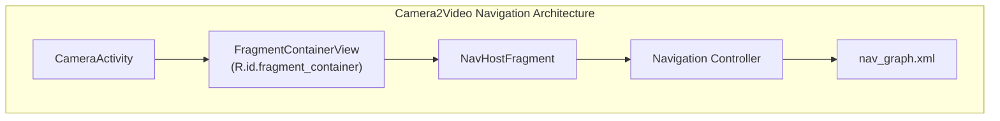
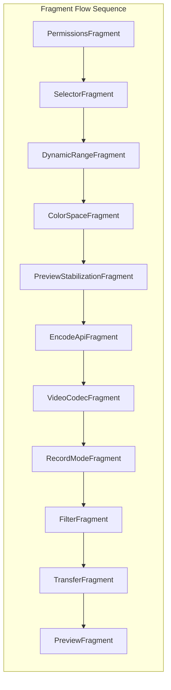
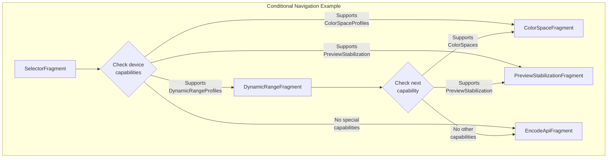
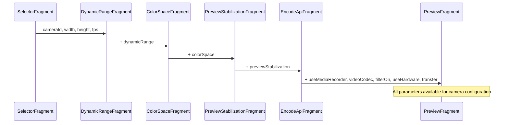
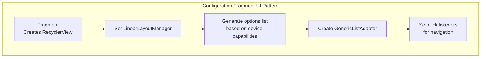

<!-- source: DeepWiki mcp.deepwiki.com · repo android/camera-samples · extra page Camera2Video Navigation and UI Flow · fetched 2026-10-23 -->

# Camera2Video Navigation and UI Flow

<details>
<summary>Relevant source files</summary>

The following files were used as context for generating this wiki page:

- [Camera2Video/app/src/main/java/com/example/android/camera2/video/fragments/DynamicRangeFragment.kt](Camera2Video/app/src/main/java/com/example/android/camera2/video/fragments/DynamicRangeFragment.kt)
- [Camera2Video/app/src/main/java/com/example/android/camera2/video/fragments/EncodeApiFragment.kt](Camera2Video/app/src/main/java/com/example/android/camera2/video/fragments/EncodeApiFragment.kt)
- [Camera2Video/app/src/main/java/com/example/android/camera2/video/fragments/FilterFragment.kt](Camera2Video/app/src/main/java/com/example/android/camera2/video/fragments/FilterFragment.kt)
- [Camera2Video/app/src/main/java/com/example/android/camera2/video/fragments/PreviewStabilizationFragment.kt](Camera2Video/app/src/main/java/com/example/android/camera2/video/fragments/PreviewStabilizationFragment.kt)
- [Camera2Video/app/src/main/java/com/example/android/camera2/video/fragments/RecordModeFragment.kt](Camera2Video/app/src/main/java/com/example/android/camera2/video/fragments/RecordModeFragment.kt)
- [Camera2Video/app/src/main/java/com/example/android/camera2/video/fragments/SelectorFragment.kt](Camera2Video/app/src/main/java/com/example/android/camera2/video/fragments/SelectorFragment.kt)
- [Camera2Video/app/src/main/java/com/example/android/camera2/video/fragments/TransferFragment.kt](Camera2Video/app/src/main/java/com/example/android/camera2/video/fragments/TransferFragment.kt)
- [Camera2Video/app/src/main/java/com/example/android/camera2/video/fragments/VideoCodecFragment.kt](Camera2Video/app/src/main/java/com/example/android/camera2/video/fragments/VideoCodecFragment.kt)
- [Camera2Video/app/src/main/res/layout/fragment_preview.xml](Camera2Video/app/src/main/res/layout/fragment_preview.xml)
- [Camera2Video/app/src/main/res/navigation/nav_graph.xml](Camera2Video/app/src/main/res/navigation/nav_graph.xml)
- [Camera2Video/app/src/main/res/values/strings.xml](Camera2Video/app/src/main/res/values/strings.xml)
- [Camera2Video/utils/src/main/res/drawable/ic_shutter_focused.xml](Camera2Video/utils/src/main/res/drawable/ic_shutter_focused.xml)
- [Camera2Video/utils/src/main/res/drawable/ic_shutter_pressed.xml](Camera2Video/utils/src/main/res/drawable/ic_shutter_pressed.xml)

</details>


## Purpose and Scope

This document explains the navigation architecture and user interface flow of the Camera2Video sample application. It details how users progress through configuration screens to set up video recording parameters and how the application transitions between different fragments. For information about the video processing pipelines used in Camera2Video, see [Camera2Video Processing Pipelines](#4.2.2).

## Navigation Architecture Overview

The Camera2Video application follows a single-activity pattern with multiple fragments. Navigation between fragments is managed using the Android Navigation Component, with a well-defined navigation graph that coordinates the user's journey through the app.



Sources: [Camera2Video/app/src/main/res/navigation/nav_graph.xml:17-483]()

## Fragment Sequence and Flow

The Camera2Video application guides users through a sequence of configuration screens before reaching the camera preview and recording interface. The sequence is designed to progressively collect all necessary configuration parameters for video recording.



Sources: [Camera2Video/app/src/main/res/navigation/nav_graph.xml:23-481]()

### Conditional Navigation

Not all users will navigate through every fragment in the sequence. The app dynamically determines which screens to show based on:

1. Device capabilities (supported features)
2. User selections
3. Compatibility requirements between options



Sources: 
- [Camera2Video/app/src/main/java/com/example/android/camera2/video/fragments/SelectorFragment.kt:68-122]()
- [Camera2Video/app/src/main/java/com/example/android/camera2/video/fragments/DynamicRangeFragment.kt:76-96]()

## Navigation Graph Structure

The application's navigation is defined in `nav_graph.xml`, which specifies:
- All possible destinations (fragments)
- Actions that connect destinations
- Arguments passed between destinations
- Start destination

Here's a simplified visual representation of the navigation graph:

```mermaid
graph TD
    subgraph "Camera2Video Navigation Graph"
        PF["permissions_fragment<br>PermissionsFragment"]
        SF["selector_fragment<br>SelectorFragment"]
        DRF["dynamic_range_fragment<br>DynamicRangeFragment"]
        CSF["color_space_fragment<br>ColorSpaceFragment"]
        PSF["preview_stabilization_fragment<br>PreviewStabilizationFragment"]
        EAF["encode_api_fragment<br>EncodeApiFragment"]
        VCF["video_codec_fragment<br>VideoCodecFragment"]
        RMF["record_mode_fragment<br>RecordModeFragment"]
        FF["filter_fragment<br>FilterFragment"]
        TF["transfer_fragment<br>TransferFragment"]
        PVF["preview_fragment<br>PreviewFragment"]

        PF -->|"action_permissions_to_selector"| SF
        SF -->|"action_selector_to_dynamic_range"| DRF
        SF -->|"action_selector_to_color_space"| CSF
        SF -->|"action_selector_to_preview_stabilization"| PSF
        SF -->|"action_selector_to_encode_api"| EAF
        DRF -->|"action_dynamic_range_to_color_space"| CSF
        DRF -->|"action_dynamic_range_to_preview_stabilization"| PSF
        DRF -->|"action_dynamic_range_to_encode_api"| EAF
        CSF -->|"action_color_space_to_preview_stabilization"| PSF
        CSF -->|"action_color_space_to_encode_api"| EAF
        PSF -->|"action_preview_stabilization_to_encode_api"| EAF
        EAF -->|"action_encode_api_to_video_codec"| VCF
        VCF -->|"action_video_codec_to_record_mode"| RMF
        RMF -->|"action_record_mode_to_filter"| FF
        RMF -->|"action_record_mode_to_preview"| PVF
        FF -->|"action_filter_to_transfer"| TF
        FF -->|"action_filter_to_preview"| PVF
        TF -->|"action_transfer_to_preview"| PVF
        PVF -->|"action_preview_to_permissions"| PF
    end
```



Sources: [Camera2Video/app/src/main/res/navigation/nav_graph.xml:17-483]()

## Fragment Descriptions and Purpose

Each fragment in the navigation flow serves a specific purpose in configuring the camera for video recording:

| Fragment | Purpose | Key Parameters Set |
|----------|---------|-------------------|
| PermissionsFragment | Requests camera permissions | N/A |
| SelectorFragment | Camera, resolution, and FPS selection | cameraId, width, height, fps |
| DynamicRangeFragment | HDR capabilities configuration | dynamicRange |
| ColorSpaceFragment | Color space selection | colorSpace |
| PreviewStabilizationFragment | Video stabilization toggle | previewStabilization |
| EncodeApiFragment | Encoding API selection (MediaCodec/MediaRecorder) | useMediaRecorder |
| VideoCodecFragment | Video codec selection (H.264, HEVC, AV1) | videoCodec |
| RecordModeFragment | Single or multi-stream recording | N/A (controls navigation path) |
| FilterFragment | Portrait filter toggle | filterOn |
| TransferFragment | Transfer function for HDR content | transfer |
| PreviewFragment | Camera preview and recording | N/A (uses all parameters) |

Sources:
- [Camera2Video/app/src/main/res/navigation/nav_graph.xml:23-481]()
- [Camera2Video/app/src/main/java/com/example/android/camera2/video/fragments/SelectorFragment.kt:40-189]()
- [Camera2Video/app/src/main/java/com/example/android/camera2/video/fragments/DynamicRangeFragment.kt:40-153]()

## Parameter Propagation

A key aspect of the Camera2Video navigation flow is how configuration parameters are accumulated and passed between fragments. The application uses the Navigation Component's Safe Args feature to safely pass typed arguments.



Sources:
- [Camera2Video/app/src/main/res/navigation/nav_graph.xml:65-473]()
- [Camera2Video/app/src/main/java/com/example/android/camera2/video/fragments/DynamicRangeFragment.kt:76-96]()

### Navigation Argument Building Pattern

Each fragment follows a consistent pattern for propagating parameters:

1. Receive arguments from the previous fragment using `navArgs()`
2. Let the user make a selection for the current parameter
3. Add the new parameter to existing ones and navigate to the next appropriate fragment

For example, in the `DynamicRangeFragment`:

```kotlin
// 1. Receive arguments
private val args: DynamicRangeFragmentArgs by navArgs()

// 2. User makes selection (dynamicRangeProfile)

// 3. Navigate with all parameters
navController.navigate(
    DynamicRangeFragmentDirections.actionDynamicRangeToColorSpace(
        args.cameraId, args.width, args.height, args.fps, dynamicRangeProfile))
```

Sources: [Camera2Video/app/src/main/java/com/example/android/camera2/video/fragments/DynamicRangeFragment.kt:76-96]()

## UI Implementation

Each configuration fragment in Camera2Video follows a consistent UI pattern:



### Selection UI

The configuration fragments use a simple list-based UI:
- `RecyclerView` with `LinearLayoutManager`
- `GenericListAdapter` with a standard Android list item layout
- Click listeners that navigate to the next fragment with selected parameters

Sources:
- [Camera2Video/app/src/main/java/com/example/android/camera2/video/fragments/SelectorFragment.kt:46-125]()
- [Camera2Video/app/src/main/java/com/example/android/camera2/video/fragments/FilterFragment.kt:45-80]()

### Camera Preview UI

The `PreviewFragment` uses a different UI layout designed for camera preview and recording:
- `AutoFitSurfaceView` for camera preview
- Overlay view for potential effects
- Capture button for starting/stopping recording
- Timer to show recording duration

Sources:
- [Camera2Video/app/src/main/res/layout/fragment_preview.xml:17-51]()

## Feature-Based Navigation Paths

The Camera2Video application dynamically adjusts its navigation path based on device capabilities and user selections. This creates multiple possible paths through the application.

```mermaid
flowchart TD
    subgraph "Feature-Based Navigation Paths"
        Start["Start"] --> Permissions["PermissionsFragment"]
        Permissions --> Selector["SelectorFragment"]
        
        Selector --> |"Device supports<br>DynamicRange"| DynamicRange["DynamicRangeFragment"]
        Selector --> |"Device supports<br>ColorSpace only"| ColorSpace["ColorSpaceFragment"]
        Selector --> |"Device supports<br>PreviewStabilization only"| Stabilization["PreviewStabilizationFragment"]
        Selector --> |"Basic device"| EncodeApi["EncodeApiFragment"]
        
        DynamicRange --> |"HDR selection"| ColorSpace
        DynamicRange --> |"No ColorSpace<br>support"| Stabilization
        DynamicRange --> |"No advanced<br>features"| EncodeApi
        
        ColorSpace --> Stabilization
        ColorSpace --> |"No PreviewStabilization<br>support"| EncodeApi
        
        Stabilization --> EncodeApi
        
        EncodeApi --> VideoCodec["VideoCodecFragment"]
        VideoCodec --> RecordMode["RecordModeFragment"]
        
        RecordMode --> |"Single-stream"| Filter["FilterFragment"]
        RecordMode --> |"Multi-stream"| Preview["PreviewFragment"]
        
        Filter --> |"Standard<br>dynamic range"| Preview
        Filter --> |"HDR"| Transfer["TransferFragment"]
        
        Transfer --> Preview
    end
```



Sources:
- [Camera2Video/app/src/main/java/com/example/android/camera2/video/fragments/SelectorFragment.kt:68-122]()
- [Camera2Video/app/src/main/java/com/example/android/camera2/video/fragments/DynamicRangeFragment.kt:76-96]()
- [Camera2Video/app/src/main/java/com/example/android/camera2/video/fragments/FilterFragment.kt:64-76]()
- [Camera2Video/app/src/main/java/com/example/android/camera2/video/fragments/RecordModeFragment.kt:62-78]()

## User Interaction Flow

From the user's perspective, the Camera2Video application presents a series of configuration screens, each with simple list-based choices. The user selects one option on each screen and progressively builds up their desired video recording configuration.

1. User grants camera permissions
2. User selects a camera and its resolution/FPS
3. User navigates through feature-specific configuration screens based on device capabilities
4. User arrives at the preview screen where they can start/stop recording

The app intelligently skips irrelevant configuration screens based on prior selections and device capabilities, presenting only contextually relevant options at each step.

Sources:
- [Camera2Video/app/src/main/res/navigation/nav_graph.xml:23-481]()
- [Camera2Video/app/src/main/java/com/example/android/camera2/video/fragments/SelectorFragment.kt:68-122]()

## Summary

The Camera2Video application demonstrates a sophisticated navigation and UI flow that:

1. Progressively builds up video recording configuration
2. Adapts to device capabilities
3. Provides contextual options based on previous selections
4. Passes configuration parameters between fragments
5. Culminates in a camera preview and recording interface

This design allows the app to support a wide range of Android devices with varying camera capabilities while providing a streamlined user experience.

---

