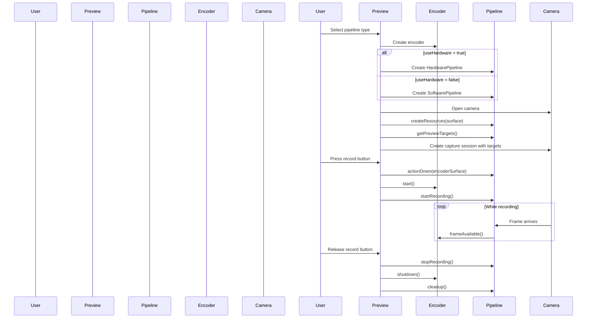
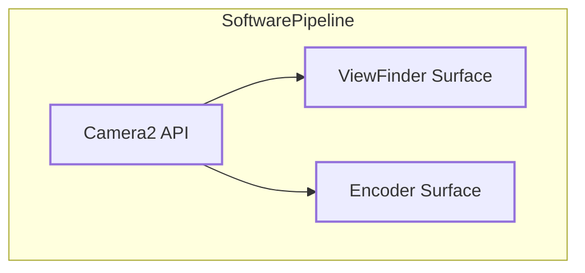
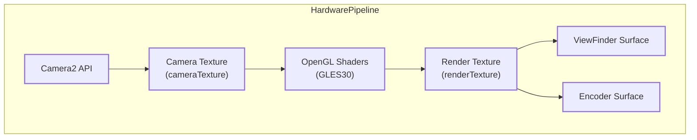
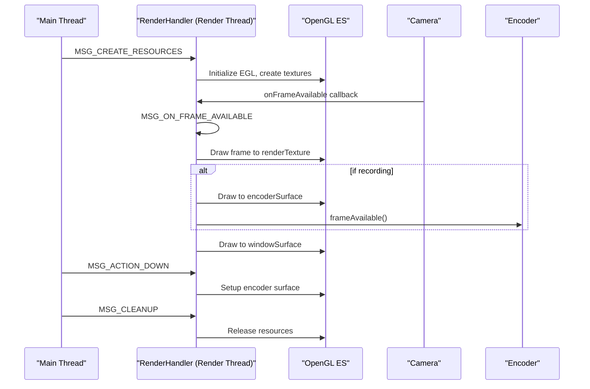
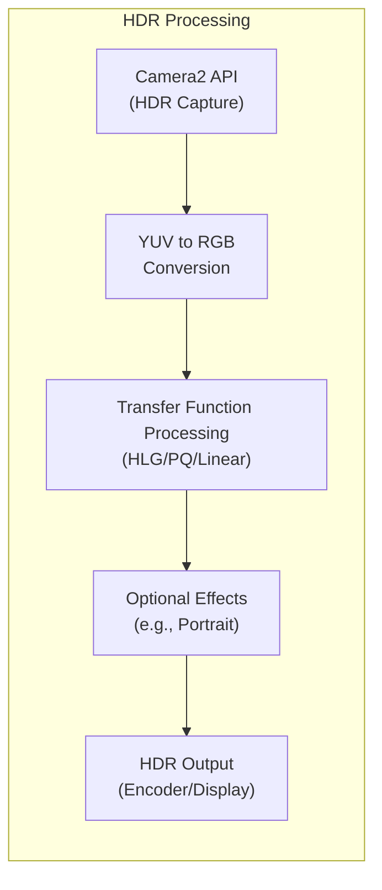
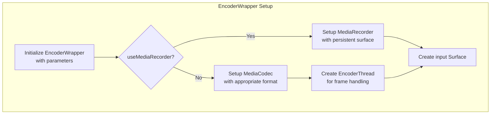
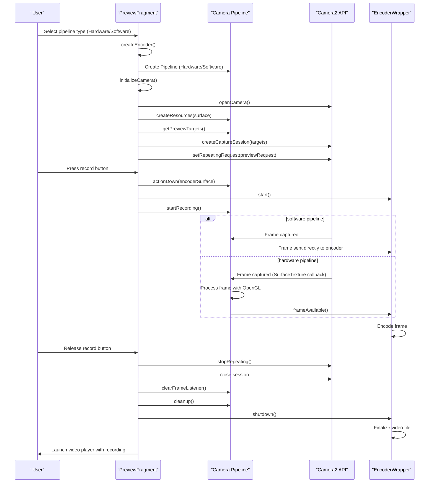

<!-- source: DeepWiki mcp.deepwiki.com · repo android/camera-samples · extra page Camera2Video Processing Pipelines · fetched 2026-10-23 -->

# Camera2Video Processing Pipelines

<details>
<summary>Relevant source files</summary>

The following files were used as context for generating this wiki page:

- [Camera2Video/.gitignore](Camera2Video/.gitignore)
- [Camera2Video/app/src/main/java/com/example/android/camera2/video/EncoderWrapper.kt](Camera2Video/app/src/main/java/com/example/android/camera2/video/EncoderWrapper.kt)
- [Camera2Video/app/src/main/java/com/example/android/camera2/video/HardwarePipeline.kt](Camera2Video/app/src/main/java/com/example/android/camera2/video/HardwarePipeline.kt)
- [Camera2Video/app/src/main/java/com/example/android/camera2/video/Pipeline.kt](Camera2Video/app/src/main/java/com/example/android/camera2/video/Pipeline.kt)
- [Camera2Video/app/src/main/java/com/example/android/camera2/video/SoftwarePipeline.kt](Camera2Video/app/src/main/java/com/example/android/camera2/video/SoftwarePipeline.kt)
- [Camera2Video/app/src/main/java/com/example/android/camera2/video/fragments/PreviewFragment.kt](Camera2Video/app/src/main/java/com/example/android/camera2/video/fragments/PreviewFragment.kt)

</details>


## Purpose and Scope

This document provides a detailed explanation of the processing pipelines in the Camera2Video sample application. It focuses on the architecture and implementation of the two main processing approaches: Hardware Pipeline and Software Pipeline, which handle camera frames from capture to encoding. For information about the Camera2Video navigation and UI flow, see [Camera2Video Navigation and UI Flow](#4.2.1).

## Pipeline Architecture Overview

The Camera2Video sample demonstrates two distinct approaches to process camera frames for video recording:

1. **Software Pipeline**: A simple approach that directly routes camera frames to both preview and encoder surfaces
2. **Hardware Pipeline**: A more complex approach that leverages OpenGL ES for frame processing, enabling effects and HDR support

Both pipelines inherit from an abstract `Pipeline` class that defines their common interface.

```mermaid
classDiagram
    direction TB
    
    class "Pipeline" {
        <<abstract>>
        +createPreviewRequest()
        +createRecordRequest()
        +getPreviewTargets()
        +getRecordTargets()
        +startRecording()
        +stopRecording()
        +cleanup()
    }
    
    class "SoftwarePipeline" {
        -width: Int
        -height: Int
        -fps: Int
        -filterOn: Boolean
        -dynamicRange: Long
        +createRecordRequest()
        +getPreviewTargets()
        +getRecordTargets()
    }
    
    class "HardwarePipeline" {
        -width: Int
        -height: Int
        -fps: Int
        -filterOn: Boolean
        -dynamicRange: Long
        -transfer: Int
        -renderThread: HandlerThread
        -renderHandler: RenderHandler
        +createRecordRequest()
        +startRecording()
        +stopRecording()
        +getPreviewTargets()
        +getRecordTargets()
    }
    
    class "EncoderWrapper" {
        -width: Int
        -height: Int
        -bitRate: Int
        -frameRate: Int
        -dynamicRange: Long
        -mimeType: String
        +getInputSurface()
        +start()
        +shutdown()
        +frameAvailable()
    }
    
    class "PreviewFragment" {
        -pipeline: Pipeline
        -encoder: EncoderWrapper
        +initializeCamera()
        +onViewCreated()
    }
    
    Pipeline <|-- SoftwarePipeline
    Pipeline <|-- HardwarePipeline
    PreviewFragment --> Pipeline : creates
    PreviewFragment --> EncoderWrapper : creates
    SoftwarePipeline --> EncoderWrapper : uses
    HardwarePipeline --> EncoderWrapper : uses
```

Sources:
- [Camera2Video/app/src/main/java/com/example/android/camera2/video/Pipeline.kt:28-67]()
- [Camera2Video/app/src/main/java/com/example/android/camera2/video/SoftwarePipeline.kt:29-72]()
- [Camera2Video/app/src/main/java/com/example/android/camera2/video/HardwarePipeline.kt:325-390]()
- [Camera2Video/app/src/main/java/com/example/android/camera2/video/fragments/PreviewFragment.kt:93-101]()

## Pipeline Selection

The `PreviewFragment` instantiates either a `HardwarePipeline` or `SoftwarePipeline` based on user selection from the UI. The selection is passed as a navigation argument (`args.useHardware`).



Sources:
- [Camera2Video/app/src/main/java/com/example/android/camera2/video/fragments/PreviewFragment.kt:93-101]()
- [Camera2Video/app/src/main/java/com/example/android/camera2/video/fragments/PreviewFragment.kt:254-413]()

## Abstract Pipeline Interface

The `Pipeline` abstract class defines the common interface that both pipeline implementations must follow. It declares methods for creating capture requests, managing surfaces, and controlling the recording process.

| Method | Description |
|--------|-------------|
| `createPreviewRequest()` | Creates a capture request for preview only |
| `createRecordRequest()` | Creates a capture request for recording |
| `getPreviewTargets()` | Returns surfaces used for preview |
| `getRecordTargets()` | Returns surfaces used for recording |
| `startRecording()` | Starts the recording process |
| `stopRecording()` | Stops the recording process |
| `actionDown()` | Called when recording button is pressed |
| `destroyWindowSurface()` | Destroys the window surface |
| `setPreviewSize()` | Sets the preview size |
| `createResources()` | Creates necessary resources |
| `clearFrameListener()` | Clears the frame listener |
| `cleanup()` | Cleans up resources |

Sources:
- [Camera2Video/app/src/main/java/com/example/android/camera2/video/Pipeline.kt:28-67]()

## Software Pipeline Implementation

The `SoftwarePipeline` provides a straightforward implementation that directly connects camera output to both preview and encoder surfaces without additional processing.

### Key Characteristics

- Minimal overhead, as frames are not processed before encoding
- Uses the Camera2 API's standard templates (`TEMPLATE_PREVIEW` and `TEMPLATE_RECORD`)
- Directly routes camera frames to both the viewfinder and encoder surfaces
- No GPU involvement or custom image processing

### Frame Flow



### Implementation Details

The software pipeline's record request connects camera output directly to both the viewfinder and encoder:

- For preview, it returns only the viewfinder surface
- For recording, it returns both viewfinder and encoder surfaces

Sources:
- [Camera2Video/app/src/main/java/com/example/android/camera2/video/SoftwarePipeline.kt:29-72]()

## Hardware Pipeline Implementation

The `HardwarePipeline` uses OpenGL ES for frame processing, enabling advanced features like filtering and HDR support. It runs on a dedicated rendering thread to avoid blocking the main UI thread.

### Key Characteristics

- Employs OpenGL ES for frame processing
- Runs on a dedicated `RenderThread` with a message handler architecture
- Supports HDR video with different transfer functions (HLG, PQ, Linear)
- Can apply effects like portrait mode to the video stream
- Manages complex surface chain using EGL/GLES

### Frame Flow



### OpenGL Pipeline Components

The hardware pipeline uses several OpenGL components to process frames:

1. **Textures**: 
   - `cameraTexId`: Used to receive frames from the camera
   - `renderTexId`: Used for intermediate rendering with effects
   - `windowTexId`: Used for display surface when needed

2. **Shader Programs**:
   - `cameraToRenderShaderProgram`: Processes frames from camera to render texture
   - `renderToPreviewShaderProgram`: Processes frames from render texture to preview
   - `renderToEncodeShaderProgram`: Processes frames from render texture to encoder

3. **EGL Surfaces**:
   - `eglRenderSurface`: For rendering operations
   - `eglEncoderSurface`: For writing to encoder
   - `eglWindowSurface`: For display

### Message Handler Architecture

The `HardwarePipeline` uses a message-based architecture with `RenderHandler` to manage OpenGL operations:



Sources:
- [Camera2Video/app/src/main/java/com/example/android/camera2/video/HardwarePipeline.kt:325-390]()
- [Camera2Video/app/src/main/java/com/example/android/camera2/video/HardwarePipeline.kt:423-903]()

### HDR Support

The hardware pipeline supports High Dynamic Range (HDR) video with different transfer functions:

- **HLG (Hybrid Log-Gamma)**
- **PQ (Perceptual Quantization)** 
- **Linear**

For HDR, it configures appropriate color spaces and shaders:



The transfer function selection affects shaders used for processing and the color space configuration of EGL surfaces.

Sources:
- [Camera2Video/app/src/main/java/com/example/android/camera2/video/HardwarePipeline.kt:560-602]()
- [Camera2Video/app/src/main/java/com/example/android/camera2/video/HardwarePipeline.kt:790-823]()

### Filter Effects

The hardware pipeline can apply filter effects when `filterOn` is true. The current implementation includes a portrait effect that darkens the edges of the frame:

- For HDR content: [Camera2Video/app/src/main/java/com/example/android/camera2/video/HardwarePipeline.kt:171-222]()
- For SDR content: [Camera2Video/app/src/main/java/com/example/android/camera2/video/HardwarePipeline.kt:283-294]()

## EncoderWrapper Integration

Both pipelines use the `EncoderWrapper` class to handle video encoding. This class provides a consistent interface regardless of whether `MediaRecorder` or `MediaCodec` is used for encoding.

### Key Features

- Supports both `MediaRecorder` and `MediaCodec` APIs
- Handles HDR video encoding with proper profiles (HDR10, HLG10, HDR10+)
- Supports multiple video codecs (H.264, HEVC, AV1)
- Manages encoding thread when using `MediaCodec`

### Encoder Setup Flow



### MediaCodec vs MediaRecorder

The `EncoderWrapper` supports two encoding approaches:

1. **MediaRecorder** (when `useMediaRecorder` is true):
   - Simpler API with less control
   - Handles audio recording automatically
   - All encoding and muxing is handled internally

2. **MediaCodec** (when `useMediaRecorder` is false):
   - More control over encoding parameters
   - Requires manual frame handling via `EncoderThread`
   - Uses `MediaMuxer` for combining encoded data into a container

Sources:
- [Camera2Video/app/src/main/java/com/example/android/camera2/video/EncoderWrapper.kt:41-512]()
- [Camera2Video/app/src/main/java/com/example/android/camera2/video/fragments/PreviewFragment.kt:230-246]()

## Full Recording Flow

The complete flow from camera to encoded video file involves several components working together:



Sources:
- [Camera2Video/app/src/main/java/com/example/android/camera2/video/fragments/PreviewFragment.kt:254-408]()

## Performance Considerations

### Software Pipeline
- **Advantages**: Simpler implementation, less CPU/GPU overhead
- **Disadvantages**: Limited flexibility, no frame processing capability

### Hardware Pipeline
- **Advantages**: Supports effects and HDR processing, more flexibility
- **Disadvantages**: Higher complexity, more resource-intensive, potential for dropped frames

The appropriate pipeline should be chosen based on the requirements of the video capture:
- Use Software Pipeline for basic recording needs
- Use Hardware Pipeline when HDR or effects are required

Sources:
- [Camera2Video/app/src/main/java/com/example/android/camera2/video/fragments/PreviewFragment.kt:93-101]()

## Conclusion

The Camera2Video sample demonstrates two approaches to video recording pipelines using the Camera2 API:

1. The **Software Pipeline** provides a direct path from camera to encoder with minimal overhead.
2. The **Hardware Pipeline** offers advanced features like HDR support and effects through OpenGL ES processing.

Both pipelines work with the `EncoderWrapper` to handle video encoding. The choice between them depends on the specific requirements of the video recording application.

---

