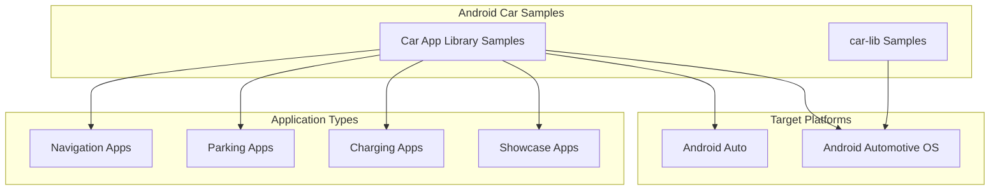
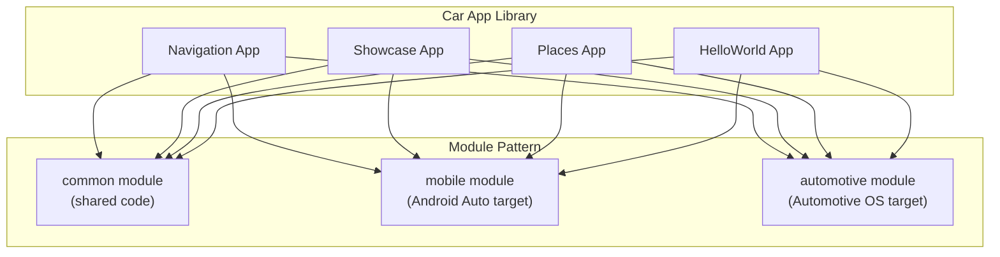
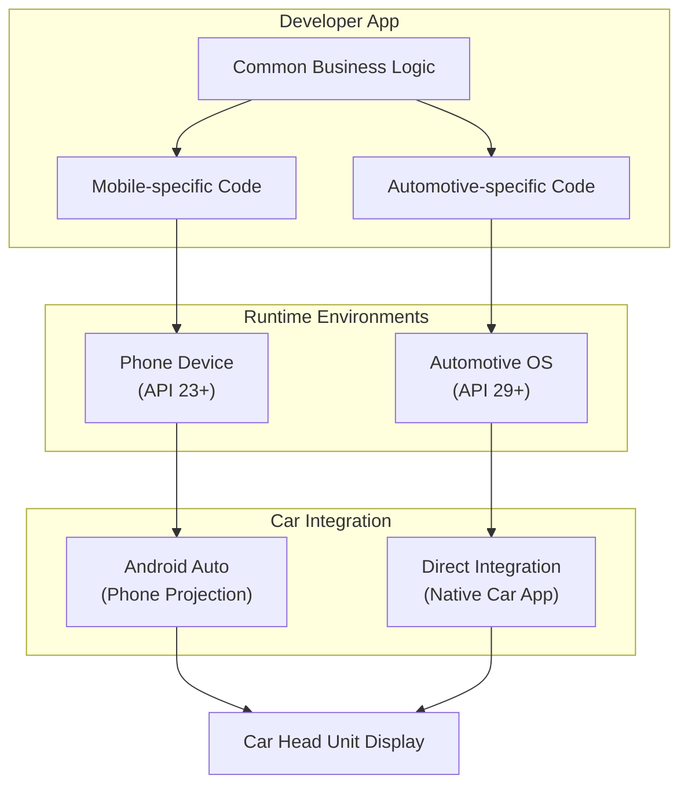
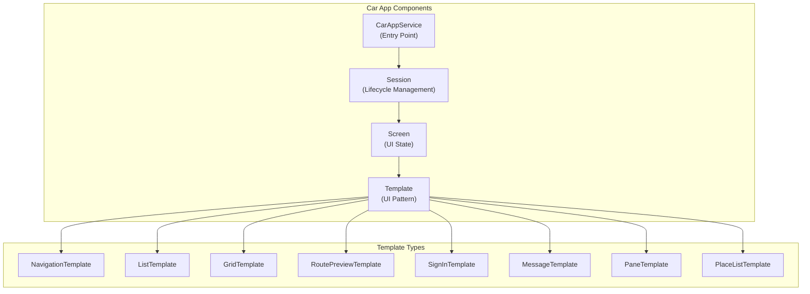

<!-- source: DeepWiki mcp.deepwiki.com · repo android/car-samples · page 1 Overview · fetched 2026-10-23 -->

# Overview

<details>
<summary>Relevant source files</summary>

The following files were used as context for generating this wiki page:

- [README.md](README.md)
- [car_app_library/README.md](car_app_library/README.md)
- [car_app_library/build.gradle](car_app_library/build.gradle)

</details>


This document provides an introduction to the Android Car Samples repository, which contains sample applications demonstrating how to build apps for Android Auto and Android Automotive OS. This repository serves as a practical reference for developers looking to create automotive applications using the Android platform.

For detailed information about the architectural patterns and design principles, see [Architecture and Design](#2). For specific details about individual sample applications, see [Sample Applications](#3).

## Repository Purpose

The car-samples repository demonstrates implementation patterns for automotive applications targeting two distinct environments:

1. **Android Auto**: Apps running on a mobile device and projecting their UI to the vehicle's display
2. **Android Automotive OS**: Apps running directly on the vehicle's infotainment system

The repository provides working examples of navigation, parking, charging, and other automotive applications using the Car App Library and related Android automotive APIs.



Sources: [README.md:1-13]()

## Repository Structure

The repository is organized into distinct sections based on the target platforms and integration libraries:

- **Car App Library**: The primary section containing sample applications that can run on both Android Auto and Android Automotive OS
- **car-lib**: Samples specifically targeting Android Automotive OS

The Car App Library samples follow a consistent structure that enables code sharing between platforms while accommodating platform-specific requirements.



Sources: [car_app_library/README.md:1-4](), [README.md:7-11]()

## Sample Applications

The repository includes four primary sample applications in the Car App Library section:

| Sample App | Description | Key Demonstrations |
|------------|-------------|-------------------|
| Navigation | Navigation app example | Map rendering, route guidance, trip planning |
| Showcase | Comprehensive feature showcase | Various UI templates, car app capabilities |
| Places | Location-based services | Location search, place details, favorites |
| HelloWorld | Minimal starter example | Basic app structure and setup |

Each sample app is designed to demonstrate specific aspects of automotive app development while following the common/mobile/automotive module pattern.

Sources: [car_app_library/README.md:1-4]()

## Platform Architecture 

The Car App Library enables developers to build apps that can work across both Android Auto and Android Automotive OS environments. This cross-platform capability is achieved through a modular architecture:



Sources: [car_app_library/README.md:67-92]()

## Car App Architecture

Car apps follow a specific architecture pattern centered around templates and services:



This architecture ensures that car apps comply with driver distraction guidelines by using standardized UI components optimized for the automotive environment.

Sources: [car_app_library/README.md:1-4]()

## Building and Running

The samples can be built and run using either Android Studio or the command line:

### Android Studio
1. Open the project in Android Studio
2. Select a sample app module (e.g., `helloworld/mobile`)
3. Build the module using Build → Make Module
4. Run the app on a device or emulator

### Command Line
1. Use the Gradle wrapper to assemble the APK:
   ```
   ./gradlew :<sample_app>:<platform>:assemble
   ```
2. Install the APK using ADB:
   ```
   adb install <path_to_sample_app_apk>
   ```

### Testing Environments
- **Mobile apps**: Test using the Desktop Head Unit (DHU) simulator
- **Automotive apps**: Test using the Automotive OS Emulator

Sources: [car_app_library/README.md:10-92](), [car_app_library/build.gradle:17-46]()

## Prerequisites

To work with the samples in this repository, you need:

- Android 6.0 SDK (API level 23) or newer
- Android Studio
- For automotive testing: Android Studio 4.2+ with Automotive OS emulator images

Sources: [car_app_library/README.md:6-9](), [car_app_library/README.md:79-86]()

This overview provides a foundation for understanding the car-samples repository. The following sections in this wiki provide more detailed information about the architecture, sample applications, and development considerations.

---

