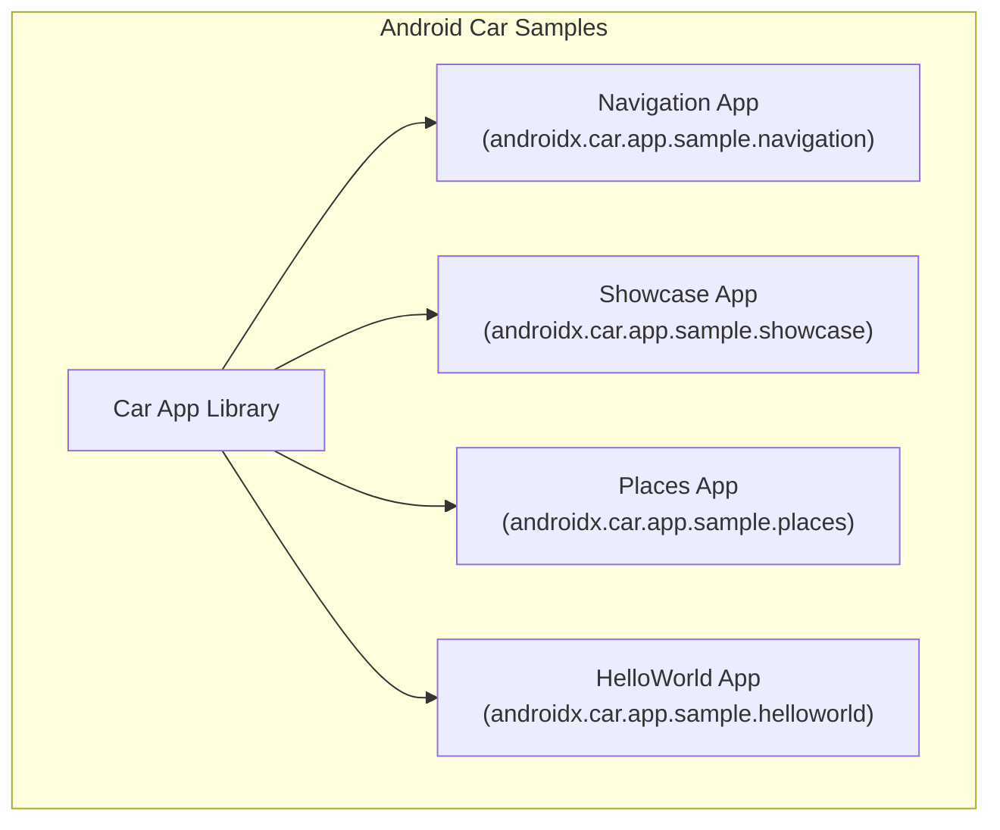
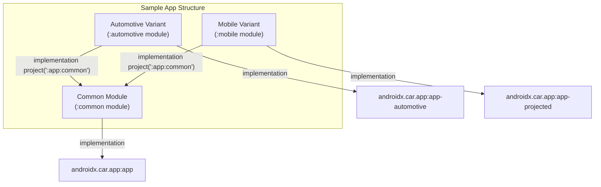
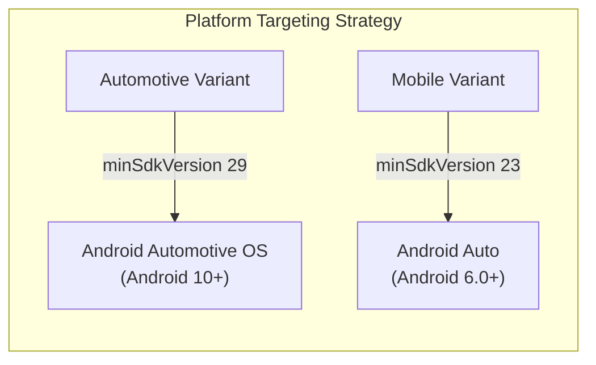
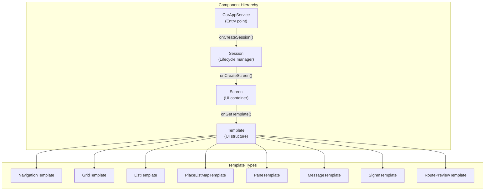
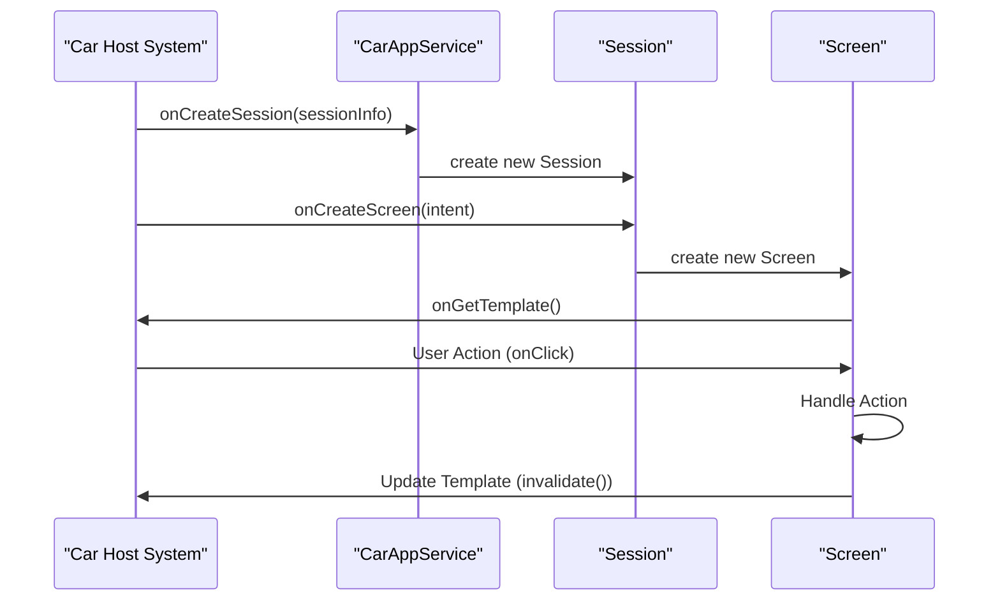
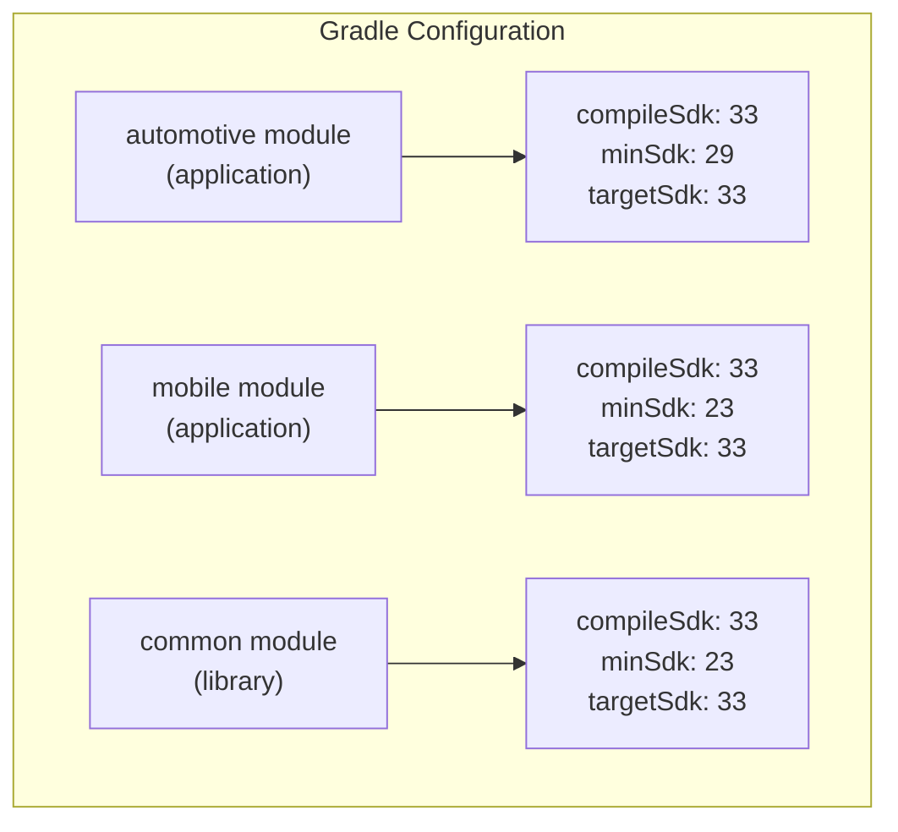
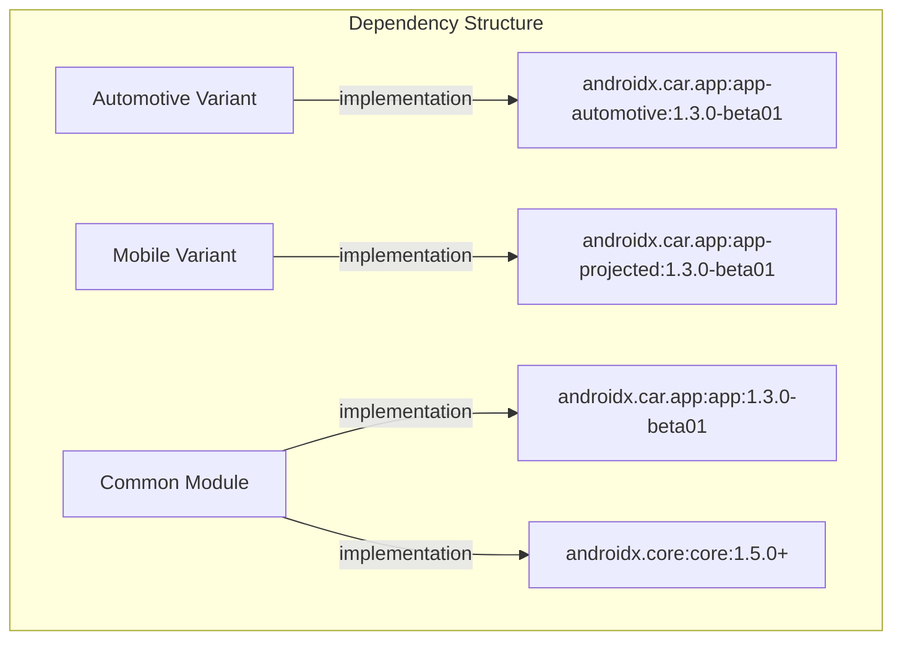

<!-- source: DeepWiki mcp.deepwiki.com · repo android/car-samples · page 2 Architecture and Design · fetched 2026-10-23 -->

# Architecture and Design

Relevant source files

The following files were used as context for generating this wiki page:

- [car_app_library/gradle.properties](car_app_library/gradle.properties)
- [car_app_library/helloworld/automotive/build.gradle](car_app_library/helloworld/automotive/build.gradle)
- [car_app_library/helloworld/mobile/build.gradle](car_app_library/helloworld/mobile/build.gradle)
- [car_app_library/navigation/automotive/build.gradle](car_app_library/navigation/automotive/build.gradle)
- [car_app_library/navigation/common/build.gradle](car_app_library/navigation/common/build.gradle)
- [car_app_library/navigation/mobile/build.gradle](car_app_library/navigation/mobile/build.gradle)
- [car_app_library/places/automotive/build.gradle](car_app_library/places/automotive/build.gradle)
- [car_app_library/places/mobile/build.gradle](car_app_library/places/mobile/build.gradle)
- [car_app_library/showcase/automotive/build.gradle](car_app_library/showcase/automotive/build.gradle)
- [car_app_library/showcase/common/build.gradle](car_app_library/showcase/common/build.gradle)
- [car_app_library/showcase/mobile/build.gradle](car_app_library/showcase/mobile/build.gradle)

This document outlines the high-level architecture of the Android car apps in the car-samples repository. It explains the structural organization, design patterns, and core components that form the foundation of these applications.

For detailed information about build system configuration, see [Build System](#2.2). For an in-depth explanation of core components, refer to [Core App Components](#2.3).

## Repository Organization

The car-samples repository is organized around four primary sample applications, each demonstrating different aspects of car app development:

Sources:
- [car_app_library/navigation/automotive/build.gradle:23]()
- [car_app_library/showcase/automotive/build.gradle:23]()
- [car_app_library/places/automotive/build.gradle:22]()
- [car_app_library/helloworld/automotive/build.gradle:23]()

## Modular Application Architecture

Each sample application follows a consistent three-module design pattern that enables cross-platform development:

Sources:
- [car_app_library/navigation/automotive/build.gradle:50-51]()
- [car_app_library/navigation/mobile/build.gradle:50-51]()
- [car_app_library/navigation/common/build.gradle:39]()
- [car_app_library/showcase/automotive/build.gradle:52-53]()
- [car_app_library/showcase/mobile/build.gradle:52-53]()
- [car_app_library/showcase/common/build.gradle:38]()

### Module Responsibilities

| Module | Purpose | Key Dependencies |
|--------|---------|------------------|
| Common | Shared business logic and UI | androidx.car.app:app |
| Automotive | Android Automotive OS entry point | androidx.car.app:app-automotive |
| Mobile | Android Auto projection entry point | androidx.car.app:app-projected |

This architecture enables code sharing between variants while allowing platform-specific implementations when necessary.

## Platform Targeting

The sample applications target two distinct platforms with different SDK requirements:

| Variant | Target Platform | Min SDK | Target SDK | Version Code Strategy |
|---------|----------------|---------|------------|------------------------|
| Automotive | Android Automotive OS | 29 | 33 | Unique (e.g., 113) |
| Mobile | Android Auto | 23 | 33 | Unique (e.g., 114) |

The version codes for automotive and mobile variants are deliberately different to enable publishing both to the Play Store as separate applications.

Sources:
- [car_app_library/navigation/automotive/build.gradle:24-29]()
- [car_app_library/navigation/mobile/build.gradle:24-29]()
- [car_app_library/showcase/automotive/build.gradle:24-29]()
- [car_app_library/showcase/mobile/build.gradle:24-29]()

## Core Component Architecture

Android car apps follow a specific architectural pattern defined by the AndroidX Car App library:

Sources:
- [car_app_library/navigation/common/build.gradle:39]()
- [car_app_library/showcase/common/build.gradle:38]()

### Component Interaction Flow

The following sequence diagram illustrates the typical interaction flow between components:

This architecture enforces several key principles:

1. **Service-based entry point**: All car apps must provide a `CarAppService` implementation
2. **Stateful sessions**: The `Session` maintains app state across screen transitions
3. **Template-driven UI**: UI elements are limited to predefined templates for driver safety
4. **Limited customization**: UI customization is restricted to ensure consistency
5. **Surface rendering**: For specialized needs like maps, a separate `SurfaceRenderer` API is available

## Build Configuration

The sample applications use a consistent Gradle configuration across all modules:

Key build settings include:
- Java 8 compatibility for all modules
- ProGuard optimization for release builds
- AndroidX library support enabled
- Disabled unused Android features for efficiency

Sources:
- [car_app_library/navigation/automotive/build.gradle:19-46]()
- [car_app_library/navigation/mobile/build.gradle:19-46]()
- [car_app_library/navigation/common/build.gradle:17-32]()
- [car_app_library/showcase/automotive/build.gradle:19-48]()
- [car_app_library/showcase/mobile/build.gradle:19-48]()
- [car_app_library/showcase/common/build.gradle:17-33]()
- [car_app_library/gradle.properties:27-33]()

## Dependencies

The sample applications rely on a specific set of AndroidX Car App libraries:

This dependency structure ensures that:
1. Each module uses the appropriate car app library variant
2. The common module uses only APIs available to both platforms
3. Version consistency is maintained across modules

Sources:
- [car_app_library/navigation/automotive/build.gradle:50]()
- [car_app_library/navigation/mobile/build.gradle:50]()
- [car_app_library/navigation/common/build.gradle:37-39]()
- [car_app_library/showcase/automotive/build.gradle:52]()
- [car_app_library/showcase/mobile/build.gradle:52]()
- [car_app_library/showcase/common/build.gradle:37-38]()

## Summary

The architecture of Android car apps in the car-samples repository demonstrates a modular design approach that enables:

1. **Cross-platform compatibility**: Supporting both Android Automotive OS and Android Auto
2. **Code reuse**: Sharing business logic and UI templates between platforms
3. **Safety compliance**: Using standardized templates that adhere to driver distraction guidelines
4. **Consistent structure**: Following a common architectural pattern across all sample apps

This architecture allows developers to create car apps that work seamlessly across different car environments while maintaining a consistent user experience and adhering to driver safety guidelines.

---

