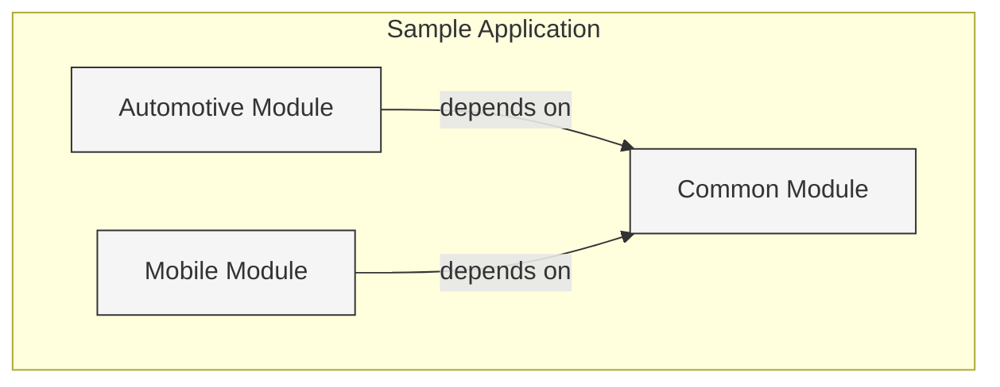
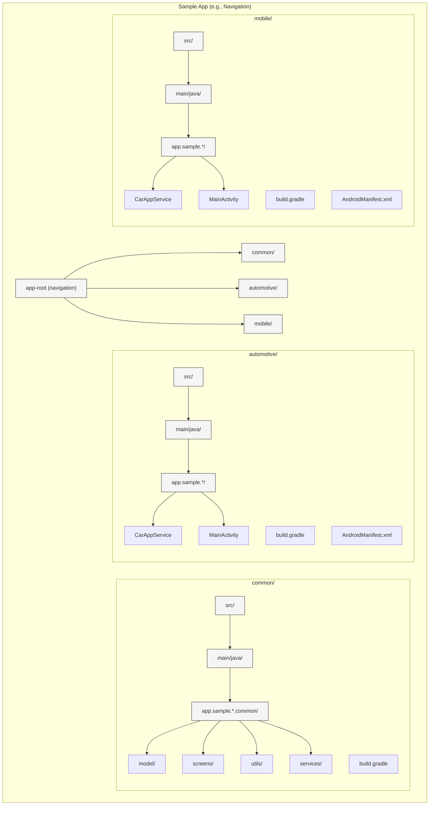
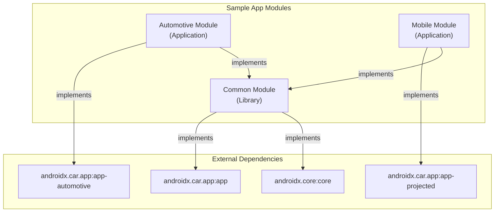

<!-- source: DeepWiki mcp.deepwiki.com · repo android/car-samples · page 2.1 Application Structure · fetched 2026-10-23 -->

# Application Structure

<details>
<summary>Relevant source files</summary>

The following files were used as context for generating this wiki page:

- [car_app_library/helloworld/automotive/build.gradle](car_app_library/helloworld/automotive/build.gradle)
- [car_app_library/helloworld/common/build.gradle](car_app_library/helloworld/common/build.gradle)
- [car_app_library/helloworld/mobile/build.gradle](car_app_library/helloworld/mobile/build.gradle)
- [car_app_library/navigation/automotive/build.gradle](car_app_library/navigation/automotive/build.gradle)
- [car_app_library/navigation/common/build.gradle](car_app_library/navigation/common/build.gradle)
- [car_app_library/navigation/mobile/build.gradle](car_app_library/navigation/mobile/build.gradle)
- [car_app_library/places/automotive/build.gradle](car_app_library/places/automotive/build.gradle)
- [car_app_library/places/common/build.gradle](car_app_library/places/common/build.gradle)
- [car_app_library/places/mobile/build.gradle](car_app_library/places/mobile/build.gradle)
- [car_app_library/showcase/automotive/build.gradle](car_app_library/showcase/automotive/build.gradle)
- [car_app_library/showcase/common/build.gradle](car_app_library/showcase/common/build.gradle)
- [car_app_library/showcase/mobile/build.gradle](car_app_library/showcase/mobile/build.gradle)

</details>


This page documents the module architecture and organizational patterns used across the sample applications in the Android Car Samples repository. It details how each application is structured to target both Android Automotive OS and Android Auto platforms while maximizing code reuse.

For information about how the build system is configured to support this structure, see [Build System](#2.2).

## Module Pattern

Each sample application in the repository follows a consistent three-module architecture pattern designed to separate platform-specific code from shared functionality.

### Three-Module Architecture



Sources: [car_app_library/showcase/automotive/build.gradle:52-53](), [car_app_library/showcase/mobile/build.gradle:52-53](), [car_app_library/navigation/automotive/build.gradle:51-52](), [car_app_library/navigation/mobile/build.gradle:51-52]()

The three-module architecture consists of:

1. **Common Module**: Library module containing shared code and resources used by both platform variants
2. **Automotive Module**: Application module targeting Android Automotive OS
3. **Mobile Module**: Application module targeting Android mobile devices (for use with Android Auto)

This pattern enables high code reuse while allowing for platform-specific optimizations and implementations where necessary.

## Module Characteristics

Each module type has distinct characteristics defined in their respective build configurations:

| Module Type | Plugin | Min SDK | Target Type | AndroidX Car Dependency |
|-------------|--------|---------|-------------|-------------------------|
| Common | com.android.library | 23 | Both platforms | androidx.car.app:app |
| Automotive | com.android.application | 29 | Android Automotive OS | androidx.car.app:app-automotive |
| Mobile | com.android.application | 23 | Android Mobile (Auto) | androidx.car.app:app-projected |

Sources: [car_app_library/navigation/common/build.gradle:17-39](), [car_app_library/navigation/automotive/build.gradle:17-24](), [car_app_library/navigation/mobile/build.gradle:17-25]()

### Common Module

The common module is implemented as an Android library that contains the core business logic, UI templates, and shared resources. It uses the base Car App library dependency:

```
implementation "androidx.car.app:app:1.3.0-beta01"
```

Key characteristics:
- Uses the `com.android.library` plugin
- Has a minimum SDK version of 23 to be compatible with both platforms
- Contains shared UI templates, models, and utility classes

Sources: [car_app_library/showcase/common/build.gradle:17-38](), [car_app_library/navigation/common/build.gradle:17-39]()

### Automotive Module

The automotive module is an application specifically targeting Android Automotive OS:

```
implementation "androidx.car.app:app-automotive:1.3.0-beta01"
implementation project(":navigation:common")
```

Key characteristics:
- Uses the `com.android.application` plugin
- Has a minimum SDK version of 29 (Android 10), required for Automotive OS
- Contains automotive-specific implementations and configurations
- Depends on the common module

Sources: [car_app_library/navigation/automotive/build.gradle:17-52](), [car_app_library/showcase/automotive/build.gradle:17-53]()

### Mobile Module

The mobile module is an application targeting mobile devices that connect to cars via Android Auto:

```
implementation "androidx.car.app:app-projected:1.3.0-beta01"
implementation project(":navigation:common")
```

Key characteristics:
- Uses the `com.android.application` plugin
- Has a minimum SDK version of 23 (Android 6.0)
- Contains mobile-specific implementations and projection configurations
- Depends on the common module

Sources: [car_app_library/navigation/mobile/build.gradle:17-52](), [car_app_library/showcase/mobile/build.gradle:17-53]()

## Application Structure Diagram

The following diagram illustrates how a typical sample application in the repository is structured, including the file organization and key components:



Sources: [car_app_library/navigation/common/build.gradle](), [car_app_library/navigation/automotive/build.gradle](), [car_app_library/navigation/mobile/build.gradle]()

## Dependency Structure

The following diagram illustrates the dependency relationships between modules and external libraries:



Sources: [car_app_library/showcase/common/build.gradle:36-39](), [car_app_library/showcase/automotive/build.gradle:51-53](), [car_app_library/showcase/mobile/build.gradle:51-53]()

Key dependencies:
- **Common module**: Depends on the base car app library (`androidx.car.app:app`)
- **Automotive module**: Depends on the common module and the automotive-specific car app library (`androidx.car.app:app-automotive`)
- **Mobile module**: Depends on the common module and the projected car app library (`androidx.car.app:app-projected`)

## Sample Applications

All four sample applications in the repository follow this module pattern:

| Application | Purpose | Common Module | Automotive Module | Mobile Module |
|-------------|---------|---------------|------------------|---------------|
| Navigation | Demonstrates navigation features | navigation/common | navigation/automotive | navigation/mobile |
| Showcase | Demonstrates variety of templates | showcase/common | showcase/automotive | showcase/mobile |
| Places | Demonstrates place search and list | places/common | places/automotive | places/mobile |
| HelloWorld | Minimal example app | helloworld/common | helloworld/automotive | helloworld/mobile |

Sources: [car_app_library/navigation/common/build.gradle](), [car_app_library/showcase/common/build.gradle](), [car_app_library/places/common/build.gradle](), [car_app_library/helloworld/common/build.gradle]()

## Version Management

The sample applications maintain separate version codes between the automotive and mobile variants:

```
// Increment this to generate signed builds for uploading to Playstore
// Make sure this is different from the navigation-automotive version
versionCode 114  // Mobile version
versionCode 113  // Automotive version
```

This separation is necessary because:
1. The application variants may have different release cycles
2. Each variant requires its own Play Store listings
3. Different version codes help prevent confusion during development and deployment

Sources: [car_app_library/navigation/automotive/build.gradle:23-29](), [car_app_library/navigation/mobile/build.gradle:23-29]()

## Implementation Considerations

When developing applications using this structure, consider the following:

1. **Code Sharing**: Place as much code as possible in the common module to maximize reuse
2. **Platform Detection**: When platform-specific behavior is needed, use capability detection instead of direct platform checks
3. **Resource Optimization**: Include platform-specific resources in the respective module
4. **Module Boundaries**: Keep module interfaces clean and well-defined to minimize coupling

The next page [Core App Components](#2.3) covers the key components that form the foundation of car apps built using this structure.

---

