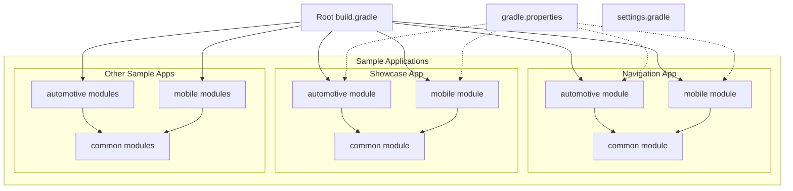
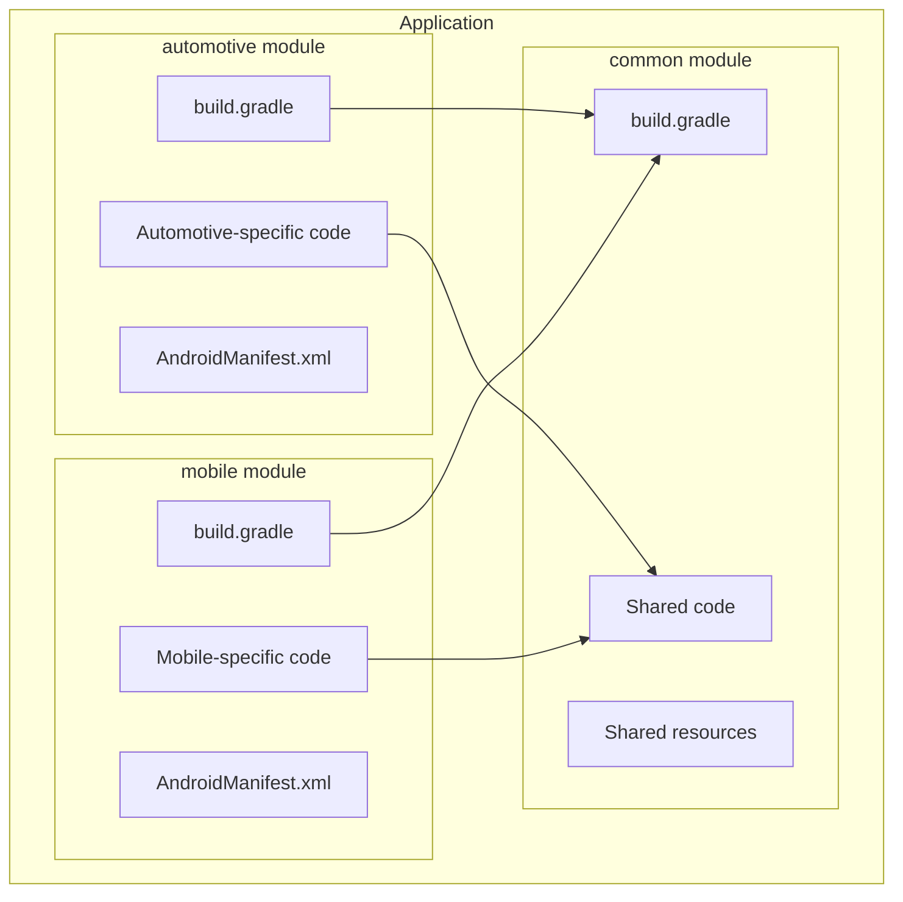
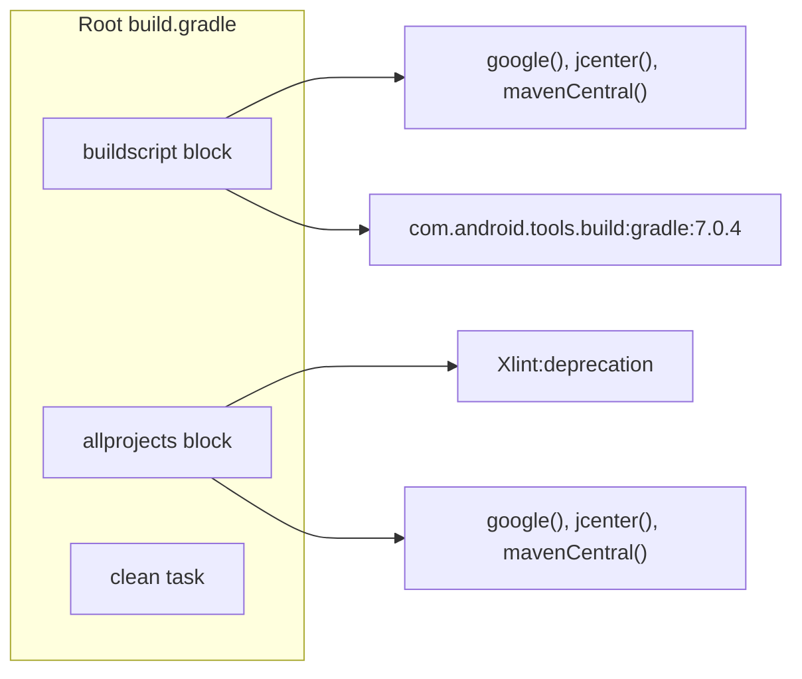
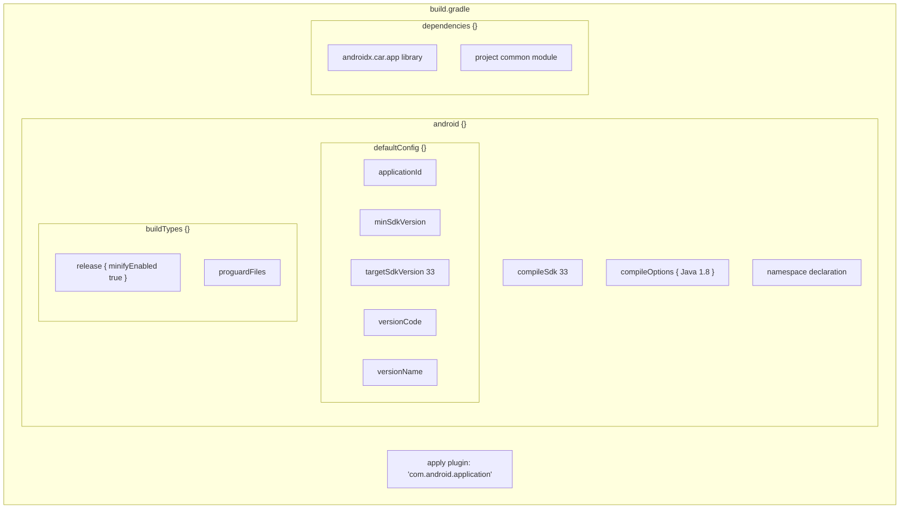
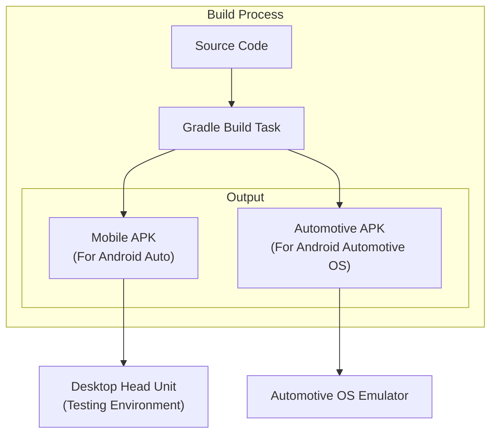
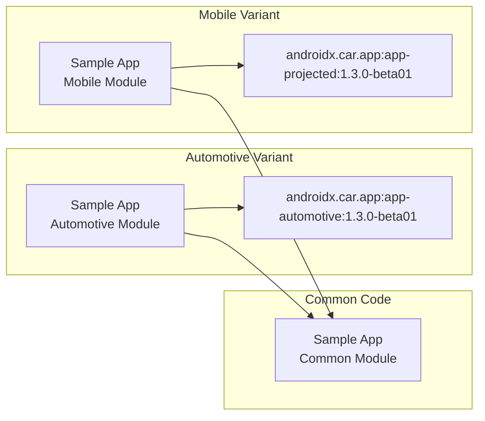

<!-- source: DeepWiki mcp.deepwiki.com · repo android/car-samples · page 2.2 Build System · fetched 2026-10-23 -->

# Build System

<details>
<summary>Relevant source files</summary>

The following files were used as context for generating this wiki page:

- [car_app_library/README.md](car_app_library/README.md)
- [car_app_library/build.gradle](car_app_library/build.gradle)
- [car_app_library/gradle.properties](car_app_library/gradle.properties)
- [car_app_library/navigation/automotive/build.gradle](car_app_library/navigation/automotive/build.gradle)
- [car_app_library/navigation/mobile/build.gradle](car_app_library/navigation/mobile/build.gradle)
- [car_app_library/showcase/automotive/build.gradle](car_app_library/showcase/automotive/build.gradle)
- [car_app_library/showcase/mobile/build.gradle](car_app_library/showcase/mobile/build.gradle)

</details>


## Purpose and Scope

This document describes the Gradle build system configuration used in the Android Car Samples repository. It covers the build file structure, module organization, platform variants, dependency management, and build process for both command-line and Android Studio environments. For information about running the built applications, see [Development and Testing](#5).

## Build System Overview

The car-samples repository uses Gradle as its build system with a structured module hierarchy designed to support both Android Automotive OS and Android Auto (mobile) variants of each sample application.



Sources: [car_app_library/build.gradle](), [car_app_library/gradle.properties]()

## Module Structure

Each sample application in the car-samples repository follows a consistent three-module structure:



Sources: [car_app_library/navigation/automotive/build.gradle](), [car_app_library/navigation/mobile/build.gradle]()

### Module Dependencies

Both the automotive and mobile modules depend on their respective Car App Library variants and the common module:

| Module Type | Car App Library Dependency | Other Dependencies |
|-------------|----------------------------|-------------------|
| Automotive | `androidx.car.app:app-automotive` | common module |
| Mobile | `androidx.car.app:app-projected` | common module |

Sources: [car_app_library/navigation/automotive/build.gradle:50-52](), [car_app_library/navigation/mobile/build.gradle:50-52]()

## Platform Variant Configurations

The build system maintains separate configurations for automotive and mobile variants through their respective build.gradle files. Here are the key differences:

| Configuration | Automotive Variant | Mobile Variant |
|---------------|-------------------|---------------|
| Min SDK | 29 (Android 10) | 23 (Android 6.0) |
| Target SDK | 33 | 33 |
| Library Dependency | androidx.car.app:app-automotive | androidx.car.app:app-projected |
| Version Code | Usually odd (e.g., 113) | Usually even (e.g., 114) |

Sources: [car_app_library/navigation/automotive/build.gradle:22-29](), [car_app_library/navigation/mobile/build.gradle:22-29](), [car_app_library/showcase/automotive/build.gradle:22-29](), [car_app_library/showcase/mobile/build.gradle:22-29]()

## Root Build Configuration

The root build.gradle file configures the build environment, including:

1. Repository sources (Google, JCenter, and Maven Central)
2. Gradle version (7.0.4)
3. Global Java compiler options



Sources: [car_app_library/build.gradle:17-46]()

## Gradle Properties

The gradle.properties file configures several important build behaviors:

1. Enabling AndroidX
2. Disabling unused Android features (AIDL, BuildConfig, RenderScript, etc.)

Sources: [car_app_library/gradle.properties:27-33]()

## Application Module Configuration

Each application module (automotive and mobile) defines its specific Android application configuration:

### Common Configuration Elements

1. **Application ID** - Package name for the application (same for both variants)
2. **Target SDK** - API level 33 for both variants
3. **Compilation Options** - Java 8 compatibility
4. **Release Configuration** - Code shrinking and optimization

### Example Module Configuration



Sources: [car_app_library/navigation/automotive/build.gradle:19-52](), [car_app_library/showcase/mobile/build.gradle:19-54]()

## Build Process

The build process generates different APKs for the automotive and mobile variants:



Sources: [car_app_library/README.md:10-66](), [car_app_library/README.md:67-92]()

## Building Applications

### Command Line Building

To build sample applications from the command line:

```
./gradlew :<sample_app>:<platform>:assemble
```

Examples:
- `./gradlew :showcase:mobile:assemble` - Builds the mobile variant of Showcase app
- `./gradlew :navigation:automotive:assemble` - Builds the automotive variant of Navigation app

The generated APKs will be located at `<sample_app>/<platform>/build/outputs/apk/debug/`.

Sources: [car_app_library/README.md:34-65]()

### Android Studio Building

To build from Android Studio:

1. Open the project in Android Studio
2. Select a module (e.g., `navigation/mobile`)
3. Use Build > Make Module to generate the APK

Sources: [car_app_library/README.md:10-33]()

## Module Dependencies Hierarchy

The project's build system establishes dependencies between modules and external libraries:



Sources: [car_app_library/navigation/automotive/build.gradle:49-52](), [car_app_library/navigation/mobile/build.gradle:49-52](), [car_app_library/showcase/automotive/build.gradle:51-54](), [car_app_library/showcase/mobile/build.gradle:51-54]()

## Version Management

The build system maintains separate version codes and names for automotive and mobile variants to allow independent publishing to the Play Store:

- Automotive variants typically use odd version codes (e.g., 113)
- Mobile variants typically use even version codes (e.g., 114)

This separation allows for independent update cycles while maintaining a consistent application ID.

Sources: [car_app_library/navigation/automotive/build.gradle:26-29](), [car_app_library/navigation/mobile/build.gradle:26-29](), [car_app_library/showcase/automotive/build.gradle:26-29](), [car_app_library/showcase/mobile/build.gradle:26-29]()

---

