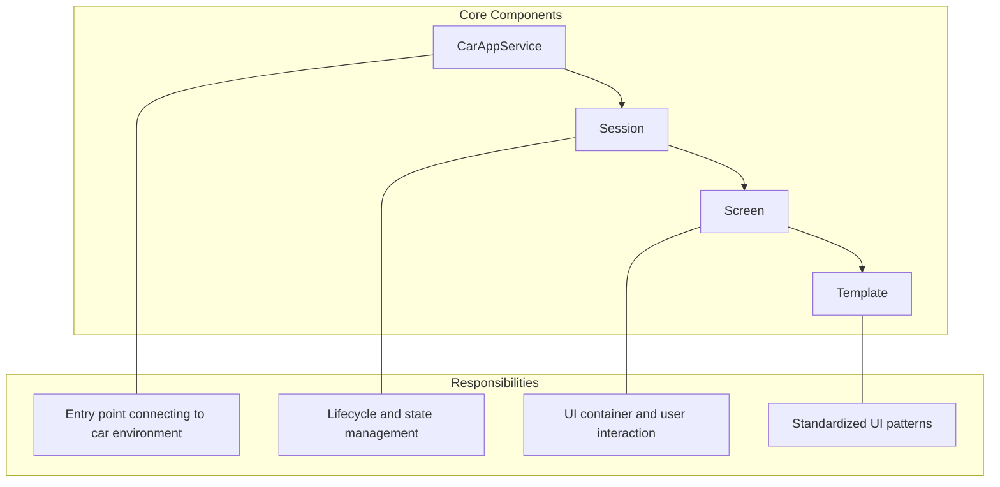
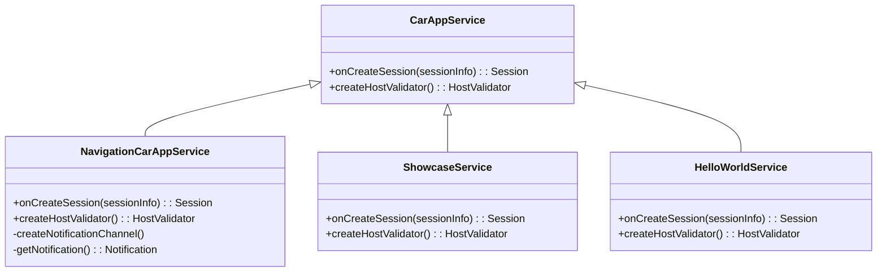
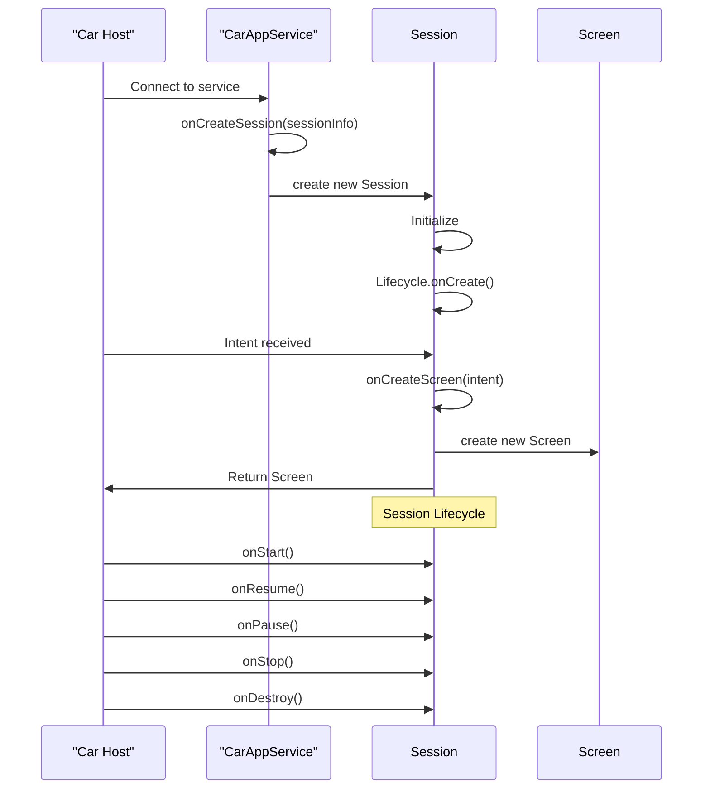
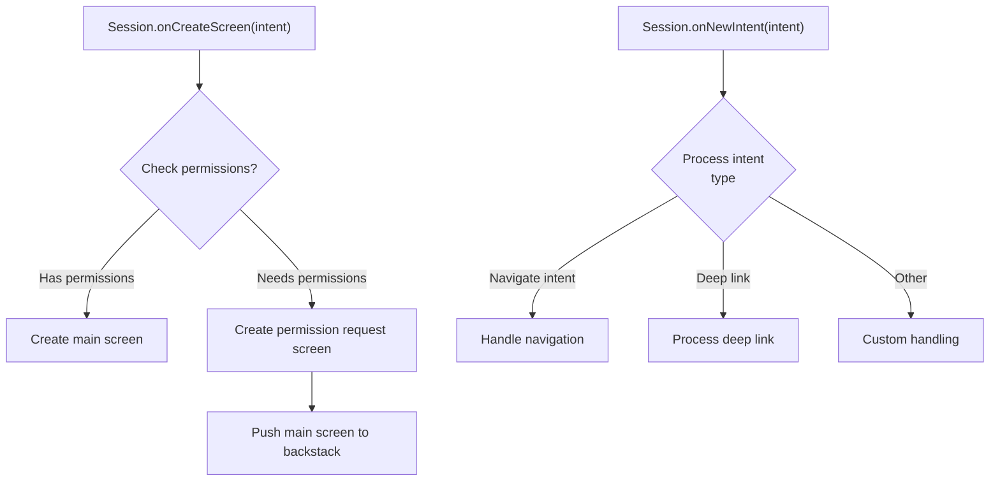
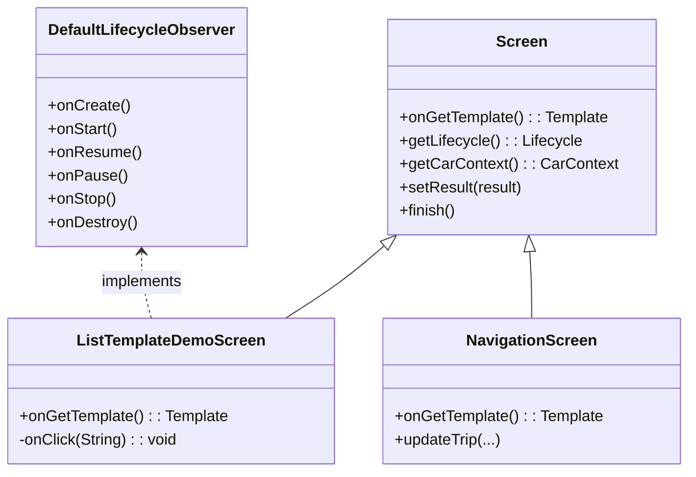
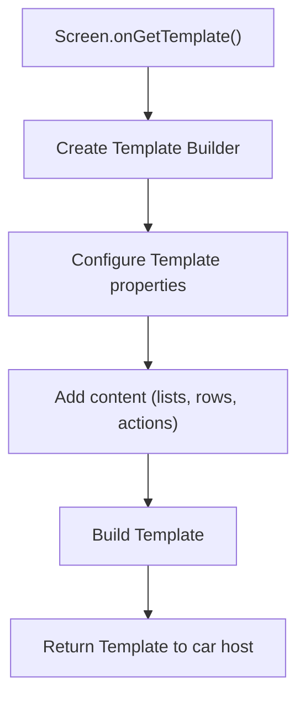
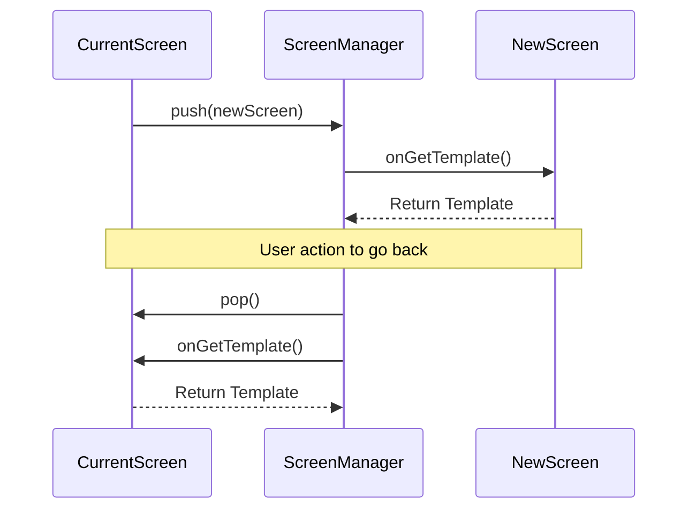
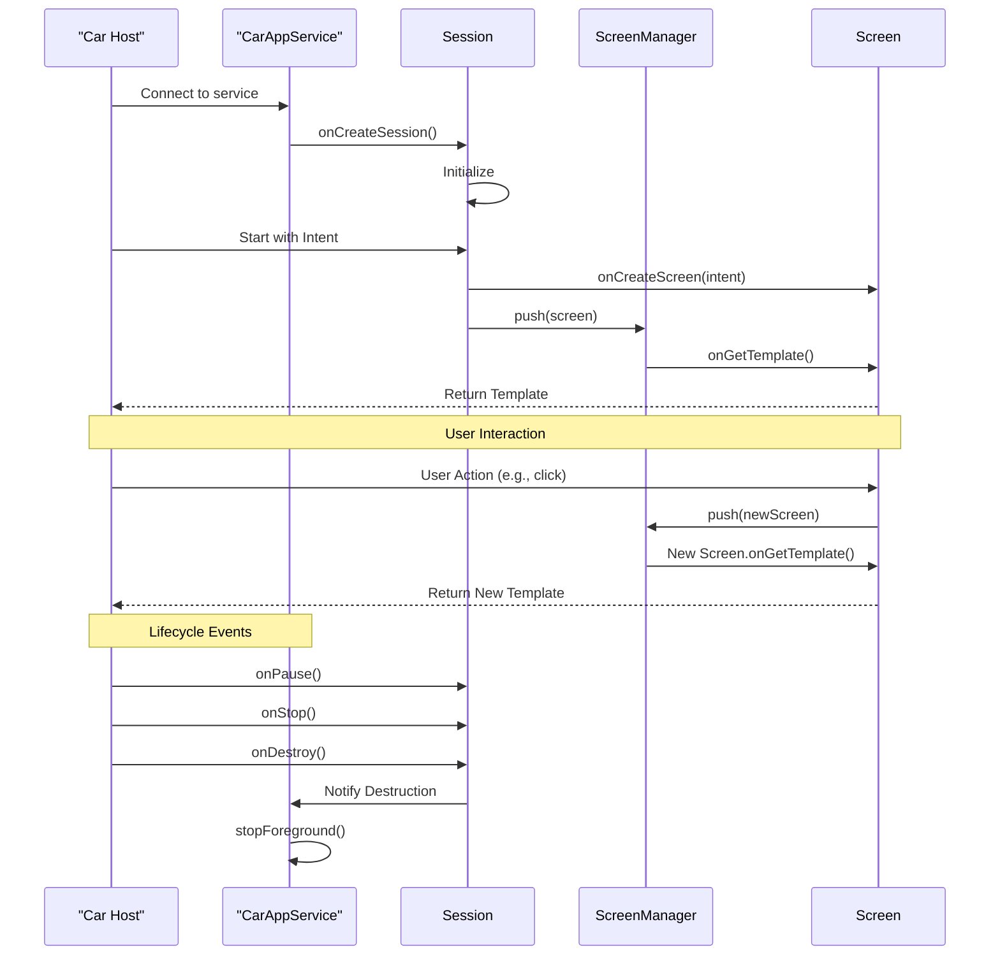

<!-- source: DeepWiki mcp.deepwiki.com · repo android/car-samples · page 2.3 Core App Components · fetched 2026-10-23 -->

# Core App Components

<details>
<summary>Relevant source files</summary>

The following files were used as context for generating this wiki page:

- [car_app_library/helloworld/common/src/main/java/androidx/car/app/sample/helloworld/common/HelloWorldService.java](car_app_library/helloworld/common/src/main/java/androidx/car/app/sample/helloworld/common/HelloWorldService.java)
- [car_app_library/helloworld/common/src/test/java/androidx/car/app/sample/helloworld/common/HelloWorldSessionTest.java](car_app_library/helloworld/common/src/test/java/androidx/car/app/sample/helloworld/common/HelloWorldSessionTest.java)
- [car_app_library/navigation/automotive/src/main/AndroidManifest.xml](car_app_library/navigation/automotive/src/main/AndroidManifest.xml)
- [car_app_library/navigation/common/src/main/java/androidx/car/app/sample/navigation/common/car/NavigationCarAppService.java](car_app_library/navigation/common/src/main/java/androidx/car/app/sample/navigation/common/car/NavigationCarAppService.java)
- [car_app_library/navigation/common/src/main/java/androidx/car/app/sample/navigation/common/car/NavigationSession.java](car_app_library/navigation/common/src/main/java/androidx/car/app/sample/navigation/common/car/NavigationSession.java)
- [car_app_library/navigation/mobile/src/main/AndroidManifest.xml](car_app_library/navigation/mobile/src/main/AndroidManifest.xml)
- [car_app_library/places/common/src/main/java/androidx/car/app/sample/places/common/PlacesCarAppService.java](car_app_library/places/common/src/main/java/androidx/car/app/sample/places/common/PlacesCarAppService.java)
- [car_app_library/showcase/common/src/main/java/androidx/car/app/sample/showcase/common/ShowcaseService.java](car_app_library/showcase/common/src/main/java/androidx/car/app/sample/showcase/common/ShowcaseService.java)
- [car_app_library/showcase/common/src/main/java/androidx/car/app/sample/showcase/common/templates/ListTemplateDemoScreen.java](car_app_library/showcase/common/src/main/java/androidx/car/app/sample/showcase/common/templates/ListTemplateDemoScreen.java)

</details>


This page describes the core architectural components that form the foundation of Android car apps: `CarAppService`, `Session`, and `Screen`. Understanding these components and their lifecycles is essential for developing robust car applications. For information about UI templates that are used within screens, see [UI Components and Templates](#4).

## 1. Core Component Overview

Android car apps follow a specific component architecture designed for automotive environments. These components provide the structure, state management, and UI capabilities needed for distraction-optimized automotive experiences.



Sources:
- [car_app_library/navigation/common/src/main/java/androidx/car/app/sample/navigation/common/car/NavigationCarAppService.java:36-43]()
- [car_app_library/navigation/common/src/main/java/androidx/car/app/sample/navigation/common/car/NavigationSession.java:60-62]()
- [car_app_library/showcase/common/src/main/java/androidx/car/app/sample/showcase/common/templates/ListTemplateDemoScreen.java:42-44]()

## 2. CarAppService

`CarAppService` is the main interface between your app and the car host environment. It serves as the entry point for your car app and is responsible for creating sessions, validating hosts, and managing service lifecycle.

### 2.1 Implementation and Configuration

To create a car app, you must implement a service that extends `CarAppService` and register it in your Android manifest with the appropriate intent filter.



Sources:
- [car_app_library/navigation/common/src/main/java/androidx/car/app/sample/navigation/common/car/NavigationCarAppService.java:43-123]()
- [car_app_library/showcase/common/src/main/java/androidx/car/app/sample/showcase/common/ShowcaseService.java:35-70]()
- [car_app_library/helloworld/common/src/main/java/androidx/car/app/sample/helloworld/common/HelloWorldService.java:36-65]()

### 2.2 Service Registration in Manifest

The service must be properly declared in your AndroidManifest.xml file with the appropriate intent filter to be discoverable by the car host.

```xml
<service
    android:name="androidx.car.app.sample.navigation.common.car.NavigationCarAppService"
    android:foregroundServiceType="location"
    android:exported="true">
    <intent-filter>
        <action android:name="androidx.car.app.CarAppService" />
        <category android:name="androidx.car.app.category.NAVIGATION"/>
    </intent-filter>
</service>
```

Key aspects of the manifest registration:
- Service must be `exported="true"` to be accessible to the car host
- Must include intent filter with `androidx.car.app.CarAppService` action
- Appropriate categories (e.g., NAVIGATION) must be specified
- For services that use location, specify `foregroundServiceType="location"`

Sources:
- [car_app_library/navigation/automotive/src/main/AndroidManifest.xml:62-72]()
- [car_app_library/navigation/mobile/src/main/AndroidManifest.xml:53-68]()

### 2.3 Host Validation

Car apps need to validate the host trying to connect to ensure security. The `createHostValidator()` method provides this validation mechanism.

```java
@NonNull
@Override
public HostValidator createHostValidator() {
    if ((getApplicationInfo().flags & ApplicationInfo.FLAG_DEBUGGABLE) != 0) {
        return HostValidator.ALLOW_ALL_HOSTS_VALIDATOR;
    } else {
        return new HostValidator.Builder(getApplicationContext())
                .addAllowedHosts(androidx.car.app.R.array.hosts_allowlist_sample)
                .build();
    }
}
```

This pattern is consistently used across different service implementations to ensure that only authorized hosts can connect to the app, while allowing more permissive validation during development.

Sources:
- [car_app_library/navigation/common/src/main/java/androidx/car/app/sample/navigation/common/car/NavigationCarAppService.java:87-97]()
- [car_app_library/helloworld/common/src/main/java/androidx/car/app/sample/helloworld/common/HelloWorldService.java:54-64]()

## 3. Session

The `Session` class manages the lifecycle and state of your car app. It handles the creation of screens, processes intents, and maintains state across screens.

### 3.1 Session Creation and Lifecycle

When the car host connects to your service, the system calls `onCreateSession()` to create a new Session instance. The session then handles various lifecycle events in coordination with Android's lifecycle components.



Sources:
- [car_app_library/navigation/common/src/main/java/androidx/car/app/sample/navigation/common/car/NavigationCarAppService.java:58-85]()
- [car_app_library/navigation/common/src/main/java/androidx/car/app/sample/navigation/common/car/NavigationSession.java:132-176]()
- [car_app_library/helloworld/common/src/test/java/androidx/car/app/sample/helloworld/common/HelloWorldSessionTest.java:52-64]()

### 3.2 Screen Creation and Intent Handling

A key responsibility of the Session is to create the initial Screen of your app and handle new intents received from the car host.



Sources:
- [car_app_library/places/common/src/main/java/androidx/car/app/sample/places/common/PlacesCarAppService.java:44-58]()
- [car_app_library/navigation/common/src/main/java/androidx/car/app/sample/navigation/common/car/NavigationSession.java:185-233]()
- [car_app_library/navigation/common/src/main/java/androidx/car/app/sample/navigation/common/car/NavigationSession.java:234-281]()

### 3.3 Session Implementation Patterns

There are two common patterns for implementing Session:

1. **Anonymous inner class** - Simple apps often define Session as an anonymous class within `onCreateSession()`

```java
@Override
@NonNull
public Session onCreateSession(@NonNull SessionInfo sessionInfo) {
    return new Session() {
        @Override
        @NonNull
        public Screen onCreateScreen(@NonNull Intent intent) {
            return new HelloWorldScreen(getCarContext());
        }
    };
}
```

2. **Dedicated class** - More complex apps define a separate Session class that extends the base Session class

```java
@Override
@NonNull
public Session onCreateSession(@NonNull SessionInfo sessionInfo) {
    createNotificationChannel();
    startForeground(NOTIFICATION_ID, getNotification());
    NavigationSession session = new NavigationSession(sessionInfo);
    session.getLifecycle()
            .addObserver(
                    new DefaultLifecycleObserver() {
                        @Override
                        public void onDestroy(@NonNull LifecycleOwner owner) {
                            stopForeground(true);
                        }
                    });
    return session;
}
```

Sources:
- [car_app_library/helloworld/common/src/main/java/androidx/car/app/sample/helloworld/common/HelloWorldService.java:42-52]()
- [car_app_library/places/common/src/main/java/androidx/car/app/sample/places/common/PlacesCarAppService.java:40-59]()
- [car_app_library/navigation/common/src/main/java/androidx/car/app/sample/navigation/common/car/NavigationCarAppService.java:58-85]()

## 4. Screen

The `Screen` class represents a single screen in your car app's UI. It's responsible for providing templates to the car host, handling user interactions, and managing screen-specific state.

### 4.1 Screen Structure and Lifecycle

Screens are created by the Session and follow the Android lifecycle. Each screen is responsible for providing a Template that defines its UI.



Sources:
- [car_app_library/showcase/common/src/main/java/androidx/car/app/sample/showcase/common/templates/ListTemplateDemoScreen.java:43-52]()
- [car_app_library/navigation/common/src/main/java/androidx/car/app/sample/navigation/common/car/NavigationSession.java:204-208]()

### 4.2 Template Creation

The primary responsibility of a Screen is to provide a Template through its `onGetTemplate()` method. Templates are predefined UI structures that adhere to driver distraction guidelines.



Example from `ListTemplateDemoScreen`:

```java
@NonNull
@Override
public Template onGetTemplate() {
    ItemList.Builder listBuilder = new ItemList.Builder();
    // Add items to the list...
    
    return new ListTemplate.Builder()
            .setSingleList(listBuilder.build())
            .setTitle("List Template Demo")
            .setHeaderAction(BACK)
            .setActionStrip(
                    new ActionStrip.Builder()
                            .addAction(settings)
                            .build())
            .build();
}
```

Sources:
- [car_app_library/showcase/common/src/main/java/androidx/car/app/sample/showcase/common/templates/ListTemplateDemoScreen.java:52-120]()

### 4.3 Screen Navigation and Management

The car app framework provides a `ScreenManager` for navigating between screens. Common operations include:
- Pushing a new screen onto the stack
- Popping the current screen
- Replacing the current screen
- Returning to the root screen



Sources:
- [car_app_library/navigation/common/src/main/java/androidx/car/app/sample/navigation/common/car/NavigationSession.java:227-229]()
- [car_app_library/places/common/src/main/java/androidx/car/app/sample/places/common/PlacesCarAppService.java:53-56]()

## 5. Component Integration Workflow

The following diagram illustrates how the core components work together in a complete car app lifecycle.



Sources:
- [car_app_library/navigation/common/src/main/java/androidx/car/app/sample/navigation/common/car/NavigationCarAppService.java:58-85]()
- [car_app_library/navigation/common/src/main/java/androidx/car/app/sample/navigation/common/car/NavigationSession.java:185-233]()
- [car_app_library/showcase/common/src/main/java/androidx/car/app/sample/showcase/common/templates/ListTemplateDemoScreen.java:43-52]()

## 6. Implementation Checklist

Here's a summary of what you need to implement for the core components of a car app:

| Component | Required Implementations | Manifest Registration |
|-----------|--------------------------|----------------------|
| CarAppService | `onCreateSession()` <br> `createHostValidator()` | `<service>` with intent filter for<br>`androidx.car.app.CarAppService` |
| Session | `onCreateScreen()` <br> Optional: `onNewIntent()` | Not directly registered |
| Screen | `onGetTemplate()` | Not directly registered |

Sources:
- [car_app_library/navigation/automotive/src/main/AndroidManifest.xml:62-72]()
- [car_app_library/navigation/common/src/main/java/androidx/car/app/sample/navigation/common/car/NavigationCarAppService.java:58-97]()
- [car_app_library/helloworld/common/src/main/java/androidx/car/app/sample/helloworld/common/HelloWorldService.java:42-64]()
- [car_app_library/showcase/common/src/main/java/androidx/car/app/sample/showcase/common/templates/ListTemplateDemoScreen.java:52-120]()

---

