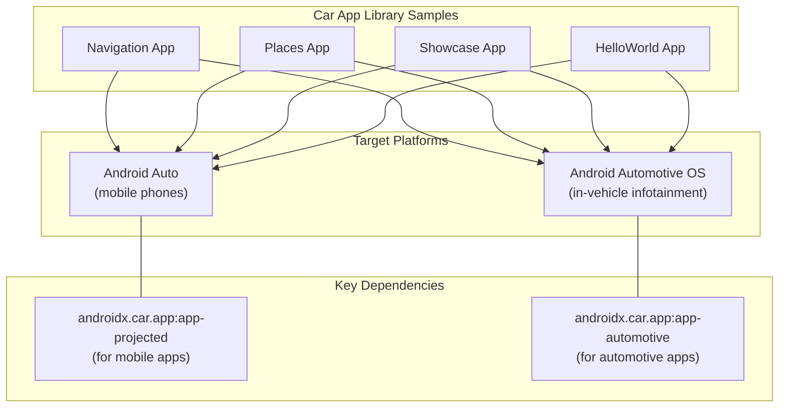
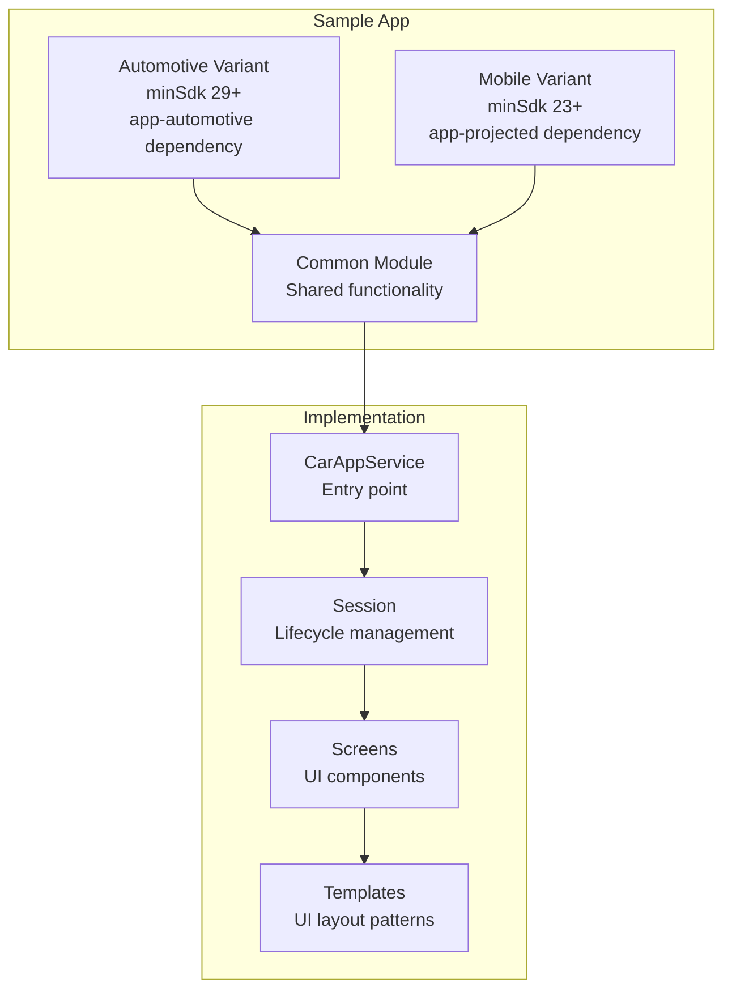
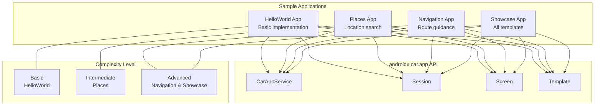

<!-- source: DeepWiki mcp.deepwiki.com · repo android/car-samples · page 3 Sample Applications · fetched 2026-10-23 -->

# Sample Applications

Relevant source files

The following files were used as context for generating this wiki page:

- [README.md](README.md)
- [car_app_library/helloworld/automotive/build.gradle](car_app_library/helloworld/automotive/build.gradle)
- [car_app_library/helloworld/mobile/build.gradle](car_app_library/helloworld/mobile/build.gradle)
- [car_app_library/navigation/automotive/build.gradle](car_app_library/navigation/automotive/build.gradle)
- [car_app_library/navigation/mobile/build.gradle](car_app_library/navigation/mobile/build.gradle)
- [car_app_library/places/automotive/build.gradle](car_app_library/places/automotive/build.gradle)
- [car_app_library/places/mobile/build.gradle](car_app_library/places/mobile/build.gradle)
- [car_app_library/showcase/automotive/build.gradle](car_app_library/showcase/automotive/build.gradle)
- [car_app_library/showcase/mobile/build.gradle](car_app_library/showcase/mobile/build.gradle)

This document provides a technical overview of the sample applications included in the car-samples repository. These applications demonstrate different aspects of Android Auto and Android Automotive OS app development using the Car App Library. For information about the architectural patterns used across these applications, see [Architecture and Design](#2). For build system details, see [Build System](#2.2).

## Sample Applications Overview

The car-samples repository contains four primary sample applications that demonstrate different capabilities and use cases for automotive app development:

Sources: [car_app_library/navigation/automotive/build.gradle](). [car_app_library/navigation/mobile/build.gradle](). [car_app_library/showcase/automotive/build.gradle](). [car_app_library/showcase/mobile/build.gradle](). [car_app_library/places/automotive/build.gradle](). [car_app_library/places/mobile/build.gradle](). [car_app_library/helloworld/automotive/build.gradle](). [car_app_library/helloworld/mobile/build.gradle]().

## Common Structure

Each sample application follows a consistent modular structure with three key components:

Sources: [car_app_library/navigation/automotive/build.gradle:22-26](). [car_app_library/navigation/mobile/build.gradle:22-26](). [car_app_library/showcase/automotive/build.gradle:22-26](). [car_app_library/showcase/mobile/build.gradle:22-26]().

### Variant Configuration

Each sample application includes both automotive and mobile variants with specific configurations:

| Variant | Min SDK | Target SDK | Key Dependency | Purpose |
|---------|---------|------------|----------------|---------|
| Automotive | 29 | 32/33 | androidx.car.app:app-automotive | Runs directly on Android Automotive OS |
| Mobile | 23 | 32/33 | androidx.car.app:app-projected | Runs on mobile device and projects to car display |

Sources: [car_app_library/navigation/automotive/build.gradle:24-25](). [car_app_library/navigation/mobile/build.gradle:24-25](). [car_app_library/showcase/automotive/build.gradle:24-25](). [car_app_library/showcase/mobile/build.gradle:24-25]().

## Navigation App

The Navigation app demonstrates how to implement navigation functionality for automotive environments, including turn-by-turn directions, map rendering, and route planning.

### Key Features
- Map rendering with surface controls
- Turn-by-turn navigation
- Route planning and guidance
- Trip progress monitoring
- Navigation templates demonstration

### Implementation Details
- Uses `NavigationTemplate` for turn-by-turn guidance
- Demonstrates `SurfaceRenderer` for map rendering
- Shows integration with location services
- Illustrates the navigation-specific permissions model

Sources: [car_app_library/navigation/automotive/build.gradle:22-24](). [car_app_library/navigation/mobile/build.gradle:22-24]().

## Places App

The Places app showcases location-based services integration with the car environment, including searching for places, displaying place details, and navigating to destinations.

### Key Features
- Place search functionality
- Place details display
- Integration with mapping services
- Place list browsing
- User favorites management

### Implementation Details
- Demonstrates `PlaceListTemplate` for displaying locations
- Shows integration with location and search APIs
- Illustrates place data management patterns
- Provides example of list-based UI patterns

Sources: [car_app_library/places/automotive/build.gradle:22-23](). [car_app_library/places/mobile/build.gradle:22-23]().

## Showcase App

The Showcase app is the most comprehensive sample, demonstrating the full range of UI templates and car app capabilities across both platforms.

### Key Features
- Comprehensive template demonstrations
- Multiple UI patterns
- Permission handling examples
- Template transitions and navigation
- Car-specific UI adaptations

### Implementation Details
- Demonstrates all available UI templates:
  - GridTemplate
  - ListTemplate
  - PaneTemplate
  - MessageTemplate
  - NavigationTemplate
  - PlaceListTemplate
  - SignInTemplate
- Shows template combinations and transitions
- Illustrates proper lifecycle management
- Provides examples of car-specific input handling

The Showcase app serves as a comprehensive reference for developers looking to understand the full capabilities of the Car App Library.

Sources: [car_app_library/showcase/automotive/build.gradle:22-24](). [car_app_library/showcase/mobile/build.gradle:22-24]().

## HelloWorld App

The HelloWorld app is a minimal implementation demonstrating the basic setup required to create a functional car app. It serves as a starting point for developers new to car app development.

### Key Features
- Minimal implementation
- Basic UI demonstration
- Fundamental app structure
- Core lifecycle management

### Implementation Details
- Simple template usage
- Basic CarAppService implementation
- Demonstrates essential app structure
- Shows minimum viable car app integration

Sources: [car_app_library/helloworld/automotive/build.gradle:22-24](). [car_app_library/helloworld/mobile/build.gradle:22-24]().

## Sample Application Comparison

The following table compares the key features and focus areas of each sample application:

| Feature | Navigation App | Places App | Showcase App | HelloWorld App |
|---------|---------------|------------|--------------|----------------|
| Template Types | Navigation-focused | Place lists | Comprehensive | Basic |
| Map Rendering | ✓ | ✓ | ✓ | ✗ |
| Route Guidance | ✓ | ✓ | Limited | ✗ |
| Search | Limited | ✓ | Limited | ✗ |
| UI Complexity | Medium | Medium | High | Low |
| Permissions Demo | ✓ | ✓ | ✓ | Limited |
| Best For | Navigation apps | Location-based apps | Learning all capabilities | Getting started |

## Application Relationships and Dependencies

Sources: [car_app_library/navigation/automotive/build.gradle:50-52](). [car_app_library/showcase/automotive/build.gradle:52-53](). [car_app_library/places/automotive/build.gradle:47-49](). [car_app_library/helloworld/automotive/build.gradle:48-50]().

## Application Selection Guide

When selecting a sample application to reference for your development:

1. For **new developers** - Start with the HelloWorld app to understand basic structure and setup
2. For **location-based services** - Reference the Places app for search and place display patterns
3. For **navigation providers** - Use the Navigation app for route guidance and map rendering examples
4. For **comprehensive reference** - The Showcase app demonstrates all available templates and patterns

Each sample application is designed to work on both Android Auto (via the mobile variant) and Android Automotive OS (via the automotive variant) using a shared common module for business logic and UI definitions.

---

